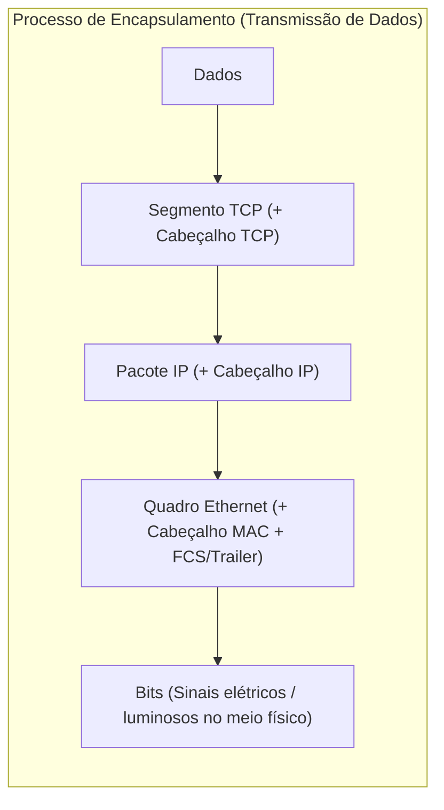
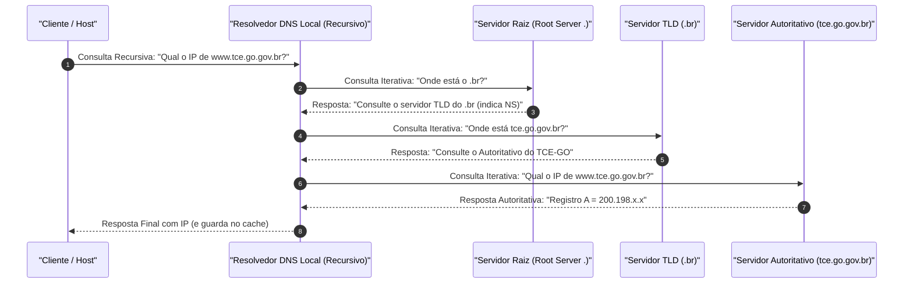
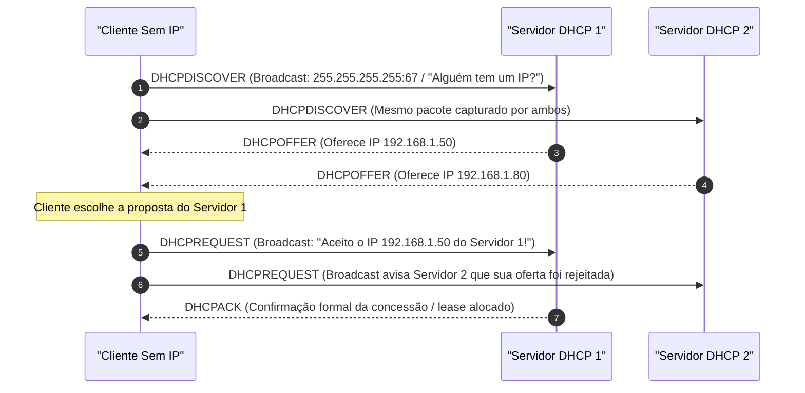

# 03 - Redes TCP/IP, Endereçamento IPv4/IPv6, DNS e DHCP

> **Matéria:** Sistemas Operacionais, Redes e Computação em Nuvem  
> **Cargo:** B02 – Técnico de Controle Externo – Especialidade: Tecnologia da Informação  
> **Arquivo:** `03_redes_tcp_ip_enderecamento_ipv4_ipv6_dns_dhcp.md`  

---

## 📌 Ementa / Itens do Edital
- Arquitetura de redes TCP/IP e comparação com o Modelo OSI
- Endereçamento IPv4: Classes, máscaras de rede, notação CIDR, sub-redes e RFC 1918 (IPs privados)
- Endereçamento IPv6: Estrutura, tipos de endereçamento e mecanismos de transição
- Protocolo de Resolução de Nomes: DNS (Domain Name System)
- Protocolo de Configuração Dinâmica de Hosts: DHCP (Dynamic Host Configuration Protocol)

---

## 🌳 Classificação Hierárquica

```text
3. Arquitetura TCP/IP, Endereçamento de Rede e Serviços Fundamentais
├── 3.1 Modelos de Referência: OSI vs. TCP/IP
│   ├── 3.1.1 Modelo OSI (7 Camadas): Física, Enlace, Rede, Transporte, Sessão, Apresentação e Aplicação
│   ├── 3.1.2 Pilha TCP/IP (4 Camadas):
│   │   ├── 1. Camada de Acesso à Rede / Enlace (Ethernet, Wi-Fi, ARP, MAC Address)
│   │   ├── 2. Camada de Internet / Rede (IP, ICMP, IGMP, roteamento)
│   │   ├── 3. Camada de Transporte (TCP, UDP, controle de portas)
│   │   └── 4. Camada de Aplicação (HTTP, DNS, DHCP, SSH, SMTP)
│   └── 3.1.3 Unidades de Dados de Protocolo (PDU) e Encapsulamento: Bits -> Quadros (Frames) -> Pacotes -> Segmentos/Datagramas -> Dados
├── 3.2 Endereçamento e Sub-redes IPv4
│   ├── 3.2.1 Estrutura do Endereço IPv4: 32 bits divididos em 4 octetos decimais separados por pontos
│   ├── 3.2.2 Classes Históricas de Endereços:
│   │   ├── Classe A (0.0.0.0 a 127.255.255.255 - máscara padrão /8)
│   │   ├── Classe B (128.0.0.0 a 191.255.255.255 - máscara padrão /16)
│   │   ├── Classe C (192.0.0.0 a 223.255.255.255 - máscara padrão /24)
│   │   ├── Classe D (224.0.0.0 a 239.255.255.255 - Multicast)
│   │   └── Classe E (240.0.0.0 a 255.255.255.255 - Experimental)
│   ├── 3.2.3 Endereços Privados (RFC 1918):
│   │   ├── 10.0.0.0/8 (10.0.0.0 a 10.255.255.255)
│   │   ├── 172.16.0.0/12 (172.16.0.0 a 172.31.255.255)
│   │   └── 192.168.0.0/16 (192.168.0.0 a 192.168.255.255)
│   │   └── Tradução de Endereços de Rede: NAT Estático, NAT Dinâmico e NAPT / PAT (Port Address Translation / NAT Overload)
│   ├── 3.2.4 Roteamento Interdomínio Sem Classe (CIDR) e VLSM (Variable Length Subnet Mask)
│   └── 3.2.5 Cálculo de Sub-redes:
│       ├── Endereço de Rede (bits de host em zero)
│       ├── Endereço de Broadcast (bits de host em um)
│       └── Número de hosts úteis por sub-rede: 2^h - 2 (onde h é a quantidade de bits de host)
├── 3.3 Endereçamento IPv6
│   ├── 3.3.1 Motivação: Esgotamento do espaço de endereços IPv4
│   ├── 3.3.2 Estrutura do Endereço IPv6: 128 bits representados por 8 hextetos hexadecimais separados por dois-pontos
│   ├── 3.3.3 Regras de Abreviatura e Compactação:
│   │   ├── Omissão de zeros à esquerda em cada hexteto
│   │   └── Substituição do maior bloco contíguo de zeros por duplo dois-pontos (`::`), aplicável apenas uma vez
│   ├── 3.3.4 Tipos de Comunicação IPv6: Unicast, Anycast e Multicast (Ausência total de transmissão Broadcast no IPv6)
│   ├── 3.3.5 Faixas Notáveis de Endereços IPv6:
│   │   ├── Loopback: `::1/128`
│   │   ├── Link-Local (válido apenas no enlace local): `fe80::/10`
│   │   ├── Unique Local (ULA - equivalente a IP privado RFC 1918): `fc00::/7`
│   │   └── Global Unicast (GUA - roteável publicamente na Internet): `2000::/3`
│   └── 3.3.6 Autoconfiguração e Transição: SLAAC (Stateless Address Autoconfiguration via NDP e Router Advertisement) vs. DHCPv6, e Pilha Dupla (Dual Stack), Túneis e Tradução (NAT64)
├── 3.4 Protocolo DNS (Domain Name System)
│   ├── 3.4.1 Finalidade: Mapeamento bidirecional hierárquico entre nomes e endereços IP (Porta UDP/TCP 53)
│   ├── 3.4.2 Arquitetura Hierárquica: Servidores Raiz (Root `.`), TLDs (`.br`, `.gov`, `.com`) e Servidores Autoritativos
│   ├── 3.4.3 Tipos de Consultas: Consulta Recursiva vs. Consulta Iterativa
│   └── 3.4.4 Registros DNS Críticos: `A` (IPv4), `AAAA` (IPv6), `CNAME` (Apelido/Alias), `MX` (E-mail), `NS` (Servidor de Nomes), `PTR` (Reverso), `TXT` (SPF/DKIM) e `SOA` (Start of Authority)
└── 3.5 Protocolo DHCP (Dynamic Host Configuration Protocol)
    ├── 3.5.1 Finalidade: Configuração automática de parâmetros de rede para clientes (Portas UDP 67 Servidor e UDP 68 Cliente)
    ├── 3.5.2 O Ciclo de Concessão de 4 Etapas (Mnemônico DORA):
    │   ├── 1. DHCP Discover (Cliente em Broadcast)
    │   ├── 2. DHCP Offer (Servidor em Unicast/Broadcast)
    │   ├── 3. DHCP Request (Cliente em Broadcast)
    │   └── 4. DHCP Acknowledge (Servidor em Unicast/Broadcast)
    └── 3.5.3 Conceitos Operacionais: Escopo (Scope), Concessão (Lease Time), Timers T1 (50%) e T2 (87,5%), e Agente de Retransmissão (DHCP Relay Agent)
```

---

## 📖 Resumo Teórico & Conceitos Fundamentais

### 3.1 Modelos de Referência: OSI vs. TCP/IP

A comunicação entre nós de rede é estruturada em camadas, em que cada camada presta serviços à camada imediatamente superior e consome serviços da camada imediatamente inferior.

| Camada OSI (7 Níveis) | Camada TCP/IP (4 Níveis) | PDU (*Protocol Data Unit*) | Principais Protocolos e Tecnologias |
| :--- | :--- | :--- | :--- |
| **7. Aplicação** | **Aplicação** | **Dados** | HTTP, HTTPS, DNS, DHCP, SSH, FTP, SMTP, IMAP, SNMP |
| **6. Apresentação** | *(incorporada na Aplicação)* | **Dados** | Criptografia TLS/SSL, compressão gzip, codificações ASCII/JPEG |
| **5. Sessão** | *(incorporada na Aplicação)* | **Dados** | RPC, gerenciamento de diálogo e pontos de sincronismo (checkpoints) |
| **4. Transporte** | **Transporte** | **Segmento** (TCP) / **Datagrama** (UDP) | TCP (orientado à conexão, confiável) e UDP (não orientado à conexão, sem garantia) |
| **3. Rede** | **Internet** | **Pacote** | IPv4, IPv6, ICMP, ICMPv6, IGMP, OSPF, BGP, IPsec |
| **2. Enlace** | **Acesso à Rede** | **Quadro (*Frame*)** | Ethernet (802.3), Wi-Fi (802.11), PPP, Switch L2, ARP, MAC Address |
| **1. Física** | **Acesso à Rede** | **Bit** | Cabos de par trançado (Cat6), fibra óptica, conectores RJ-45, Hub |



> ⭐ **IMPORTANTE / REGRA DE OURO:**  
> A unidade de dados (PDU) muda de nome conforme desce a pilha:  
> **Dados** (Aplicação) $\rightarrow$ **Segmento** (Transporte TCP) ou **Datagrama** (Transporte UDP) $\rightarrow$ **Pacote** (Rede IP) $\rightarrow$ **Quadro / Frame** (Enlace) $\rightarrow$ **Bits** (Física).

---

### 3.2 Endereçamento e Sub-redes IPv4

O IPv4 utiliza endereços lógicos de **32 bits**, estruturados em quatro octetos expressos em notação decimal com ponto (ex.: `192.168.1.1`).

#### Classes Históricas de Endereços IPv4

| Classe | Primeiro Octeto (Binário) | Faixa Decimal do 1º Octeto | Máscara Padrão | Finalidade Original |
| :---: | :---: | :---: | :---: | :--- |
| **A** | `0xxxxxxx` | $1$ a $126$ (o $127$ é reservado para loopback) | `255.0.0.0` (/8) | Redes gigantescas (16 milhões de hosts por rede) |
| **B** | `10xxxxxx` | $128$ a $191$ | `255.255.0.0` (/16) | Redes médias (65.534 hosts por rede) |
| **C** | `110xxxxx` | $192$ a $223$ | `255.255.255.0` (/24) | Redes pequenas (254 hosts por rede) |
| **D** | `1110xxxx` | $224$ a $239$ | Não aplicável | Comunicação em **Multicast** |
| **E** | `1111xxxx` | $240$ a $255$ | Não aplicável | Uso Experimental e Pesquisa |

#### Espaço de Endereçamento Privado (RFC 1918)
Estes blocos não são roteáveis na Internet pública e destinam-se ao uso exclusivo em redes locais:
- **Classe A Privada:** `10.0.0.0/8` (`10.0.0.0` até `10.255.255.255`) $\implies 1$ bloco /8 com $16.777.216$ endereços.
- **Classe B Privada:** `172.16.0.0/12` (`172.16.0.0` até `172.31.255.255`) $\implies 16$ blocos /16 contíguos com $1.048.576$ endereços.
- **Classe C Privada:** `192.168.0.0/16` (`192.168.0.0` até `192.168.255.255`) $\implies 256$ blocos /24 com $65.536$ endereços.

> 🚨 **ALERTA DE PROVA / PEGADINHA FCC:**  
> A faixa `172.16.0.0` a `172.31.255.255` possui máscara **/12** (e não /16!). Um endereço como `172.32.1.1` **NÃO** é privado, é um IP público roteável na Internet.

#### Mecânica de Cálculo de Sub-redes IPv4

Para qualquer endereço com máscara CIDR `/$n$`:
1. Quantidade de bits da porção de rede: $n$.
2. Quantidade de bits da porção de host: $h = 32 - n$.
3. Total de endereços na sub-rede: $2^h$.
4. Total de **hosts úteis** (utilizáveis por computadores): $2^h - 2$ (subtraem-se o endereço de rede com bits de host todos zerados e o de broadcast com bits de host todos em 1).

#### Tabela Rápida de Conversão de Sub-redes (/24 a /30)

| Notação CIDR | Máscara Decimal | Bits de Host ($h$) | Tamanho do Bloco ($2^h$) | Hosts Úteis ($2^h - 2$) |
| :---: | :---: | :---: | :---: | :---: |
| **/24** | `255.255.255.0` | $8$ | $256$ | $254$ |
| **/25** | `255.255.255.128` | $7$ | $128$ | $126$ |
| **/26** | `255.255.255.192` | $6$ | $64$ | $62$ |
| **/27** | `255.255.255.224` | $5$ | $32$ | $30$ |
| **/28** | `255.255.255.240` | $4$ | $16$ | $14$ |
| **/29** | `255.255.255.248` | $3$ | $8$ | $6$ |
| **/30** | `255.255.255.252` | $2$ | $4$ | $2$ (Links Ponto a Ponto) |

---

### 3.3 Endereçamento IPv6

O IPv6 dispõe de **128 bits** de endereçamento (proporcionando $2^{128} \approx 3,4 \times 10^{38}$ endereços), representados por 8 grupos de 4 dígitos hexadecimais (hextetos) delimitados por dois-pontos.

#### Regras Oficiais de Compactação (RFC 5952):
1. **Omissão de zeros à esquerda** em qualquer hexteto individual:  
   `2001:0db8:000a:0000:0000:0000:0000:0001` $\implies$ `2001:db8:a:0:0:0:0:1`
2. **Compressão por duplo dois-pontos (`::`):** A sequência contígua mais longa de hextetos compostos unicamente por zeros pode ser substituída por `::`.  
   `2001:db8:a:0:0:0:0:1` $\implies$ `2001:db8:a::1`  
   *Regra de Ouro:* O símbolo `::` só pode ser usado **uma única vez** no endereço para evitar ambiguidade na reconstrução dos 128 bits.

#### Tipos de Transmissão no IPv6:
- **Unicast:** Comunicação de um remetente para uma interface específica.
- **Anycast:** Comunicação enviada para o endereço atribuído a múltiplas interfaces, sendo entregue **ao nó topologicamente mais próximo**.
- **Multicast:** Comunicação entregue a um conjunto de interfaces que pertencem ao grupo de multicast.
- **BROADCAST NÃO EXISTE NO IPv6!** As funções antes realizadas por broadcast (como resolução ARP) são implementadas por **Multicast** direcionado através do protocolo NDP (*Neighbor Discovery Protocol*).

#### Faixas de Endereçamento Notáveis no IPv6

| Prefixo IPv6 | Denominação | Escopo / Finalidade | Equivalente no IPv4 |
| :--- | :--- | :--- | :--- |
| `::1/128` | **Loopback** | Comunicação local interna do host | `127.0.0.1` |
| `::/128` | **Unspecified Address** | Indica ausência temporária de endereço | `0.0.0.0` |
| `fe80::/10` | **Link-Local Unicast** | Válido apenas no link local; gerado automaticamente em toda interface IPv6 | `169.254.0.0/16` (APIPA) |
| `fc00::/7` | **Unique Local (ULA)** | Roteável no escopo corporativo interno; não roteável na Internet | RFC 1918 (ex.: `10.0.0.0/8`) |
| `2000::/3` | **Global Unicast (GUA)** | Roteável publicamente na Internet mundial | IPs IPv4 Públicos |
| `ff00::/8` | **Multicast** | Tráfego de difusão seletiva para grupos | Classe D (`224.0.0.0/4`) |

---

### 3.4 Protocolo DNS (Domain Name System)

O DNS é uma base de dados distribuída e hierárquica responsável por traduzir nomes de domínio legíveis por humanos (ex.: `www.tce.go.gov.br`) em endereços IP de máquinas de destino. Opera na **porta UDP 53** para consultas ordinárias e na **porta TCP 53** para transferências de zona (*Zone Transfer* - AXFR/IXFR) e respostas que excedam 512 bytes.

#### Registros de Recursos (*Resource Records* - RR) Mais Cobrados:
- `A`: Mapeia um nome de domínio para um endereço **IPv4** de 32 bits.
- `AAAA` (*Quad-A*): Mapeia um nome de domínio para um endereço **IPv6** de 128 bits.
- `CNAME` (*Canonical Name*): Cria um **apelido (alias)** apontando para outro nome de domínio canônico (nunca aponta para um endereço IP numérico!).
- `MX` (*Mail Exchange*): Especifica os servidores receptores de correio eletrônico do domínio, associados a uma métrica de prioridade (menor número = maior prioridade).
- `NS` (*Name Server*): Delega uma zona DNS para um servidor de nomes autoritativo específico.
- `PTR` (*Pointer*): Permite a **resolução reversa** (mapeia um IP numérico de volta para o seu nome FQDN), utilizando os domínios especiais `in-addr.arpa` (IPv4) e `ip6.arpa` (IPv6).
- `SOA` (*Start of Authority*): Contém as diretivas de governança da zona (servidor primário, e-mail do administrador, número de versão/serial para replicação e timers de expiração).
- `TXT`: Contém cadeias arbitrárias de texto legível, largamente usado para autenticação de e-mail e mitigação de phishing via **SPF** (*Sender Policy Framework*), **DKIM** e **DMARC**.



---

### 3.5 Protocolo DHCP (Dynamic Host Configuration Protocol)

O DHCP opera no modelo cliente-servidor para automatizar a distribuição dinâmica e temporária de configurações de rede: endereço IP, máscara de sub-rede, gateway padrão (*Default Gateway*) e endereços de servidores DNS.
- **Portas de Transporte UDP:**  
  - **Porta UDP 67:** Porta de escuta do **Servidor DHCP**;  
  - **Porta UDP 68:** Porta de escuta do **Cliente DHCP**.



#### O Ciclo DORA em Detalhes:
1. **DHCP Discover:** O cliente recém-conectado envia um pacote em **Broadcast** (IP de origem `0.0.0.0`, destino `255.255.255.255`) procurando qualquer servidor DHCP disponível na rede local.
2. **DHCP Offer:** Os servidores DHCP que recebem o Discover respondem ofertando um endereço IP disponível, parâmetros de rede e tempo de concessão.
3. **DHCP Request:** O cliente escolhe uma das ofertas recebidas e envia um pacote em **Broadcast**.  
   *Por que em broadcast?* Para notificar o servidor escolhido e, simultaneamente, sinalizar aos outros servidores que suas respectivas ofertas foram rejeitadas, liberando os IPs de volta a seus pools.
4. **DHCP Acknowledge (DHCPACK):** O servidor escolhido homologa formalmente a transação, registrando o endereço na tabela de concessões (*leases*) e confirmando os parâmetros ao cliente.

#### Agente de Retransmissão DHCP (*DHCP Relay Agent*):
O tráfego de *broadcast* do cliente é descartado por roteadores por definição de fronteira de camada 3. Para permitir que um único servidor DHCP centralizado atenda múltiplos segmentos de rede ou VLANs, instala-se um **DHCP Relay Agent** (geralmente habilitado na própria interface do roteador ou switch L3 via comando `ip helper-address`), que intercepta os broadcasts dos clientes e os encapsula em pacotes **Unicast** diretamente para o endereço IP do servidor DHCP central.

---

## 🌐 Fontes Recomendadas na Internet

- [IPv6.br - Portal de Capacitação do NIC.br](https://ipv6.br/)
  - Portal técnico oficial brasileiro sobre o protocolo IPv6 mantido pelo Núcleo de Informação e Coordenação do Ponto BR. Inclui guias completos de sub-redes, transição e autoconfiguração.
- [IETF RFC 791 - Internet Protocol Specification (IPv4)](https://datatracker.ietf.org/doc/html/rfc791)
  - Norma seminal do protocolo IPv4, estrutura de cabeçalho de 20 bytes, fragmentação e endereçamento.
- [IETF RFC 8200 - Internet Protocol, Version 6 (IPv6) Specification](https://datatracker.ietf.org/doc/html/rfc8200)
  - Especificação padrão da Internet (STD 86) consolidando o cabeçalho base de 40 bytes do IPv6, eliminação de broadcast e cabeçalhos de extensão.
- [IETF RFC 1035 - Domain Names - Implementation and Specification](https://datatracker.ietf.org/doc/html/rfc1035)
  - Padrão arquitetural do DNS, formatos de mensagens, tipos de registros fundamentais e resolução hierárquica.
- [IETF RFC 2131 - Dynamic Host Configuration Protocol](https://datatracker.ietf.org/doc/html/rfc2131)
  - Especificação oficial do protocolo DHCP, ciclo DORA, timers de renovação T1/T2 e estados da máquina de concessão.
- [IETF RFC 1918 - Address Allocation for Private Internets](https://datatracker.ietf.org/doc/html/rfc1918)
  - Norma que define os três intervalos canônicos de endereços IPv4 privados não roteáveis globalmente.

---

## 📝 Questões Comentadas & Exemplos (Padrão FCC)

### Questão 1 (FCC - Adaptada / Analista de Tecnologia da Informação - Redes)
Um analista de infraestrutura de redes recebeu a incumbência de particionar o bloco IPv4 privado `192.168.10.0/24` para atender a 4 sub-redes destinadas a diferentes setores de uma secretaria estadual. O setor mais numeroso exige suporte a um máximo de 26 computadores conectados simultaneamente com IPs úteis. O analista deseja utilizar uma máscara de sub-rede idêntica em todas as novas sub-redes, garantindo a menor quantidade possível de endereços desperdiçados e reservando o maior número possível de novas sub-redes para futuras expansões.

Assinale a alternativa que apresenta, correta e respectivamente, a máscara de sub-rede em notação CIDR adotada, o número máximo de sub-redes que podem ser obtidas a partir do bloco original e o número de endereços IP úteis disponíveis em cada sub-rede:

A) `/27`, 8 sub-redes e 30 hosts úteis  
B) `/26`, 4 sub-redes e 62 hosts úteis  
C) `/28`, 16 sub-redes e 14 hosts úteis  
D) `/27`, 4 sub-redes e 32 hosts úteis  
E) `/25`, 2 sub-redes e 126 hosts úteis  

> **Gabarito: A**  
> **Comentário Analítico Passo a Passo:**  
> - **Determinação da quantidade necessária de bits de host ($h$):**
>   - A sub-rede requer capacidade para 26 computadores simultâneos.
>   - A fórmula para cálculo de hosts úteis é $2^h - 2 \ge 26$.
>   - Se testarmos $h = 4$: $2^4 - 2 = 16 - 2 = 14$ hosts (insuficiente para atender 26 computadores).
>   - Se testarmos $h = 5$: $2^5 - 2 = 32 - 2 = 30$ hosts úteis (atende perfeitamente à demanda de 26 máquinas com a menor folga possível).
> - **Cálculo da Máscara de Sub-rede:**
>   - Sabendo que o IPv4 possui 32 bits no total: $\text{Bits de rede} = 32 - h = 32 - 5 = 27$ bits.
>   - Notação CIDR resultante: `/27` (máscara decimal `255.255.255.224`).
> - **Cálculo do Número de Sub-redes Obtidas:**
>   - O bloco original possuía máscara `/24`.
>   - Foram emprestados $27 - 24 = 3$ bits da porção de host original.
>   - O número de novas sub-redes é $2^3 = 8$ sub-redes idênticas.
> - **Análise Detalhada das Alternativas:**
>   - **A (Correta):** Identifica com exatidão a máscara `/27`, o total de 8 sub-redes criadas e a disponibilidade de 30 hosts utilizáveis em cada uma.
>   - **B (Incorreta):** A máscara `/26` aloca 6 bits para host ($62$ úteis), gerando um desperdício substancialmente maior de endereços e fornecendo apenas 4 sub-redes.
>   - **C (Incorreta):** A máscara `/28` fornece apenas 14 hosts utilizáveis ($2^4 - 2 = 14$), incapaz de abrigar as 26 estações demandadas.
>   - **D (Incorreta):** O bloco `/24` dividido em `/27` gera 8 sub-redes e não 4; ademais, o número de hosts úteis é 30 (pois subtraem-se a rede e o broadcast de 32).
>   - **E (Incorreta):** A máscara `/25` geraria apenas 2 sub-redes, com 126 hosts úteis cada, violando o requisito de menor desperdício e impossibilitando acomodar as 4 sub-redes necessárias.

---

### Questão 2 (FCC - Adaptada / Analista de Sistemas - Suporte e Infraestrutura)
Considere as seguintes assertivas a respeito da arquitetura do protocolo IPv6, comparativamente ao legado IPv4:

I. O protocolo IPv6 aboliu o conceito de transmissão em difusão geral (*broadcast*); mensagens destinadas a múltiplos dispositivos utilizam mecanismos e endereços de *multicast*.  
II. O endereço `fe80::/10` pertence à faixa de endereços *Link-Local Unicast*, sendo atribuído compulsoriamente a qualquer interface com IPv6 habilitado e possuindo validade restrita ao enlace local de comunicação.  
III. No protocolo DNS, a resolução de nomes de domínio diretamente para endereços IPv6 é implementada por meio de registros de recursos do tipo `A`, ao passo que registros do tipo `AAAA` são reservados para mapeamento de servidores de e-mail.  

Está correto o que se afirma em:

A) I e II, apenas.  
B) II e III, apenas.  
C) I e III, apenas.  
D) I, II e III.  
E) I, apenas.  

> **Gabarito: A**  
> **Comentário Analítico Passo a Passo:**  
> - **Item I (Correto):** O cabeçalho IPv6 não define endereços de *broadcast*. O tráfego de broadcast causava tempestades de interrupção em todas as placas de rede do segmento no IPv4. No IPv6, tudo é tratado via *multicast* estruturado ou *anycast*.
> - **Item II (Correto):** A faixa `fe80::/10` define os endereços *Link-Local*. Toda interface de rede IPv6 ativa autoconfigura um endereço nessa faixa (usualmente combinando o prefixo com o EUI-64 ou identificador aleatório), utilizado para comunicação estritamente intra-enlace e protocolos de vizinhança (NDP).
> - **Item III (Incorreto):** O registro que traduz um nome de domínio para um endereço IPv6 é o registro `AAAA` (*Quad-A*), derivado dos 128 bits (quatro vezes o tamanho dos 32 bits do registro `A` de IPv4). O registro responsável por apontar servidores de correio eletrônico é o registro `MX` (*Mail Exchange*).
> - **Conclusão:** Apenas as afirmativas I e II estão estritamente corretas, tornando a alternativa A a resposta incontestável.

---

### Questão 3 (FCC - Adaptada / Analista de Tecnologia da Informação - Suporte Técnico)
Em uma rede local corporativa onde as estações de trabalho obtêm suas configurações lógicas dinamicamente por meio do protocolo DHCP, um analista observou a troca de pacotes entre um cliente recém-conectado e o servidor de rede. 

A respeito do ciclo operacional de quatro etapas do DHCP (processo DORA), assinale a afirmativa correta:

A) A mensagem `DHCPDISCOVER` é enviada em Unicast pelo cliente diretamente ao endereço IP estático previamente gravado no seu firmware.  
B) A mensagem `DHCPREQUEST` emitida pelo cliente após receber uma ou mais propostas é enviada em Broadcast, permitindo que os demais servidores DHCP que enviaram ofertas concorrentes saibam que suas propostas foram recusadas e liberem os endereços ofertados.  
C) O protocolo DHCP utiliza o protocolo de transporte TCP na porta 67 para garantir a entrega ordenada e retransmissão de todas as mensagens de negociação de endereços.  
D) O tempo de concessão (*lease time*) de um endereço IP atribuído pelo DHCP é perene e imutável, não permitindo renovação até que a máquina cliente seja fisicamente desligada da tomada.  
E) Quando o cliente e o servidor DHCP estão localizados em redes lógicas distintas separadas por um roteador, o ciclo DORA opera naturalmente sem a necessidade de nenhum recurso intermediário de retransmissão.  

> **Gabarito: B**  
> **Comentário Analítico Passo a Passo:**  
> - **Análise da Mensagem DHCPREQUEST:** Quando um cliente recebe múltiplas ofertas (`DHCPOFFER`), ele seleciona uma delas e emite um `DHCPREQUEST`. Esse pacote é transmitido intencionalmente em **Broadcast** (para `255.255.255.255`). Essa difusão informa formalmente ao servidor escolhido a aceitação de sua proposta e, ao mesmo tempo, avisa a todos os outros servidores da rede local que suas ofertas foram declinadas, permitindo que eles devolvam os respectivos IPs aos seus pools livres.
> - **Análise Detalhada das Alternativas:**
>   - **A (Incorreta):** O cliente inicial não possui IP configurado e não conhece a topologia; logo, o `DHCPDISCOVER` é enviado compulsoriamente em **Broadcast**.
>   - **B (Correta):** Descreve com exatidão técnica a justificativa e o mecanismo de difusão do `DHCPREQUEST`.
>   - **C (Incorreta):** O DHCP opera exclusivamente sobre o protocolo **UDP** (portas UDP 67 no servidor e UDP 68 no cliente), pois uma máquina sem endereço IP configurado não pode estabelecer um aperto de mão de três vias do TCP.
>   - **D (Incorreta):** O tempo de concessão é dinâmico e renovável nos temporizadores T1 (50% do lease) e T2 (87,5% do lease).
>   - **E (Incorreta):** Roteadores bloqueiam pacotes de difusão (broadcast). Se o servidor estiver em outra sub-rede, é obrigatório o uso de um Agente de Retransmissão DHCP (*DHCP Relay Agent* / `ip helper-address`).

---

### Questão 4 (FCC - Adaptada / Analista de Sistemas - Infraestrutura de Redes)
Considere os conceitos de resolução de nomes, delegação e estrutura de registros de recursos do protocolo DNS (*Domain Name System*).

Sobre os tipos de registros DNS e a mecânica de funcionamento desse serviço, é correto afirmar:

A) O registro de recurso do tipo `CNAME` (*Canonical Name*) permite que um administrador configure um pseudônimo (alias) apontando diretamente para um endereço IP numérico de destino, acelerando a resolução de páginas web.  
B) O protocolo DNS opera primariamente sobre o protocolo de transporte UDP na porta 53, recorrendo ao protocolo TCP na mesma porta prioritariamente para operações de transferência de zona (*zone transfer*) entre servidores primários e secundários ou quando a resposta ultrapassa os limites dimensionais suportados.  
C) O processo de resolução iterativa exige que o primeiro servidor DNS consultado assuma o encargo de percorrer toda a árvore hierárquica mundial da Internet até devolver a resposta final resolvida ao cliente requisitante.  
D) O registro do tipo `PTR` é utilizado nos servidores DNS autoritativos para definir os nós balanceadores de carga responsáveis por redirecionar requisições HTTP para instâncias de contêineres.  
E) A consulta reversa de DNS para endereços da arquitetura IPv4 utiliza o domínio de topo especial denominado `ip6.arpa`.  

> **Gabarito: B**  
> **Comentário Analítico Passo a Passo:**  
> - **Uso de UDP vs. TCP no DNS:** Historicamente, consultas simples de resolução de nomes utilizam UDP 53 por sua rapidez e baixa latência (mensagens de até 512 bytes). O protocolo TCP na porta 53 é reservado para transferências de zonas completas (*Zone Transfers* - AXFR/IXFR) entre servidores autoritativos primários e secundários, que requerem integridade de transmissão e superam com frequência centenas de kilobytes, ou em respostas DNSSEC volumosas quando o cliente não negocia EDNS0.
> - **Análise Detalhada das Alternativas:**
>   - **A (Incorreta):** Um registro `CNAME` aponta **estritamente para outro nome canônico de domínio** (ex.: `portal.orgao.gov.br CNAME servidor1.orgao.gov.br`), e nunca diretamente para um endereço IP numérico. Mapear para IP é papel dos registros `A` ou `AAAA`.
>   - **B (Correta):** Define com perfeição técnica as circunstâncias em que o DNS emprega UDP versus TCP na porta 53.
>   - **C (Incorreta):** A modalidade em que o servidor assume a responsabilidade de ir até o final da árvore e retornar a resposta definitiva é a consulta **Recursiva**. Na consulta **Iterativa**, o servidor responde com a melhor indicação que possui no momento (apontando o próximo servidor de nomes a ser consultado).
>   - **D (Incorreta):** O registro `PTR` (*Pointer*) é utilizado exclusivamente para **resolução reversa** (mapeamento de endereço IP para nome de domínio).
>   - **E (Incorreta):** A resolução reversa do IPv4 opera sob o domínio especial `in-addr.arpa`. O domínio `ip6.arpa` é reservado para o IPv6.

---

### Questão 5 (FCC - Adaptada / Analista de Tecnologia da Informação - Suporte de Redes)
No contexto das camadas do modelo de referência OSI e da arquitetura de protocolos da Internet (pilha TCP/IP), assinale a afirmativa correta:

A) A camada de Transporte do modelo OSI é responsável pelo endereçamento lógico global de pacotes e pela determinação de rotas ao longo dos sistemas autônomos da Internet.  
B) A Unidade de Dados de Protocolo (PDU) associada à camada de Enlace de dados recebe tecnicamente a denominação de Quadro (*Frame*).  
C) O protocolo ARP (*Address Resolution Protocol*) opera no nível da camada de Transporte, sendo o responsável por mapear endereços de portas TCP em números de soquetes da aplicação.  
D) Os endereços IPv4 `10.50.100.1`, `172.35.10.2` e `192.168.1.254` são todos classificados pelas normas da RFC 1918 como endereços estritamente privados e não roteáveis publicamente.  
E) O protocolo TCP é classificado como não orientado à conexão e não provê garantias formais de entrega de dados, características estas que são exclusivas do protocolo UDP.  

> **Gabarito: B**  
> **Comentário Analítico Passo a Passo:**  
> - **Análise de PDUs por Camada:**
>   - Camada Física: Bit;
>   - Camada de Enlace: **Quadro (*Frame*)**;
>   - Camada de Rede: Pacote;
>   - Camada de Transporte: Segmento (TCP) / Datagrama (UDP);
>   - Camadas Superiores: Dados / Mensagem.
> - **Análise Detalhada das Alternativas:**
>   - **A (Incorreta):** O endereçamento lógico global e o roteamento de pacotes através da rede são atribuições exclusivas da **Camada de Rede** (Camada 3), e não da camada de Transporte.
>   - **B (Correta):** A PDU da camada de enlace de dados é denominada Quadro (*Frame*).
>   - **C (Incorreta):** O protocolo ARP opera na fronteira entre as camadas de **Enlace e Rede** (mapeando endereços IPv4 em endereços físicos MAC), não tendo nenhuma relação com portas da camada de transporte.
>   - **D (Incorreta):** O endereço `172.35.10.2` **não** é privado. A faixa privada de classe B da RFC 1918 vai de `172.16.0.0` até `172.31.255.255`. Qualquer endereço acima de `172.31` é um IP público mundial.
>   - **E (Incorreta):** As características foram completamente invertidas: o **TCP** é orientado à conexão (*connection-oriented*) e garante a entrega ordenada e confiável dos dados; o **UDP** é não orientado à conexão (*connectionless*) e opera sob o paradigma de melhor esforço (*best-effort*).
