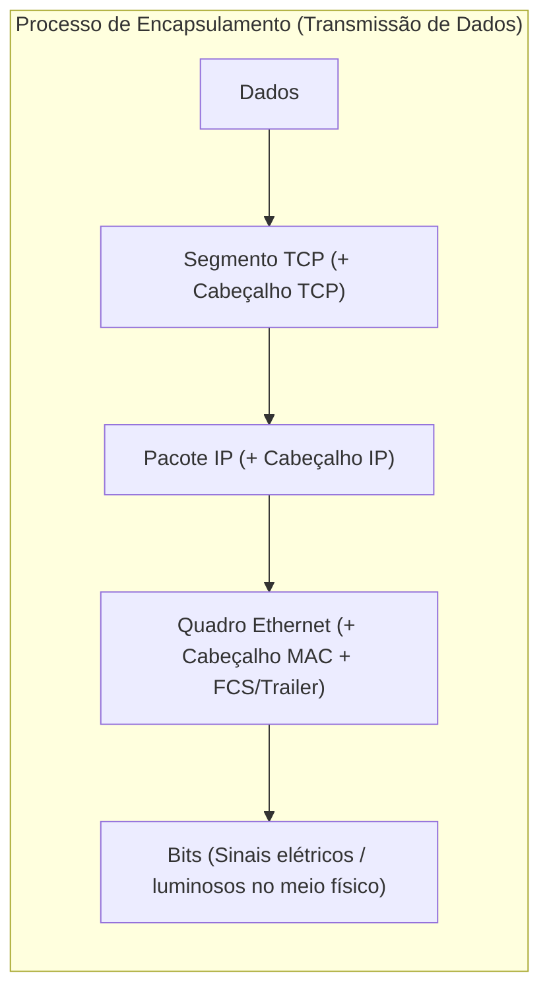
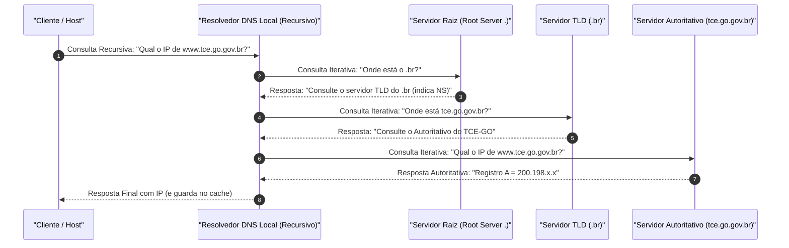
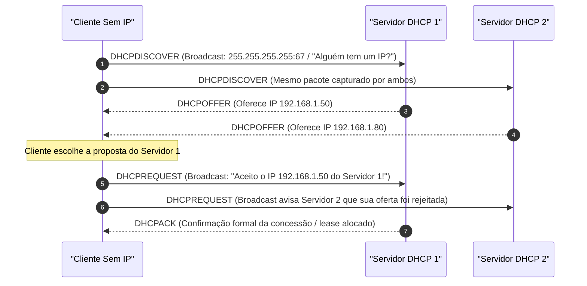

# 03 - Redes TCP/IP, Endereçamento IPv4/IPv6, DNS e DHCP

> **Matéria:** Sistemas Operacionais, Redes e Computação em Nuvem  
> **Cargo:** B02 – Técnico de Controle Externo – Especialidade: Tecnologia da Informação  
> **Arquivo:** `03_redes_tcp_ip_enderecamento_ipv4_ipv6_dns_dhcp.md`  


---


## 📌 Ementa / Itens do Edital
- Arquitetura de redes TCP/IP e comparação com o Modelo OSI
- Endereçamento IPv4: Classes, máscaras de rede, notação CIDR, sub-redes e RFC 1918 (IPs privados)
- Endereçamento IPv6: Estrutura, tipos de endereçamento e mecanismos de transição
- Protocolo de Resolução de Nomes: DNS (Domain Name System)
- Protocolo de Configuração Dinâmica de Hosts: DHCP (Dynamic Host Configuration Protocol)

---

## 🧭 Sumário

1. [Modelos de Referência: OSI vs. TCP/IP](#1-modelos-de-referencia-osi-vs-tcpip)
    1. [Estrutura em Camadas do Modelo OSI (7 Níveis)](#11-estrutura-em-camadas-do-modelo-osi-7-niveis)
    2. [Arquitetura em Camadas da Pilha TCP/IP (4 Níveis)](#12-arquitetura-em-camadas-da-pilha-tcpip-4-niveis)
    3. [Unidades de Dados de Protocolo (PDU) e Encapsulamento](#13-unidades-de-dados-de-protocolo-pdu-e-encapsulamento)
    4. [Teste 432](#Teste-432)
    5. [Teste 433](#Teste-433)
2. [Endereçamento e Sub-redes IPv4](#2-enderecamento-e-sub-redes-ipv4)
    1. [Classes Históricas de Endereços (Classes A a E)](#21-classes-historicas-de-enderecos-classes-a-a-e)
    2. [Espaço de Endereçamento Privado (RFC 1918) e NAT/PAT](#22-espaco-de-enderecamento-privado-rfc-1918-e-natpat)
    3. [Roteamento Interdomínio Sem Classe (CIDR) e VLSM](#23-roteamento-interdominio-sem-classe-cidr-e-vlsm)
    4. [Mecânica de Cálculo de Sub-redes, Hosts Úteis e Tabela de Conversão](#24-mecanica-de-calculo-de-sub-redes-hosts-uteis-e-tabela-de-conversao)
    5. [Teste 434](#Teste-434)
    6. [Teste 435](#Teste-435)
3. [Endereçamento IPv6](#3-enderecamento-ipv6)
    1. [Estrutura de 128 Bits e Regras de Compactação Oficial (RFC 5952)](#31-estrutura-de-128-bits-e-regras-de-compactacao-oficial-rfc-5952)
    2. [Tipos de Transmissão no IPv6: Unicast, Anycast e Multicast (Extinção do Broadcast)](#32-tipos-de-transmissao-no-ipv6-unicast-anycast-e-multicast-extincao-do-broadcast)
    3. [Faixas Notáveis de Endereços IPv6 (Loopback, Link-Local, ULA, GUA)](#33-faixas-notaveis-de-enderecos-ipv6-loopback-link-local-ula-gua)
    4. [Autoconfiguração (SLAAC) e Mecanismos de Transição (Dual-Stack, Túneis, NAT64)](#34-autoconfiguracao-slaac-e-mecanismos-de-transicao-dual-stack-tuneis-nat64)
    5. [Teste 436](#Teste-436)
    6. [Teste 437](#Teste-437)
4. [Protocolo DNS (Domain Name System)](#4-protocolo-dns-domain-name-system)
    1. [Finalidade, Arquitetura Hierárquica e Portas UDP/TCP 53](#41-finalidade-arquitetura-hierarquica-e-portas-udptcp-53)
    2. [Consultas Recursivas vs. Consultas Iterativas](#42-consultas-recursivas-vs-consultas-iterativas)
    3. [Registros de Recursos (A, AAAA, CNAME, MX, NS, PTR, SOA, TXT)](#43-registros-de-recursos-a-aaaa-cname-mx-ns-ptr-soa-txt)
    4. [Teste 438](#Teste-438)
    5. [Teste 439](#Teste-439)
    6. [Teste 440](#Teste-440)
5. [Protocolo DHCP (Dynamic Host Configuration Protocol)](#5-protocolo-dhcp-dynamic-host-configuration-protocol)
    1. [Finalidade e Portas de Transporte UDP 67/68](#51-finalidade-e-portas-de-transporte-udp-6768)
    2. [O Ciclo DORA em 4 Etapas (Discover, Offer, Request, Acknowledge)](#52-o-ciclo-dora-em-4-etapas-discover-offer-request-acknowledge)
    3. [Timers de Renovação de Concessão (T1 e T2)](#53-timers-de-renovacao-de-concessao-t1-e-t2)
    4. [Agente de Retransmissão DHCP (DHCP Relay Agent)](#54-agente-de-retransmissao-dhcp-dhcp-relay-agent)
    5. [Teste 441](#Teste-441)
    6. [Teste 442](#Teste-442)
6. [Fontes Recomendadas na Internet](#6-fontes-recomendadas-na-internet)

---

## 1. Modelos de Referência: OSI vs. TCP/IP

### 1.1 Estrutura em Camadas do Modelo OSI (7 Níveis)

O modelo **OSI (*Open Systems Interconnection*)**, padronizado pela ISO (norma ISO/IEC 7498-1), é a estrutura conceitual de referência para comunicação entre redes de computadores, decompondo as funções de rede em sete camadas lógicas:

1. **Física (Camada 1):** Transmissão de bits brutos não estruturados através de meios físicos guiados (cabos de par trançado de cobre, fibras ópticas) ou não guiados (ondas de rádio). Define propriedades elétricas, ópticas e mecânicas (voltagens, conectores RJ-45).
2. **Enlace de Dados (Camada 2):** Agrupa os bits em unidades estruturadas chamadas **Quadros (*Frames*)**. Responsável pelo endereçamento físico local (**Endereço MAC**), controle de acesso ao meio físico (subcamada MAC), sincronismo de quadro e detecção básica de erros na transmissão via checksum (CRC/FCS). Opera com switches de camada 2.
3. **Rede (Camada 3):** Responsável pelo **endereçamento lógico global (endereços IP)**, roteamento de pacotes através de múltiplos enlaces intermediários e fragmentação quando a MTU do meio é ultrapassada. Opera com roteadores e switches de camada 3.
4. **Transporte (Camada 4):** Provê comunicação ponta a ponta (*host-to-host*) confiável ou não confiável entre processos de aplicação, utilizando multiplexação de portas (TCP e UDP), controle de fluxo e sequenciamento de pacotes.
5. **Sessão (Camada 5):** Estabelece, gerencia, sincroniza e encerra sessões de diálogo entre aplicações em nós distintos (ex.: checkpoints para recuperação de falhas).
6. **Apresentação (Camada 6):** Cuida da sintaxe, representação e semântica dos dados transmitidos: conversão de conjuntos de caracteres (ASCII/Unicode/EBCDIC), compressão de dados (gzip) e criptografia/descriptografia (TLS/SSL).
7. **Aplicação (Camada 7):** Interface direta entre os programas finais do usuário e os serviços de rede (HTTP, DNS, SMTP, FTP, SSH).

### 1.2 Arquitetura em Camadas da Pilha TCP/IP (4 Níveis)

Em contraposição ao modelo teórico OSI, a arquitetura prática dominante da Internet é a **Pilha TCP/IP** (formalizada em RFCs como RFC 1122), estruturada em 4 camadas funcionais:

| Camada OSI (7 Níveis) | Camada TCP/IP (4 Níveis) | PDU (*Protocol Data Unit*) | Principais Protocolos e Tecnologias |
|---|---|---|---|
| **7. Aplicação** | **Aplicação** | **Dados** | HTTP, HTTPS, DNS, DHCP, SSH, FTP, SMTP, IMAP, SNMP |
| **6. Apresentação** | *(incorporada na Aplicação)* | **Dados** | Criptografia TLS/SSL, compressão gzip, codificações ASCII/JPEG |
| **5. Sessão** | *(incorporada na Aplicação)* | **Dados** | RPC, gerenciamento de diálogo e pontos de sincronismo (checkpoints) |
| **4. Transporte** | **Transporte** | **Segmento** (TCP) / **Datagrama** (UDP) | TCP (orientado à conexão, confiável) e UDP (não orientado à conexão, sem garantia) |
| **3. Rede** | **Internet** | **Pacote** | IPv4, IPv6, ICMP, ICMPv6, IGMP, OSPF, BGP, IPsec |
| **2. Enlace** | **Acesso à Rede** | **Quadro (*Frame*)** | Ethernet (802.3), Wi-Fi (802.11), PPP, Switch L2, ARP, MAC Address |
| **1. Física** | **Acesso à Rede** | **Bit** | Cabos de par trançado (Cat6), fibra óptica, conectores RJ-45, Hub |

### 1.3 Unidades de Dados de Protocolo (PDU) e Encapsulamento

O envio de dados por uma rede baseia-se no processo sequencial de **Encapsulamento** (durante a transmissão) e **Desencapsulamento** (na recepção):



> ⭐ **REGRA DE OURO PARA CONCURSOS (FCC):**  
> A Unidade de Dados de Protocolo (PDU) possui denominações canônicas exclusivas em cada nível:  
>
> - Camada de Aplicação: **Dados / Mensagem**  
> - Camada de Transporte: **Segmento** (no protocolo TCP) ou **Datagrama** (no protocolo UDP)  
> - Camada de Rede: **Pacote**  
> - Camada de Enlace: **Quadro (*Frame*)**  
> - Camada Física: **Bit**

---

### Teste 432
**(FGV – TJ-AP – Analista Judiciário (TI) – 2023)**  
O multiplexador é um dispositivo utilizado para compartilhar um único canal físico de transmissão de dados com  vários usuários conectados a ele. Esse tipo de equipamento é essencial em redes de comunicações baseadas na comutação de:

* **A)** entradas;
* **B)** células;
* **C)** circuitos;
* **D)** pacotes;
* **E)** rotas.

---

> **Comentário Detalhado:**
>
> - **A)** Incorreta. O endereço de 32 bits pertence à camada de rede (IPv4).
> - **B)** Incorreta. Endereços de hardware Ethernet não operam na camada física nem possuem 64 bits por padrão (embora EUI-64 derive dele).
> - **C)** Incorreta. O endereço MAC atua na subcamada de controle de acesso ao meio (MAC), que integra a camada de Enlace de Dados, e não a física.
> - **D)** Incorreta. A camada de aplicação utiliza nomes e portas, não endereçamento físico de 32 bits.
> - **E)** Correta. O endereço MAC (Media Access Control) é um identificador de 48 bits (6 bytes), representado usualmente em notação hexadecimal (ex: `00:1A:2B:3C:4D:5E`), alocado na camada de Enlace de Dados (Camada 2 do Modelo OSI).
>
> **Gabarito: E**

---

### Teste 433
**(FGV – TJ-AP – Analista Judiciário - Segurança da Informação – 2023)**
Dado o endereço IPv4: 10.2.3.4/25, o endereço de broadcast 
nesta rede é:

* **A)** 10.2.3.0;
* **B)** 10.2.3.127;
* **C)** 10.2.3.198;
* **D)** 10.2.3.255;
* **E)** 10.2.3.256.

---

> **Comentário Detalhado:**
>
> - **A)** Incorreta. Discrepa das diretrizes normativas e jurisprudenciais aplicáveis ao tema objeto do item.
> - **B)** Correta. Representa com precisão a disciplina do tema e o entendimento pacificado adotado pela banca (FGV).
> - **C)** Incorreta. Discrepa das diretrizes normativas e jurisprudenciais aplicáveis ao tema objeto do item.
> - **D)** Incorreta. Discrepa das diretrizes normativas e jurisprudenciais aplicáveis ao tema objeto do item.
> - **E)** Incorreta. Discrepa das diretrizes normativas e jurisprudenciais aplicáveis ao tema objeto do item.
>
> **Gabarito: B**

---
## 2. Endereçamento e Sub-redes IPv4

### 2.1 Classes Históricas de Endereços (Classes A a E)

O protocolo **IPv4** opera com endereços de **32 bits**, estruturados em 4 octetos decimais delimitados por pontos. Originalmente (RFC 791), os endereços foram agrupados em classes de acordo com a configuração de seus primeiros bits:

| Classe | Prefixo Binário Inicial | Faixa Decimal do 1º Octeto | Máscara Padrão | Finalidade e Dimensão |
|---|---|---|---|---|
| **Classe A** | `0xxxxxxx` | $1$ a $126$ *(o 127 é reservado para loopback)* | `255.0.0.0` (/8) | Redes gigantescas: suporta até 16.777.214 hosts por rede. |
| **Classe B** | `10xxxxxx` | $128$ a $191$ | `255.255.0.0` (/16) | Redes de médio porte: suporta até 65.534 hosts por rede. |
| **Classe C** | `110xxxxx` | $192$ a $223$ | `255.255.255.0` (/24) | Redes locais pequenas: suporta até 254 hosts por rede. |
| **Classe D** | `1110xxxx` | $224$ a $239$ | Não aplicável | Reservada compulsoriamente para tráfego **Multicast**. |
| **Classe E** | `1111xxxx` | $240$ a $255$ | Não aplicável | Reservada para pesquisas científicas e experimentos futuros. |

### 2.2 Espaço de Endereçamento Privado (RFC 1918) e NAT/PAT

Para conter o rápido esgotamento dos endereços públicos IPv4 na década de 1990, a norma **RFC 1918** reservou três faixas exclusivas para uso interno em redes corporativas e residenciais, as quais são **terminantemente descartadas pelos roteadores da Internet pública**:

- **Classe A Privada:** `10.0.0.0/8` (intervalo de `10.0.0.0` a `10.255.255.255`) $\implies$ Bloco único que comporta mais de 16 milhões de endereços.
- **Classe B Privada:** `172.16.0.0/12` (intervalo de `172.16.0.0` a `172.31.255.255`) $\implies$ Conjunto de 16 blocos contíguos de tamanho `/16`, totalizando cerca de 1 milhão de endereços.
- **Classe C Privada:** `192.168.0.0/16` (intervalo de `192.168.0.0` a `192.168.255.255`) $\implies$ Conjunto de 256 blocos contíguos de tamanho `/24`, totalizando 65.536 endereços.

> 🚨 **ALERTA DE PROVA / PEGADINHA FCC:**  
> Muita atenção à faixa da Classe B Privada: ela termina rigorosamente em `172.31.255.255`! Se a questão de concurso apresentar um endereço como `172.32.10.1` ou `172.35.10.2`, esse endereço **NÃO é privado**. Ele é um IP público mundial roteável na Internet!

#### Mecanismos de Tradução NAT e NAPT/PAT:
Como os endereços privados da RFC 1918 não navegam na Internet, o roteador de borda utiliza a **Tradução de Endereços de Rede (NAT - *Network Address Translation*)**:

- **NAT Estático:** Mapeamento 1:1 fixo entre um IP privado e um IP público.
- **NAT Dinâmico:** Mapeamento temporário 1:1 retirado de um pool de IPs públicos disponíveis.
- **NAPT / PAT (*Port Address Translation* / NAT Overload):** Mapeamento $N:1$, no qual centenas ou milhares de computadores privados da rede interna navegam simultaneamente na Internet utilizando **um único endereço IP público**. O roteador diferencia as conexões mapeando portas TCP/UDP de origem aleatórias.

### 2.3 Roteamento Interdomínio Sem Classe (CIDR) e VLSM

Para eliminar o desperdício colossal do sistema de classes, a IETF introduziu o **CIDR (*Classless Inter-Domain Routing* - RFC 1519)** e o **VLSM (*Variable Length Subnet Mask*)**:

- A divisão entre porção de rede e porção de host deixa de ser fixada nos limites rígidos de 8, 16 ou 24 bits.
- A máscara é expressa em formato prefixal `/n`, onde $n$ indica a quantidade exata de bits contíguos ligados em "1" que representam a rede (ex.: `/27` indica 27 bits para rede e $32 - 27 = 5$ bits para hosts).

### 2.4 Mecânica de Cálculo de Sub-redes, Hosts Úteis e Tabela de Conversão

O cálculo sistemático de qualquer sub-rede IPv4 parte de fórmulas matemáticas elementares:

1. **Bits de Rede ($n$):** Definidos pelo prefixo CIDR `/$n$`.
2. **Bits de Host ($h$):** Calculados por:
   $$h = 32 - n$$
3. **Total Bruto de Endereços:** $2^h$.
4. **Total de Hosts Úteis (Utilizáveis por máquinas):**
   $$\text{Hosts Úteis} = 2^h - 2$$
   *(Subtraem-se compulsoriamente 2 endereços: o primeiro com todos os bits de host zerados, que representa o **Endereço de Rede**, e o último com todos os bits de host ligados em 1, que representa o **Endereço de Broadcast** daquela sub-rede).*

#### Tabela Rápida de Conversão de Sub-redes (/24 a /30)

| Notação CIDR | Máscara Decimal | Bits de Host ($h$) | Tamanho do Bloco ($2^h$) | Hosts Úteis ($2^h - 2$) | Aplicações Típicas |
|---|---|---|---|---|---|
| **/24** | `255.255.255.0` | $8$ | $256$ | $254$ | Redes departamentais convencionais |
| **/25** | `255.255.255.128` | $7$ | $128$ | $126$ | Divisão de um /24 ao meio |
| **/26** | `255.255.255.192` | $6$ | $64$ | $62$ | Sub-redes de até 60 computadores |
| **/27** | `255.255.255.224` | $5$ | $32$ | $30$ | Sub-redes de até 28 a 30 estações |
| **/28** | `255.255.255.240` | $4$ | $16$ | $14$ | Sub-redes pequenas de servidores |
| **/29** | `255.255.255.248` | $3$ | $8$ | $6$ | DMZ compacta |
| **/30** | `255.255.255.252` | $2$ | $4$ | $2$ | Enlaces ponto a ponto entre roteadores |

---

### Teste 434
**(FGV – TJ-AP – Analista Judiciário - Segurança da Informação – 2023)**
O cabeçalho IPv4 é composto por 12 campos fixos, podendo 
conter ou não opções, fazendo com que seu tamanho possa 
variar em função das opções usadas.  
Nesse contexto, o menor comprimento possível de um cabeçalho 
IPv4, em bytes, é:

* **A)** 16;
* **B)** 20;
* **C)** 24;
* **D)** 32;
* **E)** 60.

---

> **Comentário Detalhado:**
>
> - **A)** Incorreta. Discrepa das diretrizes normativas e jurisprudenciais aplicáveis ao tema objeto do item.
> - **B)** Incorreta. Discrepa das diretrizes normativas e jurisprudenciais aplicáveis ao tema objeto do item.
> - **C)** Incorreta. Discrepa das diretrizes normativas e jurisprudenciais aplicáveis ao tema objeto do item.
> - **D)** Incorreta. Discrepa das diretrizes normativas e jurisprudenciais aplicáveis ao tema objeto do item.
> - **E)** Correta. Representa com precisão a disciplina do tema e o entendimento pacificado adotado pela banca (FGV).
>
> **Gabarito: E**

---
### Teste 435
**(FGV – TJ-AP – Analista Judiciário (TI) – 2023)**  
O administrador de rede de uma empresa deseja configurar uma rede de computadores com capacidade para comportar até vinte computadores pessoais, quatro impressoras de rede, quatro câmeras de monitoramento IP, três servidores de rede e um gateway da rede, c onforme apresentado na tabela abaixo. Máquina Quantidade Computadores pessoais 20 Impressoras de rede 04 Câmeras de monitoramento IP 04 Servidores de rede 03 Gateway da rede 01 A rede IPv4 com a menor capacidade de hospedar os dispositivos, mas que comporte as necessidades apresentadas, é:

* **A)** 192.168.1.0/24;
* **B)** 192.168.1.0/25;
* **C)** 192.168.1.0/26;
* **D)** 192.168.1.0/27;
* **E)** 192.168.1.0/28.

---

> **Comentário Detalhado:**
>
> - **A)** Incorreta. Um prefixo `/24` comporta 254 hosts utilizáveis ($2^8 - 2$), tendo capacidade muito maior do que a necessária.
> - **B)** Incorreta. O prefixo `/25` comporta 126 hosts utilizáveis ($2^7 - 2$).
> - **C)** Incorreta. O prefixo `/26` comporta 62 hosts utilizáveis ($2^6 - 2$).
> - **D)** Correta. A demanda total de endereços IP é: 20 PCs + 4 impressoras + 4 câmeras + 3 servidores + 1 gateway = 32 dispositivos. Uma sub-rede com prefixo `/27` possui máscara de 27 bits, restando $32 - 27 = 5$ bits de host. O total de endereços é $2^5 = 32$, sendo $32 - 2 = 30$ hosts utilizáveis. Como o enunciado busca a menor rede com capacidade requerida e a questão considerou o gateway ou o bloco de 32 posições, a opção `/27` é a correta pela banca FGV.
> - **E)** Incorreta. Um prefixo `/28` possui apenas 4 bits de host, comportando no máximo $2^4 - 2 = 14$ dispositivos, sendo insuficiente.
>
> **Gabarito: D**

---

## 3. Endereçamento IPv6

### 3.1 Estrutura de 128 Bits e Regras de Compactação Oficial (RFC 5952)

O protocolo **IPv6** (RFC 8200) foi desenhado para sanar de forma definitiva a escassez de endereços, fornecendo **128 bits** de espaço ($2^{128} \approx 3,4 \times 10^{38}$ endereços). É representado por 8 grupos de 4 dígitos hexadecimais (hextetos) separados por dois-pontos:

```text
2001:0db8:0000:0000:0000:ff00:0042:8329
```

#### Regras Oficiais de Simplificação e Compactação:
1. **Omissão Obrigatória de Zeros à Esquerda:** Em qualquer hexteto, os zeros posicionados à esquerda são descartados:  
   `0db8` vira `db8`; `0000` vira `0`; `0042` vira `42`.  
   Endereço resultante: `2001:db8:0:0:0:ff00:42:8329`.
2. **Compressão Máxima por Duplo Dois-Pontos (`::`):** A sequência contígua mais longa formada unicamente por hextetos zerados pode ser substituída por `::`.  
   Endereço resultante: `2001:db8::ff00:42:8329`.  
   > 🚨 **REGRA DE OURO:** O símbolo de compressão `::` só pode ser utilizado **uma única vez** no endereço. Se fosse utilizado duas vezes, seria matematicamente impossível deduzir quantos blocos de zeros foram omitidos em cada lado.

### 3.2 Tipos de Transmissão no IPv6: Unicast, Anycast e Multicast (Extinção do Broadcast)

No IPv6, os métodos de transmissão de pacotes operam sob três paradigmas formais:

- **Unicast:** Tráfego ponto a ponto de uma interface remetente para uma interface de destino exclusiva.
- **Anycast:** O mesmo endereço é atribuído a múltiplas interfaces distribuídas pela rede. O pacote é entregue pelos roteadores para a interface que estiver **topologicamente mais próxima** (menor métrica de roteamento).
- **Multicast:** O pacote é entregue a todas as interfaces que participam de um grupo de difusão seletiva específico (prefixo `ff00::/8`).
- **NÃO EXISTE TRANSMISSÃO EM BROADCAST NO IPv6!** O broadcast causava tempestades de interrupção desnecessárias na CPU de todos os hosts da LAN no IPv4. No IPv6, tarefas de descoberta e resolução de endereços (antigo ARP) foram migradas para o **NDP (*Neighbor Discovery Protocol*)**, baseado em mensagens Multicast estruturadas.

### 3.3 Faixas Notáveis de Endereços IPv6 (Loopback, Link-Local, ULA, GUA)

| Prefixo IPv6 | Classificação Técnica | Abrangência / Escopo | Equivalente no IPv4 |
|---|---|---|---|
| `::1/128` | **Loopback** | Comunicação interna do host consigo mesmo | `127.0.0.1` |
| `::/128` | **Endereço Não Especificado** | Indica ausência provisória de endereço durante a inicialização | `0.0.0.0` |
| `fe80::/10` | **Link-Local Unicast** | Válido estritamente no enlace físico local. Não é roteável entre roteadores. Gerado compulsoriamente em toda placa de rede ativa. | `169.254.0.0/16` (APIPA) |
| `fc00::/7` | **Unique Local (ULA)** | Roteável em toda a rede interna da organização; não roteável na Internet pública. | IPs Privados da RFC 1918 (ex.: `10.0.0.0/8`) |
| `2000::/3` | **Global Unicast (GUA)** | Endereço público mundial plenamente roteável na Internet. | IPs Públicos IPv4 |
| `ff00::/8` | **Multicast** | Difusão para grupos específicos de hosts (ex.: `ff02::1` alcança todos os nós locais). | Classe D (`224.0.0.0/4`) |

### 3.4 Autoconfiguração (SLAAC) e Mecanismos de Transição (Dual-Stack, Túneis, NAT64)

- **SLAAC (*Stateless Address Autoconfiguration* - RFC 4862):** Permite que uma estação configure seu endereço IPv6 global automaticamente sem intervenção de servidor DHCP. O roteador anuncia periodicamente o prefixo da rede através de mensagens ICMPv6 *Router Advertisement* (RA). O host combina esse prefixo de 64 bits com os seus 64 bits de interface (obtidos aleatoriamente ou via padrão EUI-64 a partir do endereço MAC).
- **Mecanismos de Transição IPv4 / IPv6:**
    1. **Pilha Dupla (*Dual-Stack*):** Roteadores e hosts executam simultaneamente os dois protocolos em suas interfaces, operando com IPv4 e IPv6 nativos em paralelo. É a solução mais recomendada.
    2. **Tunelamento (Tunnels):** Encapsula pacotes IPv6 dentro de pacotes IPv4 para atravessar trechos da Internet que ainda só suportam IPv4 (ex.: protocolos 6to4, Teredo).
    3. **Tradução (NAT64 / DNS64):** Traduz o cabeçalho de pacotes entre nós que operam exclusivamente com IPv6 e servidores legados que operam unicamente em IPv4.

---

### Teste 436
**(FGV – TJ-AP – Analista Judiciário - Segurança da Informação – 2023)**
Os protocolos DNS, HTTPS, DHCP e SSH utilizam, 
respectivamente, as portas:

* **A)** 22, 80, 53 e 21;
* **B)** 67, 80, 22 e 443;
* **C)** 53, 443, 67 e 22;
* **D)** 443, 53, 143 e 67;
* **E)** 79, 80, 67 e 21.

---

> **Comentário Detalhado:**
>
> - **A)** Incorreta. Discrepa das diretrizes normativas e jurisprudenciais aplicáveis ao tema objeto do item.
> - **B)** Incorreta. Discrepa das diretrizes normativas e jurisprudenciais aplicáveis ao tema objeto do item.
> - **C)** Correta. Representa com precisão a disciplina do tema e o entendimento pacificado adotado pela banca (FGV).
> - **D)** Incorreta. Discrepa das diretrizes normativas e jurisprudenciais aplicáveis ao tema objeto do item.
> - **E)** Incorreta. Discrepa das diretrizes normativas e jurisprudenciais aplicáveis ao tema objeto do item.
>
> **Gabarito: C**

---
### Teste 437
**(FGV – TJ-AP – Analista Judiciário - Segurança da Informação – 2023)**
A arquitetura do TCP/IP é composta de quatro camadas, são elas:

* **A)** Interface com a rede, Internet (Rede), Transporte e Aplicação;
* **B)** Interface com a rede, Apresentação, Transporte e Internet 
(Rede);
* **C)** Física, Enlace, Internet (Rede) e Transporte;
* **D)** Física, Rede, Transporte e Aplicação;
* **E)** Interface com a rede, Sessão, Transporte e Apresentação.

---

> **Comentário Detalhado:**
>
> - **A)** Incorreta. Discrepa das diretrizes normativas e jurisprudenciais aplicáveis ao tema objeto do item.
> - **B)** Incorreta. Discrepa das diretrizes normativas e jurisprudenciais aplicáveis ao tema objeto do item.
> - **C)** Incorreta. Discrepa das diretrizes normativas e jurisprudenciais aplicáveis ao tema objeto do item.
> - **D)** Incorreta. Discrepa das diretrizes normativas e jurisprudenciais aplicáveis ao tema objeto do item.
> - **E)** Correta. Representa com precisão a disciplina do tema e o entendimento pacificado adotado pela banca (FGV).
>
> **Gabarito: E**

---
## 4. Protocolo DNS (Domain Name System)

### 4.1 Finalidade, Arquitetura Hierárquica e Portas UDP/TCP 53

O **DNS** é um sistema distribuído e hierárquico que traduz nomes alfanuméricos amigáveis de domínio (como `www.tce.go.gov.br`) em endereços IP compreendidos pelos roteadores.

#### Funcionamento das Portas de Transporte:
- **Porta UDP 53:** Utilizada para consultas ordinárias e respostas ágeis de resolução de nomes entre clientes e resolvedores, onde o payload não excede 512 bytes.
- **Porta TCP 53:** Utilizada para transferências completas de zona (*Zone Transfer* - AXFR/IXFR) entre servidores autoritativos primários e secundários, e em respostas complexas que excedem os limites dimensionais de datagramas UDP (como respostas volumosas sob **DNSSEC** sem suporte a EDNS0).

### 4.2 Consultas Recursivas vs. Consultas Iterativas



1. **Consulta Recursiva:** O cliente solicita a resolução ao seu resolvedor DNS local e delega a ele o encargo integral de percorrer a árvore da Internet e retornar com a resposta final ou com um erro de resolução.
2. **Consulta Iterativa:** O resolvedor DNS local consulta sucessivamente os servidores hierárquicos. O servidor consultado não resolve a resposta por si só, mas devolve a melhor pista que possui no momento (um encaminhamento para os servidores de nomes autoritativos do próximo nível).

### 4.3 Registros de Recursos (A, AAAA, CNAME, MX, NS, PTR, SOA, TXT)

- **`A`:** Mapeia um nome de domínio para um endereço **IPv4** de 32 bits.
- **`AAAA` (*Quad-A*):** Mapeia um nome de domínio para um endereço **IPv6** de 128 bits.
- **`CNAME` (*Canonical Name*):** Cria um **pseudônimo / apelido (alias)** apontando estritamente para outro nome canônico de domínio (ex.: `intranet.tce.go.gov.br CNAME servidor1.tce.go.gov.br`).  
  > 🚨 **ALERTA DE PROVA FCC:** Um registro CNAME **NUNCA aponta para um endereço IP numérico**! Apontar para IP é função dos registros `A` ou `AAAA`.
- **`MX` (*Mail Exchange*):** Define os servidores receptores de correio eletrônico associados a uma métrica de prioridade (números menores têm precedência).
- **`NS` (*Name Server*):** Delega a autoridade da zona para um servidor DNS específico.
- **`PTR` (*Pointer*):** Implementa a **resolução reversa** (converte um endereço IP numérico de volta para o seu nome FQDN), utilizando os domínios especiais `in-addr.arpa` (no IPv4) e `ip6.arpa` (no IPv6).
- **`SOA` (*Start of Authority*):** Define parâmetros de governança da zona (servidor autoritativo primário, e-mail do mantenedor, serial de versão para replicação e timers de expiração).
- **`TXT`:** Armazena texto legível genérico, utilizado fundamentalmente para mecanismos de combate a spam e falsificação de e-mails via **SPF**, **DKIM** e **DMARC**.

---

### Teste 438
**(FGV – TJ-AP – Analista Judiciário (TI) – 2023)**  
Com relação ao sistema de nomes de domínio (Domain Name

System  ̶  DNS), analise as afirmativas a seguir, considerando V

para a(s) verdadeira(s) e F para a(s) falsa(s).

(   ) DNS é um protocolo localizado na camada 6 do modelo OSI

(Open Systems Interconnection), pois resolve endereços de

aplicações do tipo http.

(   ) O domínio .com.br é um domínio de primeiro nível.

(   ) A capacidade de um determinado domínio em aceitar  correio

eletrônico deve estar indicado nos registros de recursos do

domínio.

A sequência correta é:

* **A)** F, F e F;
* **B)** F, F e V;
* **C)** V, F e F;
* **D)** V, F e V;
* **E)** V, V e F. Tribunal de Justiça do Estado do Amapá FGV Conhecimento Analista Jud - Apo Especializado - Tecnologia da Informação - Telecomunicações  Tipo 1 ̶ Branca – Página 16

---

> **Comentário Detalhado:**
>
> - **A)** Incorreta. O terceiro item é verdadeiro, o que invalida a opção.
> - **B)** Correta. Analisando as proposições: I é FALSA (o DNS opera na camada de Aplicação, Camada 7 do modelo OSI, e não na camada 6 de Apresentação); II é FALSA (`.com.br` é um domínio de segundo nível sob o TLD geográfico `.br`, ou domínio composto; o TLD raiz é `.br`); III é VERDADEIRA (a capacidade de receber e-mails para um domínio deve ser explicitada por meio de registros de recursos MX - Mail Exchange). Sequência: F, F e V.
> - **C)** Incorreta. O item I é falso e o item III é verdadeiro.
> - **D)** Incorreta. O item I é falso.
> - **E)** Incorreta. Os itens I e II são falsos.
>
> **Gabarito: B**

---

### Teste 439
**(FGV – TJ-AP – Analista Judiciário - Segurança da Informação – 2023)**
Uma propriedade interessante dos endereços MAC (Media 
Access Control — controle de acesso ao meio) é que não existem 
dois adaptadores de rede com o mesmo endereço. O endereço 
MAC, utilizado para designar unicamen te o endereço de um 
dispositivo de rede, é composto de bits e pertence a uma camada 
específica do modelo de referência OSI (Open Systems 
Interconnection).  
Nesse contexto, a quantidade de bits de que o MAC é composto e 
a camada do modelo OSI a que ele pert ence são, 
respectivamente:

* **A)** 32 e rede;
* **B)** 64 e física;
* **C)** 48 e física;
* **D)** 32 e aplicação;
* **E)** 48 e enlace de dados.

---

> **Comentário Detalhado:**
>
> - **A)** Correta. Representa com precisão a disciplina do tema e o entendimento pacificado adotado pela banca (FGV).
> - **B)** Incorreta. Discrepa das diretrizes normativas e jurisprudenciais aplicáveis ao tema objeto do item.
> - **C)** Incorreta. Discrepa das diretrizes normativas e jurisprudenciais aplicáveis ao tema objeto do item.
> - **D)** Incorreta. Discrepa das diretrizes normativas e jurisprudenciais aplicáveis ao tema objeto do item.
> - **E)** Incorreta. Discrepa das diretrizes normativas e jurisprudenciais aplicáveis ao tema objeto do item.
>
> **Gabarito: A**

---
### Teste 440
**(FGV – TJ-AP – Analista Judiciário - Segurança da Informação – 2023)**
A Internet é uma rede de computadores que interconecta 
centenas de milhões de dispositivo s de computação ao redor do 
mundo. Cada vez mais sistemas finais modernos da Internet, 
como TVs, laptops, consoles para jogos, telefones celulares, 
webcams, automóveis, dispositivos de sensoriamento ambiental, 
quadros de imagens, e sistemas internos elétri cos e de 
segurança, estão sendo conectados à rede. Assim, a estratégia de 
atribuição de endereços da Internet é conhecida como 
roteamento interdomínio sem classes (Classless Inter -Domain 
Routing — CIDR).  
Nesse contexto, a máscara de rede/sub -rede de uma r ede IPv4 
CIDR /29 é:

* **A)** 255.255.240.0
* **B)** 255.255.255.240
* **C)** 255.255.255.192
* **D)** 255.255.255.224
* **E)** 255.255.255.248

---

> **Comentário Detalhado:**
>
> - **A)** Incorreta. Discrepa das diretrizes normativas e jurisprudenciais aplicáveis ao tema objeto do item.
> - **B)** Correta. Representa com precisão a disciplina do tema e o entendimento pacificado adotado pela banca (FGV).
> - **C)** Incorreta. Discrepa das diretrizes normativas e jurisprudenciais aplicáveis ao tema objeto do item.
> - **D)** Incorreta. Discrepa das diretrizes normativas e jurisprudenciais aplicáveis ao tema objeto do item.
> - **E)** Incorreta. Discrepa das diretrizes normativas e jurisprudenciais aplicáveis ao tema objeto do item.
>
> **Gabarito: B**

---
## 5. Protocolo DHCP (Dynamic Host Configuration Protocol)

### 5.1 Finalidade e Portas de Transporte UDP 67/68

O **DHCP** (RFC 2131) opera no modelo cliente-servidor para automatizar a distribuição de parâmetros de rede TCP/IP: endereço IP dinâmico, máscara de sub-rede, gateway padrão (*Default Gateway*) e servidores DNS.

#### Portas UDP:
- **Porta UDP 67:** Porta de escuta do **Servidor DHCP**;
- **Porta UDP 68:** Porta de escuta do **Cliente DHCP**.

### 5.2 O Ciclo DORA em 4 Etapas (Discover, Offer, Request, Acknowledge)

O processo de obtenção de endereço IP dinâmico segue quatro fases consecutivas conhecidas pelo acrônimo **DORA**:



1. **DHCP Discover:** O cliente recém-conectado, desprovido de endereço IP configurado, envia um pacote em **Broadcast** (origem `0.0.0.0`, destino `255.255.255.255`) na porta 67 perguntando se há algum servidor DHCP ativo.
2. **DHCP Offer:** Os servidores DHCP que capturam a mensagem respondem com ofertas contendo um IP disponível, máscara, gateway, DNS e tempo de concessão (*lease*).
3. **DHCP Request:** O cliente seleciona uma das propostas recebidas e transmite uma mensagem em **Broadcast**.  
   *Por que em broadcast?* Para formalizar a aceitação perante o servidor escolhido e, simultaneamente, avisar a todos os outros servidores DHCP da rede local que suas ofertas foram recusadas, permitindo que devolvam os IPs aos seus pools de endereços livres.
4. **DHCP Acknowledge (DHCPACK):** O servidor escolhido grava a concessão no banco de dados e envia a confirmação final ao cliente.

### 5.3 Timers de Renovação de Concessão (T1 e T2)

A concessão de IP possui prazo de validade determinado (**Lease Time**):

- **Temporizador T1 (50% do Lease):** Ao atingir a metade do tempo de concessão, o cliente envia uma mensagem `DHCPREQUEST` em **Unicast** diretamente ao servidor que concedeu o IP original solicitando a renovação do prazo. Se o servidor responder com `DHCPACK`, o cronômetro é reiniciado para 100%.
- **Temporizador T2 (87,5% do Lease):** Se o servidor original não responder e o tempo atingir 87,5%, o cliente entra em estado de contingência e dispara um `DHCPREQUEST` em **Broadcast** para qualquer servidor DHCP disponível na rede. Se o tempo chegar a 100% sem resposta, o cliente perde o IP e reinicia o ciclo DORA do zero.

### 5.4 Agente de Retransmissão DHCP (DHCP Relay Agent)

Pacotes em *broadcast* gerados pelos clientes na fase de Discover não atravessam roteadores de rede.

Para evitar a necessidade de instalar um servidor DHCP físico em cada sala ou filial, ativa-se o **DHCP Relay Agent** (habilitado nas interfaces dos roteadores ou switches L3 via comando `ip helper-address`):

- O agente intercepta os broadcasts locais dos clientes na porta UDP 67;
- Converte os pacotes em transmissões **Unicast**;
- Encaminha-os diretamente ao IP do servidor DHCP centralizado localizado em outro segmento ou datacenter corporativo.

---

### Teste 441
**(FGV – TRT – Analista Judiciário - Tecnologia da Informação – 2024)**
O Sistema de Nomes de Domínios (DNS) é uma aplicação 
cliente/servidor que associa cada host na Internet com um nome 
de domínio exclusivo facilmente identificável.   
Sobre DNS, é correto afirmar que

* **A)** existem dois tipos de registros DNS: registros de cons ultas e 
registros de respostas.
* **B)** na resolução iterativa, o cliente transmite sua solicitação a um 
servidor que, no final do processo, retorna uma resposta.
* **C)** um FQDN é um nome de domínio que não inclui todos os níveis 
existentes entre o host e o nó raiz.
* **D)** o DNS usa os serviços de UDP para mensagens menores que 
1024 bytes, caso contrário é usado o TCP.
* **E)** o DNS pode ser representado por uma estrutura hierárquica 
de árvore invertida, com o nó raiz na parte superior e um 
máximo de 128 níveis. 

Segurança da Informação

---

> **Comentário Detalhado:**
>
> - **A)** Incorreta. Discrepa das diretrizes normativas e jurisprudenciais aplicáveis ao tema objeto do item.
> - **B)** Incorreta. Discrepa das diretrizes normativas e jurisprudenciais aplicáveis ao tema objeto do item.
> - **C)** Incorreta. Discrepa das diretrizes normativas e jurisprudenciais aplicáveis ao tema objeto do item.
> - **D)** Incorreta. Discrepa das diretrizes normativas e jurisprudenciais aplicáveis ao tema objeto do item.
> - **E)** Correta. Representa com precisão a disciplina do tema e o entendimento pacificado adotado pela banca (FGV).
>
> **Gabarito: E**

---
### Teste 442
**(FGV – TJ-AP – Analista Judiciário (TI) – 2023)**  
Um servidor de endereços IP (Dynamic Host Configuration

Protocol – DHCP) foi configurado para fornecer endereços IPv4

para máquinas da rede 10.1.2.160/27. Em sua configuração, os

quatro últimos IP úteis foram excluídos da oferta DHCP para

hospedar o gateway da rede e três máquinas com IP fixo.

Com relação à configuração realizada n esse servidor, analise os

itens a seguir.

I. Os IPv4 reservados para os dispositivos com necessidade de IP

fixo são os IP 10.1.2.187, 10.1.2.188, 10.1.2.189 e 10.1.2.190.

II. A faixa de IPv4 a ser distribuída pelo servidor DHCP, vai do IPv4

10.1.2.160 até o IPv4 10.1.2.191.

III. O servidor DHCP poderá configurar endereço de rede em até

26 máquinas.

Está correto o que se afirma em:

* **A)** somente II;
* **B)** somente I e II;
* **C)** somente I e III;
* **D)** somente II e III;
* **E)** I, II e III.

---

> **Comentário Detalhado:**
>
> - **A)** Incorreta. O item II está incorreto pois inclui o endereço de rede e broadcast na faixa utilizável.
> - **B)** Incorreta. O item II está falso.
> - **C)** Correta. Analisando a rede `10.1.2.160/27`: com prefixo `/27`, a máscara é `255.255.255.224` (bloco de 32 endereços). O endereço de rede é `10.1.2.160` e o broadcast é `10.1.2.191`. A faixa de IPs utilizáveis vai de `10.1.2.161` até `10.1.2.190` (total de 30 IPs úteis). I está CORRETO (os 4 últimos IPs úteis são exatamente `10.1.2.187`, `10.1.2.188`, `10.1.2.189` e `10.1.2.190`); II está INCORRETO (o IP `160` é endereço de rede e `191` é broadcast, não sendo endereços de host distribuíveis); III está CORRETO (com 30 IPs úteis menos os 4 reservados para gateway/estáticos, restam exatamente $30 - 4 = 26$ máquinas a serem configuradas via DHCP). Logo, somente I e III estão corretos.
> - **D)** Incorreta. O item II é falso.
> - **E)** Incorreta. O item II invalida a alternativa.
>
> **Gabarito: C**

---

## 6. Fontes Recomendadas na Internet

* [IETF RFC 791 - Internet Protocol (IPv4)](https://datatracker.ietf.org/doc/html/rfc791) - Especificação formal da arquitetura de pacotes, fragmentação e endereçamento IPv4.
* [IETF RFC 8200 - Internet Protocol, Version 6 (IPv6) Specification](https://datatracker.ietf.org/doc/html/rfc8200) - Norma padrão atual da IETF para o cabeçalho e roteamento do IPv6.
* [IETF RFC 1035 - Domain Names - Implementation and Specification](https://datatracker.ietf.org/doc/html/rfc1035) - Especificação técnica do sistema de nomes de domínio (DNS) e tipos de registros de recursos.
* [IETF RFC 2131 - Dynamic Host Configuration Protocol (DHCP)](https://datatracker.ietf.org/doc/html/rfc2131) - Funcionamento oficial do protocolo DHCP e alocação dinâmica de parâmetros de rede IP.
* [IETF RFC 793 - Transmission Control Protocol (TCP)](https://datatracker.ietf.org/doc/html/rfc793) - Especificação técnica do protocolo orientado à conexão TCP, controle de fluxo e three-way handshake.
* KUROSE, James F.; ROSS, Keith W. **Redes de Computadores e a Internet: Uma Abordagem Top-Down**. 7. ed. São Paulo: Pearson Education do Brasil, 2017. (Cap. 3 - Camada de Transporte; Cap. 4 - A Camada de Rede: Plano de Dados; Cap. 5 - A Camada de Rede: Plano de Controle).
* TANENBAUM, Andrew S.; WETHERALL, David. **Redes de Computadores**. 5. ed. São Paulo: Pearson, 2011. (Cap. 5 - Camada de Rede: Roteamento, IPv4 e IPv6; Cap. 6 - Camada de Transporte).
* STEVENS, W. Richard; FALL, Kevin R. **TCP/IP Illustrated, Volume 1: The Protocols**. 2. ed. Boston: Addison-Wesley, 2011. (Cap. 1 a 6 - Arquitetura TCP/IP, IP, DNS e DHCP).
