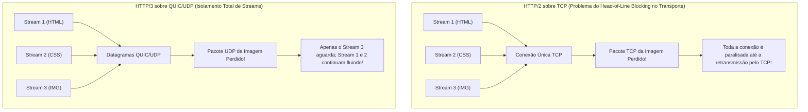
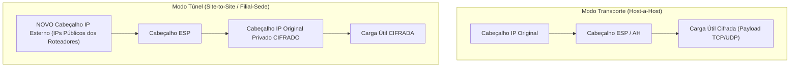
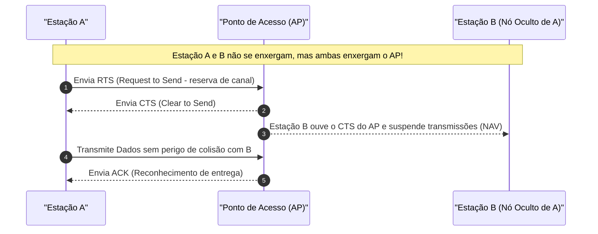

# 04 - Protocolos de Aplicação, Segurança de Rede e Redes Sem Fio

> **Matéria:** Sistemas Operacionais, Redes e Computação em Nuvem  
> **Cargo:** B02 – Técnico de Controle Externo – Especialidade: Tecnologia da Informação  
> **Arquivo:** `04_protocolos_de_aplicacao_redes_sem_fio_e_seguranca_de_rede.md`  

---

## 📌 Ementa / Itens do Edital
- Protocolos da camada de aplicação e transporte:
    - Evolução da Web: HTTP/1.1, HTTP/2, HTTP/3 e HTTPS
    - Gerenciamento e transferência: SSH, FTP/SFTP
    - Correio eletrônico: SMTP, IMAP e POP3
- Tecnologias de interconexão e segurança perimetral: VPN, Balanceamento de Carga, Proxies e Firewalls
- Noções de redes sem fio (Padrões IEEE 802.11 e segurança Wi-Fi)

---

## 🧭 Sumário

1. [Evolução dos Protocolos Web: HTTP/1.1, HTTP/2, HTTP/3 e HTTPS](#1-evolucao-dos-protocolos-web-http11-http2-http3-e-https)
    1. [HTTP/1.1 e o Bloqueio de Início de Fila (Head-of-Line Blocking) na Aplicação](#11-http11-e-o-bloqueio-de-inicio-de-fila-head-of-line-blocking-na-aplicacao)
    2. [Teste 443](#Teste-443)
    3. [HTTP/2: Formato Binário, Multiplexação de Streams e Compressão HPACK](#12-http2-formato-binario-multiplexacao-de-streams-e-compressao-hpack)
    4. [Teste 444](#Teste-444)
    5. [HTTP/3 e o Protocolo QUIC sobre UDP](#13-http3-e-o-protocolo-quic-sobre-udp)
    6. [Teste 445](#Teste-445)
    7. [HTTPS e TLS 1.3 Integrado](#14-https-e-tls-13-integrado)
2. [Protocolos Utilitários, Transferência de Arquivos e Correio Eletrônico](#2-protocolos-utilitarios-transferencia-de-arquivos-e-correio-eletronico)
    1. [SSH (Secure Shell) e Redirecionamento de Portas](#21-ssh-secure-shell-e-redirecionamento-de-portas)
    2. [Transferência de Arquivos: FTP vs. FTPS vs. SFTP](#22-transferencia-de-arquivos-ftp-vs-ftps-vs-sftp)
    3. [Teste 446](#Teste-446)
    4. [Correio Eletrônico: SMTP vs. POP3 vs. IMAP](#23-correio-eletronico-smtp-vs-pop3-vs-imap)
    5. [Teste 447](#Teste-447)
3. [Elementos de Borda e Segurança de Rede: VPN, IPsec, Balanceadores e Proxies](#3-elementos-de-borda-e-seguranca-de-rede-vpn-ipsec-balanceadores-e-proxies)
    1. [Arquitetura IPsec: Cabeçalhos AH vs. ESP e Modos Transporte vs. Túnel](#31-arquitetura-ipsec-cabecalhos-ah-vs-esp-e-modos-transporte-vs-tunel)
    2. [Teste 448](#Teste-448)
    3. [Balanceadores de Carga: Camada 4 (L4) vs. Camada 7 (L7)](#32-balanceadores-de-carga-camada-4-l4-vs-camada-7-l7)
    4. [Teste 449](#Teste-449)
    5. [Servidores Proxy: Forward Proxy vs. Reverse Proxy](#33-servidores-proxy-forward-proxy-vs-reverse-proxy)
    6. [Teste 450](#Teste-450)
4. [Redes Sem Fio (IEEE 802.11 - Wi-Fi)](#4-redes-sem-fio-ieee-80211-wi-fi)
    1. [Evolução dos Padrões 802.11 (Wi-Fi 4, Wi-Fi 5 e Wi-Fi 6/6E)](#41-evolucao-dos-padroes-80211-wi-fi-4-wi-fi-5-e-wi-fi-66e)
    2. [Frequências de Operação: 2.4 GHz vs. 5 GHz](#42-frequencias-de-operacao-24-ghz-vs-5-ghz)
    3. [Teste 451](#Teste-451)
    4. [Mecanismo de Acesso ao Meio: CSMA/CA e o Problema do Nó Oculto (RTS/CTS)](#43-mecanismo-de-acesso-ao-meio-csmaca-e-o-problema-do-no-oculto-rtscts)
    5. [Teste 452](#Teste-452)
    6. [Evolução da Segurança Sem Fio: WEP, WPA, WPA2 e WPA3 (Personal vs. Enterprise)](#44-evolucao-da-seguranca-sem-fio-wep-wpa-wpa2-e-wpa3-personal-vs-enterprise)
    7. [Teste 453](#Teste-453)
5. [Fontes Recomendadas na Internet](#5-fontes-recomendadas-na-internet)

---

## 1. Evolução dos Protocolos Web: HTTP/1.1, HTTP/2, HTTP/3 e HTTPS

### 1.1 HTTP/1.1 e o Bloqueio de Início de Fila (Head-of-Line Blocking) na Aplicação

O protocolo **HTTP/1.1** (RFC 2616) estruturou a comunicação na web durante duas décadas. Ele trouxe como avanço o suporte a **conexões persistentes (*Keep-Alive*)**, permitindo que uma mesma conexão TCP fosse reaproveitada para transferir múltiplos recursos sem a necessidade de reabrir o handshake a cada arquivo.

Contudo, o HTTP/1.1 padece de uma limitação arquitetural grave:

- As mensagens trafegam em formato **estritamente textual e sequencial** no modelo requisição-resposta.
- Se uma página web demanda dezenas de imagens, folhas de estilo CSS e scripts JavaScript, o cliente envia uma requisição e precisa aguardar o servidor responder integralmente antes de enviar a próxima.
- Esse fenômeno é denominado **Bloqueio de Início de Fila na Aplicação (*Head-of-Line Blocking / HoL Blocking*)**: se a primeira requisição for lenta ou complexa para o backend processar, todos os demais recursos da página ficam bloqueados na fila do navegador. Para mitigar o problema, os navegadores passaram a abrir de 6 a 8 conexões TCP concorrentes com o mesmo domínio, sobrecarregando os servidores.

---

### Teste 443
**(FCC - Adaptada / Analista de Redes e Infraestrutura)**
Considere a evolução dos protocolos da arquitetura World Wide Web, em especial os padrões HTTP/1.1, HTTP/2 e HTTP/3, concebidos para aprimorar o desempenho, a segurança e a latência de transferência de dados em aplicações corporativas.

Sobre as características fundamentais desses protocolos, assinale a afirmativa correta:

* **A)** O HTTP/2 resolveu integralmente o problema de bloqueio de início de fila (*head-of-line blocking*) em conexões suscetíveis a perdas de pacotes, pois aboliu o protocolo TCP e adotou datagramas UDP em conexões paralelas.
* **B)** O HTTP/3 adota o protocolo de transporte QUIC operando primariamente sobre datagramas UDP, o que possibilita múltiplos fluxos multiplexados verdadeiramente independentes, nos quais a perda de um pacote individual em um fluxo não bloqueia o processamento dos demais fluxos da conexão.
* **C)** O HTTP/1.1 introduziu o mecanismo de multiplexação binária através de uma única conexão TCP, dispensando conexões concorrentes para o download de folhas de estilo e imagens.
* **D)** O protocolo QUIC do HTTP/3 opera em texto plano sem segurança criptográfica nativa, exigindo a instalação manual e facultativa de certificados SSL externos para cifrar dados sensíveis.
* **E)** Os protocolos HTTP/2 e HTTP/3 mantiveram a estrutura de mensagens baseada em formato estritamente textual legível por humanos em seus cabeçalhos e fluxos, para simplificar a auditoria direta por analisadores de pacotes.

---

> **Comentário Detalhado:**
>
> - **A)** Incorreta. O HTTP/2 opera sobre o protocolo de transporte TCP, mantendo o problema do bloqueio de início de fila (*Head-of-Line Blocking*) na camada de transporte caso ocorra perda de pacotes.
> - **B)** Correta. O HTTP/3 adota o protocolo QUIC sobre UDP, garantindo que os fluxos multiplexados operem de forma verdadeiramente independente, de modo que a perda de um pacote em um stream específico não paralisa a entrega dos demais fluxos da conexão.
> - **C)** Incorreta. A multiplexação de fluxos binários sobre uma única conexão TCP foi a grande inovação do HTTP/2, e não do HTTP/1.1.
> - **D)** Incorreta. O protocolo QUIC integra nativamente a criptografia TLS 1.3 em sua estrutura, sendo impossível operar HTTP/3 em texto claro na especificação padrão.
> - **E)** Incorreta. Tanto o HTTP/2 (com HPACK) quanto o HTTP/3 (com QPACK) utilizam enquadramento binário estruturado, abandonando a sintaxe textual pura do HTTP/1.1.
> 
> **Gabarito: B**

---

### 1.2 HTTP/2: Formato Binário, Multiplexação de Streams e Compressão HPACK

Padronizado pela RFC 7540, o **HTTP/2** reformulou a camada de aplicação sem alterar a semântica básica (métodos GET/POST, cabeçalhos e códigos de status HTTP continuam os mesmos):

1. **Protocolo Estritamente Binário:** Substituiu o texto ASCII puro por uma camada de enquadramento binário estruturada em **Quadros (*Frames*)** e **Fluxos (*Streams*)**.
2. **Multiplexação Verdadeira:** Múltiplas requisições e respostas podem trafegar de forma intercalada, bidirecional e simultânea sobre uma **única conexão TCP aberta**. Um arquivo CSS pesado não bloqueia mais o tráfego de imagens leves.
3. **Compressão de Cabeçalhos (HPACK):** Utiliza tabelas estáticas e dinâmicas associadas à codificação Huffman para eliminar a repetição redundante de cabeçalhos volumosos (como cookies e user-agents).
4. **Server Push:** O servidor pode enviar antecipadamente recursos essenciais ao cliente (como uma folha de estilo `style.css`) antes mesmo de o navegador interpretá-la e requisitá-la explicitamente.

#### O Gargalo Restante do HTTP/2: HoL Blocking no Transporte TCP
Embora o HTTP/2 tenha solucionado o bloqueio de início de fila na aplicação, ele transferiu o problema para a **Camada de Transporte (TCP)**:

- Como todos os streams do site compartilham a mesma e única conexão TCP, se um único pacote TCP for corrompido ou perdido na rede, o mecanismo de confiabilidade do TCP obriga o receptor a paralisar **a entrega de todos os outros streams da conexão** até que o pacote faltante seja retransmitido (*TCP Head-of-Line Blocking*).

---

### Teste 444
**(FGV - TRT / Analista Judiciário - TI - Inovações do Protocolo HTTP/2)**
O protocolo **HTTP/2** (RFC 7540) foi desenvolvido pelo IETF com o objetivo central de mitigar as graves restrições de latência e concorrência inerentes ao protocolo HTTP/1.1 clássico.

A respeito das inovações arquiteturais introduzidas pelo HTTP/2, assinale a afirmativa correta:

* **A)** O HTTP/2 aboliu o uso de cabeçalhos e passou a transferir mensagens exclusivamente em linguagem assembly.
* **B)** O HTTP/2 substituiu o formato textual do HTTP/1.1 por um **protocolo binário estruturado em quadros (*Frames*) e fluxos (*Streams*)**, permitindo a **Multiplexação Completa** de múltiplas requisições e respostas bidirecionais concorrentes trafegando simultaneamente sobre uma **única conexão TCP**, eliminando o bloqueio de início de fila (*Head-of-Line Blocking*) na camada de aplicação e introduzindo a compressão de cabeçalhos via algoritmo **HPACK**.
* **C)** O HTTP/2 exige a abertura de 50 conexões TCP paralelas para cada imagem carregada em uma página web.
* **D)** O HTTP/2 é incompatível com criptografia TLS, funcionando exclusivamente em conexões HTTP não seguras na porta 80.
* **E)** O algoritmo HPACK do HTTP/2 foi projetado exclusivamente para descompactar arquivos de vídeo em formato AVI.

---

> **Comentário Detalhado:**
>
> - **A)** Incorreta. Os cabeçalhos permanecem essenciais no HTTP/2, porém são comprimidos pelo HPACK.
> - **B)** **CORRETA.** Avanços técnicos canônicos do **HTTP/2 (RFC 7540)**:
>   1. **Formato Binário:** Mensagens são estruturadas em quadros binários (*Frames* de dados, cabeçalhos, prioridade, etc.), sendo muito mais fáceis e rápidas de parsear por computadores do que o texto plano do HTTP/1.1.
>   2. **Multiplexação (Uma Única Conexão TCP):** Múltiplas requisições independentes e assíncronas viajam intercaladas (*interleaved*) em uma única conexão TCP persistente. Resolve o HoL Blocking na aplicação (uma requisição lenta não trava as demais).
>   3. **Compressão HPACK (RFC 7541):** Comprime cabeçalhos HTTP por codificação de Huffman e tabelas de indexação de cabeçalhos estática e dinâmica, eliminando o envio repetitivo de cookies e user-agents idênticos.
>   4. **Server Push:** Capacidade de o servidor enviar recursos preventivos ao cache do navegador antes mesmo de serem explicitamente solicitados.
> - **C)** Incorreta. O objetivo do HTTP/2 é exatamente o inverso: concentrar tudo em **uma única conexão TCP**.
> - **D)** Incorreta. Na prática dos navegadores modernos, o HTTP/2 exige obrigatoriamente transporte seguro sobre TLS (h2).
> - **E)** Incorreta. O HPACK é um algoritmo de compressão específico para cabeçalhos HTTP.
> 
> **Gabarito: B**

---

### 1.3 HTTP/3 e o Protocolo QUIC sobre UDP

Para eliminar em definitivo qualquer forma de bloqueio em redes móveis e de alta latência, a IETF padronizou o **HTTP/3** (RFC 9114), substituindo o TCP pelo protocolo de transporte **QUIC (*Quick UDP Internet Connections* - RFC 9000)**, que opera sobre datagramas **UDP (Porta UDP 443)**:

#### Inovações Tecnológicas do HTTP/3 (QUIC):
- **Eliminação Total do HoL Blocking:** Os streams dentro do QUIC são verdadeiramente isolados. A perda de um pacote no fluxo da imagem congela apenas o processamento da imagem, enquanto o código HTML e o script JavaScript continuam sendo entregues imediatamente ao navegador.
- **Handshake Acelerado (0-RTT e 1-RTT):** Como o controle de transporte e a criptografia TLS 1.3 são integrados no mesmo protocolo, a conexão segura é estabelecida em apenas 1 RTT (ou 0-RTT se o host já for conhecido), contra 2 a 3 RTTs exigidos pelo par TCP + TLS 1.2.
- **Migração de Conexão Resiliente (*Connection Migration*):** A conexão QUIC não é identificada pela 4-tupla tradicional (IP de origem, IP de destino, porta de origem, porta de destino), mas por um identificador exclusivo de 64 bits chamado **Connection ID**. Se o usuário sair da rede Wi-Fi de casa e entrar na rede móvel 5G (mudando completamente o endereço IP do smartphone), **a sessão de download, streaming ou chamada de vídeo NÃO cai nem reinicia**, migrando de forma totalmente transparente.
- **Compressão QPACK:** Evolução do algoritmo HPACK adaptada para lidar com pacotes que chegam fora de ordem sobre o transporte UDP.

---

### Teste 445
**(FCC - TRT / Analista de Redes - HTTP/3 e o Protocolo QUIC sobre UDP)**
Embora o HTTP/2 tenha solucionado o bloqueio de início de fila (*Head-of-Line Blocking*) na camada de aplicação, ele continuou sofrendo com o *Head-of-Line Blocking* na **Camada de Transporte**, decorrente da garantia de entrega estritamente sequencial e ordenada do protocolo TCP subjacente (onde a perda de um único pacote TCP paralisa todos os fluxos multiplexados).

Para superar definitivamente essa barreira física, a IETF padronizou o **HTTP/3** (RFC 9114), cuja principal inovação reside na substituição do TCP pelo protocolo:

* **A)** ICMP com criptografia DES.
* **B)** **QUIC** (*Quick UDP Internet Connections*), executado sobre o protocolo de transporte **UDP**, no qual as perdas de pacotes em um fluxo (*stream*) individual não bloqueiam os demais fluxos independentes, incorporando criptografia **TLS 1.3 nativa** em seu núcleo e permitindo o estabelecimento de conexão ultrarrápido com handshake de zero tempo de ida e volta (**0-RTT**).
* **C)** FTP tradicional com autenticação anônima.
* **D)** AppleTalk em cabos coaxiais antigos.
* **E)** SMTP executado diretamente sobre conexões seriais RS-232.

---

> **Comentário Detalhado:**
>
> - **A)** Incorreta. O ICMP é um protocolo utilitário de controle e diagnóstico (ping/traceroute), não servindo para transporte de aplicações web.
> - **B)** **CORRETA.** Revolução arquitetural do **HTTP/3 e QUIC (RFC 9000 / RFC 9114)**:
>   - **Fundamento:** O HTTP/3 abandona o TCP e roda no espaço de usuário sobre **UDP (User Datagram Protocol)**.
>   - **Eliminação do HoL Blocking de Transporte:** No QUIC, os *streams* multiplexados são gerenciados no nível do próprio protocolo de transporte. Se um pacote correspondente ao Stream 2 for perdido na rede, apenas o Stream 2 aguarda a retransmissão; os Streams 1, 3 e 4 continuam sendo entregues imediatamente à aplicação sem qualquer bloqueio.
>   - **Criptografia Integrada (TLS 1.3):** A segurança não é uma camada sobreposta como no TCP; o handshake do QUIC funde a negociação de transporte com o handshake do TLS 1.3, reduzindo o tempo de estabelecimento de conexão de múltiplos RTTs para **1-RTT** (ou **0-RTT** em conexões recorrentes).
>   - **Migração de Conexão (*Connection Migration*):** Utiliza um ID de Conexão (*Connection ID*) independente do IP; se o usuário sai do Wi-Fi e entra no 4G/5G, a conexão não cai nem precisa reiniciar o handshake.
> - **C)** Incorreta. FTP é protocolo de transferência de arquivos.
> - **D)** Incorreta. Protocolo legado proprietário da Apple da década de 1980.
> - **E)** Incorreta. Protocolo de envio de e-mails.
> 
> **Gabarito: B**

---

### 1.4 HTTPS e TLS 1.3 Integrado

O **HTTPS** nada mais é do que o tráfego HTTP executado sobre uma camada de segurança de transporte criptográfica:

- **TLS 1.3 (RFC 8446):** Padrão moderno obrigatório que aboliu cifras antigas fracas ou suscetíveis a ataques (eliminou suporte a RC4, 3DES, CBC, MD5 e trocas estáticas de chave RSA).
- **Forward Secrecy Mandatório:** O TLS 1.3 exige o uso de algoritmos de troca de chave efêmera (como ECDHE), garantindo que, mesmo que a chave privada do servidor web seja roubada no futuro, o tráfego gravado no passado não poderá ser decifrado.
- No HTTP/3, o **TLS 1.3 é embutido nativamente no QUIC**, não existindo HTTP/3 em texto claro na especificação padrão.

---

## 2. Protocolos Utilitários, Transferência de Arquivos e Correio Eletrônico

### 2.1 SSH (Secure Shell) e Redirecionamento de Portas

O protocolo **SSH** opera na **porta TCP 22** e provê comunicação criptografada segura para administração remota de servidores, transferência de arquivos e execução remota de comandos, substituindo protocolos inseguros legados (Telnet, rlogin):

- **Autenticação:** Baseada em senhas ou pares de chaves criptográficas assimétricas (RSA, Ed25519), onde a chave pública fica registrada no arquivo `~/.ssh/authorized_keys` do servidor remoto e a chave privada permanece protegida sob custódia do usuário.
- **Túneis e Redirecionamento de Portas (*Port Forwarding*):**
    - *Local Port Forwarding (`ssh -L local_port:target_host:target_port user@server`):* Encaminha o tráfego de uma porta local da estação do administrador através do túnel criptografado SSH para um serviço interno na rede remota (ex.: acessar uma base de dados inacessível pela Internet).
    - *Remote Port Forwarding (`ssh -R remote_port:target_host:target_port user@server`):* Encaminha tráfego recebido em uma porta do servidor remoto de volta para um serviço rodando na máquina local do administrador.
    - *Dynamic Port Forwarding (`ssh -D local_port user@server`):* Transforma a sessão SSH em um servidor proxy local do tipo SOCKS4/SOCKS5.

---

### 2.2 Transferência de Arquivos: FTP vs. FTPS vs. SFTP

| Protocolo | Portas de Transporte Utilizadas | Criptografia / Segurança | Arquitetura e Relação com FTP |
|---|---|---|---|
| **FTP** (*File Transfer Protocol*) | **TCP 21** (Controle) e **TCP 20** (Dados no modo ativo) | **NENHUMA.** Usuário, senha e conteúdo dos arquivos transitam em texto claro puro. | Protocolo legado original. Opera com duas conexões distintas (modo Ativo vs. modo Passivo/PASV). |
| **FTPS** (*FTP over SSL/TLS*) | TCP 21 (Controle) + Portas de Dados dinâmicas protegidas | Criptografia via TLS/SSL aplicada sobre as conexões de controle e dados do FTP. | É o protocolo FTP clássico encapsulado em uma sessão TLS. Requer abertura de faixas complexas de portas no firewall. |
| **SFTP** (*SSH File Transfer Protocol*) | **Apenas a porta TCP 22** | Criptografia forte de ponta a ponta e autenticação por chaves SSH. | **NÃO tem nenhuma relação com o FTP!** É um subsistema de extensão que opera inteiramente dentro de uma sessão SSH estabelecida. |

---

### Teste 446
**(FGV - TRT / Analista Judiciário - TI - Transferência de Arquivos Segura: SFTP vs. FTPS)**
Em auditorias de sistemas governamentais, é frequente a necessidade de transferir arquivos volumosos contendo bases de dados e folhas de pagamento de órgãos fiscalizados para os servidores do tribunal.

A respeito da distinção técnica fundamental entre os protocolos de transferência segura **SFTP** (*SSH File Transfer Protocol*) e **FTPS** (*FTP over SSL/TLS*), assinale a afirmativa correta:

* **A)** O SFTP é uma extensão direta do protocolo FTP tradicional que utiliza duas portas de conexão (portas 20 e 21) com certificados X.509.
* **B)** O **SFTP** é um protocolo completamente independente do FTP clássico, funcionando como um subsistema executado sobre um canal seguro do protocolo **SSH (*Secure Shell*)**, utilizando uma **única porta de rede (porta padrão TCP 22)** para comandos e transferência de dados com autenticação baseada em chaves públicas ou senhas; ao passo que o **FTPS** é o protocolo FTP tradicional legado encapsulado por uma camada de criptografia SSL/TLS, exigindo múltiplos canais de comunicação (porta de comando TCP 21 e uma faixa dinâmica de portas para os canais de dados em modo passivo), o que gera frequentes conflitos com firewalls corporativos.
* **C)** O FTPS é proibido em redes IPv4 por ser um protocolo exclusivo de satélites espaciais.
* **D)** Ambos os protocolos utilizam exclusivamente o protocolo UDP sem criptografia.
* **E)** O SFTP transmite dados em texto claro e foi decifrado em 1995.

---

> **Comentário Detalhado:**
>
> - **A)** Incorreta. O SFTP não tem nenhuma relação com o protocolo FTP nem com suas portas; ele roda integralmente dentro do protocolo SSH.
> - **B)** **CORRETA.** Confronto arquitetural canônico:
>   - **SFTP (SSH File Transfer Protocol):** É uma extensão do SSH (porta TCP 22). Utiliza **uma única conexão TCP** multiplexada para envio de comandos de controle, transferência de arquivos e manipulação remota de diretórios. É extremamente amigável para firewalls corporativos (basta liberar a porta 22) e herda toda a infraestrutura de segurança do SSH (chaves assimétricas RSA/Ed25519, `known_hosts`).
>   - **FTPS (FTP over TLS/SSL):** É o FTP antigo (RFC 959) envolvido por TLS. Mantém a problemática arquitetura de canal duplo do FTP (um canal de controle na porta TCP 21 e múltiplos canais de dados dinâmicos na faixa efêmera em modo passivo), exigindo regras complexas de *Connection Tracking / Application Layer Gateway (ALG)* nos firewalls para autorizar as portas dinâmicas de dados.
> - **C)** Incorreta. FTPS é amplamente suportado na internet padrão.
> - **D)** Incorreta. Ambos usam conexões TCP confiáveis e criptografia de ponta a ponta.
> - **E)** Incorreta. O SFTP cifra todo o tráfego de ponta a ponta através da criptografia robusta do túnel SSH.
> 
> **Gabarito: B**

---

### 2.3 Correio Eletrônico: SMTP vs. POP3 vs. IMAP

O tráfego de correio eletrônico na Internet divide-se claramente entre envio/retransmissão e acesso/leitura:

#### Protocolos em Detalhes:
1. **SMTP (*Simple Mail Transfer Protocol* - Portas TCP 25 e TCP 587):**
    - É um protocolo do tipo **Push (Envio)**.
    - Utilizado pelo cliente para submeter e-mails ao seu servidor (porta 587 com autenticação e STARTTLS) e utilizado para retransmitir e-mails entre servidores de correio na Internet (porta 25).

2. **POP3 (*Post Office Protocol v3* - Portas TCP 110 e TCP 995 com SSL):**
    - É um protocolo do tipo **Pull (Recuperação)**.
    - Baixa as mensagens do servidor para a máquina local do usuário e, por padrão histórico, **remove as mensagens da caixa postal do servidor**. Não suporta criação nem sincronização de pastas remotas.

3. **IMAP (*Internet Message Access Protocol* - Portas TCP 143 e TCP 993 com SSL):**
    - É um protocolo do tipo **Pull (Acesso e Sincronização)**.
    - Mantém as mensagens, pastas customizadas, marcações de lido/não-lido e rascunhos **armazenados permanentemente no servidor central**. Permite que o usuário consulte sua caixa de correio através de múltiplos dispositivos (smartphone, webmail, notebook) com sincronização em tempo real.

---

### Teste 447
**(FCC - Adaptada / Analista de Sistemas - Suporte a Serviços de Rede)**
A respeito dos protocolos da camada de aplicação e seus papéis no ecossistema de infraestrutura de TI, assinale a afirmação correta:

* **A)** O protocolo POP3 opera na porta TCP 110 e caracteriza-se por manter cópias sincronizadas das pastas e mensagens permanentemente no servidor, refletindo instantaneamente as alterações feitas em múltiplos clientes de correio.
* **B)** O protocolo SMTP (Simple Mail Transfer Protocol) é classificado tecnicamente como um protocolo do tipo *pull*, utilizado primariamente para a recuperação e leitura de mensagens armazenadas nas caixas de correio dos usuários finais.
* **C)** O protocolo SFTP (*SSH File Transfer Protocol*) baseia-se na execução paralela do protocolo FTP tradicional com redirecionamento de portas, exigindo a abertura obrigatória das portas TCP 20 e 21 nos firewalls perimetrais.
* **D)** O protocolo IMAP opera permitindo a sincronização bidirecional entre o cliente e o servidor de mensagens, mantendo a estrutura de diretórios e o estado das mensagens centralizados no servidor de correio eletrônico.
* **E)** O protocolo SSH opera por padrão na porta UDP 22, não provendo recursos de confidencialidade e limitando-se a registrar sessões de auditoria em arquivos de log do sistema operacional.

---

> **Comentário Detalhado:**
>
> - **A)** Incorreta. A sincronização permanente e bidirecional de mensagens e pastas no servidor é a característica definidora do protocolo **IMAP**, enquanto o POP3 baixa os e-mails e convencionalmente os apaga do servidor.
> - **B)** Incorreta. O protocolo SMTP é classificado como protocolo de envio (**Push**), utilizado para despachar e retransmitir mensagens, e não para recuperação e leitura por usuários finais.
> - **C)** Incorreta. O SFTP roda inteiramente dentro da sessão do protocolo SSH na porta **TCP 22**, não tendo nenhuma relação com as portas TCP 20 e 21 do FTP legado.
> - **D)** Correta. O IMAP mantém toda a estrutura de caixas postais, pastas e status de leitura centralizada no servidor, permitindo acesso concorrente e sincronizado a partir de múltiplos dispositivos.
> - **E)** Incorreta. O SSH opera sobre **TCP na porta 22**, fornecendo criptografia forte e autenticação robusta ponta a ponta.
> 
> **Gabarito: D**

---

## 3. Elementos de Borda e Segurança de Rede: VPN, IPsec, Balanceadores e Proxies

### 3.1 Arquitetura IPsec: Cabeçalhos AH vs. ESP e Modos Transporte vs. Túnel

O conjunto de protocolos **IPsec** opera na **Camada de Rede (Camada 3 do modelo OSI)**, sendo agnóstico em relação às aplicações de camadas superiores:

#### Protocolos de Segurança do IPsec:
- **AH (*Authentication Header* - Protocolo IP 51):** Provê autenticação da origem e integridade estrita dos dados via hash criptográfico.  
  > 🚨 **REGRA DE PROVA FCC:** O protocolo **AH NÃO PROVÊ CONFIDENCIALIDADE (NÃO realiza criptografia de dados)**! Além disso, é incompatível com NAT porque inclui o cabeçalho IP original no cálculo de integridade.
- **ESP (*Encapsulating Security Payload* - Protocolo IP 50):** Provê **confidencialidade (criptografia dos dados)**, além de autenticação de origem e integridade. É o protocolo primário utilizado para túneis VPN seguros.

#### Modos de Operação do IPsec:
- **Modo Transporte:** Utilizado em comunicações ponto a ponto entre dois hosts finais (*Host-to-Host*). Criptografa apenas o payload de transporte (dados TCP/UDP), mantendo o cabeçalho IP original legível. Os IPs privados de origem e destino ficam visíveis na rede pública.
- **Modo Túnel:** Utilizado em conexões de borda **VPN *Site-to-Site*** interligando redes inteiras (Matriz e Filial) através de roteadores ou firewalls. O **pacote IP original inteiro (cabeçalho IP privado + carga útil) é completamente criptografado**, e um novo cabeçalho IP externo contendo os endereços públicos dos gateways de borda é adicionado por fora.

---

### Teste 448
**(FCC - Adaptada / Analista de Tecnologia da Informação - Segurança Cibernética)**
Uma entidade governamental necessita interligar a rede local de seu data center sede à rede local de uma unidade regional descentralizada através da Internet pública. O projeto de segurança estipula que a solução deve mascarar integralmente os endereços IP corporativos internos de ambas as localidades e garantir sigilo criptográfico completo e autenticidade para todo o tráfego em trânsito.

Para atender plenamente aos requisitos de interconexão VPN *Site-to-Site*, o analista deve configurar a arquitetura IPsec utilizando:

* **A)** O protocolo AH (*Authentication Header*) em Modo Transporte.
* **B)** O protocolo ESP (*Encapsulating Security Payload*) em Modo Transporte.
* **C)** O protocolo ESP (*Encapsulating Security Payload*) em Modo Túnel.
* **D)** O protocolo AH (*Authentication Header*) em Modo Túnel.
* **E)** O protocolo TLS em Modo Enlace com portas abertas.

---

> **Comentário Detalhado:**
>
> - **A)** Incorreta. O protocolo AH não fornece sigilo (criptografia de dados) e o Modo Transporte preserva o cabeçalho IP original visível na rede pública.
> - **B)** Incorreta. O Modo Transporte expõe o cabeçalho IP original, revelando os endereços IPs internos dos servidores para qualquer nó intermediário da Internet.
> - **C)** Correta. O protocolo ESP em Modo Túnel é a configuração canônica obrigatória para VPNs *Site-to-Site*, pois criptografa integralmente o pacote IP original (cabeçalho privado + payload) e insere um novo cabeçalho IP público externo para roteamento seguro entre os gateways de borda.
> - **D)** Incorreta. O protocolo AH em Modo Túnel encapsula o pacote, mas não provê confidencialidade (não realiza criptografia do conteúdo).
> - **E)** Incorreta. A especificação técnica requer o emprego dos padrões arquiteturais do IPsec em nível de rede.
> 
> **Gabarito: C**

---

### 3.2 Balanceadores de Carga: Camada 4 (L4) vs. Camada 7 (L7)

Os Balanceadores de Carga (*Load Balancers*) distribuem o fluxo de requisições entre múltiplos servidores de backend para garantir escalabilidade horizontal e alta disponibilidade:

- **Balanceador de Camada 4 (L4 - Transporte):**
    - Toma decisões de chaveamento baseando-se unicamente em informações das camadas de rede e transporte: **Endereço IP de origem/destino e Portas TCP/UDP**.
    - Não examina o conteúdo da aplicação. Apresenta rendimento extraordinário, baixa latência e consome poucos recursos computacionais.
- **Balanceador de Camada 7 (L7 - Aplicação):**
    - Compreende a semântica dos protocolos de aplicação (HTTP/HTTPS, gRPC).
    - Pode inspecionar URLs, caminhos de requisição (`/api` vs. `/imagens`), cabeçalhos HTTP, métodos REST e cookies de sessão.
    - Suporta roteamento contextual baseado em conteúdo, persistência de sessão (*Sticky Sessions* via cookies) e descarregamento de processamento criptográfico (**SSL Termination / Offloading**).

---

### Teste 449
**(FCC - TRT / Analista de Infraestrutura - Balanceamento de Carga: Camada 4 vs. Camada 7)**
Na infraestrutura de datacenters de tribunais de contas, o balanceamento de carga (*Load Balancing*) distribui o tráfego dos sistemas de processo eletrônico entre múltiplos servidores de aplicação em cluster, operando tipicamente na **Camada 4 (Transporte)** ou na **Camada 7 (Aplicação)**.

A respeito das características que diferenciam um balanceador **Layer 4 (L4)** de um balanceador **Layer 7 (L7)**, assinale a afirmativa correta:

* **A)** O balanceador L7 é incapaz de ler o conteúdo da requisição HTTP, roteando pacotes apenas pelo endereço IP de destino.
* **B)** O balanceador **Layer 4 (L4)** toma decisões de roteamento em alta velocidade baseando-se exclusivamente em informações das camadas de rede e transporte (endereço IP de origem/destino e porta TCP/UDP), sem inspecionar a carga útil da aplicação; ao passo que o balanceador **Layer 7 (L7)** atua na camada de aplicação, inspecionando o conteúdo semântico da mensagem (cabeçalhos HTTP, URIs solicitadas, métodos `GET`/`POST`, cookies de sessão e dados de formulário), permitindo roteamento inteligente baseado em caminhos (ex.: direcionar `/api/` para um cluster de microsserviços e `/estaticos/` para outro), além de permitir terminação SSL/TLS e persistência de sessão baseada em cookies (*Sticky Sessions*).
* **C)** O balanceador L4 é exclusivo de cabos de fibra óptica submarinos.
* **D)** O balanceador L7 consome menos ciclos de CPU e memória do que o L4 por não analisar o cabeçalho das mensagens.
* **E)** Ambos os tipos exigem que todos os servidores web de destino possuam o mesmo endereço IP físico.

---

> **Comentário Detalhado:**
>
> - **A)** Incorreta. O balanceador L7 inspeciona minuciosamente todo o tráfego da camada de aplicação HTTP/HTTPS.
> - **B)** **CORRETA.** Comparativo técnico clássico de **Load Balancers**:
>   - **Layer 4 (L4 - Transporte):** Roteamento em nível de fluxo TCP/UDP. Olha apenas a tupla de 5 elementos (*IP Origem, Porta Origem, IP Destino, Porta Destino, Protocolo*). Não decifra a mensagem nem conhece HTTP. É extremamente veloz, consome pouca CPU e lida com centenas de milhares de conexões por segundo sem interferir nos dados.
>   - **Layer 7 (L7 - Aplicação):** Roteamento consciente do conteúdo (*Content-Aware / Application Routing*). Atua como um proxy reverso completo: termina a conexão TCP do cliente, decifra o TLS, analisa o payload HTTP e decide o servidor backend com base na URL (ex.: `/relatorios` $	o$ Servidor A; `/pagamentos` $	o$ Servidor B), cookies ou cabeçalhos. Oferece inteligência máxima e recursos como WAF e *Sticky Sessions*, com maior custo computacional de CPU/RAM.
> - **C)** Incorreta. Dispositivos lógicos aplicados em qualquer infraestrutura corporativa.
> - **D)** Incorreta. O L7 consome **muito mais recursos de CPU e memória** do que o L4 justamente porque precisa remontar pacotes TCP, decifrar criptografia SSL e analisar texto HTTP.
> - **E)** Incorreta. Os servidores do pool de backend possuem endereços IPs privados distintos para os quais o balanceador despacha o tráfego.
> 
> **Gabarito: B**

---

### 3.3 Servidores Proxy: Forward Proxy vs. Reverse Proxy

- **Forward Proxy (Proxy Direto):** Fica posicionado em frente aos **computadores clientes internos** da organização. É utilizado para controlar e registrar a navegação dos funcionários na Internet, aplicar políticas de filtragem de conteúdo corporativo, fazer cache de páginas externas e mascarar os endereços IP das estações de trabalho perante os servidores web do mundo exterior.
- **Reverse Proxy (Proxy Reverso):** Fica posicionado em frente aos **servidores internos de aplicação e bancos de dados** da instituição (ex.: Nginx, HAProxy, Envoy). Atua como a vitrine pública de entrada: recebe as requisições dos usuários da Internet, faz terminação SSL, aplica balanceamento de carga, acelera a entrega por meio de cache de conteúdo estático e oculta a topologia interna e a quantidade de servidores do datacenter contra invasores externos.

---

### Teste 450
**(FGV - TRT / Analista Judiciário - TI - Servidores Proxy: Forward Proxy vs. Reverse Proxy)**
Os servidores proxy são intermediários de rede amplamente empregados para segurança, controle de acesso, anonimização e aceleração de tráfego.

A respeito da distinção funcional entre um **Forward Proxy** e um **Reverse Proxy**, assinale a afirmativa correta:

* **A)** O Forward Proxy fica posicionado na frente dos servidores web do tribunal para protegê-los contra invasões externas vindas da internet.
* **B)** O **Forward Proxy** é posicionado à frente dos **clientes internos da rede corporativa**, atuando em nome dos colaboradores para intermediar o acesso à internet externa, sendo utilizado para filtragem de conteúdo web indesejado, aplicação de políticas de DLP, cache de navegação e auditoria de acessos de saída; ao passo que o **Reverse Proxy** é posicionado à frente dos **servidores internos da instituição**, interceptando as requisições de clientes externos da internet e repassando-as aos servidores de aplicação backend, atuando para balanceamento de carga, terminação SSL/TLS, aceleração de cache de páginas e proteção contra ataques externos (como DDoS).
* **C)** O Reverse Proxy impede que os servidores internos recebam energia elétrica da rede predial.
* **D)** Ambos os proxies realizam rigorosamente a mesma função e não possuem nenhuma diferença de posicionamento ou objetivo arquitetural.
* **E)** O Forward Proxy é exclusivo de conexões via satélite do padrão DVB-S2.

---

> **Comentário Detalhado:**
>
> - **A)** Incorreta. Quem fica na frente dos servidores para protegê-los é o **Reverse Proxy** (Proxy Reverso).
> - **B)** **CORRETA.** Distinção arquitetural clássica entre os tipos de proxy:
>   - **Forward Proxy (Proxy de Saída):** O cliente interno sabe que está usando o proxy (ou é interceptado de modo transparente). O proxy esconde os clientes da internet: o site externo enxerga apenas o IP do proxy. Finalidades: controle de navegação corporativa, bloqueio de sites impróprios, auditoria de compliance e economia de banda por cache.
>   - **Reverse Proxy (Proxy Reverso / de Entrada):** Os clientes da internet não sabem que estão falando com um proxy; eles pensam que estão acessando diretamente o portal oficial do tribunal. O proxy esconde e protege os servidores internos de aplicação. Finalidades: segurança perimetral, ocultação da topologia de backend, terminação SSL (descarrega a criptografia), compressão gzip e balanceamento de carga entre nós do cluster.
> - **C)** Incorreta. Trata-se de software/hardware de rede de dados.
> - **D)** Incorreta. Possuem papéis e direções de tráfego diametralmente opostos.
> - **E)** Incorreta. São conceitos universais da arquitetura TCP/IP.
> 
> **Gabarito: B**

---

## 4. Redes Sem Fio (IEEE 802.11 - Wi-Fi)

### 4.1 Evolução dos Padrões 802.11 (Wi-Fi 4, Wi-Fi 5 e Wi-Fi 6/6E)

| Geração Comercial | Padrão IEEE | Frequências de Operação | Larguras de Canal | Principais Tecnologias e Recursos | Taxas Teóricas Máximas |
|---|---|---|---|---|---|
| **Wi-Fi 4** | **802.11n** | 2.4 GHz e 5 GHz | 20 e 40 MHz | Introdução da tecnologia **MIMO** (*Multiple-Input Multiple-Output*) | Até 600 Mbps |
| **Wi-Fi 5** | **802.11ac** | **Exclusivo 5 GHz** | 20, 40, 80 e 160 MHz | **MU-MIMO** (*Multi-User MIMO*) para downlink, modulação 256-QAM | Até 6.9 Gbps |
| **Wi-Fi 6 / 6E** | **802.11ax** | 2.4 GHz, 5 GHz e 6 GHz (no 6E) | Canais de até 160 MHz | **OFDMA** (subcanais RU), MU-MIMO bidirecional, TWT (*Target Wake Time*) para IoT | Até 9.6 Gbps |

---

### 4.2 Frequências de Operação: 2.4 GHz vs. 5 GHz

- **Faixa de 2.4 GHz:**
    - *Vantagem:* Maior comprimento de onda, proporcionando **maior alcance físico** de cobertura e melhor penetração através de paredes e obstáculos sólidos.
    - *Desvantagem:* Menor largura de banda total e **altíssima interferência** (disputa espaço com Bluetooth, fornos micro-ondas e telefones sem fio). Possui apenas **3 canais não sobrepostos** na regulamentação padrão (canais 1, 6 e 11).
- **Faixa de 5 GHz:**
    - *Vantagem:* Menor índice de interferência, dezenas de canais não sobrepostos e capacidade para canais largos (80/160 MHz), oferecendo **altíssima vazão de dados**.
    - *Desvantagem:* Menor alcance de cobertura de sinal e maior atenuação ao atravessar obstáculos físicos.

---

### Teste 451
**(FCC - TRT / Analista de Telecomunicações - Redes Sem Fio IEEE 802.11 e Frequências 2.4 GHz vs. 5 GHz)**
A implantação de redes locais sem fio corporativas (*WLAN / Wi-Fi*) baseadas na família de padrões IEEE 802.11 requer o planejamento criterioso de frequências e canais para evitar interferências de rádio e degradação de sinal.

A respeito da comparação técnica entre as bandas de frequência de **2.4 GHz** e **5 GHz**, assinale a afirmativa correta:

* **A)** A banda de 2.4 GHz oferece maiores taxas de transmissão de dados e mais canais sem sobreposição do que a banda de 5 GHz.
* **B)** A frequência de **2.4 GHz** possui maior alcance geográfico e maior capacidade de penetração de obstáculos físicos (paredes e divisórias) devido ao seu comprimento de onda maior, porém sofre de grande congestionamento e dispõe de apenas **3 canais sem sobreposição mútua** no espectro padrão (canais 1, 6 e 11); ao passo que a frequência de **5 GHz** oferece larguras de canal muito maiores, taxas de transmissão significativamente mais elevadas e dezenas de canais descorrelacionados, com o *trade-off* de apresentar menor alcance útil e maior atenuação ao atravessar obstáculos sólidos.
* **C)** A banda de 5 GHz é totalmente imune a qualquer atenuação provocada por paredes de concreto armado.
* **D)** O padrão IEEE 802.11b opera exclusivamente na faixa de 60 GHz com velocidade de 10 Gigabits por segundo.
* **E)** Fornos micro-ondas e telefones sem fio antigos operam exclusivamente na faixa de 5 GHz, deixando a faixa de 2.4 GHz livre de qualquer interferência.

---

> **Comentário Detalhado:**
>
> - **A)** Incorreta. A banda de 5 GHz oferece taxas de transferência ordens de grandeza superiores e muito mais canais não sobrepostos.
> - **B)** **CORRETA.** Propriedades físicas fundamentais da radiofrequência em redes Wi-Fi:
>   - **Banda de 2.4 GHz:** Comprimento de onda de cerca de 12,5 cm. **Vantagem:** Alcance mais longo e melhor propagação através de obstáculos sólidos. **Desvantagens:** Banda estreita, extremamente congestionada (Bluetooth, micro-ondas, telefones sem fio) e dispõe de apenas **três canais que não se sobrepõem: 1, 6 e 11** (canais adjacentes sofrem interferência de canal adjacente).
>   - **Banda de 5 GHz:** Comprimento de onda de cerca de 6 cm. **Vantagens:** Mais de 20 canais sem sobreposição, suporte a canais agregados de 40, 80 e 160 MHz (Wi-Fi 5 e 6), fornecendo taxas de múltiplos Gigabits/s com baixíssima interferência. **Desvantagem:** Maior absorção pelo ar e severa atenuação por obstáculos físicos (paredes grossas atenuam fortemente o sinal).
> - **C)** Incorreta. Sinais de frequências mais altas sofrem atenuação significativamente mais severa ao atravessar materiais densos.
> - **D)** Incorreta. O 802.11b é um padrão legado de 1999 que operava em 2.4 GHz com taxa máxima de 11 Mbps.
> - **E)** Incorreta. Fornos micro-ondas operam exatamente na faixa de **2.4 GHz** (frequência de ressonância da água), sendo a principal fonte de interferência eletromagnética não-Wi-Fi nessa banda.
> 
> **Gabarito: B**

---

### 4.3 Mecanismo de Acesso ao Meio: CSMA/CA e o Problema do Nó Oculto (RTS/CTS)

Diferente das redes cabeadas Ethernet (IEEE 802.3), que utilizam detecção de colisão (**CSMA/CD**), o meio sem fio via rádio impossibilita a detecção confiável de colisões elétricas na antena transmissora enquanto ela mesma emite sinal em alta potência. Por isso, o padrão IEEE 802.11 adota compulsoriamente a **Prevenção de Colisões (CSMA/CA - *Carrier Sense Multiple Access with Collision Avoidance*)**:

#### O Problema do Nó Oculto (*Hidden Node Problem*):
Ocorre quando duas estações distantes (Estação A e Estação B) estão ambas dentro do raio de alcance do mesmo Ponto de Acesso (AP), mas encontram-se fora do alcance de escuta de rádio uma da outra. Se ambas escutarem o canal e acharem que ele está livre, transmitirão simultaneamente para o AP, provocando colisão destrutiva.

O problema é neutralizado pelo mecanismo opcional de reserva via quadros de controle **RTS/CTS**:

1. A Estação A transmite um quadro **RTS (*Request to Send*)** ao AP solicitando tempo de reserva;
2. O AP responde com um quadro **CTS (*Clear to Send*)** em broadcast;
3. A Estação B escuta o CTS emitido pelo AP e suspende suas transmissões (ajustando seu temporizador NAV - *Network Allocation Vector*), permitindo que a Estação A envie seus dados sem risco de colisão.

---

### Teste 452
**(FCC - Adaptada / Analista de Infraestrutura de Redes de Comunicação)**
No que tange às redes sem fio fundamentadas no padrão IEEE 802.11 (Wi-Fi) e aos seus mecanismos de controle de acesso ao meio físico e topologia, é correto afirmar:

* **A)** As redes Wi-Fi implementam o protocolo de acesso ao meio CSMA/CD, o qual baseia-se na detecção ativa e instantânea de colisões elétricas na antena transmissora para interromper transmissões conflitantes.
* **B)** O mecanismo de prevenção de colisões CSMA/CA com suporte aos quadros de controle RTS (*Request to Send*) e CTS (*Clear to Send*) visa contornar especificamente o problema do nó oculto (*hidden node problem*), em que duas estações não se detectam mutuamente mas tentam transmitir simultaneamente para o mesmo ponto de acesso.
* **C)** A faixa de frequência de 2.4 GHz oferece taxas de transmissão teóricas substancialmente superiores à faixa de 5 GHz, além de disponibilizar uma quantidade três vezes maior de canais não sobrepostos.
* **D)** O protocolo WEP é o algoritmo atualmente recomendado pelas normas internacionais para redes governamentais de alta segurança, pois utiliza a cifra de bloco AES com chaves simétricas de 256 bits.
* **E)** No padrão IEEE 802.11ax (Wi-Fi 6), a tecnologia CSMA/CA foi totalmente substituída pelo protocolo de chaveamento de circuitos estáticos Token Ring.

---

> **Comentário Detalhado:**
>
> - **A)** Incorreta. Redes sem fio utilizam CSMA/CA (prevenção de colisões), e não CSMA/CD (detecção), pois não conseguem escutar o meio de forma confiável enquanto suas antenas transmitem sinal.
> - **B)** Correta. O mecanismo CSMA/CA com quadros RTS/CTS soluciona com precisão o problema do nó oculto (*hidden node problem*), onde duas estações fora do alcance mútuo de rádio disputam o mesmo Ponto de Acesso.
> - **C)** Incorreta. A faixa de 2.4 GHz tem menor largura de banda e conta com apenas 3 canais não sobrepostos (1, 6 e 11), ao passo que a faixa de 5 GHz oferece taxas mais elevadas e dezenas de canais sem sobreposição.
> - **D)** Incorreta. O WEP utiliza a cifra de fluxo RC4 com vetores de inicialização curtos e é considerado totalmente quebrado e inseguro há décadas.
> - **E)** Incorreta. O Wi-Fi 6 adicionou tecnologias como OFDMA e MU-MIMO, mas mantém a retrocompatibilidade operacional com o mecanismo CSMA/CA.
> 
> **Gabarito: B**

---

### 4.4 Evolução da Segurança Sem Fio: WEP, WPA, WPA2 e WPA3 (Personal vs. Enterprise)

| Padrão | Criptografia Adotada | Mecanismo de Integridade | Vulnerabilidades Críticas / Situação Atual |
|---|---|---|---|
| **WEP** | Cifra de fluxo **RC4** (chave de 40 ou 104 bits + IV estático de 24 bits) | CRC-32 (fraco) | **Totalmente Quebrado e Obsoleto.** Pode ser decifrado em poucos minutos devido ao reúso de vetores de inicialização (IVs curtos). Banido pelas normas de segurança. |
| **WPA** | Cifra **TKIP** (*Temporal Key Integrity Protocol*) sobre RC4 | Michael (MIC) | Padrão emergencial de transição para cobrir as falhas do WEP sem exigir troca de hardware; hoje também considerado obsoleto. |
| **WPA2** | **AES** (*Advanced Encryption Standard*) com protocolo **CCMP** | CBC-MAC | Padrão robusto da indústria. Vulnerável ao ataque de reinstalação de chave (**KRACK**) e ataques de força bruta/dicionário offline ao aperto de mão de 4 vias (modo PSK). |
| **WPA3** | **AES-128 (modo Personal) ou CNSA de 192 bits (modo Enterprise)** | Galois/Counter Mode (GCMP) | **Padrão de Excelência Atual.** Elimina ataques de dicionário offline através da troca autenticada simultânea de iguais (**SAE / Dragonfly**) e garante sigilo futuro (*Forward Secrecy*). |

#### Modos de Operação: Personal vs. Enterprise
- **Modo Personal (WPA-PSK):** Emprega uma **chave pré-compartilhada única (*Pre-Shared Key*)** configurada no ponto de acesso e digitada por todos os usuários da rede. Típico de ambientes residenciais ou pequenas empresas.
- **Modo Enterprise (WPA-Enterprise):** Não utiliza senha compartilhada única. Implementa a arquitetura de autenticação centralizada e individualizada baseada no padrão **IEEE 802.1X**:
    - Cada colaborador autentica-se com seu próprio login e senha do Active Directory ou com um certificado digital pessoal;
    - A comunicação é intermediada pelo ponto de acesso e validada por um servidor de autenticação corporativo baseado no protocolo **RADIUS** (*Remote Authentication Dial-In User Service*);
    - Uma chave criptográfica de sessão exclusiva é gerada dinamicamente para cada dispositivo individualmente.

---

### Teste 453
**(FCC - Adaptada / Analista de Tecnologia da Informação - Redes e Telecomunicações)**
Em uma organização pública que implementou uma infraestrutura de rede corporativa sem fio (Wi-Fi), a equipe de segurança da informação adotou o padrão de segurança WPA3 no modo *Enterprise*.

Em comparação com implementações domésticas baseadas em WPA2-Personal (PSK), a referida arquitetura governamental caracteriza-se por:

* **A)** Utilizar uma única chave criptográfica estática pré-compartilhada gravada nas estações de trabalho de todos os servidores do órgão, a qual nunca pode ser alterada.
* **B)** Eliminar a camada de criptografia dos dados em trânsito no ar, restringindo a proteção unicamente à filtragem por endereço físico MAC cadastrado na tabela ARP do roteador.
* **C)** Implementar autenticação centralizada e individualizada baseada no padrão IEEE 802.1X, utilizando um servidor corporativo de controle de acesso fundamentado no protocolo RADIUS integrado a um repositório de identidades.
* **D)** Utilizar a cifra obsoleta RC4 com vetores de inicialização estendidos de 128 bits para manter compatibilidade reversa com o padrão WEP.
* **E)** Prescindir do uso de certificados digitais ou credenciais individuais, concedendo acesso livre e irrestrito através de um portal cativo (*captive portal*) não autenticado.

---

> **Comentário Detalhado:**
>
> - **A)** Incorreta. O uso de uma chave pré-compartilhada estática única é a definição do modo Personal (PSK), e não do modo Enterprise.
> - **B)** Incorreta. O modo Enterprise emprega criptografia de alto nível em trânsito (AES-128/192 com CCMP/GCMP); a filtragem MAC não constitui mecanismo seguro de proteção.
> - **C)** Correta. A arquitetura WPA/WPA3 Enterprise implementa autenticação individualizada centralizada através da norma IEEE 802.1X com servidores corporativos RADIUS, vinculando cada usuário ao diretório central de identidades.
> - **D)** Incorreta. A cifra RC4 foi sumariamente banida dos padrões modernos de conectividade sem fio.
> - **E)** Incorreta. O modo Enterprise exige autenticação rigorosa e individualizada baseada em credenciais de usuário ou certificados digitais.
> 
> **Gabarito: C**

---

## 6. Fontes Recomendadas na Internet

* [IETF RFC 9110 - HTTP Semantics](https://datatracker.ietf.org/doc/html/rfc9110) - Norma de referência global da IETF com as semânticas, códigos de status e métodos do protocolo HTTP.
* [IETF RFC 8446 - The Transport Layer Security (TLS) Protocol Version 1.3](https://datatracker.ietf.org/doc/html/rfc8446) - Especificação oficial do protocolo TLS 1.3 para canal seguro de comunicação na Internet.
* [IETF RFC 4253 - The Secure Shell (SSH) Transport Layer Protocol](https://datatracker.ietf.org/doc/html/rfc4253) - Especificação oficial da arquitetura de transporte e autenticação criptográfica do protocolo SSH.
* [Wi-Fi Alliance - Wi-Fi CERTIFIED WPA3 Security Highlights](https://www.wi-fi.org/discover-wi-fi/security) - Visão geral técnica oficial dos mecanismos do WPA3 e protocolo SAE (Simultaneous Authentication of Equals).
* [NIST SP 800-41 Rev. 1 - Guidelines on Firewalls and Firewall Policy](https://csrc.nist.gov/pubs/sp/800/41/r1/final) - Recomendações oficiais do NIST para arquitetura de firewalls e regras de segurança de rede.
* KUROSE, James F.; ROSS, Keith W. **Redes de Computadores e a Internet: Uma Abordagem Top-Down**. 7. ed. São Paulo: Pearson Education do Brasil, 2017. (Cap. 2 - Camada de Aplicação: HTTP, SMTP, DNS; Cap. 6 - Redes Sem Fio e Móveis; Cap. 8 - Segurança em Redes).
* TANENBAUM, Andrew S.; WETHERALL, David. **Redes de Computadores**. 5. ed. São Paulo: Pearson, 2011. (Cap. 4 - A Subcamada de Controle de Acesso ao Meio: Padrões IEEE 802.11; Cap. 8 - Segurança de Rede).
* STALLINGS, William. **Criptografia e Segurança de Redes: Princípios e Práticas**. 7. ed. São Paulo: Pearson Education do Brasil, 2018. (Cap. 17 - Segurança de Camada de Transporte: TLS; Cap. 20 - Firewalls).
