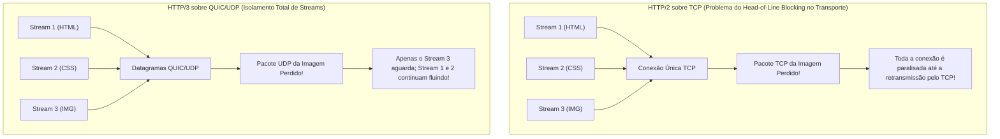
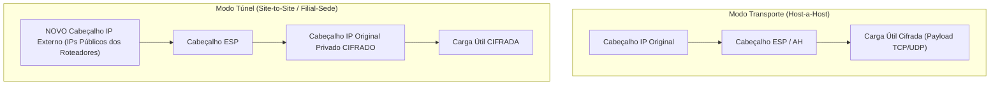
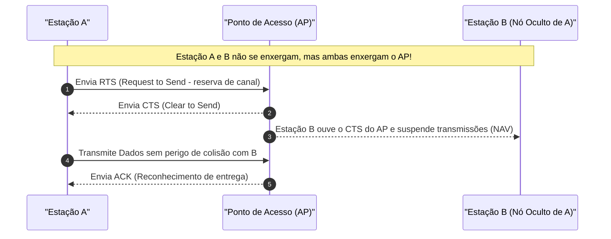

# 04 - Protocolos de Aplicação, Segurança de Rede e Redes Sem Fio

> **Matéria:** Sistemas Operacionais, Redes e Computação em Nuvem  
> **Cargo:** B02 – Técnico de Controle Externo – Especialidade: Tecnologia da Informação  
> **Arquivo:** `04_protocolos_de_aplicacao_redes_sem_fio_e_seguranca_de_rede.md`  

---

## 📌 Ementa / Itens do Edital
- Protocolos da camada de aplicação e transporte:
  - Evolução da Web: HTTP/1.1, HTTP/2, HTTP/3 e HTTPS
  - Gerenciamento e transferência: SSH, FTP/SFTP
  - Correio eletrônico: SMTP, IMAP e POP3
- Tecnologias de interconexão e segurança perimetral: VPN, Balanceamento de Carga, Proxies e Firewalls
- Noções de redes sem fio (Padrões IEEE 802.11 e segurança Wi-Fi)

---

## 🌳 Classificação Hierárquica

```text
4. Protocolos Modernos, Infraestrutura de Comunicação e Conectividade Sem Fio
├── 4.1 Evolução dos Protocolos Web (HTTP/1.1, HTTP/2, HTTP/3 e HTTPS)
│   ├── 4.1.1 HTTP/1.1 (RFC 2616): Conexões persistentes (Keep-Alive), pipelining limitado, Head-of-Line Blocking na camada de aplicação
│   ├── 4.1.2 HTTP/2 (RFC 7540):
│   │   ├── Protocolo binário (frames e streams)
│   │   ├── Multiplexação: Múltiplas requisições/respostas concorrentes em uma ÚNICA conexão TCP
│   │   ├── Compressão de cabeçalhos HPACK
│   │   ├── Server Push e limitação do Head-of-Line Blocking no nível de transporte TCP
│   ├── 4.1.3 HTTP/3 (RFC 9114):
│   │   ├── Protocolo de transporte QUIC operando sobre UDP (Porta UDP 443)
│   │   ├── Resolução definitiva do Head-of-Line Blocking em nível de transporte
│   │   ├── Handshake unificado em 0-RTT / 1-RTT com TLS 1.3 obrigatório integrado
│   │   ├── Migração de conexão resiliente baseada em Connection ID (troca de Wi-Fi para 5G)
│   │   └── Compressão de cabeçalhos QPACK
│   └── 4.1.4 HTTPS e TLS 1.3: Criptografia fim a fim, Forward Secrecy obrigatório e mitigação de vulnerabilidades legadas
├── 4.2 Protocolos Utilitários e de Mensageria
│   ├── 4.2.1 SSH (Secure Shell - Porta TCP 22):
│   │   ├── Autenticação por chaves assimétricas e integridade
│   │   └── Túneis e redirecionamento de portas: Local (-L), Remoto (-R) e Dinâmico (-D)
│   ├── 4.2.2 Protocolos de Transferência de Arquivos:
│   │   ├── FTP (Portas TCP 20 dados e 21 controle): Texto claro, Modo Ativo vs. Modo Passivo (PASV)
│   │   ├── FTPS (FTP encapsulado em TLS/SSL)
│   │   └── SFTP (SSH File Transfer Protocol: opera estritamente na porta TCP 22 do SSH)
│   └── 4.2.3 Protocolos de Correio Eletrônico:
│       ├── SMTP (Portas TCP 25 e TCP 587 com STARTTLS): Envio e retransmissão de mensagens
│       ├── POP3 (Portas TCP 110 e TCP 995 SSL): Baixa mensagens localmente e esvazia o servidor
│       └── IMAP (Portas TCP 143 e TCP 993 SSL): Sincronização bidirecional mantendo mensagens no servidor
├── 4.3 Elementos de Borda e Segurança de Rede
│   ├── 4.3.1 VPN (Virtual Private Network) e IPsec:
│   │   ├── VPN de Acesso Remoto (Client-to-Gateway) vs. VPN Site-to-Site (Gateway-to-Gateway)
│   │   ├── Protocolos IPsec: AH (Autenticação/Integridade sem sigilo) vs. ESP (Confidencialidade, Autenticação e Integridade)
│   │   └── Modos de Operação: Modo Transporte (apenas payload) vs. Modo Túnel (pacote IP inteiro cifrado)
│   ├── 4.3.2 Balanceadores de Carga (Load Balancers):
│   │   ├── Camada 4 (L4 - Transporte: IP e Portas) vs. Camada 7 (L7 - Aplicação: URLs, Cookies e Cabeçalhos)
│   │   └── Algoritmos: Round Robin, Weighted, Least Connections e IP Hash (Sticky Sessions)
│   └── 4.3.3 Servidores Proxy:
│       ├── Forward Proxy (Proxy Direto): Proteção de clientes internos e controle de navegação
│       └── Reverse Proxy (Proxy Reverso): Proteção de servidores internos, terminação SSL e cache
└── 4.4 Noções de Redes Sem Fio (Wi-Fi - Padrões IEEE 802.11)
    ├── 4.4.1 Evolução dos Padrões:
    │   ├── 802.11n (Wi-Fi 4): 2.4/5 GHz, MIMO, até 600 Mbps
    │   ├── 802.11ac (Wi-Fi 5): Exclusivo 5 GHz, MU-MIMO downlink, canais de 80/160 MHz
    │   └── 802.11ax (Wi-Fi 6 / 6E): 2.4/5/6 GHz, OFDMA, MU-MIMO bidirecional, Target Wake Time (TWT)
    ├── 4.4.2 Frequências de Operação: 2.4 GHz (maior alcance, alta interferência) vs. 5 GHz (maior vazão, menor alcance)
    ├── 4.4.3 Mecanismo de Acesso ao Meio:
    │   ├── CSMA/CA (Carrier Sense Multiple Access with Collision Avoidance)
    │   └── Mecanismo de Reserva com Quadros RTS/CTS e o Problema do Nó Oculto (Hidden Node)
    └── 4.4.4 Segurança Sem Fio:
        ├── WEP (Obsoleto e inseguro por falhas no RC4)
        ├── WPA / WPA2 (AES com protocolo CCMP)
        ├── WPA3 (Autenticação SAE / Dragonfly contra força bruta e criptografia de 192 bits)
        └── Modos de Operação: Personal (WPA-PSK com chave pré-compartilhada) vs. Enterprise (IEEE 802.1X com RADIUS)
```

---

## 📖 Resumo Teórico & Conceitos Fundamentais

### 4.1 Evolução dos Protocolos Web: HTTP/1.1, HTTP/2, HTTP/3 e HTTPS

A web moderna passou por três grandes gerações normatizadas pelo IETF:

#### Comparativo Técnico: HTTP/1.1 vs. HTTP/2 vs. HTTP/3

| Recurso / Propriedade | HTTP/1.1 (RFC 2616) | HTTP/2 (RFC 7540) | HTTP/3 (RFC 9114) |
| :--- | :--- | :--- | :--- |
| **Camada de Transporte** | **TCP** (Porta 80 ou 443) | **TCP** (Porta 80 ou 443) | **QUIC sobre UDP** (Porta 443) |
| **Formato das Mensagens** | Texto plano legível | **Binário** estruturado (Frames) | **Binário** estruturado (Frames) |
| **Multiplexação** | Inexistente (requisições sequenciais via *Keep-Alive*) | **Sim**, múltiplos streams sobre uma única conexão TCP | **Sim**, múltiplos streams independentes sobre conexões QUIC/UDP |
| **Bloqueio de Início de Fila (*Head-of-Line Blocking*)** | Presente na **Camada de Aplicação** (uma requisição lenta trava a fila) | Resolvido na aplicação, mas **presente na Camada de Transporte** (TCP retransmite e trava tudo) | **Totalmente Eliminado** em ambas as camadas (perda em um stream não afeta os demais) |
| **Compressão de Cabeçalhos** | Nenhuma | **HPACK** (Tabelas estática e dinâmica) | **QPACK** (Otimizado para chegada fora de ordem) |
| **Handshake de Conexão** | 1 RTT TCP (+ 2 RTTs TLS 1.2) = 3 RTTs | 1 RTT TCP (+ 1-2 RTTs TLS) = 2-3 RTTs | **0-RTT ou 1-RTT** (Conexão + TLS 1.3 unificados nativamente) |
| **Migração de Rede** | Conexão cai (amarrada à 4-tupla IP/Porta) | Conexão cai (amarrada à 4-tupla IP/Porta) | **Resiliente** via `Connection ID` de 64 bits (migra de Wi-Fi para 5G sem queda) |



> ⭐ **IMPORTANTE / REGRA DE OURO:**  
> O **QUIC** (base do HTTP/3) incorpora a camada de criptografia **TLS 1.3** diretamente no seu núcleo. Não existe HTTP/3 em texto claro desprotegido na especificação oficial do IETF.

---

### 4.2 Protocolos Utilitários, Transferência de Arquivos e Correio Eletrônico

#### Transferência de Arquivos: FTP vs. FTPS vs. SFTP
1. **FTP (*File Transfer Protocol*):** Utiliza duas conexões TCP distintas em texto claro:
   - **Porta TCP 21 (Conexão de Controle):** Autenticação e comandos (comandos `USER`, `PASS`, `RETR`, `STOR`).
   - **Porta TCP 20 (Conexão de Dados):** Transmissão efetiva dos arquivos.
   - *Modo Ativo:* O cliente conecta na porta 21 do servidor e avisa em qual porta local está ouvindo; o servidor inicia uma conexão de retorno da sua porta 20 até a porta do cliente (frequentemente bloqueado por firewalls de clientes).
   - *Modo Passivo (PASV):* O cliente inicia ambas as conexões (porta 21 e uma porta alta aleatória informada pelo servidor), compatível com firewalls e NATs.
2. **SFTP (*SSH File Transfer Protocol*):** Não tem nenhuma relação arquitetural com o FTP. É um subsistema que executa **inteiramente sobre a sessão SSH na porta TCP 22**, herdando nativamente a autenticação por chaves assimétricas e a criptografia robusta do SSH.

#### Correio Eletrônico: SMTP vs. POP3 vs. IMAP

| Protocolo | Porta Padrão / Porta Segura | Papel no Ecossistema | Comportamento Operacional |
| :--- | :--- | :--- | :--- |
| **SMTP** (*Simple Mail Transfer Protocol*) | **TCP 25** (servidor-servidor) / **TCP 587** (submissão de cliente com STARTTLS) | **Envio e Transferência** de mensagens (*Push*) | Envia mensagens do cliente (MUA) para o servidor de correio (MTA) e retransmite entre servidores MTA na Internet. |
| **POP3** (*Post Office Protocol v3*) | **TCP 110** (padrão) / **TCP 995** (POP3S sobre SSL) | **Acesso e Leitura** (*Pull*) | Baixa os e-mails para o dispositivo local e, convencionalmente, **apaga as mensagens do servidor**. Não suporta pastas remotas. |
| **IMAP** (*Internet Message Access Protocol*) | **TCP 143** (padrão) / **TCP 993** (IMAPS sobre SSL) | **Acesso e Sincronização** (*Pull*) | Mantém as mensagens, pastas e marcações **armazenadas centralizadamente no servidor**. Permite múltiplos clientes sincronizados em tempo real. |

---

### 4.3 Elementos de Borda e Segurança de Rede: VPN, IPsec, Balanceadores e Proxies

#### Arquitetura IPsec: Protocolos e Modos de Operação
O IPsec opera na **Camada de Rede (Camada 3)** para proteger fluxos IP:
- **Protocolos de Cabeçalho:**
  - **AH (*Authentication Header* - Protocolo IP 51):** Provê integridade de dados e autenticação de origem. **NÃO provê confidencialidade (não realiza criptografia)**. Incompatível com NAT, pois o cálculo do hash inclui o cabeçalho IP original.
  - **ESP (*Encapsulating Security Payload* - Protocolo IP 50):** Provê **confidencialidade (criptografia forte)**, autenticação de origem e integridade dos pacotes.



> 🚨 **ALERTA DE PROVA / PEGADINHA FCC:**  
> - Em uma VPN *Site-to-Site* que interliga matriz e filiais através da Internet, o modo **obrigatório** é o **Modo Túnel com ESP**. No modo túnel, até mesmo o cabeçalho IP original com os endereços IPs privados da rede interna é completamente criptografado e ocultado.
> - O protocolo **AH nunca deve ser marcado** em questões que exijam sigilo ou confidencialidade dos dados!

#### Balanceadores de Carga: Nível 4 vs. Nível 7
- **Balanceamento L4 (Camada de Transporte):** Baseia suas decisões unicamente em endereços IP e portas TCP/UDP. Não inspeciona o conteúdo das requisições. Altíssimo rendimento e baixíssimo uso de CPU.
- **Balanceamento L7 (Camada de Aplicação):** Compreende protocolos de aplicação (HTTP/HTTPS). Capaz de inspecionar URLs, cabeçalhos HTTP, métodos REST e cookies de sessão. Permite roteamento inteligente (ex.: enviar `/api` para servidores backend e `/static` para servidores CDN) e descarregamento de criptografia (*SSL Termination*).

#### Servidores Proxy: Forward Proxy vs. Reverse Proxy
- **Forward Proxy (Proxy Direto):** Fica posicionado em frente aos **clientes internos**. Utilizado para filtrar navegação corporativa, cache de saída e ocultar os endereços IP dos computadores dos usuários perante a Internet.
- **Reverse Proxy (Proxy Reverso):** Fica posicionado em frente aos **servidores internos** da organização (ex.: Nginx, HAProxy, Envoy). Utilizado para distribuir tráfego, prover alta disponibilidade, terminação SSL/TLS e blindar os servidores de banco de dados e aplicação contra ataques externos diretos.

---

### 4.4 Redes Sem Fio (IEEE 802.11 - Wi-Fi)

#### Mecanismo de Acesso ao Meio: CSMA/CA e o Problema do Nó Oculto
Em redes locais cabeadas (Ethernet IEEE 802.3), utiliza-se o **CSMA/CD** (*Collision Detection*). No meio sem fio via rádio, as estações não conseguem detectar colisões de forma confiável enquanto suas próprias antenas estão transmitindo. Por isso, o padrão IEEE 802.11 adota obrigatoriamente o **CSMA/CA** (*Collision Avoidance* - Prevenção de Colisões):



- **O Problema do Nó Oculto (*Hidden Node Problem*):** Ocorre quando duas estações distantes (A e B) estão dentro do alcance do mesmo Ponto de Acesso (AP), mas fora do alcance mútuo de rádio entre si. Se ambas transmitirem simultaneamente ao AP, haverá colisão destrutiva. O protocolo resolve esse problema através do aperto de mão opcional com quadros de controle **RTS/CTS** (*Request to Send / Clear to Send*).

#### Evolução da Segurança Wi-Fi: WEP a WPA3

| Padrão de Segurança | Criptografia / Algoritmo | Mecanismo de Autenticação | Vulnerabilidades / Situação Atual |
| :--- | :--- | :--- | :--- |
| **WEP** | Cifra de fluxo **RC4** (chave estática de 40/104 bits + IV fraco de 24 bits) | Chave Compartilhada / Aberta | **Quebrado e obsoleto.** Pode ser decifrado em minutos devido ao reúso de vetores de inicialização (IV). |
| **WPA** | **TKIP** (*Temporal Key Integrity Protocol*) sobre RC4 | WPA-PSK ou IEEE 802.1X | Padrão emergencial temporário; suscetível a ataques estatísticos. |
| **WPA2** | **AES** (*Advanced Encryption Standard*) com protocolo **CCMP** | Pre-Shared Key (PSK) ou Enterprise (802.1X / EAP) | Padrão robusto da indústria. Vulnerável ao ataque de reinstalação de chave (**KRACK**) e ataques de força bruta offline ao handshake de 4 vias (modo PSK). |
| **WPA3** | **AES-128 / CNSA de 192 bits** | **SAE (*Simultaneous Authentication of Equals*)** no Personal; 802.1X no Enterprise | **Estado da arte.** O protocolo SAE (baseado em Dragonfly) elimina ataques de dicionário offline mesmo com senhas fracas e garante *Forward Secrecy*. |

> 🚨 **ALERTA DE PROVA / PEGADINHA FCC:**  
> A modalidade **WPA2/WPA3 Enterprise** dispensa o uso de uma senha compartilhada única na empresa. Ela implementa a arquitetura **IEEE 802.1X**, em que cada colaborador autentica-se com suas credenciais individuais (usuário e senha do Active Directory ou certificado digital), utilizando um servidor de autenticação centralizado baseado no protocolo **RADIUS** (*Remote Authentication Dial-In User Service*).

---

## 🌐 Fontes Recomendadas na Internet

- [IETF RFC 9114 - HTTP/3 Specification](https://datatracker.ietf.org/doc/html/rfc9114)
  - Especificação técnica que oficializou o HTTP/3 sobre o protocolo de transporte QUIC.
- [IETF RFC 9000 - QUIC: A UDP-Based Multiplexed and Secure Transport](https://datatracker.ietf.org/doc/html/rfc9000)
  - Detalha a arquitetura do QUIC, conexões orientadas a identificadores de 64 bits, mitigação do HoL blocking e TLS 1.3 integrado.
- [IETF RFC 4301 - Security Architecture for the Internet Protocol (IPsec)](https://datatracker.ietf.org/doc/html/rfc4301)
  - Arquitetura oficial de segurança IPsec detalhando o AH, o ESP e a diferença conceitual entre o Modo Transporte e o Modo Túnel.
- [Wi-Fi Alliance - Visão Geral do Padrão WPA3](https://www.wi-fi.org/discover-wi-fi/security)
  - Especificação e diretrizes dos mecanismos de autenticação simultânea de iguais (SAE), criptografia robusta e padrões corporativos 802.1X.
- [IEEE 802.11 Working Group - IEEE Standard for Wireless LAN MAC and PHY Specifications](https://standards.ieee.org/)
  - Documentação padrão mundial dos protocolos sem fio, mecanismos de controle CSMA/CA e reservas por quadros RTS/CTS.

---

## 📝 Questões Comentadas & Exemplos (Padrão FCC)

### Questão 1 (FCC - Adaptada / Analista de Redes e Infraestrutura)
Considere a evolução dos protocolos da arquitetura World Wide Web, em especial os padrões HTTP/1.1, HTTP/2 e HTTP/3, concebidos para aprimorar o desempenho, a segurança e a latência de transferência de dados em aplicações corporativas.

Sobre as características fundamentais desses protocolos, assinale a afirmativa correta:

A) O HTTP/2 resolveu integralmente o problema de bloqueio de início de fila (*head-of-line blocking*) em conexões suscetíveis a perdas de pacotes, pois aboliu o protocolo TCP e adotou datagramas UDP em conexões paralelas.  
B) O HTTP/3 adota o protocolo de transporte QUIC operando primariamente sobre datagramas UDP, o que possibilita múltiplos fluxos multiplexados verdadeiramente independentes, nos quais a perda de um pacote individual em um fluxo não bloqueia o processamento dos demais fluxos da conexão.  
C) O HTTP/1.1 introduziu o mecanismo de multiplexação binária através de uma única conexão TCP, dispensando conexões concorrentes para o download de folhas de estilo e imagens.  
D) O protocolo QUIC do HTTP/3 opera em texto plano sem segurança criptográfica nativa, exigindo a instalação manual e facultativa de certificados SSL externos para cifrar dados sensíveis.  
E) Os protocolos HTTP/2 e HTTP/3 mantiveram a estrutura de mensagens baseada em formato estritamente textual legível por humanos em seus cabeçalhos e fluxos, para simplificar a auditoria direta por analisadores de pacotes.  

> **Gabarito: B**  
> **Comentário Analítico Passo a Passo:**  
> - **A evolução do Head-of-Line Blocking:**
>   - No HTTP/1.1, o bloqueio ocorria na camada de aplicação (o navegador abria várias conexões TCP paralelas para tentar contornar a lentidão).
>   - No HTTP/2, a multiplexação binária agrupou múltiplos streams em uma **única conexão TCP**. Porém, como o TCP exige entrega sequencial e ordenada absoluta, se um único pacote TCP for perdido na rede, o buffer do receptor segura todos os outros streams até a retransmissão (*Head-of-Line Blocking no nível de transporte TCP*).
>   - No HTTP/3, com o protocolo **QUIC sobre UDP**, cada stream possui sua própria máquina de controle de perda. A perda de um pacote do Stream 2 atrasa apenas o Stream 2; os streams 1, 3 e 4 continuam sendo processados sem interrupção.
> - **Análise Detalhada das Alternativas:**
>   - **A (Incorreta):** O HTTP/2 ainda opera sobre **TCP**, sofrendo diretamente de bloqueio de início de fila na camada de transporte.
>   - **B (Correta):** Resume com absoluta precisão o papel do QUIC/UDP no HTTP/3 e o isolamento independente de fluxos multiplexados.
>   - **C (Incorreta):** A multiplexação binária em uma única conexão TCP foi a grande inovação do **HTTP/2**, e não do legado HTTP/1.1.
>   - **D (Incorreta):** O protocolo QUIC exige e incorpora **nativamente o TLS 1.3** no próprio aperto de mão; não há HTTP/3 sem criptografia.
>   - **E (Incorreta):** Tanto o HTTP/2 (com HPACK) quanto o HTTP/3 (com QPACK) são protocolos estritamente **binários**, em oposição à sintaxe textual legível do HTTP/1.1.

---

### Questão 2 (FCC - Adaptada / Analista de Tecnologia da Informação - Segurança Cibernética)
Uma entidade governamental necessita interligar a rede local de seu data center sede à rede local de uma unidade regional descentralizada através da Internet pública. O projeto de segurança estipula que a solução deve mascarar integralmente os endereços IP corporativos internos de ambas as localidades e garantir sigilo criptográfico completo e autenticidade para todo o tráfego em trânsito.

Para atender plenamente aos requisitos de interconexão VPN *Site-to-Site*, o analista deve configurar a arquitetura IPsec utilizando:

A) O protocolo AH (*Authentication Header*) em Modo Transporte.  
B) O protocolo ESP (*Encapsulating Security Payload*) em Modo Transporte.  
C) O protocolo ESP (*Encapsulating Security Payload*) em Modo Túnel.  
D) O protocolo AH (*Authentication Header*) em Modo Túnel.  
E) O protocolo TLS em Modo Enlace com portas abertas.  

> **Gabarito: C**  
> **Comentário Analítico Passo a Passo:**  
> - **Diferença AH vs. ESP:** O protocolo AH gera apenas um hash de autenticação e integridade sobre o pacote, **sem fornecer qualquer confidencialidade/criptografia** (os dados trafegam em texto claro). O protocolo ESP (*Encapsulating Security Payload*) fornece criptografia robusta (confidencialidade), integridade e autenticação.
> - **Diferença Modo Transporte vs. Modo Túnel:**
>   - No *Modo Transporte*, cifra-se apenas a carga útil da camada de transporte para cima; o cabeçalho IP original permanece intacto e visível, revelando os IPs de origem e destino na Internet pública.
>   - No *Modo Túnel*, o **pacote IP original inteiro (cabeçalho IP privado + carga útil) é criptografado**, e um novo cabeçalho IP externo contendo os IPs públicos dos roteadores de borda é adicionado por fora.
> - **Análise Detalhada das Alternativas:**
>   - **A (Incorreta):** AH não provê sigilo/criptografia e o Modo Transporte expõe os cabeçalhos originais.
>   - **B (Incorreta):** O Modo Transporte deixaria expostos os endereços IP internos dos servidores do tribunal aos nós intermediários da Internet pública.
>   - **C (Correta):** O protocolo ESP em Modo Túnel é a configuração padrão canônica para VPNs *Site-to-Site*, garantindo criptografia do payload e ocultação total dos IPs internos.
>   - **D (Incorreta):** O AH em Modo Túnel encapsularia o pacote, mas os dados internos continuariam legíveis em texto claro, descumprindo a exigência de sigilo.
>   - **E (Incorreta):** Mistura conceitos e não utiliza a arquitetura IPsec demandada na especificação do projeto.

---

### Questão 3 (FCC - Adaptada / Analista de Infraestrutura de Redes de Comunicação)
No que tange às redes sem fio fundamentadas no padrão IEEE 802.11 (Wi-Fi) e aos seus mecanismos de controle de acesso ao meio físico e topologia, é correto afirmar:

A) As redes Wi-Fi implementam o protocolo de acesso ao meio CSMA/CD, o qual baseia-se na detecção ativa e instantânea de colisões elétricas na antena transmissora para interromper transmissões conflitantes.  
B) O mecanismo de prevenção de colisões CSMA/CA com suporte aos quadros de controle RTS (*Request to Send*) e CTS (*Clear to Send*) visa contornar especificamente o problema do nó oculto (*hidden node problem*), em que duas estações não se detectam mutuamente mas tentam transmitir simultaneamente para o mesmo ponto de acesso.  
C) A faixa de frequência de 2.4 GHz oferece taxas de transmissão teóricas substancialmente superiores à faixa de 5 GHz, além de disponibilizar uma quantidade três vezes maior de canais não sobrepostos.  
D) O protocolo WEP é o algoritmo atualmente recomendado pelas normas internacionais para redes governamentais de alta segurança, pois utiliza a cifra de bloco AES com chaves simétricas de 256 bits.  
E) No padrão IEEE 802.11ax (Wi-Fi 6), a tecnologia CSMA/CA foi totalmente substituída pelo protocolo de chaveamento de circuitos estáticos Token Ring.  

> **Gabarito: B**  
> **Comentário Analítico Passo a Passo:**  
> - **O Mecanismo CSMA/CA e RTS/CTS:** Ao contrário do padrão Ethernet cabeado (802.3), que utiliza CSMA/CD (detecção de colisão), as redes sem fio utilizam CSMA/CA (prevenção de colisão). O uso de quadros de reserva RTS/CTS soluciona a situação de nós ocultos: a Estação A solicita permissão ao Ponto de Acesso (AP) enviando um RTS; o AP responde com um CTS com difusão em sua área de cobertura; as estações ocultas a A que escutam o CTS do AP postergam suas transmissões temporariamente, evitando a colisão no ar.
> - **Análise Detalhada das Alternativas:**
>   - **A (Incorreta):** As redes sem fio utilizam CSMA/**CA** (*Collision Avoidance*), e não CSMA/**CD** (*Collision Detection*), pois o hardware de rádio não tem capacidade de escutar e detectar colisões simultâneas enquanto transmite.
>   - **B (Correta):** Explicita de forma perfeita o funcionamento do CSMA/CA e o propósito dos quadros RTS/CTS para resolução do problema do nó oculto.
>   - **C (Incorreta):** A frequência de 2.4 GHz oferece menor largura de banda e tem apenas 3 canais não sobrepostos (1, 6 e 11), ao passo que a frequência de 5 GHz oferece taxas de transferência mais elevadas e dezenas de canais sem sobreposição.
>   - **D (Incorreta):** O padrão WEP utiliza a cifra de fluxo RC4, é considerado totalmente vulnerável há mais de duas décadas e seu uso é proibido por normas de conformidade.
>   - **E (Incorreta):** O Wi-Fi 6 introduziu tecnologias de multiplexação como OFDMA e MU-MIMO, mas mantém a retrocompatibilidade com CSMA/CA, sem nenhuma correlação com a arquitetura Token Ring.

---

### Questão 4 (FCC - Adaptada / Analista de Sistemas - Suporte a Serviços de Rede)
A respeito dos protocolos da camada de aplicação e seus papéis no ecossistema de infraestrutura de TI, assinale a afirmação correta:

A) O protocolo POP3 opera na porta TCP 110 e caracteriza-se por manter cópias sincronizadas das pastas e mensagens permanentemente no servidor, refletindo instantaneamente as alterações feitas em múltiplos clientes de correio.  
B) O protocolo SMTP (Simple Mail Transfer Protocol) é classificado tecnicamente como um protocolo do tipo *pull*, utilizado primariamente para a recuperação e leitura de mensagens armazenadas nas caixas de correio dos usuários finais.  
C) O protocolo SFTP (*SSH File Transfer Protocol*) baseia-se na execução paralela do protocolo FTP tradicional com redirecionamento de portas, exigindo a abertura obrigatória das portas TCP 20 e 21 nos firewalls perimetrais.  
D) O protocolo IMAP opera permitindo a sincronização bidirecional entre o cliente e o servidor de mensagens, mantendo a estrutura de diretórios e o estado das mensagens centralizados no servidor de correio eletrônico.  
E) O protocolo SSH opera por padrão na porta UDP 22, não provendo recursos de confidencialidade e limitando-se a registrar sessões de auditoria em arquivos de log do sistema operacional.  

> **Gabarito: D**  
> **Comentário Analítico Passo a Passo:**  
> - **IMAP vs. POP3:** O protocolo IMAP (*Internet Message Access Protocol*) foi projetado para permitir que múltiplos clientes sincronizem a mesma caixa postal em tempo real. O estado de leitura, pastas customizadas, exclusões e rascunhos são mantidos centralizadamente no servidor. O POP3, por sua vez, tradicionalmente descarrega as mensagens para o computador local e remove a cópia do servidor.
> - **Análise Detalhada das Alternativas:**
>   - **A (Incorreta):** Descreve as características do protocolo **IMAP**, e não do POP3. O POP3 realiza download local e não sincroniza árvores de pastas.
>   - **B (Incorreta):** O SMTP é um protocolo do tipo **push**, utilizado para **envio e transferência** de correio entre servidores e do cliente para o servidor, e não para recuperação e leitura por usuários finais.
>   - **C (Incorreta):** O SFTP roda inteiramente em cima do subsistema SSH na porta **TCP 22**. Ele não utiliza as portas TCP 20 ou 21 do FTP legado.
>   - **D (Correta):** Descreve com fidelidade a arquitetura de sincronização centralizada do protocolo IMAP.
>   - **E (Incorreta):** O protocolo SSH opera na camada de transporte via **TCP na porta 22** (e não UDP), oferecendo autenticação forte e criptografia assimétrica/simétrica fim a fim.

---

### Questão 5 (FCC - Adaptada / Analista de Tecnologia da Informação - Redes e Telecomunicações)
Em uma organização pública que implementou uma infraestrutura de rede corporativa sem fio (Wi-Fi), a equipe de segurança da informação adotou o padrão de segurança WPA3 no modo *Enterprise*.

Em comparação com implementações domésticas baseadas em WPA2-Personal (PSK), a referida arquitetura governamental caracteriza-se por:

A) Utilizar uma única chave criptográfica estática pré-compartilhada gravada nas estações de trabalho de todos os servidores do órgão, a qual nunca pode ser alterada.  
B) Eliminar a camada de criptografia dos dados em trânsito no ar, restringindo a proteção unicamente à filtragem por endereço físico MAC cadastrado na tabela ARP do roteador.  
C) Implementar autenticação centralizada e individualizada baseada no padrão IEEE 802.1X, utilizando um servidor corporativo de controle de acesso fundamentado no protocolo RADIUS integrado a um repositório de identidades.  
D) Utilizar a cifra obsoleta RC4 com vetores de inicialização estendidos de 128 bits para manter compatibilidade reversa com o padrão WEP.  
E) Prescindir do uso de certificados digitais ou credenciais individuais, concedendo acesso livre e irrestrito através de um portal cativo (*captive portal*) não autenticado.  

> **Gabarito: C**  
> **Comentário Analítico Passo a Passo:**  
> - **Arquitetura WPA Enterprise:** O modo *Enterprise* (seja em WPA2 ou WPA3) foi concebido para eliminar a fragilidade do compartilhamento de uma senha única (*Pre-Shared Key* - PSK) entre centenas de colaboradores.
> - **Componentes da Arquitetura IEEE 802.1X / RADIUS:**
>   1. **Suplicante (*Supplicant*):** O software cliente na estação de trabalho ou smartphone;
>   2. **Autenticador (*Authenticator*):** O Ponto de Acesso (AP) Wi-Fi ou controladora de rede sem fio (WLC);
>   3. **Servidor de Autenticação (*Authentication Server*):** Um servidor **RADIUS** (ex.: Microsoft NPS, FreeRADIUS) conectado ao diretório corporativo (Active Directory / LDAP).
>   Cada colaborador informa seu próprio usuário e senha ou apresenta um certificado digital (EAP-TLS). Uma chave de criptografia de sessão exclusiva é gerada dinamicamente para cada dispositivo conectado.
> - **Análise Detalhada das Alternativas:**
>   - **A (Incorreta):** O uso de chave única pré-compartilhada caracteriza o modo *Personal* (PSK), e não o modo *Enterprise*.
>   - **B (Incorreta):** O modo Enterprise utiliza criptografia de nível avançado (AES com CCMP ou GCMP de 192 bits no WPA3); filtragem por endereço MAC é trivialmente burlada por spoofing.
>   - **C (Correta):** Resume com precisão a estrutura corporativa do padrão IEEE 802.1X e o uso de servidores RADIUS.
>   - **D (Incorreta):** A cifra RC4 foi banida e eliminada dos padrões contemporâneos de segurança sem fio; o WPA3 adota criptografia moderna padrão CNSA/AES.
>   - **E (Incorreta):** O modo Enterprise baseia-se exatamente em credenciais individualizadas e controle estrito de identidade corporativa.
