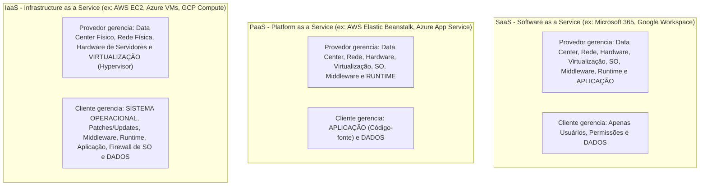
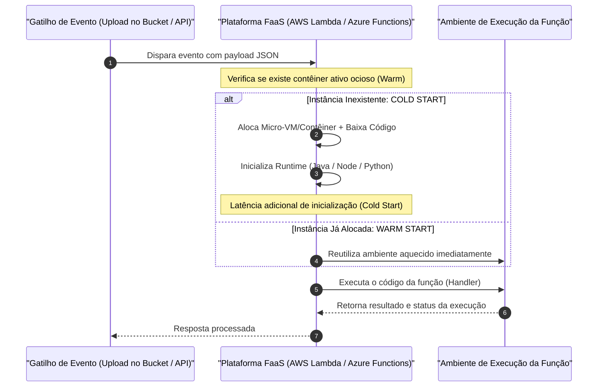
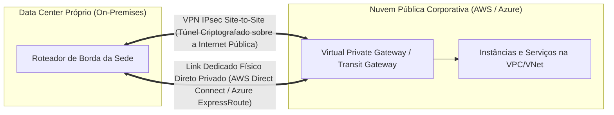

# 05 - Computação em Nuvem, Serverless e Ambientes Híbridos

> **Matéria:** Sistemas Operacionais, Redes e Computação em Nuvem  
> **Cargo:** B02 – Técnico de Controle Externo – Especialidade: Tecnologia da Informação  
> **Arquivo:** `05_computacao_em_nuvem_modelos_serverless_e_hibridos.md`  

---

## 📌 Ementa / Itens do Edital
- Fundamentos e características essenciais da Computação em Nuvem (NIST SP 800-145)
- Modelos de Serviço em Nuvem: IaaS, PaaS e SaaS
- Modelos de Implantação: Nuvem Pública, Privada, Comunitária e Híbrida
- Computação sem Servidor (Serverless / FaaS)
- Estratégias de escalabilidade (Vertical vs. Horizontal) e Alta Disponibilidade
- Integração entre ambientes locais (On-Premises) e nuvem pública
- Monitoramento de infraestrutura e custos em nuvem (FinOps)

---

## 🧭 Sumário

1. [Fundamentos de Computação em Nuvem (NIST SP 800-145)](#1-fundamentos-de-computacao-em-nuvem-nist-sp-800-145)
    1. [Definição Canônica do NIST](#11-definicao-canonica-do-nist)
    2. [As Cinco Características Essenciais](#12-as-cinco-caracteristicas-essenciais)
    3. [Teste 454](#Teste-454)
    4. [Os Quatro Modelos de Implantação (Pública, Privada, Comunitária, Híbrida)](#13-os-quatro-modelos-de-implantacao-publica-privada-comunitaria-hibrida)
    5. [Teste 455](#Teste-455)
2. [Modelos de Serviço e Matriz de Responsabilidade Compartilhada](#2-modelos-de-servico-e-matriz-de-responsabilidade-compartilhada)
    1. [IaaS, PaaS e SaaS: Estrutura e Escopos de Controle](#21-iaas-paas-e-saas-estrutura-e-escopos-de-controle)
    2. [Teste 456](#Teste-456)
    3. [Matriz de Responsabilidade Compartilhada (Shared Responsibility Model)](#22-matriz-de-responsabilidade-compartilhada-shared-responsibility-model)
    4. [Teste 457](#Teste-457)
3. [Computação Serverless (FaaS - Function as a Service)](#3-computacao-serverless-faas-function-as-a-service)
    1. [Paradigma: Execução Orientada a Eventos e Abstração de Infraestrutura](#31-paradigma-execucao-orientada-a-eventos-e-abstracao-de-infraestrutura)
    2. [Escala Automática a Zero (Scale-to-Zero) e Cobrança Fracionada](#32-escala-automatica-a-zero-scale-to-zero-e-cobranca-fracionada)
    3. [Teste 458](#Teste-458)
    4. [O Desafio do Cold Start e Estratégias de Mitigação](#33-o-desafio-do-cold-start-e-estrategias-de-mitigacao)
    5. [Teste 459](#Teste-459)
4. [Arquiteturas de Alta Disponibilidade e Escalabilidade em Nuvem](#4-arquiteturas-de-alta-disponibilidade-e-escalabilidade-em-nuvem)
    1. [Topologia Física Global: Regiões, Zonas de Disponibilidade (AZs) e Pontos de Presença](#41-topologia-fisica-global-regioes-zonas-de-disponibilidade-azs-e-pontos-de-presenca)
    2. [Teste 460](#Teste-460)
    3. [Escalabilidade Vertical (Scale-Up) vs. Horizontal (Scale-Out)](#42-escalabilidade-vertical-scale-up-vs-horizontal-scale-out)
    4. [Padrões de Resiliência: Multi-AZ e Recuperação de Desastres](#43-padroes-de-resiliencia-multi-az-e-recuperacao-de-desastres)
    5. [Teste 461](#Teste-461)
5. [Integração Híbrida e Governança Financeira (FinOps)](#5-integracao-hibrida-e-governanca-financeira-finops)
    1. [Conectividade Corporativa Híbrida: VPN IPsec vs. Links Dedicados Diretos](#51-conectividade-corporativa-hibrida-vpn-ipsec-vs-links-dedicados-diretos)
    2. [Teste 462](#Teste-462)
    3. [Modelos de Compra em Nuvem: On-Demand, Instâncias Reservadas e Spot](#52-modelos-de-compra-em-nuvem-on-demand-instancias-reservadas-e-spot)
    4. [Teste 463](#Teste-463)
    5. [FinOps: Transição CapEx para OpEx e Dimensionamento Correto (Rightsizing)](#53-finops-transicao-capex-para-opex-e-dimensionamento-correto-rightsizing)
    6. [Teste 464](#Teste-464)
6. [Fontes Recomendadas na Internet](#6-fontes-recomendadas-na-internet)

---

## 1. Fundamentos de Computação em Nuvem (NIST SP 800-145)

### 1.1 Definição Canônica do NIST

A publicação técnica especial **NIST SP 800-145** (*The NIST Definition of Cloud Computing*) consolidou o consenso acadêmico e de mercado sobre a computação em nuvem:
> *"Computação em nuvem é um modelo para habilitar acesso de rede ubíquo, conveniente e sob demanda a um conjunto compartilhado de recursos de computação configuráveis (por exemplo, redes, servidores, armazenamento, aplicativos e serviços) que podem ser rapidamente provisionados e liberados com esforço de gerenciamento mínimo ou interação do provedor de serviços."*

---

### 1.2 As Cinco Características Essenciais

Para ser legitimamente classificado como computação em nuvem, um ambiente tecnológico deve contemplar obrigatoriamente as cinco características essenciais normatizadas pelo NIST:

| Característica Essencial | Definição Canônica do NIST | Impacto Operacional / Exemplo |
|---|---|---|
| **1. Autoatendimento sob Demanda** (*On-Demand Self-Service*) | O consumidor pode provisionar recursos computacionais (tempo de CPU, instâncias, armazenamento) de forma unilateral e automática, **sem intervenção humana** de operadores do provedor. | Administrador cria uma máquina virtual via portal web ou CLI em 2 minutos. |
| **2. Amplo Acesso à Rede** (*Broad Network Access*) | Os recursos estão disponíveis na rede e são acessíveis por meio de mecanismos padronizados que promovem o uso por plataformas heterogêneas de clientes finos ou espessos. | Acesso corporativo uniforme via navegadores web, celulares, tablets ou estações de trabalho. |
| **3. Agrupamento de Recursos em Pool** (*Resource Pooling*) | Os recursos computacionais do provedor são agrupados para atender múltiplos clientes em um modelo **multilocatário (*multi-tenant*)**, com diferentes recursos físicos e virtuais atribuídos e reatribuídos dinamicamente. Independência de localização física. | Vários clientes compartilham o mesmo servidor físico isolados por hipervisores; o cliente desconhece a sala exata do servidor. |
| **4. Elasticidade Rápida** (*Rapid Elasticity*) | Capacidades podem ser provisionadas e liberadas de forma elástica, em alguns casos automaticamente, para **escalar rapidamente para fora e para dentro** conforme a demanda. Para o consumidor, os recursos parecem ilimitados. | Durante picos de tráfego, o *Auto Scaling* adiciona 20 servidores web em minutos e desliga-os à noite quando a demanda cai. |
| **5. Serviço Mensurado** (*Measured Service*) | Os sistemas em nuvem controlam e otimizam automaticamente o uso de recursos utilizando capacidade de medição (métricas de CPU, armazenamento, largura de banda, contas de usuário). O uso é monitorado, controlado e relatado com transparência. | Faturamento transparente no modelo *Pay-as-you-go* (pague estritamente pelos gigabytes e horas consumidos). |

---

### Teste 454
**(FGV - TRT / Analista Judiciário - TI - As Cinco Características Essenciais da Nuvem pelo NIST)**
A publicação especial NIST SP 800-145 estabelece a definição formal e canônica de Computação em Nuvem aceita internacionalmente por governos e indústrias de tecnologia.

O framework do NIST estrutura a computação em nuvem em **Cinco Características Essenciais**, Três Modelos de Serviço e Quatro Modelos de Implantação. Assinale a afirmativa que apresenta corretamente as Cinco Características Essenciais:

* **A)** Uso exclusivo de software proprietário, pagamento antecipado em moeda estrangeira, conexão física serial, ausência de virtualização e suporte telefônico presencial.
* **B)** **Autosserviço sob Demanda** (*On-Demand Self-Service*), **Amplo Acesso de Rede** (*Broad Network Access*), **Pool de Recursos Compartilhados** (*Resource Pooling*), **Elasticidade Rápida** (*Rapid Elasticity*) e **Serviço Mensurado** (*Measured Service*).
* **C)** Criptografia simétrica, assinatura em papel moeda, arquitetura cliente-servidor centralizada em mainframe, roteamento RIP e ausência de APIs.
* **D)** Tolerância a falhas manual, ausência de medição de consumo, dependência de fitas magnéticas, escaneamento de portas TCP e gerência por e-mail.
* **E)** As características essenciais proíbem que mais de uma organização compartilhe os servidores físicos de um mesmo provedor de nuvem.

---

> **Comentário Detalhado:**
>
> - **A)** Incorreta. Características falsas que contrariam a própria essência de nuvem.
> - **B)** **CORRETA.** As **Cinco Características Essenciais do NIST (SP 800-145)**:
>   1. **Autosserviço sob Demanda (On-Demand Self-Service):** O consumidor provisiona poder de computação, armazenamento e rede unilateralmente e automaticamente, sem interação humana com o provedor.
>   2. **Amplo Acesso de Rede (Broad Network Access):** Os recursos são disponibilizados na rede e acessíveis por mecanismos padronizados através de plataformas heterogêneas (celulares, tablets, notebooks).
>   3. **Pool de Recursos Compartilhados (Resource Pooling):** Recursos computacionais do provedor são agrupados para atender múltiplos consumidores sob um modelo multilocatário (*Multi-Tenant*), com alocação dinâmica e abstração de localização.
>   4. **Elasticidade Rápida (Rapid Elasticity):** Recursos podem ser provisionados e liberados elasticamente, em alguns casos automaticamente, escalando rapidamente para cima ou para baixo conforme a demanda.
>   5. **Serviço Mensurado (Measured Service):** O controle e a otimização de recursos ocorrem por meio de medição automática e transparente (*Pay-per-Use* / pague pelo que usar).
> - **C)** Incorreta. Não são características definidoras de computação em nuvem.
> - **D)** Incorreta. A nuvem exige medição estrita de consumo (*metering*) e orquestração automatizada.
> - **E)** Incorreta. O compartilhamento multilocatário (*Resource Pooling*) é um dos pilares centrais da economia de escala em nuvem.
> 
> **Gabarito: B**

---

### 1.3 Os Quatro Modelos de Implantação (Pública, Privada, Comunitária, Híbrida)

1. **Nuvem Pública (*Public Cloud*):** Infraestrutura aberta ao público em geral ou a grandes grupos industriais, pertencente e operada por um provedor comercial de nuvem (AWS, Microsoft Azure, Google Cloud, Oracle Cloud).
2. **Nuvem Privada (*Private Cloud*):** Infraestrutura provisionada para **uso exclusivo por uma única organização** com múltiplas unidades ou departamentos (ex.: data center corporativo governamental operado com OpenStack ou VMware). Pode ser gerenciada pela própria organização ou por terceiros.
3. **Nuvem Comunitária (*Community Cloud*):** Infraestrutura compartilhada exclusivamente por organizações que possuem missões, exigências de segurança, políticas ou conformidades regulatórias comuns (ex.: nuvem compartilhada entre os Tribunais de Contas dos Estados para auditoria concorrente).
4. **Nuvem Híbrida (*Hybrid Cloud*):** Composição de duas ou mais infraestruturas de nuvem distintas (privada, comunitária ou pública) que permanecem entidades independentes, mas são integradas por tecnologias padronizadas que asseguram a portabilidade de dados e aplicações (ex.: manter o banco de dados sigiloso na nuvem privada interna e expandir servidores web para a nuvem pública durante picos sazonais - técnica conhecida como *cloud bursting*).

---

### Teste 455
**(FCC - TRT / Analista de Tecnologia da Informação - Modelos de Implantação de Nuvem)**
A definição do modelo de implantação de computação em nuvem determina o escopo de governança, compartilhamento de infraestrutura física e fronteiras de segurança entre organizações.

Considere um consórcio de Tribunais de Contas Estaduais que resolve implantar uma infraestrutura de nuvem conjunta para compartilhar ferramentas de auditoria e bases de jurisprudência, onde a infraestrutura é compartilhada estritamente entre instituições que possuem missões institucionais, requisitos de segurança e preocupações de conformidade comuns.

Segundo a taxonomia do NIST SP 800-145, esse modelo de implantação é classificado formalmente como:

* **A)** Nuvem Pública (*Public Cloud*).
* **B)** Nuvem Privada Monolítica (*Private Cloud*).
* **C)** Nuvem Comunitária (*Community Cloud*).
* **D)** Nuvem Descentralizada P2P (*Peer-to-Peer Cloud*).
* **E)** Nuvem Não Comercial Externa (*External Off-Grid Cloud*).

---

> **Comentário Detalhado:**
>
> - **A)** Incorreta. Na *Nuvem Pública*, a infraestrutura é aberta ao público em geral e a qualquer empresa privada.
> - **B)** Incorreta. A *Nuvem Privada* é provisionada para uso exclusivo de **uma única organização** isoladamente.
> - **C)** **CORRETA.** A **Nuvem Comunitária (Community Cloud - NIST SP 800-145)**:
>   - É provisionada para uso exclusivo de uma **comunidade específica de organizações** que compartilham interesses, objetivos e requisitos regulatórios comuns (por exemplo: conformidade com a Lei de Responsabilidade Fiscal, auditoria governamental, interoperabilidade do controle externo ou segurança nacional).
>   - Pode ser gerenciada e operada pelas próprias organizações participantes, por uma terceira parte contratada ou por uma combinação mútua, e pode residir física e logicamente dentro ou fora das instalações dos órgãos (*on-premises* ou *off-premises*).
> - **D)** Incorreta. Modelo inexistente na taxonomia oficial do NIST.
> - **E)** Incorreta. Categoria inexistente na norma.
> 
> **Gabarito: C**

---

## 2. Modelos de Serviço e Matriz de Responsabilidade Compartilhada

### 2.1 IaaS, PaaS e SaaS: Estrutura e Escopos de Controle

- **IaaS (*Infrastructure as a Service*):** O provedor entrega infraestrutura computacional bruta (máquinas virtuais, capacidade de processamento, armazenamento em bloco e interfaces de rede). O cliente instala, configura e mantém o Sistema Operacional convidado, middlewares, bancos de dados e aplicações.
- **PaaS (*Platform as a Service*):** O provedor entrega uma plataforma de desenvolvimento e execução pronta (runtimes como Node.js, Python, Java, .NET, acompanhados de bancos gerenciados). O desenvolvedor não se preocupa com o sistema operacional, atualizações de segurança ou virtualização; seu foco restringe-se exclusivamente ao código da aplicação e às configurações de negócio.
- **SaaS (*Software as a Service*):** O provedor disponibiliza um software de aplicação completo e funcional acessível pela Internet (ex.: navegadores web). Toda a pilha técnica (do hardware ao código) é mantida pelo provedor; o cliente gerencia apenas os usuários autorizados e seus dados operacionais.

---

### Teste 456
**(FCC - Adaptada / Analista de Tecnologia da Informação - Infraestrutura em Nuvem)**
O Tribunal de Contas está conduzindo um projeto de modernização de seu ecossistema de TI, migrando sistemas legados para ambientes de computação em nuvem pública e adotando novos serviços modernos. Segundo a publicação NIST SP 800-145 (*The NIST Definition of Cloud Computing*), a definição de responsabilidades entre o cliente e o provedor varia fundamentalmente de acordo com o modelo de serviço contratado.

A respeito dos modelos de serviço e da matriz de responsabilidade compartilhada, é correto afirmar:

* **A)** No modelo IaaS (*Infrastructure as a Service*), o provedor de nuvem é o único responsável pela aplicação de correções de segurança (*patches*) no sistema operacional das máquinas virtuais e pela configuração dos firewalls de software dos sistemas operacionais convidados.
* **B)** No modelo PaaS (*Platform as a Service*), o cliente gerencia diretamente o hardware físico subjacente e os hipervisores de virtualização, ficando o provedor responsável apenas pela codificação das regras de negócio da aplicação.
* **C)** No modelo SaaS (*Software as a Service*), o consumidor não gerencia nem controla a infraestrutura de nuvem subjacente (redes, servidores, sistemas operacionais ou armazenamento) e nem mesmo as capacidades individuais da aplicação, com exceção de limitadas configurações específicas de perfil e preferência de uso.
* **D)** A característica de "Elasticidade Rápida" (*Rapid Elasticity*) prevista pelo NIST exige intervenção manual e aprovação prévia do suporte técnico do provedor de nuvem para alocação temporária de novos nós computacionais.
* **E)** No modelo IaaS, o provisionamento de recursos físicos é estático e exclusivo, não permitindo o compartilhamento dinâmico de recursos físicos (*Resource Pooling*) entre múltiplos locatários (*multi-tenancy*).

---

> **Comentário Detalhado:**
>
> - **A)** Incorreta. Em soluções IaaS, o provedor cuida exclusivamente da infraestrutura física e da virtualização; a instalação de patches de segurança e a gestão do sistema operacional convidado são encargos estritos do cliente.
> - **B)** Incorreta. No modelo PaaS, o provedor gerencia a infraestrutura, o sistema operacional e a plataforma de runtime; o cliente foca no código e nos dados.
> - **C)** Correta. Transcreve com rigor a definição canônica da norma NIST SP 800-145 para o modelo SaaS (*Software as a Service*), onde o usuário consome o software funcional sem gerenciar as camadas técnicas inferiores.
> - **D)** Incorreta. A Elasticidade Rápida atua de forma automatizada e elástica, sem requerer aprovação manual ou abertura de chamados técnicos.
> - **E)** Incorreta. O agrupamento de recursos (*Resource Pooling*) sob o modelo multilocatário (*multi-tenancy*) é uma das características essenciais mandatórias de toda arquitetura em nuvem, inclusive no IaaS.
> 
> **Gabarito: C**

---

### 2.2 Matriz de Responsabilidade Compartilhada (Shared Responsibility Model)

A segurança cibernética em nuvem fundamenta-se na **Responsabilidade Compartilhada**:

| Componente da Pilha | Ambiente Local (*On-Premises*) | IaaS | PaaS | SaaS |
|---|:---:|:---:|:---:|:---:|
| **Segurança Física do Data Center** | Cliente | **Provedor** | **Provedor** | **Provedor** |
| **Rede Física e Hardware de Servidores** | Cliente | **Provedor** | **Provedor** | **Provedor** |
| **Camada de Hipervisor / Virtualização** | Cliente | **Provedor** | **Provedor** | **Provedor** |
| **Sistema Operacional do Servidor (Guest OS)** | Cliente | **Cliente** | **Provedor** | **Provedor** |
| **Middleware e Runtimes de Execução** | Cliente | **Cliente** | **Provedor** | **Provedor** |
| **Código da Aplicação** | Cliente | **Cliente** | **Cliente** | **Provedor** |
| **Controle de Acessos e Identidades (IAM)** | Cliente | **Cliente** | **Cliente** | **Compartilhado / Cliente** |
| **Classificação, Governança e Dados** | **Cliente** | **Cliente** | **Cliente** | **Cliente** |

> 🚨 **ALERTA DE PROVA / PEGADINHA FCC:**  
> A responsabilidade pelos **DADOS e pela Classificação da Informação** pertence **SEMPRE E EXCLUSIVAMENTE AO CLIENTE**, em qualquer modelo (IaaS, PaaS ou SaaS). O provedor de nuvem jamais assume o dever legal sobre as autorizações concedidas pelo próprio cliente dentro de seus sistemas.

---

### Teste 457
**(FGV - TRT / Analista Judiciário - TI - Matriz de Responsabilidade Compartilhada na Nuvem)**
O modelo de segurança na computação em nuvem baseia-se na **Matriz de Responsabilidade Compartilhada** (*Shared Responsibility Model*) entre o Provedor de Nuvem (*Cloud Service Provider - CSP*) e o Cliente (a organização governamental contratante).

A respeito da distribuição de responsabilidades de segurança da informação no modelo **IaaS** (*Infrastructure as a Service*), assinale a afirmativa correta:

* **A)** No modelo IaaS, o provedor de nuvem é integralmente responsável pela aplicação de correções de segurança (*patches*) do sistema operacional convidado, pelo controle de acesso aos bancos de dados do cliente e pela configuração do firewall do sistema operacional.
* **B)** No modelo **IaaS**, a responsabilidade é estritamente demarcada: o **Provedor de Nuvem** é responsável pela **segurança DA nuvem** (segurança física dos datacenters, hardware de servidores, subsistemas de armazenamento e camada de virtualização/hipervisor); ao passo que o **Cliente** é integralmente responsável pela **segurança NA nuvem** (instalação e aplicação de patches no Sistema Operacional Convidado da VM, configuração de firewalls lógicos de host / *Security Groups*, gestão de identidades e acessos - IAM, middleware, aplicações instaladas e proteção/criptografia dos seus próprios dados).
* **C)** O cliente de IaaS deve responsabilizar-se pela manutenção física do gerador a diesel do datacenter do provedor.
* **D)** Em modelos SaaS (Software as a Service), o cliente tem a obrigação técnica de atualizar o firmware dos roteadores do provedor.
* **E)** A responsabilidade pela classificação e conformidade dos dados transferidos para a nuvem recai sempre e exclusivamente sobre o fabricante dos processadores de hardware.

---

> **Comentário Detalhado:**
>
> - **A)** Incorreta. No IaaS, o sistema operacional da máquina virtual (Linux/Windows) é de responsabilidade estrita e exclusiva do **cliente**. O provedor entrega a VM e não tem acesso às credenciais internas do SO do cliente.
> - **B)** **CORRETA.** Axioma da **Responsabilidade Compartilhada (AWS, Azure, Google Cloud e CSA)**:
>   - **Segurança DA Nuvem (*Security OF the Cloud* - Dever do Provedor):** Instalações físicas, climatização, energia, servidores físicos, hipervisores (KVM/Nitro/Hyper-V) e rede física.
>   - **Segurança NA Nuvem (*Security IN the Cloud* - Dever do Cliente em IaaS):** O cliente gerencia o Sistema Operacional (atualizações de patches de kernel), tabelas de roteamento e *Security Groups*, privilégios de usuários (IAM), serviços em execução, integridade das aplicações desenvolvidas e criptografia dos dados armazenados e em trânsito.
>   - À medida que se sobe na camada de abstração (PaaS e SaaS), o provedor assume camadas adicionais (em PaaS, o SO e middleware passam a ser mantidos pelo provedor; em SaaS, o provedor mantém até a aplicação inteira), mas **a governança e classificação dos dados pertencem sempre ao Cliente**.
> - **C)** Incorreta. Manutenção física de datacenter é responsabilidade absoluta do provedor em qualquer modelo.
> - **D)** Incorreta. No SaaS, o cliente gerencia apenas os dados e permissões dos usuários finais daquele software.
> - **E)** Incorreta. A custódia e governança legal dos dados é responsabilidade primária do cliente (*data controller*).
> 
> **Gabarito: B**

---

## 3. Computação Serverless (FaaS - Function as a Service)

### 3.1 Paradigma: Execução Orientada a Eventos e Abstração de Infraestrutura

Na computação sem servidor (**Serverless / FaaS**), o conceito de servidor físico ou máquina virtual é totalmente abstraído para a equipe de tecnologia. O desenvolvimento organiza-se em torno de pequenas funções de código atômicas disparadas em resposta a **Eventos**:

- Requisições HTTP tratadas por um API Gateway;
- Eventos de armazenamento de arquivos (upload em buckets S3 ou Azure Blobs);
- Mensagens inseridas em filas assíncronas (SQS, RabbitMQ, Kafka);
- Alterações em registros de bancos de dados NoSQL (DynamoDB Streams);
- Gatilhos temporais agendados.

---

### 3.2 Escala Automática a Zero (Scale-to-Zero) e Cobrança Fracionada

As arquiteturas Serverless destacam-se por duas características econômicas e operacionais revolucionárias:

- **Redução de Escala a Zero (*Scale-to-Zero*):** Se o tribunal passa a madrugada inteira ou o fim de semana sem receber nenhuma requisição nas funções, nenhuma instância computacional permanece ligada na nuvem. A cobrança pelo serviço durante esse período é de exatamente **R$ 0,00**.
- **Faturamento Fino e Fracionado:** O valor cobrado é proporcional aos milissegundos efetivos de processamento do código da função multiplicado pelo montante de memória RAM alocada.
- **Arquitetura Stateless (Sem Estado):** Como o contêiner subjacente à função pode ser destruído a qualquer instante pela nuvem, as funções devem ser estritamente sem estado (*stateless*). Qualquer dado que precise persistir deve ser gravado em serviços externos duráveis (bancos de dados, caches Redis, storages).

---

### Teste 458
**(FCC - Adaptada / Analista de TI - Arquitetura de Soluções)**
Uma equipe de desenvolvimento concebeu um microsserviço assíncrono para processar notas de auditoria geradas pelos auditores fiscais. O serviço é disparado estritamente quando um novo arquivo PDF é depositado em um repositório de objetos de armazenamento em nuvem. Durante a noite e fins de semana, o volume de arquivos é nulo; durante o expediente forense, ocorrem picos esporádicos de centenas de arquivos por minuto. A equipe optou por uma arquitetura *Serverless* com modelo FaaS (*Function as a Service*).

Considerando as características intrínsecas das arquiteturas *Serverless*, é correto afirmar que essa abordagem:

* **A)** Exige que a equipe administre e dimensione previamente a quantidade de instâncias de máquinas virtuais e reserve portas de escuta no sistema operacional para manter o serviço ativo.
* **B)** Apresenta o comportamento de redução de escala a zero (*scale-to-zero*), não gerando custos de cobrança computacional nos períodos de ociosidade, embora possa incorrer em latência inicial decorrente de *cold start* na primeira invocação após inatividade.
* **C)** Impossibilita o escalonamento horizontal automático frente a aumentos repentinos de carga de requisições, dependendo de redimensionamento de memória vertical (*scale-up*).
* **D)** Mantém os ambientes de execução das funções permanentemente ativos na memória RAM do data center, eliminando por completo qualquer latência de inicialização.
* **E)** Impede a integração com serviços orientados a eventos, necessitando que o código execute uma rotina em laço infinito (*polling*) para inspecionar novos arquivos no repositório.

---

> **Comentário Detalhado:**
>
> - **A)** Incorreta. O modelo Serverless abstrai inteiramente a administração de sistemas operacionais, máquinas virtuais e gerenciamento de portas de rede.
> - **B)** Correta. A computação Serverless reduz a escala a zero nos períodos de inatividade (custo zero de processamento), podendo apresentar latência transitória de *cold start* na inicialização inicial do ambiente de execução do contêiner da função.
> - **C)** Incorreta. As plataformas FaaS escalam horizontalmente de forma massiva e instantânea para absorver centenas de execuções paralelas.
> - **D)** Incorreta. Se as instâncias ficassem ativas permanentemente na memória RAM, violaria o princípio de escala a zero e geraria custos contínuos de servidor alocado.
> - **E)** Incorreta. As arquiteturas Serverless são intrinsecamente orientadas a eventos (*event-driven*), sendo acionadas por gatilhos nativos de upload sem necessidade de loops manuais de polling.
> 
> **Gabarito: B**

---

### 3.3 O Desafio do Cold Start e Estratégias de Mitigação

- **Cold Start (Inicialização a Frio):** Ocorre quando uma requisição chega e a plataforma precisa criar uma nova micro-VM/contêiner do zero, baixar o pacote de código e inicializar a máquina virtual da linguagem (especialmente perceptível em linguagens com runtimes pesados como Java e .NET). Isso introduz uma latência inicial transitória.
- **Warm Start:** Se novas requisições chegarem logo em seguida, a plataforma reutiliza o ambiente já instanciado e aquecido (*Warm Container*), executando o código instantaneamente.
- **Mitigações de Cold Start:** Utilização de *Provisioned Concurrency* (manutenção de instâncias pré-aquecidas pagas pelo provedor), redução de bibliotecas importadas e escolha de runtimes leves com partida ultrarrápida (Node.js, Go, Python).

---

### Teste 459
**(FGV - TRT / Analista Judiciário - TI - Paradigma Serverless e o Fenômeno do Cold Start)**
A computação sem servidor (*Serverless / Function-as-a-Service - FaaS*, como AWS Lambda, Azure Functions e Google Cloud Functions) oferece alta abstração de infraestrutura, escala automática orientada a eventos e cobrança por tempo de execução.

No entanto, uma das principais características operacionais a ser gerenciada por arquitetos de software em soluções FaaS é o **Cold Start** (*Inicialização a Frio*). O fenômeno do *Cold Start* é definido quando:

* **A)** O processador do servidor desliga permanentemente por congelamento criogênico na câmara frigorífica.
* **B)** Uma função Serverless é invocada após um período de inatividade (ou quando a demanda aumenta subitamente e exige novas réplicas paralelas), forçando a plataforma de nuvem a **alocar um novo contêiner de micro-máquina virtual, baixar a imagem de código, inicializar o ambiente de execução de runtime (ex.: JVM, Node.js ou Python) e carregar as bibliotecas na memória**, introduzindo uma latência perceptível no tempo de resposta da primeira requisição; sendo mitigado por técnicas como manter instâncias pré-aquecidas (**Provisioned Concurrency**) ou otimizar o tamanho do pacote de código.
* **C)** A função serverless rejeita comandos executados em dias de inverno.
* **D)** O código da função é deletado da nuvem caso a temperatura ambiente ultrapasse 25 graus Celsius.
* **E)** O sistema operacional trava e exige que o desenvolvedor reinicie manualmente a placa-mãe no datacenter.

---

> **Comentário Detalhado:**
>
> - **A)** Incorreta. Metáfora física descabida.
> - **B)** **CORRETA.** Mecânica do **Cold Start em Arquiteturas Serverless (FaaS)**:
>   - Em FaaS, quando não há requisições, o número de instâncias ativas reduz-se a zero (*Scale-to-Zero*), poupando custos de faturamento.
>   - Quando uma nova requisição chega e não há nenhuma instância previamente aquecida (*Warm Instance*) em memória, ocorre o **Cold Start**:
>     1. O orquestrador da nuvem instancia um microcontêiner isolado (ex.: Firecracker MicroVM).
>     2. Baixa o código da aplicação e dependências.
>     3. Inicializa o interpretador ou máquina virtual (linguagens com runtimes pesados como Java/JVM ou .NET sofrem *cold starts* mais longos do que Go, Rust, Node.js ou Python).
>     4. Executa os blocos estáticos de inicialização de código (como conexões com banco).
>     5. Finalmente processa o evento e responde.
>   - **Mitigação:** Uso de **Provisioned Concurrency (Concorrência Provisionada)**, que mantém um pool mínimo de instâncias sempre inicializadas e prontas para responder em milissegundos sem *cold start*.
> - **C)** Incorreta. Fatores climáticos não se aplicam à lógica de invocação de software.
> - **D)** Incorreta. O código fica persistido com segurança no repositório do provedor.
> - **E)** Incorreta. O desenvolvedor não gerencia hardware ou SO no paradigma serverless.
> 
> **Gabarito: B**

---

## 4. Arquiteturas de Alta Disponibilidade e Escalabilidade em Nuvem

### 4.1 Topologia Física Global: Regiões, Zonas de Disponibilidade (AZs) e Pontos de Presença

A infraestrutura dos grandes provedores de nuvem (AWS, Microsoft Azure, Google Cloud) é estruturada em níveis hierárquicos de isolamento físico:

- **Região (*Region*):** Área geográfica delimitada no planeta (ex.: Região de São Paulo `sa-east-1`, Virgínia `us-east-1`), totalmente isolada e independente de outras regiões para evitar falhas em cascata.
- **Zona de Disponibilidade (*Availability Zone - AZ*):** Cada região abriga múltiplas (no mínimo duas, geralmente três ou mais) Zonas de Disponibilidade.  
    - Uma AZ é composta por **um ou mais data centers físicos discretos**, com suprimento elétrico independente (subestações e geradores próprios), refrigeração dedicada e conectividade de rede redundante.
    - As AZs de uma mesma região são interconectadas por enlaces de fibra óptica de altíssima velocidade e ultra-baixa latência (< 2 milissegundos).
- **Pontos de Presença (*Edge Locations / PoPs*):** Data centers distribuídos em centenas de cidades globais responsáveis por aproximar o conteúdo do usuário final por meio de redes de entrega de conteúdo (**CDN**), realizando cache e terminação SSL próxima ao cliente.

---

### Teste 460
**(FCC - Adaptada / Analista de Tecnologia da Informação - Infraestrutura Cloud)**
Com relação aos conceitos de resiliência, topologia física e estratégias de escalabilidade em provedores de computação em nuvem pública (como AWS, Microsoft Azure e Google Cloud), assinale a afirmação correta:

* **A)** Uma Zona de Disponibilidade (*Availability Zone* - AZ) consiste simplesmente em um rack isolado de servidores localizado dentro do mesmo espaço físico de um único data center comercial.
* **B)** A escalabilidade horizontal (*scale-out*) consiste em aumentar os recursos de hardware, como vCPUs e memória RAM, de uma única máquina virtual existente, sendo a estratégia que oferece a maior elasticidade sem limites de capacidade.
* **C)** Uma Zona de Disponibilidade (*Availability Zone*) é constituída por um ou mais data centers físicos discretos, dotados de fontes de alimentação elétrica, refrigeração e conectividade de rede independentes e redundantes, interligados a outras zonas da mesma região por meio de conexões de baixa latência.
* **D)** As Regiões de nuvem compartilham obrigatoriamente a mesma subestação elétrica e a mesma rede física metropolitana, visando baratear o custo operacional da transmissão de dados.
* **E)** A estratégia de resiliência *Multi-AZ* é ineficaz para mitigar falhas físicas de data center, dependendo compulsoriamente de migração manual de discos rígidos físicos.

---

> **Comentário Detalhado:**
>
> - **A)** Incorreta. Zonas de Disponibilidade são data centers completos fisicamente separados por quilômetros de distância, e não simples racks de servidores.
> - **B)** Incorreta. Adicionar processadores e memória a uma mesma máquina existente é a definição de escalabilidade **vertical** (*scale-up*), a qual possui teto físico de expansão.
> - **C)** Correta. Expressa a definição técnica de uma Zona de Disponibilidade (AZ): infraestrutura composta por um ou mais data centers independentes, com redundância própria de energia, refrigeração e rede, conectada a outras AZs por fibra óptica de alta velocidade e baixa latência.
> - **D)** Incorreta. Regiões são geograficamente autônomas e completamente isoladas umas das outras exatamente para que desastres em uma localidade não alcancem outras regiões.
> - **E)** Incorreta. O modelo Multi-AZ foi concebido para conferir tolerância automática a falhas com comutação transparente entre data centers.
> 
> **Gabarito: C**

---

### 4.2 Escalabilidade Vertical (Scale-Up) vs. Horizontal (Scale-Out)

| Dimensão | Escalabilidade Vertical (*Scale-Up / Scale-Down*) | Escalabilidade Horizontal (*Scale-Out / Scale-In*) |
|---|---|---|
| **Conceito Operacional** | Adicionar mais poder de processamento (vCPUs), memória RAM ou disco a uma **mesma máquina virtual existente**. | Adicionar **mais instâncias virtuais idênticas em paralelo**, distribuindo a carga sob um balanceador de carga. |
| **Disponibilidade / Downtime** | Na maioria das vezes exige reiniciar ou paralisar o servidor temporariamente para aplicar o novo tamanho de hardware. | **Zero downtime**. Novas instâncias entram e saem do pool de atendimento dinamicamente sem interromper o serviço. |
| **Limite Máximo** | Possui um **teto físico rígido** determinado pelo maior tamanho de máquina física existente no catálogo do provedor. | **Virtualmente ilimitado**. Permite escalar para dezenas, centenas ou milhares de nós computacionais. |
| **Tolerância a Falhas** | Fraca: a máquina única permanece como Ponto Único de Falha (*Single Point of Failure*). | Excelente: se uma instância quebrar, as demais continuam absorvendo as requisições com suporte a *Auto Scaling*. |

---

### 4.3 Padrões de Resiliência: Multi-AZ e Recuperação de Desastres

- **Arquitetura Multi-AZ:** Distribuição de servidores web e instâncias de banco de dados por pelo menos duas Zonas de Disponibilidade distintas dentro da mesma região. Em caso de desastre físico em um data center (alagamento, explosão de subestação), a outra AZ assume a carga imediatamente sem perda de dados.
- **Recuperação de Desastres Multi-Região:** Utilizada para requisitos de continuidade de negócio críticos onde a perda de uma região geográfica inteira é tolerada através de replicação remota de dados com base nas métricas corporativas de **RTO** (*Recovery Time Objective*) e **RPO** (*Recovery Point Objective*).

---

### Teste 461
**(FCC - TRT / Analista de Tecnologia da Informação - Padrões de Resiliência e Arquiteturas Multi-AZ)**
No desenho de soluções corporativas de missão crítica em nuvens públicas, arquitetos de infraestrutura projetam sistemas para tolerar falhas físicas catastróficas sem interrupção de serviço.

A respeito das construções topológicas de **Regiões** e **Zonas de Disponibilidade (*Availability Zones - AZs*)**, assinale a afirmativa correta:

* **A)** Uma Região de nuvem é composta por apenas um único computador pessoal conectado a uma tomada comum.
* **B)** Uma Zona de Disponibilidade (AZ) é composta por um ou mais datacenters físicos discretos e independentes, dotados de infraestrutura autônoma de energia, refrigeração e segurança física; e uma **Região** é uma área geográfica que abriga **múltiplas AZs isoladas entre si contra desastres comuns, interconectadas por redes de fibra óptica privadas de altíssima largura de banda e ultrabaixa latência**, permitindo a implantação de bancos de dados e aplicações em arquitetura **Multi-AZ** para failover automático sem perda perceptível de dados.
* **C)** Duas Zonas de Disponibilidade da mesma região devem obrigatoriamente compartilhar o mesmo transformador de energia da concessionária e a mesma rede de água predial.
* **D)** O padrão Multi-AZ proíbe que existam servidores de aplicação espelhados em mais de uma localidade.
* **E)** Regiões de nuvem nunca podem ser interconectadas pela internet global.

---

> **Comentário Detalhado:**
>
> - **A)** Incorreta. Uma região abriga múltiplos datacenters de classe mundial com milhares de servidores.
> - **B)** **CORRETA.** Topologia de infraestrutura global dos grandes provedores de nuvem (AWS, GCP, Azure, Oracle):
>   - **Zona de Disponibilidade (Availability Zone - AZ):** Datacenter (ou grupo de datacenters) físico isolado contra inundações, falhas elétricas e desastres locais. Cada AZ tem seus próprios geradores a diesel, linhas elétricas redundantes e sistemas de refrigeração.
>   - **Região (Region):** Área geográfica delimitada (ex.: Região São Paulo `sa-east-1`, Região Virgínia do Norte `us-east-1`). É composta por no mínimo **três AZs distintas e distantes entre si** (para que uma inundação ou queda regional de energia não atinja as demais), porém próximas o bastante para serem unidas por enlaces ópticos de latência menor que 2 milissegundos.
>   - **Padrão Multi-AZ:** Ao distribuir instâncias e réplicas de banco de dados síncronas entre ao menos duas AZs diferentes, o sistema suporta a queda física total de um datacenter inteiro com *failover* automático e disponibilidade contínua dos serviços públicos.
> - **C)** Incorreta. A regra de ouro do isolamento de AZs é exatamente a **independência total de infraestrutura crítica** (redes elétricas e de telecomunicações distintas).
> - **D)** Incorreta. O Multi-AZ incentiva exatamente o espelhamento redundante ativo.
> - **E)** Incorreta. Regiões conectam-se através do backbone de fibra privado do provedor e da internet mundial.
> 
> **Gabarito: B**

---

## 5. Integração Híbrida e Governança Financeira (FinOps)

### 5.1 Conectividade Corporativa Híbrida: VPN IPsec vs. Links Dedicados Diretos

1. **VPN IPsec Site-to-Site:** Estabelece um túnel criptografado seguro **através da Internet pública**. Possui baixo custo e rapidez de implantação, mas fica sujeita a oscilações de latência (*jitter*), perda de pacotes e instabilidades dos provedores de trânsito da Internet.
2. **Conexões Físicas Dedicadas (AWS Direct Connect / Azure ExpressRoute):** Circuito de telecomunicação físico dedicado e direto entre o data center corporativo e o ponto de interconexão do provedor de nuvem.  
   > 🚨 **VANTAGEM CANÔNICA FCC:** Esse tráfego **NÃO PASSA PELA INTERNET PÚBLICA**! Fornece largura de banda garantida e previsível (1 Gbps a 100 Gbps), latência determinística mínima e altíssima segurança física.

---

### Teste 462
**(FCC - Adaptada / Tribunal de Contas - Infraestrutura e Redes Híbridas)**
Um órgão governamental de controle externo decidiu manter suas bases de dados confidenciais hospedadas em seu data center corporativo local (*on-premises*), integrando-as a aplicações analíticas executadas em um provedor de nuvem pública. A equipe de tecnologia avalia as opções para implementar a conectividade híbrida entre os dois ambientes.

A respeito dos mecanismos de conectividade em arquiteturas de nuvem híbrida, é correto afirmar:

* **A)** Uma conexão via VPN IPsec *Site-to-Site* estabelece um enlace físico direto por fibra óptica proprietária que dispensa a infraestrutura de telecomunicação da Internet pública.
* **B)** Serviços de conexão física direta e dedicada (como AWS Direct Connect ou Azure ExpressRoute) estabelecem uma conexão privada entre a rede local da organização e a nuvem que não transita pela Internet pública, proporcionando largura de banda previsível, menor variabilidade de latência e maior confiabilidade em relação a túneis VPN sobre a Internet.
* **C)** O tráfego de dados em um link dedicado como o Azure ExpressRoute ou AWS Direct Connect não pode ser integrado aos firewalls nem aos roteadores de borda locais da entidade pública.
* **D)** A criação de túneis VPN IPsec *Site-to-Site* para nuvem pública exige que os servidores em nuvem possuam todos os seus endereços IP cadastrados obrigatoriamente na faixa pública de DNS mundial.
* **E)** A utilização de links dedicados privados inviabiliza a comunicação com recursos alocados em redes virtuais privadas (VPC ou VNet) na nuvem.

---

> **Comentário Detalhado:**
>
> - **A)** Incorreta. As VPNs IPsec utilizam a infraestrutura compartilhada da Internet pública para o transporte de seus túneis criptografados.
> - **B)** Correta. Soluções como AWS Direct Connect e Azure ExpressRoute estabelecem conexões privadas físicas exclusivas que não trafegam pela Internet pública, garantindo desempenho determinístico, alta vazão e latência constante.
> - **C)** Incorreta. Os links dedicados conectam-se diretamente aos roteadores e firewalls de borda da organização utilizando o protocolo BGP.
> - **D)** Incorreta. A VPN Site-to-Site permite a comunicação direta entre endereços IP privados internos de ambas as pontas sem exposição pública.
> - **E)** Incorreta. A conexão dedicada foi concebida precisamente para conectar a rede local às redes privadas virtuais (VPC/VNet) na nuvem.
> 
> **Gabarito: B**

---

### 5.2 Modelos de Compra em Nuvem: On-Demand, Instâncias Reservadas e Spot

- **Sob Demanda (*On-Demand*):** Paga estritamente pelas horas ou segundos consumidos, sem compromisso de permanência nem custo inicial. Flexibilidade máxima com o preço de tabela unitário mais elevado.
- **Instâncias Reservadas (*Reserved Instances*) / Savings Plans:** O cliente assume um **compromisso formal de uso contínuo por prazos de 1 ou 3 anos**. Em troca, os provedores concedem descontos expressivos de até **72%** sobre o valor da hora. É a opção ideal para servidores com carga permanente previsível (bancos de dados centrais).
- **Instâncias Spot / Preemptíveis:** O provedor comercializa a capacidade computacional ociosa de seus data centers com descontos extremos de até **90%**. Contudo, **o provedor tem a prerrogativa de interromper ou desligar a instância a qualquer momento** (com aviso prévio de apenas 2 minutos) quando a capacidade for requisitada por clientes pagantes sob demanda. Deve ser utilizada exclusivamente para tarefas assíncronas tolerantes a falhas (renderização, processamento em lote, pipelines analíticos).

---

### Teste 463
**(FCC - Adaptada / Analista de Tecnologia da Informação - Governança Cloud e FinOps)**
No âmbito da governança orçamentária e gestão de custos em nuvem (práticas de FinOps), a organização busca otimizar os gastos computacionais decorrentes do uso contínuo e transitório de máquinas virtuais na nuvem pública.

A respeito dos modelos de contratação de capacidade computacional disponíveis nos principais provedores de computação em nuvem, assinale a opção correta:

* **A)** As instâncias do tipo *Spot* (ou instâncias preemptíveis) garantem disponibilidade contínua de 99,99% sem interrupções pelo provedor, sendo ideais para bancos de dados transacionais de missão crítica.
* **B)** O modelo de Instâncias Sob Demanda (*On-Demand*) exige uma contratação mínima prévia com fidelidade contratual de 36 meses, aplicando multas financeiras caso os servidores sejam desligados.
* **C)** As Instâncias Reservadas (*Reserved Instances*) ou Planos de Economia (*Savings Plans*) proporcionam descontos tarifários expressivos em relação aos preços sob demanda mediante o compromisso de utilização contínua por prazos definidos (tipicamente 1 ou 3 anos), sendo recomendadas para cargas de trabalho previsíveis e de estado estável.
* **D)** A prática de *Rightsizing* (dimensionamento correto) consiste em duplicar a capacidade de vCPUs e memória RAM de todas as instâncias ativas na virada de cada ano fiscal para evitar problemas de saturação de disco.
* **E)** Em arquiteturas de nuvem, a transição do modelo financeiro migra custos de despesas operacionais (OpEx) para despesas exclusivas de capital imobilizado (CapEx).

---

> **Comentário Detalhado:**
>
> - **A)** Incorreta. As instâncias Spot utilizam capacidade ociosa do provedor e podem ser revogadas/interrompidas a qualquer instante com aviso prévio de minutos, sendo inadequadas para bancos de dados críticos.
> - **B)** Incorreta. O modelo Sob Demanda (*On-Demand*) destaca-se exatamente pela ausência de carência ou compromisso de permanência.
> - **C)** Correta. As Instâncias Reservadas e Savings Plans reduzem significativamente a tarifa horária em troca de um compromisso de uso contínuo por 1 ou 3 anos para cargas estáveis e previsíveis.
> - **D)** Incorreta. *Rightsizing* é a prática de redimensionar servidores superdimensionados para configurações menores e mais econômicas, eliminando desperdício orçamentário.
> - **E)** Incorreta. O paradigma em nuvem substitui investimentos pesados em ativos de capital imobilizado (**CapEx**) por despesas operacionais recorrentes proporcionais ao consumo (**OpEx**).
> 
> **Gabarito: C**

---

### 5.3 FinOps: Transição CapEx para OpEx e Dimensionamento Correto (Rightsizing)

- **Transição Financeira: CapEx $\rightarrow$ OpEx:**
    - *CapEx (Capital Expenditure):* Despesas de capital com aquisição física pesada de hardware, licenças perpétuas, geradores e salas-cofre, depreciados contabilmente ao longo de anos.
    - *OpEx (Operational Expenditure):* Despesas operacionais recorrentes, pagas conforme o uso real (*Pay-as-you-go*), proporcionando agilidade orçamentária e redução de custos ociosos.
- **Dimensionamento Correto (*Rightsizing*):** Prática sistemática de inspecionar a telemetria de consumo (percentual real de uso de CPU e memória RAM) e redimensionar instâncias superdimensionadas para tipos menores e mais aderentes à necessidade real, eliminando desperdício orçamentário.

---

### Teste 464
**(FGV - TRT / Analista Judiciário - Governança Cloud e FinOps - Da CapEx para OpEx e Rightsizing)**
A governança financeira e orçamentária da computação em nuvem no setor público consolidou a disciplina de **FinOps** (*Cloud Financial Management*), unindo engenharia de software, operações de infraestrutura e gestão financeira.

No âmbito dos princípios de FinOps e planejamento econômico em nuvem, a transição contábil do modelo **CapEx para OpEx** e a técnica de **Rightsizing** caracterizam-se por:

* **A)** A substituição de despesas operacionais contínuas por compras maciças de hardware físico próprio a cada dez anos.
* **B)** A transição de despesas de capital (**CapEx - Capital Expenditure**, com vultosos investimentos iniciais em ativos físicos depreciáveis e superdimensionados) para despesas operacionais (**OpEx - Operational Expenditure**, com custos variáveis baseados no consumo real e sob demanda); e o **Rightsizing** como a prática contínua de analisar o consumo real de CPU, memória e armazenamento das cargas de trabalho para redimensionar instâncias excessivamente grandes para configurações de tamanho estritamente adequado às suas necessidades reais, eliminando o desperdício de dinheiro público.
* **C)** O Rightsizing consiste em aumentar indefinidamente o tamanho de todas as máquinas virtuais para a maior capacidade do catálogo do provedor sem verificar o consumo.
* **D)** O FinOps proíbe que órgãos públicos realizem qualquer tipo de controle de custos de computação em nuvem.
* **E)** CapEx e OpEx são índices de criptografia de ponta a ponta que dispensam aprovação orçamentária no Plano Plurianual (PPA).

---

> **Comentário Detalhado:**
>
> - **A)** Incorreta. A nuvem promove exatamente a direção oposta: abandona a compra de hardware antecipado e adota serviços operacionais contínuos sob demanda.
> - **B)** **CORRETA.** Pilares econômicos do **FinOps na Nuvem**:
>   - **CapEx (Capital Expenditure):** Compra tradicional de datacenters locais: exige previsão orçamentária para 5 anos, aquisição de servidores superdimensionados para picos raros, contratos de garantia caros e depreciação patrimonial estática.
>   - **OpEx (Operational Expenditure):** A organização paga periodicamente apenas pelos recursos de computação que efetivamente consome mês a mês, adaptando a despesa ao ciclo orçamentário anual e à volatilidade da demanda.
>   - **Rightsizing (Dimensionamento Correto):** Técnica fundamental de otimização de custos em FinOps. Se um servidor virtual foi provisionado com 64 núcleos de CPU e 256 GB de RAM, mas a telemetria comprova que ele opera com média de 5% de uso nos últimos 90 dias, o *rightsizing* rebaixa a instância para 8 núcleos e 32 GB, reduzindo o custo daquela fatura em até 70% sem degradar a performance do sistema.
> - **C)** Incorreta. Superdimensionar desnecessariamente é a causa primária do desperdício de recursos públicos em nuvem que o FinOps combate.
> - **D)** Incorreta. FinOps é a própria prática de controle rigoroso e prestação de contas de custos.
> - **E)** Incorreta. São conceitos contábeis e financeiros clássicos de orçamento público e empresarial.
> 
> **Gabarito: B**

---

## 6. Fontes Recomendadas na Internet

* [NIST SP 800-145 - The NIST Definition of Cloud Computing](https://csrc.nist.gov/pubs/sp/800/145/final) - Definição seminal do NIST contemplando os 5 atributos essenciais, 3 modelos de serviço (IaaS, PaaS, SaaS) e 4 modelos de implantação.
* [Martin Fowler - Serverless Architectures](https://martinfowler.com/articles/serverless.html) - Artigo seminal e abrangente de Martin Fowler e Mike Roberts sobre arquitetura, padrões e desafios do paradigma Serverless.
* [Governo Digital - Computação em Nuvem no Setor Público](https://www.gov.br/governodigital/pt-br/infraestrutura-nacional-de-dados/ambiente-tecnologico/nuvem) - Diretrizes e estratégia federal de contratação e adoção de infraestrutura em nuvem.
* [AWS Official Documentation - O que é Computação Serverless?](https://aws.amazon.com/pt/serverless/) - Conceitos e arquitetura de computação sem servidor, automação orientada a eventos e escalabilidade sob demanda.
* [NIST SP 800-146 - Cloud Computing Synopsis and Recommendations](https://csrc.nist.gov/pubs/sp/800/146/final) - Recomendações técnicas detalhadas para adoção de nuvens públicas, privadas, híbridas e comunitárias.
* VERAS, Manoel. **Cloud Computing: Nova Arquitetura de TI**. Rio de Janeiro: Brasport, 2016. (Cap. 1 a 4 - Modelos de Entrega e Implantação em Nuvem).
* FOWLER, Martin. **Patterns of Enterprise Application Architecture**. Boston: Addison-Wesley, 2002. (Cap. 3 a 5 - Estruturas de Distribuição e Escalabilidade).
* BUYYA, Rajkumar; VECCHIOLA, Christian; SELVI, S. Thamarai. **Mastering Cloud Computing: Foundations and Applications Programming**. Burlington: Morgan Kaufmann, 2013. (Cap. 4 - Cloud Computing Architecture; Cap. 8 - Virtualization).
