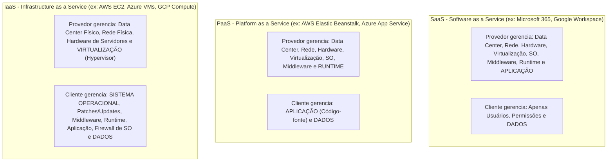
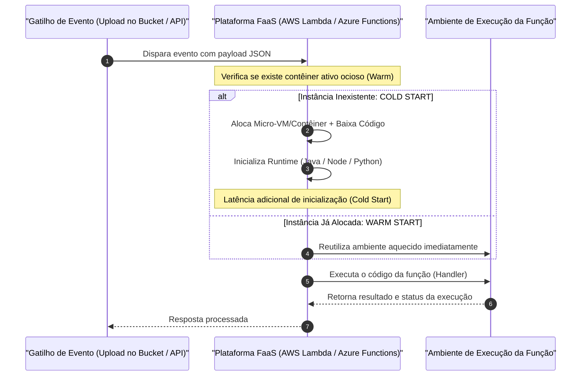
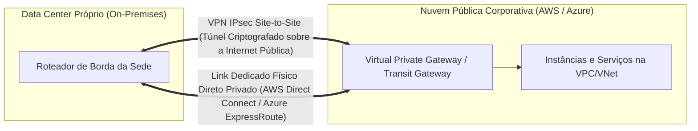

# 05 - Computação em Nuvem, Serverless e Ambientes Híbridos

> **Matéria:** Sistemas Operacionais, Redes e Computação em Nuvem  
> **Cargo:** B02 – Técnico de Controle Externo – Especialidade: Tecnologia da Informação  
> **Arquivo:** `05_computacao_em_nuvem_modelos_serverless_e_hibridos.md`  

---

## 📌 Ementa / Itens do Edital
- Fundamentos e características essenciais da Computação em Nuvem (NIST SP 800-145)
- Modelos de Serviço em Nuvem: IaaS, PaaS e SaaS
- Modelos de Implantação: Nuvem Pública, Privada, Comunitária e Híbrida
- Computação sem Servidor (Serverless / FaaS)
- Estratégias de escalabilidade (Vertical vs. Horizontal) e Alta Disponibilidade
- Integração entre ambientes locais (On-Premises) e nuvem pública
- Monitoramento de infraestrutura e custos em nuvem (FinOps)

---

## 🧭 Sumário

1. [Fundamentos de Computação em Nuvem (NIST SP 800-145)](#1-fundamentos-de-computacao-em-nuvem-nist-sp-800-145)
    1. [Definição Canônica do NIST](#11-definicao-canonica-do-nist)
    2. [As Cinco Características Essenciais](#12-as-cinco-caracteristicas-essenciais)
    3. [Os Quatro Modelos de Implantação (Pública, Privada, Comunitária, Híbrida)](#13-os-quatro-modelos-de-implantacao-publica-privada-comunitaria-hibrida)
    4. [Teste 454](#Teste-454)
    5. [Teste 455](#Teste-455)
2. [Modelos de Serviço e Matriz de Responsabilidade Compartilhada](#2-modelos-de-servico-e-matriz-de-responsabilidade-compartilhada)
    1. [IaaS, PaaS e SaaS: Estrutura e Escopos de Controle](#21-iaas-paas-e-saas-estrutura-e-escopos-de-controle)
    2. [Matriz de Responsabilidade Compartilhada (Shared Responsibility Model)](#22-matriz-de-responsabilidade-compartilhada-shared-responsibility-model)
    3. [Teste 456](#Teste-456)
    4. [Teste 457](#Teste-457)
3. [Computação Serverless (FaaS - Function as a Service)](#3-computacao-serverless-faas-function-as-a-service)
    1. [Paradigma: Execução Orientada a Eventos e Abstração de Infraestrutura](#31-paradigma-execucao-orientada-a-eventos-e-abstracao-de-infraestrutura)
    2. [Escala Automática a Zero (Scale-to-Zero) e Cobrança Fracionada](#32-escala-automatica-a-zero-scale-to-zero-e-cobranca-fracionada)
    3. [O Desafio do Cold Start e Estratégias de Mitigação](#33-o-desafio-do-cold-start-e-estrategias-de-mitigacao)
    4. [Teste 458](#Teste-458)
    5. [Teste 459](#Teste-459)
4. [Arquiteturas de Alta Disponibilidade e Escalabilidade em Nuvem](#4-arquiteturas-de-alta-disponibilidade-e-escalabilidade-em-nuvem)
    1. [Topologia Física Global: Regiões, Zonas de Disponibilidade (AZs) e Pontos de Presença](#41-topologia-fisica-global-regioes-zonas-de-disponibilidade-azs-e-pontos-de-presenca)
    2. [Escalabilidade Vertical (Scale-Up) vs. Horizontal (Scale-Out)](#42-escalabilidade-vertical-scale-up-vs-horizontal-scale-out)
    3. [Padrões de Resiliência: Multi-AZ e Recuperação de Desastres](#43-padroes-de-resiliencia-multi-az-e-recuperacao-de-desastres)
    4. [Teste 460](#Teste-460)
    5. [Teste 461](#Teste-461)
5. [Integração Híbrida e Governança Financeira (FinOps)](#5-integracao-hibrida-e-governanca-financeira-finops)
    1. [Conectividade Corporativa Híbrida: VPN IPsec vs. Links Dedicados Diretos](#51-conectividade-corporativa-hibrida-vpn-ipsec-vs-links-dedicados-diretos)
    2. [Modelos de Compra em Nuvem: On-Demand, Instâncias Reservadas e Spot](#52-modelos-de-compra-em-nuvem-on-demand-instancias-reservadas-e-spot)
    3. [FinOps: Transição CapEx para OpEx e Dimensionamento Correto (Rightsizing)](#53-finops-transicao-capex-para-opex-e-dimensionamento-correto-rightsizing)
    4. [Teste 462](#Teste-462)
    5. [Teste 463](#Teste-463)
    6. [Teste 464](#Teste-464)
6. [Fontes Recomendadas na Internet](#6-fontes-recomendadas-na-internet)

---

## 1. Fundamentos de Computação em Nuvem (NIST SP 800-145)

### 1.1 Definição Canônica do NIST

A publicação técnica especial **NIST SP 800-145** (*The NIST Definition of Cloud Computing*) consolidou o consenso acadêmico e de mercado sobre a computação em nuvem:
> *"Computação em nuvem é um modelo para habilitar acesso de rede ubíquo, conveniente e sob demanda a um conjunto compartilhado de recursos de computação configuráveis (por exemplo, redes, servidores, armazenamento, aplicativos e serviços) que podem ser rapidamente provisionados e liberados com esforço de gerenciamento mínimo ou interação do provedor de serviços."*

### 1.2 As Cinco Características Essenciais

Para ser legitimamente classificado como computação em nuvem, um ambiente tecnológico deve contemplar obrigatoriamente as cinco características essenciais normatizadas pelo NIST:

| Característica Essencial | Definição Canônica do NIST | Impacto Operacional / Exemplo |
|---|---|---|
| **1. Autoatendimento sob Demanda** (*On-Demand Self-Service*) | O consumidor pode provisionar recursos computacionais (tempo de CPU, instâncias, armazenamento) de forma unilateral e automática, **sem intervenção humana** de operadores do provedor. | Administrador cria uma máquina virtual via portal web ou CLI em 2 minutos. |
| **2. Amplo Acesso à Rede** (*Broad Network Access*) | Os recursos estão disponíveis na rede e são acessíveis por meio de mecanismos padronizados que promovem o uso por plataformas heterogêneas de clientes finos ou espessos. | Acesso corporativo uniforme via navegadores web, celulares, tablets ou estações de trabalho. |
| **3. Agrupamento de Recursos em Pool** (*Resource Pooling*) | Os recursos computacionais do provedor são agrupados para atender múltiplos clientes em um modelo **multilocatário (*multi-tenant*)**, com diferentes recursos físicos e virtuais atribuídos e reatribuídos dinamicamente. Independência de localização física. | Vários clientes compartilham o mesmo servidor físico isolados por hipervisores; o cliente desconhece a sala exata do servidor. |
| **4. Elasticidade Rápida** (*Rapid Elasticity*) | Capacidades podem ser provisionadas e liberadas de forma elástica, em alguns casos automaticamente, para **escalar rapidamente para fora e para dentro** conforme a demanda. Para o consumidor, os recursos parecem ilimitados. | Durante picos de tráfego, o *Auto Scaling* adiciona 20 servidores web em minutos e desliga-os à noite quando a demanda cai. |
| **5. Serviço Mensurado** (*Measured Service*) | Os sistemas em nuvem controlam e otimizam automaticamente o uso de recursos utilizando capacidade de medição (métricas de CPU, armazenamento, largura de banda, contas de usuário). O uso é monitorado, controlado e relatado com transparência. | Faturamento transparente no modelo *Pay-as-you-go* (pague estritamente pelos gigabytes e horas consumidos). |

### 1.3 Os Quatro Modelos de Implantação (Pública, Privada, Comunitária, Híbrida)

1. **Nuvem Pública (*Public Cloud*):** Infraestrutura aberta ao público em geral ou a grandes grupos industriais, pertencente e operada por um provedor comercial de nuvem (AWS, Microsoft Azure, Google Cloud, Oracle Cloud).
2. **Nuvem Privada (*Private Cloud*):** Infraestrutura provisionada para **uso exclusivo por uma única organização** com múltiplas unidades ou departamentos (ex.: data center corporativo governamental operado com OpenStack ou VMware). Pode ser gerenciada pela própria organização ou por terceiros.
3. **Nuvem Comunitária (*Community Cloud*):** Infraestrutura compartilhada exclusivamente por organizações que possuem missões, exigências de segurança, políticas ou conformidades regulatórias comuns (ex.: nuvem compartilhada entre os Tribunais de Contas dos Estados para auditoria concorrente).
4. **Nuvem Híbrida (*Hybrid Cloud*):** Composição de duas ou mais infraestruturas de nuvem distintas (privada, comunitária ou pública) que permanecem entidades independentes, mas são integradas por tecnologias padronizadas que asseguram a portabilidade de dados e aplicações (ex.: manter o banco de dados sigiloso na nuvem privada interna e expandir servidores web para a nuvem pública durante picos sazonais - técnica conhecida como *cloud bursting*).

---

### Teste 454
**(FCC – TRT-3 – Analista Judiciário (TI) – 2015)**  
A computação na nuvem apresenta a grande vantagem de acessar os recursos computacionais (processamento, banco de dados, etc) a partir da internet sem a necessidade de instalar programas e aplicações nos computadores e dispositivos. Dentre os diferentes tipos de serviços da computação na nuvem, quando recursos de hardware são acessados na nuvem, está se utilizando o tipo de serviço

* **A)** DevaaS.
* **B)** IaaS.
* **C)** CaaS.
* **D)** SaaS.
* **E)** PaaS. Caderno de Prova ’A28’, Tipo 001 16 TRT3R-An.Jud.-Tecnologia Informação-A28 ESTUDO DE CASO Instruções Gerais: Conforme Edital publicado, Capítulo IX: “3.1. Na Prova de Estudo de Caso deverão ser rigorosamente observados os limites mínimo de 12 (doze) linhas e o máximo de 20 (v inte) linhas, sob pena de perda de pontos a serem atribuídos à prova. 5. A Prova de Estudo de Caso terá caráter eliminatório e classificatório. Cada uma das questões será avaliada na escala de 0 (zero) a 100 (cem) pontos, considerando-se habilitado o candidato que tiver obtido, no conjunto das duas questões, média igual ou superior a 60 (sessenta) pontos. 7. Será atribuída nota ZERO à Prova de Estudo de Caso nos seguintes casos: a) fugir à modalidade de texto solicitada e/ou às questões práticas propostas; b) apresentar textos sob forma não articulada verbalmente (apenas com desenhos, números e palavras soltas ou em versos) ou qual quer fragmento do texto escrito fora do local apropriado; c) for assinada fora do local apropriado; d) apresentar qualquer sinal que, de alguma forma, possibilite a identificação do candidato; e) for escrita a lápis, em parte ou na sua totalidade; f) estiver em branco; g) apresentar letra ilegível e/ou incompreensível.”

---

> **Comentário Detalhado:**
>
> - **A)** Incorreta. DevaaS não é uma sigla padronizada pela taxonomia NIST SP 800-145.
> - **B)** Correta. Na classificação canônica dos modelos de serviço em computação em nuvem (NIST / ISO 17788), a Infraestrutura como Serviço (IaaS - Infrastructure as a Service) fornece recursos computacionais fundamentais de hardware (processamento, memória, máquinas virtuais, armazenamento e interfaces de rede) sob demanda, permitindo que o cliente instale e execute sistemas operacionais e softwares arbitrários.
> - **C)** Incorreta. CaaS (Containers as a Service) foca em orquestração de contêineres.
> - **D)** Incorreta. O SaaS entrega aplicações prontas para uso final na web.
> - **E)** Incorreta. O PaaS disponibiliza plataformas de desenvolvimento e runtimes de execução de software.
>
> **Gabarito: B**

---

### Teste 455
**(FGV – TJ-MT – Analista Judiciário (TI) – 2024)**  
A computação em nuvem é uma tecnologia que permite o acesso remoto a recursos de computação, como armazenamento, processamento e software, por meio da internet. Existem diversos modelos de serviço em computação em nuvem. A ideia por trás dos Modelos de Serviço em Computação em Nuvem é fornecer diferentes níveis de abstração e gerenciamento de recursos de TI para atender às diversas necessid ades das organizações e desenvolvedores. Nos modelos de serviço em computação em nuvem, a Plataforma como Serviço (PaaS)

* **A)** oferece ao usuário controle total sobre a infraestrutura física e virtual, permitindo que configure e gerencie servidores e armazenamento conforme necessário.
* **B)** disponibiliza um ambiente para desenvolvimento, teste e implementação de aplicações, sem a necessidade de gerenciar a infraestrutura subjacente.
* **C)** oferece um software completo via internet, pronto para uso, como e-mails e ferramentas de produtividade, sem a necessidade de instalação local.
* **D)** fornece recursos básicos de armazenamento e rede para que os usuários possam instalar e executar seus próprios sistemas operacionais e aplicações.
* **E)** permite ao usuário gerenciar somente a camada de segurança e backup, delegando o controle da infraestrutura para o provedor de nuvem.

---

> **Comentário Detalhado:**
>
> - **A)** Incorreta. Controle sobre a infraestrutura e gerenciamento de hardware/servidores caracteriza o modelo IaaS.
> - **B)** Correta. De acordo com o modelo de serviços em nuvem, a Plataforma como Serviço (PaaS) disponibiliza ao desenvolvedor todo o ambiente de runtime, bibliotecas, ferramentas de compilação e infraestrutura para desenvolvimento, teste e implantação de aplicações, abstraindo totalmente a complexidade de gerenciamento de servidores físicos, patches do sistema operacional, storage e redes.
> - **C)** Incorreta. Software completo fornecido pronto para o usuário final é a definição de Software como Serviço (SaaS).
> - **D)** Incorreta. O fornecimento de recursos básicos de armazenamento e rede onde o usuário instala seus próprios sistemas operacionais define o modelo IaaS.
> - **E)** Incorreta. A matriz de responsabilidade compartilhada no PaaS abrange desenvolvimento e dados sob controle do cliente, e a infraestrutura/S.O. sob guarda do provedor.
>
> **Gabarito: B**

---

## 2. Modelos de Serviço e Matriz de Responsabilidade Compartilhada

### 2.1 IaaS, PaaS e SaaS: Estrutura e Escopos de Controle

- **IaaS (*Infrastructure as a Service*):** O provedor entrega infraestrutura computacional bruta (máquinas virtuais, capacidade de processamento, armazenamento em bloco e interfaces de rede). O cliente instala, configura e mantém o Sistema Operacional convidado, middlewares, bancos de dados e aplicações.
- **PaaS (*Platform as a Service*):** O provedor entrega uma plataforma de desenvolvimento e execução pronta (runtimes como Node.js, Python, Java, .NET, acompanhados de bancos gerenciados). O desenvolvedor não se preocupa com o sistema operacional, atualizações de segurança ou virtualização; seu foco restringe-se exclusivamente ao código da aplicação e às configurações de negócio.
- **SaaS (*Software as a Service*):** O provedor disponibiliza um software de aplicação completo e funcional acessível pela Internet (ex.: navegadores web). Toda a pilha técnica (do hardware ao código) é mantida pelo provedor; o cliente gerencia apenas os usuários autorizados e seus dados operacionais.

### 2.2 Matriz de Responsabilidade Compartilhada (Shared Responsibility Model)

A segurança cibernética em nuvem fundamenta-se na **Responsabilidade Compartilhada**:

| Componente da Pilha | Ambiente Local (*On-Premises*) | IaaS | PaaS | SaaS |
|---|:---:|:---:|:---:|:---:|
| **Segurança Física do Data Center** | Cliente | **Provedor** | **Provedor** | **Provedor** |
| **Rede Física e Hardware de Servidores** | Cliente | **Provedor** | **Provedor** | **Provedor** |
| **Camada de Hipervisor / Virtualização** | Cliente | **Provedor** | **Provedor** | **Provedor** |
| **Sistema Operacional do Servidor (Guest OS)** | Cliente | **Cliente** | **Provedor** | **Provedor** |
| **Middleware e Runtimes de Execução** | Cliente | **Cliente** | **Provedor** | **Provedor** |
| **Código da Aplicação** | Cliente | **Cliente** | **Cliente** | **Provedor** |
| **Controle de Acessos e Identidades (IAM)** | Cliente | **Cliente** | **Cliente** | **Compartilhado / Cliente** |
| **Classificação, Governança e Dados** | **Cliente** | **Cliente** | **Cliente** | **Cliente** |

> 🚨 **ALERTA DE PROVA / PEGADINHA FCC:**  
> A responsabilidade pelos **DADOS e pela Classificação da Informação** pertence **SEMPRE E EXCLUSIVAMENTE AO CLIENTE**, em qualquer modelo (IaaS, PaaS ou SaaS). O provedor de nuvem jamais assume o dever legal sobre as autorizações concedidas pelo próprio cliente dentro de seus sistemas.

---

### Teste 456
**(FGV – TJ-RR – Analista Judiciário (TI) – 2024)**  
A equipe de desenvolvimento do TJ -RR precisa de uma solução de computação em nuvem que permita a criação e o gerenciamento de sua própria aplicação, mas prefere concentrar seus esforços exclusivamente no desenvolvimento do software, sem a necessidade de gerenciar detalhes da infraestrutura subjacente, como servidores, balanceamento de carga ou atualizações de sistema operacional. Além disso, essa solução deve oferecer escalabilidade para lidar com picos de demanda, integração com ferramentas de desenvolvimento, e a possibilidade de implantar rapidamente novas versões da aplicação. Assinale a afirmativa correta acerca do modelo de serviço em nuvem mais adequado para esse cenário.

* **A)** Infrastructure as a Service (IaaS) seria o mais indicado, pois possibilita que a equipe de desenvolvimento configure seu ambiente de infraestrutura virtual.
* **B)** Software as a Service (SaaS) oferece a maior simplicidade, já que a equipe de dese nvolvimento pode utilizar aplicações prontas, com mínima necessidade de ajustes na infraestrutura.
* **C)** Platform as a Service (PaaS) facilita o gerenciamento de servidores e redes, permitindo que a organização desenvolva e execute suas próprias aplicações, sem preocupações com infraestrutura física , mas com responsabilidade total sobre os sistemas operacionais.
* **D)** Infrastructure as a Service (IaaS) proporciona flexibilidade na configuração de infraestrutura, permitindo à organização adaptar os recursos de h ardware virtual conforme as necessidades da aplicação, sem precisar gerenciar balanceamento de carga.
* **E)** Platform as a Service (PaaS) é a solução mais apropriada, uma vez que disponibiliza um ambiente completo de desenvolvimento e execução, eliminando a necessidade de gerenciamento de servidores, balanceamento de carga e sistemas operacionais, enquanto garante a escalabilidade e integração com ferramentas de desenvolvimento.

---

> **Comentário Detalhado:**
>
> - **A)** Incorreta. O IaaS exige que a equipe gerencie o sistema operacional, patches e configurações de servidor, o que contraria a demanda de concentrar esforços apenas no desenvolvimento.
> - **B)** Incorreta. O SaaS disponibiliza aplicações prontas, não atendendo à necessidade da equipe de desenvolver seu próprio software proprietário.
> - **C)** Incorreta. No PaaS a responsabilidade pelo sistema operacional fica a cargo do provedor de nuvem, e não do time de desenvolvimento.
> - **D)** Incorreta. O IaaS não oferece abstração nativa de balanceadores e runtimes.
> - **E)** Correta. O modelo Platform as a Service (PaaS) é a solução ideal para o cenário do Tribunal de Justiça, pois provê um ambiente completo de execução de código e entrega contínua, permitindo que a equipe foque unicamente nas regras de negócio da aplicação, enquanto o provedor gerencia automaticamente a escalabilidade, o balanceamento de carga, a disponibilidade dos nós e as atualizações do sistema operacional.
>
> **Gabarito: E**

---

### Teste 457
**(FGV – TRT – Analista Judiciário - Suporte e Infraestrutura de TI – 2022)**
O Poder Judiciário criou a Plataforma Digital do Poder Judiciário 
Brasileiro (PDPJ -Br) para disponibilizar soluções para uso por 
todos os sistemas de processo judicial eletrônico do Poder 
Judiciário nacional. A PDPJ -Br é disponibilizada na forma de um 
marketplace que pode ser hospedada em nuvem.  
O requisito a ser observado para permitir a hospedagem da PDPJ-Br 
em um provedor de serviços de nuvem é que a nuvem:

* **A)** seja híbrida e exclusiva para o Poder Judiciário;
* **B)** seja híbrida, podendo ser compartilhada somente outro 
órgão público;
* **C)** armazene os dados em um datacenter em território nacional;
* **D)** transmita os dados por equipamentos em território nacional;
* **E)** realize o backup dos dados em equipamentos do Poder 
Judiciário.

---

> **Comentário Detalhado:**
>
> - **A)** Incorreta. Discrepa das diretrizes normativas e jurisprudenciais aplicáveis ao tema objeto do item.
> - **B)** Incorreta. Discrepa das diretrizes normativas e jurisprudenciais aplicáveis ao tema objeto do item.
> - **C)** Incorreta. Discrepa das diretrizes normativas e jurisprudenciais aplicáveis ao tema objeto do item.
> - **D)** Incorreta. Discrepa das diretrizes normativas e jurisprudenciais aplicáveis ao tema objeto do item.
> - **E)** Correta. Representa com precisão a disciplina do tema e o entendimento pacificado adotado pela banca (FGV).
>
> **Gabarito: E**

---
## 3. Computação Serverless (FaaS - Function as a Service)

### 3.1 Paradigma: Execução Orientada a Eventos e Abstração de Infraestrutura

Na computação sem servidor (**Serverless / FaaS**), o conceito de servidor físico ou máquina virtual é totalmente abstraído para a equipe de tecnologia. O desenvolvimento organiza-se em torno de pequenas funções de código atômicas disparadas em resposta a **Eventos**:

- Requisições HTTP tratadas por um API Gateway;
- Eventos de armazenamento de arquivos (upload em buckets S3 ou Azure Blobs);
- Mensagens inseridas em filas assíncronas (SQS, RabbitMQ, Kafka);
- Alterações em registros de bancos de dados NoSQL (DynamoDB Streams);
- Gatilhos temporais agendados.

### 3.2 Escala Automática a Zero (Scale-to-Zero) e Cobrança Fracionada

As arquiteturas Serverless destacam-se por duas características econômicas e operacionais revolucionárias:

- **Redução de Escala a Zero (*Scale-to-Zero*):** Se o tribunal passa a madrugada inteira ou o fim de semana sem receber nenhuma requisição nas funções, nenhuma instância computacional permanece ligada na nuvem. A cobrança pelo serviço durante esse período é de exatamente **R$ 0,00**.
- **Faturamento Fino e Fracionado:** O valor cobrado é proporcional aos milissegundos efetivos de processamento do código da função multiplicado pelo montante de memória RAM alocada.
- **Arquitetura Stateless (Sem Estado):** Como o contêiner subjacente à função pode ser destruído a qualquer instante pela nuvem, as funções devem ser estritamente sem estado (*stateless*). Qualquer dado que precise persistir deve ser gravado em serviços externos duráveis (bancos de dados, caches Redis, storages).

### 3.3 O Desafio do Cold Start e Estratégias de Mitigação

- **Cold Start (Inicialização a Frio):** Ocorre quando uma requisição chega e a plataforma precisa criar uma nova micro-VM/contêiner do zero, baixar o pacote de código e inicializar a máquina virtual da linguagem (especialmente perceptível em linguagens com runtimes pesados como Java e .NET). Isso introduz uma latência inicial transitória.
- **Warm Start:** Se novas requisições chegarem logo em seguida, a plataforma reutiliza o ambiente já instanciado e aquecido (*Warm Container*), executando o código instantaneamente.
- **Mitigações de Cold Start:** Utilização de *Provisioned Concurrency* (manutenção de instâncias pré-aquecidas pagas pelo provedor), redução de bibliotecas importadas e escolha de runtimes leves com partida ultrarrápida (Node.js, Go, Python).

---

### Teste 458
**(FGV – TRT – Analista Judiciário - Suporte e Infraestrutura de TI – 2022)**
O órgão XPTO do Poder Judiciário está implementando tecnologia 
em nuvem para prover serviços para outros ó rgãos. Os serviços 
ofertados consistirão em um ambiente no qual os clientes 
receberão máquinas virtuais, com suas áreas de armazenamento 
definidas ( storage) e as interfaces de rede de acordo com os 
ambientes (produtivos ou não produtivos), nas quais poderã o 
instalar os sistemas operacionais e suas aplicações para 
disponibilizarem serviços para seus clientes.  
De acordo com a NIST SP 800-145, o modelo de serviço de nuvem 
implementado pelo órgão XPTO é o:

* **A)** infrastructure as a service;
* **B)** on-demand self-service;
* **C)** software as a service;
* **D)** platform as a service;
* **E)** measured service.

---

> **Comentário Detalhado:**
>
> - **A)** Incorreta. Discrepa das diretrizes normativas e jurisprudenciais aplicáveis ao tema objeto do item.
> - **B)** Incorreta. Discrepa das diretrizes normativas e jurisprudenciais aplicáveis ao tema objeto do item.
> - **C)** Incorreta. Discrepa das diretrizes normativas e jurisprudenciais aplicáveis ao tema objeto do item.
> - **D)** Correta. Representa com precisão a disciplina do tema e o entendimento pacificado adotado pela banca (FGV).
> - **E)** Incorreta. Discrepa das diretrizes normativas e jurisprudenciais aplicáveis ao tema objeto do item.
>
> **Gabarito: D**

---
### Teste 459
**(FGV – TRT – Analista Judiciário - Suporte e Infraestrutura de TI – 2022)**
Um órgão que lida com muitos documentos sigilosos sinalizou 
para sua equipe de Tecnologia da Informação (TI) sua 
preocupação quanto a uma invasão cibernética e roubo desses 
documentos. Para incrementar a segurança da rede desse órgão, 
a equipe de TI instalou um equipamento capaz de verificar as 
conexões TCP em andame nto antes de permitir a passagem de 
um determinado pacote.  
O equipamento instalado pela equipe de TI utiliza recursos de:

* **A)** IDS (Intrusion Detection System);
* **B)** gateway VPN;
* **C)** gateway de aplicação;
* **D)** filtro de pacotes tradicionais;
* **E)** filtro de estado.

---

> **Comentário Detalhado:**
>
> - **A)** Incorreta. Discrepa das diretrizes normativas e jurisprudenciais aplicáveis ao tema objeto do item.
> - **B)** Correta. Representa com precisão a disciplina do tema e o entendimento pacificado adotado pela banca (FGV).
> - **C)** Incorreta. Discrepa das diretrizes normativas e jurisprudenciais aplicáveis ao tema objeto do item.
> - **D)** Incorreta. Discrepa das diretrizes normativas e jurisprudenciais aplicáveis ao tema objeto do item.
> - **E)** Incorreta. Discrepa das diretrizes normativas e jurisprudenciais aplicáveis ao tema objeto do item.
>
> **Gabarito: B**

---
## 4. Arquiteturas de Alta Disponibilidade e Escalabilidade em Nuvem

### 4.1 Topologia Física Global: Regiões, Zonas de Disponibilidade (AZs) e Pontos de Presença

A infraestrutura dos grandes provedores de nuvem (AWS, Microsoft Azure, Google Cloud) é estruturada em níveis hierárquicos de isolamento físico:

- **Região (*Region*):** Área geográfica delimitada no planeta (ex.: Região de São Paulo `sa-east-1`, Virgínia `us-east-1`), totalmente isolada e independente de outras regiões para evitar falhas em cascata.
- **Zona de Disponibilidade (*Availability Zone - AZ*):** Cada região abriga múltiplas (no mínimo duas, geralmente três ou mais) Zonas de Disponibilidade.  
    - Uma AZ é composta por **um ou mais data centers físicos discretos**, com suprimento elétrico independente (subestações e geradores próprios), refrigeração dedicada e conectividade de rede redundante.
    - As AZs de uma mesma região são interconectadas por enlaces de fibra óptica de altíssima velocidade e ultra-baixa latência (< 2 milissegundos).
- **Pontos de Presença (*Edge Locations / PoPs*):** Data centers distribuídos em centenas de cidades globais responsáveis por aproximar o conteúdo do usuário final por meio de redes de entrega de conteúdo (**CDN**), realizando cache e terminação SSL próxima ao cliente.

### 4.2 Escalabilidade Vertical (Scale-Up) vs. Horizontal (Scale-Out)

| Dimensão | Escalabilidade Vertical (*Scale-Up / Scale-Down*) | Escalabilidade Horizontal (*Scale-Out / Scale-In*) |
|---|---|---|
| **Conceito Operacional** | Adicionar mais poder de processamento (vCPUs), memória RAM ou disco a uma **mesma máquina virtual existente**. | Adicionar **mais instâncias virtuais idênticas em paralelo**, distribuindo a carga sob um balanceador de carga. |
| **Disponibilidade / Downtime** | Na maioria das vezes exige reiniciar ou paralisar o servidor temporariamente para aplicar o novo tamanho de hardware. | **Zero downtime**. Novas instâncias entram e saem do pool de atendimento dinamicamente sem interromper o serviço. |
| **Limite Máximo** | Possui um **teto físico rígido** determinado pelo maior tamanho de máquina física existente no catálogo do provedor. | **Virtualmente ilimitado**. Permite escalar para dezenas, centenas ou milhares de nós computacionais. |
| **Tolerância a Falhas** | Fraca: a máquina única permanece como Ponto Único de Falha (*Single Point of Failure*). | Excelente: se uma instância quebrar, as demais continuam absorvendo as requisições com suporte a *Auto Scaling*. |

### 4.3 Padrões de Resiliência: Multi-AZ e Recuperação de Desastres

- **Arquitetura Multi-AZ:** Distribuição de servidores web e instâncias de banco de dados por pelo menos duas Zonas de Disponibilidade distintas dentro da mesma região. Em caso de desastre físico em um data center (alagamento, explosão de subestação), a outra AZ assume a carga imediatamente sem perda de dados.
- **Recuperação de Desastres Multi-Região:** Utilizada para requisitos de continuidade de negócio críticos onde a perda de uma região geográfica inteira é tolerada através de replicação remota de dados com base nas métricas corporativas de **RTO** (*Recovery Time Objective*) e **RPO** (*Recovery Point Objective*).

---

### Teste 460
**(FGV – TRT-16 – Analista Judiciário - Tecnologia da Informação – 2022)**
O RAID é um subsistema de armazenamento de dados composto 
por várias unidades de discos individuais de baixo custo. 
Com relação ao RAID 6, analise os itens a seguir. 
I. Provê elevada tolerância a falhas e pode sustentar várias 
falhas simultâneas em suas unidades, efetua dois cálculos 
independentes de paridades que são armazenados em duas 
unidades distintas. 
II. Como desvantagem requer controladoras de disco mais 
complexas, que  em geral, possuem alta sobrecarga para 
computar os endereçamentos das paridades. 
III. Essa configuração é recomendada para aplicações de missão 
crítica pois os dados dos usuários são espelhados unidades de 
disco pareadas. 
Está correto o que se afirma em

* **A)** I, apenas.
* **B)** II, apenas.
* **C)** III, apenas.
* **D)** I e II, apenas.
* **E)** II e III, apenas.

---

> **Comentário Detalhado:**
>
> - **A)** Incorreta. Discrepa das diretrizes normativas e jurisprudenciais aplicáveis ao tema objeto do item.
> - **B)** Correta. Representa com precisão a disciplina do tema e o entendimento pacificado adotado pela banca (FGV).
> - **C)** Incorreta. Discrepa das diretrizes normativas e jurisprudenciais aplicáveis ao tema objeto do item.
> - **D)** Incorreta. Discrepa das diretrizes normativas e jurisprudenciais aplicáveis ao tema objeto do item.
> - **E)** Incorreta. Discrepa das diretrizes normativas e jurisprudenciais aplicáveis ao tema objeto do item.
>
> **Gabarito: B**

---
### Teste 461
**(FCC – TRT-6 – Analista Judiciário - Tecnologia da Informação – 2012)**
"Modificação da informação contida nos cabeçalhos de pacotes IP no seu percurso  através de um roteador" é uma descrição do  
processo conhecido pela sigla

* **A)** P2P.
* **B)** VPN.
* **C)** DoS.
* **D)** IPSec.
* **E)** NAT.

---

> **Comentário Detalhado:**
>
> - **A)** Incorreta. Discrepa das diretrizes normativas e jurisprudenciais aplicáveis ao tema objeto do item.
> - **B)** Incorreta. Discrepa das diretrizes normativas e jurisprudenciais aplicáveis ao tema objeto do item.
> - **C)** Incorreta. Discrepa das diretrizes normativas e jurisprudenciais aplicáveis ao tema objeto do item.
> - **D)** Correta. Representa com precisão a disciplina do tema e o entendimento pacificado adotado pela banca (FCC).
> - **E)** Incorreta. Discrepa das diretrizes normativas e jurisprudenciais aplicáveis ao tema objeto do item.
>
> **Gabarito: D**

---
## 5. Integração Híbrida e Governança Financeira (FinOps)

### 5.1 Conectividade Corporativa Híbrida: VPN IPsec vs. Links Dedicados Diretos

1. **VPN IPsec Site-to-Site:** Estabelece um túnel criptografado seguro **através da Internet pública**. Possui baixo custo e rapidez de implantação, mas fica sujeita a oscilações de latência (*jitter*), perda de pacotes e instabilidades dos provedores de trânsito da Internet.
2. **Conexões Físicas Dedicadas (AWS Direct Connect / Azure ExpressRoute):** Circuito de telecomunicação físico dedicado e direto entre o data center corporativo e o ponto de interconexão do provedor de nuvem.  
   > 🚨 **VANTAGEM CANÔNICA FCC:** Esse tráfego **NÃO PASSA PELA INTERNET PÚBLICA**! Fornece largura de banda garantida e previsível (1 Gbps a 100 Gbps), latência determinística mínima e altíssima segurança física.

### 5.2 Modelos de Compra em Nuvem: On-Demand, Instâncias Reservadas e Spot

- **Sob Demanda (*On-Demand*):** Paga estritamente pelas horas ou segundos consumidos, sem compromisso de permanência nem custo inicial. Flexibilidade máxima com o preço de tabela unitário mais elevado.
- **Instâncias Reservadas (*Reserved Instances*) / Savings Plans:** O cliente assume um **compromisso formal de uso contínuo por prazos de 1 ou 3 anos**. Em troca, os provedores concedem descontos expressivos de até **72%** sobre o valor da hora. É a opção ideal para servidores com carga permanente previsível (bancos de dados centrais).
- **Instâncias Spot / Preemptíveis:** O provedor comercializa a capacidade computacional ociosa de seus data centers com descontos extremos de até **90%**. Contudo, **o provedor tem a prerrogativa de interromper ou desligar a instância a qualquer momento** (com aviso prévio de apenas 2 minutos) quando a capacidade for requisitada por clientes pagantes sob demanda. Deve ser utilizada exclusivamente para tarefas assíncronas tolerantes a falhas (renderização, processamento em lote, pipelines analíticos).

### 5.3 FinOps: Transição CapEx para OpEx e Dimensionamento Correto (Rightsizing)

- **Transição Financeira: CapEx $\rightarrow$ OpEx:**
    - *CapEx (Capital Expenditure):* Despesas de capital com aquisição física pesada de hardware, licenças perpétuas, geradores e salas-cofre, depreciados contabilmente ao longo de anos.
    - *OpEx (Operational Expenditure):* Despesas operacionais recorrentes, pagas conforme o uso real (*Pay-as-you-go*), proporcionando agilidade orçamentária e redução de custos ociosos.
- **Dimensionamento Correto (*Rightsizing*):** Prática sistemática de inspecionar a telemetria de consumo (percentual real de uso de CPU e memória RAM) e redimensionar instâncias superdimensionadas para tipos menores e mais aderentes à necessidade real, eliminando desperdício orçamentário.

---

### Teste 462
**(FCC – TRT-6 – Analista Judiciário - Tecnologia da Informação – 2012)**
Segundo o Web Services for Remote Portlets Specification v2.0 (WSRP), em um fluxo típico de interação entre os atores, a fase 
que deve ocorrer primeiro, na ordem cronológica, é aquela em que

* **A)** se estabelece uma relação entre o consumidor e o usuário final.
* **B)** o consumidor aprende as capacidades totais e serviços do produtor.
* **C)** se estabelece a relação entre o consumidor e o produtor.
* **D)** páginas agregadas são produzidas pelo produtor.
* **E)** uma página é requisitada pelo consumidor.

---

> **Comentário Detalhado:**
>
> - **A)** Incorreta. Discrepa das diretrizes normativas e jurisprudenciais aplicáveis ao tema objeto do item.
> - **B)** Incorreta. Discrepa das diretrizes normativas e jurisprudenciais aplicáveis ao tema objeto do item.
> - **C)** Incorreta. Discrepa das diretrizes normativas e jurisprudenciais aplicáveis ao tema objeto do item.
> - **D)** Incorreta. Discrepa das diretrizes normativas e jurisprudenciais aplicáveis ao tema objeto do item.
> - **E)** Correta. Representa com precisão a disciplina do tema e o entendimento pacificado adotado pela banca (FCC).
>
> **Gabarito: E**

---
### Teste 463
**(FCC – TRT – Analista Judiciário - Tecnologia da Informação – 2009)**
A avaliação do custo-benefício de um título permutado 
com outra instituição ou biblioteca deve considerar, entre 
outras coisas, o equilíbrio de conteúdo das publicações, 
os custos reais da publicação da própria entidade, os cus-
tos de todos os serviços para abrigar o título recebido e

* **A)** o processamento do material comparado com o 
mesmo processamento se fosse adquirido por 
compra.
* **B)** o tempo necessário para recebimento do material 
comparado com o mesmo tempo se fosse adquirido 
por compra.
* **C)** o tempo necessário para realização dos contatos 
visando o estabelecimento da permuta.
* **D)** o aumento da carga de trabalho devido à ampliação 
do número de títulos permutados.
* **E)** a cultura da organização. 
_________________________________________________________

---

> **Comentário Detalhado:**
>
> - **A)** Incorreta. Discrepa das diretrizes normativas e jurisprudenciais aplicáveis ao tema objeto do item.
> - **B)** Correta. Representa com precisão a disciplina do tema e o entendimento pacificado adotado pela banca (FCC).
> - **C)** Incorreta. Discrepa das diretrizes normativas e jurisprudenciais aplicáveis ao tema objeto do item.
> - **D)** Incorreta. Discrepa das diretrizes normativas e jurisprudenciais aplicáveis ao tema objeto do item.
> - **E)** Incorreta. Discrepa das diretrizes normativas e jurisprudenciais aplicáveis ao tema objeto do item.
>
> **Gabarito: B**

---
### Teste 464
**(FCC – TRT – Analista Judiciário - Tecnologia da Informação – 2009)**
Visando melhorar o atendimento do usuário e, ao mesmo 
tempo, promover o uso extensivo dos recursos da biblio-
teca, o serviço de informação e referência deve concentrar 
esforços

* **A)** no serviço de empréstimo domiciliar.
* **B)** na educação do usuário.
* **C)** na divulgação da biblioteca.
* **D)** no treinamento do bibliotecário.
* **E)** na comunicação visual do espaço. 
_________________________________________________________

---

> **Comentário Detalhado:**
>
> - **A)** Correta. Representa com precisão a disciplina do tema e o entendimento pacificado adotado pela banca (FCC).
> - **B)** Incorreta. Discrepa das diretrizes normativas e jurisprudenciais aplicáveis ao tema objeto do item.
> - **C)** Incorreta. Discrepa das diretrizes normativas e jurisprudenciais aplicáveis ao tema objeto do item.
> - **D)** Incorreta. Discrepa das diretrizes normativas e jurisprudenciais aplicáveis ao tema objeto do item.
> - **E)** Incorreta. Discrepa das diretrizes normativas e jurisprudenciais aplicáveis ao tema objeto do item.
>
> **Gabarito: A**

---
## 6. Fontes Recomendadas na Internet

* [NIST SP 800-145 - The NIST Definition of Cloud Computing](https://csrc.nist.gov/pubs/sp/800/145/final) - Definição seminal do NIST contemplando os 5 atributos essenciais, 3 modelos de serviço (IaaS, PaaS, SaaS) e 4 modelos de implantação.
* [Martin Fowler - Serverless Architectures](https://martinfowler.com/articles/serverless.html) - Artigo seminal e abrangente de Martin Fowler e Mike Roberts sobre arquitetura, padrões e desafios do paradigma Serverless.
* [Governo Digital - Computação em Nuvem no Setor Público](https://www.gov.br/governodigital/pt-br/infraestrutura-nacional-de-dados/ambiente-tecnologico/nuvem) - Diretrizes e estratégia federal de contratação e adoção de infraestrutura em nuvem.
* [AWS Official Documentation - O que é Computação Serverless?](https://aws.amazon.com/pt/serverless/) - Conceitos e arquitetura de computação sem servidor, automação orientada a eventos e escalabilidade sob demanda.
* [NIST SP 800-146 - Cloud Computing Synopsis and Recommendations](https://csrc.nist.gov/pubs/sp/800/146/final) - Recomendações técnicas detalhadas para adoção de nuvens públicas, privadas, híbridas e comunitárias.
* VERAS, Manoel. **Cloud Computing: Nova Arquitetura de TI**. Rio de Janeiro: Brasport, 2016. (Cap. 1 a 4 - Modelos de Entrega e Implantação em Nuvem).
* FOWLER, Martin. **Patterns of Enterprise Application Architecture**. Boston: Addison-Wesley, 2002. (Cap. 3 a 5 - Estruturas de Distribuição e Escalabilidade).
* BUYYA, Rajkumar; VECCHIOLA, Christian; SELVI, S. Thamarai. **Mastering Cloud Computing: Foundations and Applications Programming**. Burlington: Morgan Kaufmann, 2013. (Cap. 4 - Cloud Computing Architecture; Cap. 8 - Virtualization).
