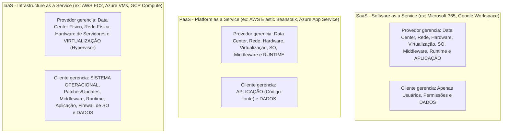
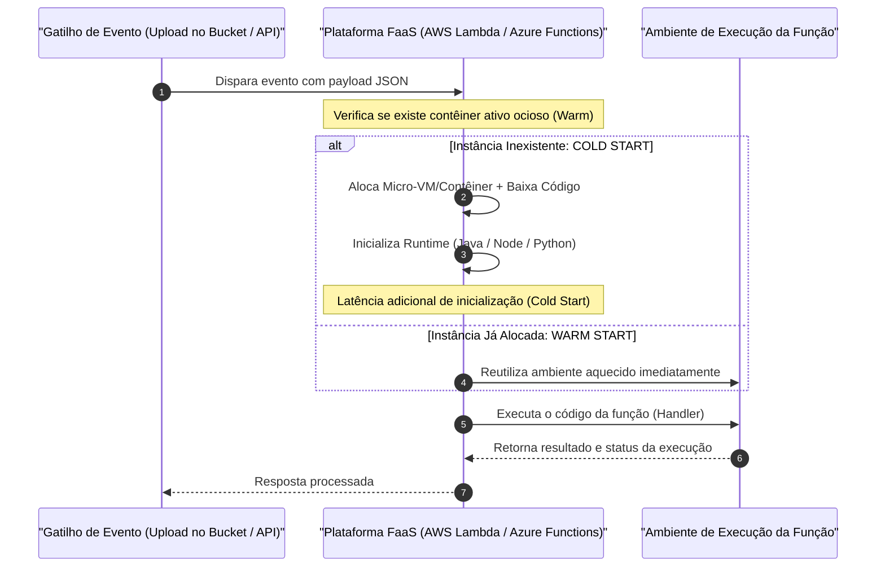
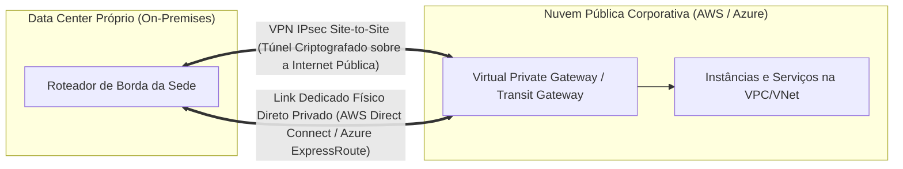

# 05 - Computação em Nuvem, Serverless e Ambientes Híbridos

> **Matéria:** Sistemas Operacionais, Redes e Computação em Nuvem  
> **Cargo:** B02 – Técnico de Controle Externo – Especialidade: Tecnologia da Informação  
> **Arquivo:** `05_computacao_em_nuvem_modelos_serverless_e_hibridos.md`  

---

## 📌 Ementa / Itens do Edital
- Fundamentos e características essenciais da Computação em Nuvem (NIST SP 800-145)
- Modelos de Serviço em Nuvem: IaaS, PaaS e SaaS
- Modelos de Implantação: Nuvem Pública, Privada, Comunitária e Híbrida
- Computação sem Servidor (Serverless / FaaS)
- Estratégias de escalabilidade (Vertical vs. Horizontal) e Alta Disponibilidade
- Integração entre ambientes locais (On-Premises) e nuvem pública
- Monitoramento de infraestrutura e custos em nuvem (FinOps)

---

## 🌳 Classificação Hierárquica

```text
5. Paradigma Cloud Computing, Arquiteturas Serverless e Estratégias Híbridas
├── 5.1 Fundamentos de Computação em Nuvem (NIST SP 800-145)
│   ├── 5.1.1 Definição Canônica do NIST
│   ├── 5.1.2 As Cinco Características Essenciais da Nuvem:
│   │   ├── 1. Autoatendimento sob Demanda (On-Demand Self-Service): Provisionamento sem intervenção humana do provedor
│   │   ├── 2. Amplo Acesso à Rede (Broad Network Access): Disponível via rede por plataformas heterogêneas
│   │   ├── 3. Pool de Recursos Compartilhados (Resource Pooling): Modelo multitenant com abstração de localização física
│   │   ├── 4. Elasticidade Rápida (Rapid Elasticity): Escalar para cima e para baixo automática e ilimitadamente
│   │   └── 5. Serviço Mensurado (Measured Service): Pagamento conforme o uso (Pay-as-you-go) com métricas transparentes
│   └── 5.1.3 Os Quatro Modelos de Implantação:
│       ├── Nuvem Pública (Public Cloud: infraestrutura aberta ao público geral)
│       ├── Nuvem Privada (Private Cloud: uso exclusivo por uma única organização)
│       ├── Nuvem Comunitária (Community Cloud: compartilhada por órgãos com interesses e requisitos afins)
│       └── Nuvem Híbrida (Hybrid Cloud: integração de duas ou mais nuvens distintas mantendo portabilidade de dados)
├── 5.2 Modelos de Serviço e Matriz de Responsabilidade Compartilhada
│   ├── 5.2.1 IaaS (Infrastructure as a Service): Hardware e virtualização pelo provedor; SO, middleware e dados pelo cliente
│   ├── 5.2.2 PaaS (Platform as a Service): Do hardware ao SO gerenciados pelo provedor; código e dados pelo cliente
│   ├── 5.2.3 SaaS (Software as a Service): Toda a pilha técnica pelo provedor; apenas dados e configurações pelo cliente
│   └── 5.2.4 Matriz de Responsabilidade Compartilhada (Shared Responsibility Model) em Segurança da Informação
├── 5.3 Computação Serverless (FaaS - Function as a Service)
│   ├── 5.3.1 Paradigma: Funções atômicas de negócio sem gerenciamento ou provisionamento de servidores
│   ├── 5.3.2 Características do Serverless:
│   │   ├── Execução orientada a eventos (Event-Driven: disparada por HTTP, storage, mensageria e agendamentos)
│   │   ├── Cobrança estrita por tempo de execução em milissegundos e consumo de memória
│   │   ├── Escala Automática a Zero (Scale-to-Zero: custo zero em períodos de ociosidade total)
│   │   └── O Desafio do Cold Start (latência de inicialização a frio de contêineres e runtimes)
│   └── 5.3.3 Serviços de Referência: AWS Lambda, Azure Functions e Google Cloud Functions
├── 5.4 Arquiteturas de Alta Disponibilidade e Escalabilidade em Nuvem
│   ├── 5.4.1 Topologia de Infraestrutura Global:
│   │   ├── Regiões (Regions: áreas geográficas independentes no mundo)
│   │   ├── Zonas de Disponibilidade (AZs: data centers físicos isolados com energia e rede redundantes na mesma região)
│   │   └── Pontos de Presença / Edge Locations (PoP para redes CDN de entrega de conteúdo)
│   ├── 5.4.2 Estratégias de Escalabilidade:
│   │   ├── Vertical (Scale-Up / Scale-Down): Aumento de CPU/RAM em máquina única (com teto físico e indisponibilidade)
│   │   └── Horizontal (Scale-Out / Scale-In): Adição de instâncias idênticas paralelas com Auto Scaling
│   └── 5.4.3 Padrões de Resiliência: Multi-AZ, Disaster Recovery Multi-Região e métricas RPO / RTO
└── 5.5 Integração Híbrida e Governança de Custos (FinOps)
    ├── 5.5.1 Conectividade Corporativa Híbrida:
    │   ├── VPN Site-to-Site com IPsec sobre a Internet pública
    │   └── Links Dedicados Privados Diretos (AWS Direct Connect, Azure ExpressRoute)
    ├── 5.5.2 Gerenciamento e Monitoramento em Nuvem:
    │   ├── Coleta de métricas e alarmes (CloudWatch, Azure Monitor)
    │   └── Trilha de auditoria e conformidade de chamadas de API (CloudTrail)
    └── 5.5.3 Governança Financeira (FinOps):
        ├── Dimensionamento Correto (Rightsizing) e etiquetagem por centros de custo
        └── Modelos de Compra: Sob Demanda (On-Demand), Instâncias Reservadas / Savings Plans e Instâncias Spot
```

---

## 📖 Resumo Teórico & Conceitos Fundamentais

### 5.1 Fundamentos de Computação em Nuvem (NIST SP 800-145)

A publicação normativa **NIST SP 800-145** (*The NIST Definition of Cloud Computing*) estabelece a definição de referência mundial para o paradigma:
> *"Computação em nuvem é um modelo para habilitar acesso de rede ubíquo, conveniente e sob demanda a um conjunto compartilhado de recursos de computação configuráveis (por exemplo, redes, servidores, armazenamento, aplicativos e serviços) que podem ser rapidamente provisionados e liberados com esforço de gerenciamento mínimo ou interação do provedor de serviços."*

#### As Cinco Características Essenciais (Cobrança Literal FCC)

| Característica Essencial | Definição Canônica do NIST | Impacto Operacional / Exemplo |
| :--- | :--- | :--- |
| **1. Autoatendimento sob Demanda** (*On-Demand Self-Service*) | O consumidor pode provisionar recursos computacionais (tempo de CPU, instâncias, armazenamento) de forma unilateral e automática, **sem intervenção humana** de operadores do provedor. | Administrador cria uma máquina virtual via portal web ou CLI em 2 minutos. |
| **2. Amplo Acesso à Rede** (*Broad Network Access*) | Os recursos estão disponíveis na rede e são acessíveis por meio de mecanismos padronizados que promovem o uso por plataformas heterogêneas de clientes finos ou espessos. | Acesso corporativo uniforme via navegadores web, celulares, tablets ou estações de trabalho. |
| **3. Agrupamento de Recursos em Pool** (*Resource Pooling*) | Os recursos computacionais do provedor são agrupados para atender múltiplos clientes em um modelo **multilocatário (*multi-tenant*)**, com diferentes recursos físicos e virtuais atribuídos e reatribuídos dinamicamente. Independência de localização física. | Vários clientes compartilham o mesmo servidor físico isolados por hipervisores; o cliente desconhece a sala exata do servidor. |
| **4. Elasticidade Rápida** (*Rapid Elasticity*) | Capacidades podem ser provisionadas e liberadas de forma elástica, em alguns casos automaticamente, para **escalar rapidamente para fora e para dentro** conforme a demanda. Para o consumidor, os recursos parecem ilimitados. | Durante picos de tráfego, o *Auto Scaling* adiciona 20 servidores web em minutos e desliga-os à noite quando a demanda cai. |
| **5. Serviço Mensurado** (*Measured Service*) | Os sistemas em nuvem controlam e otimizam automaticamente o uso de recursos utilizando capacidade de medição (métricas de CPU, armazenamento, largura de banda, contas de usuário). O uso é monitorado, controlado e relatado com transparência. | Faturamento transparente no modelo *Pay-as-you-go* (pague estritamente pelos gigabytes e horas consumidos). |

#### Os Quatro Modelos de Implantação:
1. **Nuvem Pública (*Public Cloud*):** Infraestrutura provisionada para uso aberto ao público em geral. Pertence, é gerenciada e operada por uma empresa comercial, instituição acadêmica ou governamental (AWS, Microsoft Azure, Google Cloud).
2. **Nuvem Privada (*Private Cloud*):** Infraestrutura provisionada para **uso exclusivo por uma única organização** com múltiplas unidades de negócio (ex.: OpenStack ou VMware em data center governamental próprio).
3. **Nuvem Comunitária (*Community Cloud*):** Compartilhada por organizações com missões, requisitos de conformidade, políticas ou considerações de segurança compartilhadas (ex.: nuvem compartilhada entre Ministérios Públicos e Tribunais de Contas estaduais).
4. **Nuvem Híbrida (*Hybrid Cloud*):** Composição de duas ou mais infraestruturas de nuvem distintas (privada, comunitária ou pública) que continuam sendo entidades únicas, mas são unidas por tecnologia padronizada ou proprietária que permite a portabilidade de dados e aplicativos (ex.: expansão para a nuvem pública em picos sazonais - *cloud bursting*).

---

### 5.2 Modelos de Serviço e Matriz de Responsabilidade Compartilhada



#### Matriz Detalhada de Responsabilidade Compartilhada

| Camada da Pilha Tecnológica | Local (*On-Premises*) | IaaS | PaaS | SaaS |
| :--- | :---: | :---: | :---: | :---: |
| **Acesso Físico e Data Center** | Cliente | **Provedor** | **Provedor** | **Provedor** |
| **Rede Física e Servidores Físicos** | Cliente | **Provedor** | **Provedor** | **Provedor** |
| **Camada de Virtualização / Hipervisor** | Cliente | **Provedor** | **Provedor** | **Provedor** |
| **Sistema Operacional do Servidor** | Cliente | **Cliente** | **Provedor** | **Provedor** |
| **Middleware e Runtimes de Linguagem** | Cliente | **Cliente** | **Provedor** | **Provedor** |
| **Código da Aplicação / Software** | Cliente | **Cliente** | **Cliente** | **Provedor** |
| **Identidades, Permissões e Credenciais** | Cliente | **Cliente** | **Cliente** | **Compartilhado / Cliente** |
| **Dados do Cliente e Classificação** | **Cliente** | **Cliente** | **Cliente** | **Cliente** |

> 🚨 **ALERTA DE PROVA / PEGADINHA FCC:**  
> A responsabilidade pelos **DADOS e Classificação da Informação** é **SEMPRE DO CLIENTE**, independentemente de o serviço ser IaaS, PaaS ou SaaS! O cliente nunca transfere para o provedor o dever legal de governança de dados. Em contrapartida, a **segurança física do data center** é sempre responsabilidade do provedor em qualquer modelo de nuvem pública.

---

### 5.3 Computação Serverless (FaaS - Function as a Service)

No paradigma **Serverless**, o desenvolvedor não gerencia máquinas virtuais, sistemas operacionais, contêineres subjacentes nem clusters de escalonamento. O código é estruturado em funções atômicas de negócio que executam em resposta a eventos.

#### Características Canônicas do Serverless:
1. **Abstração Total de Infraestrutura:** Inexistência de configuração de sistemas operacionais, patches de segurança de kernel ou reserva de instâncias.
2. **Execução Orientada a Eventos (*Event-Driven*):** As funções são disparadas por gatilhos:
   - Requisições HTTP/HTTPS via API Gateway;
   - Eventos de armazenamento de arquivos (ex.: upload de imagem em bucket Amazon S3 ou Azure Blob Storage);
   - Mensagens em filas assíncronas (ex.: Amazon SQS, RabbitMQ, Kafka);
   - Alterações em tabelas de bancos de dados (ex.: DynamoDB Streams);
   - Agendamentos temporais periódicos (*cron*).
3. **Escala Automática a Zero (*Scale-to-Zero*):** Em períodos sem requisições, não há recursos computacionais ativos alocados, e a conta faturada é rigorosamente **R$ 0,00**.
4. **Cobrança Fina e Fracionada:** O faturamento é calculado pelo tempo efetivo de execução da função (faturado em milissegundos) multiplicado pela quantidade de memória alocada.
5. **A Arquitetura Stateless (Sem Estado):** Cada invocação de função deve ser desacoplada de dados temporários locais em disco, pois o ambiente de execução pode ser destruído a qualquer momento. O estado persistente deve residir em bancos externos (Redis, DynamoDB, PostgreSQL).



> ⭐ **IMPORTANTE / REGRA DE OURO - O FENÔMENO COLD START:**  
> O **Cold Start (Inicialização a Frio)** é o atraso percebido na primeira execução de uma função após um período prolongado de inatividade (ou quando há um pico repentino de requisições que demanda novos contêineres). A plataforma precisa criar o ambiente isolado do zero.  
> *Mitigações:* Utilizar *Provisioned Concurrency* (concorrência pré-aquecida paga), empacotar bibliotecas enxutas ou priorizar runtimes rápidos (Node.js, Go, Rust) sobre runtimes pesados com JVM/CLR lenta.

---

### 5.4 Arquiteturas de Alta Disponibilidade e Escalabilidade

#### Topologia Física dos Grandes Provedores de Nuvem:
- **Região (*Region*):** Área geográfica delimitada no mundo (ex.: `sa-east-1` em São Paulo, `us-east-1` no Norte da Virgínia) que opera de maneira completamente isolada de outras regiões para conter falhas sistêmicas.
- **Zona de Disponibilidade (*Availability Zone - AZ*):** Cada região é composta por um conjunto de múltiplas (no mínimo duas, geralmente três ou mais) Zonas de Disponibilidade.  
  - Uma AZ é formada por **um ou mais data centers físicos discretos e independentes**.
  - Cada AZ possui infraestrutura própria e redundante de fornecimento elétrico, subestações de energia, geradores a diesel, refrigeração e links de conectividade.
  - As AZs de uma mesma região são interligadas por anéis metropolitanos de fibra óptica proprietária de altíssima velocidade e ultra-baixa latência (< 2 ms).
- **Pontos de Presença / Edge Locations (PoPs):** Data centers distribuídos em centenas de cidades globais para redes de entrega de conteúdo (CDN / Amazon CloudFront / Azure Front Door) que fazem cache de arquivos estáticos próximos ao usuário.

#### Estratégias de Escalabilidade: Vertical vs. Horizontal

| Dimensão | Escalabilidade Vertical (*Scale-Up / Scale-Down*) | Escalabilidade Horizontal (*Scale-Out / Scale-In*) |
| :--- | :--- | :--- |
| **Mecânica** | Adicionar mais processadores (vCPUs), memória RAM ou disco a uma **mesma máquina virtual existente**. | Adicionar **mais instâncias virtuais idênticas em paralelo**, distribuindo a carga sob um balanceador (*Load Balancer*). |
| **Impacto de Disponibilidade** | Exige parada / reinicialização da máquina (*downtime*) na maioria das nuvens. | **Zero downtime**. Novas instâncias são criadas e agregadas ao pool sem parar o serviço. |
| **Limite Máximo** | Possui um **teto físico rígido** determinado pelo maior servidor disponível no catálogo do provedor. | **Virtualmente ilimitada**. Permite escalar para centenas ou milhares de instâncias. |
| **Tolerância a Falhas** | Fraca: continua sendo um Ponto Único de Falha (*Single Point of Failure*). Se o host falhar, o serviço para. | Excelente: se uma das instâncias quebrar, as outras continuam atendendo as requisições normalmente. |

---

### 5.5 Integração Híbrida e Governança Financeira (FinOps)

#### Conectividade Corporativa Híbrida



- **VPN IPsec Site-to-Site:** Túnel criptografado estabelecido **sobre a Internet pública**. Baixo custo de implantação, ativação rápida, mas sofre com oscilações de latência, jitter e dependência da velocidade de provedores de Internet pública.
- **Links Dedicados Privados (AWS Direct Connect / Azure ExpressRoute):** Circuito de telecomunicação físico dedicado contratado junto a operadoras autorizadas que conecta a rede interna diretamente aos roteadores de borda do provedor de nuvem. **Não trafega pela Internet pública!** Oferece altíssima largura de banda (1 Gbps a 100 Gbps), latência determinística mínima e segurança reforçada.

#### FinOps: Gestão Financeira e Modelos de Compra em Nuvem
A governança de custos em nuvem baseia-se na transição de despesas de capital (**CapEx** - compra de hardware físico depreciado em 5 anos) para despesas operacionais (**OpEx** - despesa corrente previsível baseada em consumo):
1. **Instâncias Sob Demanda (*On-Demand*):** Paga estritamente por hora ou segundo de uso sem compromisso a longo prazo. Ideal para cargas imprevisíveis ou fases de teste.
2. **Instâncias Reservadas (*Reserved Instances*) / Savings Plans:** Compromisso financeiro de uso constante por **1 ou 3 anos**. Em troca desse compromisso, os provedores oferecem descontos substanciais de até **72%** em relação ao preço sob demanda.
3. **Instâncias Spot / Preemptíveis:** O provedor disponibiliza sua capacidade computacional ociosa de data centers com descontos extremos de até **90%**. Contudo, o provedor reserva-se o direito de **recuperar a instância a qualquer momento** (com aviso prévio de apenas 2 minutos). Indicada exclusivamente para tarefas tolerantes a falhas (renderização, processamento em lote e pipelines de big data).
4. **Dimensionamento Correto (*Rightsizing*):** Prática contínua de inspecionar a utilização real de CPU/RAM e substituir instâncias superdimensionadas por instâncias menores e mais econômicas.

---

## 🌐 Fontes Recomendadas na Internet

- [NIST Special Publication 800-145 - The NIST Definition of Cloud Computing](https://csrc.nist.gov/pubs/sp/800/145/final)
  - Publicação canônica e oficial do NIST definindo as 5 características essenciais, 3 modelos de serviço e 4 modelos de implantação de nuvem.
- [AWS Well-Architected Framework](https://aws.amazon.com/pt/architecture/well-architected/)
  - Guia arquitetural da Amazon Web Services para construção de ecossistemas em nuvem baseados nos pilares de Segurança, Confiabilidade, Eficiência, Custos e Operação.
- [Microsoft Learn - Azure Architecture Center e Cloud Adoption Framework](https://learn.microsoft.com/pt-br/azure/architecture/)
  - Portal técnico da Microsoft com diretrizes oficiais sobre infraestruturas híbridas (ExpressRoute), padrões de resiliência multi-zona e arquiteturas orientadas a microsserviços.
- [FinOps Foundation - The FinOps Framework](https://www.finops.org/framework/)
  - Padrão internacional de governança e disciplina operacional de gestão financeira para nuvem pública mantido pela Linux Foundation.
- [CNCF Serverless Whitepaper](https://www.cncf.io/reports/serverless-whitepaper/)
  - Documentação da Cloud Native Computing Foundation conceituando arquiteturas Serverless, padrões de eventos e ciclo de vida de funções.

---

## 📝 Questões Comentadas & Exemplos (Padrão FCC)

### Questão 1 (FCC - Adaptada / Analista de Tecnologia da Informação - Infraestrutura em Nuvem)
O Tribunal de Contas está conduzindo um projeto de modernização de seu ecossistema de TI, migrando sistemas legados para ambientes de computação em nuvem pública e adotando novos serviços modernos. Segundo a publicação NIST SP 800-145 (*The NIST Definition of Cloud Computing*), a definição de responsabilidades entre o cliente e o provedor varia fundamentalmente de acordo com o modelo de serviço contratado.

A respeito dos modelos de serviço e da matriz de responsabilidade compartilhada, é correto afirmar:

A) No modelo IaaS (*Infrastructure as a Service*), o provedor de nuvem é o único responsável pela aplicação de correções de segurança (*patches*) no sistema operacional das máquinas virtuais e pela configuração dos firewalls de software dos sistemas operacionais convidados.  
B) No modelo PaaS (*Platform as a Service*), o cliente gerencia diretamente o hardware físico subjacente e os hipervisores de virtualização, ficando o provedor responsável apenas pela codificação das regras de negócio da aplicação.  
C) No modelo SaaS (*Software as a Service*), o consumidor não gerencia nem controla a infraestrutura de nuvem subjacente (redes, servidores, sistemas operacionais ou armazenamento) e nem mesmo as capacidades individuais da aplicação, com exceção de limitadas configurações específicas de perfil e preferência de uso.  
D) A característica de "Elasticidade Rápida" (*Rapid Elasticity*) prevista pelo NIST exige intervenção manual e aprovação prévia do suporte técnico do provedor de nuvem para alocação temporária de novos nós computacionais.  
E) No modelo IaaS, o provisionamento de recursos físicos é estático e exclusivo, não permitindo o compartilhamento dinâmico de recursos físicos (*Resource Pooling*) entre múltiplos locatários (*multi-tenancy*).  

> **Gabarito: C**  
> **Comentário Analítico Passo a Passo:**  
> - **O Modelo SaaS e a Definição do NIST:** No modelo SaaS (*Software as a Service*), toda a infraestrutura, plataformas, códigos e segurança das camadas inferiores são operados integralmente pelo provedor. O consumidor apenas consome o serviço (ex.: Office 365, Gmail), configurando preferências pontuais de seu perfil de usuário.
> - **Análise Detalhada das Alternativas:**
>   - **A (Incorreta):** No IaaS, o provedor cuida apenas da infraestrutura física e do hipervisor; a responsabilidade pela instalação de atualizações (*patches*) no sistema operacional convidado (*guest OS*) e pelos firewalls locais é **estrita e exclusiva do cliente**.
>   - **B (Incorreta):** No PaaS, o provedor gerencia a infraestrutura e o sistema operacional/runtime. O cliente gerencia o código e os dados, e não o hardware físico.
>   - **C (Correta):** Reproduz com fidelidade a definição canônica constante da publicação NIST SP 800-145 para o modelo SaaS.
>   - **D (Incorreta):** A Elasticidade Rápida é inerentemente **automática** e dinâmica, funcionando sem aprovação manual de suporte humano.
>   - **E (Incorreta):** O agrupamento compartilhado de recursos (*Resource Pooling*) com isolamento lógico multilocatário (*multi-tenancy*) é uma das 5 características essenciais da computação em nuvem, presente em todos os modelos, inclusive no IaaS.

---

### Questão 2 (FCC - Adaptada / Analista de TI - Arquitetura de Soluções)
Uma equipe de desenvolvimento concebeu um microsserviço assíncrono para processar notas de auditoria geradas pelos auditores fiscais. O serviço é disparado estritamente quando um novo arquivo PDF é depositado em um repositório de objetos de armazenamento em nuvem. Durante a noite e fins de semana, o volume de arquivos é nulo; durante o expediente forense, ocorrem picos esporádicos de centenas de arquivos por minuto. A equipe optou por uma arquitetura *Serverless* com modelo FaaS (*Function as a Service*).

Considerando as características intrínsecas das arquiteturas *Serverless*, é correto afirmar que essa abordagem:

A) Exige que a equipe administre e dimensione previamente a quantidade de instâncias de máquinas virtuais e reserve portas de escuta no sistema operacional para manter o serviço ativo.  
B) Apresenta o comportamento de redução de escala a zero (*scale-to-zero*), não gerando custos de cobrança computacional nos períodos de ociosidade, embora possa incorrer em latência inicial decorrente de *cold start* na primeira invocação após inatividade.  
C) Impossibilita o escalonamento horizontal automático frente a aumentos repentinos de carga de requisições, dependendo de redimensionamento de memória vertical (*scale-up*).  
D) Mantém os ambientes de execução das funções permanentemente ativos na memória RAM do data center, eliminando por completo qualquer latência de inicialização.  
E) Impede a integração com serviços orientados a eventos, necessitando que o código execute uma rotina em laço infinito (*polling*) para inspecionar novos arquivos no repositório.  

> **Gabarito: B**  
> **Comentário Analítico Passo a Passo:**  
> - **A Dinâmica do Paradigma Serverless / FaaS:** Em plataformas FaaS (AWS Lambda, Azure Functions, Cloud Functions), a infraestrutura subjacente é totalmente gerenciada pelo provedor. Quando não há requisições, nenhuma instância computacional é mantida alocada, resultando em cobrança nula (*scale-to-zero*).
> - **O Desafio do Cold Start:** Quando um evento dispara uma função cujo ambiente de execução não está atualmente ativo na memória RAM do cluster, o provedor deve alocar uma nova micro-VM/contêiner, descompactar o pacote de código e inicializar o runtime. Esse tempo introdutório é denominado **Cold Start**, inserindo uma latência transitória na resposta.
> - **Análise Detalhada das Alternativas:**
>   - **A (Incorreta):** No Serverless, não há gestão de instâncias de SO nem reserva manual de portas.
>   - **B (Correta):** Descreve perfeitamente o binômio econômico e arquitetural do Serverless: *scale-to-zero* combinado com a latência eventual de *cold start*.
>   - **C (Incorreta):** As plataformas FaaS escalam horizontalmente de forma maciça e automática, disparando centenas de execuções simultâneas em contêineres paralelos.
>   - **D (Incorreta):** Manter instâncias ativas continuamente violaria o princípio de escala a zero e geraria custos contínuos; o cold start existe justamente porque as instâncias são destruídas após um período ocioso.
>   - **E (Incorreta):** O Serverless é inerentemente orientado a eventos (*event-driven*), sendo acionado por gatilhos nativos sem necessidade de loops de polling no código.

---

### Questão 3 (FCC - Adaptada / Analista de Tecnologia da Informação - Infraestrutura Cloud)
Com relação aos conceitos de resiliência, topologia física e estratégias de escalabilidade em provedores de computação em nuvem pública (como AWS, Microsoft Azure e Google Cloud), assinale a afirmação correta:

A) Uma Zona de Disponibilidade (*Availability Zone* - AZ) consiste simplesmente em um rack isolado de servidores localizado dentro do mesmo espaço físico de um único data center comercial.  
B) A escalabilidade horizontal (*scale-out*) consiste em aumentar os recursos de hardware, como vCPUs e memória RAM, de uma única máquina virtual existente, sendo a estratégia que oferece a maior elasticidade sem limites de capacidade.  
C) Uma Zona de Disponibilidade (*Availability Zone*) é constituída por um ou mais data centers físicos discretos, dotados de fontes de alimentação elétrica, refrigeração e conectividade de rede independentes e redundantes, interligados a outras zonas da mesma região por meio de conexões de baixa latência.  
D) As Regiões de nuvem compartilham obrigatoriamente a mesma subestação elétrica e a mesma rede física metropolitana, visando baratear o custo operacional da transmissão de dados.  
E) A estratégia de resiliência *Multi-AZ* é ineficaz para mitigar falhas físicas de data center, dependendo compulsoriamente de migração manual de discos rígidos físicos.  

> **Gabarito: C**  
> **Comentário Analítico Passo a Passo:**  
> - **Definição Canônica de Availability Zone (AZ):** Uma Zona de Disponibilidade não é uma partição lógica simples. É uma infraestrutura física robusta composta por um ou mais centros de dados fisicamente separados entre si por alguns quilômetros (para proteção contra inundações ou incêndios locais), possuindo geradores próprios, refrigeração dedicada e conexão por fibra óptica tolerante a falhas.
> - **Análise Detalhada das Alternativas:**
>   - **A (Incorreta):** AZs não são apenas racks de servidores; são instalações físicas completas e geograficamente separadas.
>   - **B (Incorreta):** Adicionar vCPUs e RAM a uma única máquina virtual é a definição de escalabilidade **vertical** (*scale-up*), a qual possui teto físico estrito de capacidade.
>   - **C (Correta):** Apresenta com exatidão a definição arquitetural de uma Zona de Disponibilidade segundo as diretrizes técnicas dos grandes provedores.
>   - **D (Incorreta):** Regiões são áreas geográficas completamente isoladas e autônomas (frequentemente em países ou estados diferentes), justamente para garantir que desastres naturais em uma região não impactem as demais.
>   - **E (Incorreta):** A arquitetura *Multi-AZ* foi criada precisamente para garantir tolerância automática a desastres locais de data centers com failover transparente.

---

### Questão 4 (FCC - Adaptada / Tribunal de Contas - Infraestrutura e Redes Híbridas)
Um órgão governamental de controle externo decidiu manter suas bases de dados confidenciais hospedadas em seu data center corporativo local (*on-premises*), integrando-as a aplicações analíticas executadas em um provedor de nuvem pública. A equipe de tecnologia avalia as opções para implementar a conectividade híbrida entre os dois ambientes.

A respeito dos mecanismos de conectividade em arquiteturas de nuvem híbrida, é correto afirmar:

A) Uma conexão via VPN IPsec *Site-to-Site* estabelece um enlace físico direto por fibra óptica proprietária que dispensa a infraestrutura de telecomunicação da Internet pública.  
B) Serviços de conexão física direta e dedicada (como AWS Direct Connect ou Azure ExpressRoute) estabelecem uma conexão privada entre a rede local da organização e a nuvem que não transita pela Internet pública, proporcionando largura de banda previsível, menor variabilidade de latência e maior confiabilidade em relação a túneis VPN sobre a Internet.  
C) O tráfego de dados em um link dedicado como o Azure ExpressRoute ou AWS Direct Connect não pode ser integrado aos firewalls nem aos roteadores de borda locais da entidade pública.  
D) A criação de túneis VPN IPsec *Site-to-Site* para nuvem pública exige que os servidores em nuvem possuam todos os seus endereços IP cadastrados obrigatoriamente na faixa pública de DNS mundial.  
E) A utilização de links dedicados privados inviabiliza a comunicação com recursos alocados em redes virtuais privadas (VPC ou VNet) na nuvem.  

> **Gabarito: B**  
> **Comentário Analítico Passo a Passo:**  
> - **Conexão Dedicada (Direct Connect / ExpressRoute) vs. VPN:**
>   - A **VPN IPsec** estabelece um túnel seguro cifrado que transita pela **Internet pública**. Consequentemente, fica vulnerável a instabilidades, oscilações de latência (*jitter*) e congestionamento de tráfego dos provedores de trânsito da Internet.
>   - Serviços como **AWS Direct Connect** e **Azure ExpressRoute** fornecem circuitos dedicados de camada 2 ou 3 entre o data center do cliente e as instalações do provedor de nuvem por meio de operadoras parceiras, **sem passar pela Internet pública**, garantindo latência constante, desempenho determinístico e altíssima segurança física.
> - **Análise Detalhada das Alternativas:**
>   - **A (Incorreta):** A VPN opera sobre a **Internet pública**, e não sobre enlace físico exclusivo.
>   - **B (Correta):** Sintetiza com rigor a definição técnica e os diferenciais operacionais dos links dedicados de nuvem híbrida.
>   - **C (Incorreta):** Links dedicados conectam-se diretamente aos roteadores de borda corporativos (utilizando BGP para troca de rotas) e integram-se aos firewalls da instituição.
>   - **D (Incorreta):** A grande utilidade da VPN *Site-to-Site* é justamente permitir a comunicação entre sub-redes privadas internas locais e sub-redes privadas da VPC/VNet sem necessidade de expor IPs públicos na Internet.
>   - **E (Incorreta):** Os links dedicados foram projetados exatamente para conectar o data center local às VPCs/VNets da nuvem privada do cliente.

---

### Questão 5 (FCC - Adaptada / Analista de Tecnologia da Informação - Governança Cloud e FinOps)
No âmbito da governança orçamentária e gestão de custos em nuvem (práticas de FinOps), a organização busca otimizar os gastos computacionais decorrentes do uso contínuo e transitório de máquinas virtuais na nuvem pública.

A respeito dos modelos de contratação de capacidade computacional disponíveis nos principais provedores de computação em nuvem, assinale a opção correta:

A) As instâncias do tipo *Spot* (ou instâncias preemptíveis) garantem disponibilidade contínua de 99,99% sem interrupções pelo provedor, sendo ideais para bancos de dados transacionais de missão crítica.  
B) O modelo de Instâncias Sob Demanda (*On-Demand*) exige uma contratação mínima prévia com fidelidade contratual de 36 meses, aplicando multas financeiras caso os servidores sejam desligados.  
C) As Instâncias Reservadas (*Reserved Instances*) ou Planos de Economia (*Savings Plans*) proporcionam descontos tarifários expressivos em relação aos preços sob demanda mediante o compromisso de utilização contínua por prazos definidos (tipicamente 1 ou 3 anos), sendo recomendadas para cargas de trabalho previsíveis e de estado estável.  
D) A prática de *Rightsizing* (dimensionamento correto) consiste em duplicar a capacidade de vCPUs e memória RAM de todas as instâncias ativas na virada de cada ano fiscal para evitar problemas de saturação de disco.  
E) Em arquiteturas de nuvem, a transição do modelo financeiro migra custos de despesas operacionais (OpEx) para despesas exclusivas de capital imobilizado (CapEx).  

> **Gabarito: C**  
> **Comentário Analítico Passo a Passo:**  
> - **Modelos de Compra em Nuvem:**
>   - **On-Demand:** Pague pelo tempo que usar, flexibilidade máxima, preço unitário mais elevado.
>   - **Instâncias Reservadas / Savings Plans:** Compra garantida ou compromisso financeiro de 1 a 3 anos. Proporciona economias de até 72%, ideal para cargas de trabalho estáveis cuja demanda é perene e previsível (ex.: servidores de banco de dados e servidores web primários de produção).
>   - **Instâncias Spot / Preemptíveis:** Utilização de capacidade excedente do data center com descontos de até 90%, mas **podem ser revogadas/interrompidas pelo provedor** com aviso prévio de poucos minutos quando clientes sob demanda demandam a capacidade.
> - **Análise Detalhada das Alternativas:**
>   - **A (Incorreta):** Instâncias Spot **não** possuem garantias de disponibilidade contínua e podem ser desligadas a qualquer momento pelo provedor, sendo proibitivas para bancos de dados críticos.
>   - **B (Incorreta):** O modelo Sob Demanda é caracterizado exatamente pela ausência de fidelidade ou compromisso; pode ser contratado e desligado a qualquer momento.
>   - **C (Correta):** Descreve fielmente a finalidade e o modelo financeiro das Instâncias Reservadas e Planos de Economia.
>   - **D (Incorreta):** *Rightsizing* é a prática de **otimizar e enxugar** recursos, identificando servidores ociosos ou superdimensionados e reduzindo suas especificações para cortar desperdícios.
>   - **E (Incorreta):** A nuvem promove o movimento inverso: a substituição de despesas de capital (**CapEx** - imobilização de ativos como data centers físicos) por despesas operacionais (**OpEx** - despesa corrente previsível conforme o consumo).
