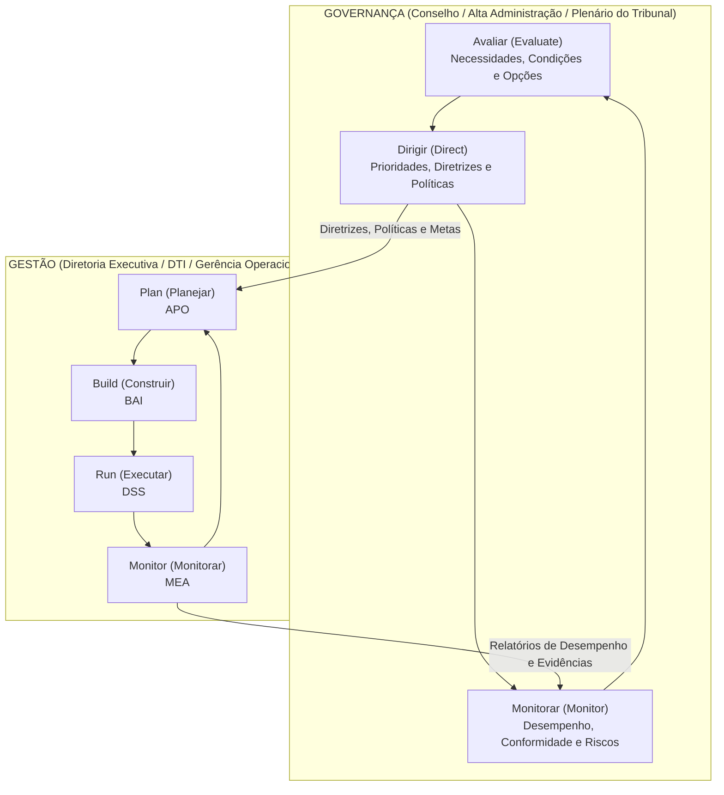
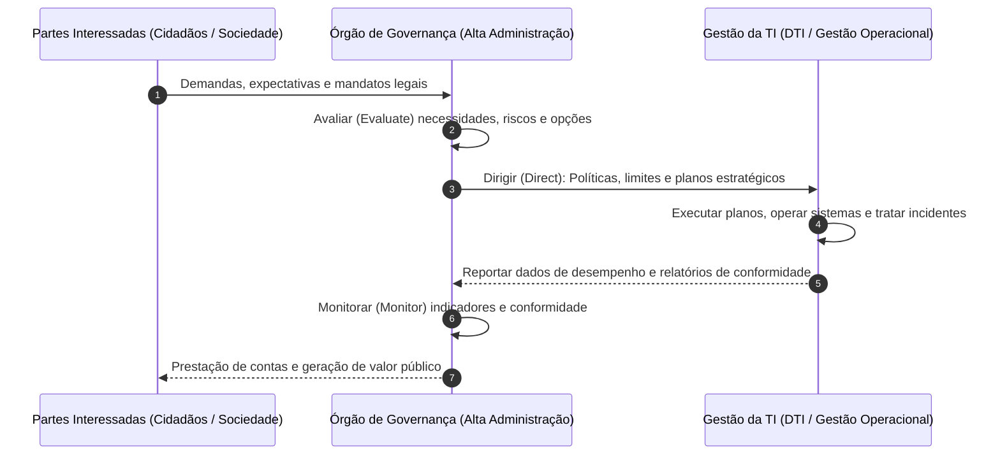
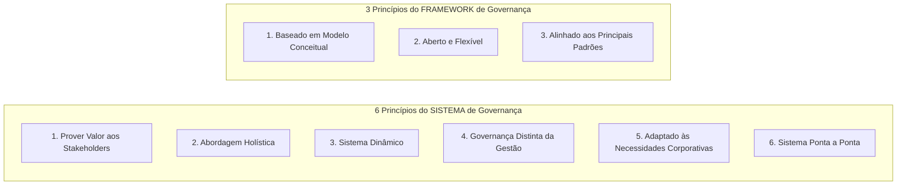
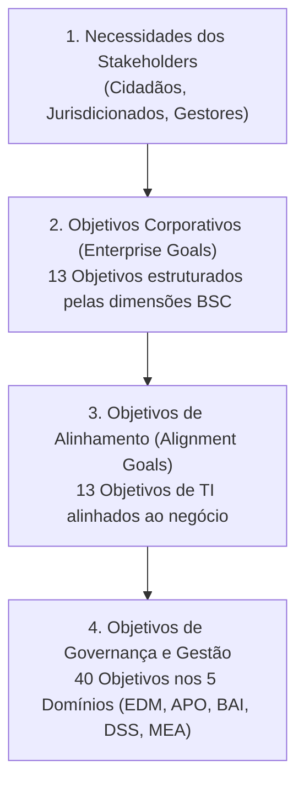
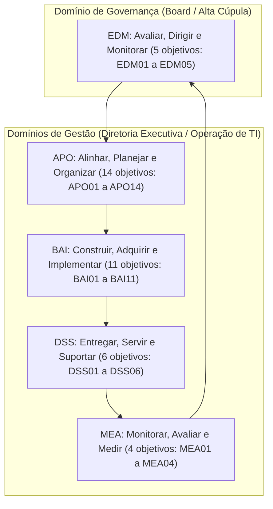
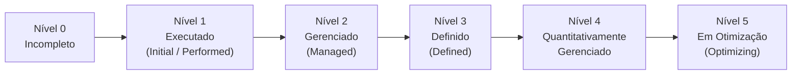

# 01 - Fundamentos de Governança, COBIT 2019 e ISO/IEC 38500:2024

> **Matéria:** Governança de Tecnologia da Informação  
> **Cargo:** B02 – Técnico de Controle Externo – Especialidade: Tecnologia da Informação  
> **Arquivo:** `01_fundamentos_governanca_cobit_2019_e_iso_38500.md`  

---

## 📌 Ementa / Itens do Edital
- Governança de TI vs. Gestão de TI: conceitos e alinhamento estratégico institucional
- Norma ABNT NBR ISO/IEC 38500:2024 (Governança Corporativa de Tecnologia da Informação)
- Framework COBIT 2019 (ISACA):
    - Princípios de Governança e do Framework
    - Componentes do Sistema de Governança e Fatores de Design (Design Factors)
    - Áreas de Foco (Focus Areas) e Cascatamento de Objetivos (Goals Cascade)
    - Os 40 Objetivos de Governança e Gestão (5 Domínios: EDM, APO, BAI, DSS, MEA)
    - Gestão de Desempenho do COBIT (CPM) e Níveis de Capacidade CMMI

---

## 🧭 Sumário
- [1. Fundamentos da Governança de TI e Alinhamento Estratégico](#1-fundamentos-da-governanca-de-ti-e-alinhamento-estrategico)
    - [1.1 Distinção Essencial entre Governança e Gestão](#11-distincao-essencial-entre-governanca-e-gestao)
    - [1.2 Alinhamento Estratégico e Criação de Valor Público](#12-alinhamento-estrategico-e-criacao-de-valor-publico)
- [2. Norma ABNT NBR ISO/IEC 38500:2024](#2-norma-abnt-nbr-isoiec-385002024)
    - [2.1 Escopo e Modelo de Governança (Ciclo EDM)](#21-escopo-e-modelo-de-governanca-ciclo-edm)
    - [2.2 Os Seis Princípios da Boa Governança de TI](#22-os-seis-principios-da-boa-governanca-de-ti)
- [3. Framework COBIT 2019 (ISACA)](#3-framework-cobit-2019-isaca)
    - [3.1 Princípios do Sistema e do Framework de Governança](#31-principios-do-sistema-e-do-framework-de-governanca)
    - [3.2 Componentes do Sistema de Governança (7 Componentes)](#32-componentes-do-sistema-de-governanca-7-componentes)
    - [3.3 Fatores de Design (11 Design Factors) e Áreas de Foco (Focus Areas)](#33-fatores-de-design-11-design-factors-e-areas-de-foco-focus-areas)
    - [3.4 Cascatamento de Objetivos (Goals Cascade)](#34-cascatamento-de-objetivos-goals-cascade)
    - [3.5 Os 40 Objetivos de Governança e Gestão nos 5 Domínios](#35-os-40-objetivos-de-governanca-e-gestao-nos-5-dominios)
    - [3.6 Gestão de Desempenho do COBIT (CPM) e Níveis de Capacidade CMMI](#36-gestao-de-desempenho-do-cobit-cpm-e-niveis-de-capacidade-cmmi)
- [4. Fontes Recomendadas na Internet](#4-fontes-recomendadas-na-internet)
- [5. Questões Comentadas no Padrão FCC](#5-questoes-comentadas-no-padrao-fcc)

---

## 📖 Teoria Aprofundada & Conceitos Essenciais

## 1. Fundamentos da Governança de TI e Alinhamento Estratégico

### 1.1 Distinção Essencial entre Governança e Gestão

A separação entre **Governança** e **Gestão** é o pilar estruturante de maior incidência em provas da Fundação Carlos Chagas (FCC) na disciplina de Governança de TI. Trata-se de responsabilidades, papéis e ciclos operacionais completamente distintos, embora fortemente integrados.

#### Tabela Comparativa: Governança de TI versus Gestão de TI

| Dimensão de Análise | Governança de TI (*Governance*) | Gestão de TI (*Management*) |
| :--- | :--- | :--- |
| **Papel Primário** | Direcionamento estratégico, supervisão, liderança institucional e prestação de contas (*Accountability*). | Execução técnica, coordenação operacional, manutenção de rotinas e entrega diária de serviços. |
| **Responsável Típico** | Alta Administração, Conselho de Administração, Plenário e Comitês Estratégicos de Governança. | Diretoria Executiva de TI (CIO/DTI), gerentes de projetos, equipes de desenvolvimento e suporte. |
| **Atividades Centrais** | **EDM**: Avaliar (*Evaluate*), Dirigir (*Direct*) e Monitorar (*Monitor*). | **PBRM**: Planejar (*Plan*), Construir (*Build*), Executar (*Run*) e Monitorar (*Monitor*). |
| **Horizonte Temporal** | Longo prazo (visão plurianual, sustentabilidade e impacto institucional). | Curto e médio prazo (sprints de desenvolvimento, chamados operacionais, metas contratuais imediatas). |
| **Objetivo Maior** | **Criação de Valor**: Realização de benefícios com balanceamento e otimização de riscos e recursos. | Eficiência técnica, cumprimento estrito de SLAs, produtividade e estabilidade dos sistemas em produção. |
| **Ponto de Partida** | Necessidades das partes interessadas (*stakeholders*: cidadãos, magistrados, auditores, jurisdicionados). | Diretrizes, limites orçamentários, apetite a risco e prioridades deliberadas pela governança. |

> 🚨 **ALERTA DE PROVA / PEGADINHA FCC:**  
> A banca frequentemente tenta confundir o candidato atribuindo à Governança tarefas de execução (como configurar roteadores, gerenciar chamados de help desk ou planejar sprints). Lembre-se: a governança **define o que fazer e em qual direção ir**, avaliando, dirigindo e monitorando. A gestão cuida do **como fazer**, planejando, construindo, executando e monitorando o trabalho diário.

---

### 1.2 Alinhamento Estratégico e Criação de Valor Público

No setor público, e em especial nos órgãos de controle externo como o TCE-GO, o alinhamento estratégico da Tecnologia da Informação não tem como meta o lucro, mas sim a **criação de valor público**. Isso significa garantir que os recursos aplicados em tecnologia resultem em fiscalizações mais ágeis, auditorias digitais baseadas em cruzamento massivo de dados, transparência ativa ao cidadão e prestação jurisdicional de excelência.

O alinhamento estratégico é teorizado pelo clássico **Modelo de Alinhamento Estratégico (SAM - *Strategic Alignment Model*) de Henderson & Venkatraman**, que articula quatro domínios fundamentais:

1. **Estratégia do Negócio:** Escopo corporativo, competências distintivas e governança corporativa.
2. **Estratégia de TI:** Escopo de tecnologia, competências sistêmicas e governança de TI.
3. **Infraestrutura e Processos Organizacionais:** Estrutura administrativa, processos de trabalho corporativos e habilidades dos servidores.
4. **Infraestrutura e Processos de TI:** Arquitetura tecnológica, processos operacionais de TI e habilidades da equipe técnica.

A governança assegura a integração bidirecional contínua entre a estratégia institucional e a estratégia de TI, evitando que a área técnica formule objetivos isolados ou desconectados das reais prioridades de fiscalização e auditoria do Tribunal.

---

## 2. Norma ABNT NBR ISO/IEC 38500:2024

### 2.1 Escopo e Modelo de Governança (Ciclo EDM)

A norma **ABNT NBR ISO/IEC 38500:2024** fornece princípios e diretrizes para os órgãos deliberativos e membros da alta administração das organizações (públicas ou privadas, de qualquer porte ou setor) sobre a utilização aceitável, eficaz e eficiente da TI.

A governança atua segundo o modelo cíclico **EDM**:

- **Avaliar (*Evaluate*):** Examinar continuamente as circunstâncias presentes e futuras, considerando demandas dos stakeholders, tendências tecnológicas, requisitos legais e restrições financeiras.
- **Dirigir (*Direct*):** Atribuir responsabilidades e orientar a preparação e execução de estratégias, planos de TI e políticas institucionais.
- **Monitorar (*Monitor*):** Acompanhar periodicamente se a gestão está operando em conformidade com as diretrizes e se os objetivos de desempenho planejados estão sendo atingidos.

---

### 2.2 Os Seis Princípios da Boa Governança de TI

A ISO/IEC 38500 prescreve **seis princípios** fundamentais que orientam a tomada de decisão da alta administração:

| Nº | Princípio | Significado / Exigência Normativa | Foco de Cobrança FCC |
| :---: | :--- | :--- | :--- |
| **1** | **Responsabilidade** (*Responsibility*) | Indivíduos e comitês compreendem e aceitam suas responsabilidades relativas à oferta e demanda de TI. Autoridade delegada deve ser proporcional à responsabilidade. | Não pode haver ambiguidade de papéis; a responsabilidade de governança jamais pode ser transferida ou terceirizada a fornecedores externos. |
| **2** | **Estratégia** (*Strategy*) | A estratégia de TI deve estar perfeitamente alinhada e suportar as necessidades atuais e as aspirações futuras da estratégia corporativa. | TI não cria estratégia isolada; a TI viabiliza os objetivos institucionais e o plano de diretrizes do órgão. |
| **3** | **Aquisição** (*Acquisition*) | As aquisições de TI são feitas por razões válidas, com base em análise apropriada e contínua do Custo Total de Propriedade (TCO) e retorno esperado. | Veda compras impulsivas ou sem Estudo Técnico Preliminar (ETP) fundamentado. Exige análise de ciclo de vida completo. |
| **4** | **Desempenho** (*Performance*) | A TI atende às necessidades da organização, entregando serviços com os níveis de serviço e capacidade exigidos pelo negócio. | Monitoramento contínuo de disponibilidade, tempo de resposta e eficácia dos sistemas em produção. |
| **5** | **Conformidade** (*Conformance*) | A TI opera em estrita conformidade com toda a legislação, regulações e políticas internas aplicáveis (LGPD, Marco Civil, Lei 14.133/2021). | As práticas de governança devem assegurar aderência legal e auditoria formal periódica. |
| **6** | **Comportamento Humano** (*Human Behaviour*) | As políticas, práticas e decisões de TI respeitam os fatores humanos, culturais e as necessidades de todas as pessoas envolvidas. | Treinamento, usabilidade, ergonomia, acessibilidade e gestão de mudanças comportamentais no trabalho. |

> 🚨 **ALERTA DE PROVA / PEGADINHA FCC:**  
> A FCC adora cobrar a lista exata dos 6 princípios da ISO/IEC 38500 trocando palavras como "Comportamento Humano" por "Comportamento Financeiro", "Econômico" ou inventando termos como "Agilidade" e "Virtualização". Grave o mnemônico: **R-E-A-D-C-H** (*Responsibility, Strategy, Acquisition, Performance, Conformance, Human Behaviour*).

---

## 3. Framework COBIT 2019 (ISACA)

O **COBIT 2019** (*Control Objectives for Information and Related Technologies*) é o framework líder mundial de governança e gestão corporativa de informação e tecnologia (I&T), publicado pela ISACA. O COBIT não é prescritivo em nível de codificação ou configuração de servidores; ele funciona como um **framework guarda-chuva** integrador, alinhando padrões técnicos (como ITIL, PMBOK, TOGAF e ISO 27001) às metas institucionais.

### 3.1 Princípios do Sistema e do Framework de Governança

Uma das maiores inovações do COBIT 2019 foi dividir formalmente os princípios em duas categorias:

1. **6 Princípios para o Sistema de Governança** (*Governance System Principles*).
2. **3 Princípios para o Framework de Governança** (*Governance Framework Principles*).

#### Tabela Comparativa dos Princípios do COBIT 2019

| Princípios do **Sistema** de Governança (6) | Princípios do **Framework** de Governança (3) |
| :--- | :--- |
| **1. Prover valor aos stakeholders:** O sistema deve gerar valor a partir do uso de I&T balanceando benefícios, riscos e uso otimizado de recursos. | **1. Baseado em um modelo conceitual:** Deve identificar os principais componentes e relacionamentos para garantir consistência e automação. |
| **2. Abordagem holística:** O sistema é construído a partir de múltiplos tipos de componentes integrados entre si. | **2. Aberto e flexível:** Deve permitir a inclusão de novos conteúdos e tecnologias emergentes sem desestruturar o núcleo original. |
| **3. Sistema dinâmico:** Sempre que um ou mais fatores de design mudarem, o impacto sobre o sistema de governança deve ser reavaliado. | **3. Alinhado aos principais padrões:** Deve harmonizar-se com os padrões de referência (ISO, ITIL, TOGAF, PMBOK, NIST). |
| **4. Governança distinta da gestão:** O sistema mantém clara separação estrutural e conceitual entre governança e gestão. | — |
| **5. Adaptado às necessidades corporativas:** Deve ser customizado conforme o contexto organizacional por meio de fatores de design (*tailoring*). | — |
| **6. Sistema ponta a ponta:** Cobre todas as informações e tecnologias de toda a organização, e não apenas o departamento de TI. | — |

> 🚨 **ALERTA DE PROVA / PEGADINHA FCC:**  
> A banca FCC frequentemente afirma em enunciados que "Baseado em Modelo Conceitual" ou "Aberto e Flexível" são princípios do *Sistema de Governança*. **Errado!** Esses são princípios do **Framework de Governança**. Da mesma forma, "Sistema Dinâmico" e "Abordagem Holística" pertencem ao **Sistema**, e não ao framework!

---

### 3.2 Componentes do Sistema de Governança (7 Componentes)

Para construir, operar e manter um sistema de governança funcional, o COBIT 2019 define **7 categorias de Componentes** (denominados "Habilitadores" no antigo COBIT 5):

1. **Processos:** Conjuntos estruturados de práticas e atividades concebidos para atingir determinados objetivos e produzir saídas úteis.
2. **Estruturas Organizacionais:** Entidades e comitês formais responsáveis pela tomada de decisão (Comitê de Governança Digital, Plenário, DTI).
3. **Princípios, Políticas e Estruturas:** Instrumentos normativos que traduzem comportamentos e diretrizes desejadas em orientações práticas cotidianas.
4. **Informação:** Dados e fluxos informacionais consumidos e produzidos pela organização (relevância, segurança, precisão, completude).
5. **Cultura, Ética e Comportamento:** Posturas éticas, hábitos e traços culturais dos servidores e da liderança corporativa.
6. **Pessoas, Habilidades e Competências:** Capital humano, competências técnicas e conhecimentos requeridos para a execução das práticas.
7. **Serviços, Infraestrutura e Aplicações:** A infraestrutura tecnológica, redes, data centers, ferramentas de software e aplicações corporativas.

---

### 3.3 Fatores de Design (11 Design Factors) e Áreas de Foco (Focus Areas)

#### Os 11 Fatores de Design (*Design Factors*)
O COBIT 2019 não adota o modelo "tamanho único" (*one size fits all*). Para viabilizar a adaptação (*tailoring*) do sistema de governança à realidade de cada órgão ou empresa, são utilizados **11 Fatores de Design**:

1. **Estratégia corporativa (*Enterprise Strategy*):** Liderança em custos, diferenciação, inovação ou prestação de serviços essenciais.
2. **Objetivos corporativos (*Enterprise Goals*):** As prioridades desdobradas no Balanced Scorecard.
3. **Perfil de risco (*Risk Profile*):** O apetite e a tolerância a riscos de TI da instituição.
4. **Problemas relacionados a I&T (*I&T-Related Issues*):** Histórico de falhas, projetos com estouro de orçamento ou carência de competências.
5. **Cenário de ameaças (*Threat Landscape*):** Grau de exposição a ataques cibernéticos e espionagem de dados.
6. **Requisitos de conformidade (*Compliance Requirements*):** Rigidez regulatória externa (ex.: setor público sujeito à fiscalização do TCU/TCE vs. startups).
7. **Papel da TI (*Role of IT*):** Papel estratégico (TI como motor essencial da missão) vs. suporte (*back-office* básico).
8. **Modelo de fornecimento de TI (*Sourcing Model for IT*):** Terceirização (outsourcing), equipes próprias (insourcing), nuvem ou modelo híbrido.
9. **Métodos de implementação de TI (*IT Implementation Methods*):** Abordagens ágeis (DevOps, Scrum) vs. métodos tradicionais preditivos (cascata/waterfall).
10. **Estratégia de adoção de tecnologia (*Technology Adoption Strategy*):** Inovador pioneiro (*first mover*), seguidor rápido (*fast follower*) ou adotante conservador (*slow adopter*).
11. **Tamanho da organização (*Enterprise Size*):** Grande corporação / órgão público de grande porte vs. pequenas e médias organizações.

#### Áreas de Foco (*Focus Areas*)
Uma **Área de Foco** descreve um tópico, domínio de governança ou desafio tecnológico específico que requer a seleção e priorização de um conjunto direcionado de componentes e objetivos de governança do COBIT 2019. Exemplos de áreas de foco publicadas pela ISACA incluem: Segurança da Informação (*Information Security*), DevOps, Pequenas e Médias Empresas (PMEs) e Governança de Nuvem (*Cloud Governance*). As áreas de foco podem ser ilimitadas e são expandidas continuamente pela comunidade.

---

### 3.4 Cascatamento de Objetivos (Goals Cascade)

O mecanismo do COBIT 2019 traduz as necessidades das partes interessadas em ações e objetivos práticos de TI por meio de quatro níveis em cascata:

- **1. Necessidades dos Stakeholders:** Criam os direcionadores corporativos e estratégicos do órgão.
- **2. 13 Objetivos Corporativos (*Enterprise Goals*):** Classificados sob as 4 dimensões do *Balanced Scorecard* (Financeira, Clientes, Processos Internos, Aprendizado e Crescimento).
- **3. 13 Objetivos de Alinhamento (*Alignment Goals*):** Objetivos técnicos de TI alinhados diretamente aos objetivos corporativos (no COBIT 5 eram 17 objetivos de TI; no COBIT 2019 foram otimizados para 13).
- **4. 40 Objetivos de Governança e Gestão:** Cada um associado a um processo e aos componentes do sistema.

---

### 3.5 Os 40 Objetivos de Governança e Gestão nos 5 Domínios

O COBIT 2019 organiza seus 40 objetivos em **5 Domínios**. O primeiro pertence exclusivamente à **Governança**, enquanto os demais quatro integram a **Gestão**:

#### Relação Detalhada dos 40 Objetivos do COBIT 2019

##### Domínio de Governança: EDM (*Evaluate, Direct and Monitor*) - 5 Objetivos
1. **EDM01:** Garantir a Definição e Manutenção do Framework de Governança.
2. **EDM02:** Garantir a Realização de Benefícios.
3. **EDM03:** Garantir a Otimização de Riscos.
4. **EDM04:** Garantir a Otimização de Recursos.
5. **EDM05:** Garantir o Engajamento das Partes Interessadas (*Stakeholder Engagement*).

##### Domínio de Gestão 1: APO (*Align, Plan and Organize*) - 14 Objetivos
1. **APO01:** Gerenciar o Framework de Gestão de I&T.
2. **APO02:** Gerenciar a Estratégia.
3. **APO03:** Gerenciar a Arquitetura Corporativa.
4. **APO04:** Gerenciar a Inovação.
5. **APO05:** Gerenciar o Portfólio.
6. **APO06:** Gerenciar o Orçamento e os Custos.
7. **APO07:** Gerenciar os Recursos Humanos.
8. **APO08:** Gerenciar os Relacionamentos.
9. **APO09:** Gerenciar os Acordos de Serviços (SLAs).
10. **APO10:** Gerenciar os Fornecedores.
11. **APO11:** Gerenciar a Qualidade.
12. **APO12:** Gerenciar os Riscos.
13. **APO13:** Gerenciar a Segurança.
14. **APO14:** Gerenciar os Dados *(Objetivo introduzido expressamente no COBIT 2019)*.

##### Domínio de Gestão 2: BAI (*Build, Acquire and Implement*) - 11 Objetivos
1. **BAI01:** Gerenciar Programas.
2. **BAI02:** Gerenciar a Definição de Requisitos.
3. **BAI03:** Gerenciar a Identificação e Construção de Soluções.
4. **BAI04:** Gerenciar a Disponibilidade e a Capacidade.
5. **BAI05:** Gerenciar a Mudança Organizacional.
6. **BAI06:** Gerenciar as Mudanças de TI (*IT Changes*).
7. **BAI07:** Gerenciar a Aceitação e Transição da Mudança de TI.
8. **BAI08:** Gerenciar o Conhecimento.
9. **BAI09:** Gerenciar os Ativos.
10. **BAI10:** Gerenciar a Configuração.
11. **BAI11:** Gerenciar Projetos *(Separado de Programas no COBIT 2019)*.

##### Domínio de Gestão 3: DSS (*Deliver, Service and Support*) - 6 Objetivos
1. **DSS01:** Gerenciar as Operações.
2. **DSS02:** Gerenciar as Requisições de Serviços e Incidentes.
3. **DSS03:** Gerenciar Problemas.
4. **DSS04:** Gerenciar a Continuidade.
5. **DSS05:** Gerenciar os Serviços de Segurança.
6. **DSS06:** Gerenciar os Controles de Processos de Negócio.

##### Domínio de Gestão 4: MEA (*Monitor, Evaluate and Assess*) - 4 Objetivos
1. **MEA01:** Monitorar, Avaliar e Medir o Desempenho e a Conformidade.
2. **MEA02:** Monitorar, Avaliar e Medir o Sistema de Controle Interno.
3. **MEA03:** Monitorar, Avaliar e Medir a Conformidade com Requisitos Externos.
4. **MEA04:** Monitorar, Avaliar e Medir a Garantia (*Assurance*).

---

### 3.6 Gestão de Desempenho do COBIT (CPM) e Níveis de Capacidade CMMI

No COBIT 2019, o modelo de medição de capacidade e maturidade migrou da ISO/IEC 33000 (usada no COBIT 5) para a escala alinhada ao **CMMI** (*Capability Maturity Model Integration*).

#### Níveis de Capacidade de Processo (CPM / CMMI: 0 a 5)

| Nível | Classificação | Descrição Prática do Desempenho do Processo |
| :---: | :--- | :--- |
| **0** | **Incompleto** (*Incomplete*) | O trabalho não atinge o propósito geral do processo. Poucas ou nenhuma atividade foram concluídas. |
| **1** | **Executado** (*Initial / Performed*) | O processo atinge seu propósito através de um conjunto incompleto de atividades; atua de forma intuitiva, sem padronização formal. |
| **2** | **Gerenciado** (*Managed*) | O processo é planejado, executado, monitorado e ajustado para atingir objetivos específicos. Os produtos de trabalho são controlados e mantidos adequadamente. |
| **3** | **Definido** (*Defined*) | O processo é bem caracterizado, compreendido e executado com base em procedimentos padronizados em toda a organização (*organizational standards*). |
| **4** | **Quantitativamente Gerenciado** (*Quantitatively Managed*) | O processo é controlado quantitativamente por meio de métricas estatísticas e técnicas de controle de qualidade, sendo altamente previsível. |
| **5** | **Em Otimização** (*Optimizing*) | O processo é continuamente aprimorado com base na compreensão quantitativa das causas de variações e na adoção de inovações tecnológicas. |

#### Escala de Avaliação de Atividades e Práticas
Cada atividade é avaliada conforme a escala percentual de alcance:

- **N (Não Atingido / *Not Achieved*):** Evidência de alcance de $0\%$ a $15\%$.
- **P (Parcialmente Atingido / *Partially Achieved*):** Evidência de alcance de $> 15\%$ a $50\%$.
- **L (Praticamente Atingido / *Largely Achieved*):** Evidência de alcance de $> 50\%$ a $85\%$.
- **F (Totalmente Atingido / *Fully Achieved*):** Evidência de alcance de $> 85\%$ a $100\%$.

---

## 4. Fontes Recomendadas na Internet

- [x] **ISACA - COBIT 2019 Framework Overview (Portal Oficial ISACA):**
    - Link Oficial: [ISACA COBIT 2019 Resources](https://www.isaca.org/resources/cobit)
    - *Conteúdo:* Resumo oficial do framework COBIT 2019, princípios do sistema de governança, 40 objetivos dos 5 domínios (EDM, APO, BAI, DSS, MEA) e fatores de design.
- [x] **ISO/IEC 38500:2024 - Governance of Information Technology for the Organization:**
    - Link Oficial: [ISO Standard Overview - ISO/IEC 38500](https://www.iso.org/standard/83648.html)
    - *Conteúdo:* Os 6 princípios de governança corporativa de TI (Responsabilidade, Estratégia, Aquisição, Desempenho, Conformidade e Comportamento Humano) e o modelo EDM (Avaliar, Dirigir, Monitorar).
- [x] **Tribunal de Contas da União (TCU) - Referencial de Governança de TI:**
    - Link Oficial: [Portal de Governança de TI do TCU](https://portal.tcu.gov.br/comunidades/governanca-de-ti/)
    - *Conteúdo:* Guias do TCU para auditoria de governança de TI em órgãos públicos (iGovTI / iGG), boas práticas de alinhamento estratégico e gestão de riscos.

---

## 5. Questões Comentadas no Padrão FCC

### Questão 1 (FCC - Auditor de Controle Externo / TI - Adaptada)
**Enunciado:** O framework COBIT 2019 da ISACA estabelece uma distinção estrutural e operacional inequívoca entre Governança e Gestão de TI na organização. Com base nas definições dos domínios e competências organizacionais do COBIT 2019, assinale a alternativa correta:  

* **A)** A Governança tem como domínio executivo primário o APO (*Align, Plan and Organize*), sendo de sua competência a programação de sprints de desenvolvimento e a instalação de atualizações operacionais de sistemas.
* **B)** O domínio de Governança no COBIT 2019 é o EDM (*Evaluate, Direct and Monitor*), cabendo aos dirigentes máximos e comitês de governança avaliar necessidades, dirigir políticas e monitorar o alcance estratégico, enquanto a Gestão opera por meio de quatro domínios (APO, BAI, DSS e MEA).
* **C)** As atividades operacionais de atendimento a incidentes de suporte e requisições de serviço na Central de Serviços integram o domínio EDM, sob a responsabilidade direta dos membros do Conselho de Administração.
* **D)** O COBIT 2019 revogou o princípio da separação entre governança e gestão preconizado pelo COBIT 5, determinando que gerentes operacionais de redes acumulem privativamente as funções de deliberação estratégica e fixação de apetite a risco.
* **E)** O domínio BAI (*Build, Acquire and Implement*) é o único domínio classificado como de governança, destinando-se exclusivamente à fiscalização judicial de contratos públicos de TI.

> **Comentário Detalhado:**
>
> - **A)** Incorreta. O domínio APO pertence à Gestão, e não à Governança. Além disso, tarefas cotidianas como instalar atualizações operacionais pertencem à operação técnica (domínio DSS), e não ao planejamento tático ou à governança.
> - **B)** **Correta.** No COBIT 2019, o domínio exclusivo de governança é o EDM (*Evaluate, Direct and Monitor*), composto por 5 objetivos direcionados à Alta Administração (Board). Os domínios de Gestão são quatro: APO (*Align, Plan and Organize*), BAI (*Build, Acquire and Implement*), DSS (*Deliver, Service and Support*) e MEA (*Monitor, Evaluate and Assess*).
> - **C)** Incorreta. O atendimento a incidentes e requisições de serviço pertence ao domínio de gestão DSS (especificamente objetivo *DSS02 - Gerenciar Requisições de Serviços e Incidentes*), sendo executado pela Central de Serviços e equipes de suporte, jamais pelo Conselho de Administração.
> - **D)** Incorreta. O COBIT 2019 manteve inalterado o princípio basilar de que "Governança é distinta da gestão" (Princípio 4 do Sistema de Governança). A segregação de funções é imperativa para evitar conflitos de interesse e desvios de controle interno.
> - **E)** Incorreta. O domínio BAI é um domínio de Gestão (focado em construir, adquirir e implementar soluções, gerenciar projetos e mudanças), e não de governança, nem tem foco judicial exclusivo.
> 
> **Gabarito: B**

---

### Questão 2 (FCC - Analista de TI / Governança - Adaptada)
**Enunciado:** A norma ABNT NBR ISO/IEC 38500 fornece diretrizes para que dirigentes e órgãos de governança assegurem o uso eficaz, eficiente e aceitável da Tecnologia da Informação. Acerca dos princípios e do modelo de atuação prescritos por essa norma, assinale a alternativa correta:  

* **A)** O modelo da ISO/IEC 38500 estabelece que a atuação do órgão de governança ocorre por meio de três tarefas fundamentais: Avaliar (*Evaluate*), Dirigir (*Direct*) e Monitorar (*Monitor*).
* **B)** O princípio do Comportamento Humano exige que todos os colaboradores assinem termos de confidencialidade com renúncia a direitos trabalhistas antes de utilizar sistemas corporativos.
* **C)** O princípio da Aquisição determina que a organização deve sempre optar pela solução de menor preço nominal de compra imediata, sendo vedado o cômputo de custos futuros de manutenção e suporte.
* **D)** As diretrizes da norma ISO/IEC 38500 aplicam-se exclusivamente a instituições financeiras privadas e empresas de tecnologia listadas em bolsa de valores, sendo expressamente vedada sua aplicação a órgãos públicos.
* **E)** A responsabilidade pela prestação de contas do uso de TI na organização deve ser transferida compulsoriamente aos fornecedores externos e prestadores de suporte técnico terceirizados.

> **Comentário Detalhado:**
>
> - **A)** **Correta.** A ISO/IEC 38500 estrutura a governança corporativa de TI em torno do ciclo EDM: Avaliar o uso atual e futuro da TI, Dirigir a preparação e implementação de planos e políticas, e Monitorar o cumprimento das políticas e o desempenho alcançado.
> - **B)** Incorreta. O princípio do Comportamento Humano estabelece que as políticas, práticas e decisões de TI devem respeitar os comportamentos humanos, as necessidades culturais e o bem-estar dos colaboradores e usuários, incluindo treinamento, usabilidade e transição adequada de rotinas.
> - **C)** Incorreta. O princípio da Aquisição exige justamente o oposto: os investimentos em TI devem ser fundamentados em análises criteriosas de custo-benefício de longo prazo, considerando o Custo Total de Propriedade (TCO) e riscos, e não apenas o custo de aquisição imediata.
> - **D)** Incorreta. A norma aplica-se a qualquer organização, pública ou privada, governamental ou não-governamental, independente de seu porte ou natureza jurídica.
> - **E)** Incorreta. Conforme o princípio da Responsabilidade, a governança e a *accountability* sobre as decisões de TI recaem sobre os dirigentes e a administração da própria organização; a responsabilidade final nunca pode ser terceirizada a prestadores de serviços externos.
> 
> **Gabarito: A**

---

### Questão 3 (FCC - Analista de Controle Externo / Auditoria de TI - Adaptada)
**Enunciado:** O framework COBIT 2019 estruturou seus fundamentos separando os princípios aplicáveis ao "Sistema de Governança" dos princípios aplicáveis ao "Framework de Governança". A respeito dessa classificação e dos componentes de governança do COBIT 2019, assinale a afirmativa correta:  

* **A)** "Baseado em um modelo conceitual", "Aberto e flexível" e "Alinhado aos principais padrões" constituem os 3 princípios do Framework de Governança.
* **B)** O princípio de "Prover valor aos stakeholders" pertence com exclusividade ao Framework de Governança, não tendo qualquer relação com o Sistema de Governança.
* **C)** O COBIT 2019 extinguiu os componentes organizacionais, considerando que processos de software são os únicos elementos necessários para garantir uma governança robusta.
* **D)** O princípio do "Sistema dinâmico" postula que o sistema de governança, uma vez implementado no órgão público, deve permanecer estático e imutável por no mínimo dez anos.
* **E)** A separação conceitual entre governança e gestão foi descontinuada na versão 2019, passando ambos a serem regidos pelo mesmo princípio unificado de desenvolvimento ágil.

> **Comentário Detalhado:**
>
> - **A)** **Correta.** O COBIT 2019 estabelece exatamente 3 princípios para o Framework de Governança: 1. Baseado em um modelo conceitual; 2. Aberto e flexível; 3. Alinhado aos principais padrões e normas mundiais (ISO, ITIL, TOGAF, etc.).
> - **B)** Incorreta. "Prover valor aos stakeholders" é o primeiro e mais importante princípio do Sistema de Governança (e não do framework).
> - **C)** Incorreta. O COBIT 2019 define 7 componentes holísticos (Processos; Estruturas Organizacionais; Princípios, Políticas e Estruturas; Informação; Cultura, Ética e Comportamento; Pessoas, Habilidades e Competências; Serviços, Infraestrutura e Aplicações). Ele rejeita a visão míope de focar apenas em processos.
> - **D)** Incorreta. O princípio do "Sistema dinâmico" afirma exatamente o contrário: sempre que um ou mais fatores de design mudarem (ex.: nova legislação, alteração de diretoria, mudança tecnológica), o impacto sobre a governança de TI deve ser reavaliado dinamicamente.
> - **E)** Incorreta. A governança distinta da gestão é mantida explicitamente como o Princípio 4 do Sistema de Governança no COBIT 2019.
> 
> **Gabarito: A**

---

### Questão 4 (FCC - Auditor Fiscal da Receita Estadual / TI - Adaptada)
**Enunciado:** Em uma auditoria de governança de TI no setor público, a equipe avaliou como as metas institucionais do órgão são traduzidas em prioridades concretas de investimento tecnológico por meio do mecanismo de Cascatamento de Objetivos (*Goals Cascade*) e dos Fatores de Design (*Design Factors*) do COBIT 2019. A respeito desses instrumentos, assinale a alternativa correta:  

* **A)** O cascatamento de objetivos do COBIT 2019 estabelece que as necessidades dos stakeholders devem ser desdobradas primeiramente em 13 Objetivos Corporativos (*Enterprise Goals*), os quais se desdobram em 13 Objetivos de Alinhamento (*Alignment Goals*) e, finalmente, nos 40 Objetivos de Governança e Gestão.
* **B)** Os Fatores de Design foram concebidos com a finalidade exclusiva de impedir a customização do COBIT 2019, tornando sua adoção rígida e idêntica para qualquer entidade do planeta.
* **C)** O Perfil de Risco e o Cenário de Ameaças são classificados pelo COBIT 2019 como objetivos de alinhamento financeiro, não exercendo papel na definição dos fatores de design.
* **D)** O número de objetivos corporativos no COBIT 2019 foi ampliado para 114 itens, abolindo-se a correlação com as perspectivas clássicas do Balanced Scorecard (BSC).
* **E)** A estratégia corporativa da organização não exerce influência sobre o desenho do sistema de governança de TI, sendo este definido exclusivamente pelo fornecedor de hardware.

> **Comentário Detalhado:**
>
> - **A)** **Correta.** No COBIT 2019, a Cascata de Objetivos (*Goals Cascade*) segue a sequência rigorosa: Necessidades dos Stakeholders $\rightarrow$ 13 Objetivos Corporativos (*Enterprise Goals* estruturados no BSC) $\rightarrow$ 13 Objetivos de Alinhamento (*Alignment Goals*) $\rightarrow$ 40 Objetivos de Governança e Gestão nos domínios EDM, APO, BAI, DSS e MEA.
> - **B)** Incorreta. Os 11 Fatores de Design têm como propósito justamente permitir o *tailoring* (adaptação personalizada) do sistema de governança às particularidades de porte, risco, estratégia e maturidade de cada organização.
> - **C)** Incorreta. O Perfil de Risco (Design Factor 3) e o Cenário de Ameaças (Design Factor 5) são explicitamente Fatores de Design (*Design Factors*), e não objetivos de alinhamento.
> - **D)** Incorreta. São exatamente 13 Objetivos Corporativos no COBIT 2019, organizados diretamente sob as quatro dimensões clássicas do BSC (Financeira, Clientes, Processos Internos, Aprendizado e Crescimento).
> - **E)** Incorreta. A Estratégia Corporativa é o Fator de Design número 1 (*Design Factor 1*), exercendo impacto primordial sobre as prioridades e o sistema de governança de I&T.
> 
> **Gabarito: A**

---

### Questão 5 (FCC - Técnico de Controle Externo / TI - Adaptada)
**Enunciado:** O modelo de Gestão de Desempenho do COBIT 2019 (CPM - *COBIT Performance Management*) utiliza a abordagem de Níveis de Capacidade de Processo (*Process Capability Levels*) alinhada ao CMMI, graduando a maturidade de execução de cada processo em uma escala de 0 a 5. Um processo que atinge o seu propósito por meio da aplicação de procedimentos formalmente padronizados, documentados e disseminados por toda a organização, classifica-se no:  

* **A)** Nível 0 - Incompleto (*Incomplete*).
* **B)** Nível 1 - Executado (*Initial / Performed*).
* **C)** Nível 2 - Gerenciado (*Managed*).
* **D)** Nível 3 - Definido (*Defined*).
* **E)** Nível 5 - Em Otimização (*Optimizing*).

> **Comentário Detalhado:**
>
> - **A)** Incorreta. No Nível 0 (Incompleto), o processo não atinge seu propósito; praticamente nenhuma atividade relevante foi executada.
> - **B)** Incorreta. No Nível 1 (Executado), o processo atinge seu propósito através de um conjunto incompleto de atividades, funcionando de forma ad-hoc, dependente do heroísmo individual e sem padrão.
> - **C)** Incorreta. No Nível 2 (Gerenciado), o processo é planejado, monitorado e controlado para um projeto ou unidade específica, gerando produtos de trabalho controlados, mas ainda não se tornou um padrão organizacional institucionalizado.
> - **D)** **Correta.** No Nível 3 (Definido), o processo é executado com base em um conjunto de procedimentos e normas documentadas e padronizadas em nível corporativo (*organizational standards*).
> - **E)** Incorreta. No Nível 5 (Em Otimização), o processo foca na melhoria contínua preditiva com base em inovações tecnológicas e controle estatístico de causas de variação (passando antes pelo Nível 4 - Quantitativamente Gerenciado).
> 
> **Gabarito: D**
