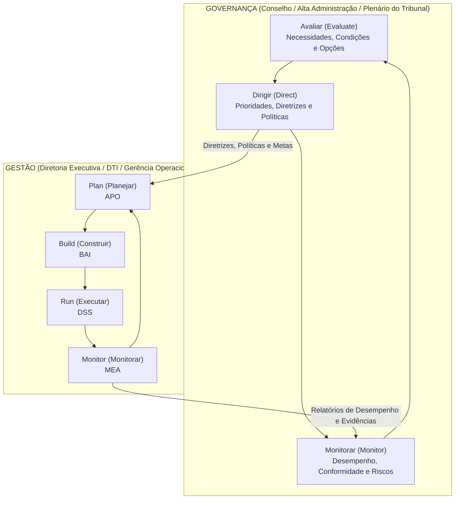
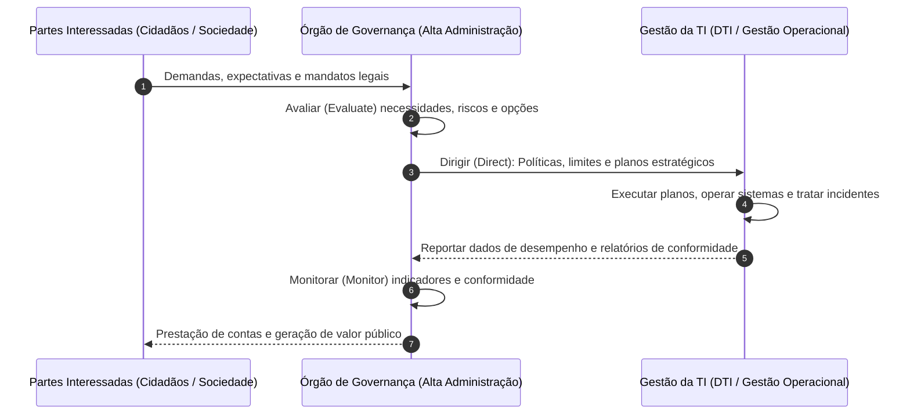
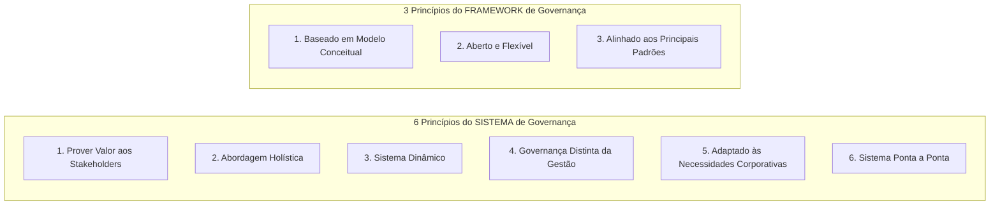
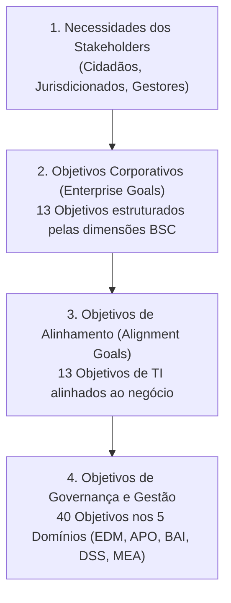
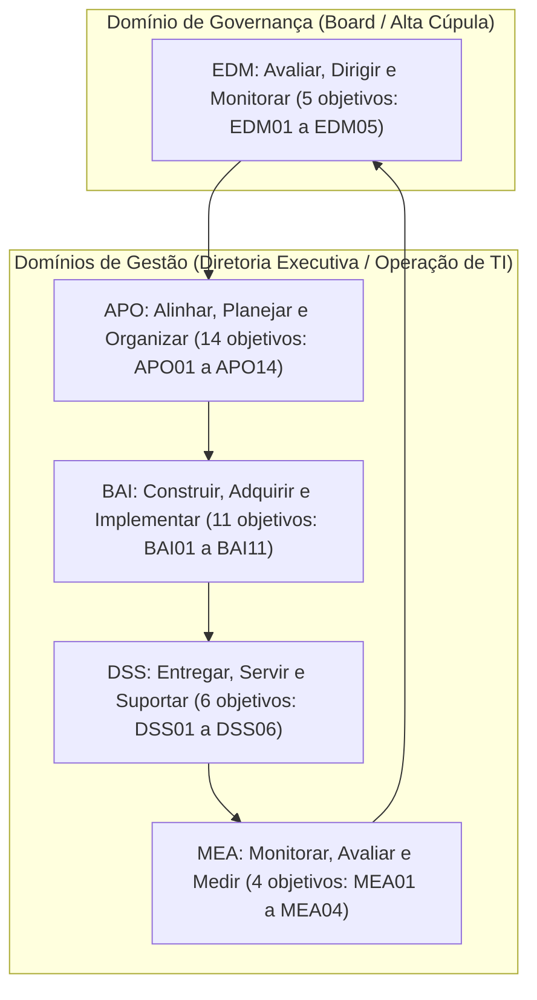
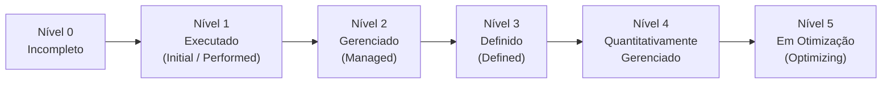

# 01 - Fundamentos de Governança, COBIT 2019 e ISO/IEC 38500:2024

> **Matéria:** Governança de Tecnologia da Informação  
> **Cargo:** B02 – Técnico de Controle Externo – Especialidade: Tecnologia da Informação  
> **Arquivo:** `01_fundamentos_governanca_cobit_2019_e_iso_38500.md`  

---

## 📌 Ementa / Itens do Edital
- Governança de TI vs. Gestão de TI: conceitos e alinhamento estratégico institucional
- Norma ABNT NBR ISO/IEC 38500:2024 (Governança Corporativa de Tecnologia da Informação)
- Framework COBIT 2019 (ISACA):
    - Princípios de Governança e do Framework
    - Componentes do Sistema de Governança e Fatores de Design (Design Factors)
    - Áreas de Foco (Focus Areas) e Cascatamento de Objetivos (Goals Cascade)
    - Os 40 Objetivos de Governança e Gestão (5 Domínios: EDM, APO, BAI, DSS, MEA)
    - Gestão de Desempenho do COBIT (CPM) e Níveis de Capacidade CMMI

---

## 🧭 Sumário

1. [Fundamentos da Governança de TI e Alinhamento Estratégico](#1-fundamentos-da-governanca-de-ti-e-alinhamento-estrategico)
1. [Distinção Essencial entre Governança e Gestão](#1-1-distincao-essencial-entre-governanca-e-gestao)
1. [Alinhamento Estratégico e Criação de Valor Público](#1-2-alinhamento-estrategico-e-criacao-de-valor-publico)
    1. [Teste 465](#Teste-465)
2. [Norma ABNT NBR ISO/IEC 38500:2024](#2-norma-abnt-nbr-isoiec-385002024)
2. [Escopo e Modelo de Governança (Ciclo EDM)](#2-1-escopo-e-modelo-de-governanca-ciclo-edm)
    1. [Teste 466](#Teste-466)
2. [Os Seis Princípios da Boa Governança de TI](#2-2-os-seis-principios-da-boa-governanca-de-ti)
    1. [Teste 467](#Teste-467)
3. [Framework COBIT 2019 (ISACA)](#3-framework-cobit-2019-isaca)
3. [Princípios do Sistema e do Framework de Governança](#3-1-principios-do-sistema-e-do-framework-de-governanca)
    1. [Teste 468](#Teste-468)
3. [Componentes do Sistema de Governança (7 Componentes)](#3-2-componentes-do-sistema-de-governanca-7-componentes)
    1. [Teste 469](#Teste-469)
3. [Fatores de Design (11 Design Factors) e Áreas de Foco (Focus Areas)](#3-3-fatores-de-design-11-design-factors-e-areas-de-foco-focus-areas)
    1. [Teste 470](#Teste-470)
3. [Cascatamento de Objetivos (Goals Cascade)](#3-4-cascatamento-de-objetivos-goals-cascade)
    1. [Teste 471](#Teste-471)
3. [Os 40 Objetivos de Governança e Gestão nos 5 Domínios](#3-5-os-40-objetivos-de-governanca-e-gestao-nos-5-dominios)
    1. [Teste 472](#Teste-472)
3. [Gestão de Desempenho do COBIT (CPM) e Níveis de Capacidade CMMI](#3-6-gestao-de-desempenho-do-cobit-cpm-e-niveis-de-capacidade-cmmi)
    1. [Teste 473](#Teste-473)
    2. [Teste 474](#Teste-474)
6. [Fontes Recomendadas na Internet](#6-fontes-recomendadas-na-internet)

---

## 1. Fundamentos da Governança de TI e Alinhamento Estratégico

---

## 1.1 Distinção Essencial entre Governança e Gestão

A separação entre **Governança** e **Gestão** é o pilar estruturante de maior incidência em provas da Fundação Carlos Chagas (FCC) na disciplina de Governança de TI. Trata-se de responsabilidades, papéis e ciclos operacionais completamente distintos, embora fortemente integrados.

#### Tabela Comparativa: Governança de TI versus Gestão de TI

| Dimensão de Análise | Governança de TI (*Governance*) | Gestão de TI (*Management*) |
| :--- | :--- | :--- |
| **Papel Primário** | Direcionamento estratégico, supervisão, liderança institucional e prestação de contas (*Accountability*). | Execução técnica, coordenação operacional, manutenção de rotinas e entrega diária de serviços. |
| **Responsável Típico** | Alta Administração, Conselho de Administração, Plenário e Comitês Estratégicos de Governança. | Diretoria Executiva de TI (CIO/DTI), gerentes de projetos, equipes de desenvolvimento e suporte. |
| **Atividades Centrais** | **EDM**: Avaliar (*Evaluate*), Dirigir (*Direct*) e Monitorar (*Monitor*). | **PBRM**: Planejar (*Plan*), Construir (*Build*), Executar (*Run*) e Monitorar (*Monitor*). |
| **Horizonte Temporal** | Longo prazo (visão plurianual, sustentabilidade e impacto institucional). | Curto e médio prazo (sprints de desenvolvimento, chamados operacionais, metas contratuais imediatas). |
| **Objetivo Maior** | **Criação de Valor**: Realização de benefícios com balanceamento e otimização de riscos e recursos. | Eficiência técnica, cumprimento estrito de SLAs, produtividade e estabilidade dos sistemas em produção. |
| **Ponto de Partida** | Necessidades das partes interessadas (*stakeholders*: cidadãos, magistrados, auditores, jurisdicionados). | Diretrizes, limites orçamentários, apetite a risco e prioridades deliberadas pela governança. |

> 🚨 **ALERTA DE PROVA / PEGADINHA FCC:**  
> A banca frequentemente tenta confundir o candidato atribuindo à Governança tarefas de execução (como configurar roteadores, gerenciar chamados de help desk ou planejar sprints). Lembre-se: a governança **define o que fazer e em qual direção ir**, avaliando, dirigindo e monitorando. A gestão cuida do **como fazer**, planejando, construindo, executando e monitorando o trabalho diário.

---

---

## 1.2 Alinhamento Estratégico e Criação de Valor Público

No setor público, e em especial nos órgãos de controle externo como o TCE-GO, o alinhamento estratégico da Tecnologia da Informação não tem como meta o lucro, mas sim a **criação de valor público**. Isso significa garantir que os recursos aplicados em tecnologia resultem em fiscalizações mais ágeis, auditorias digitais baseadas em cruzamento massivo de dados, transparência ativa ao cidadão e prestação jurisdicional de excelência.

O alinhamento estratégico é teorizado pelo clássico **Modelo de Alinhamento Estratégico (SAM - *Strategic Alignment Model*) de Henderson & Venkatraman**, que articula quatro domínios fundamentais:

1. **Estratégia do Negócio:** Escopo corporativo, competências distintivas e governança corporativa.
2. **Estratégia de TI:** Escopo de tecnologia, competências sistêmicas e governança de TI.
3. **Infraestrutura e Processos Organizacionais:** Estrutura administrativa, processos de trabalho corporativos e habilidades dos servidores.
4. **Infraestrutura e Processos de TI:** Arquitetura tecnológica, processos operacionais de TI e habilidades da equipe técnica.

A governança assegura a integração bidirecional contínua entre a estratégia institucional e a estratégia de TI, evitando que a área técnica formule objetivos isolados ou desconectados das reais prioridades de fiscalização e auditoria do Tribunal.

---

### Teste 465
**(FGV – TRT – Analista Judiciário (TI) – 2024)**  
Assinale a opção que descreve corretamente um ponto principal característico de COBIT 2019, ITIL v4 e PMBOK.

* **A)** COBIT 2019 é centrado na governança de TI, ITIL v4 foca na gestão de serviços de TI e PMBOK orienta sobre a gestão de projetos tradicionais.
* **B)** COBIT 2019 é um gui a para auditoria de TI, ITIL v4 é um framework para desenvolvimento de software, e PMBOK é uma metodologia ágil.
* **C)** COBIT 2019, ITIL v4 e PMBOK são frameworks que priorizam a implementação de práticas ágeis e DevOps em suas abordagens.
* **D)** COBIT 2019, IT IL v4 e PMBOK são estruturas voltadas exclusivamente para o controle financeiro de projetos de TI.
* **E)** COBIT 2019 define princípios de governança corporativa, ITIL v4 prioriza a gestão de serviços de TI focada no cliente, e PMBOK foca na entrega de valor através da gestão de projetos. Desenvolvimento Web e Mobile

---

> **Comentário Detalhado:**
>
> - **A)** Correta. O COBIT 2019 foca primordialmente na governança corporativa de informações e tecnologia (distinguindo os domínios de governança EDM e gestão), a ITIL v4 adota o Sistema de Valor de Serviço (SVS) centrado na co-criação de valor através de 34 práticas, e o PMBOK foca nas entregas de projetos e princípios de entrega de valor.
> - **B)** Incorreta. ITIL não é um framework exclusivo de governança estratégica corporativa.
> - **C)** Incorreta. O COBIT não é voltado ao gerenciamento operacional de chamados ou código-fonte.
> - **D)** Incorreta. PMBOK não substitui governança institucional e gestão de serviços contínuos.
> - **E)** Incorreta. ITIL não se limita a gerenciamento de projetos temporários.
>
> **Gabarito: A**

---

## 2. Norma ABNT NBR ISO/IEC 38500:2024

---

## 2.1 Escopo e Modelo de Governança (Ciclo EDM)

A norma **ABNT NBR ISO/IEC 38500:2024** fornece princípios e diretrizes para os órgãos deliberativos e membros da alta administração das organizações (públicas ou privadas, de qualquer porte ou setor) sobre a utilização aceitável, eficaz e eficiente da TI.

A governança atua segundo o modelo cíclico **EDM**:

- **Avaliar (*Evaluate*):** Examinar continuamente as circunstâncias presentes e futuras, considerando demandas dos stakeholders, tendências tecnológicas, requisitos legais e restrições financeiras.
- **Dirigir (*Direct*):** Atribuir responsabilidades e orientar a preparação e execução de estratégias, planos de TI e políticas institucionais.
- **Monitorar (*Monitor*):** Acompanhar periodicamente se a gestão está operando em conformidade com as diretrizes e se os objetivos de desempenho planejados estão sendo atingidos.

---

### Teste 466
**(FCC – TRT-23 – Analista Judiciário - Tecnologia da Informação – 2016)**
Conforme sugerido pelo COBIT 5, os dois objetivos de TI, relacionados de forma primária ou secundária ao seu Processo 
Gerenciar Fornecedores, são:

* **A)** Conhecimento, expertise e iniciativas para inovação dos negócios; Equipes de TI e de negócios motivadas e qualificadas.
* **B)** Prestação de serviços de TI em consonância com os requisitos de negócio; Conhecimento, expertise e iniciativas para 
inovação dos negócios.
* **C)** Alinhamento da estratégia de TI e de negócios; Capacitação e apoio aos processos de negócio através da integração de 
aplicativos e tecnologia nos processos de negócio.
* **D)** Equipes de TI e de negócios motivadas e qualificadas; Capacitação e apoio aos processos de negócio através da 
integração de aplicativos e tecnologia nos processos de negócio.
* **E)** Capacitação e apoio aos processos de negócio através da integração de aplicativos e tecnologia nos processos de 
negócio; Prestação de serviços de TI em consonância com os requisitos de negócio.

---

> **Comentário Detalhado:**
>
> - **A)** Correta. Representa com precisão a disciplina do tema e o entendimento pacificado adotado pela banca (FCC).
> - **B)** Incorreta. Discrepa das diretrizes normativas e jurisprudenciais aplicáveis ao tema objeto do item.
> - **C)** Incorreta. Discrepa das diretrizes normativas e jurisprudenciais aplicáveis ao tema objeto do item.
> - **D)** Incorreta. Discrepa das diretrizes normativas e jurisprudenciais aplicáveis ao tema objeto do item.
> - **E)** Incorreta. Discrepa das diretrizes normativas e jurisprudenciais aplicáveis ao tema objeto do item.
>
> **Gabarito: A**

---
## 2.2 Os Seis Princípios da Boa Governança de TI

A ISO/IEC 38500 prescreve **seis princípios** fundamentais que orientam a tomada de decisão da alta administração:

| Nº | Princípio | Significado / Exigência Normativa | Foco de Cobrança FCC |
| :---: | :--- | :--- | :--- |
| **1** | **Responsabilidade** (*Responsibility*) | Indivíduos e comitês compreendem e aceitam suas responsabilidades relativas à oferta e demanda de TI. Autoridade delegada deve ser proporcional à responsabilidade. | Não pode haver ambiguidade de papéis; a responsabilidade de governança jamais pode ser transferida ou terceirizada a fornecedores externos. |
| **2** | **Estratégia** (*Strategy*) | A estratégia de TI deve estar perfeitamente alinhada e suportar as necessidades atuais e as aspirações futuras da estratégia corporativa. | TI não cria estratégia isolada; a TI viabiliza os objetivos institucionais e o plano de diretrizes do órgão. |
| **3** | **Aquisição** (*Acquisition*) | As aquisições de TI são feitas por razões válidas, com base em análise apropriada e contínua do Custo Total de Propriedade (TCO) e retorno esperado. | Veda compras impulsivas ou sem Estudo Técnico Preliminar (ETP) fundamentado. Exige análise de ciclo de vida completo. |
| **4** | **Desempenho** (*Performance*) | A TI atende às necessidades da organização, entregando serviços com os níveis de serviço e capacidade exigidos pelo negócio. | Monitoramento contínuo de disponibilidade, tempo de resposta e eficácia dos sistemas em produção. |
| **5** | **Conformidade** (*Conformance*) | A TI opera em estrita conformidade com toda a legislação, regulações e políticas internas aplicáveis (LGPD, Marco Civil, Lei 14.133/2021). | As práticas de governança devem assegurar aderência legal e auditoria formal periódica. |
| **6** | **Comportamento Humano** (*Human Behaviour*) | As políticas, práticas e decisões de TI respeitam os fatores humanos, culturais e as necessidades de todas as pessoas envolvidas. | Treinamento, usabilidade, ergonomia, acessibilidade e gestão de mudanças comportamentais no trabalho. |

> 🚨 **ALERTA DE PROVA / PEGADINHA FCC:**  
> A FCC adora cobrar a lista exata dos 6 princípios da ISO/IEC 38500 trocando palavras como "Comportamento Humano" por "Comportamento Financeiro", "Econômico" ou inventando termos como "Agilidade" e "Virtualização". Grave o mnemônico: **R-E-A-D-C-H** (*Responsibility, Strategy, Acquisition, Performance, Conformance, Human Behaviour*).

---

### Teste 467
**(FGV – TCE-GO – Analista de Controle Externo (TI) – 2024)**  
Uma empresa de TI está considerando a terceirização de algumas de suas funções de TI para melhorar a eficiência e reduzir custos. Assinale a opção que descreve corretamente uma etapa crítica que tem que ser abordada antes de implementar a terceirização de TI.

* **A)** Reduzir o quadro de pessoal interno para garantir economias de custo substanciais antes de firmar qualquer contrato de terceirização.
* **B)** Implementar uma ferramenta de software que autom atize completamente os processos de TI.
* **C)** Conduzir uma análise detalhada das necessidades da empresa e do impacto da terceirização no atual ambiente de TI e nos funcionários envolvidos.
* **D)** Aumentar os investimentos em infraestrutura de TI para permitir a melhor gestão de empresas terceirizadas com capacidades tecnológicas avançadas.
* **E)** Focar nas tendências de mercado. TRIBUNAL DE CONTAS DO ESTADO DE GOIÁS FGV CONHECIMENTO ANALISTA DE CONTROLE EXTERNO - TECNOLOGIA DA INFORMACAO – MANHÃ TIPO BRANCA – PÁGINA 13

---

> **Comentário Detalhado:**
>
> - **A)** Incorreta. A governança e as decisões estratégicas de TI são indelegáveis.
> - **B)** Incorreta. Riscos de conformidade jurídica e segurança da informação permanecem sob responsabilidade primária da organização contratante.
> - **C)** Correta. Na terceirização de serviços de TI em organizações e órgãos de controle, é fundamental manter internamente a capacidade de governança, o planejamento estratégico, o monitoramento e a fiscalização técnica dos contratos (gestão de fornecedores), assegurando alinhamento aos objetivos do negócio.
> - **D)** Incorreta. Custos indiretos de gestão contratual devem ser rigorosamente considerados.
> - **E)** Incorreta. Terceirização sem governança acarreta dependência tecnológica (*vendor lock-in*) e riscos de descontinuidade.
>
> **Gabarito: C**

---

## 3. Framework COBIT 2019 (ISACA)

O **COBIT 2019** (*Control Objectives for Information and Related Technologies*) é o framework líder mundial de governança e gestão corporativa de informação e tecnologia (I&T), publicado pela ISACA. O COBIT não é prescritivo em nível de codificação ou configuração de servidores; ele funciona como um **framework guarda-chuva** integrador, alinhando padrões técnicos (como ITIL, PMBOK, TOGAF e ISO 27001) às metas institucionais.

---

## 3.1 Princípios do Sistema e do Framework de Governança

Uma das maiores inovações do COBIT 2019 foi dividir formalmente os princípios em duas categorias:

1. **6 Princípios para o Sistema de Governança** (*Governance System Principles*).
2. **3 Princípios para o Framework de Governança** (*Governance Framework Principles*).

#### Tabela Comparativa dos Princípios do COBIT 2019

| Princípios do **Sistema** de Governança (6) | Princípios do **Framework** de Governança (3) |
| :--- | :--- |
| **1. Prover valor aos stakeholders:** O sistema deve gerar valor a partir do uso de I&T balanceando benefícios, riscos e uso otimizado de recursos. | **1. Baseado em um modelo conceitual:** Deve identificar os principais componentes e relacionamentos para garantir consistência e automação. |
| **2. Abordagem holística:** O sistema é construído a partir de múltiplos tipos de componentes integrados entre si. | **2. Aberto e flexível:** Deve permitir a inclusão de novos conteúdos e tecnologias emergentes sem desestruturar o núcleo original. |
| **3. Sistema dinâmico:** Sempre que um ou mais fatores de design mudarem, o impacto sobre o sistema de governança deve ser reavaliado. | **3. Alinhado aos principais padrões:** Deve harmonizar-se com os padrões de referência (ISO, ITIL, TOGAF, PMBOK, NIST). |
| **4. Governança distinta da gestão:** O sistema mantém clara separação estrutural e conceitual entre governança e gestão. | — |
| **5. Adaptado às necessidades corporativas:** Deve ser customizado conforme o contexto organizacional por meio de fatores de design (*tailoring*). | — |
| **6. Sistema ponta a ponta:** Cobre todas as informações e tecnologias de toda a organização, e não apenas o departamento de TI. | — |

> 🚨 **ALERTA DE PROVA / PEGADINHA FCC:**  
> A banca FCC frequentemente afirma em enunciados que "Baseado em Modelo Conceitual" ou "Aberto e Flexível" são princípios do *Sistema de Governança*. **Errado!** Esses são princípios do **Framework de Governança**. Da mesma forma, "Sistema Dinâmico" e "Abordagem Holística" pertencem ao **Sistema**, e não ao framework!

---

### Teste 468
**(FCC – TRT-14 – Analista Judiciário - Tecnologia da Informação – 2016)**
Após construir um DFD durante a modelagem funcional de um sistema, um Analista deseja apresentar mais informações com 
objetivo de definir o significado dos fluxos e depósitos de dados, a composição de pacotes de dados que se movimentam pelos 
fluxos e os valores e unidades relevantes de partes elementares dos fluxos e depósitos de dados. O Analista terá que criar

* **A)** um Banco de Dados de Gerenciamento da Configuração.
* **B)** um Dicionário de Dados.
* **C)** um Repositório de Componentes.
* **D)** uma Base de Dados de Processos.
* **E)** uma Base de Dados de Contexto.

---

> **Comentário Detalhado:**
>
> - **A)** Incorreta. Discrepa das diretrizes normativas e jurisprudenciais aplicáveis ao tema objeto do item.
> - **B)** Incorreta. Discrepa das diretrizes normativas e jurisprudenciais aplicáveis ao tema objeto do item.
> - **C)** Incorreta. Discrepa das diretrizes normativas e jurisprudenciais aplicáveis ao tema objeto do item.
> - **D)** Correta. Representa com precisão a disciplina do tema e o entendimento pacificado adotado pela banca (FCC).
> - **E)** Incorreta. Discrepa das diretrizes normativas e jurisprudenciais aplicáveis ao tema objeto do item.
>
> **Gabarito: D**

---
## 3.2 Componentes do Sistema de Governança (7 Componentes)

Para construir, operar e manter um sistema de governança funcional, o COBIT 2019 define **7 categorias de Componentes** (denominados "Habilitadores" no antigo COBIT 5):

1. **Processos:** Conjuntos estruturados de práticas e atividades concebidos para atingir determinados objetivos e produzir saídas úteis.
2. **Estruturas Organizacionais:** Entidades e comitês formais responsáveis pela tomada de decisão (Comitê de Governança Digital, Plenário, DTI).
3. **Princípios, Políticas e Estruturas:** Instrumentos normativos que traduzem comportamentos e diretrizes desejadas em orientações práticas cotidianas.
4. **Informação:** Dados e fluxos informacionais consumidos e produzidos pela organização (relevância, segurança, precisão, completude).
5. **Cultura, Ética e Comportamento:** Posturas éticas, hábitos e traços culturais dos servidores e da liderança corporativa.
6. **Pessoas, Habilidades e Competências:** Capital humano, competências técnicas e conhecimentos requeridos para a execução das práticas.
7. **Serviços, Infraestrutura e Aplicações:** A infraestrutura tecnológica, redes, data centers, ferramentas de software e aplicações corporativas.

---

### Teste 469
**(FGV – TRT – Analista Judiciário (TI) – 2024)**  
Quando uma organização busca implementar um Planejamento Estratégico de Tecnologia da Informação (PETI), é essencial considerar o alinhamento estratégico entre a área de TI e os negócios. Marque a ação que garante esse alinhamento e apoia a governança de TI.

* **A)** Implementação de práticas ITIL em comunicação com as equipes de operações de infraestrutura.
* **B)** Desenvolvimento de políticas e procedimentos de TI que reflitam as estratégias definidas pelo framework ITIL
* **C)** Centralização das decisões de TI usand o o framework COBIT combinado com ITIL para as áreas de gestão.
* **D)** Reestruturação da equipe de TI em alinhamento com operações e desenvolvimento.
* **E)** Integração dos frameworks COBIT e ITIL para estabelecer processos que suportem os objetivos estratégicos de negócios e TI.

---

> **Comentário Detalhado:**
>
> - **A)** Incorreta. O PETI não deve ser elaborado isoladamente sem considerar as estratégias da organização.
> - **B)** Incorreta. Indicadores puramente operacionais não asseguram alinhamento estratégico corporativo.
> - **C)** Incorreta. O PETI não se restringe a aquisições pontuais de hardware.
> - **D)** Incorreta. O planejamento deve envolver todas as áreas finalísticas institucionais.
> - **E)** Correta. No Planejamento Estratégico de Tecnologia da Informação (PETI), o alinhamento estratégico entre as metas institucionais de negócio e as iniciativas de TIC é essencial, assegurando priorização de investimentos e geração de valor público.
>
> **Gabarito: E**

---

## 3.3 Fatores de Design (11 Design Factors) e Áreas de Foco (Focus Areas)

#### Os 11 Fatores de Design (*Design Factors*)
O COBIT 2019 não adota o modelo "tamanho único" (*one size fits all*). Para viabilizar a adaptação (*tailoring*) do sistema de governança à realidade de cada órgão ou empresa, são utilizados **11 Fatores de Design**:

1. **Estratégia corporativa (*Enterprise Strategy*):** Liderança em custos, diferenciação, inovação ou prestação de serviços essenciais.
2. **Objetivos corporativos (*Enterprise Goals*):** As prioridades desdobradas no Balanced Scorecard.
3. **Perfil de risco (*Risk Profile*):** O apetite e a tolerância a riscos de TI da instituição.
4. **Problemas relacionados a I&T (*I&T-Related Issues*):** Histórico de falhas, projetos com estouro de orçamento ou carência de competências.
5. **Cenário de ameaças (*Threat Landscape*):** Grau de exposição a ataques cibernéticos e espionagem de dados.
6. **Requisitos de conformidade (*Compliance Requirements*):** Rigidez regulatória externa (ex.: setor público sujeito à fiscalização do TCU/TCE vs. startups).
7. **Papel da TI (*Role of IT*):** Papel estratégico (TI como motor essencial da missão) vs. suporte (*back-office* básico).
8. **Modelo de fornecimento de TI (*Sourcing Model for IT*):** Terceirização (outsourcing), equipes próprias (insourcing), nuvem ou modelo híbrido.
9. **Métodos de implementação de TI (*IT Implementation Methods*):** Abordagens ágeis (DevOps, Scrum) vs. métodos tradicionais preditivos (cascata/waterfall).
10. **Estratégia de adoção de tecnologia (*Technology Adoption Strategy*):** Inovador pioneiro (*first mover*), seguidor rápido (*fast follower*) ou adotante conservador (*slow adopter*).
11. **Tamanho da organização (*Enterprise Size*):** Grande corporação / órgão público de grande porte vs. pequenas e médias organizações.

#### Áreas de Foco (*Focus Areas*)
Uma **Área de Foco** descreve um tópico, domínio de governança ou desafio tecnológico específico que requer a seleção e priorização de um conjunto direcionado de componentes e objetivos de governança do COBIT 2019. Exemplos de áreas de foco publicadas pela ISACA incluem: Segurança da Informação (*Information Security*), DevOps, Pequenas e Médias Empresas (PMEs) e Governança de Nuvem (*Cloud Governance*). As áreas de foco podem ser ilimitadas e são expandidas continuamente pela comunidade.

---

### Teste 470
**(FCC – TRT-14 – Analista Judiciário - Tecnologia da Informação – 2016)**
Considere que uma organização tenha os seguintes objetivos de TI: 

 I. Uso adequado de aplicativos, informações e soluções tecnológicas. 

 II. Conhecimento, expertise e iniciativas para inovação dos negócios. 

 III. Disponibilidade de informações úteis e confiáveis para a tomada de decisão. 

 IV. Alinhamento da estratégia de negócios e de TI. 

 Estes objetivos de TI são relacionados, correta e respectivamente, com as dimensões do BSC:

* **A)** Interna  −  Treinamento e Crescimento  −  Cliente  −  Financeira.
* **B)** Cliente  −  Financeira  −  Treinamento e Crescimento  −  Interna.
* **C)** Treinamento e Crescimento  −  Cliente  −  Financeira  −  Interna.
* **D)** Financeira  −  Interna  −  Treinamento e Crescimento  −  Cliente.
* **E)** Cliente  −  Treinamento e Crescimento  −  Interna  −  Financeira.

---

> **Comentário Detalhado:**
>
> - **A)** Incorreta. Discrepa das diretrizes normativas e jurisprudenciais aplicáveis ao tema objeto do item.
> - **B)** Incorreta. Discrepa das diretrizes normativas e jurisprudenciais aplicáveis ao tema objeto do item.
> - **C)** Correta. Representa com precisão a disciplina do tema e o entendimento pacificado adotado pela banca (FCC).
> - **D)** Incorreta. Discrepa das diretrizes normativas e jurisprudenciais aplicáveis ao tema objeto do item.
> - **E)** Incorreta. Discrepa das diretrizes normativas e jurisprudenciais aplicáveis ao tema objeto do item.
>
> **Gabarito: C**

---
## 3.4 Cascatamento de Objetivos (Goals Cascade)

O mecanismo do COBIT 2019 traduz as necessidades das partes interessadas em ações e objetivos práticos de TI por meio de quatro níveis em cascata:

- **1. Necessidades dos Stakeholders:** Criam os direcionadores corporativos e estratégicos do órgão.
- **2. 13 Objetivos Corporativos (*Enterprise Goals*):** Classificados sob as 4 dimensões do *Balanced Scorecard* (Financeira, Clientes, Processos Internos, Aprendizado e Crescimento).
- **3. 13 Objetivos de Alinhamento (*Alignment Goals*):** Objetivos técnicos de TI alinhados diretamente aos objetivos corporativos (no COBIT 5 eram 17 objetivos de TI; no COBIT 2019 foram otimizados para 13).
- **4. 40 Objetivos de Governança e Gestão:** Cada um associado a um processo e aos componentes do sistema.

---

### Teste 471
**(FCC – TRT-14 – Analista Judiciário - Tecnologia da Informação – 2016)**
Uma organização atingiu o nível 1 de capacidade de processo do COBIT 5. Isso significa dizer que

* **A)** o atributo de desempenho do processo foi amplamente atingido; o processo está sendo realizado com sucesso e os 
resultados esperados estão sendo obtidos pela organização.
* **B)** não há uma diferença significativa entre a capacidade de processo nível 1 e os níveis de capacidade mais altos.
* **C)** houve um engano, pois o COBIT 5 trabalha com níveis de maturidade e não com níveis de capacidade.
* **D)** todos os cinco atributos de desempenho dos dois processos foram amplamente atingidos; a organização progride com 
sucesso e os resultados esperados estão sendo obtidos.
* **E)** a organização atingiu o nível de capacidade Processo Gerenciado e seus produtos de trabalho estão adequadamente 
estabelecidos, controlados e mantidos.

---

> **Comentário Detalhado:**
>
> - **A)** Incorreta. Discrepa das diretrizes normativas e jurisprudenciais aplicáveis ao tema objeto do item.
> - **B)** Correta. Representa com precisão a disciplina do tema e o entendimento pacificado adotado pela banca (FCC).
> - **C)** Incorreta. Discrepa das diretrizes normativas e jurisprudenciais aplicáveis ao tema objeto do item.
> - **D)** Incorreta. Discrepa das diretrizes normativas e jurisprudenciais aplicáveis ao tema objeto do item.
> - **E)** Incorreta. Discrepa das diretrizes normativas e jurisprudenciais aplicáveis ao tema objeto do item.
>
> **Gabarito: B**

---
## 3.5 Os 40 Objetivos de Governança e Gestão nos 5 Domínios

O COBIT 2019 organiza seus 40 objetivos em **5 Domínios**. O primeiro pertence exclusivamente à **Governança**, enquanto os demais quatro integram a **Gestão**:

#### Relação Detalhada dos 40 Objetivos do COBIT 2019

##### Domínio de Governança: EDM (*Evaluate, Direct and Monitor*) - 5 Objetivos
1. **EDM01:** Garantir a Definição e Manutenção do Framework de Governança.
2. **EDM02:** Garantir a Realização de Benefícios.
3. **EDM03:** Garantir a Otimização de Riscos.
4. **EDM04:** Garantir a Otimização de Recursos.
5. **EDM05:** Garantir o Engajamento das Partes Interessadas (*Stakeholder Engagement*).

##### Domínio de Gestão 1: APO (*Align, Plan and Organize*) - 14 Objetivos
1. **APO01:** Gerenciar o Framework de Gestão de I&T.
2. **APO02:** Gerenciar a Estratégia.
3. **APO03:** Gerenciar a Arquitetura Corporativa.
4. **APO04:** Gerenciar a Inovação.
5. **APO05:** Gerenciar o Portfólio.
6. **APO06:** Gerenciar o Orçamento e os Custos.
7. **APO07:** Gerenciar os Recursos Humanos.
8. **APO08:** Gerenciar os Relacionamentos.
9. **APO09:** Gerenciar os Acordos de Serviços (SLAs).
10. **APO10:** Gerenciar os Fornecedores.
11. **APO11:** Gerenciar a Qualidade.
12. **APO12:** Gerenciar os Riscos.
13. **APO13:** Gerenciar a Segurança.
14. **APO14:** Gerenciar os Dados *(Objetivo introduzido expressamente no COBIT 2019)*.

##### Domínio de Gestão 2: BAI (*Build, Acquire and Implement*) - 11 Objetivos
1. **BAI01:** Gerenciar Programas.
2. **BAI02:** Gerenciar a Definição de Requisitos.
3. **BAI03:** Gerenciar a Identificação e Construção de Soluções.
4. **BAI04:** Gerenciar a Disponibilidade e a Capacidade.
5. **BAI05:** Gerenciar a Mudança Organizacional.
6. **BAI06:** Gerenciar as Mudanças de TI (*IT Changes*).
7. **BAI07:** Gerenciar a Aceitação e Transição da Mudança de TI.
8. **BAI08:** Gerenciar o Conhecimento.
9. **BAI09:** Gerenciar os Ativos.
10. **BAI10:** Gerenciar a Configuração.
11. **BAI11:** Gerenciar Projetos *(Separado de Programas no COBIT 2019)*.

##### Domínio de Gestão 3: DSS (*Deliver, Service and Support*) - 6 Objetivos
1. **DSS01:** Gerenciar as Operações.
2. **DSS02:** Gerenciar as Requisições de Serviços e Incidentes.
3. **DSS03:** Gerenciar Problemas.
4. **DSS04:** Gerenciar a Continuidade.
5. **DSS05:** Gerenciar os Serviços de Segurança.
6. **DSS06:** Gerenciar os Controles de Processos de Negócio.

##### Domínio de Gestão 4: MEA (*Monitor, Evaluate and Assess*) - 4 Objetivos
1. **MEA01:** Monitorar, Avaliar e Medir o Desempenho e a Conformidade.
2. **MEA02:** Monitorar, Avaliar e Medir o Sistema de Controle Interno.
3. **MEA03:** Monitorar, Avaliar e Medir a Conformidade com Requisitos Externos.
4. **MEA04:** Monitorar, Avaliar e Medir a Garantia (*Assurance*).

---

### Teste 472
**(FGV – TJ-AP – Analista Judiciário - Tecnologia da Informação – 2023)**
O COBIT 4.1 é um framework de Governança de TI que oferece 
padrões de boas práticas através de um modelo de Domínios, 
Processos e Atividades. 
Com relação ao Modelo de Maturidade do COBIT 4.1, analise os 
itens a seguir: 
I. No nível 1, Inicial/Ad hoc, os processos seguem um caminho 
padrão. 
II. No nível 3, Processo Definido, os processos são documentados 
e comunicados. 
III. No nível 4, Gerenciado e Mensurável, os processos são 
monitorados e medidos. 
Está correto o que se afirma em:

* **A)** somente I;
* **B)** somente II;
* **C)** somente I e III;
* **D)** somente II e III;
* **E)** I, II e III.

---

> **Comentário Detalhado:**
>
> - **A)** Incorreta. Discrepa das diretrizes normativas e jurisprudenciais aplicáveis ao tema objeto do item.
> - **B)** Incorreta. Discrepa das diretrizes normativas e jurisprudenciais aplicáveis ao tema objeto do item.
> - **C)** Correta. Representa com precisão a disciplina do tema e o entendimento pacificado adotado pela banca (FGV).
> - **D)** Incorreta. Discrepa das diretrizes normativas e jurisprudenciais aplicáveis ao tema objeto do item.
> - **E)** Incorreta. Discrepa das diretrizes normativas e jurisprudenciais aplicáveis ao tema objeto do item.
>
> **Gabarito: C**

---
## 3.6 Gestão de Desempenho do COBIT (CPM) e Níveis de Capacidade CMMI

No COBIT 2019, o modelo de medição de capacidade e maturidade migrou da ISO/IEC 33000 (usada no COBIT 5) para a escala alinhada ao **CMMI** (*Capability Maturity Model Integration*).

#### Níveis de Capacidade de Processo (CPM / CMMI: 0 a 5)

| Nível | Classificação | Descrição Prática do Desempenho do Processo |
| :---: | :--- | :--- |
| **0** | **Incompleto** (*Incomplete*) | O trabalho não atinge o propósito geral do processo. Poucas ou nenhuma atividade foram concluídas. |
| **1** | **Executado** (*Initial / Performed*) | O processo atinge seu propósito através de um conjunto incompleto de atividades; atua de forma intuitiva, sem padronização formal. |
| **2** | **Gerenciado** (*Managed*) | O processo é planejado, executado, monitorado e ajustado para atingir objetivos específicos. Os produtos de trabalho são controlados e mantidos adequadamente. |
| **3** | **Definido** (*Defined*) | O processo é bem caracterizado, compreendido e executado com base em procedimentos padronizados em toda a organização (*organizational standards*). |
| **4** | **Quantitativamente Gerenciado** (*Quantitatively Managed*) | O processo é controlado quantitativamente por meio de métricas estatísticas e técnicas de controle de qualidade, sendo altamente previsível. |
| **5** | **Em Otimização** (*Optimizing*) | O processo é continuamente aprimorado com base na compreensão quantitativa das causas de variações e na adoção de inovações tecnológicas. |

---

### Teste 473
**(FGV – TJ-AP – Analista Judiciário - Tecnologia da Informação – 2023)**
Os processos de governança de serviços de TI são divididos em 4 
domínios, de acordo com o guia COBIT.  
Os processos do domínio de planejar e organizar têm como 
objetivos gerais:

* **A)** apresentar como a infraestrutura de TI contribui para o 
atendimento dos objetivos institucionais da organização;
* **B)** identificar, desenvolver ou adquirir soluções de TI que 
acompanham as mudanças da organização;
* **C)** realizar a implantação de novos serviço s de TI, levando em 
conta também aspectos de treinamento e segurança;
* **D)** monitorar o funcionamento dos serviços de TI, analisando a 
aderência aos requisitos definidos para a área;
* **E)** realizar a contratação de serviços de TI com base nas 
expectativas de uma determinada organização. 

Tribunal de Justiça do Estado do Amapá FGV Conhecimento 

Analista Jud - Apo Especializado - Tecnologia da Informação - Telecomunicações  Tipo 1  ̶  Branca – Página 18

---

> **Comentário Detalhado:**
>
> - **A)** Correta. Representa com precisão a disciplina do tema e o entendimento pacificado adotado pela banca (FGV).
> - **B)** Incorreta. Discrepa das diretrizes normativas e jurisprudenciais aplicáveis ao tema objeto do item.
> - **C)** Incorreta. Discrepa das diretrizes normativas e jurisprudenciais aplicáveis ao tema objeto do item.
> - **D)** Incorreta. Discrepa das diretrizes normativas e jurisprudenciais aplicáveis ao tema objeto do item.
> - **E)** Incorreta. Discrepa das diretrizes normativas e jurisprudenciais aplicáveis ao tema objeto do item.
>
> **Gabarito: A**

---
### Teste 474
**(FGV – TRT – Analista Judiciário - Tecnologia da Informação – 2024)**
Conjuntos de boas práticas, diretrizes e ferramentas de 
governança e gestão de TI são mapeados por meio de 
frameworks para auxiliar a implantação de tais instrumentos nas 
empresas. Um dos principais frameworks na indústria é o COBIT 
2019. 
O principal objetivo do framework COBIT 2019 na governança e 
gestão de TI é

* **A)** estabelecer padrões internacionais para desenvolvimento de 
software.
* **B)** fornecer metodologias para análise de mercado de TI.
* **C)** definir diretrizes para a gestão e controle de tecnologia da 
informação.
* **D)** implementar práticas para otimização de infraestrutura de 
rede.
* **E)** padronizar processos para conformidade fiscal em TI.

---

> **Comentário Detalhado:**
>
> - **A)** Incorreta. Discrepa das diretrizes normativas e jurisprudenciais aplicáveis ao tema objeto do item.
> - **B)** Incorreta. Discrepa das diretrizes normativas e jurisprudenciais aplicáveis ao tema objeto do item.
> - **C)** Correta. Representa com precisão a disciplina do tema e o entendimento pacificado adotado pela banca (FGV).
> - **D)** Incorreta. Discrepa das diretrizes normativas e jurisprudenciais aplicáveis ao tema objeto do item.
> - **E)** Incorreta. Discrepa das diretrizes normativas e jurisprudenciais aplicáveis ao tema objeto do item.
>
> **Gabarito: C**

---
## 6. Fontes Recomendadas na Internet

* [ISACA - COBIT Framework Resources](https://www.isaca.org/resources/cobit) - Visão geral oficial do COBIT 2019, princípios de governança, objetivos de gestão e fatores de desenho.
* [TCU - Governança Pública e de TI no TCU](https://portal.tcu.gov.br/governanca/governanca-no-tcu/) - Referencial institucional do TCU para avaliação e controle da governança nas organizações públicas.
* [Decreto nº 12.198/2024 (Estratégia Nacional de Governo Digital)](https://www.planalto.gov.br/ccivil_03/_ato2023-2026/2024/decreto/d12198.htm) - Institui a Estratégia Nacional de Governo Digital para o ciclo 2024-2027.
* [Decreto Federal nº 9.203/2017 (Governança Pública)](https://www.planalto.gov.br/ccivil_03/_ato2015-2018/2017/decreto/d9203.htm) - Dispõe sobre a política de governança da administração pública federal e mecanismos de liderança, estratégia e controle.
* [Governo Digital - Sistema de Administração dos Recursos de TIC (SISP)](https://www.gov.br/governodigital/pt-br/estrategias-e-governanca-digital/sisp/sobre-o-sisp) - Estrutura de governança e alinhamento estratégico de TI no setor público.
* FERNANDES, Aguinaldo Aragon; ABREU, Vladimir Ferraz de. **Implantando a Governança de TI: da Estratégia aos Processos**. 4. ed. Rio de Janeiro: Brasport, 2014. (Cap. 1 a 4 - Fundamentos de Governança, COBIT e ISO/IEC 38500).
* ISACA. **COBIT 2019 Framework: Introduction and Methodology**. Schaumburg: ISACA, 2018. (Cap. 2 - Principles; Cap. 4 - Governance and Management Objectives).
* ASSOCIAÇÃO BRASILEIRA DE NORMAS TÉCNICAS. **ABNT NBR ISO/IEC 38500:2018**: Governança corporativa de tecnologia da informação. Rio de Janeiro: ABNT, 2018.
