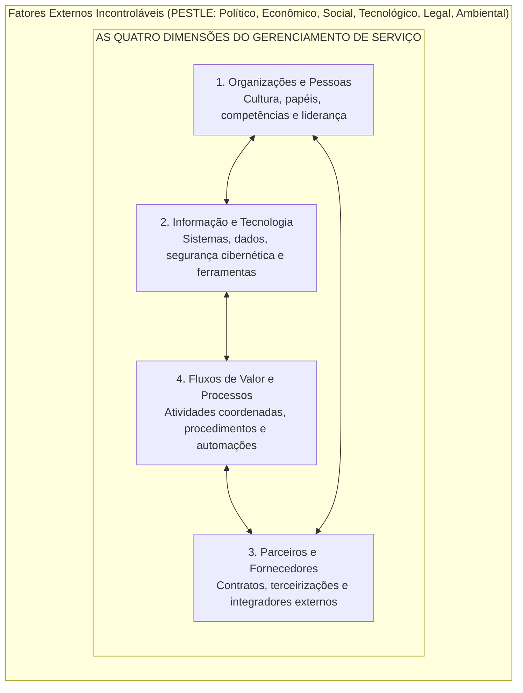
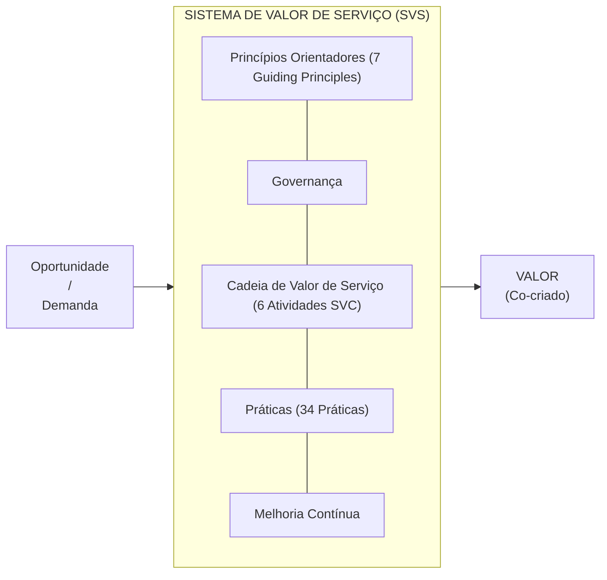
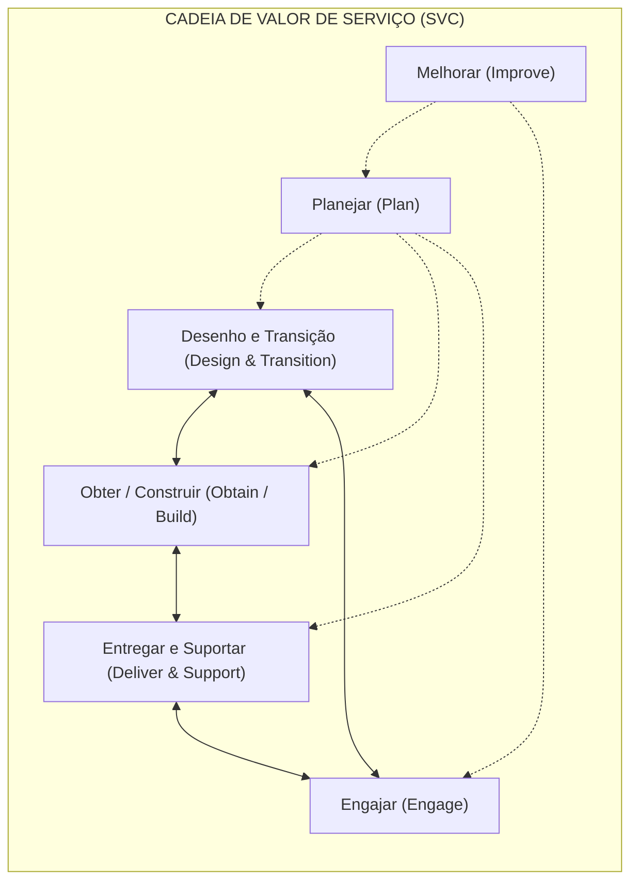
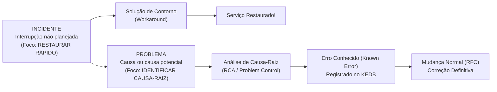
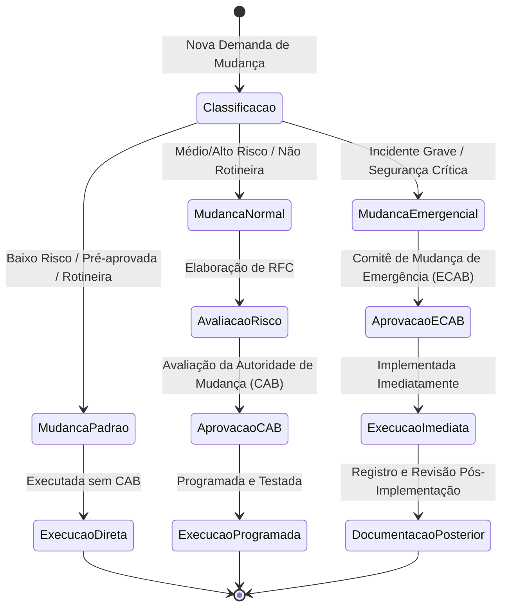

# 02 - Gestão de Serviços de TI e Práticas da ITIL v4

> **Matéria:** Governança de Tecnologia da Informação  
> **Cargo:** B02 – Técnico de Controle Externo – Especialidade: Tecnologia da Informação  
> **Arquivo:** `02_gestao_de_servicos_de_ti_itil_v4.md`  

---

## 📌 Ementa / Itens do Edital
- Framework ITIL v4 (Information Technology Infrastructure Library)
- Conceitos fundamentais de serviço, utilidade e garantia (Utility & Warranty)
- Sistema de Valor de Serviço (SVS - Service Value System)
- As Quatro Dimensões do Gerenciamento de Serviço
- Cadeia de Valor de Serviço (SVC - Service Value Chain)
- Os 7 Princípios Orientadores da ITIL v4
- Práticas de Gerenciamento de Serviços:
  - Central de Serviços (Service Desk)
  - Gerenciamento de Incidentes (Incident Management)
  - Gerenciamento de Problemas (Problem Management) e KEDB
  - Habilitação de Mudanças (Change Enablement)
  - Gerenciamento de Configuração de Serviço (CMDB e CIs)
  - Gerenciamento de Ativos de TI (ITAM)
  - Gerenciamento de Nível de Serviço (SLA, OLA, UC)
  - Gerenciamento de Continuidade de Serviços de TI (ITSCM: RPO e RTO)

---

## 🌳 Classificação Hierárquica

```text
2. ITIL v4 e Práticas de Gerenciamento de Serviços de TI
├── 2.1 A Estrutura Central da ITIL v4
│   ├── 2.1.1 Definição de Serviço: Co-criação de valor facilitando resultados desejados sem assumir custos e riscos específicos
│   ├── 2.1.2 Utilidade (Fit for Purpose) vs. Garantia (Fit for Use)
│   ├── 2.1.3 As Quatro Dimensões do Gerenciamento de Serviço:
│   │   ├── 1. Organizações e Pessoas
│   │   ├── 2. Informação e Tecnologia
│   │   ├── 3. Parceiros e Fornecedores
│   │   └── 4. Fluxos de Valor e Processos (+ Fatores Externos PESTLE)
│   ├── 2.1.4 Sistema de Valor de Serviço (SVS - Service Value System):
│   │   ├── Entradas: Oportunidade / Demanda
│   │   ├── Elementos Centrais: Princípios Orientadores, Governança, Cadeia de Valor de Serviço, Práticas e Melhoria Contínua
│   │   └── Saída: Valor co-criado
│   ├── 2.1.5 Os 7 Princípios Orientadores (Guiding Principles):
│   │   ├── 1. Foco no Valor (Focus on Value)
│   │   ├── 2. Comece de Onde Você Está (Start Where You Are)
│   │   ├── 3. Progrida Iterativamente com Feedback (Progress Iteratively with Feedback)
│   │   ├── 4. Colabore e Promova Visibilidade (Collaborate and Promote Visibility)
│   │   ├── 5. Pense e Trabalhe Holisticamente (Think and Work Holistically)
│   │   ├── 6. Mantenha Simples e Prático (Keep It Simple and Practical)
│   │   └── 7. Otimize e Automatize (Optimize and Automate)
│   └── 2.1.6 A Cadeia de Valor de Serviço (SVC - 6 Atividades Operacionais):
│       ├── Planejar (Plan), Melhorar (Improve), Engajar (Engage)
│       └── Desenho e Transição (Design & Transition), Obter/Construir (Obtain/Build), Entregar e Suportar (Deliver & Support)
└── 2.2 Práticas Essenciais de Gerenciamento de Serviços (Service Management Practices)
    ├── 2.2.1 Central de Serviços (Service Desk): Ponto Único de Contato (SPOC), modelos de atendimento e inteligência artificial
    ├── 2.2.2 Gerenciamento de Incidentes (Incident Management):
    │   ├── Objetivo: Restaurar a operação normal do serviço no menor tempo possível
    │   ├── Solução de Contorno (Workaround) e Swarming (resolução ágil colaborativa)
    │   └── Escalação Funcional (técnica) vs. Escalação Hierárquica (gerencial) e Incidentes Graves (Major Incidents)
    ├── 2.2.3 Gerenciamento de Problemas (Problem Management):
    │   ├── Objetivo: Reduzir a probabilidade e o impacto de incidentes identificando causas-raiz
    │   ├── Fases: Identificação do problema -> Controle do problema -> Controle de erros
    │   ├── Banco de Dados de Erros Conhecidos (KEDB - Known Error Database)
    │   └── Abordagem Reativa (após incidentes) vs. Abordagem Proativa (análise preditiva de tendências)
    ├── 2.2.4 Habilitação de Mudanças (Change Enablement):
    │   ├── Objetivo: Maximizar o sucesso das mudanças balanceando agilidade e risco
    │   ├── Categorias: Mudança Padrão (baixo risco, pré-autorizada), Mudança Normal (RFC e CAB), Mudança de Emergência (ECAB)
    │   └── Autoridade de Mudança (Change Authority)
    ├── 2.2.5 Gerenciamento de Configuração de Serviço (Service Configuration Management):
    │   ├── Item de Configuração (CI - Configuration Item): Componente gerenciado para entregar serviços
    │   └── Banco de Dados de Configuração (CMDB): Estrutura de relacionamentos e mapa de impacto
    ├── 2.2.6 Gerenciamento de Ativos de TI (ITAM - IT Asset Management):
    │   └── Ciclo de vida patrimonial e financeiro de hardware e licenças de software (diferença entre CI e Ativo)
    ├── 2.2.7 Gerenciamento de Nível de Serviço (SLM): SLA (com clientes), OLA (acordos internos) e Contratos de Apoio (Underpinning Contracts com terceiros)
    └── 2.2.8 Continuidade de Serviços de TI (ITSCM): Alinhamento ao BCP, BIA, Recovery Time Objective (RTO) e Recovery Point Objective (RPO)
```

---

## 📖 Teoria Aprofundada & Conceitos Essenciais

### 2.1 O Modelo Central da ITIL v4

A **ITIL v4** representa uma evolução profunda da biblioteca de boas práticas de Gerenciamento de Serviços de TI (ITSM). Em vez do antigo ciclo de vida linear baseado em estágios do livro da ITIL v3 (Estratégia, Desenho, Transição, Operação e Melhoria Contínua), a ITIL v4 adota uma abordagem holística, flexível e orientada à **co-criação de valor**.

#### Definições Fundamentais da ITIL v4

- **Serviço (*Service*):** Um meio para permitir a **co-criação de valor**, facilitando os resultados que os clientes desejam alcançar, sem que eles precisem assumir custos e riscos específicos.
- **Co-criação de Valor:** O valor não é entregue de forma unilateral pelo provedor; ele é criado conjuntamente por meio de uma colaboração ativa entre o provedor de serviços e o consumidor.
- **Utilidade (*Utility*):** A funcionalidade oferecida por um produto ou serviço para atender a uma necessidade específica (**"o que o serviço faz"** / *Fit for Purpose* - aptidão para o propósito).
- **Garantia (*Warranty*):** A certeza de que um produto ou serviço atenderá aos requisitos acordados de disponibilidade, capacidade, continuidade e segurança (**"como o serviço é entregue"** / *Fit for Use* - aptidão para o uso).

> ⭐ **IMPORTANTE / REGRA DE OURO:**  
> Para que um serviço gere valor real ao negócio, ele deve fornecer simultaneamente **Utilidade** (ter as funcionalidades necessárias) e **Garantia** (estar disponível, seguro e com capacidade adequada). Uma aplicação com todas as funcionalidades (utilidade) mas que passa o dia fora do ar (sem garantia) gera valor nulo.

---

### 2.2 As Quatro Dimensões do Gerenciamento de Serviço

Para garantir uma abordagem holística e sustentável, a ITIL v4 determina que qualquer serviço ou produto deve ser gerenciado considerando equilibradamente **Quatro Dimensões**:



1. **Organizações e Pessoas:** Estrutura formal da organização, cultura colaborativa, definição clara de papéis e responsabilidades, comunicação eficaz e competências técnicas e comportamentais.
2. **Informação e Tecnologia:** O ecossistema de informações gerado e consumido (bancos de dados, integridade, LGPD) e as tecnologias que sustentam os serviços (nuvem, IA, redes, ferramentas de ITSM).
3. **Parceiros e Fornecedores:** Relacionamento com empresas terceirizadas, contratos de suporte, consultorias e integrações da cadeia de suprimentos.
4. **Fluxos de Valor e Processos:** Como as partes da organização trabalham de maneira integrada e coordenada para criar valor por meio de fluxos de valor de ponta a ponta e processos eficientes.

Essas 4 dimensões são influenciadas por fatores macroambientais externos representados pela matriz **PESTLE** (*Political, Economic, Social, Technological, Legal, Environmental*).

---

### 2.3 O Sistema de Valor de Serviço (SVS)

O **SVS** (*Service Value System*) descreve como todos os componentes e atividades da organização trabalham juntos como um sistema integrado para viabilizar a criação de valor.



- **Entradas:** Oportunidades (chances de agregar valor) e Demanda (necessidade manifesta de serviços por parte dos clientes/usuários).
- **5 Elementos Centrais do SVS:**
  1. **Princípios Orientadores (*Guiding Principles*):** Recomendações que guiam as decisões em quaisquer circunstâncias.
  2. **Governança (*Governance*):** Mecanismos de direção e controle da organização (alinhamento ao EDM da ISO 38500).
  3. **Cadeia de Valor de Serviço (*Service Value Chain*):** Conjunto flexível e interconectado de 6 atividades operacionais.
  4. **Práticas (*Practices*):** Conjuntos de recursos organizacionais desenhados para realizar um trabalho ou atingir um objetivo (substituem o termo "processos" da v3).
  5. **Melhoria Contínua (*Continual Improvement*):** Atividade recorrente realizada em todos os níveis.
- **Saída:** Realização de **Valor** para as partes interessadas.

---

### 2.4 Os 7 Princípios Orientadores (Guiding Principles)

Os princípios orientadores são universais, atemporais e aplicáveis a qualquer iniciativa de TI ou transformação digital:

| Nº | Princípio Orientador | Significado e Aplicação Prática no ITSM |
| :---: | :--- | :--- |
| **1** | **Foco no Valor** (*Focus on Value*) | Toda ação deve gerar valor direto ou indireto para os stakeholders. É indispensável compreender quem é o cliente do serviço e o que ele realmente valoriza. |
| **2** | **Comece de Onde Você Está** (*Start Where You Are*) | Não destrua tudo para começar do zero sem antes analisar o estado atual. Reaproveite processos, sistemas e serviços existentes que funcionam bem. |
| **3** | **Progrida Iterativamente com Feedback** (*Progress Iteratively with Feedback*) | Divida iniciativas grandes em partes menores e gerenciáveis (iterações). Colete feedback dos usuários antes, durante e após cada ciclo de entrega. |
| **4** | **Colabore e Promova Visibilidade** (*Collaborate and Promote Visibility*) | Trabalhe além das barreiras departamentais (elimine silos). Compartilhe planos, prioridades e métricas de forma transparente com as partes interessadas. |
| **5** | **Pense e Trabalhe Holisticamente** (*Think and Work Holistically*) | Nenhum serviço ou prática atua isolado. Avalie o impacto de cada mudança em todo o ecossistema organizacional, integrando pessoas, tecnologias e fornecedores. |
| **6** | **Mantenha Simples e Prático** (*Keep It Simple and Practical*) | Use o número mínimo de etapas necessárias. Se um processo, relatório ou métrica não produz valor palpável, elimine-o (*princípio da parcimônia*). |
| **7** | **Otimize e Automatize** (*Optimize and Automate*) | Simplifique e padronize o fluxo de trabalho antes de automatizá-lo. A intervenção humana deve ser reservada para atividades que exigem criatividade e julgamento. |

> 🚨 **ALERTA DE PROVA / PEGADINHA FCC:**  
> A FCC adora trocar a ordem de "Otimize e Automatize", afirmando que se deve "Automatizar primeiro e otimizar depois". **ERRADO!** Se você automatiza um processo ineficiente, você apenas terá uma ineficiência acelerada. O princípio exige: primeiro otimizar/padronizar, depois automatizar!

---

### 2.5 Cadeia de Valor de Serviço (SVC - 6 Atividades Operacionais)

A Cadeia de Valor de Serviço é o modelo operacional central da ITIL v4. Trata-se de uma matriz não-linear de **seis atividades** que podem ser combinadas em múltiplos fluxos de valor (*Value Streams*):



1. **Planejar (*Plan*):** Garantir a compreensão compartilhada da visão, status atual e direcionamento de melhoria para todos os produtos e serviços.
2. **Melhorar (*Improve*):** Assegurar o aprimoramento contínuo de produtos, serviços e práticas em todas as atividades da cadeia de valor.
3. **Engajar (*Engage*):** Proporcionar uma compreensão profunda das necessidades das partes interessadas, transparência e bom relacionamento com todos os stakeholders.
4. **Desenho e Transição (*Design & Transition*):** Garantir que os produtos e serviços atendam continuamente às expectativas de custo, qualidade e prazo.
5. **Obter/Construir (*Obtain/Build*):** Assegurar que os componentes de serviço estejam disponíveis quando e onde forem necessários, atendendo às especificações.
6. **Entregar e Suportar (*Deliver & Support*):** Garantir que os serviços sejam entregues e suportados de acordo com os níveis acordados com clientes e usuários.

---

### 2.6 Práticas Essenciais da ITIL v4 no Foco da FCC

A ITIL v4 possui 34 práticas divididas em:
- 14 Práticas de Gerenciamento Geral (*General Management Practices*)
- 17 Práticas de Gerenciamento de Serviços (*Service Management Practices*)
- 3 Práticas de Gerenciamento Técnico (*Technical Management Practices*)

Abaixo, as práticas campeãs de cobrança em concursos de Tribunais e SEFAZs.

#### 2.6.1 Gerenciamento de Incidentes vs. Gerenciamento de Problemas



#### Tabela Comparativa: Incidente versus Problema versus Erro Conhecido

| Conceito | Definição Oficial ITIL v4 | Objetivo Primordial | Tratamento Prático |
| :--- | :--- | :--- | :--- |
| **Incidente** (*Incident*) | Uma interrupção não planejada de um serviço ou redução na sua qualidade. | Restaurar a operação normal do serviço **o mais rápido possível** e minimizar o impacto no negócio. | Reiniciar servidor, trocar cabo de rede, aplicar solução paliativa temporária. |
| **Problema** (*Problem*) | Uma causa, ou causa potencial, de um ou mais incidentes. | Identificar a **causa-raiz** real ou potencial dos incidentes e prevenir a sua recorrência. | Análise de causa-raiz (RCA), investigação de logs, reprodução em laboratório. |
| **Erro Conhecido** (*Known Error*) | Um problema que foi analisado com sucesso, cuja causa-raiz foi identificada e para o qual existe uma solução de contorno (*workaround*). | Documentar a causa e a solução de contorno no **KEDB** (*Known Error Database*) para acelerar futuros atendimentos. | Criação de artigo no KEDB e emissão de solicitação de mudança (RFC) para correção permanente. |
| **Solução de Contorno** (*Workaround*) | Uma solução que reduz ou elimina o impacto de um incidente ou problema para o qual uma resolução definitiva ainda não está disponível. | Viabilizar o retorno imediato da operação antes que a correção final seja desenvolvida. | Script de liberação temporária de memória, rota estática de contingência. |

> 🚨 **ALERTA DE PROVA / PEGADINHA FCC:**  
> A FCC tenta induzir o candidato ao erro dizendo que "o técnico de incidentes deve manter o sistema indisponível até localizar a causa-raiz no código". **ERRADO!** O foco exclusivo do Gerenciamento de Incidentes é o **tempo de restauração** (*Time to Restore*). A busca da causa-raiz é trabalho privativo do **Gerenciamento de Problemas**, que corre em paralelo ou a posteriori.

---

#### 2.6.2 Habilitação de Mudanças (Change Enablement)

A Habilitação de Mudanças tem como objetivo maximizar o número de mudanças bem-sucedidas em serviços e produtos, garantindo que os riscos sejam avaliados, as mudanças sejam aprovadas por quem de direito e a implementação seja coordenada.



#### Os Três Tipos de Mudanças na ITIL v4

| Tipo de Mudança | Nível de Risco | Autorização Prévia | Fluxo Operacional | Exemplos Práticos |
| :--- | :---: | :--- | :--- | :--- |
| **Mudança Padrão** (*Standard Change*) | **Baixo** | **Pré-autorizada** (pré-aprovada formalmente). | Procedimento rotineiro, documentado e testado. Não passa pelo CAB a cada ocorrência. | Reset de senha, criação de conta de usuário, substituição de teclado com defeito. |
| **Mudança Normal** (*Normal Change*) | Variável (Médio a Alto) | Requer autorização formal da **Autoridade de Mudança** (*Change Authority* / CAB). | Segue o fluxo formal: RFC $\rightarrow$ Avaliação de impacto/risco $\rightarrow$ Agendamento $\rightarrow$ Testes $\rightarrow$ Implementação. | Atualização de versão de SGBD corporativo, migração de datacenter, publicação de novo módulo. |
| **Mudança de Emergência** (*Emergency Change*) | **Crítico** | Autorizada com urgência pelo **ECAB** (*Emergency CAB*). | Implementação rápida para resolver incidente grave ou vulnerabilidade de segurança extrema. Documentação completada a posteriori. | Aplicação imediata de patch crítico de segurança contra ransomware ativo; restauração de cluster caído. |

---

#### 2.6.3 Gerenciamento de Configuração (CMDB) vs. Ativos de TI (ITAM)

| Dimensão | Gerenciamento de Configuração de Serviço | Gerenciamento de Ativos de TI (ITAM) |
| :--- | :--- | :--- |
| **Unidade Básica** | **Item de Configuração (CI - *Configuration Item*)** | **Ativo de TI (*IT Asset*)** |
| **Foco Principal** | **Operacional / Técnico:** Como os componentes se interconectam para sustentar a entrega de um serviço de TI. | **Financeiro / Contábil / Contratual:** O valor monetário, propriedade, depreciação e conformidade de licenças do bem. |
| **Repositório Central** | **CMDB** (*Configuration Management Database*) / CMS. | Sistema de Gestão Patrimonial e Gerenciamento de Licenças de Software (*SAM*). |
| **Pergunta-Chave** | *"Se desligarmos este roteador ou este switch, quais bancos de dados e sistemas de processo eletrônico ficarão fora do ar?"* | *"Quantas licenças do software X compramos, qual é o valor residual do notebook e quando expira a garantia de hardware?"* |

---

#### 2.6.4 Gerenciamento de Continuidade de Serviços de TI (ITSCM)

Responsável por garantir que a disponibilidade e o desempenho dos serviços de TI sejam mantidos em níveis suficientes em caso de desastre ou crise grave:
- **Alinhamento com o BCP:** O ITSCM suporta o Plano de Continuidade de Negócios (*Business Continuity Plan*).
- **RTO (*Recovery Time Objective*):** Tempo Máximo Tolerável de Parada. Período aceitável entre o desastre e a restauração do serviço operacional.
- **RPO (*Recovery Point Objective*):** Ponto Objetivo de Recuperação. Quantidade máxima aceitável de perda de dados expressa em tempo (ex.: RPO de 15 minutos significa que os dados devem ser restaurados até 15 minutos antes da falha).

---

## 🌐 Fontes Recomendadas na Internet (Acesso Direto e Gratuito)

- [x] **PeopleCert / AXELOS - ITIL 4 Foundation Official Guidance:**
  - Link Oficial: [PeopleCert ITIL 4 Foundation Overview](https://www.peoplecert.org/ways-to-get-certified/itil-4-foundation)
  - *Conteúdo:* Arquitetura do Sistema de Valor de Serviço (SVS), as 4 Dimensões do Gerenciamento de Serviços e os 7 Princípios Orientadores da ITIL 4.
- [x] **Atlassian ITSM Resource Center - ITIL 4 Best Practices Guide:**
  - Link Oficial: [Atlassian ITIL 4 Guide and Practices](https://www.atlassian.com/itsm/itil)
  - *Conteúdo:* Manuais práticos sobre Incident Management, Problem Management, Change Enablement e Service Configuration Management (CMDB).
- [x] **BMC Blogs - ITIL 4 Service Management Practice Summaries:**
  - Link Oficial: [BMC ITIL 4 Practice Guides](https://www.bmc.com/blogs/categories/itil/)
  - *Conteúdo:* Artigos aprofundados sobre a diferença entre Incidentes e Problemas, Erros Conhecidos (KEDB) e Cadeia de Valor de Serviço (SVC).

---

## 📝 Questões Comentadas no Padrão FCC (Exatamente 5 Questões)

### Questão 1 (FCC - Analista de TI / Suporte e Operações - Adaptada)
**Enunciado:** Em um Tribunal de Contas Estadual, a equipe de infraestrutura e operações de TIC vivenciou os seguintes episódios durante a rotina de sustentação tecnológica:  
I. O sistema de protocolo eletrônico tornou-se subitamente indisponível no início do expediente; o analista plantonista reiniciou imediatamente os serviços de aplicação e executou um script de liberação de conexões residuais, restabelecendo a operação aos usuários em menos de dez minutos.  
II. Durante a semana seguinte, uma equipe de especialistas foi destacada para investigar detalhadamente os logs de transação e os despejos de memória (*heap dumps*), com o objetivo de descobrir por que o subsistema de sessões acumulou conexões órfãs e formular uma solução definitiva, registrando no repositório de conhecimento uma solução de contorno para o caso de nova ocorrência.  
Considerando as práticas preconizadas pela ITIL v4, as condutas descritas nos itens I e II correspondem, respectivamente, às práticas de:  
A) Gerenciamento de Problemas e Habilitação de Mudanças.  
B) Gerenciamento de Incidentes e Gerenciamento de Problemas.  
C) Gerenciamento de Liberação e Central de Serviços.  
D) Gerenciamento de Problemas e Gerenciamento de Incidentes.  
E) Gerenciamento de Capacidade e Gerenciamento de Ativos de TI.  

> **Gabarito: B**  
>  
> **Comentário Analítico Passo a Passo:**  
> - **Análise da Alternativa A:** Incorreta. O item I trata de restabelecimento urgente de serviço (Incidentes), e não de Problemas; o item II trata de análise de causa-raiz e documentação de erro (Problemas), e não da prática de Habilitação de Mudanças.  
> - **Análise da Alternativa B:** **CORRETA.** O item I caracteriza o **Gerenciamento de Incidentes**, cujo propósito central é restaurar a operação normal do serviço no menor tempo possível, minimizando o impacto negativo no negócio (mesmo usando soluções temporárias como reinicialização). O item II descreve com perfeição o **Gerenciamento de Problemas**, cuja finalidade é investigar a causa-raiz de incidentes repetidos ou graves, gerando soluções definitivas e alimentando o KEDB (*Known Error Database*) com soluções de contorno.  
> - **Análise da Alternativa C:** Incorreta. Gerenciamento de Liberação cuida de tornar serviços e recursos novos ou modificados disponíveis para uso, enquanto a Central de Serviços é a unidade organizacional de contato com os usuários.  
> - **Análise da Alternativa D:** Incorreta. Houve inversão temporal dos conceitos entre I e II.  
> - **Análise da Alternativa E:** Incorreta. A conduta I não tratou de planejamento de capacidade futura de hardware, nem a II tratou de controle patrimonial/financeiro de ativos de TI.

---

### Questão 2 (FCC - Técnico de Controle Externo / TI - Adaptada)
**Enunciado:** A respeito da prática de Habilitação de Mudanças (*Change Enablement*) da ITIL v4 e da classificação de tipos de mudança, considere as três situações a seguir em um órgão público:  
1. Criação de login e concessão de perfil de acesso de rede padronizado para um novo servidor público empossado, conforme procedimento documentado e testado.  
2. Atualização programada de versão do SGBD de produção do sistema fiscal, com planejamento prévio, análise de impacto e agendamento para o fim de semana.  
3. Aplicação emergencial imediata de pacote de correção para estancar invasão cibernética em andamento no datacenter central.  
As situações 1, 2 e 3 classificam-se, respectivamente, como mudanças:  
A) Emergencial, Normal e Padrão.  
B) Padrão, Normal e de Emergência.  
C) Normal, Padrão e Emergencial.  
D) Padrão, Estratégica e Crítica.  
E) Operacional, Tática e Governamental.  

> **Gabarito: B**  
>  
> **Comentário Analítico Passo a Passo:**  
> - **Análise da Alternativa A:** Incorreta. A situação 1 não é emergencial (é uma rotina diária de baixo risco), e a situação 3 não é uma mudança padrão.  
> - **Análise da Alternativa B:** **CORRETA.** A ITIL v4 classifica as mudanças em três tipos:  
>   1. **Mudança Padrão (*Standard*):** Mudança rotineira, de baixo risco, pré-autorizada e com procedimento documentado (criação de conta de usuário).  
>   2. **Mudança Normal (*Normal*):** Mudança que requer avaliação formal de risco, submissão de RFC (*Request for Change*) e aprovação pela Autoridade de Mudança / CAB antes da execução (atualização de SGBD).  
>   3. **Mudança de Emergência (*Emergency*):** Mudança que precisa ser implementada imediatamente para restaurar um serviço crítico ou tratar uma vulnerabilidade urgente de segurança cibernética, com validação rápida pelo ECAB.  
> - **Análise da Alternativa C:** Incorreta. A situação 1 não é mudança normal; requerer análise e autorização formal do CAB para cada novo servidor admitido geraria burocracia desnecessária para uma rotina de baixo risco.  
> - **Análise da Alternativa D:** Incorreta. "Estratégica" e "Crítica" não correspondem aos tipos formais de mudança da prática de Change Enablement da ITIL v4.  
> - **Análise da Alternativa E:** Incorreta. A ITIL v4 não adota essa nomenclatura tripartite de níveis administrativos para tipificar mudanças no Change Enablement.

---

### Questão 3 (FCC - Analista de Sistemas / Governança de TI - Adaptada)
**Enunciado:** A ITIL v4 estabelece os 7 Princípios Orientadores (*Guiding Principles*), que representam recomendações que podem orientar uma organização em qualquer circunstância, independentemente de mudanças em suas metas, estratégias ou estrutura de trabalho. Dentre esses princípios, aquele que preconiza que a organização não deve descartar prematuramente soluções e processos existentes sem antes avaliar o que já está disponível e funcionando adequadamente, denomina-se:  
A) Foco no Valor (*Focus on Value*).  
B) Pense e Trabalhe Holisticamente (*Think and Work Holistically*).  
C) Comece de Onde Você Está (*Start Where You Are*).  
D) Otimize e Automatize (*Optimize and Automate*).  
E) Mantenha Simples e Prático (*Keep It Simple and Practical*).  

> **Gabarito: C**  
>  
> **Comentário Analítico Passo a Passo:**  
> - **Análise da Alternativa A:** Incorreta. O princípio *Foco no Valor* estabelece que tudo o que a organização faz deve vincular-se, direta ou indiretamente, à entrega de valor para os stakeholders.  
> - **Análise da Alternativa B:** Incorreta. O princípio *Pense e Trabalhe Holisticamente* exige que nenhuma parte da organização atue de forma isolada e que a entrega de serviços seja vista como um todo interconectado.  
> - **Análise da Alternativa C:** **CORRETA.** O princípio *Comece de Onde Você Está* orienta a nunca começar do zero sem antes analisar o estado atual; processos, ferramentas e habilidades em vigor devem ser mensurados e reaproveitados sempre que viável.  
> - **Análise da Alternativa D:** Incorreta. O princípio *Otimize e Automatize* orienta a tornar os processos o mais eficientes e úteis possível antes de aplicar ferramentas de automação tecnológica.  
> - **Análise da Alternativa E:** Incorreta. O princípio *Mantenha Simples e Prático* prega a eliminação de burocracias, formulários e passos desnecessários que não agregam valor ao resultado final.

---

### Questão 4 (FCC - Auditor Federal de Controle Externo / TI - Adaptada)
**Enunciado:** O Sistema de Valor de Serviço (SVS) da ITIL v4 apoia-se em Quatro Dimensões do Gerenciamento de Serviço, fundamentais para assegurar a co-criação equilibrada e sustentável de valor. A dimensão que abrange a cultura da organização, as competências técnicas dos colaboradores, os estilos de liderança e a gestão das linhas de comunicação internas denomina-se:  
A) Informação e Tecnologia.  
B) Parceiros e Fornecedores.  
C) Fluxos de Valor e Processos.  
D) Organizações e Pessoas.  
E) Fatores Externos PESTLE.  

> **Gabarito: D**  
>  
> **Comentário Analítico Passo a Passo:**  
> - **Análise da Alternativa A:** Incorreta. A dimensão *Informação e Tecnologia* trata da gestão dos dados institucionais, sistemas corporativos, ferramentas de software, segurança da informação e infraestrutura física/em nuvem.  
> - **Análise da Alternativa B:** Incorreta. A dimensão *Parceiros e Fornecedores* foca nos relacionamentos da organização com outras entidades envolvidas no desenho, entrega e suporte dos serviços (contratos, parceiros de terceirização, integradores).  
> - **Análise da Alternativa C:** Incorreta. A dimensão *Fluxos de Valor e Processos* cuida das atividades, fluxos operacionais e procedimentos coordenados que viabilizam a criação de produtos e serviços.  
> - **Análise da Alternativa D:** **CORRETA.** A dimensão *Organizações e Pessoas* concentra-se explicitamente na estrutura organizacional formal, cultura corporativa compartilhada, habilidades e competências das equipes, papeis/responsabilidades e estilos de liderança e comunicação.  
> - **Análise da Alternativa E:** Incorreta. O acrônimo PESTLE descreve as influências macroambientais externas (políticas, econômicas, sociais, tecnológicas, legais e ambientais) que exercem pressão sobre as quatro dimensões, não constituindo uma das quatro dimensões em si.

---

### Questão 5 (FCC - Analista de TI / Infraestrutura de Redes - Adaptada)
**Enunciado:** Na gestão operacional de serviços de TI de uma instituição pública, dois repositórios de dados desempenham funções essenciais, porém com finalidades distintas: o repositório de Itens de Configuração (CIs) que mapeia os relacionamentos técnicos entre hardware, software e serviços para suporte operacional e análise de impacto, e o repositório financeiro/patrimonial destinado ao controle de licenças de software, custos de aquisição e ciclo de vida contábil dos equipamentos. Esses dois papéis correspondem, respectivamente, às práticas da ITIL v4 de:  
A) Gerenciamento de Nível de Serviço e Central de Serviços.  
B) Gerenciamento de Configuração de Serviço e Gerenciamento de Ativos de TI (*ITAM*).  
C) Gerenciamento de Problemas e Habilitação de Mudanças.  
D) Gerenciamento de Ativos de TI (*ITAM*) e Gerenciamento de Liberação.  
E) Gerenciamento de Continuidade e Gerenciamento de Disponibilidade.  

> **Gabarito: B**  
>  
> **Comentário Analítico Passo a Passo:**  
> - **Análise da Alternativa A:** Incorreta. Gerenciamento de Nível de Serviço trata da negociação e monitoramento de SLAs com clientes; a Central de Serviços é o ponto único de contato (SPOC) para usuários.  
> - **Análise da Alternativa B:** **CORRETA.**  
>   - **Gerenciamento de Configuração de Serviço:** Tem como foco manter informações precisas e confiáveis sobre os **Itens de Configuração (CIs)** e seus relacionamentos técnicos (armazenados tipicamente no CMDB), servindo de base para análises de impacto em incidentes e mudanças.  
>   - **Gerenciamento de Ativos de TI (ITAM):** Trata do ciclo de vida completo dos **ativos de TI sob a ótica financeira, legal e patrimonial**, abrangendo aquisição, controle de licenças de software, depreciação contábil e descarte seguro.  
> - **Análise da Alternativa C:** Incorreta. Gerenciamento de Problemas investiga causas-raiz de falhas, e Habilitação de Mudanças autoriza e agenda modificações na infraestrutura.  
> - **Análise da Alternativa D:** Incorreta. Inverteu e misturou as funções com Gerenciamento de Liberação.  
> - **Análise da Alternativa E:** Incorreta. Ambas são práticas de garantia de serviço voltadas à disponibilidade operacional e resiliência diante de desastres, não aos bancos de configuração e patrimônio.
