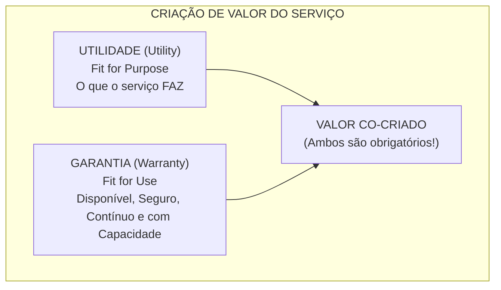
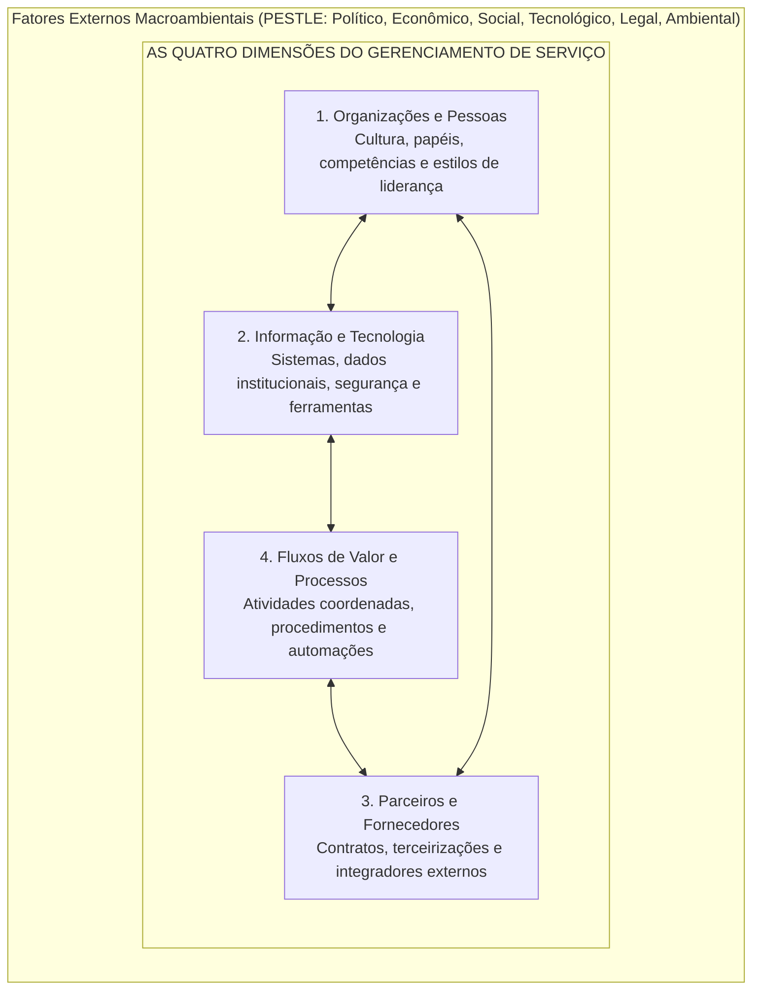
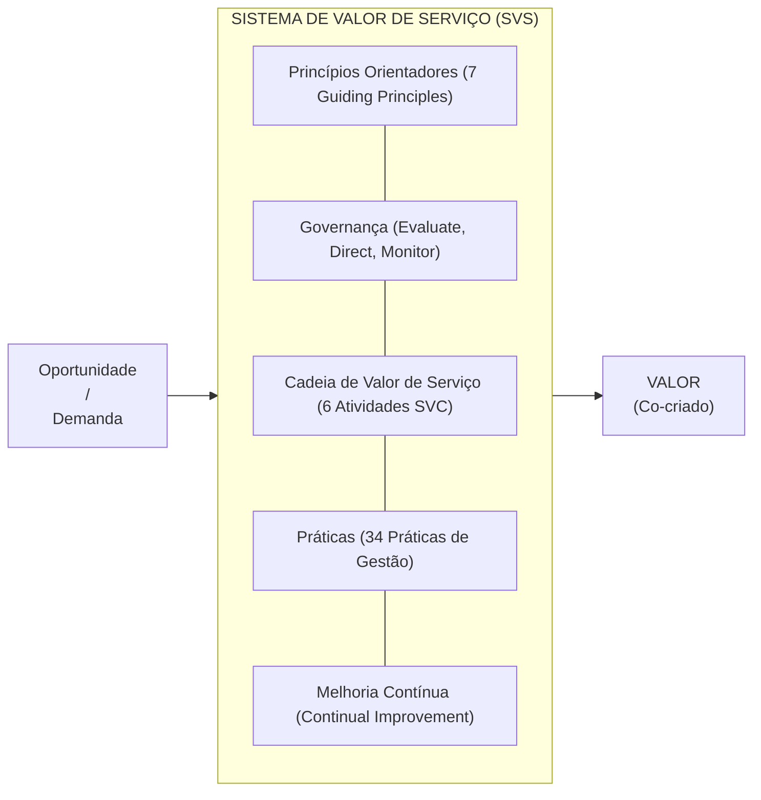
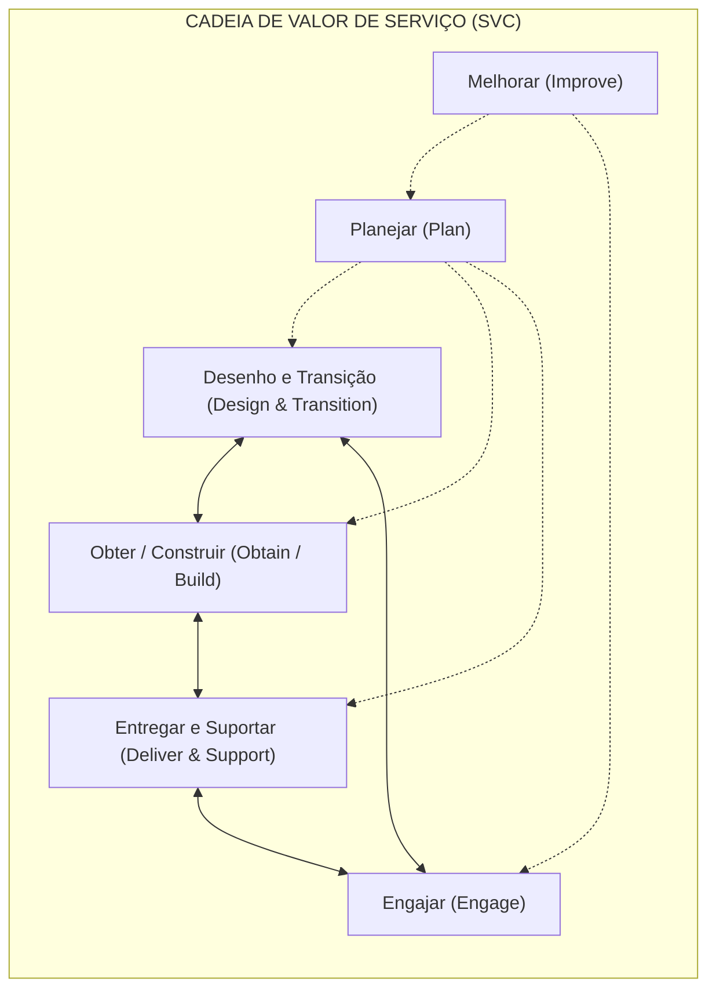
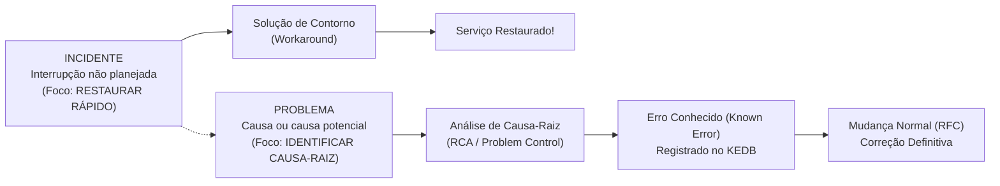
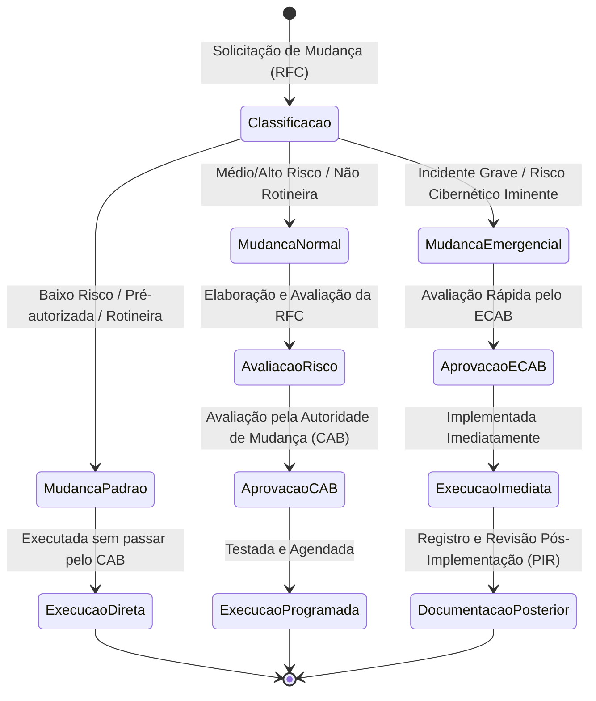

# 02 - Gestão de Serviços de TI e Práticas da ITIL v4

> **Matéria:** Governança de Tecnologia da Informação  
> **Cargo:** B02 – Técnico de Controle Externo – Especialidade: Tecnologia da Informação  
> **Arquivo:** `02_gestao_de_servicos_de_ti_itil_v4.md`  

---

## 📌 Ementa / Itens do Edital
- Framework ITIL v4 (Information Technology Infrastructure Library)
- Conceitos fundamentais de serviço, utilidade e garantia (Utility & Warranty)
- Sistema de Valor de Serviço (SVS - Service Value System)
- As Quatro Dimensões do Gerenciamento de Serviço
- Cadeia de Valor de Serviço (SVC - Service Value Chain)
- Os 7 Princípios Orientadores da ITIL v4
- Práticas de Gerenciamento de Serviços:
    - Central de Serviços (Service Desk)
    - Gerenciamento de Incidentes (Incident Management)
    - Gerenciamento de Problemas (Problem Management) e KEDB
    - Habilitação de Mudanças (Change Enablement)
    - Gerenciamento de Configuração de Serviço (CMDB e CIs)
    - Gerenciamento de Ativos de TI (ITAM)
    - Gerenciamento de Nível de Serviço (SLA, OLA, UC)
    - Gerenciamento de Continuidade de Serviços de TI (ITSCM: RPO e RTO)

---

## 🧭 Sumário
- [1. O Modelo Central da ITIL v4](#1-o-modelo-central-da-itil-v4)
    - [1.1 Conceitos de Serviço, Co-criação de Valor, Utilidade e Garantia](#11-conceitos-de-servico-co-criacao-de-valor-utilidade-e-garantia)
    - [1.2 As Quatro Dimensões do Gerenciamento de Serviço](#12-as-quatro-dimensoes-do-gerenciamento-de-servico)
    - [1.3 O Sistema de Valor de Serviço (SVS)](#13-o-sistema-de-valor-de-servico-svs)
    - [1.4 Os 7 Princípios Orientadores (Guiding Principles)](#14-os-7-principios-orientadores-guiding-principles)
    - [1.5 A Cadeia de Valor de Serviço (SVC - 6 Atividades Operacionais)](#15-a-cadeia-de-valor-de-servico-svc-6-atividades-operacionais)
- [2. Práticas Essenciais de Gerenciamento de Serviços da ITIL v4](#2-praticas-essenciais-de-gerenciamento-de-servicos-da-itil-v4)
    - [2.1 Central de Serviços (Service Desk)](#21-central-de-servicos-service-desk)
    - [2.2 Gerenciamento de Incidentes vs. Gerenciamento de Problemas](#22-gerenciamento-de-incidentes-vs-gerenciamento-de-problemas)
    - [2.3 Habilitação de Mudanças (Change Enablement)](#23-habilitacao-de-mudancas-change-enablement)
    - [2.4 Gerenciamento de Configuração de Serviço (CMDB) vs. Ativos de TI (ITAM)](#24-gerenciamento-de-configuracao-de-servico-cmdb-vs-ativos-de-ti-itam)
    - [2.5 Gerenciamento de Nível de Serviço (SLA, OLA e UC)](#25-gerenciamento-de-nivel-de-servico-sla-ola-e-uc)
    - [2.6 Gerenciamento de Continuidade de Serviços de TI (ITSCM: RTO e RPO)](#26-gerenciamento-de-continuidade-de-servicos-de-ti-itscm-rto-e-rpo)
- [3. Fontes Recomendadas na Internet](#3-fontes-recomendadas-na-internet)

---

## 📖 Teoria Aprofundada & Conceitos Essenciais

## 1. O Modelo Central da ITIL v4

A **ITIL v4** (*Information Technology Infrastructure Library*) representa uma evolução substancial da biblioteca de boas práticas de Gerenciamento de Serviços de TI (ITSM). Em substituição ao modelo puramente linear baseado nos 5 estágios do ciclo de vida da ITIL v3 (Estratégia, Desenho, Transição, Operação e Melhoria Contínua), a ITIL v4 consolida uma abordagem ágil, holística, flexível e orientada à **co-criação mútua de valor**.

### 1.1 Conceitos de Serviço, Co-criação de Valor, Utilidade e Garantia

#### Definições Fundamentais da ITIL v4

- **Serviço (*Service*):** Meio para permitir a **co-criação de valor**, facilitando os resultados que os clientes desejam alcançar, sem que eles precisem assumir a gestão de custos e riscos específicos.
- **Co-criação de Valor:** O valor não é gerado e empurrado unilateralmente pelo provedor de TI. Ele é co-criado ativamente por meio de parceria e interação constante entre o provedor e o consumidor do serviço.
- **Utilidade (*Utility*):** A funcionalidade oferecida por um produto ou serviço para atender a uma necessidade real de negócio. Reflete **o que o serviço faz** (*Fit for Purpose* - aptidão para o propósito).
- **Garantia (*Warranty*):** A segurança de que o produto ou serviço atenderá aos requisitos acordados quanto à sua disponibilidade, capacidade, continuidade e segurança. Reflete **como o serviço é entregue e mantido** (*Fit for Use* - aptidão para o uso).

> 🚨 **ALERTA DE PROVA / PEGADINHA FCC:**  
> A FCC adora afirmar que um serviço de TI pode gerar valor pleno ao negócio apenas possuindo excelente **Utilidade**, mesmo com falhas de Garantia. **ERRADO!** O valor requer simultaneamente Utilidade (*Fit for Purpose*) e Garantia (*Fit for Use*). Se um sistema de processo eletrônico tem todas as telas e funções que os auditores precisam (utilidade), mas cai a cada meia hora ou vaza dados (falha de garantia), o serviço gera valor zero ou negativo.

---

### 1.2 As Quatro Dimensões do Gerenciamento de Serviço

Para viabilizar uma abordagem holística, equilibrada e evitar o isolamento de equipes em silos técnicos, a ITIL v4 exige que qualquer produto ou serviço seja gerenciado considerando **Quatro Dimensões**:

1. **Organizações e Pessoas:** Estrutura formal do órgão ou empresa, cultura corporativa compartilhada, definição inequívoca de papéis e responsabilidades, comunicação interpessoal, competências técnicas e estilos de liderança.
2. **Informação e Tecnologia:** O ecossistema de informações gerado e processado (bancos de dados, integridade, conformidade com a LGPD) e as tecnologias de suporte aos serviços (computação em nuvem, ferramentas de automação, monitoramento e IA).
3. **Parceiros e Fornecedores:** Relações contratuais com entidades externas que participam da concepção, desenvolvimento, entrega e suporte dos serviços (fábricas de software, provedores de nuvem, consultorias de TIC).
4. **Fluxos de Valor e Processos:** Como as diversas áreas da organização coordenam suas atividades por meio de fluxos de valor (*Value Streams*) e procedimentos operacionais padronizados para entregar resultados tangíveis.

Essas quatro dimensões sofrem pressão contínua de fatores externos incontroláveis descritos pelo acrônimo **PESTLE** (*Political, Economic, Social, Technological, Legal, Environmental*).

---

### Questão 01 (FCC - Auditor Federal de Controle Externo / TI - Adaptada)
**Enunciado:** O Sistema de Valor de Serviço (SVS) da ITIL v4 apoia-se em Quatro Dimensões do Gerenciamento de Serviço, fundamentais para assegurar a co-criação equilibrada e sustentável de valor. A dimensão que abrange a cultura da organização, as competências técnicas dos colaboradores, os estilos de liderança e a gestão das linhas de comunicação internas denomina-se:  

* **A)** Informação e Tecnologia.
* **B)** Parceiros e Fornecedores.
* **C)** Fluxos de Valor e Processos.
* **D)** Organizações e Pessoas.
* **E)** Fatores Externos PESTLE.

> **Comentário Detalhado:**
>
> - **A)** Incorreta. A dimensão Informação e Tecnologia trata da gestão dos dados institucionais, sistemas corporativos, ferramentas de software, segurança da informação e infraestrutura física/em nuvem.
> - **B)** Incorreta. A dimensão Parceiros e Fornecedores foca nos relacionamentos da organização com outras entidades envolvidas no desenho, entrega e suporte dos serviços (contratos, parceiros de terceirização, integradores).
> - **C)** Incorreta. A dimensão Fluxos de Valor e Processos cuida das atividades, fluxos operacionais e procedimentos coordenados que viabilizam a criação de produtos e serviços.
> - **D)** **Correta.** A dimensão Organizações e Pessoas concentra-se explicitamente na estrutura organizacional formal, cultura corporativa compartilhada, habilidades e competências das equipes, papeis/responsabilidades e estilos de liderança e comunicação.
> - **E)** Incorreta. O acrônimo PESTLE descreve as influências macroambientais externas (políticas, econômicas, sociais, tecnológicas, legais e ambientais) que exercem pressão sobre as quatro dimensões, não constituindo uma das quatro dimensões em si.
> 
> **Gabarito: D**

---

### 1.3 O Sistema de Valor de Serviço (SVS)

O **SVS** (*Service Value System*) descreve como todos os componentes e atividades da organização atuam harmonicamente para transformar oportunidades e demandas em valor real para a sociedade e clientes.

- **Entradas:** Oportunidades (chances de agregar valor) e Demanda (necessidade manifesta de novos serviços ou correções por parte dos usuários).
- **Os 5 Componentes Centrais do SVS:**
    1. **Princípios Orientadores (*Guiding Principles*):** Filosofias e recomendações universais que orientam a tomada de decisão em quaisquer circunstâncias.
    2. **Governança (*Governance*):** O sistema pelo qual a organização é dirigida e controlada (alinhamento ao ciclo EDM da ISO/IEC 38500).
    3. **Cadeia de Valor de Serviço (*Service Value Chain*):** O modelo operacional composto por 6 atividades interconectadas.
    4. **Práticas (*Practices*):** Conjuntos de recursos organizacionais desenhados para realizar tarefas específicas (a ITIL v4 substitui o conceito de "processos" da v3 pelo termo mais abrangente "práticas").
    5. **Melhoria Contínua (*Continual Improvement*):** Atividade recorrente executada em todos os níveis e componentes da organização.

- **Saída:** Realização contínua de **Valor** para as partes interessadas.

---

### 1.4 Os 7 Princípios Orientadores (Guiding Principles)

Os princípios orientadores da ITIL v4 são recomendações perenes, aplicáveis em qualquer organização pública ou privada, guiando desde a rotina de sustentação de TI até programas estratégicos de transformação digital:

| Nº | Princípio Orientador | Significado e Aplicação Prática no ITSM |
| :---: | :--- | :--- |
| **1** | **Foco no Valor** (*Focus on Value*) | Toda iniciativa deve gerar valor direto ou indireto para os stakeholders. É indispensável identificar quem consome o serviço e o que esse usuário realmente valoriza. |
| **2** | **Comece de Onde Você Está** (*Start Where You Are*) | Não destrua o que já existe para recomeçar do zero sem antes analisar o estado atual. Avalie e reaproveite serviços, códigos, procedimentos e sistemas em operação. |
| **3** | **Progrida Iterativamente com Feedback** (*Progress Iteratively with Feedback*) | Divida iniciativas complexas em ciclos menores e gerenciáveis (iterações ágeis). Obtenha feedback real dos usuários antes, durante e após cada entrega. |
| **4** | **Colabore e Promova Visibilidade** (*Collaborate and Promote Visibility*) | Trabalhe de forma integrada entre departamentos, eliminando silos isolados. Compartilhe dados operacionais, status de projetos e métricas de forma transparente. |
| **5** | **Pense e Trabalhe Holisticamente** (*Think and Work Holistically*) | Nenhum serviço ou prática funciona de maneira isolada. É necessário compreender a interdependência sistêmica entre pessoas, processos e ferramentas. |
| **6** | **Mantenha Simples e Prático** (*Keep It Simple and Practical*) | Utilize a quantidade mínima necessária de etapas para atingir o objetivo. Elimine relatórios inúteis, etapas burocráticas e métricas redundantes (*parcimônia*). |
| **7** | **Otimize e Automatize** (*Optimize and Automate*) | Simplifique e padronize o processo antes de implementar automações tecnológicas. A tecnologia deve ser usada para liberar pessoas para tarefas criativas e complexas. |

> 🚨 **ALERTA DE PROVA / PEGADINHA FCC:**  
> A FCC adora trocar a ordem de "Otimize e Automatize", afirmando que se deve "automatizar para depois descobrir o que precisa ser otimizado". **ERRADO!** Automatizar processos ruins apenas produz erros em maior velocidade. Primeiro otimiza-se e padroniza-se; depois se automatiza!

---

### Questão 02 (FCC - Analista de Sistemas / Governança de TI - Adaptada)
**Enunciado:** A ITIL v4 estabelece os 7 Princípios Orientadores (*Guiding Principles*), que representam recomendações que podem orientar uma organização em qualquer circunstância, independentemente de mudanças em suas metas, estratégias ou estrutura de trabalho. Dentre esses princípios, aquele que preconiza que a organização não deve descartar prematuramente soluções e processos existentes sem antes avaliar o que já está disponível e funcionando adequadamente, denomina-se:  

* **A)** Foco no Valor (*Focus on Value*).
* **B)** Pense e Trabalhe Holisticamente (*Think and Work Holistically*).
* **C)** Comece de Onde Você Está (*Start Where You Are*).
* **D)** Otimize e Automatize (*Optimize and Automate*).
* **E)** Mantenha Simples e Prático (*Keep It Simple and Practical*).

> **Comentário Detalhado:**
>
> - **A)** Incorreta. O princípio Foco no Valor estabelece que tudo o que a organização faz deve vincular-se, direta ou indiretamente, à entrega de valor para os stakeholders.
> - **B)** Incorreta. O princípio Pense e Trabalhe Holisticamente exige que nenhuma parte da organização atue de forma isolada e que a entrega de serviços seja vista como um todo interconectado.
> - **C)** **Correta.** O princípio Comece de Onde Você Está orienta a nunca começar do zero sem antes analisar o estado atual; processos, ferramentas e habilidades em vigor devem ser mensurados e reaproveitados sempre que viável.
> - **D)** Incorreta. O princípio Otimize e Automatize orienta a tornar os processos o mais eficientes e úteis possível antes de aplicar ferramentas de automação tecnológica.
> - **E)** Incorreta. O princípio Mantenha Simples e Prático prega a eliminação de burocracias, formulários e passos desnecessários que não agregam valor ao resultado final.
> 
> **Gabarito: C**

---

### 1.5 A Cadeia de Valor de Serviço (SVC - 6 Atividades Operacionais)

A Cadeia de Valor de Serviço (*Service Value Chain*) é a engrenagem operacional central do SVS. Trata-se de uma rede flexível e não linear de **seis atividades** que podem ser combinadas para criar múltiplos fluxos de valor (*Value Streams*):

1. **Planejar (*Plan*):** Assegurar o entendimento compartilhado da visão institucional, situação atual e direcionamento de melhoria para todos os produtos e serviços.
2. **Melhorar (*Improve*):** Garantir o aprimoramento contínuo dos serviços, práticas e componentes em todas as atividades da cadeia de valor.
3. **Engajar (*Engage*):** Proporcionar uma compreensão profunda das expectativas dos stakeholders, garantir transparência e cultivar bom relacionamento contínuo.
4. **Desenho e Transição (*Design & Transition*):** Assegurar que produtos e serviços atendam continuamente às expectativas de custos, prazos, conformidade e especificações.
5. **Obter/Construir (*Obtain/Build*):** Garantir que os componentes de serviço (softwares, hardwares e documentações) estejam disponíveis quando e onde forem necessários.
6. **Entregar e Suportar (*Deliver & Support*):** Assegurar que os serviços sejam executados, operados e suportados de acordo com os níveis de serviço acordados com os usuários.

---

## 2. Práticas Essenciais de Gerenciamento de Serviços da ITIL v4

A ITIL v4 classifica suas 34 práticas em três domínios:

- **14 Práticas de Gerenciamento Geral** (*General Management Practices*)
- **17 Práticas de Gerenciamento de Serviços** (*Service Management Practices*)
- **3 Práticas de Gerenciamento Técnico** (*Technical Management Practices*)

Abaixo, detalham-se as práticas com maior recorrência nas bancas de controle externo.

---

### 2.1 Central de Serviços (Service Desk)

A **Central de Serviços** atua como o **Ponto Único de Contato (SPOC - *Single Point of Contact*)** entre o provedor de serviços de TI e os usuários corporativos.

- **Propósito:** Capturar a demanda de resolução de incidentes e requisições de serviço, servindo como o ponto focal para todas as comunicações operacionais.
- **Estruturas Organizacionais Típicas:**
    - *Local:* Equipe de suporte alocada fisicamente nas dependências do órgão.
    - *Centralizada:* Equipe única atendendo múltiplos prédios, unidades regionais ou filiais a partir de uma sede.
    - *Virtual:* Analistas distribuídos geograficamente que interagem por meio de sistemas na nuvem, dando ao usuário a percepção de uma central única.
    - *Siga o Sol (Follow the Sun):* Equipes em diferentes fusos horários cobrindo suporte ininterrupto 24/7.
- **Cultura e Habilidades:** Mais do que mero conhecimento técnico profundo, a Central de Serviços exige excelência em atendimento ao cliente, empatia interpessoal e compreensão do impacto das falhas nas atividades institucionais.

---

### 2.2 Gerenciamento de Incidentes vs. Gerenciamento de Problemas

Esta é a distinção mais testada em concursos de Tribunais de Contas:

#### Tabela Comparativa: Incidente versus Problema versus Erro Conhecido

| Conceito | Definição Oficial ITIL v4 | Objetivo Primordial | Tratamento Prático |
| :--- | :--- | :--- | :--- |
| **Incidente** (*Incident*) | Uma interrupção não planejada de um serviço ou redução na sua qualidade operacional. | Restaurar a operação normal do serviço **o mais rápido possível** e minimizar o impacto negativo no negócio. | Reiniciar aplicação, alternar para link redundante, aplicar solução paliativa temporária. |
| **Problema** (*Problem*) | Uma causa, ou causa potencial, de um ou mais incidentes. | Identificar a **causa-raiz** real ou provável dos incidentes e prevenir a sua recorrência futura. | Análise de causa-raiz (RCA), auditoria de logs, simulação em ambiente de testes. |
| **Erro Conhecido** (*Known Error*) | Um problema cuja análise foi concluída, com causa-raiz identificada e para o qual existe uma solução de contorno (*workaround*). | Documentar a falha e a solução de contorno no **KEDB** (*Known Error Database*) para acelerar futuros atendimentos. | Criação de artigo no KEDB e emissão de solicitação de mudança (RFC) para correção permanente no código. |
| **Solução de Contorno** (*Workaround*) | Uma medida paliativa que reduz ou elimina o impacto de um incidente ou problema para o qual a solução definitiva ainda não existe. | Viabilizar o retorno imediato da operação antes que a correção final seja desenvolvida. | Script de liberação temporária de cache, roteamento estático manual. |

> 🚨 **ALERTA DE PROVA / PEGADINHA FCC:**  
> A banca frequentemente afirma que a equipe de incidentes deve paralisar a produção até encontrar a causa-raiz no código. **ERRADO!** O foco do Gerenciamento de Incidentes é exclusivamente a **restauração do serviço no menor tempo possível** (*Time to Restore*). A busca minuciosa da causa-raiz é trabalho privativo do **Gerenciamento de Problemas**.

- **Swarming:** Técnica colaborativa em que múltiplos especialistas de áreas diversas unem-se rapidamente para resolver incidentes graves, substituindo a escalação hierárquica lenta por cooperação ágil.

---

### Questão 03 (FCC - Analista de TI / Suporte e Operações - Adaptada)
**Enunciado:** Em um Tribunal de Contas Estadual, a equipe de infraestrutura e operações de TIC vivenciou os seguintes episódios durante a rotina de sustentação tecnológica:  

I. O sistema de protocolo eletrônico tornou-se subitamente indisponível no início do expediente; o analista plantonista reiniciou imediatamente os serviços de aplicação e executou um script de liberação de conexões residuais, restabelecendo a operação aos usuários em menos de dez minutos.  

II. Durante a semana seguinte, uma equipe de especialistas foi destacada para investigar detalhadamente os logs de transação e os despejos de memória (*heap dumps*), com o objetivo de descobrir por que o subsistema de sessões acumulou conexões órfãs e formular uma solução definitiva, registrando no repositório de conhecimento uma solução de contorno para o caso de nova ocorrência.  

Considerando as práticas preconizadas pela ITIL v4, as condutas descritas nos itens I e II correspondem, respectivamente, às práticas de:  

* **A)** Gerenciamento de Problemas e Habilitação de Mudanças.
* **B)** Gerenciamento de Incidentes e Gerenciamento de Problemas.
* **C)** Gerenciamento de Liberação e Central de Serviços.
* **D)** Gerenciamento de Problemas e Gerenciamento de Incidentes.
* **E)** Gerenciamento de Capacidade e Gerenciamento de Ativos de TI.

> **Comentário Detalhado:**
>
> - **A)** Incorreta. O item I trata de restabelecimento urgente de serviço (Incidentes), e não de Problemas; o item II trata de análise de causa-raiz e documentação de erro (Problemas), e não da prática de Habilitação de Mudanças.
> - **B)** **Correta.** O item I caracteriza o Gerenciamento de Incidentes, cujo propósito central é restaurar a operação normal do serviço no menor tempo possível, minimizando o impacto negativo no negócio (mesmo usando soluções temporárias como reinicialização). O item II descreve com perfeição o Gerenciamento de Problemas, cuja finalidade é investigar a causa-raiz de incidentes repetidos ou graves, gerando soluções definitivas e alimentando o KEDB (*Known Error Database*) com soluções de contorno.
> - **C)** Incorreta. Gerenciamento de Liberação cuida de tornar serviços e recursos novos ou modificados disponíveis para uso, enquanto a Central de Serviços é a unidade organizacional de contato com os usuários.
> - **D)** Incorreta. Houve inversão da ordem cronológica e conceitual entre as condutas I e II.
> - **E)** Incorreta. A conduta I não tratou de planejamento de capacidade futura de hardware, nem a II tratou de controle patrimonial/financeiro de ativos de TI.
> 
> **Gabarito: B**

---

### 2.3 Habilitação de Mudanças (Change Enablement)

A prática de **Habilitação de Mudanças** (denominada *Change Management* na v3) visa maximizar o número de mudanças bem-sucedidas em serviços e produtos, garantindo a adequada avaliação de riscos, a autorização formal pelas autoridades competentes e a execução coordenada.

#### Os Três Tipos de Mudanças na ITIL v4

| Tipo de Mudança | Nível de Risco | Autorização Prévia | Fluxo Operacional | Exemplos Práticos |
| :--- | :---: | :--- | :--- | :--- |
| **Mudança Padrão** (*Standard Change*) | **Baixo** | **Pré-autorizada** (formalmente aprovada de antemão). | Procedimento rotineiro, documentado e testado. Não requer envio de RFC ao CAB a cada ocorrência. | Criação de conta de usuário, concessão de perfil de acesso de rede, troca de mouse defeituoso. |
| **Mudança Normal** (*Normal Change*) | Variável (Médio a Alto) | Requer autorização formal da **Autoridade de Mudança** (*Change Authority* / CAB). | Segue o fluxo formal: RFC $\rightarrow$ Avaliação de impacto/risco $\rightarrow$ Agendamento em janela $\rightarrow$ Testes $\rightarrow$ Implementação. | Atualização de versão do SGBD de produção, migração de datacenter, lançamento de nova versão do portal. |
| **Mudança de Emergência** (*Emergency Change*) | **Crítico** | Autorizada com urgência pelo **ECAB** (*Emergency Change Advisory Board*). | Implementação veloz para conter incidente gravíssimo ou brecha crítica de segurança. A documentação formal e a avaliação pós-implantação ocorrem a posteriori. | Aplicação de hotfix de segurança contra exploit ativo em firewall; restauração emergencial de servidor de autenticação caído. |

---

### Questão 04 (FCC - Técnico de Controle Externo / TI - Adaptada)
**Enunciado:** A respeito da prática de Habilitação de Mudanças (*Change Enablement*) da ITIL v4 e da classificação de tipos de mudança, considere as três situações a seguir em um órgão público:  

1. Criação de login e concessão de perfil de acesso de rede padronizado para um novo servidor público empossado, conforme procedimento documentado e testado.  
2. Atualização programada de versão do SGBD de produção do sistema fiscal, com planejamento prévio, análise de impacto e agendamento para o fim de semana.  
3. Aplicação emergencial imediata de pacote de correção para estancar invasão cibernética em andamento no datacenter central.  
As situações 1, 2 e 3 classificam-se, respectivamente, como mudanças:  

* **A)** Emergencial, Normal e Padrão.
* **B)** Padrão, Normal e de Emergência.
* **C)** Normal, Padrão e Emergencial.
* **D)** Padrão, Estratégica e Crítica.
* **E)** Operacional, Tática e Governamental.

> **Comentário Detalhado:**
>
> - **A)** Incorreta. A situação 1 não é emergencial (é uma rotina diária de baixo risco), e a situação 3 não é uma mudança padrão.
> - **B)** **Correta.** A ITIL v4 classifica as mudanças em três tipos:  
>     1. **Mudança Padrão (*Standard*):** Mudança rotineira, de baixo risco, pré-autorizada e com procedimento documentado (criação de conta de usuário).  
>     2. **Mudança Normal (*Normal*):** Mudança que requer avaliação formal de risco, submissão de RFC (*Request for Change*) e aprovação pela Autoridade de Mudança / CAB antes da execução (atualização de SGBD).  
>     3. **Mudança de Emergência (*Emergency*):** Mudança que precisa ser implementada imediatamente para restaurar um serviço crítico ou tratar uma vulnerabilidade urgente de segurança cibernética, com validação rápida pelo ECAB.
>
> - **C)** Incorreta. A situação 1 não é mudança normal; requerer análise e autorização formal do CAB para cada novo servidor admitido geraria burocracia desnecessária para uma rotina de baixo risco.
> - **D)** Incorreta. "Estratégica" e "Crítica" não correspondem aos tipos formais de mudança da prática de Change Enablement da ITIL v4.
> - **E)** Incorreta. A ITIL v4 não adota essa divisão de níveis gerenciais para tipificar mudanças no Change Enablement.
> 
> **Gabarito: B**

---

### 2.4 Gerenciamento de Configuração de Serviço (CMDB) vs. Ativos de TI (ITAM)

| Dimensão de Comparação | Gerenciamento de Configuração de Serviço | Gerenciamento de Ativos de TI (ITAM) |
| :--- | :--- | :--- |
| **Conceito Central** | **Item de Configuração (CI - *Configuration Item*)** | **Ativo de TI (*IT Asset*)** |
| **Foco Primário** | **Operacional / Técnico:** Mapeia como os componentes técnicos se interconectam e dependem uns dos outros para sustentar a entrega de um serviço de TI. | **Financeiro / Contábil / Legal:** Controla o valor financeiro, notas fiscais, depreciação contábil, termos de garantia e conformidade de licenças de software. |
| **Repositório Central** | **CMDB** (*Configuration Management Database*) integrado ao CMS (*Configuration Management System*). | Sistema de Controle Patrimonial e Gerenciamento de Licenças de Software (*SAM - Software Asset Management*). |
| **Pergunta Essencial** | *"Se o switch da sala de servidores queimar, quais bancos de dados, aplicações de fiscalização e servidores web ficarão indisponíveis?"* | *"Quantas licenças de Windows Server adquirimos, qual é o valor residual dos notebooks do Tribunal e quando expira a garantia do servidor?"* |

---

### Questão 05 (FCC - Analista de TI / Infraestrutura de Redes - Adaptada)
**Enunciado:** Na gestão operacional de serviços de TI de uma instituição pública, dois repositórios de dados desempenham funções essenciais, porém com finalidades distintas: o repositório de Itens de Configuração (CIs) que mapeia os relacionamentos técnicos entre hardware, software e serviços para suporte operacional e análise de impacto, e o repositório financeiro/patrimonial destinado ao controle de licenças de software, custos de aquisição e ciclo de vida contábil dos equipamentos. Esses dois papéis correspondem, respectivamente, às práticas da ITIL v4 de:  

* **A)** Gerenciamento de Nível de Serviço e Central de Serviços.
* **B)** Gerenciamento de Configuração de Serviço e Gerenciamento de Ativos de TI (*ITAM*).
* **C)** Gerenciamento de Problemas e Habilitação de Mudanças.
* **D)** Gerenciamento de Ativos de TI (*ITAM*) e Gerenciamento de Liberação.
* **E)** Gerenciamento de Continuidade e Gerenciamento de Disponibilidade.

> **Comentário Detalhado:**
>
> - **A)** Incorreta. Gerenciamento de Nível de Serviço trata da negociação e monitoramento de SLAs com clientes; a Central de Serviços é o ponto único de contato (SPOC) para usuários.
> - **B)** **Correta.** O Gerenciamento de Configuração de Serviço tem como foco manter informações precisas e confiáveis sobre os Itens de Configuração (CIs) e seus relacionamentos técnicos (armazenados tipicamente no CMDB), servindo de base para análises de impacto em incidentes e mudanças. Já o Gerenciamento de Ativos de TI (ITAM) trata do ciclo de vida completo dos ativos de TI sob a ótica financeira, legal e patrimonial, abrangendo aquisição, controle de licenças de software, depreciação contábil e descarte seguro.
> - **C)** Incorreta. Gerenciamento de Problemas investiga causas-raiz de falhas, e Habilitação de Mudanças autoriza e agenda modificações na infraestrutura.
> - **D)** Incorreta. Inverteu as funções e misturou com Gerenciamento de Liberação.
> - **E)** Incorreta. Ambas são práticas de garantia de serviço voltadas à disponibilidade operacional e resiliência diante de desastres, não aos bancos de configuração e patrimônio.
> 
> **Gabarito: B**

---

### 2.5 Gerenciamento de Nível de Serviço (SLA, OLA e UC)

O objetivo do Gerenciamento de Nível de Serviço (*Service Level Management - SLM*) é definir metas claras baseadas em negócios para os níveis de serviço e garantir que a entrega de serviços seja avaliada, monitorada e gerenciada em relação a essas metas.

A prática articula três tipos de instrumentos fundamentais:

1. **SLA (*Service Level Agreement* - Acordo de Nível de Serviço):** Acordo documentado e firmado formalmente entre o provedor de serviços de TI e o **cliente/negócio** (ex.: DTI acordando com a Presidência do Tribunal que o Processo Eletrônico estará disponível 99,8% do tempo).
2. **OLA (*Operational Level Agreement* - Acordo de Nível Operacional):** Acordo interno firmado entre **diferentes áreas internas do mesmo provedor de TI** (ex.: equipe de Redes acordando com a equipe de Aplicações o tempo de liberação de portas de firewall).
3. **UC (*Underpinning Contract* - Contrato de Apoio):** Contrato jurídico firmado entre o provedor de TI e um **fornecedor externo terceirizado** (ex.: contrato de link de fibra óptica celebrado com a operadora de telecomunicações, estipulando multas por indisponibilidade).

---

### 2.6 Gerenciamento de Continuidade de Serviços de TI (ITSCM: RTO e RPO)

Responsável por garantir que a disponibilidade e o desempenho dos serviços de TI sejam mantidos em níveis suficientes em caso de desastre operacional grave, alinhando-se ao Plano de Continuidade de Negócios (*Business Continuity Plan - BCP*) do Tribunal:

- **RTO (*Recovery Time Objective* - Tempo Objetivo de Recuperação):** Tempo máximo tolerável que a organização suporta manter um serviço fora do ar antes que ocorram prejuízos inaceitáveis. Mede a velocidade de recuperação.
- **RPO (*Recovery Point Objective* - Ponto Objetivo de Recuperação):** Quantidade máxima tolerável de perda de dados expressa em tempo decorrido desde o último backup válido até o momento do incidente. Mede a tolerância à perda de transações.

---

## 6. Fontes Recomendadas na Internet

* [AXELOS - ITIL 4 Foundation Overview](https://www.axelos.com/certifications/itil-service-management) - Visão geral do framework ITIL 4, Sistema de Valor de Serviço (SVS) e Quatro Dimensões do Gerenciamento de Serviços.
* [AXELOS - The Seven Guiding Principles of ITIL 4](https://www.axelos.com/resource-hub/blog/the-seven-guiding-principles-of-itil-4) - Descrição detalhada dos 7 princípios orientadores da ITIL 4 voltados à co-criação de valor.
* [TCU - Práticas de Governança e Gestão de TI no Setor Público](https://portal.tcu.gov.br/governanca/governanca-no-tcu/) - Referencial de boas práticas de gestão de operações e catálogo de serviços de TI governamentais.
* [Governo Digital - Estratégia Federal de Governo Digital (EFGD)](https://www.gov.br/governodigital/pt-br/estrategias-e-governanca-digital/EFGD) - Diretrizes estratégicas para sustentação e entrega contínua de serviços digitais centrados no usuário.
* [Governo Digital - Infraestrutura Nacional de Dados (IND)](https://www.gov.br/governodigital/pt-br/infraestrutura-nacional-de-dados) - Governança, compartilhamento e segurança de bases de dados do setor público.
* AXELOS. **ITIL Foundation: ITIL 4 Edition**. London: TSO (The Stationery Office), 2019. (Cap. 2 - Key Concepts of Service Management; Cap. 4 - The ITIL Service Value System; Cap. 5 - ITIL Management Practices).
* FERNANDES, Aguinaldo Aragon; ABREU, Vladimir Ferraz de. **Implantando a Governança de TI: da Estratégia aos Processos**. 4. ed. Rio de Janeiro: Brasport, 2014. (Cap. 5 - Gerenciamento de Serviços com ITIL).
* FREITAS, Marcos André dos Santos. **Fundamentos do Gerenciamento de Serviços de TI com Base na ITIL 4**. Rio de Janeiro: Brasport, 2020. (Cap. 1 a 6).
