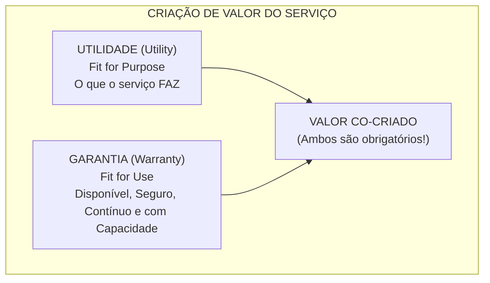
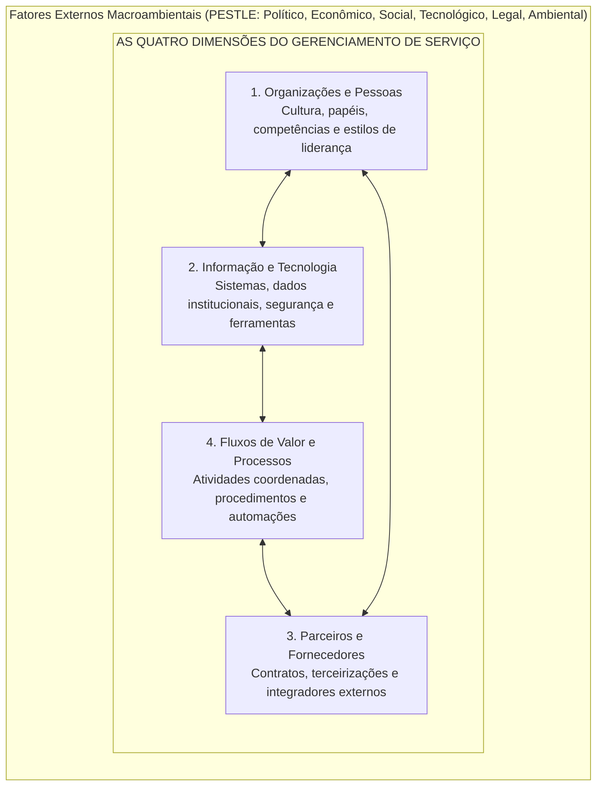
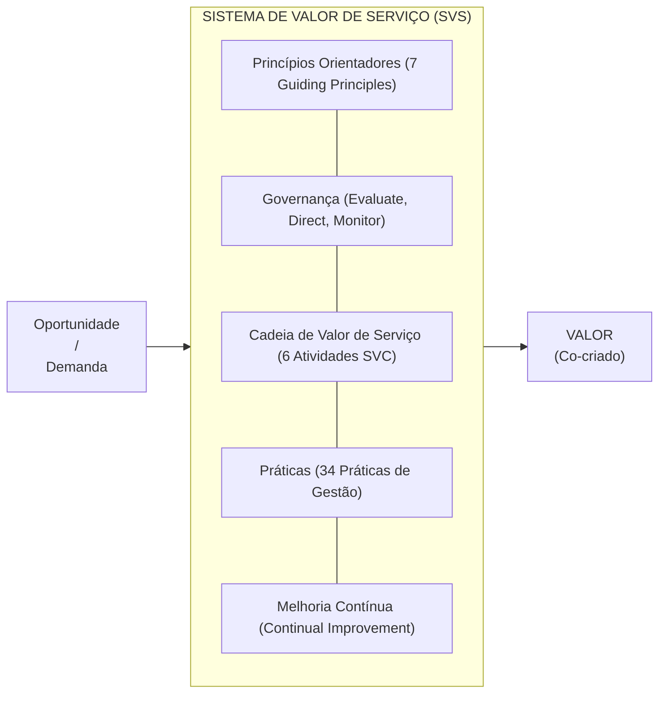
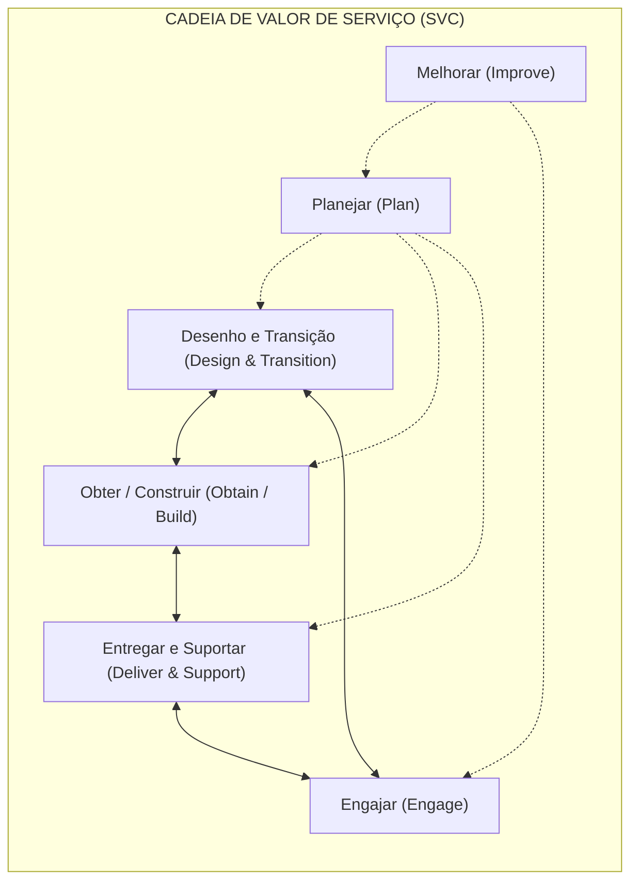
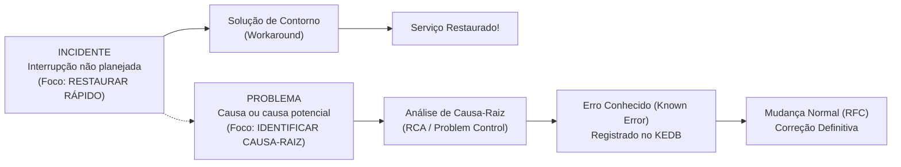
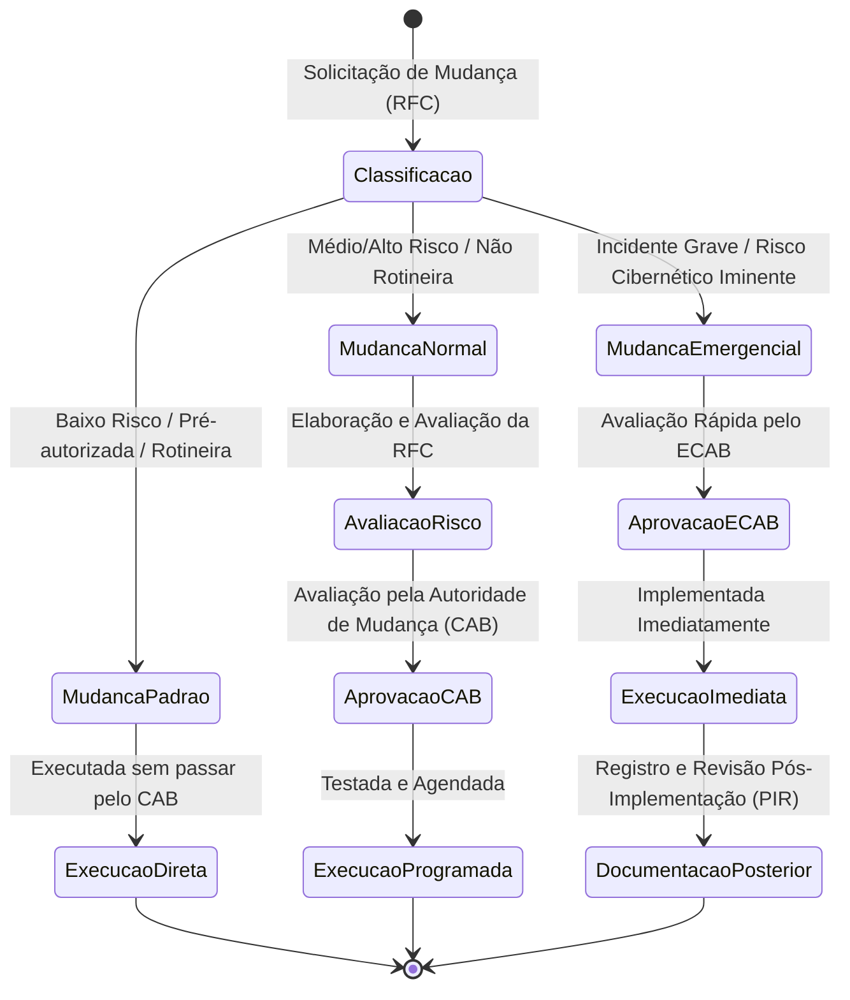

# 02 - Gestão de Serviços de TI e Práticas da ITIL v4

> **Matéria:** Governança de Tecnologia da Informação  
> **Cargo:** B02 – Técnico de Controle Externo – Especialidade: Tecnologia da Informação  
> **Arquivo:** `02_gestao_de_servicos_de_ti_itil_v4.md`  

---

## 📌 Ementa / Itens do Edital
- Framework ITIL v4 (Information Technology Infrastructure Library)
- Conceitos fundamentais de serviço, utilidade e garantia (Utility & Warranty)
- Sistema de Valor de Serviço (SVS - Service Value System)
- As Quatro Dimensões do Gerenciamento de Serviço
- Cadeia de Valor de Serviço (SVC - Service Value Chain)
- Os 7 Princípios Orientadores da ITIL v4
- Práticas de Gerenciamento de Serviços:
    - Central de Serviços (Service Desk)
    - Gerenciamento de Incidentes (Incident Management)
    - Gerenciamento de Problemas (Problem Management) e KEDB
    - Habilitação de Mudanças (Change Enablement)
    - Gerenciamento de Configuração de Serviço (CMDB e CIs)
    - Gerenciamento de Ativos de TI (ITAM)
    - Gerenciamento de Nível de Serviço (SLA, OLA, UC)
    - Gerenciamento de Continuidade de Serviços de TI (ITSCM: RPO e RTO)

---

## 🧭 Sumário

1. [O Modelo Central da ITIL v4](#1-o-modelo-central-da-itil-v4)
1. [Conceitos de Serviço, Co-criação de Valor, Utilidade e Garantia](#1-1-conceitos-de-servico-co-criacao-de-valor-utilidade-e-garantia)
    1. [Teste 475](#Teste-475)
1. [As Quatro Dimensões do Gerenciamento de Serviço](#1-2-as-quatro-dimensoes-do-gerenciamento-de-servico)
    1. [Teste 476](#Teste-476)
1. [O Sistema de Valor de Serviço (SVS)](#1-3-o-sistema-de-valor-de-servico-svs)
1. [Os 7 Princípios Orientadores (Guiding Principles)](#1-4-os-7-principios-orientadores-guiding-principles)
    1. [Teste 477](#Teste-477)
1. [A Cadeia de Valor de Serviço (SVC - 6 Atividades Operacionais)](#1-5-a-cadeia-de-valor-de-servico-svc-6-atividades-operacionais)
    1. [Teste 478](#Teste-478)
2. [Práticas Essenciais de Gerenciamento de Serviços da ITIL v4](#2-praticas-essenciais-de-gerenciamento-de-servicos-da-itil-v4)
2. [Central de Serviços (Service Desk)](#2-1-central-de-servicos-service-desk)
    1. [Teste 479](#Teste-479)
2. [Gerenciamento de Incidentes vs. Gerenciamento de Problemas](#2-2-gerenciamento-de-incidentes-vs-gerenciamento-de-problemas)
    1. [Teste 480](#Teste-480)
2. [Habilitação de Mudanças (Change Enablement)](#2-3-habilitacao-de-mudancas-change-enablement)
    1. [Teste 481](#Teste-481)
2. [Gerenciamento de Configuração de Serviço (CMDB) vs. Ativos de TI (ITAM)](#2-4-gerenciamento-de-configuracao-de-servico-cmdb-vs-ativos-de-ti-itam)
    1. [Teste 482](#Teste-482)
2. [Gerenciamento de Nível de Serviço (SLA, OLA e UC)](#2-5-gerenciamento-de-nivel-de-servico-sla-ola-e-uc)
    1. [Teste 483](#Teste-483)
2. [Gerenciamento de Continuidade de Serviços de TI (ITSCM: RTO e RPO)](#2-6-gerenciamento-de-continuidade-de-servicos-de-ti-itscm-rto-e-rpo)
    1. [Teste 484](#Teste-484)
6. [Fontes Recomendadas na Internet](#6-fontes-recomendadas-na-internet)

---

## 1. O Modelo Central da ITIL v4

A **ITIL v4** (*Information Technology Infrastructure Library*) representa uma evolução substancial da biblioteca de boas práticas de Gerenciamento de Serviços de TI (ITSM). Em substituição ao modelo puramente linear baseado nos 5 estágios do ciclo de vida da ITIL v3 (Estratégia, Desenho, Transição, Operação e Melhoria Contínua), a ITIL v4 consolida uma abordagem ágil, holística, flexível e orientada à **co-criação mútua de valor**.

---

## 1.1 Conceitos de Serviço, Co-criação de Valor, Utilidade e Garantia

#### Definições Fundamentais da ITIL v4

- **Serviço (*Service*):** Meio para permitir a **co-criação de valor**, facilitando os resultados que os clientes desejam alcançar, sem que eles precisem assumir a gestão de custos e riscos específicos.
- **Co-criação de Valor:** O valor não é gerado e empurrado unilateralmente pelo provedor de TI. Ele é co-criado ativamente por meio de parceria e interação constante entre o provedor e o consumidor do serviço.
- **Utilidade (*Utility*):** A funcionalidade oferecida por um produto ou serviço para atender a uma necessidade real de negócio. Reflete **o que o serviço faz** (*Fit for Purpose* - aptidão para o propósito).
- **Garantia (*Warranty*):** A segurança de que o produto ou serviço atenderá aos requisitos acordados quanto à sua disponibilidade, capacidade, continuidade e segurança. Reflete **como o serviço é entregue e mantido** (*Fit for Use* - aptidão para o uso).

> 🚨 **ALERTA DE PROVA / PEGADINHA FCC:**  
> A FCC adora afirmar que um serviço de TI pode gerar valor pleno ao negócio apenas possuindo excelente **Utilidade**, mesmo com falhas de Garantia. **ERRADO!** O valor requer simultaneamente Utilidade (*Fit for Purpose*) e Garantia (*Fit for Use*). Se um sistema de processo eletrônico tem todas as telas e funções que os auditores precisam (utilidade), mas cai a cada meia hora ou vaza dados (falha de garantia), o serviço gera valor zero ou negativo.

---

### Teste 475
**(FGV – TRT – Analista Judiciário (TI) – 2024)**  
Considerando as metodologias de gestão de projetos e de TI, COBIT, ITIL e PMBOK possuem abordagens distintas para a gestão de riscos. Assinale a opção que descreve corretamente a diferença fundamental entre esses três frameworks.

* **A)** COBIT foca na governança de riscos gerais em TI, enquanto ITIL aborda a gestão de riscos nos serviços de TI e PMBOK se concentra na gestão de projetos em geral, sem especialização em TI.
* **B)** ITIL é usado para análise quantitativa de riscos, ao contrário do COBIT e do PMBOK, qu e se concentram em análises qualitativas.
* **C)** PMBOK não inclui processos de gestão de riscos, diferentemente do COBIT e do ITIL que oferecem guias detalhados sobre o tema.
* **D)** COBIT, ITIL e PMBOK são equivalentes e intercambiáveis quando se trata de gestão de riscos, sendo uma questão de preferência pessoal a escolha entre eles.
* **E)** ITIL e COBIT são focados em TI, com ITIL voltado exclusivamente para a gestão de riscos em serviços de TI e COBIT para a governança de riscos TI, enquanto PMBOK é um guia de práticas para a gestão de projetos em geral.

---

> **Comentário Detalhado:**
>
> - **A)** Correta. A ITIL 4 adota uma abordagem holística orientada ao Sistema de Valor de Serviço (SVS) e quatro dimensões da gestão de serviço, integrando a gestão de riscos e tratamento de incidentes à co-criação de valor contínua.
> - **B)** Incorreta. A ITIL não prescreve regras inflexíveis nem desconsidera a cultura organizacional.
> - **C)** Incorreta. A ITIL 4 evoluiu dos processos rígidos da v3 para práticas ágeis e flexíveis.
> - **D)** Incorreta. ITIL e PMBOK são perfeitamente complementares no ecossistema corporativo.
> - **E)** Incorreta. Gerenciamento de incidentes visa restaurar a operação normal do serviço no menor tempo possível.
>
> **Gabarito: A**

---

## 1.2 As Quatro Dimensões do Gerenciamento de Serviço

Para viabilizar uma abordagem holística, equilibrada e evitar o isolamento de equipes em silos técnicos, a ITIL v4 exige que qualquer produto ou serviço seja gerenciado considerando **Quatro Dimensões**:

1. **Organizações e Pessoas:** Estrutura formal do órgão ou empresa, cultura corporativa compartilhada, definição inequívoca de papéis e responsabilidades, comunicação interpessoal, competências técnicas e estilos de liderança.
2. **Informação e Tecnologia:** O ecossistema de informações gerado e processado (bancos de dados, integridade, conformidade com a LGPD) e as tecnologias de suporte aos serviços (computação em nuvem, ferramentas de automação, monitoramento e IA).
3. **Parceiros e Fornecedores:** Relações contratuais com entidades externas que participam da concepção, desenvolvimento, entrega e suporte dos serviços (fábricas de software, provedores de nuvem, consultorias de TIC).
4. **Fluxos de Valor e Processos:** Como as diversas áreas da organização coordenam suas atividades por meio de fluxos de valor (*Value Streams*) e procedimentos operacionais padronizados para entregar resultados tangíveis.

Essas quatro dimensões sofrem pressão contínua de fatores externos incontroláveis descritos pelo acrônimo **PESTLE** (*Political, Economic, Social, Technological, Legal, Environmental*).

---

### Teste 476
**(FGV – TRT – Analista Judiciário (TI) – 2024)**  
Considere as práticas de atribuição de funções de TI na gestão de responsabilidades sob as perspectivas do COBIT, ITIL e PMBOK. Na aplicação dessas práticas é correto que se deve

* **A)** integrar os papéis de desenvolvimen to e a operação de sistemas para um funcionário garantindo eficiência e rapidez na resolução de problemas.
* **B)** designar diferentes equipes para gerenciamento de incidentes e gerenciamento de problemas para, respectivamente, a análise e a correção de falhas.
* **C)** concentrar as responsabilidades de gestão de mudanças e liberação de software em um único papel, dado que integram as mesmas funções.
* **D)** permitir que o desenvolvedor de software faça uma prévia da auditoria de código de forma a acelerar o proc esso e economizar recursos.
* **E)** delegar a um gestor a responsabilidade de aprovação de projetos de TI logo após o controle de custos facilitando a tomada de decisão.

---

> **Comentário Detalhado:**
>
> - **A)** Incorreta. A matriz RACI no COBIT e ITIL atribui papéis funcionais claros para evitar sobreposições e conflitos de interesse.
> - **B)** Correta. Na governança e gestão de serviços (COBIT e ITIL), a clara definição de papéis, responsabilidades e autoridades (frequentemente mapeadas via matriz RACI) é indispensável para evitar ambiguidades entre funções de decisão estratégica e execução técnica operacional.
> - **C)** Incorreta. Segregação de funções críticas é requisito obrigatório de auditoria e conformidade.
> - **D)** Incorreta. O gestor de serviço atua em cooperação com os proprietários dos processos.
> - **E)** Incorreta. Atribuições informais violam as boas práticas de governança corporativa.
>
> **Gabarito: B**

---

## 1.3 O Sistema de Valor de Serviço (SVS)

O **SVS** (*Service Value System*) descreve como todos os componentes e atividades da organização atuam harmonicamente para transformar oportunidades e demandas em valor real para a sociedade e clientes.

- **Entradas:** Oportunidades (chances de agregar valor) e Demanda (necessidade manifesta de novos serviços ou correções por parte dos usuários).
- **Os 5 Componentes Centrais do SVS:**
    1. **Princípios Orientadores (*Guiding Principles*):** Filosofias e recomendações universais que orientam a tomada de decisão em quaisquer circunstâncias.
    2. **Governança (*Governance*):** O sistema pelo qual a organização é dirigida e controlada (alinhamento ao ciclo EDM da ISO/IEC 38500).
    3. **Cadeia de Valor de Serviço (*Service Value Chain*):** O modelo operacional composto por 6 atividades interconectadas.
    4. **Práticas (*Practices*):** Conjuntos de recursos organizacionais desenhados para realizar tarefas específicas (a ITIL v4 substitui o conceito de "processos" da v3 pelo termo mais abrangente "práticas").
    5. **Melhoria Contínua (*Continual Improvement*):** Atividade recorrente executada em todos os níveis e componentes da organização.

- **Saída:** Realização contínua de **Valor** para as partes interessadas.

---

---

## 1.4 Os 7 Princípios Orientadores (Guiding Principles)

Os princípios orientadores da ITIL v4 são recomendações perenes, aplicáveis em qualquer organização pública ou privada, guiando desde a rotina de sustentação de TI até programas estratégicos de transformação digital:

| Nº | Princípio Orientador | Significado e Aplicação Prática no ITSM |
| :---: | :--- | :--- |
| **1** | **Foco no Valor** (*Focus on Value*) | Toda iniciativa deve gerar valor direto ou indireto para os stakeholders. É indispensável identificar quem consome o serviço e o que esse usuário realmente valoriza. |
| **2** | **Comece de Onde Você Está** (*Start Where You Are*) | Não destrua o que já existe para recomeçar do zero sem antes analisar o estado atual. Avalie e reaproveite serviços, códigos, procedimentos e sistemas em operação. |
| **3** | **Progrida Iterativamente com Feedback** (*Progress Iteratively with Feedback*) | Divida iniciativas complexas em ciclos menores e gerenciáveis (iterações ágeis). Obtenha feedback real dos usuários antes, durante e após cada entrega. |
| **4** | **Colabore e Promova Visibilidade** (*Collaborate and Promote Visibility*) | Trabalhe de forma integrada entre departamentos, eliminando silos isolados. Compartilhe dados operacionais, status de projetos e métricas de forma transparente. |
| **5** | **Pense e Trabalhe Holisticamente** (*Think and Work Holistically*) | Nenhum serviço ou prática funciona de maneira isolada. É necessário compreender a interdependência sistêmica entre pessoas, processos e ferramentas. |
| **6** | **Mantenha Simples e Prático** (*Keep It Simple and Practical*) | Utilize a quantidade mínima necessária de etapas para atingir o objetivo. Elimine relatórios inúteis, etapas burocráticas e métricas redundantes (*parcimônia*). |
| **7** | **Otimize e Automatize** (*Optimize and Automate*) | Simplifique e padronize o processo antes de implementar automações tecnológicas. A tecnologia deve ser usada para liberar pessoas para tarefas criativas e complexas. |

> 🚨 **ALERTA DE PROVA / PEGADINHA FCC:**  
> A FCC adora trocar a ordem de "Otimize e Automatize", afirmando que se deve "automatizar para depois descobrir o que precisa ser otimizado". **ERRADO!** Automatizar processos ruins apenas produz erros em maior velocidade. Primeiro otimiza-se e padroniza-se; depois se automatiza!

---

### Teste 477
**(FCC – TRT-6 – Analista Judiciário - Tecnologia da Informação – 2012)**
Para a transição de serviços, segundo o ITIL, o Gerenciamento de Ativos ( Asset Management) é

* **A)** subordinado à gerência de operações e responsável pela co mpra ou transferência de ativos entre os departamentos.
* **B)** o serviço responsável por controlar a entrada, saída e utilização dos ativos físicos da organização.
* **C)** responsável pela compra e manutenção dos ativos após a instalação dos processos, incluindo sistemas, equipamentos e 
recursos.
* **D)** o processo responsável pelo controle de estoque de ativos, incluindo sistemas, equipamentos e recursos.
* **E)** o processo responsável por rastrear e informar o valor e a propriedade de ativos financeiros em todo o seu ciclo de vida. 
Caderno de Prova ’T20’, Tipo 001

8 TRT6R-Anal.Jud-Tec.Informação-T20

---

> **Comentário Detalhado:**
>
> - **A)** Incorreta. Discrepa das diretrizes normativas e jurisprudenciais aplicáveis ao tema objeto do item.
> - **B)** Incorreta. Discrepa das diretrizes normativas e jurisprudenciais aplicáveis ao tema objeto do item.
> - **C)** Correta. Representa com precisão a disciplina do tema e o entendimento pacificado adotado pela banca (FCC).
> - **D)** Incorreta. Discrepa das diretrizes normativas e jurisprudenciais aplicáveis ao tema objeto do item.
> - **E)** Incorreta. Discrepa das diretrizes normativas e jurisprudenciais aplicáveis ao tema objeto do item.
>
> **Gabarito: C**

---
## 1.5 A Cadeia de Valor de Serviço (SVC - 6 Atividades Operacionais)

A Cadeia de Valor de Serviço (*Service Value Chain*) é a engrenagem operacional central do SVS. Trata-se de uma rede flexível e não linear de **seis atividades** que podem ser combinadas para criar múltiplos fluxos de valor (*Value Streams*):

1. **Planejar (*Plan*):** Assegurar o entendimento compartilhado da visão institucional, situação atual e direcionamento de melhoria para todos os produtos e serviços.
2. **Melhorar (*Improve*):** Garantir o aprimoramento contínuo dos serviços, práticas e componentes em todas as atividades da cadeia de valor.
3. **Engajar (*Engage*):** Proporcionar uma compreensão profunda das expectativas dos stakeholders, garantir transparência e cultivar bom relacionamento contínuo.
4. **Desenho e Transição (*Design & Transition*):** Assegurar que produtos e serviços atendam continuamente às expectativas de custos, prazos, conformidade e especificações.
5. **Obter/Construir (*Obtain/Build*):** Garantir que os componentes de serviço (softwares, hardwares e documentações) estejam disponíveis quando e onde forem necessários.
6. **Entregar e Suportar (*Deliver & Support*):** Assegurar que os serviços sejam executados, operados e suportados de acordo com os níveis de serviço acordados com os usuários.

---

### Teste 478
**(FCC – TRT-6 – Analista Judiciário - Tecnologia da Informação – 2012)**
De acordo com o ITIL v3, uma das características de um processo é

* **A)** possuir um conjunto de capacidades organizacionais especi alizadas para proporcionar valor aos clientes na forma de 
serviços.
* **B)** definir papéis, autoridades associadas e responsabilidade para um desempenho específico e seus resultados.
* **C)** responder a um evento específico.
* **D)** ser autossuficiente, com capacidades e recursos necessários para o seu desempenho e eventuais resultados.
* **E)** definir papéis e prover estrutura e estabilidade para as organizações.

---

> **Comentário Detalhado:**
>
> - **A)** Incorreta. Discrepa das diretrizes normativas e jurisprudenciais aplicáveis ao tema objeto do item.
> - **B)** Incorreta. Discrepa das diretrizes normativas e jurisprudenciais aplicáveis ao tema objeto do item.
> - **C)** Incorreta. Discrepa das diretrizes normativas e jurisprudenciais aplicáveis ao tema objeto do item.
> - **D)** Incorreta. Discrepa das diretrizes normativas e jurisprudenciais aplicáveis ao tema objeto do item.
> - **E)** Correta. Representa com precisão a disciplina do tema e o entendimento pacificado adotado pela banca (FCC).
>
> **Gabarito: E**

---
## 2. Práticas Essenciais de Gerenciamento de Serviços da ITIL v4

A ITIL v4 classifica suas 34 práticas em três domínios:

- **14 Práticas de Gerenciamento Geral** (*General Management Practices*)
- **17 Práticas de Gerenciamento de Serviços** (*Service Management Practices*)
- **3 Práticas de Gerenciamento Técnico** (*Technical Management Practices*)

Abaixo, detalham-se as práticas com maior recorrência nas bancas de controle externo.

---

---

## 2.1 Central de Serviços (Service Desk)

A **Central de Serviços** atua como o **Ponto Único de Contato (SPOC - *Single Point of Contact*)** entre o provedor de serviços de TI e os usuários corporativos.

- **Propósito:** Capturar a demanda de resolução de incidentes e requisições de serviço, servindo como o ponto focal para todas as comunicações operacionais.
- **Estruturas Organizacionais Típicas:**
    - *Local:* Equipe de suporte alocada fisicamente nas dependências do órgão.
    - *Centralizada:* Equipe única atendendo múltiplos prédios, unidades regionais ou filiais a partir de uma sede.
    - *Virtual:* Analistas distribuídos geograficamente que interagem por meio de sistemas na nuvem, dando ao usuário a percepção de uma central única.
    - *Siga o Sol (Follow the Sun):* Equipes em diferentes fusos horários cobrindo suporte ininterrupto 24/7.
- **Cultura e Habilidades:** Mais do que mero conhecimento técnico profundo, a Central de Serviços exige excelência em atendimento ao cliente, empatia interpessoal e compreensão do impacto das falhas nas atividades institucionais.

---

### Teste 479
**(FCC – TRT-23 – Analista Judiciário - Tecnologia da Informação – 2016)**
No contexto da ITIL v3 − edição 2011, para se obter hardware nos tempos acordados que serão refletidos no Acordo de Nível de 
Serviço − ANS (Service Level Agreement − SLA) com seus clientes é necessário que a área Provedora de Serviço de TI e o 
departamento de compras de uma mesma organização estabeleçam entre si

* **A)** um Acordo de Nível Operacional − (Operational Level Agreement − OLA).
* **B)** uma Revisão de Serviço − (Service review).
* **C)** um Plano de Melhoria de Serviço − PMS − (Service Improvement Plan − SIP).
* **D)** uma Monitoração do ANS − (SLA monitoring).
* **E)** um Contrato de Apoio − (Underpinning Contract − UC).

---

> **Comentário Detalhado:**
>
> - **A)** Incorreta. Discrepa das diretrizes normativas e jurisprudenciais aplicáveis ao tema objeto do item.
> - **B)** Incorreta. Discrepa das diretrizes normativas e jurisprudenciais aplicáveis ao tema objeto do item.
> - **C)** Incorreta. Discrepa das diretrizes normativas e jurisprudenciais aplicáveis ao tema objeto do item.
> - **D)** Incorreta. Discrepa das diretrizes normativas e jurisprudenciais aplicáveis ao tema objeto do item.
> - **E)** Correta. Representa com precisão a disciplina do tema e o entendimento pacificado adotado pela banca (FCC).
>
> **Gabarito: E**

---
## 2.2 Gerenciamento de Incidentes vs. Gerenciamento de Problemas

Esta é a distinção mais testada em concursos de Tribunais de Contas:

#### Tabela Comparativa: Incidente versus Problema versus Erro Conhecido

| Conceito | Definição Oficial ITIL v4 | Objetivo Primordial | Tratamento Prático |
| :--- | :--- | :--- | :--- |
| **Incidente** (*Incident*) | Uma interrupção não planejada de um serviço ou redução na sua qualidade operacional. | Restaurar a operação normal do serviço **o mais rápido possível** e minimizar o impacto negativo no negócio. | Reiniciar aplicação, alternar para link redundante, aplicar solução paliativa temporária. |
| **Problema** (*Problem*) | Uma causa, ou causa potencial, de um ou mais incidentes. | Identificar a **causa-raiz** real ou provável dos incidentes e prevenir a sua recorrência futura. | Análise de causa-raiz (RCA), auditoria de logs, simulação em ambiente de testes. |
| **Erro Conhecido** (*Known Error*) | Um problema cuja análise foi concluída, com causa-raiz identificada e para o qual existe uma solução de contorno (*workaround*). | Documentar a falha e a solução de contorno no **KEDB** (*Known Error Database*) para acelerar futuros atendimentos. | Criação de artigo no KEDB e emissão de solicitação de mudança (RFC) para correção permanente no código. |
| **Solução de Contorno** (*Workaround*) | Uma medida paliativa que reduz ou elimina o impacto de um incidente ou problema para o qual a solução definitiva ainda não existe. | Viabilizar o retorno imediato da operação antes que a correção final seja desenvolvida. | Script de liberação temporária de cache, roteamento estático manual. |

> 🚨 **ALERTA DE PROVA / PEGADINHA FCC:**  
> A banca frequentemente afirma que a equipe de incidentes deve paralisar a produção até encontrar a causa-raiz no código. **ERRADO!** O foco do Gerenciamento de Incidentes é exclusivamente a **restauração do serviço no menor tempo possível** (*Time to Restore*). A busca minuciosa da causa-raiz é trabalho privativo do **Gerenciamento de Problemas**.

- **Swarming:** Técnica colaborativa em que múltiplos especialistas de áreas diversas unem-se rapidamente para resolver incidentes graves, substituindo a escalação hierárquica lenta por cooperação ágil.

---

### Teste 480
**(FCC – TRT-14 – Analista Judiciário - Tecnologia da Informação – 2016)**
De acordo com a ITIL v3, atualizada em 2011, o Catálogo de Serviços é

* **A)** parte do Portfólio de Serviço e contém informações sobre serv iços de TI: 1. voltados para o cliente, que são visíveis para o 
negócio e 2. de suporte, requeridos pelo provedor de serviço para entregar serviços voltados para o cliente.
* **B)** estruturado por um banco de dados com informações sobre todos os serviços de TI já implantados, em produção e 
obsoletos, sem incluir serviços disponíveis para implantação.
* **C)** o responsável por fornecer e manter o Portfólio de Serviços e por garantir que esteja disponível àqueles autorizados.
* **D)** um documento que contém detalhes de um serviço novo ou modificado recentemente.
* **E)** usado para gerenciar o ciclo de vida completo de todos os serviços de TI, incluindo duas categorias: 1. Funil de Serviço 
(proposto ou em desenvolvimento) e 2. Portfólio de Serviço (em produção ou disponível para implantação).

---

> **Comentário Detalhado:**
>
> - **A)** Incorreta. Discrepa das diretrizes normativas e jurisprudenciais aplicáveis ao tema objeto do item.
> - **B)** Incorreta. Discrepa das diretrizes normativas e jurisprudenciais aplicáveis ao tema objeto do item.
> - **C)** Correta. Representa com precisão a disciplina do tema e o entendimento pacificado adotado pela banca (FCC).
> - **D)** Incorreta. Discrepa das diretrizes normativas e jurisprudenciais aplicáveis ao tema objeto do item.
> - **E)** Incorreta. Discrepa das diretrizes normativas e jurisprudenciais aplicáveis ao tema objeto do item.
>
> **Gabarito: C**

---
## 2.3 Habilitação de Mudanças (Change Enablement)

A prática de **Habilitação de Mudanças** (denominada *Change Management* na v3) visa maximizar o número de mudanças bem-sucedidas em serviços e produtos, garantindo a adequada avaliação de riscos, a autorização formal pelas autoridades competentes e a execução coordenada.

#### Os Três Tipos de Mudanças na ITIL v4

| Tipo de Mudança | Nível de Risco | Autorização Prévia | Fluxo Operacional | Exemplos Práticos |
| :--- | :---: | :--- | :--- | :--- |
| **Mudança Padrão** (*Standard Change*) | **Baixo** | **Pré-autorizada** (formalmente aprovada de antemão). | Procedimento rotineiro, documentado e testado. Não requer envio de RFC ao CAB a cada ocorrência. | Criação de conta de usuário, concessão de perfil de acesso de rede, troca de mouse defeituoso. |
| **Mudança Normal** (*Normal Change*) | Variável (Médio a Alto) | Requer autorização formal da **Autoridade de Mudança** (*Change Authority* / CAB). | Segue o fluxo formal: RFC $\rightarrow$ Avaliação de impacto/risco $\rightarrow$ Agendamento em janela $\rightarrow$ Testes $\rightarrow$ Implementação. | Atualização de versão do SGBD de produção, migração de datacenter, lançamento de nova versão do portal. |
| **Mudança de Emergência** (*Emergency Change*) | **Crítico** | Autorizada com urgência pelo **ECAB** (*Emergency Change Advisory Board*). | Implementação veloz para conter incidente gravíssimo ou brecha crítica de segurança. A documentação formal e a avaliação pós-implantação ocorrem a posteriori. | Aplicação de hotfix de segurança contra exploit ativo em firewall; restauração emergencial de servidor de autenticação caído. |

---

### Teste 481
**(FGV – TJ-AP – Analista Judiciário - Tecnologia da Informação – 2023)**
Uma empresa de pequeno porte deseja realizar a troca da central 
telefônica atual por uma central telefônica IP. A central telefônica 
atual atende a 6 ramais analógicos e possui 2 troncos analógicos 
com a operadora local. A central telefônica IP deverá ter 
conectividade com todos os ramais e troncos analógicos 
existentes, bem como deverá se conectar a um roteador da rede 
local.  
Os números mínimos de interfaces FXO (Foreign Exchange 
Office), FXS (Foreign Exchange Subscriber) e portas Ethernet da 
central telefônica IP são, respectivamente:

* **A)** 1, 2 e 6;
* **B)** 2, 1 e 6;
* **C)** 2, 6 e 1;
* **D)** 6, 1 e 2;
* **E)** 6, 2 e 1.

---

> **Comentário Detalhado:**
>
> - **A)** Incorreta. Discrepa das diretrizes normativas e jurisprudenciais aplicáveis ao tema objeto do item.
> - **B)** Incorreta. Discrepa das diretrizes normativas e jurisprudenciais aplicáveis ao tema objeto do item.
> - **C)** Correta. Representa com precisão a disciplina do tema e o entendimento pacificado adotado pela banca (FGV).
> - **D)** Incorreta. Discrepa das diretrizes normativas e jurisprudenciais aplicáveis ao tema objeto do item.
> - **E)** Incorreta. Discrepa das diretrizes normativas e jurisprudenciais aplicáveis ao tema objeto do item.
>
> **Gabarito: C**

---
## 2.4 Gerenciamento de Configuração de Serviço (CMDB) vs. Ativos de TI (ITAM)

| Dimensão de Comparação | Gerenciamento de Configuração de Serviço | Gerenciamento de Ativos de TI (ITAM) |
| :--- | :--- | :--- |
| **Conceito Central** | **Item de Configuração (CI - *Configuration Item*)** | **Ativo de TI (*IT Asset*)** |
| **Foco Primário** | **Operacional / Técnico:** Mapeia como os componentes técnicos se interconectam e dependem uns dos outros para sustentar a entrega de um serviço de TI. | **Financeiro / Contábil / Legal:** Controla o valor financeiro, notas fiscais, depreciação contábil, termos de garantia e conformidade de licenças de software. |
| **Repositório Central** | **CMDB** (*Configuration Management Database*) integrado ao CMS (*Configuration Management System*). | Sistema de Controle Patrimonial e Gerenciamento de Licenças de Software (*SAM - Software Asset Management*). |
| **Pergunta Essencial** | *"Se o switch da sala de servidores queimar, quais bancos de dados, aplicações de fiscalização e servidores web ficarão indisponíveis?"* | *"Quantas licenças de Windows Server adquirimos, qual é o valor residual dos notebooks do Tribunal e quando expira a garantia do servidor?"* |

---

### Teste 482
**(FGV – TJ-AP – Analista Judiciário - Segurança da Informação – 2023)**
O analista Itamar foi designado para fazer a instalação de uma 
fibra óptica no Tribunal de Justiça, durante a noite. Ele e sua 
equipe foram até o local e verificaram que precisariam passar 
cabos de fibr a por uma tubulação. Estavam escritos no cabo as 
siglas CFOI e SM.  
Itamar explicou a sua equipe que as siglas significam, 
respectivamente:

* **A)** cabo com baixa emissão de fumaça e multimodo;
* **B)** cabo de fibra óptica de acesso e multimodo;
* **C)** cabo óptico aéreo dielétrico autossustentável e monomodo;
* **D)** cabo de fibra óptica para uso interno e monomodo;
* **E)** cabo com alta emissão de fumaça e monomodo.

---

> **Comentário Detalhado:**
>
> - **A)** Incorreta. Discrepa das diretrizes normativas e jurisprudenciais aplicáveis ao tema objeto do item.
> - **B)** Incorreta. Discrepa das diretrizes normativas e jurisprudenciais aplicáveis ao tema objeto do item.
> - **C)** Correta. Representa com precisão a disciplina do tema e o entendimento pacificado adotado pela banca (FGV).
> - **D)** Incorreta. Discrepa das diretrizes normativas e jurisprudenciais aplicáveis ao tema objeto do item.
> - **E)** Incorreta. Discrepa das diretrizes normativas e jurisprudenciais aplicáveis ao tema objeto do item.
>
> **Gabarito: C**

---
## 2.5 Gerenciamento de Nível de Serviço (SLA, OLA e UC)

O objetivo do Gerenciamento de Nível de Serviço (*Service Level Management - SLM*) é definir metas claras baseadas em negócios para os níveis de serviço e garantir que a entrega de serviços seja avaliada, monitorada e gerenciada em relação a essas metas.

A prática articula três tipos de instrumentos fundamentais:

1. **SLA (*Service Level Agreement* - Acordo de Nível de Serviço):** Acordo documentado e firmado formalmente entre o provedor de serviços de TI e o **cliente/negócio** (ex.: DTI acordando com a Presidência do Tribunal que o Processo Eletrônico estará disponível 99,8% do tempo).
2. **OLA (*Operational Level Agreement* - Acordo de Nível Operacional):** Acordo interno firmado entre **diferentes áreas internas do mesmo provedor de TI** (ex.: equipe de Redes acordando com a equipe de Aplicações o tempo de liberação de portas de firewall).
3. **UC (*Underpinning Contract* - Contrato de Apoio):** Contrato jurídico firmado entre o provedor de TI e um **fornecedor externo terceirizado** (ex.: contrato de link de fibra óptica celebrado com a operadora de telecomunicações, estipulando multas por indisponibilidade).

---

### Teste 483
**(FGV – TRT – Analista Judiciário - Tecnologia da Informação – 2024)**
Durante a execução de um contrato de prestação de serviços de 
TI, c elebrado por uma autarquia federal, observou -se que o 
fornecedor não está cumprindo com os níveis estabelecidos nas 
Cláusulas de Nível de Serviço (SLA).  
Para resolver o problema, a administração deve

* **A)** emitir notificação formal ao fornecedor para que seja realizada 
uma auditoria técnica imediata e ajustes necessários.
* **B)** cancelar imediatamente o contrato, sem aviso formal, com 
aplicação de penalidades, visto que o serviço não atende às 
expectativas.
* **C)** cancelar o contrato com o fornecedor para evitar m ais 
consequências, uma vez que as métricas de SLA são apenas 
diretrizes, não obrigatórias.
* **D)** reportar e aguardar que as falhas, para maior eficácia e esperar 
que sejam ajustadas no próximo ciclo de renovação contratual 
automática.
* **E)** reduzir o pagamento  proporcionalmente ao período não 
conforme, independente do contrato, com comunicação 
formal ao fornecedor.

---

> **Comentário Detalhado:**
>
> - **A)** Correta. Representa com precisão a disciplina do tema e o entendimento pacificado adotado pela banca (FGV).
> - **B)** Incorreta. Discrepa das diretrizes normativas e jurisprudenciais aplicáveis ao tema objeto do item.
> - **C)** Incorreta. Discrepa das diretrizes normativas e jurisprudenciais aplicáveis ao tema objeto do item.
> - **D)** Incorreta. Discrepa das diretrizes normativas e jurisprudenciais aplicáveis ao tema objeto do item.
> - **E)** Incorreta. Discrepa das diretrizes normativas e jurisprudenciais aplicáveis ao tema objeto do item.
>
> **Gabarito: A**

---
## 2.6 Gerenciamento de Continuidade de Serviços de TI (ITSCM: RTO e RPO)

Responsável por garantir que a disponibilidade e o desempenho dos serviços de TI sejam mantidos em níveis suficientes em caso de desastre operacional grave, alinhando-se ao Plano de Continuidade de Negócios (*Business Continuity Plan - BCP*) do Tribunal:

- **RTO (*Recovery Time Objective* - Tempo Objetivo de Recuperação):** Tempo máximo tolerável que a organização suporta manter um serviço fora do ar antes que ocorram prejuízos inaceitáveis. Mede a velocidade de recuperação.
- **RPO (*Recovery Point Objective* - Ponto Objetivo de Recuperação):** Quantidade máxima tolerável de perda de dados expressa em tempo decorrido desde o último backup válido até o momento do incidente. Mede a tolerância à perda de transações.

---

### Teste 484
**(FCC – TRT-1 – Analista Judiciário - Tecnologia da Informação – 2014)**
No ITIL v3, o processo de Gerenciamento de Fornece-
dores é descrito na publicação

* **A)** Estratégia de Serviços.
* **B)** Projeto de Serviços.
* **C)** Transição de Serviços.
* **D)** Operação de Serviços.
* **E)** Melhoria Contínua de Serviços. 
_________________________________________________________

---

> **Comentário Detalhado:**
>
> - **A)** Incorreta. Discrepa das diretrizes normativas e jurisprudenciais aplicáveis ao tema objeto do item.
> - **B)** Correta. Representa com precisão a disciplina do tema e o entendimento pacificado adotado pela banca (FCC).
> - **C)** Incorreta. Discrepa das diretrizes normativas e jurisprudenciais aplicáveis ao tema objeto do item.
> - **D)** Incorreta. Discrepa das diretrizes normativas e jurisprudenciais aplicáveis ao tema objeto do item.
> - **E)** Incorreta. Discrepa das diretrizes normativas e jurisprudenciais aplicáveis ao tema objeto do item.
>
> **Gabarito: B**

---
## 6. Fontes Recomendadas na Internet

* [AXELOS - ITIL 4 Foundation Overview](https://www.axelos.com/certifications/itil-service-management) - Visão geral do framework ITIL 4, Sistema de Valor de Serviço (SVS) e Quatro Dimensões do Gerenciamento de Serviços.
* [AXELOS - The Seven Guiding Principles of ITIL 4](https://www.axelos.com/resource-hub/blog/the-seven-guiding-principles-of-itil-4) - Descrição detalhada dos 7 princípios orientadores da ITIL 4 voltados à co-criação de valor.
* [TCU - Práticas de Governança e Gestão de TI no Setor Público](https://portal.tcu.gov.br/governanca/governanca-no-tcu/) - Referencial de boas práticas de gestão de operações e catálogo de serviços de TI governamentais.
* [Governo Digital - Estratégia Federal de Governo Digital (EFGD)](https://www.gov.br/governodigital/pt-br/estrategias-e-governanca-digital/EFGD) - Diretrizes estratégicas para sustentação e entrega contínua de serviços digitais centrados no usuário.
* [Governo Digital - Infraestrutura Nacional de Dados (IND)](https://www.gov.br/governodigital/pt-br/infraestrutura-nacional-de-dados) - Governança, compartilhamento e segurança de bases de dados do setor público.
* AXELOS. **ITIL Foundation: ITIL 4 Edition**. London: TSO (The Stationery Office), 2019. (Cap. 2 - Key Concepts of Service Management; Cap. 4 - The ITIL Service Value System; Cap. 5 - ITIL Management Practices).
* FERNANDES, Aguinaldo Aragon; ABREU, Vladimir Ferraz de. **Implantando a Governança de TI: da Estratégia aos Processos**. 4. ed. Rio de Janeiro: Brasport, 2014. (Cap. 5 - Gerenciamento de Serviços com ITIL).
* FREITAS, Marcos André dos Santos. **Fundamentos do Gerenciamento de Serviços de TI com Base na ITIL 4**. Rio de Janeiro: Brasport, 2020. (Cap. 1 a 6).
