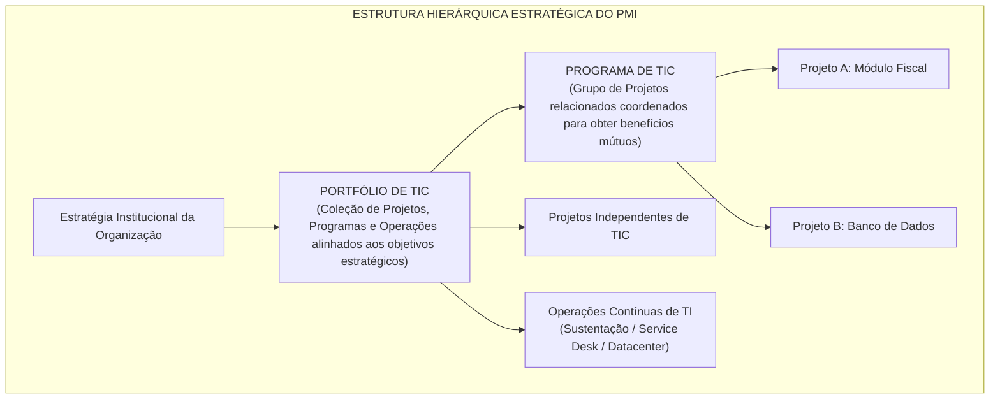
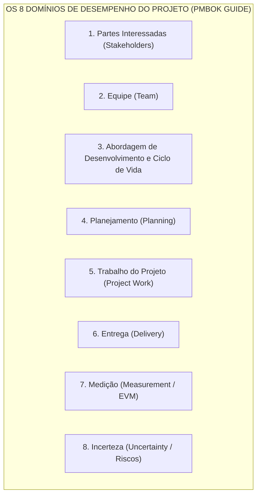
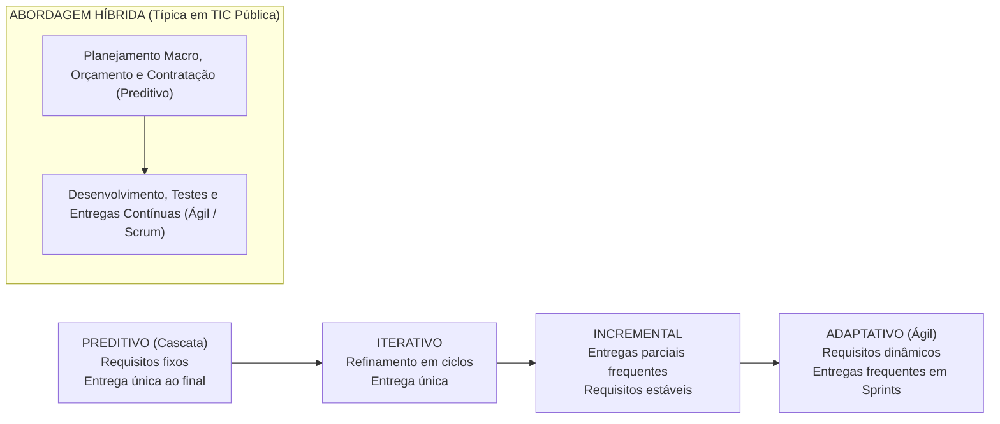

# 03 - Gestão de Projetos: PMBOK 8ª Edição e Métodos Ágeis

> **Matéria:** Governança de Tecnologia da Informação  
> **Cargo:** B02 – Técnico de Controle Externo – Especialidade: Tecnologia da Informação  
> **Arquivo:** `03_gestao_de_projetos_pmbok_8_edicao_e_metodos_ageis.md`  

---

## 📌 Ementa / Itens do Edital
- Fundamentos de Gestão de Projetos (PMI - Project Management Institute)
- O padrão do Guia PMBOK (evolução de processos para Princípios e Domínios de Desempenho)
- Sistema de Entrega de Valor (System for Value Delivery)
- Os 12 Princípios de Entrega de Projetos
- Os 8 Domínios de Desempenho do Projeto (Project Performance Domains)
- Métodos ágeis aplicados a projetos de TI, abordagens híbridas e adaptação (Tailoring)
- Análise de Valor Agregado (EVA / EVM: VP, CR, VA, IDP, IDC)
- Gestão de Portfólio de TI (alinhamento estratégico, governança de programas e priorização)

---

## 🌳 Classificação Hierárquica

```text
3. Gestão Moderna de Projetos, Framework PMBOK e Gestão de Portfólio de TI
├── 3.1 Fundamentos de Projetos e Sistema de Entrega de Valor
│   ├── 3.1.1 Definição de Projeto: Esforço temporário empreendido para criar um produto, serviço ou resultado exclusivo
│   ├── 3.1.2 Projeto vs. Operação: Temporário e exclusivo vs. Contínuo e repetitivo
│   ├── 3.1.3 O Sistema de Entrega de Valor (System for Value Delivery): Governança, funções da gestão e fluxo de valor
│   ├── 3.1.4 A Mudança de Paradigma do PMI:
│   │   ├── PMBOK 6ª Edição: Modelo prescritivo (10 Áreas de Conhecimento e 49 Processos)
│   │   └── PMBOK 7ª e 8ª Edições: Abordagem holística baseada em 12 Princípios e 8 Domínios de Desempenho
│   └── 3.1.5 Hierarquia PMI: Projetos vs. Programas vs. Portfólios de TIC
├── 3.2 Os 12 Princípios de Entrega de Projetos (PMBOK Guide)
│   ├── 1. Seja um administrador diligente, respeitoso e atencioso (Stewardship)
│   ├── 2. Crie um ambiente colaborativo para a equipe do projeto (Team)
│   ├── 3. Envolva-se eficazmente com as partes interessadas (Stakeholders)
│   ├── 4. Foque no valor (Value)
│   ├── 5. Reconheça, avalie e responda às interações sistêmicas (Systems Thinking)
│   ├── 6. Demonstre comportamentos de liderança (Leadership)
│   ├── 7. Adapte com base no contexto (Tailoring)
│   ├── 8. Incorpore a qualidade nos processos e nas entregas (Quality)
│   ├── 9. Navegue na complexidade (Complexity)
│   ├── 10. Otimize as respostas aos riscos (Risk)
│   ├── 11. Adote a adaptabilidade e a resiliência (Adaptability and Resilience)
│   └── 12. Permita a mudança para alcançar o estado futuro pretendido (Change)
├── 3.3 Os 8 Domínios de Desempenho do Projeto (Project Performance Domains)
│   ├── 3.3.1 Domínio das Partes Interessadas (Stakeholders): Identificação, engajamento e relacionamento
│   ├── 3.3.2 Domínio da Equipe (Team): Cultura colaborativa, liderança servidora e desenvolvimento
│   ├── 3.3.3 Domínio da Abordagem de Desenvolvimento e Ciclo de Vida: Preditiva, híbrida ou adaptativa
│   ├── 3.3.4 Domínio do Planejamento (Planning): Estimativas, cronogramas, orçamentos e aquisições
│   ├── 3.3.5 Domínio do Trabalho do Projeto (Project Work): Processos operacionais, fluxo e capacidade
│   ├── 3.3.6 Domínio da Entrega (Delivery): Escopo, qualidade, requisitos e sustentabilidade de valor
│   ├── 3.3.7 Domínio da Medição (Measurement): KPIs, métricas e Análise de Valor Agregado (EVA/EVM)
│   └── 3.3.8 Domínio da Incerteza (Uncertainty): Gestão de riscos, ambiguidades e volatilidade
├── 3.4 Métodos Ágeis Aplicados a TI, Abordagens Híbridas e Adaptação (Tailoring)
│   ├── 3.4.1 O Espectro dos Ciclos de Vida: Preditivo vs. Iterativo vs. Incremental vs. Adaptativo (Ágil)
│   ├── 3.4.2 Abordagens Híbridas no Setor Público: Planejamento orçamentário preditivo com Sprints ágeis
│   └── 3.4.3 Adaptação Contextual (Tailoring): Customização deliberada de métodos, ferramentas e governança
├── 3.5 Medição de Desempenho com Análise de Valor Agregado (EVM)
│   ├── 3.5.1 Variáveis Básicas: Valor Planejado (VP/PV), Custo Real (CR/AC) e Valor Agregado (VA/EV)
│   ├── 3.5.2 Variações: Variação de Prazos (VPr = VA - VP) e Variação de Custos (VC = VA - CR)
│   └── 3.5.3 Índices de Desempenho: IDP (SPI = VA / VP) e IDC (CPI = VA / CR)
└── 3.6 Gestão de Portfólio de TI
    ├── 3.6.1 Objetivos: Maximização de valor, balanceamento de riscos e alinhamento à estratégia institucional
    └── 3.6.2 Governança do Portfólio: Comitê de TI, Scoring Models e priorização de iniciativas
```

---

## 📖 Teoria Aprofundada & Conceitos Essenciais

### 3.1 Fundamentos de Gestão de Projetos e a Mudança de Paradigma do PMI

Segundo a definição formal do Project Management Institute (PMI), um **Projeto** é um esforço temporário empreendido para criar um produto, serviço ou resultado exclusivo.

- **Temporário:** Possui início e término definidos. O fim é alcançado quando os objetivos foram atingidos, ou quando o projeto é encerrado por inviabilidade econômica ou estratégica.
- **Exclusivo (Único):** O produto ou serviço resultante difere de maneira tangível de todos os produtos ou serviços similares previamente desenvolvidos.



#### Tabela Comparativa: Portfólio versus Programa versus Projeto versus Operação

| Dimensão | Portfólio | Programa | Projeto | Operação |
| :--- | :--- | :--- | :--- | :--- |
| **Escopo** | Visão estratégica corporativa; engloba projetos e programas correlatos ou independentes. | Escopo abrangente integrando benefícios coordenados de múltiplos projetos relacionados. | Escopo delimitado e específico; entregas únicas pré-definidas. | Escopo contínuo, padronizado e repetitivo. |
| **Mudança** | Monitora mudanças no ambiente estratégico e ajusta a alocação de capital e prioridades. | Gerencia mudanças programáticas de modo a maximizar os benefícios globais do grupo. | Gerencia mudanças no escopo do projeto via controle integrado de alterações. | Reage a incidentes e busca manter a estabilidade rotineira do negócio. |
| **Métrica de Sucesso** | **Retorno do investimento agregado**, equilíbrio de riscos e alcance dos objetivos estratégicos. | **Realização de benefícios globais** e eficácia da integração de componentes. | **Qualidade da entrega**, valor gerado e respeito às restrições de custo, prazo e escopo. | **Eficiência operacional**, cumprimento contínuo de SLAs e produtividade diária. |
| **Duração** | Permanente e plurianual (revisado periodicamente). | De médio a longo prazo (dura o ciclo de entrega dos benefícios integrados). | **Temporário** (início, meio e fim definidos). | **Permanente / Contínuo** (sem data de encerramento prevista). |

> ⭐ **IMPORTANTE / REGRA DE OURO:**  
> A principal diferença entre **Programa** e **Portfólio**: Os projetos dentro de um **Programa** são necessariamente *relacionados entre si* (possuem dependências e produzem um benefício conjunto). Já em um **Portfólio**, os projetos e programas agrupados podem não ter qualquer dependência operacional mútua; seu único elo em comum é estarem alinhados aos mesmos objetivos estratégicos do órgão.

---

### 3.2 Os 12 Princípios de Entrega de Projetos (PMBOK Guide)

Os 12 Princípios fornecem orientações fundamentais para a tomada de decisões, independentemente de a abordagem ser preditiva, híbrida ou puramente ágil:

| Nº | Princípio | Significado Prático |
| :---: | :--- | :--- |
| **1** | **Administração Diligente** (*Stewardship*) | Agir com integridade, cuidado, honestidade, responsabilidade e respeito às normas legais, financeiras e ambientais. |
| **2** | **Ambiente de Equipe Colaborativo** (*Team*) | Promover alinhamento, empoderamento mútuo, respeito e comunicação aberta entre os membros do time de projeto. |
| **3** | **Envolvimento Eficaz dos Stakeholders** (*Stakeholders*) | Identificar e engajar proativamente as partes interessadas para entender suas expectativas e alinhar requisitos. |
| **4** | **Foco no Valor** (*Value*) | Avaliar continuamente o valor de negócio e público gerado por cada entrega, adaptando prioridades para maximizá-lo. |
| **5** | **Pensamento Sistêmico** (*Systems Thinking*) | Reconhecer e avaliar as interações complexas entre o projeto, a arquitetura de TI corporativa e os fatores externos. |
| **6** | **Liderança** (*Leadership*) | Demonstrar e incentivar comportamentos de liderança servidora em todos os membros do time, promovendo motivação e foco. |
| **7** | **Adaptação Contextual** (*Tailoring*) | Ajustar deliberadamente a governança, ritos, metodologias e documentação ao contexto real, porte e complexidade do projeto. |
| **8** | **Qualidade nas Entregas** (*Quality*) | Garantir que os processos de trabalho e as entregas satisfaçam os padrões técnicos acordados e a aptidão para o uso. |
| **9** | **Navegar na Complexidade** (*Complexity*) | Tratar a incerteza, o comportamento humano e as interconexões tecnológicas usando abordagens adaptativas e análise contínua. |
| **10** | **Otimizar Respostas aos Riscos** (*Risk*) | Identificar tanto ameaças (riscos negativos) quanto oportunidades (riscos positivos), implementando respostas proporcionais. |
| **11** | **Adaptabilidade e Resiliência** (*Adaptability & Resilience*) | Capacidade de absorver impactos, aprender com falhas, ajustar rotas rapidamente e sustentar o foco no objetivo final. |
| **12** | **Permitir a Mudança** (*Change*) | Estruturar a gestão do projeto para facilitar a transição do estado atual para o estado futuro desejado pelas partes interessadas. |

---

### 3.3 Os 8 Domínios de Desempenho do Projeto

Os Domínios de Desempenho são grupos de atividades inter-relacionadas essenciais para a entrega eficaz dos resultados do projeto:



1. **Partes Interessadas (*Stakeholders*):** Focado no engajamento produtivo, expectativas e satisfação dos stakeholders.
2. **Equipe (*Team*):** Envolve a liderança de alto desempenho, apoio mútuo, resolução de conflitos e cultura da equipe.
3. **Abordagem de Desenvolvimento e Ciclo de Vida (*Development Approach & Life Cycle*):** Escolha fundamentada entre abordagens preditivas, adaptativas ou híbridas, definindo as fases do projeto.
4. **Planejamento (*Planning*):** Coordenação proativa de escopo, cronograma, custos, recursos e riscos, evoluindo progressivamente (elaboração progressiva).
5. **Trabalho do Projeto (*Project Work*):** Execução fluida do trabalho, gerenciamento dos recursos físicos e remoção de impedimentos operacionais.
6. **Entrega (*Delivery*):** Garantia de que os incrementos ou produtos atendem aos critérios de aceitação e agregam valor sustentável ao negócio.
7. **Medição (*Measurement*):** Monitoramento contínuo do desempenho real em relação ao planejado usando métricas e Análise de Valor Agregado (EVA).
8. **Incerteza (*Uncertainty*):** Identificação, avaliação e mitigação de incertezas, ambiguidades, volatilidade e riscos de projeto.

---

### 3.4 Ciclos de Vida: Do Preditivo ao Adaptativo e Abordagens Híbridas



- **Preditivo (Cascata / *Waterfall*):** Escopo, prazo e custo são determinados nas fases iniciais. Mudanças são rigidamente controladas. Indicado quando os requisitos são plenamente conhecidos e estáveis.
- **Iterativo:** O escopo é detalhado por meio de ciclos sucessivos de aprofundamento, desenvolvendo protótipos até que a solução final seja concluída e entregue em lote único.
- **Incremental:** O produto é desenvolvido e entregue em fatias funcionais utilizáveis ao longo do tempo.
- **Adaptativo (Ágil / Scrum / Kanban):** Requisitos mudam com frequência. O trabalho é planejado em ciclos curtos (*sprints* de 1 a 4 semanas), entregando incrementos prontos e adaptando o backlog continuamente.
- **Híbrido (*Hybrid Approach*):** Combina elementos preditivos e ágeis. Muito comum no setor público brasileiro (Lei nº 14.133/2021), onde o orçamento, o termo de referência e o teto de gastos seguem modelo formal, enquanto o desenvolvimento de software ocorre por sprints ágeis.

---

### 3.5 Análise de Valor Agregado (EVM / EVA)

A **Análise de Valor Agregado** (*Earned Value Management*) integra escopo, cronograma e custo para medir objetivamente o progresso de um projeto. É um dos tópicos mais matematicamente cobrados pela FCC.

#### As 3 Variáveis Fundamentais de Medição

1. **Valor Planejado (VP ou PV - *Planned Value*):** Orçamento aprovado alocado ao trabalho programado para ser concluído até a data de medição.
2. **Custo Real (CR ou AC - *Actual Cost*):** Custo total efetivamente incorrido na execução do trabalho realizado até a data de medição.
3. **Valor Agregado (VA ou EV - *Earned Value*):** A mensuração do trabalho **efetivamente executado**, expressa em termos do orçamento aprovado para esse trabalho.

#### As Variações (Diferenças Absolutas)

- **Variação de Prazos ($VPr$ ou $SV$):**
  $VPr = VA - VP$
  - Se $VPr > 0$: Projeto adiantado.
  - Se $VPr = 0$: Projeto rigorosamente no cronograma.
  - Se $VPr < 0$: Projeto atrasado.

- **Variação de Custos ($VC$ ou $CV$):**
  $VC = VA - CR$
  - Se $VC > 0$: Projeto abaixo do orçamento (economia).
  - Se $VC = 0$: Projeto exatamente no custo previsto.
  - Se $VC < 0$: Projeto estourando o orçamento (custos superiores ao previsto).

#### Os Índices de Desempenho (Eficiências Relativas)

- **Índice de Desempenho de Prazos ($IDP$ ou $SPI$):**
  $IDP = \frac{VA}{VP}$
  - Se $IDP > 1$: Eficiência de cronograma superior ao planejado (adiantado).
  - Se $IDP = 1$: Executando no ritmo do cronograma previsto.
  - Se $IDP < 1$: Eficiência inferior ao planejado (atrasado).

- **Índice de Desempenho de Custos ($IDC$ ou $CPI$):**
  $IDC = \frac{VA}{CR}$
  - Se $IDC > 1$: Eficiência de custo favorável (gastando menos para cada real de valor agregado).
  - Se $IDC = 1$: Gastando exatamente o previsto por unidade de trabalho.
  - Se $IDC < 1$: Eficiência desfavorável (estourando o orçamento).

#### Tabela Resumo: Diagnóstico Rápido de EVM

| Cenário de Indicadores | Situação de Cronograma / Prazos | Situação Financeira / Custos | Diagnóstico Geral |
| :---: | :---: | :---: | :--- |
| **$IDP > 1$ e $IDC > 1$** | Adiantado ($VA > VP$) | Abaixo do Orçamento ($VA > CR$) | **Cenário Ideal**: Rápido e econômico. |
| **$IDP < 1$ e $IDC > 1$** | **Atrasado** ($VA < VP$) | **Abaixo do Orçamento** ($VA > CR$) | Trabalho entregue com atraso, mas com economia de custos. |
| **$IDP > 1$ e $IDC < 1$** | **Adiantado** ($VA > VP$) | **Acima do Orçamento** ($VA < CR$) | Projeto acelerado, porém estourando o orçamento. |
| **$IDP < 1$ e $IDC < 1$** | **Atrasado** ($VA < VP$) | **Acima do Orçamento** ($VA < CR$) | **Cenário Crítico**: Atrasado e gastando mais do que deveria. |

> 🚨 **ALERTA DE PROVA / PEGADINHA FCC:**  
> A FCC adora tentar confundir o candidato trocando a ordem das fórmulas: colocar $CR$ no numerador ou dividir $VP$ por $VA$. Lembre-se: **o Valor Agregado ($VA$) SEMPRE fica no numerador nas fórmulas dos índices de desempenho** ($IDP = VA / VP$ e $IDC = VA / CR$).

---

## 🌐 Fontes Recomendadas na Internet (Acesso Direto e Gratuito)

- [x] **Project Management Institute (PMI) - PMBOK Guide & Standards:**
  - Link Oficial: [PMI Standards and PMBOK Guide Overview](https://www.pmi.org/pmbok-guide-standards)
  - *Conteúdo:* Os 12 Princípios de Entrega de Projetos, os 8 Domínios de Desempenho do Projeto e o Sistema de Entrega de Valor.
- [x] **PMI Practice Standards - Earned Value Management (EVM) Basics:**
  - Link Oficial: [PMI Learning Library - Fundamentos de EVM](https://www.pmi.org/learning/library/earned-value-management-basics-7320)
  - *Conteúdo:* Fórmulas e aplicação prática de Valor Planejado (VP), Custo Real (CR), Valor Agregado (VA), Índice de Desempenho de Prazos (IDP/SPI) e Custos (IDC/CPI).
- [x] **PMI Agile Practice Guide & Tailoring Guide:**
  - Link Oficial: [PMI Agile and Hybrid Approaches](https://www.pmi.org/pmbok-guide-standards/agile)
  - *Conteúdo:* Diretrizes para combinação de ciclos de vida preditivos e adaptativos, liderança servidora e adaptação contextual (*tailoring*).

---

## 📝 Questões Comentadas no Padrão FCC (Exatamente 5 Questões)

### Questão 1 (FCC - Analista de TI / Gestão de Projetos - Adaptada)
**Enunciado:** Em uma auditoria de acompanhamento de um projeto estratégico de desenvolvimento de software em um Tribunal de Contas, o fiscal técnico de TI apurou os seguintes valores na Análise de Valor Agregado (EVM) ao término do quinto mês:  
- Valor Planejado (VP): R$ 400.000,00  
- Valor Agregado (VA): R$ 320.000,00  
- Custo Real (CR): R$ 300.000,00  
Com base nesses valores, os cálculos do Índice de Desempenho de Prazos (IDP) e do Índice de Desempenho de Custos (IDC) demonstram que o projeto está:  
A) Adiantado no cronograma (IDP = 1,25) e gastando mais que o previsto (IDC = 0,75).  
B) Atrasado no cronograma (IDP = 0,80) e com desempenho de custos favorável, abaixo do orçamento para o trabalho executado (IDC = 1,067).  
C) Rigorosamente no prazo (IDP = 1,00) e com equilíbrio fiscal absoluto (IDC = 1,00).  
D) Atrasado no cronograma (IDP = 0,80) e com prejuízo financeiro grave, estourando os custos orçados (IDC = 0,937).  
E) Adiantado no cronograma (IDP = 1,33) e com custos favoráveis (IDC = 1,20).  

> **Gabarito: B**  
>  
> **Comentário Analítico Passo a Passo:**  
> - **Cálculo do Índice de Desempenho de Prazos (IDP):**  
>   $IDP = \frac{VA}{VP} = \frac{320.000}{400.000} = 0,80$.  
>   Como $IDP < 1$, o projeto está **atrasado** em relação ao cronograma previsto (apenas $80\%$ do trabalho planejado foi efetivamente entregue).  
> - **Cálculo do Índice de Desempenho de Custos (IDC):**  
>   $IDC = \frac{VA}{CR} = \frac{320.000}{300.000} \approx 1,067$.  
>   Como $IDC > 1$, o desempenho de custos é **favorável** (o projeto gastou R$ 300 mil para entregar um trabalho cujo valor previsto era R$ 320 mil, operando abaixo do custo orçado).  
> - **Análise das Alternativas:**  
>   - **Alternativa A:** Incorreta. Inverteu os valores dividindo $VP$ por $VA$ para calcular o IDP.  
>   - **Alternativa B:** **CORRETA.** Expressa com precisão o atraso temporal ($IDP = 0,80$) e a economia de custos ($IDC \approx 1,067$).  
>   - **Alternativa C:** Incorreta. Os índices não são iguais a 1,00.  
>   - **Alternativa D:** Incorreta. O cálculo do IDC resultou em valor superior a 1, indicando eficiência e não prejuízo financeiro.  
>   - **Alternativa E:** Incorreta. Os valores numéricos foram calculados erroneamente.

---

### Questão 2 (FCC - Técnico de Controle Externo / TI - Adaptada)
**Enunciado:** A respeito da estrutura de governança de projetos, programas e portfólios preconizada pelas boas práticas do Project Management Institute (PMI), assinale a afirmativa correta:  
A) Um portfólio consiste exclusivamente em um conjunto de projetos que possuem dependências técnicas operacionais obrigatórias e sequenciais entre si.  
B) O programa é caracterizado por um grupo de projetos relacionados, subsidiários e atividades correlatas gerenciados de forma coordenada para obter benefícios que não estariam disponíveis se fossem gerenciados individualmente.  
C) Um projeto é uma iniciativa permanente da organização que visa executar rotinas padronizadas e contínuas para manutenção do suporte de TI.  
D) O gerenciamento de portfólio foca exclusivamente no acompanhamento da velocidade diária de codificação dos desenvolvedores de sistemas.  
E) A gestão de programas visa substituir os órgãos colegiados e a alta administração do Tribunal de Contas nas deliberações de planejamento estratégico.  

> **Gabarito: B**  
>  
> **Comentário Analítico Passo a Passo:**  
> - **Análise da Alternativa A:** Incorreta. Os componentes de um portfólio (projetos, programas e operações) não precisam ter dependências mútuas nem ligação operacional sequencial; o elo entre eles é o alinhamento estratégico corporativo.  
> - **Análise da Alternativa B:** **CORRETA.** É a definição literal do PMI: Programa é um grupo de projetos relacionados gerenciados de maneira coordenada para obtenção de benefícios e controle mútuos que seriam inatingíveis se gerenciados isoladamente.  
> - **Análise da Alternativa C:** Incorreta. O projeto é por definição **temporário** (tem início e fim delimitados) e exclusivo, ao passo que rotinas contínuas e repetitivas constituem operações.  
> - **Análise da Alternativa D:** Incorreta. O gerenciamento de portfólio atua no nível estratégico corporativo (seleção, priorização e balanceamento de investimentos de TI), e não no nível de microgestão de código de programadores.  
> - **Análise da Alternativa E:** Incorreta. A gestão de programas é um mecanismo executivo subordinado à governança corporativa, jamais substituindo a Alta Administração ou o Plenário do Tribunal.

---

### Questão 3 (FCC - Analista de TI / Sistemas - Adaptada)
**Enunciado:** O padrão de gestão de projetos moderno do Guia PMBOK abandonou a estrutura estritamente processual e prescritiva, adotando uma abordagem holística estruturada em 12 Princípios de Entrega de Projetos e 8 Domínios de Desempenho. O princípio que estabelece a necessidade deliberada de ajustar e personalizar a governança, os métodos, as ferramentas e a quantidade de documentação de acordo com as características específicas, o porte e o nível de incerteza de cada projeto denomina-se:  
A) Stewardship (Administração Diligente).  
B) Systems Thinking (Pensamento Sistêmico).  
C) Tailoring (Adaptação Contextual).  
D) Quality (Incorporação de Qualidade).  
E) Complexity (Navegação na Complexidade).  

> **Gabarito: C**  
>  
> **Comentário Analítico Passo a Passo:**  
> - **Análise da Alternativa A:** Incorreta. *Stewardship* diz respeito à integridade, diligência, honestidade e responsabilidade socioambiental na condução do projeto.  
> - **Análise da Alternativa B:** Incorreta. *Systems Thinking* trata do reconhecimento das interações sistêmicas holísticas entre o projeto e os demais componentes organizacionais.  
> - **Análise da Alternativa C:** **CORRETA.** O princípio da **Adaptação (*Tailoring*)** preconiza que o gerenciamento de projetos não é do tipo "tamanho único" (*one size fits all*). A equipe deve selecionar e adaptar conscientemente os processos, métodos e ferramentas ao contexto, complexidade e requisitos de cada projeto.  
> - **Análise da Alternativa D:** Incorreta. O princípio da Qualidade trata do atendimento aos requisitos de desempenho e aceitação do produto.  
> - **Análise da Alternativa E:** Incorreta. Trata do gerenciamento de incertezas e variáveis complexas decorrentes do ambiente ou do comportamento das equipes.

---

### Questão 4 (FCC - Auditor Federal de Controle Externo / TI - Adaptada)
**Enunciado:** No âmbito do Domínio de Desempenho da Abordagem de Desenvolvimento e Ciclo de Vida do PMBOK, a escolha do ciclo de vida adequado para um projeto de TI deve equilibrar previsibilidade e agilidade. Ao planejar o desenvolvimento de um grande sistema previdenciário público, a equipe optou por fixar o escopo macro, o limite orçamentário e os marcos regulatórios de conformidade em um plano formal inicial, enquanto os módulos de software são implementados e homologados em sprints quinzenais por times ágeis. Essa configuração caracteriza uma abordagem:  
A) Preditiva pura (Cascata).  
B) Híbrida.  
C) Caótica descontrolada.  
D) Exclusivamente iterativa sem entregas funcionais.  
E) Estritamente linear sem feedback.  

> **Gabarito: B**  
>  
> **Comentário Analítico Passo a Passo:**  
> - **Análise da Alternativa A:** Incorreta. A abordagem preditiva clássica (cascata) determina todo o escopo detalhado antecipadamente e entrega todo o software pronto em um único lote ao final de todas as fases de construção e testes, sem sprints ágeis quinzenais.  
> - **Análise da Alternativa B:** **CORRETA.** A **Abordagem Híbrida** combina elementos preditivos (marcos orçamentários, conformidade legal, governança de alto nível) com elementos adaptativos (execução iterativa, sprints quinzenais, entregas incrementais ágeis), sendo o modelo mais amplamente recomendado e utilizado na Administração Pública moderna.  
> - **Análise da Alternativa C:** Incorreta. A abordagem híbrida é estruturada, disciplinada e governada, não correspondendo a ambiente caótico.  
> - **Análise da Alternativa D:** Incorreta. Na abordagem iterativa pura sem entrega incremental, o software não é homologado em partes funcionais pelas áreas de negócio a cada sprint.  
> - **Análise da Alternativa E:** Incorreta. A entrega quinzenal em sprints incorpora ciclos rápidos e contínuos de feedback, o que contradiz o modelo linear sem feedback.

---

### Questão 5 (FCC - Auditor Fiscal da Receita Estadual / TI - Adaptada)
**Enunciado:** O Guia PMBOK define os 8 Domínios de Desempenho do Projeto (*Project Performance Domains*). O domínio que trata de atividades como o gerenciamento do fluxo de trabalho físico e digital, a alocação eficiente de recursos materiais, a remoção de impedimentos e o gerenciamento contínuo das aquisições e contratos durante o ciclo diário do projeto denomina-se:  
A) Domínio das Partes Interessadas (*Stakeholders*).  
B) Domínio da Entrega (*Delivery*).  
C) Domínio do Trabalho do Projeto (*Project Work*).  
D) Domínio da Medição (*Measurement*).  
E) Domínio da Incerteza (*Uncertainty*).  

> **Gabarito: C**  
>  
> **Comentário Analítico Passo a Passo:**  
> - **Análise da Alternativa A:** Incorreta. O domínio de Stakeholders trata de identificar, analisar e manter o engajamento construtivo das pessoas e grupos afetados pelo projeto.  
> - **Análise da Alternativa B:** Incorreta. O domínio da Entrega foca nos requisitos, escopo e qualidade do produto final gerado e entregue às partes interessadas.  
> - **Análise da Alternativa C:** **CORRETA.** O **Domínio do Trabalho do Projeto (*Project Work*)** dedica-se ao estabelecimento dos processos operacionais do projeto, gerenciamento dos recursos materiais, coordenação da logística, gestão do trabalho de fornecedores e contratos, e remoção sistemática de obstáculos ao fluxo produtivo.  
> - **Análise da Alternativa D:** Incorreta. O domínio da Medição foca em avaliar indicadores de desempenho, métricas de desvio e Análise de Valor Agregado (EVM).  
> - **Análise da Alternativa E:** Incorreta. O domínio da Incerteza trata da identificação, monitoramento e resposta a riscos, ambiguidades e volatilidade.
