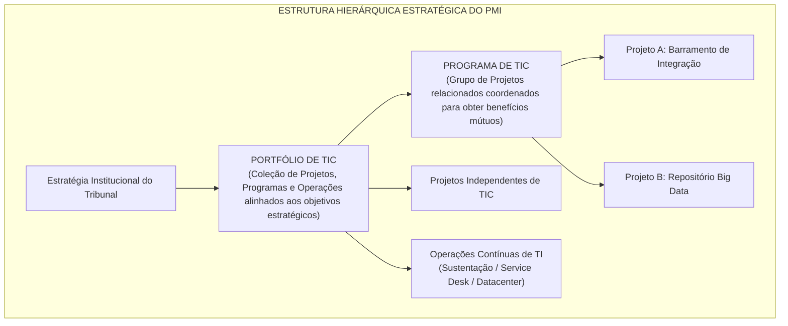
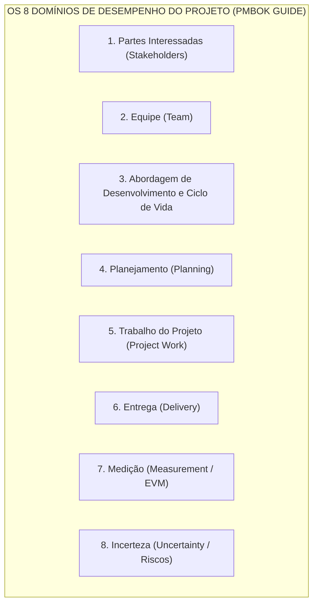
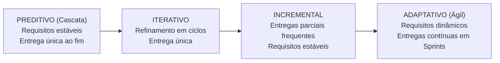
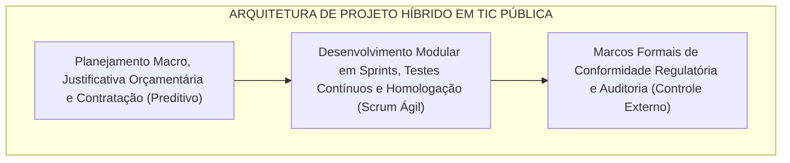

# 03 - Gestão de Projetos: PMBOK 8ª Edição e Métodos Ágeis

> **Matéria:** Governança de Tecnologia da Informação  
> **Cargo:** B02 – Técnico de Controle Externo – Especialidade: Tecnologia da Informação  
> **Arquivo:** `03_gestao_de_projetos_pmbok_8_edicao_e_metodos_ageis.md`  

---

## 📌 Ementa / Itens do Edital
- Fundamentos de Gestão de Projetos (PMI - Project Management Institute)
- O padrão do Guia PMBOK (evolução de processos para Princípios e Domínios de Desempenho)
- Sistema de Entrega de Valor (System for Value Delivery)
- Os 12 Princípios de Entrega de Projetos
- Os 8 Domínios de Desempenho do Projeto (Project Performance Domains)
- Métodos ágeis aplicados a projetos de TI, abordagens híbridas e adaptação (Tailoring)
- Análise de Valor Agregado (EVA / EVM: VP, CR, VA, IDP, IDC)
- Gestão de Portfólio de TI (alinhamento estratégico, governança de programas e priorização)

---

## 🧭 Sumário
- [1. Fundamentos de Gestão de Projetos e Mudança de Paradigma do PMI](#1-fundamentos-de-gestão-de-projetos-e-mudança-de-paradigma-do-pmi)
  - [1.1 Conceito de Projeto vs. Operação](#11-conceito-de-projeto-vs-operação)
  - [1.2 Hierarquia PMI: Projetos, Programas e Portfólios de TIC](#12-hierarquia-pmi-projetos-programas-e-portfólios-de-tic)
  - [1.3 O Sistema de Entrega de Valor (System for Value Delivery)](#13-o-sistema-de-entrega-de-valor-system-for-value-delivery)
- [2. Os 12 Princípios de Entrega de Projetos](#2-os-12-princípios-de-entrega-de-projetos)
- [3. Os 8 Domínios de Desempenho do Projeto](#3-os-8-domínios-de-desempenho-do-projeto)
- [4. Ciclos de Vida: Métodos Ágeis, Abordagens Híbridas e Adaptação (Tailoring)](#4-ciclos-de-vida-métodos-ágeis-abordagens-híbridas-e-adaptação-tailoring)
  - [4.1 Comparativo dos Ciclos de Vida (Preditivo a Adaptativo)](#41-comparativo-dos-ciclos-de-vida-preditivo-a-adaptativo)
  - [4.2 Abordagens Híbridas na Administração Pública](#42-abordagens-híbridas-na-administração-pública)
  - [4.3 Adaptação Contextual (Tailoring)](#43-adaptação-contextual-tailoring)
- [5. Análise de Valor Agregado (EVM / EVA)](#5-análise-de-valor-agregado-evm--eva)
  - [5.1 Variáveis Fundamentais (VP, CR e VA)](#51-variáveis-fundamentais-vp-cr-e-va)
  - [5.2 Variações e Índices de Desempenho (IDP e IDC)](#52-variações-e-índices-de-desempenho-idp-e-idc)
- [6. Gestão de Portfólio de TI e Governança de Programas](#6-gestão-de-portfólio-de-ti-e-governança-de-programas)
- [7. Fontes Recomendadas na Internet](#7-fontes-recomendadas-na-internet)
- [8. Questões Comentadas no Padrão FCC](#8-questões-comentadas-no-padrão-fcc)

---

## 📖 Teoria Aprofundada & Conceitos Essenciais

## 1. Fundamentos de Gestão de Projetos e Mudança de Paradigma do PMI

Segundo a padronização do Project Management Institute (PMI), um **Projeto** é definido como um esforço temporário empreendido para criar um produto, serviço ou resultado exclusivo.

### 1.1 Conceito de Projeto vs. Operação

- **Temporário:** Possui marco temporal de início e término definidos. O fim é alcançado quando os objetivos foram integralmente atingidos, ou quando o projeto é cancelado por inviabilidade técnica, orçamentária ou perda de alinhamento estratégico.
- **Exclusivo (Único):** O resultado final (sistema desenvolvido, data center modernizado) difere substancialmente de qualquer outro trabalho previamente executado.
- **Projeto versus Operação Contínua:**
  - *Projetos:* Geram mudanças, criam ativos novos, possuem equipes multidisciplinares temporárias e encerram-se ao concluir a entrega.
  - *Operações:* Sustentam o negócio existente, repetem processos padronizados contínuos (atendimento de chamados, manutenção de infraestrutura, rotinas de backup) e não têm data prevista para término.

---

### 1.2 Hierarquia PMI: Projetos, Programas e Portfólios de TIC

#### Tabela Comparativa: Portfólio versus Programa versus Projeto versus Operação

| Dimensão | Portfólio | Programa | Projeto | Operação |
| :--- | :--- | :--- | :--- | :--- |
| **Escopo** | Visão estratégica corporativa; engloba múltiplos projetos e programas correlatos ou independentes. | Escopo abrangente integrando benefícios conjuntos de múltiplos projetos relacionados. | Escopo delimitado, específico e controlado; entrega exclusiva pré-definida. | Escopo contínuo, padronizado, repetitivo e voltado à rotina. |
| **Mudança** | Monitora mudanças no ambiente macro e ajusta a alocação de recursos financeiros e prioridades. | Gerencia mudanças no ambiente programático visando maximizar os benefícios do conjunto. | Gerencia desvios de escopo por meio do processo formal de controle de mudanças. | Reage a incidentes e busca manter a estabilidade contínua dos serviços. |
| **Métrica de Sucesso** | **Retorno do investimento agregado**, mitigação de riscos globais e alcance das metas estratégicas. | **Realização de benefícios consolidados** e integração eficaz dos projetos componentes. | **Qualidade técnica da entrega**, valor agregado e respeito às restrições de custo e prazo. | **Eficiência operacional**, cumprimento estrito de SLAs e estabilidade dos sistemas. |
| **Duração** | Permanente e plurianual (revisado ciclicamente). | Médio a longo prazo (dura o ciclo de entrega dos benefícios programáticos). | **Temporário** (início, meio e fim claramente fixados). | **Permanente / Contínuo** (sem data estipulada de término). |

> 🚨 **ALERTA DE PROVA / PEGADINHA FCC:**  
> A banca frequentemente testa a diferença conceitual entre Programa e Portfólio. Lembre-se: em um **Programa**, os projetos são **necessariamente interdependentes e relacionados** (produzem benefícios em comum). Em um **Portfólio**, os projetos e programas agrupados **não precisam ter dependência técnica entre si**; o único fator comum é o alinhamento ao mesmo conjunto de objetivos estratégicos da organização.

---

### 1.3 O Sistema de Entrega de Valor (System for Value Delivery)

A partir da transição iniciada na 7ª edição do Guia PMBOK e consolidada nas diretrizes contemporâneas (8ª edição), o PMI abandonou o foco exclusivo no cumprimento mecânico de processos da 6ª edição (que continha 10 Áreas de Conhecimento e 49 Processos rígidos).

A gestão de projetos passou a ser compreendida dentro de um **Sistema de Entrega de Valor**, no qual o foco se desloca dos meros "entregáveis" (*deliverables* físicos) para os **resultados e valor de negócio gerados** (*outcomes and business value*). Esse sistema é composto por:
- Governança organizacional e estratégica;
- Funções de gestão de projetos (liderança servidora, facilitação e remoção de barreiras);
- Ambiente interno (cultura, maturidade, recursos) e externo (legislação, avanços tecnológicos);
- Fluxo de valor contínuo que transforma estratégias em benefícios tangíveis para os cidadãos e gestores públicos.

---

## 2. Os 12 Princípios de Entrega de Projetos

Os 12 Princípios do PMBOK orientam a conduta profissional dos gestores e equipes, aplicando-se indistintamente a abordagens preditivas, híbridas ou ágeis:

| Nº | Princípio | Significado Prático |
| :---: | :--- | :--- |
| **1** | **Administração Diligente** (*Stewardship*) | Atuar com honestidade, integridade, cuidado ético, zelo pelo patrimônio público e conformidade legal estrita. |
| **2** | **Ambiente de Equipe Colaborativo** (*Team*) | Fomentar a cooperação, empatia, respeito mútuo, comunicação aberta e responsabilidade compartilhada pela equipe. |
| **3** | **Envolvimento Eficaz dos Stakeholders** (*Stakeholders*) | Identificar, compreender e engajar continuamente as partes interessadas para alinhar expectativas e mitigar resistências. |
| **4** | **Foco no Valor** (*Value*) | Monitorar e maximizar o valor público e institucional gerado por cada entrega, adaptando o escopo se o valor pretendido mudar. |
| **5** | **Pensamento Sistêmico** (*Systems Thinking*) | Reconhecer que o projeto é parte de um ecossistema complexo e que decisões locais repercutem em toda a TI corporativa. |
| **6** | **Liderança** (*Leadership*) | Praticar liderança servidora, influenciando positivamente a equipe, promovendo o desenvolvimento humano e removendo bloqueios. |
| **7** | **Adaptação Contextual** (*Tailoring*) | Personalizar métodos, ritos, ferramentas e governança ao porte, complexidade e criticidade reais de cada projeto. |
| **8** | **Qualidade nas Entregas** (*Quality*) | Garantir que os processos de desenvolvimento e os produtos finais atendam aos critérios de aceitação e aos requisitos de uso. |
| **9** | **Navegar na Complexidade** (*Complexity*) | Abordar a volatilidade, as conexões tecnológicas densas e a incerteza comportamental com flexibilidade e monitoramento contínuo. |
| **10** | **Otimizar Respostas aos Riscos** (*Risk*) | Gerenciar ativamente tanto ameaças (riscos negativos) quanto oportunidades (riscos positivos), aplicando respostas proporcionais. |
| **11** | **Adaptabilidade e Resiliência** (*Adaptability & Resilience*) | Capacidade de resistir a choques, aprender rapidamente com erros, replanejar rotas e manter o compromisso com o objetivo final. |
| **12** | **Permitir a Mudança** (*Change*) | Facilitar a transição estrutural e humana entre o estado atual e o estado futuro almejado pelas partes interessadas. |

---

## 3. Os 8 Domínios de Desempenho do Projeto

Os **Domínios de Desempenho** (*Project Performance Domains*) são grupos de atividades correlatas essenciais para a entrega bem-sucedida de projetos:

1. **Partes Interessadas (*Stakeholders*):** Relacionamento produtivo, alinhamento de expectativas e engajamento das pessoas afetadas pelo projeto.
2. **Equipe (*Team*):** Criação de ambiente de alta performance, liderança colaborativa, segurança psicológica e autonomia técnica do time.
3. **Abordagem de Desenvolvimento e Ciclo de Vida (*Development Approach & Life Cycle*):** Seleção fundamentada da cadência de entrega (preditiva, híbrida ou adaptativa) e das fases do ciclo de vida.
4. **Planejamento (*Planning*):** Coordenação progressiva de escopo, prazos, orçamentos e alocação de recursos (*elaboração progressiva*).
5. **Trabalho do Projeto (*Project Work*):** Gestão do fluxo diário de atividades, administração de contratos com fornecedores e remoção de impedimentos ao avanço da equipe.
6. **Entrega (*Delivery*):** Garantia de que os incrementos e produtos satisfazem os requisitos de qualidade e entregam valor real aos usuários.
7. **Medição (*Measurement*):** Avaliação quantitativa e qualitativa do progresso por meio de métricas de desempenho e Análise de Valor Agregado (EVA/EVM).
8. **Incerteza (*Uncertainty*):** Identificação, avaliação e tratamento de incertezas, ambiguidades, riscos operacionais e contingências imprevistas.

---

## 4. Ciclos de Vida: Métodos Ágeis, Abordagens Híbridas e Adaptação (Tailoring)

### 4.1 Comparativo dos Ciclos de Vida (Preditivo a Adaptativo)

- **Preditivo (Cascata / *Waterfall*):** Escopo, tempo e custo são estabelecidos de forma detalhada no início. Mudanças são rigidamente controladas. Ideal para obras físicas e implantações onde os requisitos são absolutamente fixos e conhecidos.
- **Iterativo:** O escopo é refinado e aprofundado por meio de ciclos sucessivos de feedback e prototipagem, entregando o produto concluído em um único lote ao final.
- **Incremental:** O produto é dividido em fatias funcionais e entregue aos poucos, gerando valor utilizável antes do encerramento total.
- **Adaptativo (Ágil - Scrum / Kanban):** Projetado para alta incerteza e requisitos que evoluem. O trabalho ocorre em iterações curtas (*sprints* de 1 a 4 semanas), priorizando continuamente o backlog com base no feedback real.

---

### 4.2 Abordagens Híbridas na Administração Pública

A **Abordagem Híbrida** combina características do modelo preditivo e do modelo adaptativo. É o padrão predominante em projetos de TIC no setor público brasileiro:

- O órgão define escopo macro, limites orçamentários, conformidade legal e prazos gerais de forma formal e preditiva (respeitando a Lei nº 14.133/2021).
- O desenvolvimento, testes de software e validações com usuários ocorrem por meio de sprints quinzenais ágeis, garantindo adaptação rápida a mudanças.

---

### 4.3 Adaptação Contextual (Tailoring)

O princípio do **Tailoring** dita que não existe uma metodologia universal. Cada projeto exige adaptações deliberadas nos processos de gestão:
- *Porte do projeto:* Projetos de pequeno porte dispensam comitês pesados e documentação excessiva.
- *Criticidade e Risco:* Sistemas centrais de controle fiscal exigem maior rigor formal e testes automatizados mais densos do que protótipos internos.
- *Cultura Organizacional:* Adequação dos ritos à maturidade do órgão e dos servidores envolvidos.

---

## 5. Análise de Valor Agregado (EVM / EVA)

A **Análise de Valor Agregado** (*Earned Value Management*) integra escopo, cronograma e custo para medir objetivamente o progresso de um projeto. É o cálculo mais cobrado pela FCC em provas de gestão de projetos.

### 5.1 Variáveis Fundamentais (VP, CR e VA)

1. **Valor Planejado (VP ou PV - *Planned Value*):** Orçamento aprovado alocado ao trabalho que deveria estar concluído até a data de medição.
2. **Custo Real (CR ou AC - *Actual Cost*):** Custo efetivamente incorrido e desembolsado para realizar o trabalho entregue até a data de medição.
3. **Valor Agregado (VA ou EV - *Earned Value*):** A mensuração do trabalho **efetivamente executado**, avaliado em termos do orçamento originalmente aprovado para esse trabalho.

---

### 5.2 Variações e Índices de Desempenho (IDP e IDC)

#### Variações Absolutas
- **Variação de Prazos ($VPr$ ou $SV$):**
  $$VPr = VA - VP$$
  - $VPr > 0$: Projeto adiantado.
  - $VPr = 0$: Projeto rigorosamente no cronograma.
  - $VPr < 0$: Projeto atrasado.

- **Variação de Custos ($VC$ ou $CV$):**
  $$VC = VA - CR$$
  - $VC > 0$: Abaixo do orçamento (economia de recursos).
  - $VC = 0$: Exatamente no orçamento planejado.
  - $VC < 0$: Acima do orçamento (estouro financeiro).

#### Índices de Desempenho Relativo
- **Índice de Desempenho de Prazos ($IDP$ ou $SPI$):**
  $$IDP = \frac{VA}{VP}$$
  - $IDP > 1$: Eficiência de cronograma superior ao previsto (adiantado).
  - $IDP = 1$: No ritmo do cronograma previsto.
  - $IDP < 1$: Eficiência de cronograma inferior ao previsto (atrasado).

- **Índice de Desempenho de Custos ($IDC$ ou $CPI$):**
  $$IDC = \frac{VA}{CR}$$
  - $IDC > 1$: Eficiência de custos favorável (gastando menos para cada unidade de entrega).
  - $IDC = 1$: Gastando rigorosamente o orçado.
  - $IDC < 1$: Eficiência desfavorável (gastando mais para entregar o trabalho).

> 🚨 **ALERTA DE PROVA / PEGADINHA FCC:**  
> A banca FCC adora inverter os numeradores e denominadores para induzir ao erro. Grave a regra mnemônica: **O Valor Agregado ($VA$) SEMPRE fica no numerador nas fórmulas dos índices de desempenho** ($IDP = VA / VP$ e $IDC = VA / CR$).

#### Tabela Diagnóstica Rápida de EVM

| Índices | Situação de Prazos | Situação de Custos | Diagnóstico Geral |
| :---: | :---: | :---: | :--- |
| **$IDP > 1$ e $IDC > 1$** | Adiantado ($VA > VP$) | Abaixo do Orçamento ($VA > CR$) | **Cenário Ideal:** Rápido e econômico. |
| **$IDP < 1$ e $IDC > 1$** | **Atrasado** ($VA < VP$) | **Abaixo do Orçamento** ($VA > CR$) | Atrasado, mas com economia de gastos. |
| **$IDP > 1$ e $IDC < 1$** | **Adiantado** ($VA > VP$) | **Acima do Orçamento** ($VA < CR$) | Projeto acelerado, mas estourando orçamento. |
| **$IDP < 1$ e $IDC < 1$** | **Atrasado** ($VA < VP$) | **Acima do Orçamento** ($VA < CR$) | **Cenário Crítico:** Atrasado e gastando mais que o previsto. |

---

## 6. Gestão de Portfólio de TI e Governança de Programas

A **Gestão de Portfólio de TI** conecta a estratégia institucional do Tribunal à seleção e execução das iniciativas tecnológicas:
- **Comitê de Governança Digital / Comitê de TI:** Órgão colegiado que avalia propostas de novos projetos e programas, priorizando-os de acordo com o impacto fiscal e institucional.
- **Modelos de Pontuação (*Scoring Models*):** Critérios ponderados de priorização (ex.: retorno social, urgência regulatória, complexidade técnica, custo estimado e matriz de riscos).
- **Balanceamento do Portfólio:** Equilíbrio equilibrado entre projetos de alta inovação (IA para auditoria), modernização de infraestrutura (migração para nuvem) e sustentação de sistemas legados essenciais.

---

## 7. Fontes Recomendadas na Internet

- [x] **Project Management Institute (PMI) - PMBOK Guide & Standards:**
  - Link Oficial: [PMI Standards and PMBOK Guide Overview](https://www.pmi.org/pmbok-guide-standards)
  - *Conteúdo:* Os 12 Princípios de Entrega de Projetos, os 8 Domínios de Desempenho do Projeto e o Sistema de Entrega de Valor.
- [x] **PMI Practice Standards - Earned Value Management (EVM) Basics:**
  - Link Oficial: [PMI Learning Library - Fundamentos de EVM](https://www.pmi.org/learning/library/earned-value-management-basics-7320)
  - *Conteúdo:* Fórmulas e aplicação prática de Valor Planejado (VP), Custo Real (CR), Valor Agregado (VA), Índice de Desempenho de Prazos (IDP/SPI) e Custos (IDC/CPI).
- [x] **PMI Agile Practice Guide & Tailoring Guide:**
  - Link Oficial: [PMI Agile and Hybrid Approaches](https://www.pmi.org/pmbok-guide-standards/agile)
  - *Conteúdo:* Diretrizes para combinação de ciclos de vida preditivos e adaptativos, liderança servidora e adaptação contextual (*tailoring*).

---

## 8. Questões Comentadas no Padrão FCC

### Questão 1 (FCC - Analista de TI / Gestão de Projetos - Adaptada)
**Enunciado:** Em uma auditoria de acompanhamento de um projeto estratégico de desenvolvimento de software em um Tribunal de Contas, o fiscal técnico de TI apurou os seguintes valores na Análise de Valor Agregado (EVM) ao término do quinto mês:  
- Valor Planejado (VP): R$ 400.000,00  
- Valor Agregado (VA): R$ 320.000,00  
- Custo Real (CR): R$ 300.000,00  
Com base nesses valores, os cálculos do Índice de Desempenho de Prazos (IDP) e do Índice de Desempenho de Custos (IDC) demonstram que o projeto está:  
A) Adiantado no cronograma (IDP = 1,25) e gastando mais que o previsto (IDC = 0,75).  
B) Atrasado no cronograma (IDP = 0,80) e com desempenho de custos favorável, abaixo do orçamento para o trabalho executado (IDC = 1,067).  
C) Rigorosamente no prazo (IDP = 1,00) e com equilíbrio fiscal absoluto (IDC = 1,00).  
D) Atrasado no cronograma (IDP = 0,80) e com prejuízo financeiro grave, estourando os custos orçados (IDC = 0,937).  
E) Adiantado no cronograma (IDP = 1,33) e com custos favoráveis (IDC = 1,20).  

> **Comentário Detalhado:**
> - **A)** Incorreta. Inverteu os valores dividindo $VP$ por $VA$ para calcular o IDP.
> - **B)** **Correta.** O cálculo do Índice de Desempenho de Prazos resulta em $IDP = \frac{VA}{VP} = \frac{320.000}{400.000} = 0,80$. Sendo $IDP < 1$, o projeto está atrasado em relação ao previsto. O cálculo do Índice de Desempenho de Custos resulta em $IDC = \frac{VA}{CR} = \frac{320.000}{300.000} \approx 1,067$. Sendo $IDC > 1$, o projeto operou abaixo do orçamento orçado para o volume de trabalho entregue (desempenho favorável).
> - **C)** Incorreta. Os valores de IDP e IDC não são iguais à unidade.
> - **D)** Incorreta. O cálculo do IDC resultou em $1,067 > 1$, o que indica economia de gastos e não prejuízo financeiro.
> - **E)** Incorreta. Os valores numéricos foram calculados erroneamente.
> 
> **Gabarito: B**

---

### Questão 2 (FCC - Técnico de Controle Externo / TI - Adaptada)
**Enunciado:** A respeito da estrutura de governança de projetos, programas e portfólios preconizada pelas boas práticas do Project Management Institute (PMI), assinale a afirmativa correta:  
A) Um portfólio consiste exclusivamente em um conjunto de projetos que possuem dependências técnicas operacionais obrigatórias e sequenciais entre si.  
B) O programa é caracterizado por um grupo de projetos relacionados, subsidiários e atividades correlatas gerenciados de forma coordenada para obter benefícios que não estariam disponíveis se fossem gerenciados individualmente.  
C) Um projeto é uma iniciativa permanente da organização que visa executar rotinas padronizadas e contínuas para manutenção do suporte de TI.  
D) O gerenciamento de portfólio foca exclusivamente no acompanhamento da velocidade diária de codificação dos desenvolvedores de sistemas.  
E) A gestão de programas visa substituir os órgãos colegiados e a alta administração do Tribunal de Contas nas deliberações de planejamento estratégico.  

> **Comentário Detalhado:**
> - **A)** Incorreta. Os projetos e programas agrupados em um portfólio não necessitam de dependências técnicas mútuas; seu elo reside no alinhamento aos mesmos objetivos estratégicos corporativos.
> - **B)** **Correta.** Definição literal do PMI: Programa é um grupo de projetos relacionados gerenciados de forma coordenada para a obtenção de benefícios e controle que não estariam disponíveis se fossem gerenciados de maneira isolada.
> - **C)** Incorreta. O projeto é por essência temporário (tem início e término) e único; tarefas contínuas e repetitivas configuram operações.
> - **D)** Incorreta. O gerenciamento de portfólio foca no nível estratégico (seleção, priorização e retorno agregado), não na velocidade de codificação individual de programadores.
> - **E)** Incorreta. A gestão de programas é um mecanismo executivo subordinado à governança, jamais substituindo o plenário ou a alta administração do Tribunal.
> 
> **Gabarito: B**

---

### Questão 3 (FCC - Analista de TI / Sistemas - Adaptada)
**Enunciado:** O padrão de gestão de projetos moderno do Guia PMBOK abandonou a estrutura estritamente processual e prescritiva, adotando uma abordagem holística estruturada em 12 Princípios de Entrega de Projetos e 8 Domínios de Desempenho. O princípio que estabelece a necessidade deliberada de ajustar e personalizar a governança, os métodos, as ferramentas e a quantidade de documentação de acordo com as características específicas, o porte e o nível de incerteza de cada projeto denomina-se:  
A) Stewardship (Administração Diligente).  
B) Systems Thinking (Pensamento Sistêmico).  
C) Tailoring (Adaptação Contextual).  
D) Quality (Incorporação de Qualidade).  
E) Complexity (Navegação na Complexidade).  

> **Comentário Detalhado:**
> - **A)** Incorreta. *Stewardship* trata do zelo ético, integridade, honestidade e responsabilidade socioambiental na condução do projeto.
> - **B)** Incorreta. *Systems Thinking* refere-se à visão holística das interações e interdependências entre o projeto e a organização como um todo.
> - **C)** **Correta.** O princípio da Adaptação (*Tailoring*) preconiza que não existe um modelo universal único. A equipe do projeto deve customizar conscientemente os processos, ritos e métodos às necessidades específicas do projeto e ao contexto organizacional.
> - **D)** Incorreta. Trata da conformidade com os requisitos de qualidade e aptidão para o uso.
> - **E)** Incorreta. Refere-se à habilidade de lidar com volatilidade e ambiguidades no projeto.
> 
> **Gabarito: C**

---

### Questão 4 (FCC - Auditor Federal de Controle Externo / TI - Adaptada)
**Enunciado:** No âmbito do Domínio de Desempenho da Abordagem de Desenvolvimento e Ciclo de Vida do PMBOK, a escolha do ciclo de vida adequado para um projeto de TI deve equilibrar previsibilidade e agilidade. Ao planejar o desenvolvimento de um grande sistema previdenciário público, a equipe optou por fixar o escopo macro, o limite orçamentário e os marcos regulatórios de conformidade em um plano formal inicial, enquanto os módulos de software são implementados e homologados em sprints quinzenais por times ágeis. Essa configuração caracteriza uma abordagem:  
A) Preditiva pura (Cascata).  
B) Híbrida.  
C) Caótica descontrolada.  
D) Exclusivamente iterativa sem entregas funcionais.  
E) Estritamente linear sem feedback.  

> **Comentário Detalhado:**
> - **A)** Incorreta. Na abordagem preditiva pura (cascata), todas as etapas são sequenciais e a entrega é única ao final de todo o ciclo, sem sprints quinzenais nem entregas iterativas funcionais.
> - **B)** **Correta.** A Abordagem Híbrida mescla características do ciclo preditivo (planejamento formal de marcos, orçamento teto e requisitos regulatórios) com técnicas adaptativas (iterações curtas, sprints e entregas frequentes por equipes ágeis).
> - **C)** Incorreta. A abordagem híbrida é disciplinada, planejada e estruturada, não sendo caótica.
> - **D)** Incorreta. A homologação em sprints quinzenais gera incrementos funcionais utilizáveis.
> - **E)** Incorreta. As sprints quinzenais incorporam ciclos rápidos de feedback, contradizendo o modelo linear sem feedback.
> 
> **Gabarito: B**

---

### Questão 5 (FCC - Auditor Fiscal da Receita Estadual / TI - Adaptada)
**Enunciado:** O Guia PMBOK define os 8 Domínios de Desempenho do Projeto (*Project Performance Domains*). O domínio que trata de atividades como o gerenciamento do fluxo de trabalho físico e digital, a alocação eficiente de recursos materiais, a remoção de impedimentos e o gerenciamento contínuo das aquisições e contratos durante o ciclo diário do projeto denomina-se:  
A) Domínio das Partes Interessadas (*Stakeholders*).  
B) Domínio da Entrega (*Delivery*).  
C) Domínio do Trabalho do Projeto (*Project Work*).  
D) Domínio da Medição (*Measurement*).  
E) Domínio da Incerteza (*Uncertainty*).  

> **Comentário Detalhado:**
> - **A)** Incorreta. O domínio de Stakeholders trata de mapear, engajar e comunicar-se com os indivíduos e grupos impactados pelo projeto.
> - **B)** Incorreta. O domínio da Entrega foca nos requisitos, qualidade e aceitação dos entregáveis finais gerados.
> - **C)** **Correta.** O Domínio de Desempenho do Trabalho do Projeto (*Project Work*) dedica-se ao estabelecimento dos processos de trabalho, gerenciamento dos recursos materiais, remoção de impedimentos ao fluxo da equipe e administração de aquisições e contratos de suporte.
> - **D)** Incorreta. O domínio da Medição trata de métricas, indicadores e Análise de Valor Agregado (EVM).
> - **E)** Incorreta. O domínio da Incerteza gerencia riscos, volatilidade e ambiguidades.
> 
> **Gabarito: C**
