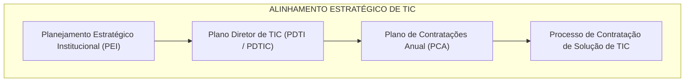
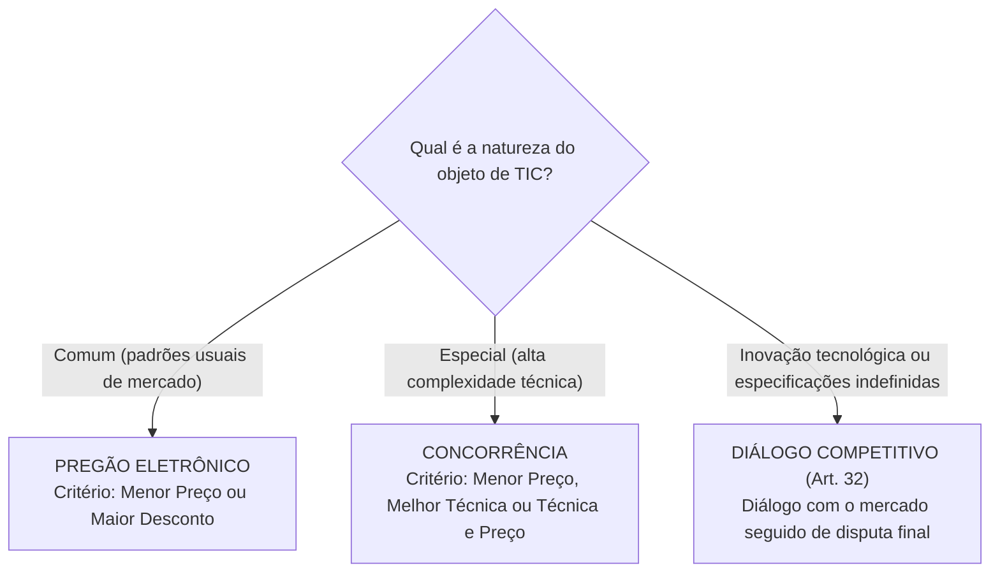
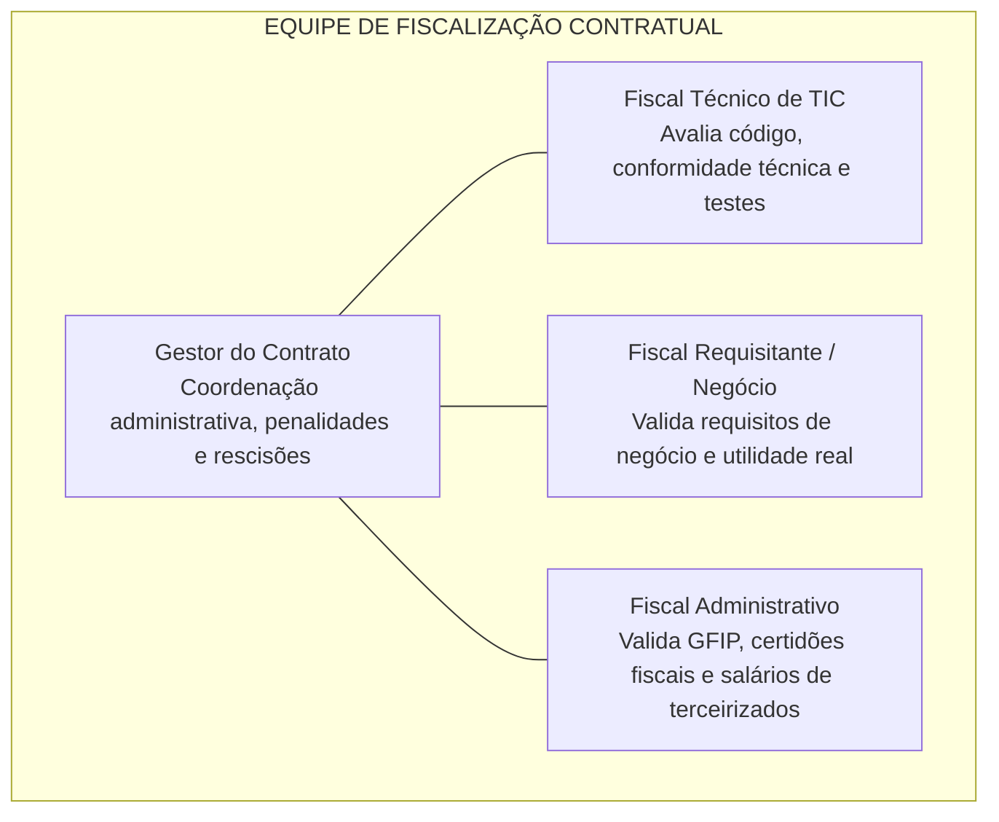
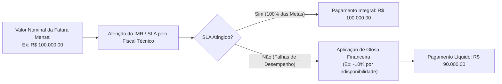

# 04 - Contratações de Soluções de TIC na Lei nº 14.133/2021

> **Matéria:** Governança de Tecnologia da Informação  
> **Cargo:** B02 – Técnico de Controle Externo – Especialidade: Tecnologia da Informação  
> **Arquivo:** `04_contratacoes_de_tic_lei_14133_2021.md`  
> **Ato Normativo Central:** Lei Federal nº 14.133, de 1º de abril de 2021 (Lei de Licitações e Contratos Administrativos)

---

## 📌 Ementa / Itens do Edital
- Aplicação da Lei nº 14.133/2021 às contratações de Soluções de Tecnologia da Informação e Comunicação (TIC)
- Alinhamento Estratégico: Plano Diretor de TIC (PDTI) e Plano de Contratações Anual (PCA)
- Fases do Processo de Contratação: Planejamento, Seleção do Fornecedor e Gestão do Contrato
- Artefatos da Fase Preparatória: DOD, Estudo Técnico Preliminar (ETP), Custo Total de Propriedade (TCO), Mapa de Riscos e Termo de Referência (TR)
- Modalidades e Critérios de Julgamento em TIC: Pregão, Concorrência e Diálogo Competitivo
- Contratação Direta de Soluções de TIC: Inexigibilidade vs. Dispensa de Licitação
- Gestão e Fiscalização de Contratos de TIC: Segregação de papéis (Gestor, Fiscal Técnico, Fiscal Requisitante, Fiscal Administrativo)
- Instrumento de Medição de Resultado (IMR), Acordo de Nível de Serviço (SLA), Glosas e Recebimento do Objeto (Provisório e Definitivo)

---

## 🌳 Classificação Hierárquica

```text
4. Licitações e Contratações de TIC sob a Lei nº 14.133/2021
├── 4.1 Princípios, Diretrizes e Alinhamento Estratégico
│   ├── 4.1.1 Princípios Aplicáveis: Planejamento, Segregação de Funções, Eficiência, Transparência e Economicidade
│   ├── 4.1.2 Instrumentos de Governança Prévia: Plano de Contratações Anual (PCA) e Plano Diretor de TIC (PDTI)
│   └── 4.1.3 Vedações Expressas em Contratações de TIC:
│       ├── Vedação à fixação de preços por homem-hora sem atrelamento a resultados (Súmula 269 TCU)
│       ├── Vedação à indicação de marcas/modelos, salvo padronização técnica fundamentada em ETP
│       └── Vedação à terceirização de atividades finalísticas de planejamento e governança estratégica de TI
├── 4.2 Fase Preparatória (Planejamento da Contratação de TIC)
│   ├── 4.2.1 Documento de Oficialização da Demanda (DOD): Registro formal da necessidade pela área requisitante
│   ├── 4.2.2 Equipe de Planejamento da Contratação: Integrante Requisitante, Integrante Técnico e Integrante Administrativo
│   ├── 4.2.3 Estudo Técnico Preliminar (ETP):
│   │   ├── Análise de alternativas tecnológicas de mercado e dimensionamento de quantitativos
│   │   ├── Custo Total de Propriedade (TCO - Total Cost of Ownership)
│   │   └── Declaração formal de viabilidade técnica, econômica e orçamentária
│   ├── 4.2.4 Mapa de Gerenciamento de Riscos: Matriz de riscos da contratação ao longo de todo o ciclo de vida
│   └── 4.2.5 Termo de Referência (TR) / Projeto Básico:
│       ├── Especificação funcional da solução de TIC
│       ├── Modelo de prestação de serviços, prazos de entrega e regime de execução
│       └── Critérios de medição, faturamento e Instrumento de Medição de Resultado (IMR)
├── 4.3 Fase de Seleção do Fornecedor (Licitação e Contratação Direta)
│   ├── 4.3.1 Bens e Serviços Comuns de TIC vs. Bens e Serviços Especiais de TIC
│   ├── 4.3.2 Modalidades de Licitação Aplicáveis:
│   │   ├── Pregão Eletrônico: Bens e serviços comuns de TIC (critério Menor Preço ou Maior Desconto)
│   │   ├── Concorrência: Soluções especiais de grande complexidade ou grande vulto
│   │   └── Diálogo Competitivo (Art. 32): Inovação tecnológica e especificações abertas
│   └── 4.3.3 Contratação Direta de Soluções de TIC:
│       ├── Inexigibilidade de Licitação (Art. 74): Fornecedor exclusivo e serviços técnicos especializados
│       └── Dispensa de Licitação (Art. 75): Limites de valor monetário e emergência tecnológica
└── 4.4 Gestão e Fiscalização Contratual de TIC
    ├── 4.4.1 Segregação de Papéis na Equipe de Fiscalização:
    │   ├── Gestor do Contrato: Coordenação administrativa geral
    │   ├── Fiscal Técnico: Servidor de TI responsável por avaliar conformidade técnica, qualidade e testes
    │   ├── Fiscal Requisitante / Setorial: Servidor da área de negócio responsável por atestar a entrega funcional
    │   └── Fiscal Administrativo: Acompanhamento de encargos trabalhistas, previdenciários e fiscais
    ├── 4.4.2 Instrumento de Medição de Resultado (IMR) / Acordo de Nível de Serviço (SLA):
    │   ├── Indicadores objetivos (disponibilidade, tempo de resposta, defeitos em software)
    │   └── Faixas de pontuação e glosas financeiras (descontos contratuais)
    ├── 4.4.3 Recebimento do Objeto de TIC:
    │   ├── Recebimento Provisório: Fiscal Técnico e Administrativo (verificação técnica preliminar)
    │   └── Recebimento Definitivo: Gestor do Contrato ou comissão (homologação final e atesto de conformidade)
    └── 4.4.4 Instrumentos Operacionais: Ordens de Serviço (OS) e Ordens de Fornecimento de Bens (OFB)
```

---

## 📖 Teoria Aprofundada & Conceitos Essenciais

### 4.1 Princípios e Diretrizes das Contratações de TIC

A **Lei nº 14.133/2021** (Nova Lei de Licitações e Contratos Administrativos) consolidou e positivou princípios e boas práticas que já vinham sendo consolidados pela jurisprudência dos Tribunais de Contas (especialmente TCU) e pelas Instruções Normativas federais de TIC (como a IN SGD/MGI nº 94/2022).



#### Regras de Ouro e Vedações Expressas em TIC

1. **Vedação à Remuneração por Homem-Hora Puro:**  
   É expressamente proibida a remuneração de serviços de desenvolvimento, sustentação ou suporte de software com base unicamente na quantidade de horas trabalhadas ou pela presença física de funcionários no órgão (**Súmula nº 269 do TCU**). Os pagamentos devem estar obrigatoriamente atrelados a **resultados mensuráveis**, como Pontos de Função (APF), Unidades de Serviço Técnico (UST) devidamente catalogadas ou metas de níveis de serviço (SLA/IMR).
2. **Vedação à Indicação de Marcas:**  
   Em regra, é vedada a indicação de marca ou fabricante específico nos editais de TIC. Exceções são admitidas **apenas** quando houver comprovação técnica de padronização corporativa prévia formalizada em ETP, ou quando determinada marca for a única capaz de atender aos requisitos operacionais.
3. **Vedação à Terceirização da Governança:**  
   Atividades privativas de tomada de decisão, gestão estratégica de TIC, aprovação de orçamentos e fiscalização de contratos **jamais** podem ser terceirizadas para empresas privadas.

---

### 4.2 O Ciclo de Vida da Contratação de TIC na Lei nº 14.133/2021

O processo de contratação pública de TIC divide-se em três macroetapas sequenciais:

```mermaid
flowchart LR
    subgraph FASE1["1. Planejamento da Contratação"]
        DOD["DOD<br/>Demanda"] --> EQ["Equipe de Planejamento<br/>(Requisitante, Técnico, ADM)"]
        EQ --> ETP["Estudo Técnico Preliminar<br/>(ETP + TCO)"]
        ETP --> MR["Mapa de Riscos"]
        MR --> TR["Termo de Referência<br/>(TR + IMR)"]
    end

    subgraph FASE2["2. Seleção do Fornecedor"]
        PUB["Edital de Licitação /<br/>Ato de Contratação Direta"] --> JULG["Sessão de Julgamento<br/>(Pregão / Concorrência / Diálogo)"]
        JULG --> HOM["Habilitação e Homologação"]
    end

    subgraph FASE3["3. Gestão Contratual"]
        OS["Emissão de OS / OFB"] --> EXEC["Execução e Aferição de SLA"]
        EXEC --> REC_PROV["Recebimento Provisório<br/>(Fiscal Técnico)"]
        REC_PROV --> REC_DEF["Recebimento Definitivo<br/>(Gestor do Contrato)"]
        REC_DEF --> PAG["Pagamento com Glosas"]
    end

    TR --> PUB
    HOM --> OS
```



---

### 4.3 Os Artefatos da Fase de Planejamento da Contratação

A fase preparatória é o coração da contratação de TIC. Licitações que falham em auditorias de Tribunais de Contas quase sempre apresentam vícios no Estudo Técnico Preliminar ou no Termo de Referência.

#### Tabela Comparativa dos Artefatos de Planejamento de TIC

| Artefato | Responsável Principal | Finalidade e Conteúdo Essencial |
| :--- | :--- | :--- |
| **DOD** (*Documento de Oficialização da Demanda*) | Área Requisitante (Área de Negócio) | Documento que inicia formalmente o processo, explicitando a necessidade institucional, o problema a ser resolvido e o alinhamento com o PDTI. |
| **Equipe de Planejamento** | Portaria / Designação da Autoridade | Comissão formada por no mínimo: Integrante Requisitante, Integrante Técnico (TI) e Integrante Administrativo, assegurando segregação de funções. |
| **ETP** (*Estudo Técnico Preliminar*) | Equipe de Planejamento da Contratação | Demonstra a viabilidade técnica, jurídica e econômica da contratação. Compara as soluções de mercado existentes, calcula o **Custo Total de Propriedade (TCO)** e define a estimativa de quantitativos. |
| **Mapa de Riscos** | Equipe de Planejamento | Matriz que identifica riscos internos e externos (técnicos, financeiros, operacionais), avalia probabilidades e impactos, e propõe ações preventivas e contingenciais. |
| **TR** (*Termo de Referência*) | Equipe de Planejamento (validado pela autoridade competente) | Documento definitivo que contém as especificações técnicas da solução de TIC, critérios de qualificação, modelo de execução, cronograma físico-financeiro e o **IMR**. |

---

### 4.4 O Custo Total de Propriedade (TCO - Total Cost of Ownership)

Ao realizar o Estudo Técnico Preliminar de soluções de TIC, a Administração não pode avaliar unicamente o custo de compra inicial das licenças ou dos servidores. Deve-se calcular o **TCO**:

```text
TCO = Custos de Aquisição (hardware / software / licenças)
    + Custos de Implantação e Customização
    + Custos de Treinamento e Capacitação dos Servidores
    + Custos de Suporte, Atualizações e Manutenção Recorrente
    + Custos de Infraestrutura Elétrica e Refrigeração (para datacenters locais)
    + Custos de Descarte, Migração e Transição Contratual
```

> ⭐ **IMPORTANTE / REGRA DE OURO:**  
> A análise de TCO frequentemente demonstra que uma solução proprietária com preço de licença inicial baixo acarreta custos ocultos de customização e suporte astronômicos ao longo de 5 anos, tornando uma solução de código aberto (*open source*) ou baseada em nuvem pública muito mais vantajosa economicamente para o Estado.

---

### 4.5 Modalidades de Licitação e Critérios de Julgamento para Soluções de TIC

A Lei nº 14.133/2021 estabelece as seguintes modalidades aplicáveis a bens e serviços de TIC:



#### 1. Pregão (Art. 28, I e Art. 29)
- **Aplicação:** Modalidade **obrigatória/preferencial** para a aquisição de **bens e serviços comuns de TIC**, definidos como aqueles cujos padrões de desempenho e qualidade podem ser objetivamente definidos pelo edital, por meio de especificações usuais de mercado.
- **Exemplos em TIC:** Compra de computadores, monitores, switches padronizados, locação de impressoras, suporte técnico help-desk de primeiro nível, renovação de licenças de software de prateleira.
- **Critérios de Julgamento:** **Menor Preço** ou **Maior Desconto**. (É vedado utilizar "Técnica e Preço" no pregão!).

#### 2. Concorrência (Art. 28, II)
- **Aplicação:** Bens e serviços **especiais** de TIC (aqueles que, por sua alta heterogeneidade ou complexidade técnica, não podem ser descritos como comuns).
- **Critérios de Julgamento:** Menor Preço, Maior Desconto, Melhor Técnica ou Conteúdo Artístico, **Técnica e Preço**, ou Maior Retorno Econômico.

#### 3. Diálogo Competitivo (Art. 32)
- **Aplicação:** Modalidade inovadora da Lei nº 14.133/2021, cabível especificamente quando a Administração Pública:
  1. Visa a contratar objeto que envolva **inovação tecnológica ou técnica**;
  2. Não possui conhecimento suficiente para definir com precisão as especificações técnicas da solução no mercado; ou
  3. Precisa avaliar alternativas financeiras, técnicas ou jurídicas antes de fixar o edital final.
- **Rito Operacional:**
  - **Fase de Diálogo:** A Administração publica edital prévio de convocação, seleciona participantes qualificados e realiza diálogos sucessivos para desenvolver as melhores soluções.
  - **Fase Competitiva:** Declarada a conclusão dos diálogos, a Administração divulga o edital com a solução definitiva construída e abre prazo não inferior a 60 dias para que os participantes apresentem suas propostas finais de preço e técnica.

---

### 4.6 Hipóteses de Contratação Direta em TIC

#### Inexigibilidade de Licitação (Art. 74) vs. Dispensa de Licitação (Art. 75)

| Dimensão | Inexigibilidade de Licitação (Art. 74) | Dispensa de Licitação (Art. 75) |
| :--- | :--- | :--- |
| **Conceito Jurídico** | **Inviabilidade jurídica de competição** (não há como estabelecer disputa objetiva de preços). | A competição é viável, mas a lei autoriza a não licitar por razões de economia processual, emergência ou conveniência legal. |
| **Hipótese 1 em TIC** | **Fornecedor Exclusivo (Art. 74, I):** Aquisição de software ou hardware exclusivo, comprovada por atestado de exclusividade fornecido pelo fabricante ou sindicato. | **Baixo Valor (Art. 75, I e II):** Compras e serviços de TIC de pequeno vulto (valores atualizados anualmente por decreto federal). |
| **Hipótese 2 em TIC** | **Serviços Técnicos Especializados de Natureza Predominantemente Intelectual (Art. 74, III):** Profissionais ou empresas de notória especialização para auditoria de segurança crítica, perícias forenses complexas ou consultoria arquitetural avançada. | **Emergência ou Calamidade Pública (Art. 75, VIII):** Restabelecimento imediato de sistemas vitais após desastres ou ciberataques severos, limitado ao prazo estritamente necessário. |
| **Hipótese 3 em TIC** | — | **Contratação de Órgão de Informática Pública (Art. 75, IX):** Contratação de órgãos públicos de processamento de dados (ex.: SERPRO, DATAPREV, ATI estadual) para serviços criados para esse fim específico, desde que o preço seja compatível com o mercado. |

> 🚨 **ALERTA DE PROVA / PEGADINHA FCC:**  
> A contratação de empresa de notória especialização por Inexigibilidade de Licitação (Art. 74, III) **não pode** ser utilizada para serviços rotineiros de informática, como manutenção de computadores ou atendimento de help-desk! Ela exige simultaneamente: 1) Serviço técnico especializado de natureza predominantemente intelectual; 2) Notória especialização do contratado; 3) Singularidade do objeto.

---

### 4.7 Gestão e Fiscalização de Contratos de TIC

Para evitar conflitos de interesse e desvios éticos, a Lei nº 14.133/2021 e a jurisprudência exigem a **segregação de funções** na equipe responsável pelo acompanhamento do contrato:



#### Atribuições Específicas dos Fiscais

1. **Gestor do Contrato:** Servidor designado para coordenar administrativamente a fiscalização, gerenciar aditivos, aplicar advertências e multas propostas pelos fiscais e assinar o termo de recebimento definitivo.
2. **Fiscal Técnico de TIC:** Servidor da área de TI encarregado de verificar se o software entregue, o hardware instalado ou os serviços executados atendem às especificações técnicas, padrões arquiteturais e métricas de desempenho.
3. **Fiscal Requisitante (de Negócio):** Servidor do setor usuário que valida as regras de negócio, funcionalidades práticas do sistema e atesta a usabilidade e eficácia para as operações do tribunal.
4. **Fiscal Administrativo:** Servidor responsável por conferir a documentação trabalhista, previdenciária e fiscal da contratada, assegurando que o órgão público não responda subsidiariamente por encargos trabalhistas de terceirizados.

---

### 4.8 O Instrumento de Medição de Resultado (IMR) e o Acordo de Nível de Serviço (SLA)

O **IMR** (*Instrumento de Medição de Resultado*) é o anexo contratual que vincula formalmente o pagamento da fatura à efetiva entrega de qualidade e desempenho.

- **Indicadores Típicos no IMR:**
  - Disponibilidade dos serviços (ex.: $99,5\%$ ao mês).
  - Tempo de Atendimento e Resolução de Incidentes Graves (ex.: até 2 horas).
  - Densidade de Defeitos de Software (ex.: máximo de 0,05 bugs críticos por Ponto de Função na homologação).
  - Pontualidade na entrega de Ordens de Serviço (OS).
- **Mecanismo de Glosas Financeiras:**  
  Se a contratada não atinge a meta de SLA pactuada, a Administração aplica uma **glosa** (desconto financeiro na fatura mensal), proporcional à gravidade da falha, sem prejuízo da aplicação de penalidades administrativas (advertência e multa).



---

### 4.9 Recebimento Provisório e Recebimento Definitivo

A Lei nº 14.133/2021 estabelece dois momentos formais e inconfundíveis para o aceite das soluções de TIC:

1. **Recebimento Provisório:**
   - Realizado pelos **Fiscais Técnico, Administrativo e Requisitante** imediatamente após a entrega dos bens ou término da prestação do serviço.
   - Finalidade: Registrar a entrega física/digital dos produtos para efeito de posterior verificação de sua perfeita conformidade com as especificações editalícias.
2. **Recebimento Definitivo:**
   - Realizado pelo **Gestor do Contrato** ou comissão designada, após a execução dos testes técnicos de homologação, análise dos relatórios de conformidade e aferição do IMR.
   - Finalidade: Homologar formalmente a entrega definitiva do objeto, liberando a fatura para liquidação e pagamento.

---

## 🌐 Fontes Recomendadas na Internet (Acesso Direto e Gratuito)

- [x] **Lei Federal nº 14.133/2021 - Nova Lei de Licitações e Contratos (Portal do Planalto):**
  - Link Oficial: [Texto Integral e Compilado da Lei nº 14.133/2021](http://www.planalto.gov.br/ccivil_03/_ato2019-2022/2021/lei/l14133.htm)
  - *Dispositivos-Chave para TIC:* Art. 6º (Definições de bens e serviços comuns/especiais), Art. 18 (Planejamento e Estudo Técnico Preliminar - ETP), Art. 28 a 32 (Modalidades de Licitação: Pregão, Concorrência e Diálogo Competitivo), Arts. 72 a 75 (Contratação Direta) e Art. 117 (Fiscalização Contratual).
- [x] **Instrução Normativa SGD/MGI nº 94/2022 (Padrão Nacional de Contratações de TIC):**
  - Link Oficial: [Instrução Normativa SGD/MGI nº 94/2022 - Portal Gov.br](https://www.gov.br/governodigital/pt-br/contratacoes-de-tic)
  - *Conteúdo:* Rito completo das contratações de TIC: Documento de Oficialização da Demanda (DOD), Equipe de Planejamento da Contratação, Mapa de Riscos, Termo de Referência e Instrumento de Medição de Resultado (IMR).
- [x] **Tribunal de Contas da União (TCU) - Jurisprudência e Boas Práticas de TIC:**
  - Link Oficial: [Portal de Governança de TI do TCU](https://portal.tcu.gov.br/)
  - *Conteúdo:* Súmula 269 do TCU, acórdãos referenciais sobre métricas de software (APF/UST), vedação ao pagamento por homem-hora puro e fiscalização de contratos de TIC.

---

## 📝 Questões Comentadas no Padrão FCC (Exatamente 5 Questões)

### Questão 1 (FCC - Auditor de Controle Externo / TI - Adaptada)
**Enunciado:** Em procedimento de auditoria de controle externo realizado no setor de tecnologia da informação de uma autarquia estadual, a equipe de auditoria analisou um termo de referência para contratação de fábrica de software e constatou a previsão de que a empresa contratada seria remunerada exclusivamente pela contagem das horas trabalhadas pelos desenvolvedores alocados presencialmente no prédio da autarquia, sem vínculo com entregas, ordens de serviço, pontos de função ou metas de níveis de serviço. Considerando a jurisprudência sumulada dos Tribunais de Contas e a Lei nº 14.133/2021:  
A) A cláusula editalícia é lícita, visto que o regime de contratação por homens-hora garante total flexibilidade técnica exigida pelo paradigma de desenvolvimento ágil.  
B) O procedimento apresenta irregularidade grave, pois a remuneração de serviços de desenvolvimento e manutenção de software na Administração Pública deve ser vinculada a resultados concretos (como métricas de pontos de função ou ordens de serviço atreladas a níveis de serviço com IMR), sendo vedada a remuneração fundamentada exclusivamente em homem-hora sem atrelamento a produtos ou resultados mensuráveis.  
C) A modalidade licitatória obrigatória para contratações remuneradas por homem-hora presencial é o Leilão Internacional.  
D) A Lei nº 14.133/2021 estabelece que a contratação de software proprietário prescinde de Estudo Técnico Preliminar e de fiscalização técnica.  
E) A responsabilidade pela escolha da métrica de homem-hora é privativa da empresa licitante vencedora, não podendo a Administração impor métricas de pagamento.  

> **Gabarito: B**  
>  
> **Comentário Analítico Passo a Passo:**  
> - **Análise da Alternativa A:** Incorreta. O modelo ágil não autoriza a administração pública a remunerar fornecedores por mera "presença física" ou tempo corrido sem entrega de valor mensurável; a jurisprudência pacífica do TCU exige aferição objetiva de resultados mesmo em projetos ágeis.  
> - **Análise da Alternativa B:** **CORRETA.** A Súmula nº 269 do TCU e os princípios da economicidade, eficiência e motivação da Lei nº 14.133/2021 vedam a remuneração de serviços de TIC baseada unicamente em homem-hora desvinculada de resultados mensuráveis. O pagamento deve basear-se em produtos, ordens de serviço, métricas objetivas (como Pontos de Função ou UST) e cumprimento de metas de SLA através do IMR.  
> - **Análise da Alternativa C:** Incorreta. O Leilão destina-se à alienação de bens móveis inservíveis ou imóveis da administração, jamais à contratação de serviços de software.  
> - **Análise da Alternativa D:** Incorreta. O Estudo Técnico Preliminar (ETP) é a base obrigatória do planejamento licitatório (Art. 18 da Lei 14.133/2021), sendo indispensável para soluções de software.  
> - **Análise da Alternativa E:** Incorreta. A definição dos critérios de medição e remuneração é dever indelegável da Administração Pública no Termo de Referência.

---

### Questão 2 (FCC - Analista de TI / Governança e Contratos - Adaptada)
**Enunciado:** Determinada Secretaria Estadual de Fazenda identificou a necessidade premente de modernizar seu ecossistema de detecção de fraudes fiscais complexas por meio de inteligência artificial generativa de ponta. No entanto, após realizar estudos iniciais, a equipe técnica concluiu que a Administração não possui conhecimento suficiente para redigir as especificações técnicas definitivas da solução, necessitando dialogar amplamente com o mercado tecnológico para avaliar os modelos algorítmicos, custos e arquiteturas disponíveis antes de receber as propostas finais. Nos termos estritos da Lei nº 14.133/2021, a modalidade de licitação cabível para esse cenário é o:  
A) Pregão Presencial.  
B) Diálogo Competitivo.  
C) Concurso Artístico.  
D) Leilão Eletrônico.  
E) Credenciamento Automático.  

> **Gabarito: B**  
>  
> **Comentário Analítico Passo a Passo:**  
> - **Análise da Alternativa A:** Incorreta. O pregão presencial é exceção na Lei nº 14.133/2021 (a regra é a forma eletrônica) e é restrito a bens e serviços comuns, sendo inviável para situações em que a administração sequer consegue especificar o objeto sem diálogo prévio com o mercado.  
> - **Análise da Alternativa B:** **CORRETA.** O **Diálogo Competitivo** (Art. 32 da Lei nº 14.133/2021) foi introduzido exatamente para contratações que envolvem: inovação tecnológica ou técnica; impossibilidade de a administração definir com precisão suficiente as especificações técnicas da solução; ou necessidade de definir a melhor modelagem da contratação através de diálogo prévio com licitantes previamente selecionados.  
> - **Análise da Alternativa C:** Incorreta. O Concurso destina-se à escolha de trabalho técnico, científico ou artístico para concessão de prêmio ou remuneração.  
> - **Análise da Alternativa D:** Incorreta. O Leilão é modalidade destinada à alienação (venda) de bens públicos.  
> - **Análise da Alternativa E:** Incorreta. Credenciamento é um procedimento auxiliar de contratação direta, e não uma modalidade licitatória competitiva para desenvolvimento de soluções tecnológicas complexas.

---

### Questão 3 (FCC - Auditor Fiscal da Receita Estadual / TI - Adaptada)
**Enunciado:** No processo preparatório para a contratação de uma nova solução integrada de armazenamento em nuvem e banco de dados corporativo, a equipe de planejamento da contratação elaborou o Estudo Técnico Preliminar (ETP). Para comparar adequadamente a aquisição de infraestrutura física local (*on-premises*) com a contratação de serviços em nuvem (*cloud computing*), a equipe calculou não apenas os custos de compra imediata de licenças e servidores, mas também os gastos projetados com implantação, capacitação de servidores, suporte técnico anual, climatização de datacenter e futura migração de dados ao longo de cinco anos. Essa técnica de avaliação econômica e financeira denomina-se:  
A) Retorno sobre Patrimônio Líquido (ROE).  
B) Custo Total de Propriedade (TCO - *Total Cost of Ownership*).  
C) Análise de Pontos por Função Rápida (FPA).  
D) Custo Marginal de Substituição Imediata.  
E) Depreciação Linear Fixa Arbitrária.  

> **Gabarito: B**  
>  
> **Comentário Analítico Passo a Passo:**  
> - **Análise da Alternativa A:** Incorreta. ROE é um indicador financeiro privado de rentabilidade sobre patrimônio acionário, não tendo relação com a avaliação integral do ciclo de vida de aquisição de TIC.  
> - **Análise da Alternativa B:** **CORRETA.** O **Custo Total de Propriedade (TCO - *Total Cost of Ownership*)** é a metodologia que calcula o custo integral de uma solução ao longo de todo o seu ciclo de vida (aquisição, implantação, treinamento, energia, suporte/manutenção e descarte/migração), sendo ferramenta obrigatória no ETP de TIC para evitar falsas economias baseadas apenas no menor preço inicial de licença.  
> - **Análise da Alternativa C:** Incorreta. Análise de Pontos de Função (FPA) é técnica de medição do tamanho funcional de software, não cálculo financeiro de ciclo de vida.  
> - **Análise da Alternativa D:** Incorreta. Termo econômico genérico que não contempla a totalidade das despesas de suporte, infraestrutura e treinamento ao longo do ciclo de vida.  
> - **Análise da Alternativa E:** Incorreta. Trata-se de método de amortização contábil patrimonial, e não de análise abrangente de viabilidade de alternativas de TIC.

---

### Questão 4 (FCC - Técnico de Controle Externo / TI - Adaptada)
**Enunciado:** De acordo com as disposições da Lei nº 14.133/2021 sobre a fiscalização dos contratos administrativos e a governança de contratações de TIC, os atos formais de atesto e aceite do objeto contratado dividem-se em Recebimento Provisório e Recebimento Definitivo. A respeito desses instrumentos, assinale a afirmativa correta:  
A) O Recebimento Definitivo é realizado pelo fornecedor privado no momento do embarque dos servidores no centro de distribuição da fábrica.  
B) O Recebimento Provisório é realizado pelos fiscais técnico, administrativo e setorial mediante termo detalhado, com a finalidade de registrar a entrega dos bens ou serviços para posterior verificação minuciosa de conformidade técnica e operacional.  
C) O Recebimento Definitivo dispensa qualquer teste de homologação ou verificação de conformidade com os níveis mínimos de serviço estabelecidos no IMR.  
D) O Recebimento Provisório transfere em definitivo toda a responsabilidade jurídica e financeira à Administração, vedando a aplicação de qualquer glosa posterior.  
E) A Lei nº 14.133/2021 proibiu expressamente a figura do recebimento provisório em contratos de TIC para conferir maior velocidade às compras públicas.  

> **Gabarito: B**  
>  
> **Comentário Analítico Passo a Passo:**  
> - **Análise da Alternativa A:** Incorreta. Ambos os recebimentos são atos administrativos privativos de agentes públicos da Administração contratante, jamais do fornecedor contratado.  
> - **Análise da Alternativa B:** **CORRETA.** O Recebimento Provisório (Art. 140 da Lei 14.133/2021) é formalizado pelos fiscais do contrato assim que o fornecedor entrega o produto ou conclui a prestação do serviço, servindo para registrar o recebimento físico/lógico e dar início ao prazo de homologação, inspeção técnica e aferição das metas do IMR.  
> - **Análise da Alternativa C:** Incorreta. O Recebimento Definitivo ocorre justamente após a verificação de que o objeto atende a todas as exigências do Termo de Referência, incluindo homologação e avaliação dos níveis de serviço do IMR.  
> - **Análise da Alternativa D:** Incorreta. O recebimento provisório tem caráter transitório; eventuais defeitos, falhas ou descumprimento de SLAs identificados na fase de homologação acarretam rejeição do objeto ou glosas financeiras antes do aceite definitivo.  
> - **Análise da Alternativa E:** Incorreta. O recebimento provisório é mantido e expressamente regulamentado pela Lei nº 14.133/2021 para serviços e compras.

---

### Questão 5 (FCC - Analista de Sistemas / Fiscalização de Contratos - Adaptada)
**Enunciado:** Em um contrato de prestação de serviços de TIC para manutenção de portais governamentais, o Termo de Referência fixou um Instrumento de Medição de Resultado (IMR) contendo como indicador de nível de serviço (SLA) a meta mensal de disponibilidade mínima do portal em 99,8%. Durante a fiscalização do terceiro mês, o Fiscal Técnico constatou, por meio de ferramentas automatizadas de monitoramento, que o portal permaneceu indisponível por 18 horas ininterruptas em horário comercial, atingindo apenas 97,5% de disponibilidade naquele ciclo. Diante do descumprimento da meta de SLA estabelecida no IMR, o procedimento contratual cabível consiste em:  
A) Efetuar o pagamento integral do valor da fatura sem qualquer desconto e indenizar a empresa pela instabilidade gerada.  
B) Aplicar a respectiva glosa financeira diretamente no valor devido na fatura mensal proporcionalmente à faixa de penalidade fixada no IMR, sem prejuízo da abertura de procedimento para aplicação de sanções administrativas cabíveis em caso de reiteração.  
C) Cancelar sumariamente todos os contratos de TIC em vigor em todo o Estado e proibir a internet nos órgãos públicos.  
D) Substituir imediatamente o Fiscal Técnico por um funcionário indicado pelo próprio provedor inadimplente.  
E) Exigir que a contratada compense o tempo de queda aumentando a velocidade da internet residencial dos servidores da Secretaria.  

> **Gabarito: B**  
>  
> **Comentário Analítico Passo a Passo:**  
> - **Análise da Alternativa A:** Incorreta. O pagamento integral sem abatimento por serviço defeituoso ou abaixo do SLA configuraria liquidação irregular de despesa pública e dano ao erário.  
> - **Análise da Alternativa B:** **CORRETA.** O Instrumento de Medição de Resultado (IMR) serve justamente para operacionalizar as **glosas financeiras** (retenções/descontos no valor faturado) correspondentes ao não alcance dos níveis mínimos de serviço pactuados, garantindo que o órgão público pague apenas pelo serviço efetivamente prestado com a qualidade exigida, cabendo ainda advertência ou multa em caso de reiteração de falhas graves.  
> - **Análise da Alternativa C:** Incorreta. Solução absurda e desproporcional que violaria o interesse público e a continuidade dos serviços.  
> - **Análise da Alternativa D:** Incorreta. O fiscal técnico é agente público independente e sua substituição para favorecer a contratada configuraria improbidade administrativa e grave infração funcional.  
> - **Análise da Alternativa E:** Incorreta. Não existe previsão de compensação pessoal a servidores; o contrato é com a Administração Pública e as compensações ocorrem na esfera financeira e de cumprimento do objeto do órgão contratante.
