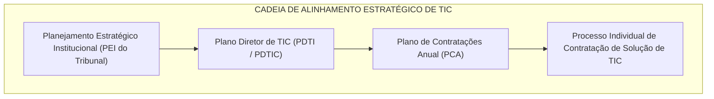
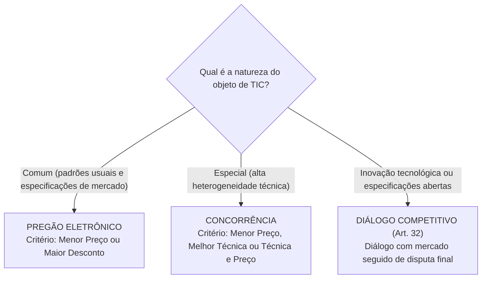
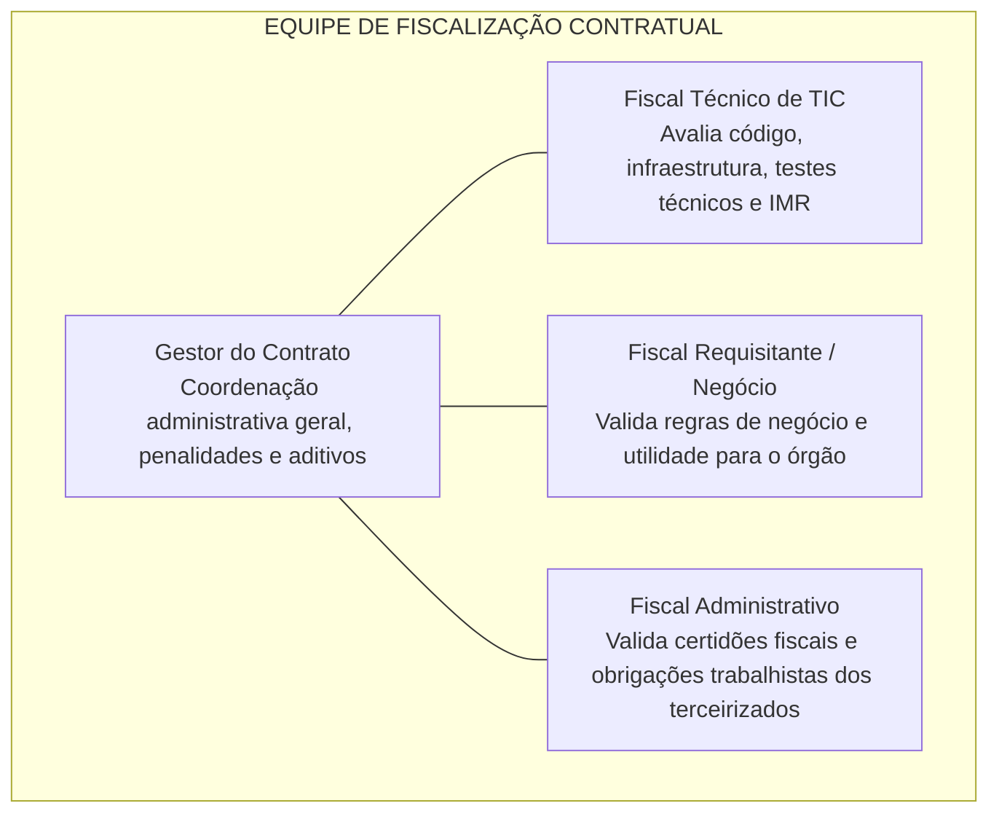

# 04 - Contratações de Soluções de TIC na Lei nº 14.133/2021

> **Matéria:** Governança de Tecnologia da Informação  
> **Cargo:** B02 – Técnico de Controle Externo – Especialidade: Tecnologia da Informação  
> **Arquivo:** `04_contratacoes_de_tic_lei_14133_2021.md`  
> **Ato Normativo Central:** Lei Federal nº 14.133, de 1º de abril de 2021 (Lei de Licitações e Contratos Administrativos)

---

## 📌 Ementa / Itens do Edital
- Aplicação da Lei nº 14.133/2021 às contratações de Soluções de Tecnologia da Informação e Comunicação (TIC)
- Alinhamento Estratégico: Plano Diretor de TIC (PDTI) e Plano de Contratações Anual (PCA)
- Fases do Processo de Contratação: Planejamento, Seleção do Fornecedor e Gestão do Contrato
- Artefatos da Fase Preparatória: DOD, Estudo Técnico Preliminar (ETP), Custo Total de Propriedade (TCO), Mapa de Riscos e Termo de Referência (TR)
- Modalidades e Critérios de Julgamento em TIC: Pregão, Concorrência e Diálogo Competitivo
- Contratação Direta de Soluções de TIC: Inexigibilidade vs. Dispensa de Licitação
- Gestão e Fiscalização de Contratos de TIC: Segregação de papéis (Gestor, Fiscal Técnico, Fiscal Requisitante, Fiscal Administrativo)
- Instrumento de Medição de Resultado (IMR), Acordo de Nível de Serviço (SLA), Glosas e Recebimento do Objeto (Provisório e Definitivo)

---

## 🧭 Sumário

1. [Princípios e Diretrizes das Contratações de TIC na Lei nº 14.133/2021](#1-principios-e-diretrizes-das-contratacoes-de-tic-na-lei-no-141332021)
1. [Alinhamento Estratégico e Planejamento Prévio (PDTI e PCA)](#1-1-alinhamento-estrategico-e-planejamento-previo-pdti-e-pca)
    1. [Teste 495](#Teste-495)
1. [Vedações Expressas e Jurisprudência dos Tribunais de Contas](#1-2-vedacoes-expressas-e-jurisprudencia-dos-tribunais-de-contas)
    1. [Teste 496](#Teste-496)
2. [O Ciclo de Vida da Contratação e a Fase Preparatória](#2-o-ciclo-de-vida-da-contratacao-e-a-fase-preparatoria)
2. [Artefatos da Fase de Planejamento (DOD, ETP, Mapa de Riscos e TR)](#2-1-artefatos-da-fase-de-planejamento-dod-etp-mapa-de-riscos-e-tr)
    1. [Teste 497](#Teste-497)
2. [Custo Total de Propriedade (TCO - Total Cost of Ownership)](#2-2-custo-total-de-propriedade-tco-total-cost-of-ownership)
    1. [Teste 498](#Teste-498)
3. [Fase de Seleção do Fornecedor em TIC](#3-fase-de-selecao-do-fornecedor-em-tic)
3. [Modalidades de Licitação (Pregão, Concorrência e Diálogo Competitivo)](#3-1-modalidades-de-licitacao-pregao-concorrencia-e-dialogo-competitivo)
    1. [Teste 499](#Teste-499)
3. [Hipóteses de Contratação Direta em TIC (Inexigibilidade vs. Dispensa)](#3-2-hipoteses-de-contratacao-direta-em-tic-inexigibilidade-vs-dispensa)
    1. [Teste 500](#Teste-500)
4. [Gestão e Fiscalização de Contratos de TIC](#4-gestao-e-fiscalizacao-de-contratos-de-tic)
4. [Segregação de Papéis na Equipe de Fiscalização](#4-1-segregacao-de-papeis-na-equipe-de-fiscalizacao)
    1. [Teste 501](#Teste-501)
4. [Instrumento de Medição de Resultado (IMR), SLA e Glosas](#4-2-instrumento-de-medicao-de-resultado-imr-sla-e-glosas)
    1. [Teste 502](#Teste-502)
4. [Recebimento Provisório e Recebimento Definitivo](#4-3-recebimento-provisorio-e-recebimento-definitivo)
    1. [Teste 503](#Teste-503)
    2. [Teste 504](#Teste-504)
6. [Fontes Recomendadas na Internet](#6-fontes-recomendadas-na-internet)

---

## 1. Princípios e Diretrizes das Contratações de TIC na Lei nº 14.133/2021

A **Lei nº 14.133/2021** (Nova Lei de Licitações e Contratos Administrativos) consolidou e positivou princípios e boas práticas de contratação pública de Soluções de Tecnologia da Informação e Comunicação (TIC), harmonizando a legislação geral com a jurisprudência histórica do Tribunal de Contas da União (TCU) e com as normas infralegais federais (como a Instrução Normativa SGD/MGI nº 94/2022).

---

## 1.1 Alinhamento Estratégico e Planejamento Prévio (PDTI e PCA)

No setor público, nenhuma aquisição de tecnologia pode ocorrer de forma isolada, episódica ou desconectada das metas institucionais:

- **Plano Diretor de TIC (PDTI / PDTIC):** Instrumento de diagnóstico, planejamento e gestão dos recursos e processos de TIC do órgão para um horizonte plurianual (normalmente de 2 a 4 anos), alinhado ao Planejamento Estratégico Institucional (PEI).
- **Plano de Contratações Anual (PCA):** Documento formalizado pela alta administração que consolida todas as compras e contratações que o órgão pretende realizar no exercício financeiro seguinte, assegurando previsão orçamentária e evitando fracionamento indevido de despesas.
- **Regra:** Toda contratação de solução de TIC deve estar expressamente prevista ou fundamentadamente compatível com o PDTI e com o PCA do exercício.

---

### Teste 495
**(FGV – TRT – Analista Judiciário - Tecnologia da Informação – 2024)**
Considerando a legislação aplicável a licitações de bens e serviços 
de Tecnologia da Informação e Comunicação (TIC), analise as 
afirmativas a seguir. 
I. Um acordo de nível de serviço (ANS), segundo a ITIL v4, é um 
acordo documentado entre um provedor de serviços de TIC e 
um cliente que define os serviços a serem prestados e o nível 
de qualidade que o provedor deve se comprometer a cumprir 
na prestação destes serviços. Em documentos da fase interna 
de processos licitatórios para a contratação de Centrais de 
Serviços ( Service Desk ), como Estudos Técnicos Preliminares 
ou Termos de Referência, é esperado encontrar requisitos da 
solução de TIC no formato de ANS. 
II. Na fase interna de licitações de bens e serviços de TIC no 
poder público, a adoção da Lei 14.133/2021 e da IN SGD/ME 
nº 94/2022 são mandatórias. Além destes documentos, a 
equipe técnica responsável deve adotar princípios 
orientadores e boas práticas de gerenciamento de serviços de 
TIC. Para isto, a lei brasileira exige que os órgãos públicos 
mantenham servidores capacitados, exclusivamente, nesta 
metodologia ITIL v4 de gerenciamento de serviços de TIC. 
III. Segundo a IN SGD/ME nº 94/2022, é vedada a contratação de 
soluções de autenticação em aplicações destinadas a serviços 
públicos digitais, salvo nos casos em que o órgão ou entidade 
tenha obtido autorização prévia pelo Órgão Central do SISP. 
Está correto o que se afirma em

* **A)** I, apenas.
* **B)** II, apenas.
* **C)** I e II, apenas.
* **D)** I e III, apenas.
* **E)** II e III, apenas.

---

> **Comentário Detalhado:**
>
> - **A)** Incorreta. Discrepa das diretrizes normativas e jurisprudenciais aplicáveis ao tema objeto do item.
> - **B)** Incorreta. Discrepa das diretrizes normativas e jurisprudenciais aplicáveis ao tema objeto do item.
> - **C)** Incorreta. Discrepa das diretrizes normativas e jurisprudenciais aplicáveis ao tema objeto do item.
> - **D)** Correta. Representa com precisão a disciplina do tema e o entendimento pacificado adotado pela banca (FGV).
> - **E)** Incorreta. Discrepa das diretrizes normativas e jurisprudenciais aplicáveis ao tema objeto do item.
>
> **Gabarito: D**

---
## 1.2 Vedações Expressas e Jurisprudência dos Tribunais de Contas

1. **Vedação à Remuneração por Homem-Hora Puro (Súmula nº 269 do TCU):**  
   É terminantemente proibida a remuneração de serviços de desenvolvimento, sustentação ou suporte de software com base unicamente na quantidade de horas trabalhadas ou pela mera presença física de funcionários terceirizados nas dependências do órgão. Os pagamentos devem estar obrigatoriamente vinculados a **resultados mensuráveis**, como Pontos de Função (Análise de Pontos de Função - APF), Unidades de Serviço Técnico (UST) previamente catalogadas em tabela de complexidade ou cumprimento de níveis mínimos de serviço (SLA/IMR).
2. **Vedação à Indicação de Marcas ou Modelos:**  
   Em regra, o edital não pode exigir marca, modelo ou fabricante exclusivo. Exceções são admitidas **apenas** quando houver comprovação técnica de padronização corporativa prévia formalizada em Estudo Técnico Preliminar (ETP), ou quando uma marca for a única tecnicamente viável para manter a interoperabilidade de sistemas preexistentes.
3. **Vedação à Terceirização da Governança e Decisão:**  
   Atividades privativas de tomada de decisão, gestão estratégica de TIC, aprovação de orçamentos, elaboração de pareceres conclusivos e fiscalização formal de contratos **jamais** podem ser terceirizadas para empresas privadas.

---

### Teste 496
**(FGV – TJ-AP – Analista Judiciário (TI) – 2023)**  
Com base na Instrução Normativa nº 4, de 11 de setembro de

2014 (MPOG/SLTI), que dispõe  sobre o processo de contratação

de Soluções de Tecnologia da Informação pelos órgãos

integrantes do Sistema de Administração dos Recursos de

Tecnologia da Informação (SISP) do Poder Executivo Federal.

A Área de Tecnologia da Informação de um órgão federal

desempenha várias funções no processo de contratação de

Soluções de Tecnologia da Informação.

Pode-se verificar que são atribuições da Área de Tecnologia da

Informação na segunda fase da contratação, conhecida como

Seleção do Fornecedor:

I. apoiar o preg oeiro na análise e julgamento das propostas

apresentadas pelos licitantes;

II. encaminhar o Plano de Fiscalização à área de Licitação, que

estabelece o processo de fiscalização do contrato de Soluções de

Tecnologia da Informação;

III. elaborar o Projeto Bá sico ou Termo de Referência de Soluções

de Tecnologia da Informação.

Está correto somente o que se afirma em:

* **A)** I;
* **B)** II;
* **C)** I e II;
* **D)** I e III;
* **E)** II e III. Tribunal de Justiça do Estado do Amapá FGV Conhecimento Analista Jud - Apo Especializado - Tecnologia da Informação - Telecomunicações  Tipo 1 Branca Realização

---

> **Comentário Detalhado:**
>
> - **A)** Incorreta. O TR deve conter critérios objetivos de mensuração e níveis mínimos de serviço.
> - **B)** Correta. O Termo de Referência (TR), elaborado a partir dos Estudos Técnicos Preliminares (ETP), é o documento obrigatório que consolida a definição do objeto de TIC, justificativa da contratação, modelo de execução, estimativa de custos, critérios de medição de resultados e obrigações contratuais.
> - **C)** Incorreta. A estimativa orçamentária prévia é obrigatória nos termos da Lei de Licitações.
> - **D)** Incorreta. O modelo de pagamento deve vincular-se a resultados e entregas efetivas (UST / Ordens de Serviço).
> - **E)** Incorreta. Cláusulas de sustentabilidade e segurança são exigidas em contratações de TIC.
>
> **Gabarito: B**

---

## 2. O Ciclo de Vida da Contratação e a Fase Preparatória

O processo de contratação pública de TIC divide-se em três macrofases interdependentes:

```mermaid
flowchart LR
    subgraph FASE1["1. Planejamento da Contratação"]
        DOD["DOD<br/>Demanda"] --> EQ["Equipe de Planejamento<br/>(Requisitante, Técnico, ADM)"]
        EQ --> ETP["Estudo Técnico Preliminar<br/>(ETP + TCO)"]
        ETP --> MR["Mapa de Riscos"]
        MR --> TR["Termo de Referência<br/>(TR + IMR)"]
    end

    subgraph FASE2["2. Seleção do Fornecedor"]
        PUB["Edital de Licitação /<br/>Ato de Contratação Direta"] --> JULG["Julgamento de Propostas<br/>(Pregão / Concorrência / Diálogo)"]
        JULG --> HOM["Habilitação e Homologação"]
    end

    subgraph FASE3["3. Gestão Contratual"]
        OS["Emissão de OS / OFB"] --> EXEC["Execução e Aferição de SLA"]
        EXEC --> REC_PROV["Recebimento Provisório<br/>(Fiscais)"]
        REC_PROV --> REC_DEF["Recebimento Definitivo<br/>(Gestor do Contrato)"]
        REC_DEF --> PAG["Pagamento com Glosas"]
    end

    TR --> PUB
    HOM --> OS
```

---

## 2.1 Artefatos da Fase de Planejamento (DOD, ETP, Mapa de Riscos e TR)

A fase preparatória é o núcleo de conformidade da contratação. Falhas graves apontadas em auditorias de controle externo derivam, em sua grande maioria, de fragilidades no ETP ou no Termo de Referência.

| Artefato | Responsável Principal | Finalidade e Conteúdo Essencial |
| :--- | :--- | :--- |
| **DOD** (*Documento de Oficialização da Demanda*) | Área Requisitante (Negócio) | Inicia formalmente o processo administrativo, explicitando o problema institucional a ser resolvido, os resultados esperados e o alinhamento com o PDTI. |
| **Equipe de Planejamento** | Designada pela Autoridade Competente | Comissão composta por no mínimo: Integrante Requisitante, Integrante Técnico (TI) e Integrante Administrativo, assegurando a segregação de funções. |
| **ETP** (*Estudo Técnico Preliminar*) | Equipe de Planejamento da Contratação | Demonstra a viabilidade técnica, operacional e econômica. Compara soluções de mercado (nuvem vs on-premises, software livre vs proprietário), calcula o **TCO** e define o quantitativo. |
| **Mapa de Riscos** | Equipe de Planejamento | Matriz que identifica riscos internos e externos em todo o ciclo de vida, avaliando probabilidade e impacto, além de prever ações preventivas e contingenciais. |
| **TR** (*Termo de Referência*) | Equipe de Planejamento | Documento definitivo que estabelece o objeto, requisitos funcionais e não funcionais, modelo de execução, critérios de habilitação e o **Instrumento de Medição de Resultado (IMR)**. |

---

### Teste 497
**(FGV – TCE-GO – Analista de Controle Externo (TI) – 2024)**  
Um certo fiscal de contratos da administração pública exerce vários papéis e funções. Considerando o tema, é correto que se deve

* **A)** representar a contratada nas negociações com a administração pública, garantindo a adequação dos termos contratuais às necessidades da contratante.
* **B)** aplicar diretamente penalidades e sanções administrativas à contratada em caso de execução inadequada do contrato.
* **C)** receber e aceite dos bens e serviços, não par ticipando das etapas anteriores de acompanhamento da execução contratual.
* **D)** acompanhar a execução contratual, registrando e notificando irregularidades à autoridade competente, para as devidas providências.
* **E)** elaborar sanções a ser aplicadas nas irregu laridades encontradas durante a execução contratual. Realização TRIBUNAL DE CONTAS DO ESTADO DE GOIÁS CONCURSO PÚBLICO – EDITAL 01/2024 TARDE ANALISTA DE CONTROLE EXTERNO TECNOLOGIA DA INFORMACAO NÍVEL SUPERIOR TIPO 1 – BRANCA • Além deste caderno contendo 2 (duas) discursivas você receberá do fiscal de sala a folha de texto definitivo; • As questões discursivas deverão ser redigidas em até 20 (vinte) linhas. • • Verifique se seu caderno de questões está completo, sem repetição de questões ou falhas. Caso contrário, notifique imediatamente o fiscal da sala, para que sejam tomadas as devidas providências; • Confira seus dados pessoais, especialmente nome, número de inscrição e documento de identidade e leia atentamente as instruções para preencher a folha de texto definitivo; • Para o preenchimento das folhas de textos definitivos, use somente caneta esferográf ica, fabricada em material transparente, com tinta preta ou azul; • Assine seu nome apenas nos espaços reservados nas folhas de textos definitivos; • Confira seu cargo, cor e tipo do caderno de questões. Caso tenha recebido caderno de cargo ou cor ou tipo diferente do impresso em sua s folhas de texto s definitivos, o fiscal de sala deve ser obrigatoriamente informado para o devido registro na ata da sala; • Reserve tempo suficiente para o preenchimento das suas folhas de textos definitivos. O preenchimento é de sua responsabilidade e não será permitida a troca das folhas de textos definitivos em caso de erro cometido pelo candidato; • Para fins de avaliação, serão levadas em consideração apenas as marcações realizadas nas folhas de textos definitivos; • A FGV coletará as impressões digitais dos candidatos na lista de presença; • Os candidatos serão submetidos ao sistema de detecção de metais quando do ingresso e da saída de sanitários durante a realização das provas. • Boa prova! • Você dispõe de 2 (duas) horas para a realização da prova, já incluído o tempo para o preenchimento das folhas de textos definitivos; • 1 (uma) hora após o início da prova, é possível retirar-se da sala, sem levar o caderno de questões; • A partir dos 30 (trinta) minutos anteriores ao término da prova é possível retirar -se da sala levando o caderno de questões. • Qualquer tipo de comunicação entre os candidatos durante a aplicação da prova; • Anotar informações relativas às respostas em qualquer outro meio que não seja o caderno de questões; • Levantar da cadeira sem autorização do fiscal de sala; • Usar o sanitário ao término da prova, após deixar a sala. SUA PROVA TEMPO NÃO SERÁ PERMITIDO INFORMAÇÕES GERAIS TRIBUNAL DE CONTAS DO ESTADO DE GOIÁS FGV CONHECIMENTO ANALISTA DE CONTROLE EXTERNO - TECNOLOGIA DA INFORMACAO – TARDE TIPO BRANCA – PÁGINA 1 Tecnologia da Informação - Discursiva

---

> **Comentário Detalhado:**
>
> - **A)** Incorreta. O fiscal técnico não exerce atos privativos de ordenador de despesa.
> - **B)** Incorreta. A fiscalização deve ser segregada entre gestão do contrato, fiscalização técnica e fiscalização administrativa.
> - **C)** Incorreta. É vedada a interferência direta na administração de pessoal da empresa contratada.
> - **D)** Correta. Na fiscalização de contratos públicos de TIC (Lei 14.133/2021 e IN SGD), o fiscal técnico acompanha a conformidade dos serviços prestados, avalia o cumprimento dos Níveis Mínimos de Serviço (SLA) pactuados e atesta as entregas para fins de liquidação e pagamento.
> - **E)** Incorreta. O atesto de faturas sem verificação dos critérios de aceitação gera responsabilidade solidária perante os Tribunais de Contas.
>
> **Gabarito: D**

---

## 2.2 Custo Total de Propriedade (TCO - Total Cost of Ownership)

Ao realizar o Estudo Técnico Preliminar de soluções de TIC, a Administração não pode avaliar exclusivamente o custo nominal de aquisição inicial de hardware ou licenças. Deve-se calcular o **Custo Total de Propriedade (TCO)** ao longo de todo o ciclo de vida:

$$\text{TCO} = \text{Aquisição} + \text{Implantação/Customização} + \text{Capacitação/Treinamento} + \text{Manutenção/Suporte Recorrente} + \text{Infraestrutura/Energia} + \text{Descarte/Migração}$$

> 🚨 **ALERTA DE PROVA / PEGADINHA FCC:**  
> A análise de TCO frequentemente demonstra que uma solução com preço inicial de compra mais baixo (ou até software gratuito) acarreta gastos elevadíssimos com suporte especializado, horas de customização e energia, tornando uma solução com custo inicial maior, porém com suporte integrado, muito mais econômica globalmente para o órgão.

---

### Teste 498
**(FGV – TCE-GO – Analista de Controle Externo (TI) – 2024)**  
A Lei nº 13.303/2016 estabelece que os órgãos de controle externo e interno das três esferas de governo fiscalizarão as empresas públicas e as sociedades de economia mista a eles relacionados, inclusive aquelas domiciliadas no exterior, quanto à legitimidade, à economicidade e à eficácia da aplicação de seus recursos, sob o ponto de vista contábil, financeiro, operacional e patrimonial. Acerca do mencionado tema, à luz da referida norma, é correto afirmar que

* **A)** as ações e deliberações do órgão ou ente de controle não podem implicar interferência na gestão das empresas públicas e das sociedades de ec onomia mista a eles submetidas nem ingerência no exercício de suas competências ou na definição de políticas públicas.
* **B)** é vedado que os Tribunais de Contas realizem o controle externo em relação às licitações e contratos formalizados pelas empresas públ icas e sociedades de economia mista, considerando a natureza jurídica de tais entidades administrativas.
* **C)** as gravações e filmagens existentes de reuniões, ordinárias ou extraordinárias, dos conselhos de administração ou fiscal das empresas públicas e da s sociedades de economia mista, não poderão ser disponibilizados para os órgãos de controle, no âmbito dos trabalhos de auditoria.
* **D)** o exercício da supervisão por vinculação da empresa pública ou da sociedade de economia mista, pelo órgão a que se vincula, enseja necessariamente a redução da autonomia conferida pela lei específica que autorizou a criação da entidade supervisionada ou inerente a sua natureza, autorizando, assim, a ingerência do supervisor em sua administração e funcionamento.
* **E)** para a realização da aludida atividade fiscalizatória, os órgãos de controle deverão ter acesso às informações e aos documentos necessários à realização dos trabalhos, ressalvados aqueles classificados como sigilosos pela empresa pública ou pela sociedade de econom ia mista, nos termos da legislação de regência. TRIBUNAL DE CONTAS DO ESTADO DE GOIÁS FGV CONHECIMENTO ANALISTA DE CONTROLE EXTERNO - CIENCIAS CONTABEIS – MANHÃ TIPO BRANCA – PÁGINA 17

---

> **Comentário Detalhado:**
>
> - **A)** Incorreta. O controle externo pelos Tribunais de Contas alcança a integridade e conformidade dos atos de gestão contratual.
> - **B)** Incorreta. É assegurado o acesso irrestrito aos documentos e sistemas comprobatórios das contratações.
> - **C)** Correta. Os órgãos de controle externo e interno exercem a fiscalização da legalidade, legitimidade e economicidade das contratações públicas e estatais, cabendo aos gestores fornecer acesso tempestivo e fidedigno aos processos e dados exigidos.
> - **D)** Incorreta. O sigilo comercial não impede o exame técnico sigiloso pelos auditores de controle externo.
> - **E)** Incorreta. A aplicação de sanções pelos TCs segue o devido processo legal e contraditório.
>
> **Gabarito: C**

---

## 3. Fase de Seleção do Fornecedor em TIC

---

## 3.1 Modalidades de Licitação (Pregão, Concorrência e Diálogo Competitivo)

#### 1. Pregão Eletrônico (Art. 28, I e Art. 29)
- **Aplicação Obrigatória/Preferencial:** Aquisição de **bens e serviços comuns de TIC**, definidos como aqueles cujos padrões de desempenho e qualidade podem ser objetivamente definidos pelo edital por meio de especificações usuais de mercado.
- **Exemplos em TIC:** Compra de notebooks, switches de borda, monitores, locação de impressoras corporativas, serviços de service desk de nível 1 e renovação de licenças de software comercial de prateleira.
- **Critérios de Julgamento Admitidos:** **Menor Preço** ou **Maior Desconto**. (É expressamente proibido usar "Técnica e Preço" no pregão!).

#### 2. Concorrência (Art. 28, II)
- **Aplicação:** Bens e serviços **especiais** de TIC (soluções cuja complexidade e peculiaridades técnicas impeçam sua padronização objetiva de mercado).
- **Critérios de Julgamento:** Menor Preço, Maior Desconto, Melhor Técnica ou Conteúdo Artístico, **Técnica e Preço**, ou Maior Retorno Econômico.

#### 3. Diálogo Competitivo (Art. 32)
- **Aplicação:** Modalidade inovadora da Lei nº 14.133/2021, cabível especificamente quando a Administração:
    1. Visa contratar objeto que envolva **inovação tecnológica ou técnica**;
    2. Não possui conhecimento suficiente para redigir as especificações técnicas da solução disponível no mercado; ou
    3. Precisa avaliar e definir a melhor modelagem técnica, jurídica ou financeira com o mercado antes de formular o edital final.

- **Dinâmica:**
    - *Fase de Diálogo:* O órgão publica edital convocatório, seleciona concorrentes qualificados e realiza rodadas de diálogo transparentes para construir a melhor solução técnica.
    - *Fase Competitiva:* Concluído o diálogo, publica-se o edital final com a solução construída, concedendo prazo de no mínimo 60 dias para a apresentação das propostas formais de preço e técnica.

---

### Teste 499
**(FCC – TRT-16 – Analista Judiciário - Tecnologia da Informação – 2014)**
O Capítulo II da Instrução Normativa MP/SLTI n o 04, de 12 de novembro de 2010, está divido em 3 seções que contemplam 
todo o procedimento para execução das fases de Planejamento da Contratação, Seleção de Fornecedor e Gerenciamento do 
Contrato. Na Seção II do capítulo II, que trata da Seleção de Fornecedor, afirma-se que

* **A)** a fase de Seleção do Fornecedor se encerrará com a assinatura do contrato e com a nomeação do Gestor do Contrato.
* **B)** caberá exclusivamente à Área Jurídica apoiar tecnicamente o pregoeiro ou a Comissão de Licitação na análise e 
julgamento das propostas e dos recursos apresentados pelos licitantes.
* **C)** caberá exclusivamente à Área de Planejamento e Contratação apoiar tecnicamente o pregoeiro ou a Comissão de 
Licitação na resposta aos questionamentos ou às impugnações dos licitantes.
* **D)** caberá à Área de Licitações conduzir as etapas da fase de Seleção do Fornecedor.
* **E)** caberá à Área de Licitações analisar as sugestões feitas pela área de TI para o Termo de Referência ou Projeto Básico e 
demais documentos.

---

> **Comentário Detalhado:**
>
> - **A)** Incorreta. Discrepa das diretrizes normativas e jurisprudenciais aplicáveis ao tema objeto do item.
> - **B)** Incorreta. Discrepa das diretrizes normativas e jurisprudenciais aplicáveis ao tema objeto do item.
> - **C)** Incorreta. Discrepa das diretrizes normativas e jurisprudenciais aplicáveis ao tema objeto do item.
> - **D)** Correta. Representa com precisão a disciplina do tema e o entendimento pacificado adotado pela banca (FCC).
> - **E)** Incorreta. Discrepa das diretrizes normativas e jurisprudenciais aplicáveis ao tema objeto do item.
>
> **Gabarito: D**

---
## 3.2 Hipóteses de Contratação Direta em TIC (Inexigibilidade vs. Dispensa)

| Dimensão | Inexigibilidade de Licitação (Art. 74) | Dispensa de Licitação (Art. 75) |
| :--- | :--- | :--- |
| **Fundamento Jurídico** | **Inviabilidade jurídica de competição** (não há como estabelecer julgamento objetivo entre competidores). | A competição é juridicamente possível, mas a lei autoriza a não licitar por razões de economia processual, celeridade ou emergência. |
| **Hipótese 1 em TIC** | **Fornecedor Exclusivo (Art. 74, I):** Aquisição de software ou hardware exclusivo, comprovada por atestado idôneo do fabricante ou sindicato de classe. | **Baixo Valor (Art. 75, I e II):** Compras e serviços comuns de TIC de pequeno vulto (valores monetários atualizados anualmente por decreto). |
| **Hipótese 2 em TIC** | **Serviços Técnicos Especializados de Natureza Predominantemente Intelectual (Art. 74, III):** Profissionais ou empresas de notória especialização para auditoria de segurança crítica, perícias forenses complexas ou consultoria arquitetural avançada. | **Emergência ou Calamidade Pública (Art. 75, VIII):** Restabelecimento imediato de sistemas vitais após sinistros graves ou ataques cibernéticos massivos, restrito ao prazo necessário. |
| **Hipótese 3 em TIC** | — | **Contratação de Órgão Público de TIC (Art. 75, IX):** Contratação de empresas públicas de processamento de dados (SERPRO, DATAPREV, ATI estadual) para serviços criados para esse fim, com preço compatível de mercado. |

> 🚨 **ALERTA DE PROVA / PEGADINHA FCC:**  
> A contratação de empresa por Notória Especialização com base em Inexigibilidade (Art. 74, III) **não pode** ser usada para suporte rotineiro de informática ou help-desk! Ela exige cumulativamente: 1) Natureza predominantemente intelectual; 2) Notória especialização do prestador; e 3) Singularidade do serviço.

---

### Teste 500
**(FGV – TRT – Analista Judiciário - Tecnologia da Informação – 2024)**
A Lei nº 14.133/2021 define as funções dos Tribunais de Contas no 
contexto das normas que regem as licitações e contratos 
administrativos no Brasil. 
Assinale a opção que indica uma função dos Tribunais de Contas 
constante na Lei nº 14.133/2021.

* **A)** Julgar documentos relativos às licitações.
* **B)** Promover gestão por competências.
* **C)** Frustrar a competitividade em licitações com a participação de 
cooperativas.
* **D)** Estabelecer tratamento igualitário entre empresas brasileiras 
e estrangeiras.
* **E)** Promover congressos sobre contratações públicas.

---

> **Comentário Detalhado:**
>
> - **A)** Incorreta. Discrepa das diretrizes normativas e jurisprudenciais aplicáveis ao tema objeto do item.
> - **B)** Incorreta. Discrepa das diretrizes normativas e jurisprudenciais aplicáveis ao tema objeto do item.
> - **C)** Incorreta. Discrepa das diretrizes normativas e jurisprudenciais aplicáveis ao tema objeto do item.
> - **D)** Incorreta. Discrepa das diretrizes normativas e jurisprudenciais aplicáveis ao tema objeto do item.
> - **E)** Correta. Representa com precisão a disciplina do tema e o entendimento pacificado adotado pela banca (FGV).
>
> **Gabarito: E**

---
## 4. Gestão e Fiscalização de Contratos de TIC

---

## 4.1 Segregação de Papéis na Equipe de Fiscalização

A Lei nº 14.133/2021 exige a separação clara de atribuições entre os agentes públicos responsáveis pelo contrato para prevenir conluios e falhas de controle:

- **Gestor do Contrato:** Servidor que coordena o contrato, formaliza termos aditivos, solicita a aplicação de penalidades (advertências e multas) e assina o termo de recebimento definitivo.
- **Fiscal Técnico:** Servidor de TIC encarregado de validar a qualidade técnica, arquitetura de software, conformidade de hardware e aferir os indicadores do IMR.
- **Fiscal Requisitante:** Servidor da área finalística/usuária que homologa se as funcionalidades do sistema atendem perfeitamente aos processos de trabalho institucionais.
- **Fiscal Administrativo:** Servidor que confere o pagamento de salários, FGTS, INSS e tributos dos empregados terceirizados, protegendo a Administração contra condenações subsidiárias na Justiça do Trabalho.

---

### Teste 501
**(FGV – TRT – Analista Judiciário - Tecnologia da Informação – 2024)**
A Lei nº 14.133/2021 define as funções dos Tribunais de Contas no 
contexto das normas que regem as licitações e contratos 
administrativos no Brasil. 
Assinale a opção que indica uma função dos Tribunais de Contas 
constante na Lei nº 14.133/2021.

* **A)** Julgar documentos relativos às licitações.
* **B)** Promover gestão por competências.
* **C)** Frustrar a competitividade em licitações com a participação de 
cooperativas.
* **D)** Estabelecer tratamento igualitário entre empresas brasileiras 
e estrangeiras.
* **E)** Promover congressos sobre contratações públicas.

---

> **Comentário Detalhado:**
>
> - **A)** Incorreta. Discrepa das diretrizes normativas e jurisprudenciais aplicáveis ao tema objeto do item.
> - **B)** Incorreta. Discrepa das diretrizes normativas e jurisprudenciais aplicáveis ao tema objeto do item.
> - **C)** Incorreta. Discrepa das diretrizes normativas e jurisprudenciais aplicáveis ao tema objeto do item.
> - **D)** Incorreta. Discrepa das diretrizes normativas e jurisprudenciais aplicáveis ao tema objeto do item.
> - **E)** Correta. Representa com precisão a disciplina do tema e o entendimento pacificado adotado pela banca (FGV).
>
> **Gabarito: E**

---
## 4.2 Instrumento de Medição de Resultado (IMR), SLA e Glosas

O **IMR** (*Instrumento de Medição de Resultado*) é o mecanismo formal que vincula o pagamento mensal da fatura ao desempenho e qualidade efetivamente entregues:

- **Métricas Comuns no IMR:**
    - Disponibilidade mensal dos sistemas (ex.: meta de 99,8%);
    - Tempo de Resolução de Falhas Críticas (ex.: máximo de 2 horas);
    - Taxa de defeitos em homologação (ex.: máximo de 0,05 bugs por Ponto de Função);
    - Cumprimento de prazos das Ordens de Serviço (OS).
- **Glosas Financeiras:**  
  Quando a empresa não atinge o SLA estipulado no IMR, a Administração aplica uma **glosa** (retenção/desconto direto na fatura do mês correspondente), pagando apenas pelo valor proporcional à qualidade entregue, sem prejuízo de advertência ou multa.

---

### Teste 502
**(FGV – TRT – Analista Judiciário - Tecnologia da Informação – 2024)**
A Lei nº 14.133/2021 define as funções dos Tribunais de Contas no 
contexto das normas que regem as licitações e contratos 
administrativos no Brasil. 
Assinale a opção que indica uma função dos Tribunais de Contas 
constante na Lei nº 14.133/2021.

* **A)** Julgar documentos relativos às licitações.
* **B)** Promover gestão por competências.
* **C)** Frustrar a competitividade em licitações com a participação de 
cooperativas.
* **D)** Estabelecer tratamento igualitário entre empresas brasileiras 
e estrangeiras.
* **E)** Promover congressos sobre contratações públicas.

---

> **Comentário Detalhado:**
>
> - **A)** Incorreta. Discrepa das diretrizes normativas e jurisprudenciais aplicáveis ao tema objeto do item.
> - **B)** Incorreta. Discrepa das diretrizes normativas e jurisprudenciais aplicáveis ao tema objeto do item.
> - **C)** Incorreta. Discrepa das diretrizes normativas e jurisprudenciais aplicáveis ao tema objeto do item.
> - **D)** Incorreta. Discrepa das diretrizes normativas e jurisprudenciais aplicáveis ao tema objeto do item.
> - **E)** Correta. Representa com precisão a disciplina do tema e o entendimento pacificado adotado pela banca (FGV).
>
> **Gabarito: E**

---
## 4.3 Recebimento Provisório e Recebimento Definitivo

A Lei nº 14.133/2021 estabelece dois momentos formais e inconfundíveis para o aceite do objeto em TIC:

1. **Recebimento Provisório:**  
    - Realizado pelos **Fiscais Técnico, Requisitante e Administrativo** imediatamente após a entrega do produto ou encerramento da etapa de serviços.  
    - Objetivo: Registrar a entrega formal para fins de início dos testes de homologação e inspeção detalhada de conformidade.

2. **Recebimento Definitivo:**  
    - Realizado pelo **Gestor do Contrato** ou por comissão designada, após a homologação técnica completa, validação de conformidade com o Termo de Referência e apuração dos indicadores do IMR.  
    - Objetivo: Atestar a conformidade integral do objeto, autorizando a liquidação e o pagamento final da fatura.

---

### Teste 503
**(FGV – TRT – Analista Judiciário - Tecnologia da Informação – 2024)**
A Lei nº 14.133/2021 define as funções dos Tribunais de Contas no 
contexto das normas que regem as licitações e contratos 
administrativos no Brasil. 
Assinale a opção que indica uma função dos Tribunais de Contas 
constante na Lei nº 14.133/2021.

* **A)** Julgar documentos relativos às licitações.
* **B)** Promover gestão por competências.
* **C)** Frustrar a competitividade em licitações com a participação de 
cooperativas.
* **D)** Estabelecer tratamento igualitário entre empresas brasileiras 
e estrangeiras.
* **E)** Promover congressos sobre contratações públicas.

---

> **Comentário Detalhado:**
>
> - **A)** Incorreta. Discrepa das diretrizes normativas e jurisprudenciais aplicáveis ao tema objeto do item.
> - **B)** Incorreta. Discrepa das diretrizes normativas e jurisprudenciais aplicáveis ao tema objeto do item.
> - **C)** Incorreta. Discrepa das diretrizes normativas e jurisprudenciais aplicáveis ao tema objeto do item.
> - **D)** Incorreta. Discrepa das diretrizes normativas e jurisprudenciais aplicáveis ao tema objeto do item.
> - **E)** Correta. Representa com precisão a disciplina do tema e o entendimento pacificado adotado pela banca (FGV).
>
> **Gabarito: E**

---
### Teste 504
**(FGV – TRT – Analista Judiciário - Tecnologia da Informação – 2024)**
A Lei nº 14.133/2021 define as funções dos Tribunais de Contas no 
contexto das normas que regem as licitações e contratos 
administrativos no Brasil. 
Assinale a opção que indica uma função dos Tribunais de Contas 
constante na Lei nº 14.133/2021.

* **A)** Julgar documentos relativos às licitações.
* **B)** Promover gestão por competências.
* **C)** Frustrar a competitividade em licitações com a participação de 
cooperativas.
* **D)** Estabelecer tratamento igualitário entre empresas brasileiras 
e estrangeiras.
* **E)** Promover congressos sobre contratações públicas.

---

> **Comentário Detalhado:**
>
> - **A)** Incorreta. Discrepa das diretrizes normativas e jurisprudenciais aplicáveis ao tema objeto do item.
> - **B)** Incorreta. Discrepa das diretrizes normativas e jurisprudenciais aplicáveis ao tema objeto do item.
> - **C)** Incorreta. Discrepa das diretrizes normativas e jurisprudenciais aplicáveis ao tema objeto do item.
> - **D)** Incorreta. Discrepa das diretrizes normativas e jurisprudenciais aplicáveis ao tema objeto do item.
> - **E)** Correta. Representa com precisão a disciplina do tema e o entendimento pacificado adotado pela banca (FGV).
>
> **Gabarito: E**

---
## 6. Fontes Recomendadas na Internet

* [Lei nº 14.133/2021 (Nova Lei de Licitações e Contratos)](https://www.planalto.gov.br/ccivil_03/_ato2019-2022/2021/lei/l14133.htm) - Texto oficial que disciplina as licitações e contratos administrativos em âmbito nacional.
* [Governo Digital - Processo de Contratação de TIC na Lei nº 14.133/2021](https://www.gov.br/governodigital/pt-br/contratacoes-de-tic/legislacao/processo-de-contratacao-de-solucoes-de-tic-regido-pela-lei-ndeg-14-133-de-2021) - Rito oficial, fases de planejamento (DFD, ETP, TR) e gestão contratual.
* [Governo Digital - Modelos e Diretrizes de Contratação de Soluções de TIC](https://www.gov.br/governodigital/pt-br/contratacoes-de-tic/legislacao/todos-os-modelos-diretrizes-e-orientacoes-para-contratacao-de-solucoes-de-tic) - Modelos oficiais padronizados de Estudos Técnicos Preliminares e Termos de Referência.
* [Governo Digital - Orientações sobre Contratos Baseados em UST](https://www.gov.br/governodigital/pt-br/contratacoes-de-tic/legislacao/orientacoes-contratos-baseados-em-ust) - Regras e limites para dimensionamento e medição por Unidade de Serviço Técnico.
* [TCU - Governança e Controle de Aquisições de TI](https://portal.tcu.gov.br/governanca/governanca-no-tcu/) - Orientações institucionais do TCU sobre terceirização, fiscalização e critérios de pagamento por resultados em TI.
* JUSTEN FILHO, Marçal. **Comentários à Lei de Licitações e Contratações Administrativas: Lei 14.133/2021**. 2. ed. São Paulo: Thomson Reuters Brasil, 2023. (Cap. II - Do Planejamento das Contratações; Cap. VII - Dos Serviços de Engenharia e TIC).
* CARVALHO FILHO, José dos Santos. **Manual de Direito Administrativo**. 38. ed. Rio de Janeiro: Atlas, 2024. (Cap. 5 - Contratos Administrativos e Licitação).
* FERNANDES, Aguinaldo Aragon; ABREU, Vladimir Ferraz de. **Implantando a Governança de TI: da Estratégia aos Processos**. 4. ed. Rio de Janeiro: Brasport, 2014. (Cap. 11 - Aquisições e Contratos de TIC no Setor Público).
