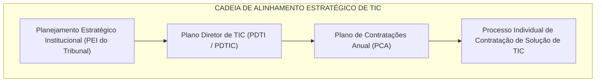
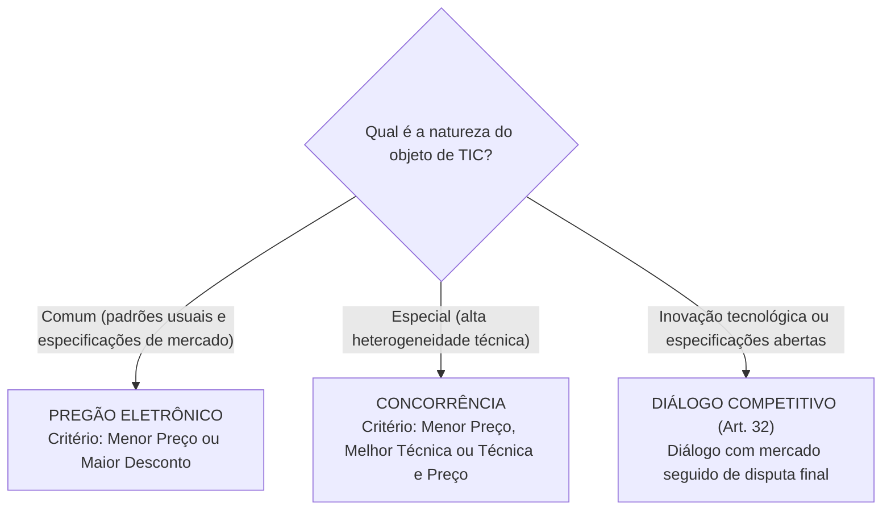
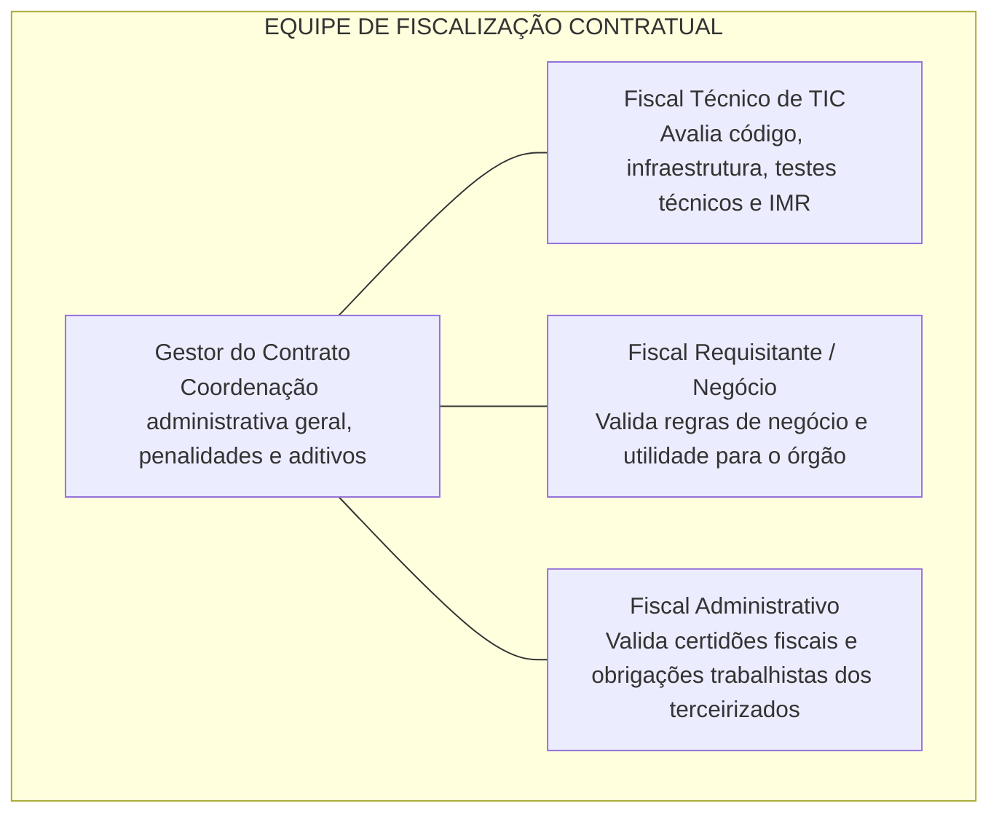

# 04 - Contratações de Soluções de TIC na Lei nº 14.133/2021

> **Matéria:** Governança de Tecnologia da Informação  
> **Cargo:** B02 – Técnico de Controle Externo – Especialidade: Tecnologia da Informação  
> **Arquivo:** `04_contratacoes_de_tic_lei_14133_2021.md`  
> **Ato Normativo Central:** Lei Federal nº 14.133, de 1º de abril de 2021 (Lei de Licitações e Contratos Administrativos)

---

## 📌 Ementa / Itens do Edital
- Aplicação da Lei nº 14.133/2021 às contratações de Soluções de Tecnologia da Informação e Comunicação (TIC)
- Alinhamento Estratégico: Plano Diretor de TIC (PDTI) e Plano de Contratações Anual (PCA)
- Fases do Processo de Contratação: Planejamento, Seleção do Fornecedor e Gestão do Contrato
- Artefatos da Fase Preparatória: DOD, Estudo Técnico Preliminar (ETP), Custo Total de Propriedade (TCO), Mapa de Riscos e Termo de Referência (TR)
- Modalidades e Critérios de Julgamento em TIC: Pregão, Concorrência e Diálogo Competitivo
- Contratação Direta de Soluções de TIC: Inexigibilidade vs. Dispensa de Licitação
- Gestão e Fiscalização de Contratos de TIC: Segregação de papéis (Gestor, Fiscal Técnico, Fiscal Requisitante, Fiscal Administrativo)
- Instrumento de Medição de Resultado (IMR), Acordo de Nível de Serviço (SLA), Glosas e Recebimento do Objeto (Provisório e Definitivo)

---

## 🧭 Sumário

1. [Princípios e Diretrizes das Contratações de TIC na Lei nº 14.133/2021](#1-principios-e-diretrizes-das-contratacoes-de-tic-na-lei-no-141332021)
1. [Alinhamento Estratégico e Planejamento Prévio (PDTI e PCA)](#1-1-alinhamento-estrategico-e-planejamento-previo-pdti-e-pca)
    1. [Teste 495](#Teste-495)
1. [Vedações Expressas e Jurisprudência dos Tribunais de Contas](#1-2-vedacoes-expressas-e-jurisprudencia-dos-tribunais-de-contas)
    1. [Teste 496](#Teste-496)
2. [O Ciclo de Vida da Contratação e a Fase Preparatória](#2-o-ciclo-de-vida-da-contratacao-e-a-fase-preparatoria)
2. [Artefatos da Fase de Planejamento (DOD, ETP, Mapa de Riscos e TR)](#2-1-artefatos-da-fase-de-planejamento-dod-etp-mapa-de-riscos-e-tr)
    1. [Teste 497](#Teste-497)
2. [Custo Total de Propriedade (TCO - Total Cost of Ownership)](#2-2-custo-total-de-propriedade-tco-total-cost-of-ownership)
    1. [Teste 498](#Teste-498)
3. [Fase de Seleção do Fornecedor em TIC](#3-fase-de-selecao-do-fornecedor-em-tic)
3. [Modalidades de Licitação (Pregão, Concorrência e Diálogo Competitivo)](#3-1-modalidades-de-licitacao-pregao-concorrencia-e-dialogo-competitivo)
    1. [Teste 499](#Teste-499)
3. [Hipóteses de Contratação Direta em TIC (Inexigibilidade vs. Dispensa)](#3-2-hipoteses-de-contratacao-direta-em-tic-inexigibilidade-vs-dispensa)
    1. [Teste 500](#Teste-500)
4. [Gestão e Fiscalização de Contratos de TIC](#4-gestao-e-fiscalizacao-de-contratos-de-tic)
4. [Segregação de Papéis na Equipe de Fiscalização](#4-1-segregacao-de-papeis-na-equipe-de-fiscalizacao)
    1. [Teste 501](#Teste-501)
4. [Instrumento de Medição de Resultado (IMR), SLA e Glosas](#4-2-instrumento-de-medicao-de-resultado-imr-sla-e-glosas)
    1. [Teste 502](#Teste-502)
4. [Recebimento Provisório e Recebimento Definitivo](#4-3-recebimento-provisorio-e-recebimento-definitivo)
    1. [Teste 503](#Teste-503)
    2. [Teste 504](#Teste-504)
6. [Fontes Recomendadas na Internet](#6-fontes-recomendadas-na-internet)

---

## 1. Princípios e Diretrizes das Contratações de TIC na Lei nº 14.133/2021

A **Lei nº 14.133/2021** (Nova Lei de Licitações e Contratos Administrativos) consolidou e positivou princípios e boas práticas de contratação pública de Soluções de Tecnologia da Informação e Comunicação (TIC), harmonizando a legislação geral com a jurisprudência histórica do Tribunal de Contas da União (TCU) e com as normas infralegais federais (como a Instrução Normativa SGD/MGI nº 94/2022).

---

## 1.1 Alinhamento Estratégico e Planejamento Prévio (PDTI e PCA)

No setor público, nenhuma aquisição de tecnologia pode ocorrer de forma isolada, episódica ou desconectada das metas institucionais:

- **Plano Diretor de TIC (PDTI / PDTIC):** Instrumento de diagnóstico, planejamento e gestão dos recursos e processos de TIC do órgão para um horizonte plurianual (normalmente de 2 a 4 anos), alinhado ao Planejamento Estratégico Institucional (PEI).
- **Plano de Contratações Anual (PCA):** Documento formalizado pela alta administração que consolida todas as compras e contratações que o órgão pretende realizar no exercício financeiro seguinte, assegurando previsão orçamentária e evitando fracionamento indevido de despesas.
- **Regra:** Toda contratação de solução de TIC deve estar expressamente prevista ou fundamentadamente compatível com o PDTI e com o PCA do exercício.

---

### Teste 495
**(FCC - Tribunal de Contas - Auditor de Controle Externo / TI - Adaptada)**
**Enunciado:** Em conformidade com a Lei nº 14.133/2021 e as boas práticas de governança de contratações públicas de TIC, os processos de compra de soluções tecnológicas devem observar estrito alinhamento ao planejamento prévio institucional. A respeito dos instrumentos de planejamento, assinale a afirmativa correta:  

* **A)** O Plano de Contratações Anual (PCA) substitui integralmente a necessidade de instauração de processos licitatórios individuais, autorizando a contratação verbal direta.
* **B)** A contratação de soluções de TIC prescinde de compatibilidade com o Plano Diretor de Tecnologia da Informação (PDTI), bastando o requerimento informal do presidente do órgão.
* **C)** O Plano Diretor de TIC (PDTI) é o instrumento plurianual de diagnóstico, planejamento e gestão estratégica de TI, ao qual devem estar alinhadas as contratações consolidadas no Plano de Contratações Anual (PCA).
* **D)** A elaboração do PCA é facultativa para órgãos que possuam menos de 10.000 servidores, devendo suas compras de tecnologia ser executadas exclusivamente por adiantamento de numerário no âmbito da administração pública direta e indireta.
* **E)** As soluções de TIC voltadas à modernização de auditorias fiscais podem ser adquiridas sem qualquer previsão no PDTI, desde que justificadas após o término do contrato.

---

> **Comentário Detalhado:**
>
> - **A)** Incorreta. O PCA consolida o planejamento anual das compras para fins orçamentários e de transparência, mas cada contratação segue seu devido processo administrativo licitatório ou de contratação direta.
> - **B)** Incorreta. O alinhamento com o PDTI e com o PEI (Planejamento Estratégico Institucional) é requisito mandatório de governança e economicidade.
> - **C)** **Correta.** O PDTI mapeia a visão estratégica plurianual de TIC, e o PCA operacionaliza o cronograma anual de contratações necessárias para viabilizar as metas institucionais.
> - **D)** Incorreta. A exigência de planejamento anual de contratações aplica-se aos órgãos e entidades no âmbito do sistema licitatório, sem isenção por número de servidores.
> - **E)** Incorreta. O planejamento é prévio (*ex ante*), sendo irregular a aquisição sem previsão ou fundamentação de compatibilidade tempestiva.
> 
> **Gabarito: C**

---

## 1.2 Vedações Expressas e Jurisprudência dos Tribunais de Contas

1. **Vedação à Remuneração por Homem-Hora Puro (Súmula nº 269 do TCU):**  
   É terminantemente proibida a remuneração de serviços de desenvolvimento, sustentação ou suporte de software com base unicamente na quantidade de horas trabalhadas ou pela mera presença física de funcionários terceirizados nas dependências do órgão. Os pagamentos devem estar obrigatoriamente vinculados a **resultados mensuráveis**, como Pontos de Função (Análise de Pontos de Função - APF), Unidades de Serviço Técnico (UST) previamente catalogadas em tabela de complexidade ou cumprimento de níveis mínimos de serviço (SLA/IMR).
2. **Vedação à Indicação de Marcas ou Modelos:**  
   Em regra, o edital não pode exigir marca, modelo ou fabricante exclusivo. Exceções são admitidas **apenas** quando houver comprovação técnica de padronização corporativa prévia formalizada em Estudo Técnico Preliminar (ETP), ou quando uma marca for a única tecnicamente viável para manter a interoperabilidade de sistemas preexistentes.
3. **Vedação à Terceirização da Governança e Decisão:**  
   Atividades privativas de tomada de decisão, gestão estratégica de TIC, aprovação de orçamentos, elaboração de pareceres conclusivos e fiscalização formal de contratos **jamais** podem ser terceirizadas para empresas privadas.

---

### Teste 496
**(FCC - Auditor de Controle Externo / TI - Adaptada)**
**Enunciado:** Em procedimento de auditoria de controle externo realizado no setor de tecnologia da informação de uma autarquia estadual, a equipe de auditoria analisou um termo de referência para contratação de fábrica de software e constatou a previsão de que a empresa contratada seria remunerada exclusivamente pela contagem das horas trabalhadas pelos desenvolvedores alocados presencialmente no prédio da autarquia, sem vínculo com entregas, ordens de serviço, pontos de função ou metas de níveis de serviço. Considerando a jurisprudência sumulada dos Tribunais de Contas e a Lei nº 14.133/2021:  

* **A)** A cláusula editalícia é lícita, visto que o regime de contratação por homens-hora garante total flexibilidade técnica exigida pelo paradigma de desenvolvimento ágil.
* **B)** O procedimento apresenta irregularidade grave.
* **C)** A modalidade licitatória obrigatória para contratações remuneradas por homem-hora presencial é o Leilão Internacional.
* **D)** A Lei nº 14.133/2021 estabelece que a contratação de software proprietário prescinde de Estudo Técnico Preliminar e de fiscalização técnica.
* **E)** A responsabilidade pela escolha da métrica de homem-hora é privativa da empresa licitante vencedora, não podendo a Administração impor métricas de pagamento.

---

> **Comentário Detalhado:**
>
> - **A)** Incorreta. O modelo ágil não autoriza a administração pública a remunerar fornecedores por mera "presença física" ou tempo corrido sem entrega de valor mensurável; a jurisprudência pacífica do TCU exige aferição objetiva de resultados mesmo em projetos ágeis.
> - **B)** **Correta.** A Súmula nº 269 do TCU e os princípios da economicidade, eficiência e motivação da Lei nº 14.133/2021 vedam a remuneração de serviços de TIC baseada unicamente em homem-hora desvinculada de resultados mensuráveis. O pagamento deve basear-se em produtos, ordens de serviço, métricas objetivas (como Pontos de Função ou UST) e cumprimento de metas de SLA através do IMR.
> - **C)** Incorreta. O Leilão destina-se à alienação de bens móveis inservíveis ou imóveis da administração, jamais à contratação de serviços de software.
> - **D)** Incorreta. O Estudo Técnico Preliminar (ETP) é a base obrigatória do planejamento licitatório (Art. 18 da Lei 14.133/2021), sendo indispensável para soluções de software.
> - **E)** Incorreta. A definição dos critérios de medição e remuneração é dever indelegável da Administração Pública no Termo de Referência.
> 
> **Gabarito: B**

---

## 2. O Ciclo de Vida da Contratação e a Fase Preparatória

O processo de contratação pública de TIC divide-se em três macrofases interdependentes:

```mermaid
flowchart LR
    subgraph FASE1["1. Planejamento da Contratação"]
        DOD["DOD<br/>Demanda"] --> EQ["Equipe de Planejamento<br/>(Requisitante, Técnico, ADM)"]
        EQ --> ETP["Estudo Técnico Preliminar<br/>(ETP + TCO)"]
        ETP --> MR["Mapa de Riscos"]
        MR --> TR["Termo de Referência<br/>(TR + IMR)"]
    end

    subgraph FASE2["2. Seleção do Fornecedor"]
        PUB["Edital de Licitação /<br/>Ato de Contratação Direta"] --> JULG["Julgamento de Propostas<br/>(Pregão / Concorrência / Diálogo)"]
        JULG --> HOM["Habilitação e Homologação"]
    end

    subgraph FASE3["3. Gestão Contratual"]
        OS["Emissão de OS / OFB"] --> EXEC["Execução e Aferição de SLA"]
        EXEC --> REC_PROV["Recebimento Provisório<br/>(Fiscais)"]
        REC_PROV --> REC_DEF["Recebimento Definitivo<br/>(Gestor do Contrato)"]
        REC_DEF --> PAG["Pagamento com Glosas"]
    end

    TR --> PUB
    HOM --> OS
```

---

## 2.1 Artefatos da Fase de Planejamento (DOD, ETP, Mapa de Riscos e TR)

A fase preparatória é o núcleo de conformidade da contratação. Falhas graves apontadas em auditorias de controle externo derivam, em sua grande maioria, de fragilidades no ETP ou no Termo de Referência.

| Artefato | Responsável Principal | Finalidade e Conteúdo Essencial |
| :--- | :--- | :--- |
| **DOD** (*Documento de Oficialização da Demanda*) | Área Requisitante (Negócio) | Inicia formalmente o processo administrativo, explicitando o problema institucional a ser resolvido, os resultados esperados e o alinhamento com o PDTI. |
| **Equipe de Planejamento** | Designada pela Autoridade Competente | Comissão composta por no mínimo: Integrante Requisitante, Integrante Técnico (TI) e Integrante Administrativo, assegurando a segregação de funções. |
| **ETP** (*Estudo Técnico Preliminar*) | Equipe de Planejamento da Contratação | Demonstra a viabilidade técnica, operacional e econômica. Compara soluções de mercado (nuvem vs on-premises, software livre vs proprietário), calcula o **TCO** e define o quantitativo. |
| **Mapa de Riscos** | Equipe de Planejamento | Matriz que identifica riscos internos e externos em todo o ciclo de vida, avaliando probabilidade e impacto, além de prever ações preventivas e contingenciais. |
| **TR** (*Termo de Referência*) | Equipe de Planejamento | Documento definitivo que estabelece o objeto, requisitos funcionais e não funcionais, modelo de execução, critérios de habilitação e o **Instrumento de Medição de Resultado (IMR)**. |

---

### Teste 497
**(FGV - TJ-AP - Analista Judiciário - Tecnologia da Informação - Adaptada)**
**Enunciado:** Na fase preparatória de uma contratação de TIC sob a égide da Lei nº 14.133/2021 e normativos de contratação de soluções digitais, a equipe de planejamento da contratação é responsável por elaborar artefatos estruturantes. A respeito desses documentos, assinale a afirmativa correta:  

* **A)** O Documento de Oficialização da Demanda (DOD) é emitido pela empresa vencedora da licitação para comunicar à Administração o início da entrega de hardware.
* **B)** O Estudo Técnico Preliminar (ETP) tem como finalidade evidenciar o problema a ser resolvido e a melhor solução entre as alternativas de mercado, avaliando a viabilidade técnica e o Custo Total de Propriedade (TCO).
* **C)** O Termo de Referência é um documento preliminar e não vinculante, podendo a contratada alterar livremente os requisitos de software durante o desenvolvimento.
* **D)** A elaboração do Mapa de Riscos é dispensável em contratações de TIC, haja vista que os riscos cibernéticos são integralmente assumidos pelo fabricante de software.
* **E)** A equipe de planejamento da contratação de TIC deve ser composta por um único servidor sem conhecimento técnico em informática, visando garantir a imparcialidade do processo no âmbito da administração pública direta e indireta.

---

> **Comentário Detalhado:**
>
> - **A)** Incorreta. O DOD é um artefato interno emitido pela área requisitante (órgão público) para formalizar a necessidade institucional perante a área de TIC.
> - **B)** **Correta.** O ETP constitui a primeira etapa da fase preparatória e fundamenta a escolha da solução mediante estudo comparativo de alternativas e cálculo do TCO.
> - **C)** Incorreta. O TR é o documento definitivo e vinculante que integra o edital e define o objeto, requisitos, modelo de execução e IMR.
> - **D)** Incorreta. O gerenciamento de riscos ao longo de todo o ciclo de vida da contratação de TIC é obrigatório.
> - **E)** Incorreta. A equipe de planejamento deve observar a multidisciplinaridade e segregação de funções, contando com integrante técnico (TI), integrante requisitante e integrante administrativo.
> 
> **Gabarito: B**

---

## 2.2 Custo Total de Propriedade (TCO - Total Cost of Ownership)

Ao realizar o Estudo Técnico Preliminar de soluções de TIC, a Administração não pode avaliar exclusivamente o custo nominal de aquisição inicial de hardware ou licenças. Deve-se calcular o **Custo Total de Propriedade (TCO)** ao longo de todo o ciclo de vida:

$$\text{TCO} = \text{Aquisição} + \text{Implantação/Customização} + \text{Capacitação/Treinamento} + \text{Manutenção/Suporte Recorrente} + \text{Infraestrutura/Energia} + \text{Descarte/Migração}$$

> 🚨 **ALERTA DE PROVA / PEGADINHA FCC:**  
> A análise de TCO frequentemente demonstra que uma solução com preço inicial de compra mais baixo (ou até software gratuito) acarreta gastos elevadíssimos com suporte especializado, horas de customização e energia, tornando uma solução com custo inicial maior, porém com suporte integrado, muito mais econômica globalmente para o órgão.

---

### Teste 498
**(FCC - Auditor Fiscal da Receita Estadual / TI - Adaptada)**
**Enunciado:** No processo preparatório para a contratação de uma nova solução integrada de armazenamento em nuvem e banco de dados corporativo, a equipe de planejamento da contratação elaborou o Estudo Técnico Preliminar (ETP). Para comparar adequadamente a aquisição de infraestrutura física local (*on-premises*) com a contratação de serviços em nuvem (*cloud computing*), a equipe calculou não apenas os custos de compra imediata de licenças e servidores, mas também os gastos projetados com implantação, capacitação de servidores, suporte técnico anual, climatização de datacenter e futura migração de dados ao longo de cinco anos. Essa técnica de avaliação econômica e financeira denomina-se:  

* **A)** Retorno sobre Patrimônio Líquido (ROE).
* **B)** Custo Total de Propriedade (TCO - *Total Cost of Ownership*).
* **C)** Análise de Pontos por Função Rápida (FPA) no âmbito da administração pública direta e indireta.
* **D)** Custo Marginal de Substituição Imediata.
* **E)** Depreciação Linear Fixa Arbitrária.

---

> **Comentário Detalhado:**
>
> - **A)** Incorreta. ROE é um indicador financeiro privado de rentabilidade sobre patrimônio acionário, não tendo relação com a avaliação integral do ciclo de vida de aquisição de TIC.
> - **B)** **Correta.** O Custo Total de Propriedade (TCO - *Total Cost of Ownership*) é a metodologia que calcula o custo integral de uma solução ao longo de todo o seu ciclo de vida (aquisição, implantação, treinamento, energia, suporte/manutenção e descarte/migração), sendo ferramenta obrigatória no ETP de TIC para evitar falsas economias baseadas apenas no menor preço inicial de licença.
> - **C)** Incorreta. Análise de Pontos de Função (FPA) é técnica de medição do tamanho funcional de software, não cálculo financeiro de ciclo de vida.
> - **D)** Incorreta. Termo econômico genérico que não contempla a totalidade das despesas de suporte, infraestrutura e treinamento ao longo do ciclo de vida.
> - **E)** Incorreta. Trata-se de método de amortização contábil patrimonial, e não de análise abrangente de viabilidade de alternativas de TIC.
> 
> **Gabarito: B**

---

## 3. Fase de Seleção do Fornecedor em TIC

---

## 3.1 Modalidades de Licitação (Pregão, Concorrência e Diálogo Competitivo)

#### 1. Pregão Eletrônico (Art. 28, I e Art. 29)
- **Aplicação Obrigatória/Preferencial:** Aquisição de **bens e serviços comuns de TIC**, definidos como aqueles cujos padrões de desempenho e qualidade podem ser objetivamente definidos pelo edital por meio de especificações usuais de mercado.
- **Exemplos em TIC:** Compra de notebooks, switches de borda, monitores, locação de impressoras corporativas, serviços de service desk de nível 1 e renovação de licenças de software comercial de prateleira.
- **Critérios de Julgamento Admitidos:** **Menor Preço** ou **Maior Desconto**. (É expressamente proibido usar "Técnica e Preço" no pregão!).

#### 2. Concorrência (Art. 28, II)
- **Aplicação:** Bens e serviços **especiais** de TIC (soluções cuja complexidade e peculiaridades técnicas impeçam sua padronização objetiva de mercado).
- **Critérios de Julgamento:** Menor Preço, Maior Desconto, Melhor Técnica ou Conteúdo Artístico, **Técnica e Preço**, ou Maior Retorno Econômico.

#### 3. Diálogo Competitivo (Art. 32)
- **Aplicação:** Modalidade inovadora da Lei nº 14.133/2021, cabível especificamente quando a Administração:
    1. Visa contratar objeto que envolva **inovação tecnológica ou técnica**;
    2. Não possui conhecimento suficiente para redigir as especificações técnicas da solução disponível no mercado; ou
    3. Precisa avaliar e definir a melhor modelagem técnica, jurídica ou financeira com o mercado antes de formular o edital final.

- **Dinâmica:**
    - *Fase de Diálogo:* O órgão publica edital convocatório, seleciona concorrentes qualificados e realiza rodadas de diálogo transparentes para construir a melhor solução técnica.
    - *Fase Competitiva:* Concluído o diálogo, publica-se o edital final com a solução construída, concedendo prazo de no mínimo 60 dias para a apresentação das propostas formais de preço e técnica.

---

### Teste 499
**(FCC - Analista de TI / Governança e Contratos - Adaptada)**
**Enunciado:** Determinada Secretaria Estadual de Fazenda identificou a necessidade premente de modernizar seu ecossistema de detecção de fraudes fiscais complexas por meio de inteligência artificial generativa de ponta. No entanto, após realizar estudos iniciais, a equipe técnica concluiu que a Administração não possui conhecimento suficiente para redigir as especificações técnicas definitivas da solução, necessitando dialogar amplamente com o mercado tecnológico para avaliar os modelos algorítmicos, custos e arquiteturas disponíveis antes de receber as propostas finais. Nos termos estritos da Lei nº 14.133/2021, a modalidade de licitação cabível para esse cenário é o:  

* **A)** Pregão Presencial.
* **B)** Diálogo Competitivo.
* **C)** Concurso Artístico.
* **D)** Leilão Eletrônico.
* **E)** Credenciamento Automático.

---

> **Comentário Detalhado:**
>
> - **A)** Incorreta. O pregão presencial é exceção na Lei nº 14.133/2021 (a regra é a forma eletrônica) e é restrito a bens e serviços comuns, sendo inviável para situações em que a administração sequer consegue especificar o objeto sem diálogo prévio com o mercado.
> - **B)** **Correta.** O Diálogo Competitivo (Art. 32 da Lei nº 14.133/2021) foi introduzido exatamente para contratações que envolvem inovação tecnológica ou técnica, impossibilidade de a administração definir com precisão suficiente as especificações técnicas da solução, ou necessidade de definir a melhor modelagem da contratação através de diálogo prévio com licitantes previamente selecionados.
> - **C)** Incorreta. O Concurso destina-se à escolha de trabalho técnico, científico ou artístico para concessão de prêmio ou remuneração.
> - **D)** Incorreta. O Leilão é modalidade destinada à alienação (venda) de bens públicos.
> - **E)** Incorreta. Credenciamento é um procedimento auxiliar de contratação direta, e não uma modalidade licitatória competitiva para desenvolvimento de soluções tecnológicas complexas.
> 
> **Gabarito: B**

---

## 3.2 Hipóteses de Contratação Direta em TIC (Inexigibilidade vs. Dispensa)

| Dimensão | Inexigibilidade de Licitação (Art. 74) | Dispensa de Licitação (Art. 75) |
| :--- | :--- | :--- |
| **Fundamento Jurídico** | **Inviabilidade jurídica de competição** (não há como estabelecer julgamento objetivo entre competidores). | A competição é juridicamente possível, mas a lei autoriza a não licitar por razões de economia processual, celeridade ou emergência. |
| **Hipótese 1 em TIC** | **Fornecedor Exclusivo (Art. 74, I):** Aquisição de software ou hardware exclusivo, comprovada por atestado idôneo do fabricante ou sindicato de classe. | **Baixo Valor (Art. 75, I e II):** Compras e serviços comuns de TIC de pequeno vulto (valores monetários atualizados anualmente por decreto). |
| **Hipótese 2 em TIC** | **Serviços Técnicos Especializados de Natureza Predominantemente Intelectual (Art. 74, III):** Profissionais ou empresas de notória especialização para auditoria de segurança crítica, perícias forenses complexas ou consultoria arquitetural avançada. | **Emergência ou Calamidade Pública (Art. 75, VIII):** Restabelecimento imediato de sistemas vitais após sinistros graves ou ataques cibernéticos massivos, restrito ao prazo necessário. |
| **Hipótese 3 em TIC** | — | **Contratação de Órgão Público de TIC (Art. 75, IX):** Contratação de empresas públicas de processamento de dados (SERPRO, DATAPREV, ATI estadual) para serviços criados para esse fim, com preço compatível de mercado. |

> 🚨 **ALERTA DE PROVA / PEGADINHA FCC:**  
> A contratação de empresa por Notória Especialização com base em Inexigibilidade (Art. 74, III) **não pode** ser usada para suporte rotineiro de informática ou help-desk! Ela exige cumulativamente: 1) Natureza predominantemente intelectual; 2) Notória especialização do prestador; e 3) Singularidade do serviço.

---

### Teste 500
**(FCC - TRT-9 - Analista Judiciário - Tecnologia da Informação - Adaptada)**
**Enunciado:** A Lei nº 14.133/2021 disciplina as hipóteses de contratação direta em seus artigos 74 (Inexigibilidade) e 75 (Dispensa). Em matéria de contratação de soluções de TIC na Administração Pública, assinale a opção que descreve uma hipótese legítima de Inexigibilidade de licitação:  

* **A)** Aquisição de computadores padrão para secretarias administrativas, com base unicamente na alegação de conveniência de prazo considerando os requisitos operacionais de segurança, escalabilidade, auditoria e desempenho corporativo.
* **B)** Contratação de empresa para suporte técnico rotineiro e atendimento de help desk de primeiro nível em informática.
* **C)** Aquisição de materiais e cabos de rede de baixo valor financeiro que se enquadrem no limite de pequenos serviços.
* **D)** Contratação de serviços técnicos especializados de natureza predominantemente intelectual com profissionais ou empresas de notória especialização para perícia forense digital de altíssima complexidade e singularidade.
* **E)** Restabelecimento emergencial de infraestrutura de refrigeração do data center após incêndio acidental.

---

> **Comentário Detalhado:**
>
> - **A)** Incorreta. Computadores comuns são bens comuns de TIC e exigem licitação, preferencialmente na modalidade Pregão Eletrônico.
> - **B)** Incorreta. Suporte rotineiro de help desk é serviço comum contínuo, sem singularidade ou natureza predominantemente intelectual que justifique inexigibilidade.
> - **C)** Incorreta. Compras de pequeno valor constituem hipótese de Dispensa de Licitação em razão do valor (Art. 75, II).
> - **D)** **Correta.** Conforme o Art. 74, III, da Lei nº 14.133/2021, é inexigível a licitação para serviços técnicos especializados de natureza predominantemente intelectual prestados por profissional ou empresa de notória especialização, vedada a inexigibilidade para serviços de publicidade e divulgação.
> - **E)** Incorreta. Contratação decorrente de emergência ou calamidade pública constitui hipótese de Dispensa de Licitação (Art. 75, VIII).
> 
> **Gabarito: D**

---

## 4. Gestão e Fiscalização de Contratos de TIC

---

## 4.1 Segregação de Papéis na Equipe de Fiscalização

A Lei nº 14.133/2021 exige a separação clara de atribuições entre os agentes públicos responsáveis pelo contrato para prevenir conluios e falhas de controle:

- **Gestor do Contrato:** Servidor que coordena o contrato, formaliza termos aditivos, solicita a aplicação de penalidades (advertências e multas) e assina o termo de recebimento definitivo.
- **Fiscal Técnico:** Servidor de TIC encarregado de validar a qualidade técnica, arquitetura de software, conformidade de hardware e aferir os indicadores do IMR.
- **Fiscal Requisitante:** Servidor da área finalística/usuária que homologa se as funcionalidades do sistema atendem perfeitamente aos processos de trabalho institucionais.
- **Fiscal Administrativo:** Servidor que confere o pagamento de salários, FGTS, INSS e tributos dos empregados terceirizados, protegendo a Administração contra condenações subsidiárias na Justiça do Trabalho.

---

### Teste 501
**(FCC - Auditor Estadual de Controle Externo / TI - Adaptada)**
**Enunciado:** Em relação à gestão e fiscalização de contratos de prestação de serviços de Tecnologia da Informação na Lei nº 14.133/2021, a Administração deve designar servidores com papéis bem segregados. Assinale a alternativa que descreve com precisão a competência do Fiscal Técnico do contrato de TIC:  

* **A)** Conferir a regularidade trabalhista e o recolhimento das guias de FGTS e INSS dos empregados terceirizados alocados na empresa em estrita conformidade com as normas legais e regulamentares aplicáveis.
* **B)** Avaliar e atestar tecnicamente se os sistemas desenvolvidos ou serviços de infraestrutura atendem aos requisitos arquiteturais, padrões técnicos de codificação e níveis de serviço fixados no IMR.
* **C)** Formalizar administrativamente aditivos de prorrogação contratual e aplicar penalidades financeiras de impedimento de licitar.
* **D)** Assinar o contrato inicial em substituição ao Presidente do Tribunal de Contas.
* **E)** Realizar a mediação jurídica em litígios judiciais trabalhistas perante o Tribunal Regional do Trabalho.

---

> **Comentário Detalhado:**
>
> - **A)** Incorreta. A conferência de encargos sociais, trabalhistas e previdenciários compete ao Fiscal Administrativo.
> - **B)** **Correta.** O Fiscal Técnico de TIC é o responsável pela verificação da conformidade técnica do objeto entregue, analisando artefatos, arquitetura, testes e o cumprimento dos níveis acordados de serviço (IMR).
> - **C)** Incorreta. A coordenação administrativa, termos aditivos e proposição formal de sanções são atribuições do Gestor do Contrato e da autoridade competente.
> - **D)** Incorreta. A assinatura do contrato é atribuição da autoridade máxima do órgão contratante.
> - **E)** Incorreta. Representação judicial compete à Procuradoria Jurídica do órgão.
> 
> **Gabarito: B**

---

## 4.2 Instrumento de Medição de Resultado (IMR), SLA e Glosas

O **IMR** (*Instrumento de Medição de Resultado*) é o mecanismo formal que vincula o pagamento mensal da fatura ao desempenho e qualidade efetivamente entregues:

- **Métricas Comuns no IMR:**
    - Disponibilidade mensal dos sistemas (ex.: meta de 99,8%);
    - Tempo de Resolução de Falhas Críticas (ex.: máximo de 2 horas);
    - Taxa de defeitos em homologação (ex.: máximo de 0,05 bugs por Ponto de Função);
    - Cumprimento de prazos das Ordens de Serviço (OS).
- **Glosas Financeiras:**  
  Quando a empresa não atinge o SLA estipulado no IMR, a Administração aplica uma **glosa** (retenção/desconto direto na fatura do mês correspondente), pagando apenas pelo valor proporcional à qualidade entregue, sem prejuízo de advertência ou multa.

---

### Teste 502
**(FCC - Analista de Sistemas / Fiscalização de Contratos - Adaptada)**
**Enunciado:** Em um contrato de prestação de serviços de TIC para manutenção de portais governamentais, o Termo de Referência fixou um Instrumento de Medição de Resultado (IMR) contendo como indicador de nível de serviço (SLA) a meta mensal de disponibilidade mínima do portal em 99,8%. Durante a fiscalização do terceiro mês, o Fiscal Técnico constatou, por meio de ferramentas automatizadas de monitoramento, que o portal permaneceu indisponível por 18 horas ininterruptas em horário comercial, atingindo apenas 97,5% de disponibilidade naquele ciclo. Diante do descumprimento da meta de SLA estabelecida no IMR, o procedimento contratual cabível consiste em:  

* **A)** Efetuar o pagamento integral do valor da fatura sem qualquer desconto e indenizar a empresa pela instabilidade gerada.
* **B)** Aplicar a respectiva glosa financeira diretamente no valor devido na fatura mensal proporcionalmente à faixa de penalidade fixada no IMR, sem prejuízo da abertura de procedimento para aplicação de sanções administrativas cabíveis em caso de reiteração.
* **C)** Cancelar sumariamente todos os contratos de TIC em vigor em todo o Estado e proibir a internet nos órgãos públicos.
* **D)** Substituir imediatamente o Fiscal Técnico por um funcionário indicado pelo próprio provedor inadimplente.
* **E)** Exigir que a contratada compense o tempo de queda aumentando a velocidade da internet residencial dos servidores da Secretaria considerando os requisitos operacionais de segurança, escalabilidade, auditoria e desempenho corporativo.

---

> **Comentário Detalhado:**
>
> - **A)** Incorreta. O pagamento integral sem abatimento por serviço defeituoso ou abaixo do SLA configuraria liquidação irregular de despesa pública e dano ao erário.
> - **B)** **Correta.** O Instrumento de Medição de Resultado (IMR) serve justamente para operacionalizar as glosas financeiras (retenções/descontos no valor faturado) correspondentes ao não alcance dos níveis mínimos de serviço pactuados, garantindo que o órgão público pague apenas pelo serviço efetivamente prestado com a qualidade exigida, cabendo ainda advertência ou multa em caso de reiteração de falhas graves.
> - **C)** Incorreta. Solução desproporcional e ilegal que violaria o interesse público e a continuidade dos serviços.
> - **D)** Incorreta. O fiscal técnico é agente público independente e sua substituição para favorecer a contratada configuraria improbidade administrativa e grave infração funcional.
> - **E)** Incorreta. Não existe previsão de compensação pessoal a servidores; o contrato vincula a pessoa jurídica contratante e as compensações ocorrem na esfera econômico-financeira e técnica da avença.
> 
> **Gabarito: B**

---

## 4.3 Recebimento Provisório e Recebimento Definitivo

A Lei nº 14.133/2021 estabelece dois momentos formais e inconfundíveis para o aceite do objeto em TIC:

1. **Recebimento Provisório:**  
    - Realizado pelos **Fiscais Técnico, Requisitante e Administrativo** imediatamente após a entrega do produto ou encerramento da etapa de serviços.  
    - Objetivo: Registrar a entrega formal para fins de início dos testes de homologação e inspeção detalhada de conformidade.

2. **Recebimento Definitivo:**  
    - Realizado pelo **Gestor do Contrato** ou por comissão designada, após a homologação técnica completa, validação de conformidade com o Termo de Referência e apuração dos indicadores do IMR.  
    - Objetivo: Atestar a conformidade integral do objeto, autorizando a liquidação e o pagamento final da fatura.

---

### Teste 503
**(FCC - Técnico de Controle Externo / TI - Adaptada)**
**Enunciado:** De acordo com as disposições da Lei nº 14.133/2021 sobre a fiscalização dos contratos administrativos e a governança de contratações de TIC, os atos formais de atesto e aceite do objeto contratado dividem-se em Recebimento Provisório e Recebimento Definitivo. A respeito desses instrumentos, assinale a afirmativa correta:  

* **A)** O Recebimento Definitivo é realizado pelo fornecedor privado no momento do embarque dos servidores no centro de distribuição da fábrica.
* **B)** O Recebimento Provisório é realizado pelos fiscais técnico, administrativo e setorial mediante termo detalhado.
* **C)** O Recebimento Definitivo dispensa qualquer teste de homologação ou verificação de conformidade com os níveis mínimos de serviço estabelecidos no IMR.
* **D)** O Recebimento Provisório transfere em definitivo toda a responsabilidade jurídica e financeira à Administração, vedando a aplicação de qualquer glosa posterior no âmbito da administração pública direta e indireta.
* **E)** A Lei nº 14.133/2021 proibiu expressamente a figura do recebimento provisório em contratos de TIC para conferir maior velocidade às compras públicas.

---

> **Comentário Detalhado:**
>
> - **A)** Incorreta. Ambos os recebimentos são atos administrativos privativos de agentes públicos da Administração contratante, jamais do fornecedor contratado.
> - **B)** **Correta.** O Recebimento Provisório (Art. 140 da Lei 14.133/2021) é formalizado pelos fiscais do contrato assim que o fornecedor entrega o produto ou conclui a prestação do serviço, servindo para registrar o recebimento físico/lógico e dar início ao prazo de homologação, inspeção técnica e aferição das metas do IMR.
> - **C)** Incorreta. O Recebimento Definitivo ocorre justamente após a verificação de que o objeto atende a todas as exigências do Termo de Referência, incluindo homologação e avaliação dos níveis de serviço do IMR.
> - **D)** Incorreta. O recebimento provisório tem caráter transitório; eventuais defeitos, falhas ou descumprimento de SLAs identificados na fase de homologação acarretam rejeição do objeto ou glosas financeiras antes do aceite definitivo.
> - **E)** Incorreta. O recebimento provisório é mantido e expressamente regulamentado pela Lei nº 14.133/2021 para serviços e compras.
> 
> **Gabarito: B**

---

---

### Teste 504
**(FCC - Técnico de Controle Externo / TI - Adaptada)**
**Enunciado:** No âmbito dos contratos de prestação de serviços e fornecimento de software e infraestrutura de TIC regidos pela Lei nº 14.133/2021, o processo de liquidação e pagamento depende dos atos formais de recebimento do objeto. Acerca do recebimento provisório e definitivo, assinale a afirmativa correta:  

* **A)** O recebimento provisório transfere a propriedade definitiva do código-fonte para a contratada e desonera a empresa de qualquer garantia técnica posterior.
* **B)** O recebimento provisório é realizado pelos fiscais do contrato para efeito de posterior verificação da conformidade dos serviços com as exigências contratuais, enquanto o recebimento definitivo é realizado pelo gestor do contrato ou comissão mediante termo detalhado que comprove o atendimento integral das exigências.
* **C)** Em contratos de soluções de TIC é vedada a emissão de recebimento provisório, ocorrendo a emissão imediata de nota fiscal e pagamento à vista antes da entrega do software.
* **D)** O recebimento definitivo pode ser firmado tacitamente pelo fornecedor caso a Administração não responda em 24 horas, vedada qualquer aplicação posterior de glosas contratuais considerando os requisitos operacionais de segurança, escalabilidade, auditoria e desempenho corporativo.
* **E)** O recebimento definitivo dispensa a realização de testes de homologação de sistemas de auditoria digital.

---

> **Comentário Detalhado:**
>
> - **A)** Incorreta. O recebimento provisório apenas atesta a entrega física dos bens ou conclusão aparente do serviço para que se iniciem os testes de conformidade.
> - **B)** **Correta.** Conforme o Art. 140 da Lei nº 14.133/2021, o objeto é recebido provisoriamente pelo responsável por seu acompanhamento e fiscalização, e definitivamente por servidor ou comissão designada pela autoridade competente, mediante termo detalhado que comprove o atendimento das exigências contratuais.
> - **C)** Incorreta. O recebimento provisório é etapa obrigatória do procedimento de controle em serviços e compras de tecnologia.
> - **D)** Incorreta. Não há recebimento definitivo tácito por parte da empresa; o ato administrativo de atesto definitivo exige manifestação expressa e motivada da Administração.
> - **E)** Incorreta. O recebimento definitivo pressupõe justamente que os testes de homologação tenham sido integralmente realizados e aprovados.
> 
> **Gabarito: B**

---

## 6. Fontes Recomendadas na Internet

* [Lei nº 14.133/2021 (Nova Lei de Licitações e Contratos)](https://www.planalto.gov.br/ccivil_03/_ato2019-2022/2021/lei/l14133.htm) - Texto oficial que disciplina as licitações e contratos administrativos em âmbito nacional.
* [Governo Digital - Processo de Contratação de TIC na Lei nº 14.133/2021](https://www.gov.br/governodigital/pt-br/contratacoes-de-tic/legislacao/processo-de-contratacao-de-solucoes-de-tic-regido-pela-lei-ndeg-14-133-de-2021) - Rito oficial, fases de planejamento (DFD, ETP, TR) e gestão contratual.
* [Governo Digital - Modelos e Diretrizes de Contratação de Soluções de TIC](https://www.gov.br/governodigital/pt-br/contratacoes-de-tic/legislacao/todos-os-modelos-diretrizes-e-orientacoes-para-contratacao-de-solucoes-de-tic) - Modelos oficiais padronizados de Estudos Técnicos Preliminares e Termos de Referência.
* [Governo Digital - Orientações sobre Contratos Baseados em UST](https://www.gov.br/governodigital/pt-br/contratacoes-de-tic/legislacao/orientacoes-contratos-baseados-em-ust) - Regras e limites para dimensionamento e medição por Unidade de Serviço Técnico.
* [TCU - Governança e Controle de Aquisições de TI](https://portal.tcu.gov.br/governanca/governanca-no-tcu/) - Orientações institucionais do TCU sobre terceirização, fiscalização e critérios de pagamento por resultados em TI.
* JUSTEN FILHO, Marçal. **Comentários à Lei de Licitações e Contratações Administrativas: Lei 14.133/2021**. 2. ed. São Paulo: Thomson Reuters Brasil, 2023. (Cap. II - Do Planejamento das Contratações; Cap. VII - Dos Serviços de Engenharia e TIC).
* CARVALHO FILHO, José dos Santos. **Manual de Direito Administrativo**. 38. ed. Rio de Janeiro: Atlas, 2024. (Cap. 5 - Contratos Administrativos e Licitação).
* FERNANDES, Aguinaldo Aragon; ABREU, Vladimir Ferraz de. **Implantando a Governança de TI: da Estratégia aos Processos**. 4. ed. Rio de Janeiro: Brasport, 2014. (Cap. 11 - Aquisições e Contratos de TIC no Setor Público).
