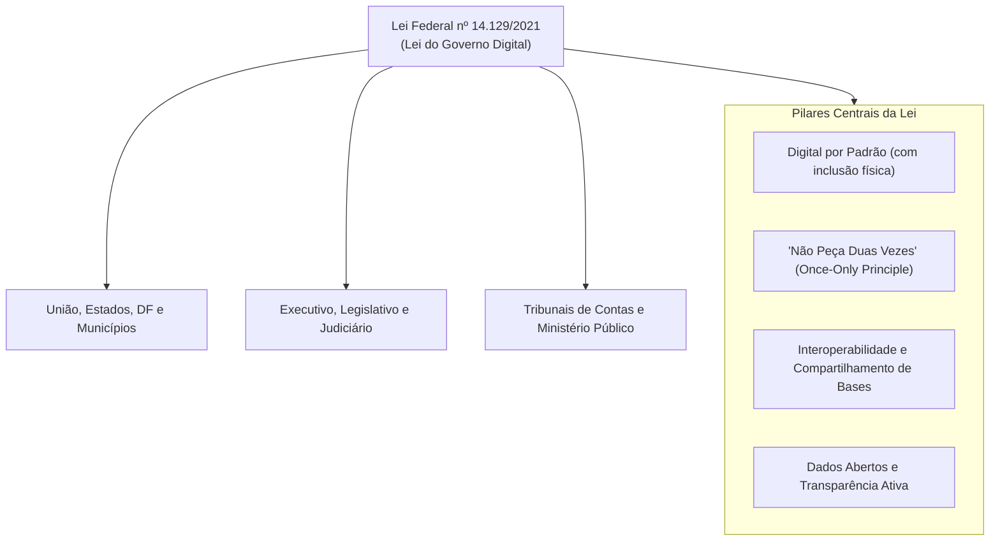
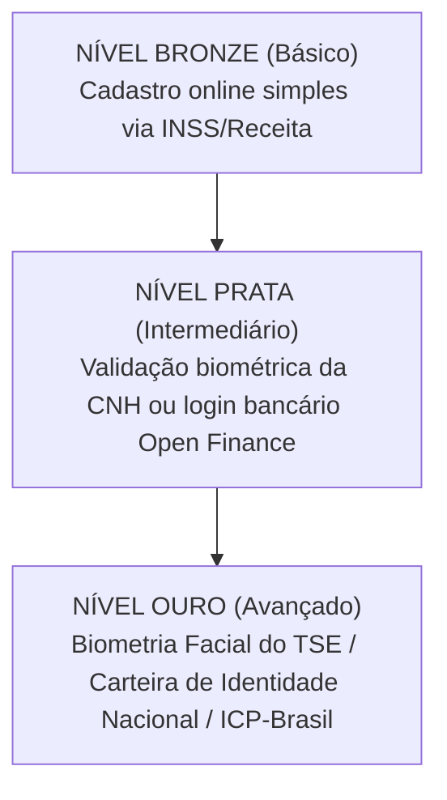
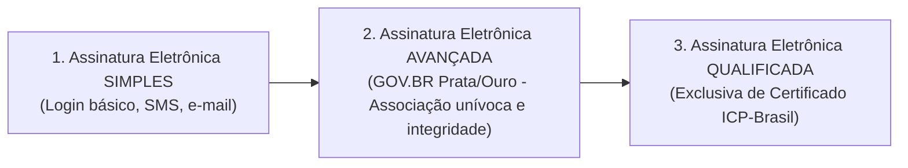
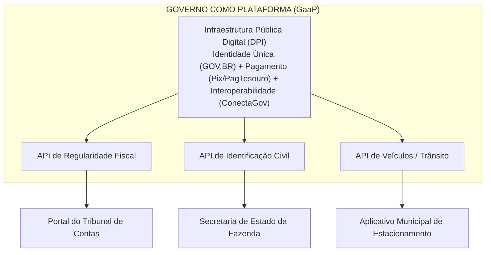
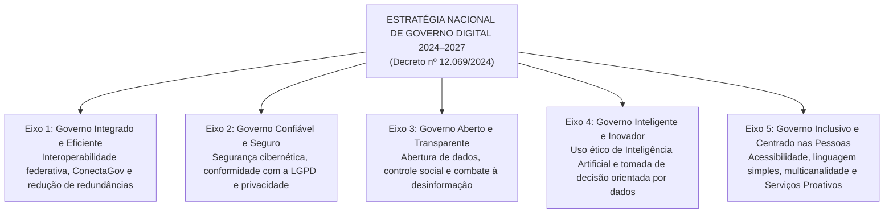
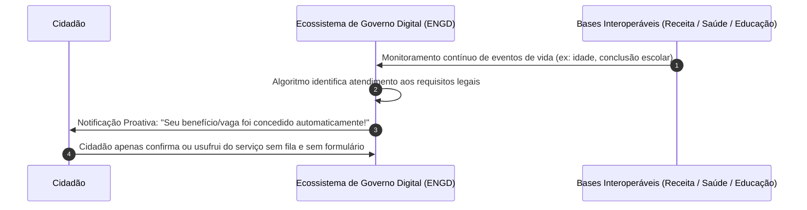

# 05 - Governo Digital e a ENGD 2024–2027 (Decreto 12.069/2024)

> **Matéria:** Governança de Tecnologia da Informação  
> **Cargo:** B02 – Técnico de Controle Externo – Especialidade: Tecnologia da Informação  
> **Arquivo:** `05_governo_digital_lei_14129_e_engd_2024_2027.md`  
> **Atos Normativos Centrais:** Lei Federal nº 14.129, de 29 de março de 2021 (Lei do Governo Digital) e Decreto Federal nº 12.069, de 21 de junho de 2024 (Estratégia Nacional de Governo Digital – ENGD 2024–2027)

---

## 📌 Ementa / Itens do Edital
- Transformação digital, inovação e modernização administrativa no setor público
- Lei Federal nº 14.129/2021 (Lei do Governo Digital):
  - Princípios, diretrizes e instrumentos fundamentais
  - Princípio do "Digital por Padrão" (*Digital by Default*) e a vedação à exigência de documentos já existentes no Estado (*Once-Only Principle*)
  - Níveis de identificação e autenticação digital (Plataforma GOV.BR: Bronze, Prata e Ouro)
  - Tipos de assinatura eletrônica no setor público: Simples, Avançada e Qualificada (Lei 14.063/2020)
  - Governo Como Plataforma (*Government as a Platform* - GaaP) e Interoperabilidade de Dados
- Estratégia Nacional de Governo Digital – ENGD 2024–2027 (Decreto Federal nº 12.069/2024):
  - Visão estratégica, objetivos e princípios orientadores
  - Os 5 Eixos Estratégicos e diretrizes para a transformação federativa (União, Estados e Municípios)
  - Serviços Públicos Proativos e Infraestrutura Pública Digital (DPI)

---

## 🌳 Classificação Hierárquica

```text
5. Transformação Digital Pública, Lei do Governo Digital e a ENGD 2024–2027
├── 5.1 A Lei do Governo Digital (Lei Federal nº 14.129/2021)
│   ├── 5.1.1 Âmbito de Aplicação: Administração direta e indireta da União, Estados, DF e Municípios, e todos os Poderes (Executivo, Legislativo, Judiciário e Tribunais de Contas)
│   ├── 5.1.2 Princípios e Diretrizes Centrais:
│   │   ├── O cidadão no centro do poder público e foco na experiência do usuário
│   │   ├── Digitalização prioritária de serviços ("Digital por Padrão" - Digital by Default) com manutenção de canais acessíveis
│   │   ├── A Regra de Ouro: Vedação expressa à exigência de documento ou certidão que já esteja na posse do Estado ("Não peça duas vezes")
│   │   ├── Presunção de boa-fé e eliminação de reconhecimentos de firma e autenticações cartorárias em papel
│   │   ├── Compartilhamento e interoperabilidade de bases de dados sob a égide da LGPD (Lei 13.709/2018)
│   │   └── Transparência ativa e dados abertos em formatos abertos e legíveis por máquina
│   ├── 5.1.3 Instrumentos da Lei 14.129/2021:
│   │   ├── Identificação Digital Única: O CPF como número geral (Lei 14.534/2023) e os níveis de conta GOV.BR (Bronze, Prata e Ouro)
│   │   ├── Domicílio Eletrônico do Cidadão: Canal centralizado para notificações e atos oficiais
│   │   └── Tipos de Assinatura Eletrônica no Setor Público (Lei 14.063/2020): Simples, Avançada e Qualificada
│   └── 5.1.4 Governo Como Plataforma (Government as a Platform - GaaP): APIs abertas, interoperabilidade e barramento ConectaGov
└── 5.2 Estratégia Nacional de Governo Digital – ENGD 2024–2027 (Decreto Federal nº 12.069/2024)
    ├── 5.2.1 Natureza e Abrangência: Política pública nacional federativa para alinhamento estratégico de União, Estados e Municípios
    ├── 5.2.2 Visão e Princípios: Inclusão digital, centralidade humana, segurança cibernética, sustentabilidade e inovação
    ├── 5.2.3 Os 5 Eixos Estratégicos da ENGD 2024–2027:
    │   ├── Eixo 1: Governo Integrado e Eficiente (interoperabilidade federativa e compartilhamento de dados)
    │   ├── Eixo 2: Governo Confiável e Seguro (privacidade, segurança cibernética e resiliência institucional)
    │   ├── Eixo 3: Governo Aberto e Transparente (dados abertos, integridade e combate à desinformação)
    │   ├── Eixo 4: Governo Inteligente e Inovador (Inteligência Artificial ética e políticas orientadas por dados)
    │   └── Eixo 5: Governo Inclusivo e Centrado nas Pessoas (acessibilidade, linguagem simples e multicanalidade)
    └── 5.2.4 Inovações Conceituais Chave:
        ├── Serviços Públicos Proativos: Concessão e notificação ativa e automática de direitos sem requerimento burocrático
        └── Infraestrutura Pública Digital (DPI - Digital Public Infrastructure): Identificação unificada, pagamentos instantâneos (Pix) e troca segura de dados
```

---

## 📖 Teoria Aprofundada & Conceitos Essenciais

### 5.1 A Lei do Governo Digital (Lei Federal nº 14.129/2021)

A **Lei nº 14.129/2021** instituiu o marco regulatório para a prestação digital dos serviços públicos no Brasil, fixando princípios, regras e instrumentos para o aumento da eficiência pública e a desburocratização das relações entre o Estado e a sociedade.

#### Âmbito de Aplicação Universal

A Lei do Governo Digital aplica-se:
1. À administração direta e indireta da **União, Estados, Distrito Federal e Municípios**.
2. Aos Poderes **Executivo, Judiciário e Legislativo** (abrangendo expressamente os **Tribunais de Contas** e o Ministério Público).
3. Às empresas públicas e sociedades de economia mista que prestem serviços públicos.



---

### 5.2 Princípios e Diretrizes Marcantes da Lei nº 14.129/2021

#### 1. A Regra de Ouro: Proibição de Exigir Documento em Posse do Estado (*Once-Only Principle*)
O Art. 5º, inciso VI e o Art. 12 da Lei nº 14.129/2021 consagram expressamente a **vedação de exigir do cidadão informações, documentos ou certidões que já constem na posse da própria Administração Pública**:
- O órgão público não pode transferir para o usuário o ônus de buscar uma certidão em outro órgão estadual ou federal.
- Os órgãos públicos são obrigados a estruturar mecanismos de **interoperabilidade de dados** para consultar diretamente as bases cadastrais governamentais.

> ⭐ **IMPORTANTE / REGRA DE OURO:**  
> Se o cidadão pleiteia um benefício ou licença em uma Secretaria Estadual, o órgão **não pode** exigir certidão de regularidade tributária emitida pela própria Secretaria ou certidão de nascimento civil emitida pelo Estado; o órgão deve consumir esses dados eletronicamente via barramento de interoperabilidade.

#### 2. Digital por Padrão (*Digital by Default*) com Garantia de Inclusão
Os serviços públicos devem ser prioritariamente disponibilizados em meio digital, permitindo atendimento integral pela internet. No entanto, para evitar exclusão de cidadãos em situação de vulnerabilidade ou sem letramento digital, o órgão deve manter canais de atendimento presencial acessíveis e humanizados.

#### 3. Presunção de Boa-Fé e Desburocratização
Dispensa-se o reconhecimento de firma em cartório e a autenticação de cópias de documentos físicos, bastando que o servidor público compare a cópia com o documento original apresentado ou valide os dados por meio da identificação digital oficial.

#### 4. Transparência Ativa e Dados Abertos
Os dados governamentais não sigilosos devem ser abertos ao público de forma ativa em sítios eletrônicos oficiais:
- Devem estar em formatos **abertos, não proprietários e estruturados** (como CSV, JSON, XML), legíveis por máquina.
- É vedado publicar dados abertos exclusivamente em arquivos fechados ou formatos de imagem (como PDF rasterizado ou JPG), que dificultam a leitura algorítmica.

---

### 5.3 Níveis de Autenticação na Plataforma GOV.BR

O ecossistema GOV.BR classifica as contas de identificação dos cidadãos em **três níveis de confiabilidade** (Portaria SEDGG/ME nº 3.781/2021 e Decretos regulamentadores da Lei 14.129/2021):



| Nível da Conta | Métodos de Validação / Obtenção | Serviços Públicos Acessíveis |
| :---: | :--- | :--- |
| **Bronze** | Cadastro presencial simplificado ou validação de dados cadastrais básicos junto à base do INSS ou da Receita Federal (perguntas cadastrais simples). | Acesso a serviços digitais básicos de baixo risco e consultas cadastrais simples. |
| **Prata** | Validação biométrica facial contra a base de dados da CNH (Senatran); login por meio de credenciais bancárias (Open Finance / Bancos Credenciados); ou validação via SIGEPE (servidores públicos). | Acesso à grande maioria dos serviços públicos digitais federais e estaduais, emissão de certidões e uso de assinatura eletrônica avançada. |
| **Ouro** | Validação biométrica facial na base da Justiça Eleitoral (TSE / CIN); ou validação por Certificado Digital padrão ICP-Brasil (A1 ou A3). | Nível máximo de segurança: acesso a todos os serviços críticos, sigilosos, declaração pré-preenchida do Imposto de Renda e assinatura digital qualificada/avançada irrestrita. |

---

### 5.4 Classificação das Assinaturas Eletrônicas no Setor Público

A Lei nº 14.063/2020 (reafirmada pela Lei nº 14.129/2021) padronizou os tipos de assinatura eletrônica aplicáveis ao relacionamento com os órgãos públicos:



#### Tabela Comparativa: Assinaturas Eletrônicas na Administração Pública

| Categoria | Requisitos Técnicos de Segurança | Hipóteses de Aplicação Típicas |
| :--- | :--- | :--- |
| **Simples** | Permite identificar o signatário e anexa dados eletrônicos a outros dados (ex.: código enviado por SMS, confirmação de link por e-mail, login com senha comum). | Interações de baixo impacto financeiro ou operacional: agendamento de atendimentos, requerimentos de informações gerais, ouvidoria. |
| **Avançada** | Está associada unicamente ao signatário; dados para criação sob seu controle exclusivo; detecta qualquer alteração posterior no documento. Produzida tipicamente pelas contas **GOV.BR Prata e Ouro**. | Processos administrativos regulares, termos de posse, contratos administrativos ordinários, manifestações processuais em Tribunais de Contas e órgãos fiscais. |
| **Qualificada** | Utiliza **certificado digital emitido por Autoridade Certificadora credenciada na Infraestrutura de Chaves Públicas Brasileira (ICP-Brasil)**. É a mais rígida. | Atos normativos de chefes de Poder (Presidente, Governadores, Prefeitos); transferência e registro de imóveis públicos; atos que impliquem sigilo fiscal/bancário gravíssimo onde a lei exigir expressamente. |

> 🚨 **ALERTA DE PROVA / PEGADINHA FCC:**  
> A FCC adora afirmar que para qualquer processo administrativo em órgão público é "obrigatória a assinatura qualificada padrão ICP-Brasil". **FALSO!** A Lei nº 14.063/2020 autorizou amplamente o uso da **Assinatura Avançada** (como a do GOV.BR Prata/Ouro) para a esmagadora maioria dos atos e processos administrativos, reservando a assinatura qualificada apenas para casos excepcionais estritos fixados em lei.

---

### 5.5 Governo Como Plataforma (GaaP) e Interoperabilidade

O paradigma de **Governo Como Plataforma** (*Government as a Platform - GaaP*) redefine o papel do Estado na era digital. Em vez de construir aplicações verticais monolíticas isoladas, o governo atua como um ecossistema integrador aberto:
- Desenvolve blocos de infraestrutura digital compartilhados (APIs, barramentos de autenticação, módulos de pagamento).
- Disponibiliza interfaces seguras para que outros órgãos, entes federados e até mesmo a iniciativa privada criem serviços complementares de interesse público.
- No Brasil, o principal instrumento operacional dessa arquitetura é a plataforma **ConectaGov**, que permite a troca de dados em tempo real entre órgãos sem necessidade de repasse manual de arquivos.



---

### 5.6 A Estratégia Nacional de Governo Digital – ENGD 2024–2027 (Decreto nº 12.069/2024)

O **Decreto Federal nº 12.069, de 21 de junho de 2024**, promulgou a nova **Estratégia Nacional de Governo Digital (ENGD)** com vigência para o quadriênio **2024 a 2027**.

#### Propósito e Abrangência Federativa

A ENGD 2024–2027 transcende o âmbito do Poder Executivo Federal: trata-se de uma **política pública de amplitude nacional** desenhada para articular e coordenar a transformação digital integrada de todos os entes federativos (União, Estados, Distrito Federal e Municípios), promovendo a interoperabilidade e diminuindo os abismos regionais de maturidade digital.

#### Visão da ENGD 2024–2027
> *"Um governo digital completo, inclusivo, eficaz, integrado e sustentável, que coloca as pessoas no centro e promove a cidadania."*

---

#### Os 5 Eixos Estratégicos da ENGD 2024–2027

A ENGD está estruturada em cinco eixos fundamentais que norteiam as iniciativas de tecnologia no setor público:



1. **Eixo 1 - Governo Integrado e Eficiente:** Expansão da interoperabilidade de dados entre entes da federação, eliminação de formulários duplicados, otimização de custos de TIC e integração da Rede Gov.br.
2. **Eixo 2 - Governo Confiável e Seguro:** Aprimoramento da resiliência cibernética contra ataques a infraestruturas críticas governamentais, proteção de dados pessoais (LGPD) e governança da segurança da informação.
3. **Eixo 3 - Governo Aberto e Transparente:** Fomento à transparência ativa, ampliação do catálogo de dados abertos para pesquisa e controle social, e fortalecimento da integridade pública.
4. **Eixo 4 - Governo Inteligente e Inovador:** Estímulo à adoção responsável e ética de soluções de **Inteligência Artificial (IA)**, automação de fluxos burocráticos e formulação de políticas públicas baseadas em evidências empíricas (*data-driven policy*).
5. **Eixo 5 - Governo Inclusivo e Centrado nas Pessoas:** Garantia de que a transformação digital alcance todos os estratos da população sem barreiras digitais, promovendo linguagem simples, design acessível e o paradigma dos **Serviços Públicos Proativos**.

---

### 5.7 Inovações Estratégicas Chave da ENGD 2024–2027

#### 1. Serviços Públicos Proativos (Serviços Antecipados)
Trata-se de uma das mudanças conceituais mais revolucionárias trazidas pelo Decreto nº 12.069/2024:
- **No Modelo Tradicional (Reativo):** O cidadão precisa descobrir que tem um direito, preencher requerimentos burocráticos, anexar documentos e aguardar a resposta da Administração Pública.
- **No Modelo Proativo da ENGD:** O Estado cruza dados de seus registros interoperáveis, reconhece que o cidadão atingiu as condições exigidas por lei e **concede ou disponibiliza ativamente o serviço ou benefício**, notificando o indivíduo de forma transparente, sem necessidade de provocação prévia.



#### 2. Infraestrutura Pública Digital (DPI - *Digital Public Infrastructure*)
A ENGD 2024–2027 incorpora as melhores práticas internacionais do G20, estruturando o ecossistema brasileiro sobre três pilares de infraestrutura pública digital:
1. **Identificação Digital Unificada:** Acesso único por meio do CPF e do login GOV.BR.
2. **Sistema de Pagamentos Instantâneos:** Uso do Pix e da plataforma PagTesouro para arrecadação de tributos, taxas e repasse de benefícios sociais de forma instantânea e sem custos intermediários abusivos.
3. **Barramento Seguro de Troca de Dados:** Interoperabilidade segura orientada por APIs que garante o compartilhamento controlado com trilhas completas de auditoria.

---

## 🌐 Fontes Recomendadas na Internet (Acesso Direto e Gratuito)

- [x] **Decreto Federal nº 12.069/2024 - Estratégia Nacional de Governo Digital (ENGD 2024–2027):**
  - Link Oficial: [Texto Integral do Decreto nº 12.069/2024 no Portal do Planalto](http://www.planalto.gov.br/ccivil_03/_ato2023-2026/2024/decreto/d12069.htm)
  - *Conteúdo:* Diretrizes para a transformação digital federativa, princípios de inclusão, eixos estratégicos, governança e serviços públicos proativos.
- [x] **Lei Federal nº 14.129/2021 - Lei do Governo Digital (Portal do Planalto):**
  - Link Oficial: [Texto Integral e Compilado da Lei nº 14.129/2021](http://www.planalto.gov.br/ccivil_03/_ato2019-2022/2021/lei/l14129.htm)
  - *Conteúdo:* Princípios da digitalização, identificação do cidadão, desburocratização, interoperabilidade de bases de dados e transparência ativa.
- [x] **Portal Oficial da Estratégia Nacional de Governo Digital (Ministério da Gestão e Inovação):**
  - Link Oficial: [ENGD 2024-2027 no Portal Gov.br](https://www.gov.br/governodigital/pt-br/estrategia-nacional-de-governo-digital)
  - *Conteúdo:* Guias práticos de implementação para estados e municípios, catálogo de serviços e padrões de interoperabilidade (ConectaGov).

---

## 📝 Questões Comentadas no Padrão FCC (Exatamente 5 Questões)

### Questão 1 (FCC Inédita - Analista de TI / Governo Digital - Adaptada)
**Enunciado:** O Decreto Federal nº 12.069, de 21 de junho de 2024, instituiu a Estratégia Nacional de Governo Digital (ENGD) para o ciclo 2024 a 2027, direcionada a articular a governança e a modernização digital no âmbito da União, dos Estados, do Distrito Federal e dos Municípios. A respeito das diretrizes estratégicas e dos novos paradigmas de atendimento público fixados pela ENGD 2024–2027, assinale a afirmativa correta:  
A) A ENGD estabelece a extinção compulsória de todos os canais de atendimento presencial nos órgãos públicos municipais e estaduais até 2025, tornando o autoatendimento em smartphones o único canal juridicamente aceito no país.  
B) A estratégia consagra o paradigma dos serviços públicos proativos, segundo o qual o Estado deve atuar de forma antecipada, utilizando a integração de bases de dados seguras para identificar o direito do cidadão e prestar serviços ou conceder benefícios de forma automática, dispensando requerimentos prévios sempre que possível.  
C) O Decreto nº 12.069/2024 proíbe a integração de sistemas e o compartilhamento de informações cadastrais entre estados e a União, sob o fundamento de preservar a soberania informática de cada ente da federação.  
D) As diretrizes da ENGD proíbem categoricamente o uso de algoritmos de inteligência artificial em quaisquer plataformas governamentais de suporte ao atendimento.  
E) A adesão aos eixos da ENGD 2024–2027 restringe-se exclusivamente às Forças Armadas e ao Ministério da Defesa.  

> **Gabarito: B**  
>  
> **Comentário Analítico Passo a Passo:**  
> - **Análise da Alternativa A:** Incorreta. A ENGD 2024–2027 enfatiza enfaticamente a **inclusão digital** e a multicanalidade (*omnichannel*), determinando expressamente que o atendimento digital não pode excluir cidadãos sem acesso à internet ou sem habilidades digitais, devendo o Estado manter canais presenciais acolhedores e integrados.  
> - **Análise da Alternativa B:** **CORRETA.** Um dos avanços doutrinários mais festejados da ENGD 2024–2027 (Decreto nº 12.069/2024) é o conceito de **Serviços Públicos Proativos**: por meio do cruzamento inteligente e seguro de dados públicos, o Estado identifica que o cidadão atingiu as condições exigidas por lei e concede o serviço/benefício automaticamente, sem que ele precise se submeter a procedimentos burocráticos de solicitação.  
> - **Análise da Alternativa C:** Incorreta. O Eixo 1 da ENGD é justamente o "Governo Integrado e Eficiente", cujo objetivo principal é impulsionar a interoperabilidade federativa entre União, estados e municípios através do ConectaGov e da Rede Gov.br.  
> - **Análise da Alternativa D:** Incorreta. O Eixo 4 da ENGD ("Governo Inteligente e Inovador") estimula explicitamente o uso ético, responsável e transparente de Inteligência Artificial para melhorar a qualidade dos serviços públicos e a eficiência decisória.  
> - **Análise da Alternativa E:** Incorreta. A ENGD é uma política nacional de transformação digital federativa, orientada a todos os órgãos civis de todos os níveis federativos.

---

### Questão 2 (FCC - Técnico de Controle Externo / TI - Adaptada)
**Enunciado:** Em uma repartição da Secretaria Estadual de Fazenda, um microempreendedor individual compareceu para solicitar seu credenciamento formal perante o Fisco. O servidor de atendimento recusou o protocolo digital sob o argumento de que o contribuinte não apresentou cópia física autenticada em cartório de sua cédula de identidade civil e nem certidão de quitação expedida por outro órgão do mesmo Poder Executivo Estadual. Considerando as disposições imperativas da Lei do Governo Digital (Lei Federal nº 14.129/2021):  
A) A exigência imposta pelo atendente foi plenamente legítima, visto que a presunção de má-fé do contribuinte impera no direito administrativo digital até comprovação documental cartorária física.  
B) A conduta do atendente violou a Lei nº 14.129/2021, pois é expressamente vedado exigir do cidadão a apresentação de certidões ou documentos expedidos pelo próprio órgão ou por outros órgãos do mesmo ente público, cabendo à Administração Pública a obtenção direta das informações por meio de interoperabilidade de suas bases de dados.  
C) O protocolo eletrônico de requerimentos na administração direta foi revogado pela Lei do Governo Digital, que reintroduziu a obrigatoriedade da tramitação física de pastas suspensas em papel.  
D) A Lei nº 14.129/2021 aplica-se unicamente aos órgãos do Poder Judiciário Federal, não vinculando as Secretarias de Estado de Fazenda.  
E) A obtenção de dados por interoperabilidade de sistemas públicos é ilegal por violar compulsoriamente o princípio da segurança jurídica.  

> **Gabarito: B**  
>  
> **Comentário Analítico Passo a Passo:**  
> - **Análise da Alternativa A:** Incorreta. A Lei nº 14.129/2021 consagra expressamente o princípio da **presunção de boa-fé** do cidadão (Art. 3º, V), dispensando formalidades cartorárias excessivas como autenticações em papel quando a validação puder ser realizada internamente.  
> - **Análise da Alternativa B:** **CORRETA.** De acordo com o Art. 5º, inciso VI c/c Art. 12 da Lei nº 14.129/2021, é expressamente vedada à Administração a exigência de certidões, declarações ou documentos expedidos por ela própria ou por outros órgãos da administração pública do mesmo ente federativo. Os órgãos estatais têm a obrigação de integrar suas bases tecnológicas para compartilhar tais informações sem sobrecarregar o cidadão.  
> - **Análise da Alternativa C:** Incorreta. A Lei 14.129/2021 promove prioritariamente a digitalização ("Digital por Padrão") e a eliminação de processos em papel.  
> - **Análise da Alternativa D:** Incorreta. A lei possui alcance universal, aplicando-se à União, Estados, DF e Municípios, e a todos os Poderes da República.  
> - **Análise da Alternativa E:** Incorreta. A interoperabilidade de dados é uma diretriz mandatória legal da transformação digital, devidamente resguardada pela governança de segurança e pela LGPD.

---

### Questão 3 (FCC - Analista de Sistemas / Governança Digital - Adaptada)
**Enunciado:** A respeito dos tipos de assinatura eletrônica aplicáveis às interações com os órgãos e entidades da Administração Pública, regulamentados pela Lei nº 14.063/2020 e pela Lei do Governo Digital (Lei nº 14.129/2021), assinale a afirmativa correta:  
A) A assinatura eletrônica simples exige obrigatoriamente a utilização de token criptográfico físico com certificado digital ICP-Brasil do tipo A3.  
B) A assinatura eletrônica avançada é aquela que utiliza garantias que asseguram a associação unívoca ao signatário e a detecção de qualquer modificação posterior dos dados, sendo amplamente admitida para a maioria dos processos administrativos e atos ordinários do setor público (como a assinatura viabilizada pelos níveis Prata e Ouro da plataforma GOV.BR).  
C) É terminantemente proibido o uso de qualquer assinatura eletrônica que não seja qualificada (ICP-Brasil) em contratos de prestação de serviços com a Administração Pública.  
D) A assinatura qualificada é o padrão mais frágil e inseguro existente na legislação brasileira, sendo permitida unicamente em redes sociais e canais de lazer.  
E) Os três tipos de assinaturas eletrônicas têm o mesmo nível de segurança técnica e são emitidos sem qualquer controle de credenciamento.  

> **Gabarito: B**  
>  
> **Comentário Analítico Passo a Passo:**  
> - **Análise da Alternativa A:** Incorreta. A assinatura eletrônica simples utiliza métodos básicos de conferência de identidade (como código SMS, login por senha ou confirmação de link), não dependendo de certificado ICP-Brasil.  
> - **Análise da Alternativa B:** **CORRETA.** A **Assinatura Eletrônica Avançada** (Art. 4º, II da Lei 14.063/2020) está univocamente associada ao signatário, opera sob seu controle exclusivo e permite a detecção de qualquer alteração subsequente no documento. Ela é o padrão dominante nos processos eletrônicos da Administração Pública, operacionalizada de forma prática e gratuita pelos níveis Prata e Ouro do GOV.BR.  
> - **Análise da Alternativa C:** Incorreta. A legislação prevê expressamente que as assinaturas avançadas podem ser utilizadas na celebração de contratos, editais e processos administrativos, não havendo exigência geral de certificado qualificado ICP-Brasil para todas as hipóteses.  
> - **Análise da Alternativa D:** Incorreta. A assinatura qualificada (baseada em certificado ICP-Brasil) é o nível mais rigoroso e de mais alto custo/segurança previsto na legislação.  
> - **Análise da Alternativa E:** Incorreta. As três modalidades possuem níveis progressivos e distintos de garantia de integridade e não repúdio (Simples $\rightarrow$ Avançada $\rightarrow$ Qualificada).

---

### Questão 4 (FCC - Auditor Federal de Controle Externo / TI - Adaptada)
**Enunciado:** A Lei Federal nº 14.129/2021 estabelece diretrizes rigorosas para a publicação de Dados Abertos e transparência ativa pelos órgãos dos Tribunais de Contas e da Administração Pública em geral. Com relação aos padrões técnicos mandatórios para disponibilização de dados abertos governamentais, a norma determina que os dados devem ser:  
A) Disponibilizados prioritariamente em documentos de texto protegidos por senha e em arquivos de imagem rasterizada (JPG ou BMP) com baixa resolução, a fim de impedir cópias por terceiros.  
B) Ofertados em formatos abertos, não proprietários e estruturados (como CSV, JSON ou XML), que permitam a livre reutilização e o processamento automatizado por máquina por qualquer interessado, de forma gratuita.  
C) Comercializados com cobrança de tarifa bancária por megabyte baixado, transferindo-se a receita para associações privadas de tecnologia.  
D) Disponibilizados apenas se o interessado assinar termo de renúncia prévia a qualquer fiscalização contábil ou representação perante o Tribunal de Contas.  
E) Mantidos em sigilo permanente como regra geral, sendo liberados apenas mediante ação judicial transitada em julgado.  

> **Gabarito: B**  
>  
> **Comentário Analítico Passo a Passo:**  
> - **Análise da Alternativa A:** Incorreta. A publicação de dados em formato de imagens rasterizadas ou PDFs bloqueados impede a leitura automatizada e viola o princípio dos dados abertos legíveis por máquina.  
> - **Análise da Alternativa B:** **CORRETA.** O Art. 29 da Lei nº 14.129/2021 estabelece que os dados abertos devem ser disponibilizados em formato estruturado, não proprietário e legível por máquina (ex.: CSV, JSON, XML), garantindo a gratuidade de acesso, a interoperabilidade e a livre reutilização pelas organizações civis, pesquisadores e cidadãos para auditoria social.  
> - **Análise da Alternativa C:** Incorreta. O acesso aos dados abertos e informações públicas é gratuito por determinação legal constitucional e infraconstitucional.  
> - **Análise da Alternativa D:** Incorreta. O acesso à informação não pode ser condicionado a renúncias a direitos de fiscalização ou controle social.  
> - **Análise da Alternativa E:** Incorreta. O princípio basilar é a **publicidade como preceito geral** e o sigilo como exceção estrita fundamentada na lei.

---

### Questão 5 (FCC - Auditor Fiscal da Receita Estadual / TI - Adaptada)
**Enunciado:** A Estratégia Nacional de Governo Digital (ENGD 2024–2027) estrutura a evolução tecnológica governamental brasileira em cinco Eixos Estratégicos. A iniciativa que prevê a ampliação e consolidação da infraestrutura pública digital de barramentos de serviços (como o ConectaGov), viabilizando o consumo mútuo de dados fiscais, cadastrais e previdenciários entre a União, os 26 Estados, o DF e os Municípios para eliminar duplicidade de cadastros e racionalizar investimentos, insere-se precipuamente no:  
A) Eixo 1 - Governo Integrado e Eficiente.  
B) Eixo de Manutenção de Sistemas Analógicos em Papel.  
C) Eixo de Restrição de Acesso às Bases Tributárias.  
D) Eixo de Cobrança Tarifária por Consulta Federal.  
E) Eixo de Privatização Integral dos Registros Civis.  

> **Gabarito: A**  
>  
> **Comentário Analítico Passo a Passo:**  
> - **Análise da Alternativa A:** **CORRETA.** O **Eixo 1 (Governo Integrado e Eficiente)** da ENGD 2024–2027 (Decreto nº 12.069/2024) tem como objetivo primordial a integração federativa de sistemas e bases de dados por meio da interoperabilidade (ConectaGov), conectando os três níveis federativos (União, Estados e Municípios) para eliminar retrabalho, diminuir custos de infraestrutura e viabilizar serviços integrados ponta a ponta.  
> - **Análise da Alternativa B:** Incorreta. A estratégia não preconiza a manutenção de sistemas analógicos em papel, mas a completa transformação digital inclusiva.  
> - **Análise da Alternativa C:** Incorreta. Não existe tal eixo na ENGD; a diretriz é o compartilhamento seguro e eficiente de dados.  
> - **Análise da Alternativa D:** Incorreta. A cooperação interfederativa e a troca de dados entre órgãos governamentais para prestação de serviços não visam tarifação interna restritiva.  
> - **Análise da Alternativa E:** Incorreta. Não há diretriz de privatização dos registros públicos na estrutura dos eixos estratégicos da ENGD.
