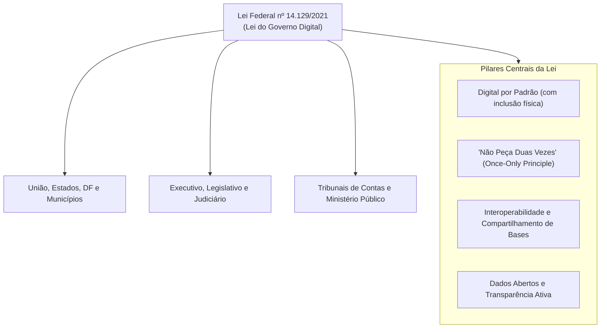
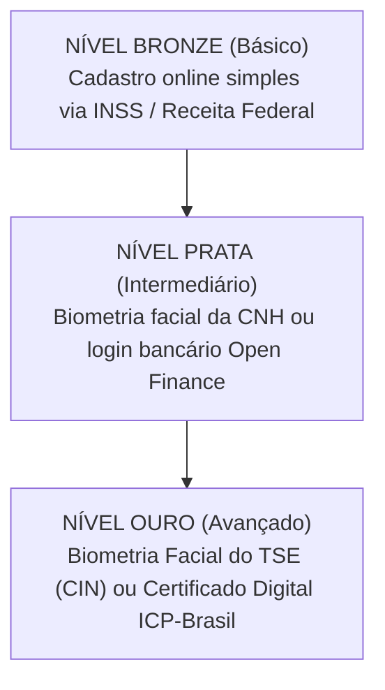
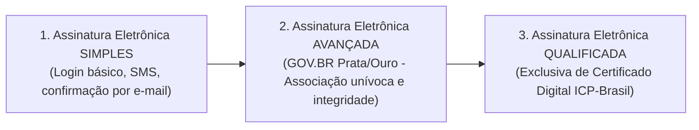
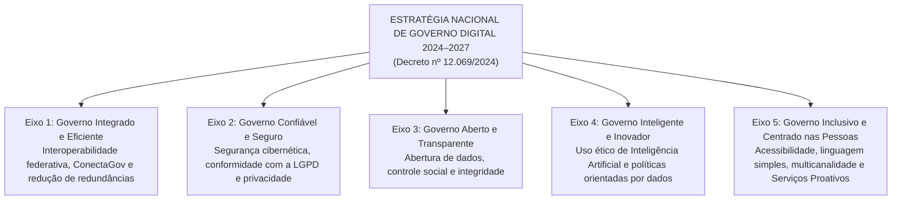

# 05 - Governo Digital e a ENGD 2024–2027 (Decreto 12.069/2024)

> **Matéria:** Governança de Tecnologia da Informação  
> **Cargo:** B02 – Técnico de Controle Externo – Especialidade: Tecnologia da Informação  
> **Arquivo:** `05_governo_digital_lei_14129_e_engd_2024_2027.md`  
> **Atos Normativos Centrais:** Lei Federal nº 14.129, de 29 de março de 2021 (Lei do Governo Digital) e Decreto Federal nº 12.069, de 21 de junho de 2024 (Estratégia Nacional de Governo Digital – ENGD 2024–2027)

---

## 📌 Ementa / Itens do Edital
- Transformação digital, inovação e modernização administrativa no setor público
- Lei Federal nº 14.129/2021 (Lei do Governo Digital):
    - Princípios, diretrizes e instrumentos fundamentais
    - Princípio do "Digital por Padrão" (*Digital by Default*) e a vedação à exigência de documentos já existentes no Estado (*Once-Only Principle*)
    - Níveis de identificação e autenticação digital (Plataforma GOV.BR: Bronze, Prata e Ouro)
    - Tipos de assinatura eletrônica no setor público: Simples, Avançada e Qualificada (Lei 14.063/2020)
    - Governo Como Plataforma (*Government as a Platform* - GaaP) e Interoperabilidade de Dados
- Estratégia Nacional de Governo Digital – ENGD 2024–2027 (Decreto Federal nº 12.069/2024):
    - Visão estratégica, objetivos e princípios orientadores
    - Os 5 Eixos Estratégicos e diretrizes para a transformação federativa (União, Estados e Municípios)
    - Serviços Públicos Proativos e Infraestrutura Pública Digital (DPI)

---

## 🧭 Sumário

1. [A Lei do Governo Digital (Lei Federal nº 14.129/2021)](#1-a-lei-do-governo-digital-lei-federal-no-141292021)
1. [Âmbito de Aplicação Universal](#1-1-ambito-de-aplicacao-universal)
    1. [Teste 505](#Teste-505)
1. [Princípios e Diretrizes Marcantes](#1-2-principios-e-diretrizes-marcantes)
    1. [Teste 506](#Teste-506)
    2. [Teste 507](#Teste-507)
1. [Níveis de Autenticação na Plataforma GOV.BR (Bronze, Prata e Ouro)](#1-3-niveis-de-autenticacao-na-plataforma-govbr-bronze-prata-e-ouro)
    1. [Teste 508](#Teste-508)
1. [Classificação das Assinaturas Eletrônicas no Setor Público (Lei nº 14.063/2020)](#1-4-classificacao-das-assinaturas-eletronicas-no-setor-publico-lei-no-140632020)
    1. [Teste 509](#Teste-509)
1. [Governo Como Plataforma (GaaP) e Interoperabilidade](#1-5-governo-como-plataforma-gaap-e-interoperabilidade)
    1. [Teste 510](#Teste-510)
2. [A Estratégia Nacional de Governo Digital – ENGD 2024–2027 (Decreto nº 12.069/2024)](#2-a-estrategia-nacional-de-governo-digital-engd-20242027-decreto-no-120692024)
2. [Propósito e Abrangência Federativa](#2-1-proposito-e-abrangencia-federativa)
    1. [Teste 511](#Teste-511)
2. [Os 5 Eixos Estratégicos da ENGD 2024–2027](#2-2-os-5-eixos-estrategicos-da-engd-20242027)
    1. [Teste 512](#Teste-512)
    2. [Teste 513](#Teste-513)
2. [Serviços Públicos Proativos e Infraestrutura Pública Digital (DPI)](#2-3-servicos-publicos-proativos-e-infraestrutura-publica-digital-dpi)
    1. [Teste 514](#Teste-514)
6. [Fontes Recomendadas na Internet](#6-fontes-recomendadas-na-internet)

---

## 1. A Lei do Governo Digital (Lei Federal nº 14.129/2021)

A **Lei nº 14.129/2021** instituiu o marco regulatório para a prestação digital dos serviços públicos no Brasil, fixando princípios, regras e instrumentos para o aumento da eficiência pública e a desburocratização das relações entre o Estado e a sociedade.

---

## 1.1 Âmbito de Aplicação Universal

A Lei do Governo Digital aplica-se obrigatoriamente a todos os entes e Poderes da Federação:

1. À administração direta e indireta da **União, dos Estados, do Distrito Federal e dos Municípios**.
2. Aos Poderes **Executivo, Judiciário e Legislativo** (abrangendo expressamente os **Tribunais de Contas** e o Ministério Público).
3. Às empresas públicas e sociedades de economia mista que prestem serviços públicos.

---

### Teste 505
**(FCC - Auditor Estadual de Controle Externo / TI - Adaptada)**
**Enunciado:** A Lei Federal nº 14.129/2021 estabelece princípios, regras e instrumentos para o Governo Digital e o aumento da eficiência pública. Em relação ao âmbito de aplicação subjetivo e institucional da referida lei, assinale a afirmativa correta:  

* **A)** A Lei do Governo Digital aplica-se com exclusividade ao Poder Executivo Federal, sendo expressamente vedada sua aplicação aos Estados, Distrito Federal e Municípios.
* **B)** A norma aplica-se aos órgãos da administração direta e indireta da União, dos Estados, do DF e dos Municípios, abrangendo expressamente os Poderes Executivo, Judiciário e Legislativo, bem como os Tribunais de Contas e o Ministério Público.
* **C)** Os Tribunais de Contas e as empresas estatais que prestam serviços públicos foram formalmente excluídos da incidência da Lei nº 14.129/2021 por emenda parlamentar.
* **D)** A aplicação da lei é facultativa para os municípios que não possuam data center próprio com servidores locais de alta densidade.
* **E)** Apenas os cartórios de registro civil privados com delegação notarial estão obrigados a cumprir as metas da Lei nº 14.129/2021.

---

> **Comentário Detalhado:**
>
> - **A)** Incorreta. A lei possui alcance federativo amplo e obrigatório em âmbito nacional.
> - **B)** **Correta.** De acordo com o Art. 2º da Lei nº 14.129/2021, a norma aplica-se aos órgãos da administração direta e indireta de todos os entes federados (União, Estados, DF e Municípios), abarcando os Poderes Executivo, Legislativo (incluídos os Tribunais de Contas), Judiciário e Ministério Público.
> - **C)** Incorreta. Os Tribunais de Contas estão expressamente subordinados às diretrizes de governo digital, transparência e interoperabilidade da lei.
> - **D)** Incorreta. A obrigatoriedade independe de infraestrutura própria prévia; incentiva-se o compartilhamento de recursos em nuvem e plataformas comuns.
> - **E)** Incorreta. A lei disciplina a atuação dos órgãos e entidades da Administração Pública.
> 
> **Gabarito: B**

---

## 1.2 Princípios e Diretrizes Marcantes

#### 1. Vedação Expressa à Exigência de Documento em Posse do Estado (*Once-Only Principle*)
O Art. 5º, inciso VI e o Art. 12 da Lei nº 14.129/2021 consagram expressamente a **vedação de exigir do cidadão informações, documentos ou certidões que já constem na posse da própria Administração Pública**:

- O órgão público não pode transferir para o usuário o ônus de buscar uma certidão emitida por outro órgão do mesmo ente ou da administração governamental.
- Os órgãos públicos são obrigados a estruturar mecanismos de **interoperabilidade de dados** para consultar diretamente as bases cadastrais governamentais.

> 🚨 **ALERTA DE PROVA / PEGADINHA FCC:**  
> A FCC adora cobrar a regra: Se o cidadão solicita um serviço em uma Secretaria Estadual, o órgão **não pode** exigir certidão de regularidade fiscal emitida pela própria Fazenda Estadual ou certidão de nascimento civil emitida pelo Estado; o órgão deve consumir esses dados eletronicamente via barramento de interoperabilidade.

---

### Teste 506
**(FCC - Técnico de Controle Externo / TI - Adaptada)**
**Enunciado:** Em uma repartição da Secretaria Estadual de Fazenda, um microempreendedor individual compareceu para solicitar seu credenciamento formal perante o Fisco. O servidor de atendimento recusou o protocolo digital sob o argumento de que o contribuinte não apresentou cópia física autenticada em cartório de sua cédula de identidade civil e nem certidão de quitação expedida por outro órgão do mesmo Poder Executivo Estadual. Considerando as disposições imperativas da Lei do Governo Digital (Lei Federal nº 14.129/2021):  

* **A)** A exigência imposta pelo atendente foi plenamente legítima, visto que a presunção de má-fé do contribuinte impera no direito administrativo digital até comprovação documental cartorária física.
* **B)** A conduta do atendente violou a Lei nº 14.129/2021, pois é expressamente vedado exigir do cidadão a apresentação de certidões ou documentos expedidos pelo próprio órgão ou por outros órgãos do mesmo ente público, cabendo à Administração Pública a obtenção direta das informações por meio de interoperabilidade de suas bases de dados.
* **C)** O protocolo eletrônico de requerimentos na administração direta foi revogado pela Lei do Governo Digital, que reintroduziu a obrigatoriedade da tramitação física de pastas suspensas em papel.
* **D)** A Lei nº 14.129/2021 aplica-se unicamente aos órgãos do Poder Judiciário Federal, não vinculando as Secretarias de Estado de Fazenda.
* **E)** A obtenção de dados por interoperabilidade de sistemas públicos é ilegal por violar compulsoriamente o princípio da segurança jurídica.

---

> **Comentário Detalhado:**
>
> - **A)** Incorreta. A Lei nº 14.129/2021 consagra expressamente o princípio da presunção de boa-fé do cidadão (Art. 3º, V), dispensando formalidades cartorárias excessivas como autenticações em papel quando a validação puder ser realizada internamente.
> - **B)** **Correta.** De acordo com o Art. 5º, inciso VI c/c Art. 12 da Lei nº 14.129/2021, é expressamente vedada à Administração a exigência de certidões, declarações ou documentos expedidos por ela própria ou por outros órgãos da administração pública do mesmo ente federativo. Os órgãos estatais têm a obrigação de integrar suas bases tecnológicas para compartilhar tais informações sem sobrecarregar o cidadão.
> - **C)** Incorreta. A Lei 14.129/2021 promove a digitalização ("Digital por Padrão") e a eliminação de processos em papel.
> - **D)** Incorreta. A lei possui alcance universal, aplicando-se à União, Estados, DF e Municípios, e a todos os Poderes da República.
> - **E)** Incorreta. A interoperabilidade de dados é diretriz legal mandatória da transformação digital, devidamente resguardada pela LGPD e normas de segurança.
> 
> **Gabarito: B**

---

#### 2. Digital por Padrão (*Digital by Default*) com Garantia de Inclusão
Os serviços públicos devem ser prioritariamente concebidos e ofertados em formato digital. Todavia, para resguardar os cidadãos em situação de vulnerabilidade ou sem letramento digital, a Administração deve manter canais de atendimento presencial humanizados e acessíveis.

#### 3. Presunção de Boa-Fé e Desburocratização
Fica dispensado o reconhecimento de firma em cartório e a autenticação de cópias em papel, bastando que o servidor público confira a cópia com o documento original apresentado ou valide os dados por meio de assinatura e identificação digital oficial.

#### 4. Transparência Ativa e Dados Abertos
Os dados governamentais não sigilosos devem ser abertos ativamente em sítios oficiais:

- Devem estar em formatos **abertos, não proprietários e estruturados** (como CSV, JSON, XML), legíveis por máquina.
- É vedado publicar dados abertos exclusivamente em arquivos fechados ou formatos de imagem (como PDF rasterizado ou JPG), que impossibilitam a análise algorítmica.

---

### Teste 507
**(FCC - Auditor Federal de Controle Externo / TI - Adaptada)**
**Enunciado:** A Lei Federal nº 14.129/2021 estabelece diretrizes rigorosas para a publicação de Dados Abertos e transparência ativa pelos órgãos dos Tribunais de Contas e da Administração Pública em geral. Com relação aos padrões técnicos mandatórios para disponibilização de dados abertos governamentais, a norma determina que os dados devem ser:  

* **A)** Disponibilizados prioritariamente em documentos de texto protegidos por senha e em arquivos de imagem rasterizada (JPG ou BMP) com baixa resolução, a fim de impedir cópias por terceiros.
* **B)** Ofertados em formatos abertos, não proprietários e estruturados (como CSV, JSON ou XML), que permitam a livre reutilização e o processamento automatizado por máquina por qualquer interessado, de forma gratuita.
* **C)** Comercializados com cobrança de tarifa bancária por megabyte baixado, transferindo-se a receita para associações privadas de tecnologia.
* **D)** Disponibilizados apenas se o interessado assinar termo de renúncia prévia a qualquer fiscalização contábil ou representação perante o Tribunal de Contas.
* **E)** Mantidos em sigilo permanente como regra geral, sendo liberados apenas mediante ação judicial transitada em julgado.

---

> **Comentário Detalhado:**
>
> - **A)** Incorreta. A publicação de dados em formato de imagens rasterizadas ou PDFs bloqueados impede a leitura automatizada e viola o princípio dos dados abertos legíveis por máquina.
> - **B)** **Correta.** O Art. 29 da Lei nº 14.129/2021 estabelece que os dados abertos devem ser disponibilizados em formato estruturado, não proprietário e legível por máquina (ex.: CSV, JSON, XML), garantindo a gratuidade de acesso, a interoperabilidade e a livre reutilização pelas organizações civis, pesquisadores e cidadãos para auditoria social.
> - **C)** Incorreta. O acesso aos dados abertos e informações públicas é gratuito por determinação legal constitucional e infraconstitucional.
> - **D)** Incorreta. O acesso à informação não pode ser condicionado a renúncias a direitos de fiscalização ou controle social.
> - **E)** Incorreta. O princípio basilar é a publicidade como preceito geral e o sigilo como exceção estrita fundamentada na lei.
> 
> **Gabarito: B**

---

## 1.3 Níveis de Autenticação na Plataforma GOV.BR (Bronze, Prata e Ouro)

O ecossistema GOV.BR classifica as contas de identificação dos cidadãos em **três níveis progressivos de confiabilidade cadastral**:

| Nível da Conta | Métodos de Validação / Obtenção | Serviços Públicos Acessíveis |
| :---: | :--- | :--- |
| **Bronze** | Cadastro presencial simplificado ou validação de dados cadastrais básicos junto à base do INSS ou da Receita Federal (perguntas cadastrais simples). | Acesso a serviços digitais básicos de baixo risco e consultas cadastrais simples. |
| **Prata** | Validação biométrica facial contra a base da CNH (Senatran); login por meio de credenciais bancárias (Open Finance / Bancos Credenciados); ou validação via SIGEPE (servidores públicos). | Acesso à grande maioria dos serviços públicos digitais federais e estaduais, emissão de certidões e uso de assinatura eletrônica avançada. |
| **Ouro** | Validação biométrica facial na base da Justiça Eleitoral (TSE / Carteira de Identidade Nacional - CIN); ou validação por Certificado Digital padrão ICP-Brasil (A1 ou A3). | Nível máximo de segurança: acesso irrestrito a todos os serviços críticos, sigilosos, declaração pré-preenchida do Imposto de Renda e assinaturas eletrônicas. |

---

### Teste 508
**(FCC - Analista de TI / Sistemas - Adaptada)**
**Enunciado:** A plataforma digital única GOV.BR disponibiliza mecanismos de autenticação com três níveis progressivos de segurança e confiabilidade cadastral: Bronze, Prata e Ouro. A respeito dos requisitos para obtenção desses níveis e seus respectivos graus de privilégio, assinale a alternativa correta:  

* **A)** A conta de nível Bronze exige compulsoriamente a validação biométrica facial do usuário cruzada com a base de dados da Justiça Eleitoral (TSE/CIN).
* **B)** O nível Prata pode ser obtido mediante validação biométrica facial na base da CNH (Senatran) ou validação de credenciais bancárias de instituições financeiras credenciadas via Open Finance.
* **C)** O nível Ouro restringe-se unicamente ao envio de SMS para telefone celular pré-pago sem necessidade de confirmação cadastral prévia.
* **D)** A obtenção de qualquer nível de conta no GOV.BR exige a presença física obrigatória do cidadão em Brasília com pagamento de taxa consular.
* **E)** O nível Bronze é o único que autoriza a realização de transações fiscais sigilosas críticas e a assinatura eletrônica avançada de contratos administrativos.

---

> **Comentário Detalhado:**
>
> - **A)** Incorreta. A biometria facial com o TSE/CIN confere o nível Ouro, e não Bronze. O nível Bronze baseia-se em cadastro online básico ou cruzamento simples com INSS/Receita.
> - **B)** **Correta.** O nível Prata (nível intermediário com alta confiabilidade) é concedido via validação biométrica com a base da Carteira Nacional de Habilitação (Senatran) ou por autenticação através de internet banking/Open Finance de bancos credenciados.
> - **C)** Incorreta. O nível Ouro (nível avançado de segurança máxima) requer validação biométrica na base da Justiça Eleitoral / Carteira de Identidade Nacional (CIN) ou certificado digital ICP-Brasil.
> - **D)** Incorreta. A criação e elevação de níveis das contas GOV.BR é totalmente digital, remota e gratuita pelo aplicativo ou portal oficial.
> - **E)** Incorreta. A assinatura eletrônica avançada e serviços críticos exigem no mínimo nível Prata ou Ouro.
> 
> **Gabarito: B**

---

## 1.4 Classificação das Assinaturas Eletrônicas no Setor Público (Lei nº 14.063/2020)

A Lei nº 14.063/2020 padronizou os tipos de assinatura eletrônica no relacionamento com órgãos públicos em três modalidades:

#### Tabela Comparativa: Assinaturas Eletrônicas na Administração Pública

| Categoria | Requisitos Técnicos de Segurança | Hipóteses de Aplicação Típicas |
| :--- | :--- | :--- |
| **Simples** | Permite identificar o signatário e anexa dados eletrônicos a outros dados (ex.: código SMS, confirmação de link por e-mail, login com senha comum). | Interações de baixo impacto financeiro ou operacional: agendamento de atendimentos, requerimentos de informações gerais, ouvidoria. |
| **Avançada** | Está associada unicamente ao signatário; dados para criação sob seu controle exclusivo; detecta qualquer alteração posterior no documento. Produzida tipicamente pelas contas **GOV.BR Prata e Ouro**. | Processos administrativos regulares, termos de posse, contratos administrativos ordinários, manifestações processuais em Tribunais de Contas e órgãos fiscais. |
| **Qualificada** | Utiliza **certificado digital emitido por Autoridade Certificadora credenciada na Infraestrutura de Chaves Públicas Brasileira (ICP-Brasil)**. É o nível mais alto. | Atos normativos de chefes de Poder (Presidente, Governadores, Prefeitos); transferência e registro de imóveis públicos; atos que impliquem sigilo fiscal/bancário gravíssimo onde a lei exigir expressamente. |

> 🚨 **ALERTA DE PROVA / PEGADINHA FCC:**  
> A FCC adora afirmar que qualquer manifestação ou processo eletrônico em órgão público "exige compulsoriamente a assinatura qualificada com certificado ICP-Brasil". **FALSO!** A legislação autorizou amplamente o uso da **Assinatura Eletrônica Avançada** (como a provida pelo GOV.BR Prata e Ouro) para a esmagadora maioria dos atos e processos administrativos cotidianos.

---

### Teste 509
**(FCC - Analista de Sistemas / Governança Digital - Adaptada)**
**Enunciado:** A respeito dos tipos de assinatura eletrônica aplicáveis às interações com os órgãos e entidades da Administração Pública, regulamentados pela Lei nº 14.063/2020 e pela Lei do Governo Digital (Lei nº 14.129/2021), assinale a afirmativa correta:  

* **A)** A assinatura eletrônica simples exige obrigatoriamente a utilização de token criptográfico físico com certificado digital ICP-Brasil do tipo A3.
* **B)** A assinatura eletrônica avançada é aquela que utiliza garantias que asseguram a associação unívoca ao signatário e a detecção de qualquer modificação posterior dos dados, sendo amplamente admitida para a maioria dos processos administrativos e atos ordinários do setor público (como a assinatura viabilizada pelos níveis Prata e Ouro da plataforma GOV.BR).
* **C)** É terminantemente proibido o uso de qualquer assinatura eletrônica que não seja qualificada (ICP-Brasil) em contratos de prestação de serviços com a Administração Pública.
* **D)** A assinatura qualificada é o padrão mais frágil e inseguro existente na legislação brasileira, sendo permitida unicamente em redes sociais e canais de lazer.
* **E)** Os três tipos de assinaturas eletrônicas têm o mesmo nível de segurança técnica e são emitidos sem qualquer controle de credenciamento.

---

> **Comentário Detalhado:**
>
> - **A)** Incorreta. A assinatura eletrônica simples utiliza métodos básicos de conferência de identidade (como código SMS, login por senha ou confirmação de link), não dependendo de certificado ICP-Brasil.
> - **B)** **Correta.** A Assinatura Eletrônica Avançada (Art. 4º, II da Lei 14.063/2020) está univocamente associada ao signatário, opera sob seu controle exclusivo e permite a detecção de qualquer alteração subsequente no documento. Ela é o padrão dominante nos processos eletrônicos da Administração Pública, operacionalizada de forma prática e gratuita pelos níveis Prata e Ouro do GOV.BR.
> - **C)** Incorreta. A legislação prevê expressamente que as assinaturas avançadas podem ser utilizadas na celebração de contratos, editais e processos administrativos, não havendo exigência geral de certificado qualificado ICP-Brasil para todas as hipóteses.
> - **D)** Incorreta. A assinatura qualificada (baseada em certificado ICP-Brasil) é o nível mais rigoroso e de mais alto custo/segurança previsto na legislação.
> - **E)** Incorreta. As três modalidades possuem níveis progressivos e distintos de garantia de integridade e não repúdio (Simples $\rightarrow$ Avançada $\rightarrow$ Qualificada).
> 
> **Gabarito: B**

---

## 1.5 Governo Como Plataforma (GaaP) e Interoperabilidade

O paradigma de **Governo Como Plataforma** (*Government as a Platform - GaaP*) redefine o papel da tecnologia pública. Em vez de construir aplicações verticais monolíticas isoladas para cada órgão, o governo desenvolve blocos compartilhados de infraestrutura tecnológica aberta:

- Criação de APIs padronizadas e barramentos centrais (como a plataforma **ConectaGov** no Brasil);
- Disponibilização de serviços públicos digitais interoperáveis que conversam em tempo real;
- Racionalização de custos de TIC e eliminação de duplicação de dados entre a União, Estados e Municípios.

---

### Teste 510
**(FCC - Analista de Sistemas - Governança Digital - Adaptada)**
**Enunciado:** O modelo conceitual de 'Governo Como Plataforma' (*Government as a Platform - GaaP*) e as diretrizes de interoperabilidade da Lei nº 14.129/2021 estabelecem uma nova arquitetura para a tecnologia no setor público. A respeito desse modelo, assinale a afirmativa correta:  

* **A)** Cada órgão público deve programar seus próprios sistemas em silos isolados, sendo proibida a utilização de APIs governamentais compartilhadas para troca de informações.
* **B)** O paradigma de Governo Como Plataforma promove a criação de componentes de software reutilizáveis, barramentos de interoperabilidade e APIs abertas que permitem a integração fluida entre múltiplos órgãos públicos e serviços digitais da sociedade.
* **C)** O GaaP exige que todas as soluções digitais governamentais sejam desenvolvidas exclusivamente em código binário assembly proprietário de uma única multinacional.
* **D)** A interoperabilidade de dados entre entes estatais visa impedir que os cidadãos acessem serviços pela internet, obrigando o retorno aos formulários manuais datilografados.
* **E)** A plataforma de interoperabilidade ConectaGov é exclusiva para entidades privadas e não pode ser integrada a sistemas de Tribunais de Contas.

---

> **Comentário Detalhado:**
>
> - **A)** Incorreta. O isolamento em silos de informação é exatamente o modelo obsoleto que a arquitetura GaaP busca erradicar.
> - **B)** **Correta.** No Governo Como Plataforma (GaaP), o Estado fornece blocos fundamentais de infraestrutura digital compartilhada (autenticação, pagamento, barramentos de mensageria e APIs padronizadas), permitindo a prestação integrada e contínua de serviços públicos sem duplicação de custos.
> - **C)** Incorreta. O modelo prioriza padrões abertos, interoperabilidade universal e formatos neutros legíveis por máquina.
> - **D)** Incorreta. O objetivo da interoperabilidade é facilitar a vida do cidadão, tornando os serviços rápidos e integrados.
> - **E)** Incorreta. O ConectaGov é o ecossistema federativo público para integração entre sistemas e bases de dados do Estado brasileiro.
> 
> **Gabarito: B**

---

## 2. A Estratégia Nacional de Governo Digital – ENGD 2024–2027 (Decreto nº 12.069/2024)

O **Decreto Federal nº 12.069, de 21 de junho de 2024**, promulgou a nova **Estratégia Nacional de Governo Digital (ENGD)** para o quadriênio **2024 a 2027**.

---

## 2.1 Propósito e Abrangência Federativa

A ENGD 2024–2027 é uma política pública de **amplitude nacional federativa**, coordenada para articular a transformação digital integrada de todos os entes federativos (União, 26 Estados, DF e Municípios), promovendo a interoperabilidade e reduzindo disparidades regionais de infraestrutura e capacidade de atendimento digital.

---

### Teste 511
**(FCC - Auditor de Controle Externo / TI - Adaptada)**
**Enunciado:** A Estratégia Nacional de Governo Digital (ENGD 2024–2027), instituída pelo Decreto nº 12.069/2024, consagra princípios de articulação federativa para a transformação digital do Estado. Sobre a abrangência e objetivos da ENGD 2024–2027, assinale a afirmativa correta:  

* **A)** A ENGD restringe suas metas à modernização dos gabinetes dos Ministérios da Esplanada em Brasília, vedando repasses de tecnologia aos Estados e Municípios.
* **B)** A nova estratégia adota abordagem estritamente federativa, buscando diminuir disparidades regionais e integrar serviços públicos digitais da União, dos Estados, do DF e dos Municípios em torno de padrões comuns de interoperabilidade e segurança.
* **C)** O Decreto nº 12.069/2024 determinou a extinção de todas as políticas de dados abertos e transparência ativa no Brasil.
* **D)** A ENGD estabelece que os serviços digitais governamentais devem ser inacessíveis a pessoas com deficiência física ou visual.
* **E)** A transformação digital preconizada pela ENGD visa terceirizar integralmente a gestão da política de segurança cibernética nacional para provedores internacionais sem regulação.

---

> **Comentário Detalhado:**
>
> - **A)** Incorreta. A ENGD 2024–2027 possui abrangência nacional e caráter expressamente federativo, alcançando os 26 estados, o DF e os mais de 5.500 municípios brasileiros.
> - **B)** **Correta.** O Decreto nº 12.069/2024 foi concebido para unificar a estratégia de transformação digital em nível federativo, superando fragmentações regionais através de padrões interoperáveis, segurança jurídica e inclusão social.
> - **C)** Incorreta. O Eixo 3 da ENGD é dedicado especificamente a 'Governo Aberto e Transparente'.
> - **D)** Incorreta. O Eixo 5 foca na acessibilidade, linguagem simples e multicanalidade para garantia de inclusão.
> - **E)** Incorreta. A soberania e a segurança cibernética (Eixo 2) são prioridades estratégicas nacionais e indelegáveis.
> 
> **Gabarito: B**

---

## 2.2 Os 5 Eixos Estratégicos da ENGD 2024–2027

1. **Eixo 1 - Governo Integrado e Eficiente:** Fortalecimento da interoperabilidade federativa via ConectaGov, racionalização de custos de TIC e eliminação de cadastros redundantes.
2. **Eixo 2 - Governo Confiável e Seguro:** Resiliência cibernética de infraestruturas críticas, proteção de dados pessoais (LGPD) e segurança da informação governamental.
3. **Eixo 3 - Governo Aberto e Transparente:** Fomento à transparência ativa, ampliação do catálogo de dados abertos para pesquisa e controle social, e integridade pública.
4. **Eixo 4 - Governo Inteligente e Inovador:** Adoção ética e responsável de Inteligência Artificial (IA) e formulação de políticas públicas orientadas por evidências empíricas (*data-driven policy*).
5. **Eixo 5 - Governo Inclusivo e Centrado nas Pessoas:** Inclusão digital ampla, design universal, linguagem simples, multicanalidade e adoção do modelo de **Serviços Públicos Proativos**.

---

### Teste 512
**(FCC Inédita - Analista de TI / Governo Digital - Adaptada)**
**Enunciado:** O Decreto Federal nº 12.069, de 21 de junho de 2024, instituiu a Estratégia Nacional de Governo Digital (ENGD) para o ciclo 2024 a 2027, direcionada a articular a governança e a modernização digital no âmbito da União, dos Estados, do Distrito Federal e dos Municípios. A respeito das diretrizes estratégicas e dos novos paradigmas de atendimento público fixados pela ENGD 2024–2027, assinale a afirmativa correta:  

* **A)** A ENGD estabelece a extinção compulsória de todos os canais de atendimento presencial nos órgãos públicos municipais e estaduais até 2025, tornando o autoatendimento em smartphones o único canal juridicamente aceito no país.
* **B)** A estratégia consagra o paradigma dos serviços públicos proativos, segundo o qual o Estado deve atuar de forma antecipada, utilizando a integração de bases de dados seguras para identificar o direito do cidadão e prestar serviços ou conceder benefícios de forma automática, dispensando requerimentos prévios sempre que possível.
* **C)** O Decreto nº 12.069/2024 proíbe a integração de sistemas e o compartilhamento de informações cadastrais entre estados e a União, sob o fundamento de preservar a soberania informática de cada ente da federação.
* **D)** As diretrizes da ENGD proíbem categoricamente o uso de algoritmos de inteligência artificial em quaisquer plataformas governamentais de suporte ao atendimento.
* **E)** A adesão aos eixos da ENGD 2024–2027 restringe-se exclusivamente às Forças Armadas e ao Ministério da Defesa.

---

> **Comentário Detalhado:**
>
> - **A)** Incorreta. A ENGD 2024–2027 enfatiza a inclusão digital e a multicanalidade (*omnichannel*), determinando expressamente que o atendimento digital não pode excluir cidadãos sem acesso à internet ou sem habilidades digitais, devendo o Estado manter canais presenciais acolhedores e integrados.
> - **B)** **Correta.** Um dos maiores avanços conceituais da ENGD 2024–2027 (Decreto nº 12.069/2024) é a consagração dos Serviços Públicos Proativos: por meio do cruzamento automatizado de bases públicas interoperáveis, o Estado identifica que o cidadão atingiu as condições previstas em lei e concede o serviço/benefício ativamente, sem a necessidade de solicitações burocráticas prévias.
> - **C)** Incorreta. O Eixo 1 da ENGD é o "Governo Integrado e Eficiente", cujo objetivo principal é impulsionar a interoperabilidade federativa entre União, estados e municípios através do ConectaGov e da Rede Gov.br.
> - **D)** Incorreta. O Eixo 4 da ENGD ("Governo Inteligente e Inovador") estimula explicitamente o uso ético, responsável e transparente de Inteligência Artificial para aprimorar os serviços públicos e a tomada de decisões.
> - **E)** Incorreta. A ENGD é uma política nacional ampla de transformação digital federativa, orientada a todos os órgãos civis de todos os níveis federativos.
> 
> **Gabarito: B**

---

### Teste 513
**(FCC - Auditor Fiscal da Receita Estadual / TI - Adaptada)**
**Enunciado:** A Estratégia Nacional de Governo Digital (ENGD 2024–2027) estrutura a evolução tecnológica governamental brasileira em cinco Eixos Estratégicos. A iniciativa que prevê a ampliação e consolidação da infraestrutura pública digital de barramentos de serviços (como o ConectaGov), viabilizando o consumo mútuo de dados fiscais, cadastrais e previdenciários entre a União, os 26 Estados, o DF e os Municípios para eliminar duplicidade de cadastros e racionalizar investimentos, insere-se precipuamente no:  

* **A)** Eixo 1 - Governo Integrado e Eficiente.
* **B)** Eixo de Manutenção de Sistemas Analógicos em Papel.
* **C)** Eixo de Restrição de Acesso às Bases Tributárias.
* **D)** Eixo de Cobrança Tarifária por Consulta Federal.
* **E)** Eixo de Privatização Integral dos Registros Civis.

---

> **Comentário Detalhado:**
>
> - **A)** **Correta.** O Eixo 1 (Governo Integrado e Eficiente) da ENGD 2024–2027 (Decreto nº 12.069/2024) tem como objetivo primordial a integração federativa de sistemas e bases de dados por meio da interoperabilidade (ConectaGov), conectando os três níveis federativos (União, Estados e Municípios) para eliminar retrabalho, diminuir custos de infraestrutura e viabilizar serviços integrados ponta a ponta.
> - **B)** Incorreta. A estratégia não preconiza a manutenção de sistemas analógicos em papel, mas a completa transformação digital inclusiva.
> - **C)** Incorreta. Não existe tal eixo na ENGD; a diretriz é o compartilhamento seguro e eficiente de dados.
> - **D)** Incorreta. A cooperação interfederativa e a troca de dados entre órgãos governamentais para prestação de serviços não visam tarifação interna restritiva.
> - **E)** Incorreta. Não há diretriz de privatização dos registros públicos na estrutura dos eixos estratégicos da ENGD.
> 
> **Gabarito: A**

---

## 2.3 Serviços Públicos Proativos e Infraestrutura Pública Digital (DPI)

#### 1. Serviços Públicos Proativos
Consiste na mudança de paradigma do atendimento público:

- *Modelo Reativo Tradicional:* O cidadão descobre a existência do direito, preenche formulários, reúne certidões e protocola requerimento no órgão.
- *Modelo Proativo da ENGD:* O Estado cruza dados de suas bases interoperáveis, reconhece automaticamente que o cidadão preencheu os requisitos previstos em lei e **disponibiliza ou concede ativamente o serviço/benefício**, notificando o indivíduo de forma transparente, sem necessidade de provocação prévia.

#### 2. Infraestrutura Pública Digital (DPI - *Digital Public Infrastructure*)
A ENGD 2024–2027 estrutura a evolução digital do país em três pilares fundamentais:

1. **Identificação Digital Unificada:** Acesso único por meio do CPF e da plataforma GOV.BR.
2. **Sistema de Pagamentos Instantâneos:** Utilização do Pix e da plataforma PagTesouro para recebimento ágil de taxas e repasses sociais diretos.
3. **Barramento Seguro de Dados:** Troca segura de informações via APIs e ConectaGov, com rastreabilidade e controle estrito de acessos.

---

### Teste 514
**(FCC - Técnico de Controle Externo / TI - Adaptada)**
**Enunciado:** A ENGD 2024–2027 (Decreto nº 12.069/2024) preconiza a transição de um modelo de serviços puramente reativo para a oferta de Serviços Públicos Proativos, alicerçados no conceito de Infraestrutura Pública Digital (DPI - *Digital Public Infrastructure*). A respeito desses conceitos, assinale a afirmativa correta:  

* **A)** Nos serviços públicos proativos, o Estado identifica automaticamente que o cidadão atingiu os requisitos previstos em lei e concede/oferece ativamente o serviço sem que o indivíduo precise solicitá-lo formalmente ou enfrentar burocracias de protocolo prévio.
* **B)** A Infraestrutura Pública Digital (DPI) baseia-se na volta do uso de fichas de papelão perfuradas para armazenamento de cadastros sociais.
* **C)** No modelo proativo, o cidadão é obrigado a contratar despachantes privados para intermediar eletronicamente o acesso aos benefícios sociais a que tem direito.
* **D)** A DPI é composta exclusivamente por impressoras matriciais de alta velocidade, excluindo componentes de identidade digital ou pagamentos instantâneos.
* **E)** O modelo proativo exige que o cidadão protocole petições físicas anuais perante o Tribunal de Contas para validar sua existência civil.

---

> **Comentário Detalhado:**
>
> - **A)** **Correta.** Os serviços proativos representam uma quebra de paradigma na relação Estado-cidadão: graças à interoperabilidade de dados e inteligência analítica, o poder público reconhece o direito adquirido do usuário e o disponibiliza ativamente, notificando-o em seus canais digitais.
> - **B)** Incorreta. DPI (*Digital Public Infrastructure*) é o conjunto de trilhos digitais modernos (Identidade Digital, Pagamentos Digitais Instantâneos e Barramentos de Dados).
> - **C)** Incorreta. A proatividade visa eliminar a burocracia e custos de intermediação para o cidadão.
> - **D)** Incorreta. Os três pilares mundiais da DPI são Identidade Digital Unificada, Sistemas de Pagamentos Instantâneos (ex.: Pix/PagTesouro) e Troca Segura de Dados via APIs.
> - **E)** Incorreta. A validação é eletrônica, automática e sem fricção burocrática presencial.
> 
> **Gabarito: A**

---

## 6. Fontes Recomendadas na Internet

* [Lei nº 14.129/2021 (Lei do Governo Digital)](https://www.planalto.gov.br/ccivil_03/_ato2019-2022/2021/lei/l14129.htm) - Texto oficial que estabelece princípios, regras e instrumentos para o aumento da eficiência pública e desburocratização.
* [Decreto nº 12.198/2024 (Estratégia Nacional de Governo Digital)](https://www.planalto.gov.br/ccivil_03/_ato2023-2026/2024/decreto/d12198.htm) - Institui a Estratégia Nacional de Governo Digital para o ciclo 2024-2027.
* [Governo Digital - Estratégia Nacional de Governo Digital (ENGD)](https://www.gov.br/governodigital/pt-br/estrategias-e-governanca-digital/estrategianacional) - Pilares, metas e indicadores da transformação digital dos serviços públicos brasileiros.
* [Governo Digital - Estratégia Federal de Governo Digital (EFGD)](https://www.gov.br/governodigital/pt-br/estrategias-e-governanca-digital/EFGD) - Diretrizes estratégicas para interoperabilidade, dados abertos e serviços centrados no cidadão.
* [Governo Digital - Infraestrutura Nacional de Dados (IND)](https://www.gov.br/governodigital/pt-br/infraestrutura-nacional-de-dados) - Governança, compartilhamento e segurança de bases de dados do setor público.
* DI PIETRO, Maria Sylvia Zanella. **Direito Administrativo**. 37. ed. Rio de Janeiro: Forense, 2024. (Cap. 3 - Princípios da Administração Pública e Eficiência Digital).
* NOHARA, Irene Patrícia. **Direito Administrativo**. 13. ed. São Paulo: Atlas, 2023. (Cap. 2 - A Transformação Digital da Administração Pública e a Lei 14.129/2021).
* BRESSER-PEREIRA, Luiz Carlos. **Reforma do Estado para a Cidadania: a Reforma Gerencial Brasileira na Perspectiva Internacional**. São Paulo: Editora 34, 1998. (Cap. 4 - Transparência, Governança e Serviços Públicos).
