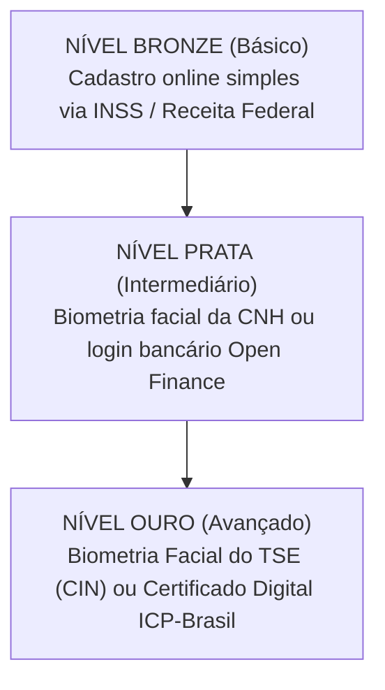
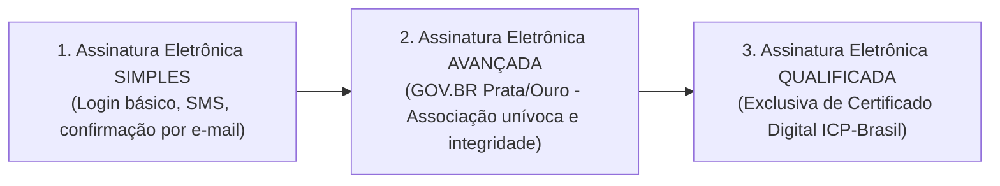
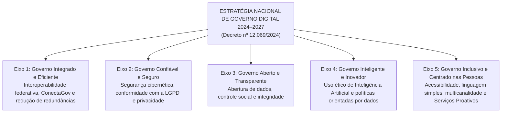

# 05 - Governo Digital e a ENGD 2024–2027 (Decreto 12.069/2024)

> **Matéria:** Governança de Tecnologia da Informação  
> **Cargo:** B02 – Técnico de Controle Externo – Especialidade: Tecnologia da Informação  
> **Arquivo:** `05_governo_digital_lei_14129_e_engd_2024_2027.md`  
> **Atos Normativos Centrais:** Lei Federal nº 14.129, de 29 de março de 2021 (Lei do Governo Digital) e Decreto Federal nº 12.069, de 21 de junho de 2024 (Estratégia Nacional de Governo Digital – ENGD 2024–2027)

---

## 📌 Ementa / Itens do Edital
- Transformação digital, inovação e modernização administrativa no setor público
- Lei Federal nº 14.129/2021 (Lei do Governo Digital):
    - Princípios, diretrizes e instrumentos fundamentais
    - Princípio do "Digital por Padrão" (*Digital by Default*) e a vedação à exigência de documentos já existentes no Estado (*Once-Only Principle*)
    - Níveis de identificação e autenticação digital (Plataforma GOV.BR: Bronze, Prata e Ouro)
    - Tipos de assinatura eletrônica no setor público: Simples, Avançada e Qualificada (Lei 14.063/2020)
    - Governo Como Plataforma (*Government as a Platform* - GaaP) e Interoperabilidade de Dados
- Estratégia Nacional de Governo Digital – ENGD 2024–2027 (Decreto Federal nº 12.069/2024):
    - Visão estratégica, objetivos e princípios orientadores
    - Os 5 Eixos Estratégicos e diretrizes para a transformação federativa (União, Estados e Municípios)
    - Serviços Públicos Proativos e Infraestrutura Pública Digital (DPI)

---

## 🧭 Sumário

1. [A Lei do Governo Digital (Lei Federal nº 14.129/2021)](#1-a-lei-do-governo-digital-lei-federal-no-141292021)
1. [Âmbito de Aplicação Universal](#1-1-ambito-de-aplicacao-universal)
    1. [Teste 505](#Teste-505)
1. [Princípios e Diretrizes Marcantes](#1-2-principios-e-diretrizes-marcantes)
    1. [Teste 506](#Teste-506)
    2. [Teste 507](#Teste-507)
1. [Níveis de Autenticação na Plataforma GOV.BR (Bronze, Prata e Ouro)](#1-3-niveis-de-autenticacao-na-plataforma-govbr-bronze-prata-e-ouro)
    1. [Teste 508](#Teste-508)
1. [Classificação das Assinaturas Eletrônicas no Setor Público (Lei nº 14.063/2020)](#1-4-classificacao-das-assinaturas-eletronicas-no-setor-publico-lei-no-140632020)
    1. [Teste 509](#Teste-509)
1. [Governo Como Plataforma (GaaP) e Interoperabilidade](#1-5-governo-como-plataforma-gaap-e-interoperabilidade)
    1. [Teste 510](#Teste-510)
2. [A Estratégia Nacional de Governo Digital – ENGD 2024–2027 (Decreto nº 12.069/2024)](#2-a-estrategia-nacional-de-governo-digital-engd-20242027-decreto-no-120692024)
2. [Propósito e Abrangência Federativa](#2-1-proposito-e-abrangencia-federativa)
    1. [Teste 511](#Teste-511)
2. [Os 5 Eixos Estratégicos da ENGD 2024–2027](#2-2-os-5-eixos-estrategicos-da-engd-20242027)
    1. [Teste 512](#Teste-512)
    2. [Teste 513](#Teste-513)
2. [Serviços Públicos Proativos e Infraestrutura Pública Digital (DPI)](#2-3-servicos-publicos-proativos-e-infraestrutura-publica-digital-dpi)
    1. [Teste 514](#Teste-514)
6. [Fontes Recomendadas na Internet](#6-fontes-recomendadas-na-internet)

---

## 1. A Lei do Governo Digital (Lei Federal nº 14.129/2021)

A **Lei nº 14.129/2021** instituiu o marco regulatório para a prestação digital dos serviços públicos no Brasil, fixando princípios, regras e instrumentos para o aumento da eficiência pública e a desburocratização das relações entre o Estado e a sociedade.

---

## 1.1 Âmbito de Aplicação Universal

A Lei do Governo Digital aplica-se obrigatoriamente a todos os entes e Poderes da Federação:

1. À administração direta e indireta da **União, dos Estados, do Distrito Federal e dos Municípios**.
2. Aos Poderes **Executivo, Judiciário e Legislativo** (abrangendo expressamente os **Tribunais de Contas** e o Ministério Público).
3. Às empresas públicas e sociedades de economia mista que prestem serviços públicos.

---

### Teste 505
**(FGV – TRT – Analista Judiciário - Tecnologia da Informação – 2024)**
As opções a seguir apresentam objetivos do governo eletrônico,  
à exceção de uma. Assinale-a.

* **A)** Inclusão digital.
* **B)** Modernizar a máquina pública.
* **C)** Reduzir custos e melhorar a eficiência da administração 
pública no que se refere aos seus processos internos.
* **D)** Aumentar a transparência, o controle social e a 
accountability.
* **E)** Fomento econômico do setor de tecnologia da informação.

---

> **Comentário Detalhado:**
>
> - **A)** Incorreta. Discrepa das diretrizes normativas e jurisprudenciais aplicáveis ao tema objeto do item.
> - **B)** Incorreta. Discrepa das diretrizes normativas e jurisprudenciais aplicáveis ao tema objeto do item.
> - **C)** Correta. Representa com precisão a disciplina do tema e o entendimento pacificado adotado pela banca (FGV).
> - **D)** Incorreta. Discrepa das diretrizes normativas e jurisprudenciais aplicáveis ao tema objeto do item.
> - **E)** Incorreta. Discrepa das diretrizes normativas e jurisprudenciais aplicáveis ao tema objeto do item.
>
> **Gabarito: C**

---
## 1.2 Princípios e Diretrizes Marcantes

#### 1. Vedação Expressa à Exigência de Documento em Posse do Estado (*Once-Only Principle*)
O Art. 5º, inciso VI e o Art. 12 da Lei nº 14.129/2021 consagram expressamente a **vedação de exigir do cidadão informações, documentos ou certidões que já constem na posse da própria Administração Pública**:

- O órgão público não pode transferir para o usuário o ônus de buscar uma certidão emitida por outro órgão do mesmo ente ou da administração governamental.
- Os órgãos públicos são obrigados a estruturar mecanismos de **interoperabilidade de dados** para consultar diretamente as bases cadastrais governamentais.

> 🚨 **ALERTA DE PROVA / PEGADINHA FCC:**  
> A FCC adora cobrar a regra: Se o cidadão solicita um serviço em uma Secretaria Estadual, o órgão **não pode** exigir certidão de regularidade fiscal emitida pela própria Fazenda Estadual ou certidão de nascimento civil emitida pelo Estado; o órgão deve consumir esses dados eletronicamente via barramento de interoperabilidade.

---

### Teste 506
**(FGV – TRT – Analista Judiciário - Tecnologia da Informação – 2024)**
As opções a seguir apresentam objetivos do governo eletrônico,  
à exceção de uma. Assinale-a.

* **A)** Inclusão digital.
* **B)** Modernizar a máquina pública.
* **C)** Reduzir custos e melhorar a eficiência da administração 
pública no que se refere aos seus processos internos.
* **D)** Aumentar a transparência, o controle social e a 
accountability.
* **E)** Fomento econômico do setor de tecnologia da informação.

---

> **Comentário Detalhado:**
>
> - **A)** Incorreta. Discrepa das diretrizes normativas e jurisprudenciais aplicáveis ao tema objeto do item.
> - **B)** Incorreta. Discrepa das diretrizes normativas e jurisprudenciais aplicáveis ao tema objeto do item.
> - **C)** Correta. Representa com precisão a disciplina do tema e o entendimento pacificado adotado pela banca (FGV).
> - **D)** Incorreta. Discrepa das diretrizes normativas e jurisprudenciais aplicáveis ao tema objeto do item.
> - **E)** Incorreta. Discrepa das diretrizes normativas e jurisprudenciais aplicáveis ao tema objeto do item.
>
> **Gabarito: C**

---
### Teste 507
**(FGV – TRT – Analista Judiciário - Tecnologia da Informação – 2024)**
As opções a seguir apresentam objetivos do governo eletrônico,  
à exceção de uma. Assinale-a.

* **A)** Inclusão digital.
* **B)** Modernizar a máquina pública.
* **C)** Reduzir custos e melhorar a eficiência da administração 
pública no que se refere aos seus processos internos.
* **D)** Aumentar a transparência, o controle social e a 
accountability.
* **E)** Fomento econômico do setor de tecnologia da informação.

---

> **Comentário Detalhado:**
>
> - **A)** Incorreta. Discrepa das diretrizes normativas e jurisprudenciais aplicáveis ao tema objeto do item.
> - **B)** Incorreta. Discrepa das diretrizes normativas e jurisprudenciais aplicáveis ao tema objeto do item.
> - **C)** Correta. Representa com precisão a disciplina do tema e o entendimento pacificado adotado pela banca (FGV).
> - **D)** Incorreta. Discrepa das diretrizes normativas e jurisprudenciais aplicáveis ao tema objeto do item.
> - **E)** Incorreta. Discrepa das diretrizes normativas e jurisprudenciais aplicáveis ao tema objeto do item.
>
> **Gabarito: C**

---
## 1.3 Níveis de Autenticação na Plataforma GOV.BR (Bronze, Prata e Ouro)

O ecossistema GOV.BR classifica as contas de identificação dos cidadãos em **três níveis progressivos de confiabilidade cadastral**:

| Nível da Conta | Métodos de Validação / Obtenção | Serviços Públicos Acessíveis |
| :---: | :--- | :--- |
| **Bronze** | Cadastro presencial simplificado ou validação de dados cadastrais básicos junto à base do INSS ou da Receita Federal (perguntas cadastrais simples). | Acesso a serviços digitais básicos de baixo risco e consultas cadastrais simples. |
| **Prata** | Validação biométrica facial contra a base da CNH (Senatran); login por meio de credenciais bancárias (Open Finance / Bancos Credenciados); ou validação via SIGEPE (servidores públicos). | Acesso à grande maioria dos serviços públicos digitais federais e estaduais, emissão de certidões e uso de assinatura eletrônica avançada. |
| **Ouro** | Validação biométrica facial na base da Justiça Eleitoral (TSE / Carteira de Identidade Nacional - CIN); ou validação por Certificado Digital padrão ICP-Brasil (A1 ou A3). | Nível máximo de segurança: acesso irrestrito a todos os serviços críticos, sigilosos, declaração pré-preenchida do Imposto de Renda e assinaturas eletrônicas. |

---

### Teste 508
**(FCC – TRT – Analista Judiciário - Tecnologia da Informação – 2024)**
De acordo com os critérios e diretrizes técnicas para o processo 
de desenvolvimento de módulos e serviços na Plataforma Digital 
do Poder Judiciário Brasileiro, portaria CNJ n  253/2020, é 
correto afirmar que

* **A)** é obrigatória a produção de relatório de  cobertura de testes 
automatizados.
* **B)** os microsserviços precisam ser coesos e manter a 
característica statefull para permitir maior escalabilidade.
* **C)** deve ser adotada, preferencialmente, a linguagem de 
programação Python para implementar microsserviços.
* **D)** aplicações monolíticas existentes devem manter suas 
funcionalidades na íntegra, sem decomposição funcional.
* **E)** as interfaces de programação de aplicações (APIs) devem ser 
providas por meio de tecnologia SOAP. 

TRT 16ª REGIÃO – MARANHÃO FGV

---

> **Comentário Detalhado:**
>
> - **A)** Incorreta. Discrepa das diretrizes normativas e jurisprudenciais aplicáveis ao tema objeto do item.
> - **B)** Incorreta. Discrepa das diretrizes normativas e jurisprudenciais aplicáveis ao tema objeto do item.
> - **C)** Incorreta. Discrepa das diretrizes normativas e jurisprudenciais aplicáveis ao tema objeto do item.
> - **D)** Incorreta. Discrepa das diretrizes normativas e jurisprudenciais aplicáveis ao tema objeto do item.
> - **E)** Correta. Representa com precisão a disciplina do tema e o entendimento pacificado adotado pela banca (FCC).
>
> **Gabarito: E**

---
## 1.4 Classificação das Assinaturas Eletrônicas no Setor Público (Lei nº 14.063/2020)

A Lei nº 14.063/2020 padronizou os tipos de assinatura eletrônica no relacionamento com órgãos públicos em três modalidades:

#### Tabela Comparativa: Assinaturas Eletrônicas na Administração Pública

| Categoria | Requisitos Técnicos de Segurança | Hipóteses de Aplicação Típicas |
| :--- | :--- | :--- |
| **Simples** | Permite identificar o signatário e anexa dados eletrônicos a outros dados (ex.: código SMS, confirmação de link por e-mail, login com senha comum). | Interações de baixo impacto financeiro ou operacional: agendamento de atendimentos, requerimentos de informações gerais, ouvidoria. |
| **Avançada** | Está associada unicamente ao signatário; dados para criação sob seu controle exclusivo; detecta qualquer alteração posterior no documento. Produzida tipicamente pelas contas **GOV.BR Prata e Ouro**. | Processos administrativos regulares, termos de posse, contratos administrativos ordinários, manifestações processuais em Tribunais de Contas e órgãos fiscais. |
| **Qualificada** | Utiliza **certificado digital emitido por Autoridade Certificadora credenciada na Infraestrutura de Chaves Públicas Brasileira (ICP-Brasil)**. É o nível mais alto. | Atos normativos de chefes de Poder (Presidente, Governadores, Prefeitos); transferência e registro de imóveis públicos; atos que impliquem sigilo fiscal/bancário gravíssimo onde a lei exigir expressamente. |

> 🚨 **ALERTA DE PROVA / PEGADINHA FCC:**  
> A FCC adora afirmar que qualquer manifestação ou processo eletrônico em órgão público "exige compulsoriamente a assinatura qualificada com certificado ICP-Brasil". **FALSO!** A legislação autorizou amplamente o uso da **Assinatura Eletrônica Avançada** (como a provida pelo GOV.BR Prata e Ouro) para a esmagadora maioria dos atos e processos administrativos cotidianos.

---

### Teste 509
**(FCC – TRT-2 – Analista Judiciário - Tecnologia da Informação – 2014)**
Órgão integrante do Poder Legislativo federal, no desempenho da função administrativa, solucionou controvérsia proferindo a to 
administrativo restritivo de direito sem, no entanto, observar a Lei no 9.784/1999. Considerando o âmbito de aplicação da referida 
lei, é correto afirmar que o administrador atuou

* **A)** conforme a lei, porque o referido ato normativo aplica-s
e, exclusivamente, ao Poder Executivo federal, abrangendo a 
Administração pública direta e indireta.
* **B)** conforme a lei, porque o referido ato normativo aplica-se ao Poder Executivo federal, abrangendo a Administração pública 
direta e indireta e ao Poder Judiciário federal, não se aplicando ao Poder Legislativo federal, estadual ou local.
* **C)** em desconformidade com a lei, porque os preceitos da supracitada norma também se aplicam aos órgãos dos Poderes 
Legislativo e Judiciário da União, quando no desempenho de função administrativa.
* **D)** em desconformidade com a lei, porque os preceitos da norma também se aplicam aos órgãos dos Poderes Legislativo e 
Judiciário da União, respectivamente, quando no desempenho de função legislativa e judicial.
* **E)** conforme a lei, porque o ato normativo aplica-se tão somente às unidades de atuação integrantes da estrutura da 
Administração direta e da estrutura da Administração indireta federal. 
Caderno de Prova ’D04’, Tipo 001

8 TRT2R-An.Jud.-Tec.Informação-D04

---

> **Comentário Detalhado:**
>
> - **A)** Incorreta. Discrepa das diretrizes normativas e jurisprudenciais aplicáveis ao tema objeto do item.
> - **B)** Incorreta. Discrepa das diretrizes normativas e jurisprudenciais aplicáveis ao tema objeto do item.
> - **C)** Correta. Representa com precisão a disciplina do tema e o entendimento pacificado adotado pela banca (FCC).
> - **D)** Incorreta. Discrepa das diretrizes normativas e jurisprudenciais aplicáveis ao tema objeto do item.
> - **E)** Incorreta. Discrepa das diretrizes normativas e jurisprudenciais aplicáveis ao tema objeto do item.
>
> **Gabarito: C**

---
## 1.5 Governo Como Plataforma (GaaP) e Interoperabilidade

O paradigma de **Governo Como Plataforma** (*Government as a Platform - GaaP*) redefine o papel da tecnologia pública. Em vez de construir aplicações verticais monolíticas isoladas para cada órgão, o governo desenvolve blocos compartilhados de infraestrutura tecnológica aberta:

- Criação de APIs padronizadas e barramentos centrais (como a plataforma **ConectaGov** no Brasil);
- Disponibilização de serviços públicos digitais interoperáveis que conversam em tempo real;
- Racionalização de custos de TIC e eliminação de duplicação de dados entre a União, Estados e Municípios.

---

### Teste 510
**(FGV – TRT-DA 24-REGIÃO – Analista Judiciário - Tecnologia da Informação – 2025)**
A Resolução 396/2021 do Conselho Nacional de Justiça institui a 
Estratégia Nacional de Segurança Cibernética do Poder Judiciário 
(ENSEC-PJ). 
A respeito dos objetivos da ENSEC-PJ, avalie as afirmativas a seguir. 
I. Baratear a execução das atividades do Judiciário no ambiente 
digital para reduzir o tempo de atendimento e recuperação de 
falhas. 
II. Aumentar a resiliência às ameaças cibernéticas por meio da 
gestão ativa de permissões de usuários de sistemas 
informatizados. 
III. Permitir a manutenção e a continuidade dos serviços, ou o seu 
restabelecimento em menor tempo possível. 
IV. Estabelecer governança de segurança cibernética e fortalecer 
a gestão e coordenação integrada de ações de segurança 
cibernética nos órgãos do Poder Judiciário. 
Está correto o que se afirma em

* **A)** I e II, apenas.
* **B)** II e III, apenas.
* **C)** III e IV, apenas.
* **D)** I, III e IV, apenas.
* **E)** II, III e IV, apenas.

---

> **Comentário Detalhado:**
>
> - **A)** Correta. Representa com precisão a disciplina do tema e o entendimento pacificado adotado pela banca (FGV).
> - **B)** Incorreta. Discrepa das diretrizes normativas e jurisprudenciais aplicáveis ao tema objeto do item.
> - **C)** Incorreta. Discrepa das diretrizes normativas e jurisprudenciais aplicáveis ao tema objeto do item.
> - **D)** Incorreta. Discrepa das diretrizes normativas e jurisprudenciais aplicáveis ao tema objeto do item.
> - **E)** Incorreta. Discrepa das diretrizes normativas e jurisprudenciais aplicáveis ao tema objeto do item.
>
> **Gabarito: A**

---
## 2. A Estratégia Nacional de Governo Digital – ENGD 2024–2027 (Decreto nº 12.069/2024)

O **Decreto Federal nº 12.069, de 21 de junho de 2024**, promulgou a nova **Estratégia Nacional de Governo Digital (ENGD)** para o quadriênio **2024 a 2027**.

---

## 2.1 Propósito e Abrangência Federativa

A ENGD 2024–2027 é uma política pública de **amplitude nacional federativa**, coordenada para articular a transformação digital integrada de todos os entes federativos (União, 26 Estados, DF e Municípios), promovendo a interoperabilidade e reduzindo disparidades regionais de infraestrutura e capacidade de atendimento digital.

---

### Teste 511
**(FGV – TRT-16 – Analista Judiciário - Tecnologia da Informação – 2022)**
De acordo com os critérios e diretrizes técnicas para o processo 
de desenvolvimento de módulos e serviços na Plataforma Digital 
do Poder Judiciário Brasileiro, portaria CNJ n  253/2020, é 
correto afirmar que

* **A)** é obrigatória a produção de relatório de  cobertura de testes 
automatizados.
* **B)** os microsserviços precisam ser coesos e manter a 
característica statefull para permitir maior escalabilidade.
* **C)** deve ser adotada, preferencialmente, a linguagem de 
programação Python para implementar microsserviços.
* **D)** aplicações monolíticas existentes devem manter suas 
funcionalidades na íntegra, sem decomposição funcional.
* **E)** as interfaces de programação de aplicações (APIs) devem ser 
providas por meio de tecnologia SOAP. 

TRT 16ª REGIÃO – MARANHÃO FGV

---

> **Comentário Detalhado:**
>
> - **A)** Incorreta. Discrepa das diretrizes normativas e jurisprudenciais aplicáveis ao tema objeto do item.
> - **B)** Incorreta. Discrepa das diretrizes normativas e jurisprudenciais aplicáveis ao tema objeto do item.
> - **C)** Incorreta. Discrepa das diretrizes normativas e jurisprudenciais aplicáveis ao tema objeto do item.
> - **D)** Incorreta. Discrepa das diretrizes normativas e jurisprudenciais aplicáveis ao tema objeto do item.
> - **E)** Correta. Representa com precisão a disciplina do tema e o entendimento pacificado adotado pela banca (FGV).
>
> **Gabarito: E**

---
## 2.2 Os 5 Eixos Estratégicos da ENGD 2024–2027

1. **Eixo 1 - Governo Integrado e Eficiente:** Fortalecimento da interoperabilidade federativa via ConectaGov, racionalização de custos de TIC e eliminação de cadastros redundantes.
2. **Eixo 2 - Governo Confiável e Seguro:** Resiliência cibernética de infraestruturas críticas, proteção de dados pessoais (LGPD) e segurança da informação governamental.
3. **Eixo 3 - Governo Aberto e Transparente:** Fomento à transparência ativa, ampliação do catálogo de dados abertos para pesquisa e controle social, e integridade pública.
4. **Eixo 4 - Governo Inteligente e Inovador:** Adoção ética e responsável de Inteligência Artificial (IA) e formulação de políticas públicas orientadas por evidências empíricas (*data-driven policy*).
5. **Eixo 5 - Governo Inclusivo e Centrado nas Pessoas:** Inclusão digital ampla, design universal, linguagem simples, multicanalidade e adoção do modelo de **Serviços Públicos Proativos**.

---

### Teste 512
**(FCC – TRT-14 – Analista Judiciário - Tecnologia da Informação – 2016)**
Afirma-se na abertura do texto: As crianças de hoje parecem nascer já familiarizadas com todas as engenhocas eletrônicas que 
estarão no centro de suas vidas. Com a leitura integral do texto, tal afirmação é

* **A)** contraditada pelo fato de que o verdadeiro interesse das crianças, longe de estar nas atrações eletrônicas, é aquele  que o  
teatro proporciona em suas grandes produções.
* **B)** ratificada quando nos certificamos de que a imaginação das crianças de hoje é estimulada sobretudo pelo manejo de jogos 
eletrônicos, sob o comando criativo de cada uma delas.
* **C)** contraposta ao prazer inexcedível que cada criança experimenta quando abandona a manipulação de engenhocas 
eletrônicas pelo encanto de criar histórias imaginosas.
* **D)** ressalvada pelo fato de que o encantamento pelas narrativas orais, com o narrador presente, pode substituir o prazer que 
elas experimentam por meio de recursos eletrônicos.
* **E)** minimizada ao nos darmos conta de que a suposta atração que as crianças sentem pelos jogos eletrônicos decorre da 
baixa atenção que a família moderna lhes dedica.

---

> **Comentário Detalhado:**
>
> - **A)** Incorreta. Discrepa das diretrizes normativas e jurisprudenciais aplicáveis ao tema objeto do item.
> - **B)** Incorreta. Discrepa das diretrizes normativas e jurisprudenciais aplicáveis ao tema objeto do item.
> - **C)** Incorreta. Discrepa das diretrizes normativas e jurisprudenciais aplicáveis ao tema objeto do item.
> - **D)** Correta. Representa com precisão a disciplina do tema e o entendimento pacificado adotado pela banca (FCC).
> - **E)** Incorreta. Discrepa das diretrizes normativas e jurisprudenciais aplicáveis ao tema objeto do item.
>
> **Gabarito: D**

---
### Teste 513
**(FGV – TRT – Analista Judiciário - Tecnologia da Informação – 2024)**
Dados abertos são informações digitais disponibilizadas ao público 
sem restrições de uso, geralmente sob formatos acessíveis e 
licenças que permitem sua livre utilização, redistribuição e 
modificação. O chamado Sistema de 5 Estrelas classifica por meio 
de estrelas o grau de abertura dos dados.  
O nível três estrelas é caracterizado por sua disponibilidade na 
internet

* **A)** em qualquer formato.
* **B)** em formato RDF.
* **C)** de maneira estruturada e formato não proprietário.
* **D)** em formato SPARQL.
* **E)** em formato RDF Conectado.

---

> **Comentário Detalhado:**
>
> - **A)** Incorreta. Discrepa das diretrizes normativas e jurisprudenciais aplicáveis ao tema objeto do item.
> - **B)** Incorreta. Discrepa das diretrizes normativas e jurisprudenciais aplicáveis ao tema objeto do item.
> - **C)** Correta. Representa com precisão a disciplina do tema e o entendimento pacificado adotado pela banca (FGV).
> - **D)** Incorreta. Discrepa das diretrizes normativas e jurisprudenciais aplicáveis ao tema objeto do item.
> - **E)** Incorreta. Discrepa das diretrizes normativas e jurisprudenciais aplicáveis ao tema objeto do item.
>
> **Gabarito: C**

---
## 2.3 Serviços Públicos Proativos e Infraestrutura Pública Digital (DPI)

#### 1. Serviços Públicos Proativos
Consiste na mudança de paradigma do atendimento público:

- *Modelo Reativo Tradicional:* O cidadão descobre a existência do direito, preenche formulários, reúne certidões e protocola requerimento no órgão.
- *Modelo Proativo da ENGD:* O Estado cruza dados de suas bases interoperáveis, reconhece automaticamente que o cidadão preencheu os requisitos previstos em lei e **disponibiliza ou concede ativamente o serviço/benefício**, notificando o indivíduo de forma transparente, sem necessidade de provocação prévia.

#### 2. Infraestrutura Pública Digital (DPI - *Digital Public Infrastructure*)
A ENGD 2024–2027 estrutura a evolução digital do país em três pilares fundamentais:

1. **Identificação Digital Unificada:** Acesso único por meio do CPF e da plataforma GOV.BR.
2. **Sistema de Pagamentos Instantâneos:** Utilização do Pix e da plataforma PagTesouro para recebimento ágil de taxas e repasses sociais diretos.
3. **Barramento Seguro de Dados:** Troca segura de informações via APIs e ConectaGov, com rastreabilidade e controle estrito de acessos.

---

### Teste 514
**(FGV – TRT – Analista Judiciário - Tecnologia da Informação – 2024)**
Pedro trabalha num pet shop localizado em Planaltina/GO há 5 
anos como t osador de animais. Desejando saber quanto tempo 
faltava para sua aposentadoria, Pedro baixou em seu celular o 
aplicativo “meu INSS” e acessou o seu CNIS (cadastro nacional de 
informações sociais). Para sua surpresa, verificou que o atual 
empregador não recolheu nenhuma contribuição, malgrado haver 
descontado o INSS cota -parte do empregado em todos os 
contracheques de Pedro. 
Diante da situação apresentada e de acordo com a Lei de regência, 
marque o crime que, em tese, foi praticado pelo empregador de 
Pedro.

* **A)** Estelionato previdenciário.
* **B)** Sonegação de contribuição previdenciária.
* **C)** Furto qualificado porque praticado contra entidade pública.
* **D)** Prevaricação dolosa.
* **E)** Apropriação indébita previdenciária.

---

> **Comentário Detalhado:**
>
> - **A)** Incorreta. Discrepa das diretrizes normativas e jurisprudenciais aplicáveis ao tema objeto do item.
> - **B)** Incorreta. Discrepa das diretrizes normativas e jurisprudenciais aplicáveis ao tema objeto do item.
> - **C)** Correta. Representa com precisão a disciplina do tema e o entendimento pacificado adotado pela banca (FGV).
> - **D)** Incorreta. Discrepa das diretrizes normativas e jurisprudenciais aplicáveis ao tema objeto do item.
> - **E)** Incorreta. Discrepa das diretrizes normativas e jurisprudenciais aplicáveis ao tema objeto do item.
>
> **Gabarito: C**

---
## 6. Fontes Recomendadas na Internet

* [Lei nº 14.129/2021 (Lei do Governo Digital)](https://www.planalto.gov.br/ccivil_03/_ato2019-2022/2021/lei/l14129.htm) - Texto oficial que estabelece princípios, regras e instrumentos para o aumento da eficiência pública e desburocratização.
* [Decreto nº 12.198/2024 (Estratégia Nacional de Governo Digital)](https://www.planalto.gov.br/ccivil_03/_ato2023-2026/2024/decreto/d12198.htm) - Institui a Estratégia Nacional de Governo Digital para o ciclo 2024-2027.
* [Governo Digital - Estratégia Nacional de Governo Digital (ENGD)](https://www.gov.br/governodigital/pt-br/estrategias-e-governanca-digital/estrategianacional) - Pilares, metas e indicadores da transformação digital dos serviços públicos brasileiros.
* [Governo Digital - Estratégia Federal de Governo Digital (EFGD)](https://www.gov.br/governodigital/pt-br/estrategias-e-governanca-digital/EFGD) - Diretrizes estratégicas para interoperabilidade, dados abertos e serviços centrados no cidadão.
* [Governo Digital - Infraestrutura Nacional de Dados (IND)](https://www.gov.br/governodigital/pt-br/infraestrutura-nacional-de-dados) - Governança, compartilhamento e segurança de bases de dados do setor público.
* DI PIETRO, Maria Sylvia Zanella. **Direito Administrativo**. 37. ed. Rio de Janeiro: Forense, 2024. (Cap. 3 - Princípios da Administração Pública e Eficiência Digital).
* NOHARA, Irene Patrícia. **Direito Administrativo**. 13. ed. São Paulo: Atlas, 2023. (Cap. 2 - A Transformação Digital da Administração Pública e a Lei 14.129/2021).
* BRESSER-PEREIRA, Luiz Carlos. **Reforma do Estado para a Cidadania: a Reforma Gerencial Brasileira na Perspectiva Internacional**. São Paulo: Editora 34, 1998. (Cap. 4 - Transparência, Governança e Serviços Públicos).
