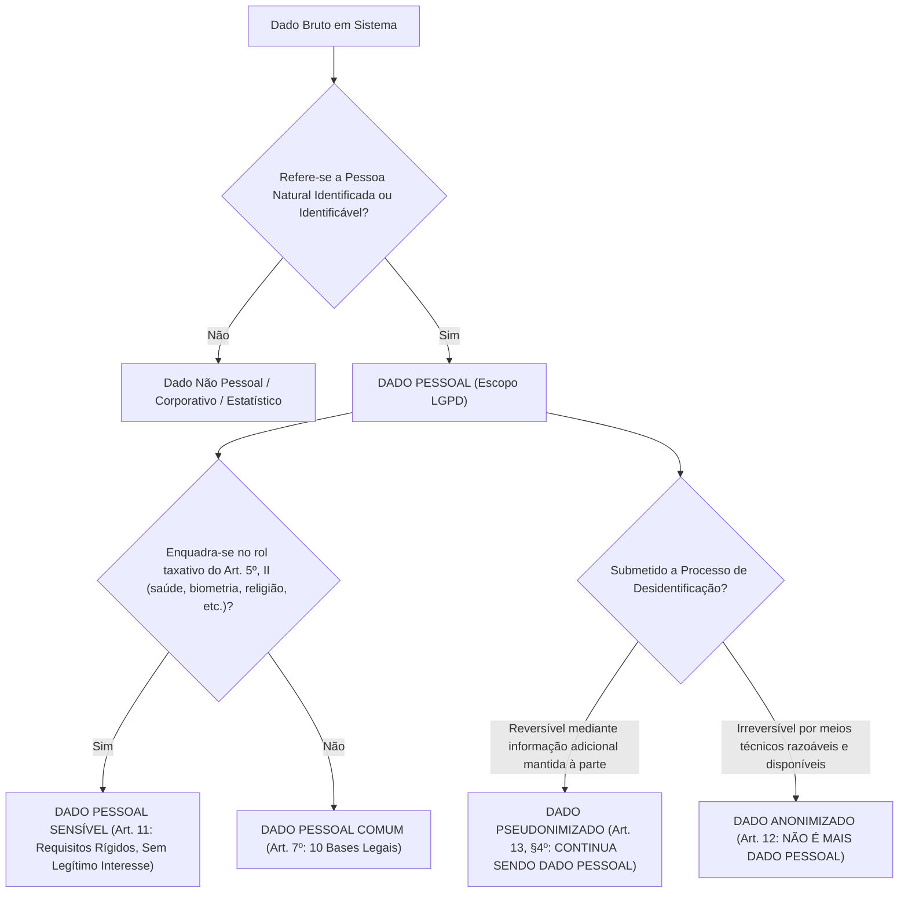
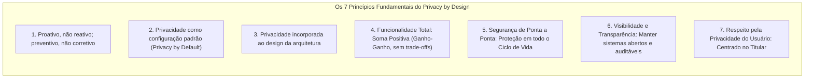
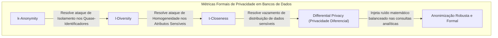
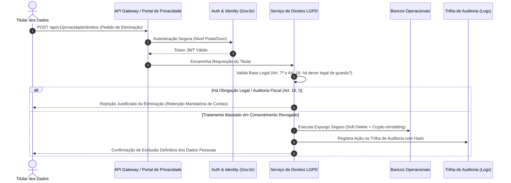

# 01 - LGPD Aplicada ao Desenvolvimento e Operação de Sistemas

> **Matéria:** Legislação Aplicada à Tecnologia da Informação  
> **Cargo:** B02 – Técnico de Controle Externo – Especialidade: Tecnologia da Informação  
> **Arquivo:** `01_lgpd_aplicada_ao_desenvolvimento_e_sistemas.md`  
> **Ato Normativo:** Lei Federal nº 13.709, de 14 de agosto de 2018 (Lei Geral de Proteção de Dados Pessoais - LGPD)

---

## 📌 Ementa / Itens do Edital
- Aplicação técnica da LGPD (Lei nº 13.709/2018) no ciclo de desenvolvimento de software e operação de sistemas
- Conceitos essenciais: Dado pessoal, Dado sensível, Dado anonimizado, Titular, Controlador, Operador e Encarregado (DPO)
- Princípios da LGPD aplicados à engenharia de software (com foco em Minimização e Finalidade)
- Metodologias: Privacy by Design e Privacy by Default (Ann Cavoukian)
- Técnicas de desidentificação: Anonimização vs. Pseudonimização
- Implementação de direitos dos titulares em sistemas de informação

---

## 🌳 Classificação Hierárquica

```text
1. LGPD Técnica na Engenharia de Software e Operações
├── 1.1 Conceitos e Classificação de Dados sob a LGPD
│   ├── 1.1.1 Dado Pessoal: Informação relacionada a pessoa natural identificada ou identificável (Nome, CPF, IP, cookie ID, geolocalização)
│   ├── 1.1.2 Dado Pessoal Sensível: Origem racial/étnica, convicção religiosa, opinião política, filiação sindical, dados genéticos, biométricos ou de saúde e vida sexual (tratamento restrito sob o Art. 11)
│   ├── 1.1.3 Dado Anonimizado: Dado relativo a titular que não possa ser identificado, considerando a utilização de meios técnicos razoáveis e disponíveis na ocasião de seu tratamento (NÃO é considerado dado pessoal sob a LGPD, salvo se o processo for reversível)
│   └── 1.1.4 Atores do Tratamento: Titular, Controlador (toma as decisões), Operador (trata dados em nome do controlador) e Encarregado / DPO (canal de comunicação entre partes e a ANPD)
├── 1.2 Princípios da LGPD Aplicados à Arquitetura de Sistemas (Art. 6º)
│   ├── 1.2.1 Princípio da Finalidade: Propósitos legítimos, específicos e informados ao titular no momento da coleta
│   ├── 1.2.2 Princípio da Adequação: Compatibilidade do processamento com as finalidades informadas
│   ├── 1.2.3 Princípio da Necessidade / Minimização de Dados: Limitação do tratamento ao mínimo necessário para a realização de suas finalidades (coletar apenas o estritamente essencial)
│   ├── 1.2.4 Princípio da Segurança e Prevenção: Medidas técnicas e administrativas aptas a proteger dados de acessos não autorizados
│   └── 1.2.5 Princípio da Qualidade e Transparência: Garantia de dados exatos, claros e atualizados
├── 1.3 Metodologias Privacy by Design e Privacy by Default
│   ├── 1.3.1 Privacy by Design (Privacidade desde a Concepção - 7 Princípios de Ann Cavoukian):
│   │   ├── 1. Proativo e não reativo; preventivo e não corretivo
│   │   ├── 2. Privacidade como padrão (Privacy as default)
│   │   ├── 3. Privacidade incorporada ao design da arquitetura
│   │   ├── 4. Funcionalidade total (Soma positiva: Privacidade E Segurança, sem trade-offs falsos)
│   │   ├── 5. Segurança de ponta a ponta (Ciclo de vida completo dos dados)
│   │   ├── 6. Visibilidade e transparência
│   │   └── 7. Respeito pela privacidade do usuário (Centrado no titular)
│   └── 1.3.2 Privacy by Default (Privacidade por Padrão):
│       ├── As configurações de privacidade mais restritivas devem ser ativadas automaticamente, sem necessidade de intervenção do usuário
│       ├── Checkboxes de consentimento NUNCA podem vir pré-marcados
│       └── Compartilhamento de dados com terceiros e cookies analíticos devem vir desativados por padrão
├── 1.4 Técnicas de Desidentificação de Dados
│   ├── 1.4.1 Pseudonimização (Art. 13, § 4º):
│   │   ├── O dado perde a possibilidade de associação direta a um indivíduo, senão pelo uso de informação adicional mantida separadamente pelo controlador em ambiente seguro
│   │   ├── O dado pseudonimizado CONTINUA SENDO DADO PESSOAL sob a LGPD (processo reversível)
│   │   └── Técnicas: Hashing com Salt secreto, Tokenização, Criptografia reversível
│   └── 1.4.2 Anonimização (Art. 12):
│       ├── Utilização de meios técnicos razoáveis e disponíveis para desvincular definitivamente o dado de qualquer pessoa natural
│       ├── O dado anonimizado DEIXA DE SER REGIDO PELA LGPD
│       └── Algoritmos e Métricas Formais de Anonimização:
│           ├── k-Anonymity (cada registro é indistinguível de pelo menos outros k-1 indivíduos em relação aos quase-identificadores)
│           ├── l-Diversity (garante diversidade de pelo menos l valores para atributos sensíveis dentro de cada grupo)
│           ├── t-Closeness (a distribuição de atributos sensíveis no grupo se aproxima da distribuição global)
│           └── Privacidade Diferencial (Differential Privacy: injeção de ruído matemático balanceado)
└── 1.5 Implementação Técnica dos Direitos dos Titulares em Software (Art. 18)
    ├── 1.5.1 Confirmação e Acesso aos Dados: Endpoints de autoatendimento para consulta de dados cadastrais
    ├── 1.5.2 Retificação e Correção: Interfaces para atualização de dados incompletos ou desatualizados
    ├── 1.5.3 Portabilidade de Dados: Exportação estruturada em formato interoperável legível por máquina (JSON, CSV, XML)
    ├── 1.5.4 Eliminação e Exclusão ("Direito ao Esquecimento" sob regras da administração): Rotinas de expurgo seguro e deleção lógica/física (soft delete vs. hard delete)
    └── 1.5.5 Revogação de Consentimento: Mecanismos simplificados de opt-out em um clique
```

---

## 📖 Teoria Aprofundada & Fundamentos de Engenharia

### 1.1 Taxonomia de Dados e Papéis sob a LGPD (Lei nº 13.709/2018)

A aplicação da LGPD no contexto de Engenharia de Software e Operações de TI (DevSecOps) impõe uma reestruturação profunda nos modelos conceituais de dados, esquemas de bancos de dados relacionais e NoSQL, esteiras de mensageria e contratos de APIs.

#### 1.1.1 Classificação Legal e Técnica dos Dados



| Categoria | Definição Legal (LGPD) | Exemplos Técnicos em Banco de Dados / APIs | Regime Jurídico de Proteção |
|---|---|---|---|
| **Dado Pessoal Comum** (Art. 5º, I) | Informação relacionada a pessoa natural identificada ou identificável. | Nome, CPF, e-mail pessoal, endereço IP de log, User-Agent, cookie identifier, geolocalização GPS. | Sujeito integralmente à LGPD. Pode ser tratado via 10 bases legais (Art. 7º), incluindo execução de contrato, cumprimento de obrigação legal e legítimo interesse. |
| **Dado Pessoal Sensível** (Art. 5º, II) | Origem racial/étnica, convicção religiosa, opinião política, filiação a sindicato/organização religiosa/política, dado referente à saúde ou à vida sexual, dado genético ou biométrico. | Template biométrico facial/digital, prontuário médico eletrônico, CID em atestados, exames toxicológicos. | Regime altamente restritivo (Art. 11). **NÃO admite a base legal do Legítimo Interesse**. Exige consentimento específico e destacado ou hipóteses legais estritas. |
| **Dado Pseudonimizado** (Art. 13, § 4º) | Dado que perde a possibilidade de associação direta a um indivíduo, senão pelo uso de informação adicional mantida separadamente pelo controlador. | IDs com Hashing salgado (`SHA-256(CPF + Salt)`), tokens UUID opacos cujas tabelas de de-para residem em base isolada com KMS. | **CONTINUA SENDO DADO PESSOAL**. É uma salvaguarda técnica e de segurança, não uma isenção da lei. |
| **Dado Anonimizado** (Art. 12) | Dado relativo a titular que não possa ser identificado, considerando meios técnicos razoáveis e disponíveis na ocasião do tratamento. | Conjuntos agregados com k-anonymity alto, microdados com injeção de ruído laplaciano (Differential Privacy). | **NÃO é considerado dado pessoal**, saindo do escopo da LGPD, **salvo se o processo for revertido** ou reversível por esforço razoável. |

> 🚨 **ALERTA DE PROVA / PEGADINHA FCC:**  
> A Fundação Carlos Chagas frequentemente tenta induzir o candidato ao erro afirmando que a **pseudonimização** retira o dado da incidência da LGPD. Isso é **FALSO**! O dado pseudonimizado permanece sob a tutela da LGPD porque o próprio controlador ou terceiro autorizado detém a chave reversora (informação adicional). Somente a **anonimização real e irreversível** afasta a aplicação da lei (Art. 12).

#### 1.1.2 Agentes de Tratamento e o Encarregado (DPO)

1. **Titular:** A pessoa natural (física) a quem se referem os dados pessoais que são objeto de tratamento. Pessoas jurídicas **não** são titulares de dados sob a LGPD.
2. **Controlador (Art. 5º, VI):** Pessoa natural ou jurídica, de direito público ou privado, a quem competem as **decisões** referentes ao tratamento de dados pessoais (ex.: Tribunal de Contas, Secretaria de Fazenda, empresa concessionária).
3. **Operador (Art. 5º, VII):** Pessoa natural ou jurídica, de direito público ou privado, que realiza o tratamento de dados pessoais **em nome do controlador** (ex.: empresa contratada de hospedagem em nuvem, fábrica de software terceirizada, consultoria de sustentação de banco de dados). O operador deve agir estritamente conforme as instruções lícitas do controlador.
4. **Encarregado / Data Protection Officer - DPO (Art. 5º, VIII):** Pessoa indicada pelo controlador e operador para atuar como canal de comunicação entre o controlador, os titulares dos dados e a Autoridade Nacional de Proteção de Dados (ANPD).
   - Suas atividades incluem: aceitar reclamações e comunicações dos titulares, prestar esclarecimentos, receber comunicações da ANPD e orientar os funcionários da entidade sobre as práticas de proteção de dados.

> ⭐ **IMPORTANTE / REGRA DE OURO:**  
> O Operador não toma decisões sobre as finalidades do tratamento. Se um provedor de nuvem contratado como Operador resolver utilizar os dados do órgão público para treinar seus próprios modelos comerciais de IA sem autorização, ele comete desvio de finalidade e passa a responder como **Controlador** em relação a esse tratamento ilícito.

---

### 1.2 Princípios do Art. 6º sob a Ótica da Arquitetura e Engenharia de Software

O Art. 6º da LGPD elenca dez princípios fundamentais que regem as atividades de tratamento. Para desenvolvedores, arquitetos e DBAs, esses princípios se traduzem em requisitos não funcionais diretos:

1. **Finalidade:** Realização do tratamento para propósitos legítimos, específicos, explícitos e informados ao titular, sem possibilidade de tratamento posterior de forma incompatível.
   - *Impacto em TI:* Cada campo persistido na tabela do banco de dados deve ter uma justificativa funcional rastreável. Não é permitido criar rotinas de coleta de dados genéricos sob a justificativa de "podemos precisar disso no futuro".
2. **Adequação:** Compatibilidade do tratamento com as finalidades informadas ao titular.
   - *Impacto em TI:* Se o cadastro foi feito para emissão de certidão negativa de débitos fiscais, o sistema não pode enviar newsletters promocionais ou compartilhar dados com empresas privadas sem base legal.
3. **Necessidade (Minimização de Dados):** Limitação do tratamento ao mínimo necessário para a realização de suas finalidades, com abrangência dos dados pertinentes, proporcionais e não excessivos.
   - *Impacto em TI:* Princípio basilar da engenharia. Se uma API precisa apenas validar a maioridade do usuário, ela deve receber um booleano `maior_de_idade: true/false` ou a idade calculada, e não o RG completo, filiação e certidão de nascimento digitalizada.
4. **Livre Acesso:** Garantia aos titulares de consulta facilitada e gratuita sobre a forma e a duração do tratamento, bem como sobre a integralidade de seus dados pessoais.
   - *Impacto em TI:* Criação de painéis de autoatendimento (*self-service privacy portals*) e endpoints de leitura de perfil.
5. **Qualidade dos Dados:** Garantia de exatidão, clareza, relevância e atualização dos dados.
   - *Impacto em TI:* Implementação de rotinas de validação de esquemas (JSON Schema, constraints de integridade), deduplicação de registros e mecanismos para retificação de dados incorretos pelo próprio titular.
6. **Transparência:** Garantia de informações claras, precisas e facilmente acessíveis sobre a realização do tratamento e os respectivos agentes de tratamento.
   - *Impacto em TI:* Políticas de privacidade com redação clara em microcopy nos formulários, registros de consentimento (*consent logs*) e termos versionados.
7. **Segurança:** Utilização de medidas técnicas e administrativas aptas a proteger os dados pessoais de acessos não autorizados e de situações acidentais ou ilícitas.
   - *Impacto em TI:* Criptografia de dados em trânsito (TLS 1.3) e em repouso (AES-256 com chaves gerenciadas por HSM/KMS), RBAC/ABAC, mTLS em microserviços e proteção contra injeções (OWASP Top 10).
8. **Prevenção:** Adoção de medidas prévias para evitar a ocorrência de danos em virtude do tratamento de dados pessoais.
   - *Impacto em TI:* Auditorias contínuas de código (SAST/DAST), modelagem de ameaças e esteiras DevSecOps com bloqueio de deploy em caso de vazamento de segredos em repositórios.
9. **Não Discriminação:** Impossibilidade de realização do tratamento para fins discriminatórios ilícitos ou abusivos.
   - *Impacto em TI:* Validação ética e técnica de modelos de Machine Learning para evitar viés algorítmico (*bias*) em sistemas de concessão de créditos tributários ou triagens fiscais.
10. **Responsabilização e Prestação de Contas (Accountability):** Demonstração da eficácia das medidas adotadas pelo agente.
    - *Impacto em TI:* Trilhas de auditoria imutáveis (*audit trails* / logs assinados digitalmente), relatórios de impacto à proteção de dados (RIPD/DPIA) e documentação de arquitetura de dados.

---

### 1.3 Privacy by Design e Privacy by Default (Ann Cavoukian)

Concebida no final da década de 1990 pela Comissária de Informação e Privacidade de Ontário (Canadá), Dra. Ann Cavoukian, a metodologia de **Privacy by Design (PbD)** prescreve que a privacidade não pode ser um adendo ou uma reflexão tardia adicionada ao final do desenvolvimento; ela deve ser o alicerce desde a primeira linha de arquitetura.



#### 1.3.1 Dissecando os 7 Princípios de Ann Cavoukian na Prática de TI

1. **Proativo e não reativo; Preventivo e não corretivo:** O sistema antecipa os riscos de violação de privacidade antes que aconteçam. Emprega-se a **Modelagem de Ameaças à Privacidade (LINDDUN)** antes de codificar.
2. **Privacidade como Padrão (Privacy by Default):** Se o titular do dado não fizer nenhuma alteração nas configurações, o nível de privacidade permanece o mais restritivo possível.
   - Checkboxes de consentimento desmarcadas por padrão;
   - Coleta de dados estritamente necessária ativada; dados opcionais desativados;
   - Cookies de rastreamento de terceiros bloqueados por padrão.
3. **Privacidade Incorporada ao Design:** A proteção da privacidade é uma funcionalidade essencial do núcleo do software e da infraestrutura, não um remendo (*patch*) colocado sobre uma arquitetura insegura.
4. **Funcionalidade Total (Soma Positiva - *Positive-Sum, not Zero-Sum*):** Rejeita a falsa dicotomia de que "ou temos privacidade, ou temos segurança/desempenho". A arquitetura de software de excelência entrega alta performance, segurança robusta **e** respeito irrestrito à privacidade.
5. **Segurança de Ponta a Ponta (Proteção em Todo o Ciclo de Vida):** A segurança cobre a informação desde a coleta inicial, trânsito, processamento, armazenamento, backup até o expurgo definitivo e seguro (*crypto-shredding* ou destruição física da mídia).
6. **Visibilidade e Transparência:** Todas as partes operacionais e políticas devem permanecer transparentes e verificáveis, assegurando que o que foi prometido nos termos seja exatamente o que os algoritmos executam em produção.
7. **Respeito pela Privacidade do Usuário:** O sistema é centrado no usuário (*user-centric*). Oferece padrões de usabilidade claros, sem padrões obscuros (*dark patterns*) voltados a ludibriar o titular a compartilhar dados indesejados.

#### 1.3.2 Comparativo: Privacy by Design vs. Privacy by Default

| Dimensão | Privacy by Design (PbD) | Privacy by Default (PbDf) |
|---|---|---|
| **Escopo** | Holístico, arquitetural e metodológico. Abrange toda a esteira de engenharia de software e processos organizacionais. | Focado na experiência de usuário, parametrização padrão de interfaces, bancos e sistemas operacionais. |
| **Momento de Aplicação** | Desde a concepção dos requisitos de negócio e arquitetura de software (Fase 0). | No momento em que o sistema ou serviço é disponibilizado para uso pelo usuário final. |
| **Ação Exigida do Usuário** | Nenhuma (é interno à engenharia de software). | Zero esforço: a proteção máxima já está ativa sem que o usuário precise alterar nenhuma chave ou configuração. |
| **Exemplo Típico** | Armazenamento de dados pessoais em tabelas segregadas com criptografia em repouso e trilhas de log imutáveis. | Perfil público de novo usuário criado como "Privado" por padrão; geolocalização desativada inicialmente. |

---

### 1.4 Engenharia de Desidentificação: Anonimização vs. Pseudonimização

Para atender aos princípios da minimização e da segurança da informação, a equipe de TI deve dominar as técnicas matemáticas e computacionais de desidentificação de dados.

#### 1.4.1 Técnicas Criptográficas de Pseudonimização
Na pseudonimização (Art. 13, § 4º da LGPD), o dado pessoal tem seu identificador direto substituído por um pseudônimo. O processo é reversível por quem possui a informação adicional.

1. **Hashing Criptográfico com Salt Único:**
   - Hashing puro (`SHA-256(CPF)`) é vulnerável a ataques de dicionário e tabelas arco-íris (*rainbow tables*), pois o espaço amostral do CPF possui apenas $10^{11}$ possibilidades.
   - Deve-se utilizar Salt aleatório de alta entropia por registro e chaves secretas (HMAC):
     $$\text{Pseudônimo} = \text{HMAC-SHA256}(\text{ChaveSecreta}, \text{CPF} \parallel \text{Salt})$$
2. **Tokenização:** Substituição de dados sensíveis (ex.: número de cartão de crédito, CPF) por um identificador não algorítmico gerado aleatoriamente (Token UUID). O mapeamento (*token vault*) é protegido em banco de dados isolado com controle rigoroso de acesso e mTLS.
3. **Criptografia Reversível Preservadora de Formato (FPE - Format-Preserving Encryption):** Criptografa o dado mantendo o mesmo tamanho e tipo (ex.: CPF de 11 dígitos continua gerando uma string de 11 dígitos numéricos), viabilizando testes em sistemas legados sem quebrar restrições de esquema.

#### 1.4.2 Métricas Formais de Anonimização (Art. 12 da LGPD)

Para que um conjunto de microdados seja considerado verdadeiramente **anonimizado**, a desidentificação deve resistir a três ataques clássicos:
- **Singling out (Isolamento):** Possibilidade de isolar um registro que pertença a um único indivíduo no conjunto.
- **Linkability (Vinculação):** Possibilidade de cruzar dois conjuntos de dados distintos e correlacionar registros referentes à mesma pessoa.
- **Inference (Inferência):** Possibilidade de deduzir, com alta probabilidade, o valor de um atributo sensível de um titular a partir de outros valores.



1. **k-Anonymity (Sweeney, 2002):**
   - Um conjunto de dados possui $k$-anonimato se cada tupla de **quase-identificadores** (ex.: Idade, Gênero, CEP) for indistinguível de pelo menos outras $k-1$ tuplas no mesmo conjunto. Ou seja, cada grupo de equivalência contém no mínimo $k$ registros.
   - *Limitação:* Não protege contra o ataque de **homogeneidade**. Se em um grupo com $k=5$, todos os 5 indivíduos tiverem o atributo sensível "Câncer", qualquer pessoa que saiba que a vítima está naquele grupo descobrirá a sua doença.
2. **l-Diversity (Machanavajjhala et al., 2007):**
   - Extensão do $k$-anonimato que exige que, dentro de cada grupo de equivalência de quase-identificadores, existam pelo menos $l$ valores "bem representados" para cada atributo sensível.
   - *Limitação:* Não protege contra ataques de **distribuição assimétrica** ou conhecimento prévio global.
3. **t-Closeness (Li et al., 2007):**
   - Exige que a distribuição de probabilidade de um atributo sensível dentro de qualquer grupo de equivalência tenha uma distância estatística (medida pela métrica *Earth Mover's Distance*) de no máximo $t$ em relação à distribuição desse mesmo atributo em todo o banco de dados global.
4. **Privacidade Diferencial ($\epsilon$-Differential Privacy - Dwork, 2006):**
   - Padrão-ouro na computação moderna (utilizado pelo Censo dos EUA, Apple e Google). Garante matematicamente que a inclusão ou remoção de um único indivíduo no banco de dados não altera significativamente a probabilidade do resultado de uma consulta analítica agregada.
   - Injeta ruído aleatório calibrado (distribuição de Laplace ou Gaussiana) controlado pelo parâmetro de privacidade $\epsilon$ (*privacy budget*).

---

### 1.5 Implementação Técnica dos Direitos dos Titulares (Art. 18 da LGPD)

O Art. 18 confere ao titular um catálogo de direitos que demandam soluções concretas na camada de aplicação e de banco de dados:



#### 1.5.1 Mapeamento dos Direitos e Requisitos Técnicos

1. **Confirmação e Acesso aos Dados (Art. 18, I e II):**
   - *Solução Técnica:* Criação de endpoint `GET /api/v1/titular/meus-dados` que consolida em uma única visão todos os dados cadastrais, operacionais e transacionais associados àquele identificador único.
2. **Correção de Dados Incompletos, Inexatos ou Desatualizados (Art. 18, III):**
   - *Solução Técnica:* Endpoint idempotente `PUT /api/v1/titular/perfil` com replicação síncrona/assíncrona para bases de réplica e filas de mensageria (ex.: eventos Kafka/RabbitMQ propagando a retificação para sistemas legados).
3. **Anonimização, Bloqueio ou Eliminação de Dados Desnecessários (Art. 18, IV):**
   - *Solução Técnica:* Rotinas de *Data Lifecycle Management* (DLM) em cron jobs de expurgo. Se um registro atingiu a data de retenção máxima de expiração (*TTL*), o sistema executa o arquivamento definitivo ou a anonimização.
4. **Portabilidade dos Dados (Art. 18, V):**
   - *Solução Técnica:* Geração assíncrona de arquivos em formato aberto e legível por máquina (JSON padronizado, CSV ou XML), disponibilizados via link pré-assinado temporário e criptografado.
5. **Eliminação dos Dados Tratados com Consentimento (Art. 18, VI):**
   - *Dilema Técnico:* Em arquiteturas de banco de dados com integridade referencial estrita e replicação para data lakes e backups imutáveis (*WORM*), um `DELETE` físico simples pode quebrar constraints ou ser impossível na mídia de backup.
   - *Boas Práticas:*
     - **Soft Delete:** Marcação da flag `is_deleted = true`, acompanhada do **mascaramento irreversível** dos dados pessoais de identificação direta na linha do registro.
     - **Crypto-shredding:** Criptografar os dados pessoais de cada titular com uma chave criptográfica individual e exclusiva ($K_{\text{titular}}$). Para executar a eliminação definitiva em todas as réplicas e backups frios, basta destruir com segurança a chave $K_{\text{titular}}$ no KMS. Sem a chave, o dado armazenado torna-se indistinguível de ruído aleatório.

> ⭐ **IMPORTANTE / REGRA DE OURO (Tratamento no Setor Público - Art. 23):**  
> Na Administração Pública e em Tribunais de Contas, o tratamento de dados pessoais é fundamentado prioritariamente no **cumprimento de obrigação legal ou regulatória** (Art. 7º, II) e na **execução de políticas públicas** previstas em leis e regulamentos (Art. 7º, III). Por essa razão, o direito de eliminação do Art. 18, VI **não é irrestrito**: o titular não pode exigir que o TCE-GO apague os registros de uma auditoria em que ele foi citado como responsável, pois a retenção é imposta pelo Art. 16, I da LGPD e pelas leis de processo de controle externo.

---

## ⚠️ Pontos de Atenção (Estilo FCC)

- **Pseudonimização não é Anonimização:** A FCC explora reiteradamente casos hipotéticos em que dados são "hasheados", "criptografados" ou "mascarados com chaves no servidor", induzindo o candidato a marcar que os dados deixaram de ser tutelados pela LGPD. O dado pseudonimizado **continua sendo dado pessoal**!
- **Consentimento no Setor Público:** A FCC adora cobrar as hipóteses de dispensa de consentimento. Para órgãos públicos desempenharem suas competências legais e políticas públicas (Art. 7º, II e III e Art. 23), **não se exige consentimento** do titular.
- **DPO / Encarregado:** A identidade e as informações de contato do encarregado devem ser divulgadas publicamente, de forma clara e objetiva, preferencialmente no sítio eletrônico do controlador (Art. 41, § 1º).
- **Relatório de Impacto à Proteção de Dados Pessoais (RIPD):** A autoridade nacional (ANPD) poderá determinar ao controlador que elabore o RIPD, inclusive para dados sensíveis ou com base no legítimo interesse.

---

## 🌐 Fontes Recomendadas na Internet (Acesso Direto e Gratuito)

- [x] **Lei Geral de Proteção de Dados Pessoais - Lei nº 13.709/2018 (Portal do Planalto):**
  - Link Oficial: [Texto Integral e Compilado da LGPD](http://www.planalto.gov.br/ccivil_03/_ato2015-2018/2018/lei/l13709.htm)
  - *Dispositivos Fundamentais:* Arts. 5º a 6º (Conceitos e Princípios), Arts. 7º e 11 (Bases Legais), Arts. 12 e 13 (Anonimização e Pseudonimização), Art. 18 (Direitos do Titular), Art. 23 (Setor Público), Arts. 46 a 50 (Segurança e Boas Práticas).
- [x] **Guias Orientativos da Autoridade Nacional de Proteção de Dados (ANPD):**
  - Link Oficial: [Publicações e Guias da ANPD](https://www.gov.br/anpd/pt-br/assuntos/noticias/guias-e-orientacoes)
  - *Destaques:* Guia de Segurança da Informação, Guia do Encarregado e Guia de Notificação de Incidentes de Segurança.
- [x] **Framework de Privacidade do NIST (NIST Privacy Framework v1.0):**
  - Link Oficial: [NIST Privacy Framework Documentation](https://www.nist.gov/privacy-framework)
  - *Foco:* Integração entre gestão de riscos de privacidade e engenharia de sistemas de computação.

---

## 📝 Questões Comentadas & Exemplos (Padrão FCC)

### Questão 1 (FCC - Auditor de Controle Externo / Tecnologia da Informação)
**Enunciado:** Um arquiteto de software da Diretoria de Tecnologia da Informação de um órgão de controle externo está projetando a nova arquitetura do sistema de protocolo e tramitação processual eletrônica. Durante o levantamento de requisitos, a equipe propôs três medidas de segurança e tratamento de dados:
I. Substituir o CPF dos cidadãos denunciantes por um hash criptográfico com salt aleatório gerado pelo servidor corporativo, cuja tabela de correspondência fica protegida em repositório seguro acessível unicamente pelos auditores responsáveis pela instrução da denúncia.  
II. Disponibilizar os dados de contratações públicas para consulta de terceiros somente após a aplicação de algoritmos de k-anonimato e injeção de ruído laplaciano, de tal forma que, por nenhum meio técnico razoável e disponível na ocasião do tratamento, seja possível identificar as pessoas naturais associadas.  
III. Ativar, por padrão, em todos os novos formulários públicos web, caixas de diálogo pré-marcadas autorizando o compartilhamento irrestrito de contatos telefônicos de cidadãos com órgãos de publicidade privada.  

À luz das disposições da Lei Federal nº 13.709/2018 (LGPD) e das metodologias de *Privacy by Design* e *Privacy by Default*, é correto afirmar que:  
A) As medidas I e II configuram anonimização perfeita, excluindo ambos os conjuntos de dados da incidência da LGPD.  
B) A medida I configura pseudonimização, razão pela qual os dados tratados continuam sendo considerados dados pessoais sob a égide da LGPD; a medida II configura anonimização, excluindo os dados da lei (salvo reversão por meios razoáveis); e a medida III viola flagrantemente o princípio do *Privacy by Default*.  
C) A medida I descaracteriza os dados como pessoais, pois o hash criptográfico com salt impede a leitura direta por parte dos atacantes externos, afastando a fiscalização da ANPD.  
D) A medida II configura pseudonimização imperfeita, uma vez que algoritmos de ruído matemático nunca possuem validade perante as diretrizes da LGPD.  
E) A medida III é juridicamente válida e recomendável pelo *Privacy by Default*, tendo em vista que desonera o usuário da tarefa manual de consentir explicitamente.  

> **Gabarito: B**  
>  
> **Comentário Analítico Passo a Passo:**  
> - **Análise da Alternativa A (Incorreta):** A medida I não é anonimização, e sim pseudonimização. Na pseudonimização, a associação com a pessoa física continua existindo por meio da chave/tabela que os auditores mantêm no repositório seguro. O dado continua sob o regime da LGPD.  
> - **Análise da Alternativa B (CORRETA):** A medida I descreve com exatidão a pseudonimização (Art. 13, § 4º), na qual o dado perde a associação direta senão pelo uso de informação adicional mantida em ambiente controlado, continuando a ser considerado dado pessoal. A medida II atende aos critérios do Art. 12 da LGPD para anonimização (não identificável por meios técnicos razoáveis e disponíveis), deixando de ser dado pessoal. A medida III viola frontalmente o *Privacy by Default*, que proíbe caixas pré-marcadas (*opt-in* forçado) e compartilhamentos indiscriminados.  
> - **Análise da Alternativa C (Incorreta):** O hash criptográfico, mesmo com salt, não descaracteriza o dado pessoal de forma absoluta perante a LGPD, pois o controlador detém a chave para reverter ou associar os registros. Trata-se de pseudonimização.  
> - **Análise da Alternativa D (Incorreta):** A injeção de ruído laplaciano (Privacidade Diferencial) e o k-anonimato são métodos formais robustos e internacionalmente reconhecidos de anonimização matemática aceitos pela doutrina e pelos órgãos reguladores.  
> - **Análise da Alternativa E (Incorreta):** A inclusão de checkboxes pré-marcados (*pre-ticked boxes*) é o oposto do *Privacy by Default*. A regra mandatória é que as opções mais restritivas de privacidade venham ativadas por padrão, exigindo ação positiva e consciente do usuário para qualquer flexibilização.

---

### Questão 2 (FCC - Técnico de Controle Externo / Tecnologia da Informação)
**Enunciado:** Durante o desenvolvimento de um aplicativo mobile para consulta de processos pelos cidadãos, o time de engenharia de software decide implementar as diretrizes de *Privacy by Design* formuladas por Ann Cavoukian. Ao tratar do princípio da "Funcionalidade Total" (*Full Functionality: Positive-Sum, not Zero-Sum*), a equipe deve adotar como premissa:  
A) A privacidade dos titulares de dados deve ser sacrificada sempre que houver necessidade de aumentar o desempenho e a vazão de requisições por segundo na API do Tribunal.  
B) A segurança da informação e a privacidade dos dados pessoais devem ser acomodadas sem concessões mútuas, demonstrando que é perfeitamente viável atingir alto nível de proteção à privacidade juntamente com excelente desempenho e integridade funcional.  
C) O desenvolvimento deve adotar uma abordagem de jogo de soma zero, na qual a comodidade do usuário e a proteção de dados são objetivos necessariamente excludentes.  
D) As funcionalidades voltadas à segurança criptográfica devem ser desabilitadas em horários de pico operacional para garantir a responsividade da interface gráfica.  
E) Os princípios de privacidade devem ser implementados exclusivamente após a homologação final do software em ambiente de produção.  

> **Gabarito: B**  
>  
> **Comentário Analítico Passo a Passo:**  
> - **Análise da Alternativa A (Incorreta):** Contraria a essência da soma positiva, pois prega o sacrifício da privacidade em troca de ganho de desempenho (mentalidade de soma zero).  
> - **Análise da Alternativa B (CORRETA):** O princípio 4 do *Privacy by Design* (Funcionalidade Total: Soma Positiva) busca satisfazer todos os objetivos legítimos em um modelo "ganha-ganha" (*win-win*), rejeitando a falsa dicotomia de que a privacidade compete destrutivamente com a segurança, usabilidade ou desempenho.  
> - **Análise da Alternativa C (Incorreta):** O princípio prega explicitamente a superação do jogo de soma zero (*not Zero-Sum*). Não se admite a escolha de um em detrimento de outro.  
> - **Análise da Alternativa D (Incorreta):** Desabilitar a segurança criptográfica para reduzir latência viola tanto o princípio da funcionalidade total quanto o princípio da segurança de ponta a ponta.  
> - **Análise da Alternativa E (Incorreta):** Implementar privacidade apenas após a homologação viola o princípio fundante de que a privacidade deve ser proativa e incorporada desde o design arquitetural inicial (Princípios 1 e 3).

---

### Questão 3 (FCC - Analista Judiciário / Apoio Especializado / Análise de Sistemas)
**Enunciado:** Determinado Tribunal de Justiça implementou uma solução corporativa para gerenciamento do ciclo de vida dos dados pessoais em conformidade com o Art. 18 da LGPD. Um cidadão que teve um procedimento administrativo disciplinar arquivado sem penalidades aciona o sistema solicitando a "eliminação definitiva de todos os seus dados pessoais e registros de movimentação processual dos bancos de dados do Tribunal". Diante desse cenário e das bases legais para o tratamento de dados no setor público, a conduta correta do órgão é:  
A) Atender compulsoriamente à exclusão imediata e física de todos os dados do requerente, uma vez que o direito à eliminação previsto no Art. 18 é absoluto e incondicionado na esfera pública.  
B) Negar o pedido de eliminação quanto aos registros processuais e atos oficiais de arquivamento mantidos para cumprimento de obrigação legal ou regulatória e exercício regular de direitos em processo judicial ou administrativo, mantendo a guarda desses dados com fulcro no Art. 16 da LGPD.  
C) Excluir os dados apenas se o requerente pagar uma taxa de expurgo eletrônico estipulada em resolução interna do tribunal.  
D) Proceder à destruição física de todos os discos rígidos e backups magnéticos do Tribunal que contenham menção ao nome do titular.  
E) Transferir a guarda dos dados para uma empresa de tecnologia privada sediada no exterior a fim de eximir o Tribunal da responsabilidade civil.  

> **Gabarito: B**  
>  
> **Comentário Analítico Passo a Passo:**  
> - **Análise da Alternativa A (Incorreta):** O direito à eliminação (Art. 18, VI) **não é absoluto**. O Art. 16 da LGPD prevê expressamente as hipóteses em que os dados devem ou podem ser conservados mesmo após o término do tratamento ou a pedido do titular: cumprimento de obrigação legal ou regulatória pelo controlador (inciso I), estudo por órgão de pesquisa (inciso II), transferência a terceiro permitida pela lei (inciso III) ou uso exclusivo do controlador sob anonimização (inciso IV).  
> - **Análise da Alternativa B (CORRETA):** Os autos processuais e registros administrativos de órgãos públicos são protegidos por deveres de custódia documental (legislação arquivística e de controle externo) e pelo exercício regular de direitos. Portanto, a exclusão física solicitada pelo titular deve ser negada com a devida justificativa legal fundamentada no Art. 16, I da LGPD.  
> - **Análise da Alternativa C (Incorreta):** O Art. 18 estabelece que o exercício dos direitos pelo titular perante o controlador é gratuito (*Art. 18, § 5º*). É vedada a cobrança de taxas.  
> - **Análise da Alternativa D (Incorreta):** A destruição física indiscriminada de infraestrutura de hardware é absurda e violaria o princípio da continuidade do serviço público e da custódia do patrimônio documental.  
> - **Análise da Alternativa E (Incorreta):** Transferir dados para terceiros no exterior para burlar a lei é ilegal, contraria os princípios da boa-fé, segurança e responsabilização, além de violar as regras de transferência internacional de dados (Art. 33 da LGPD).

---

### Questão 4 (FCC - Auditor Estadual de Controle Externo / Tecnologia da Informação)
**Enunciado:** Em relação às técnicas computacionais de proteção à privacidade aplicadas à publicação de microdados e aos algoritmos de anonimização sob a ótica da segurança da informação, analise o seguinte cenário:  
Um analista aplicou generalização de atributos (faixas etárias e agrupamento de CEP) para garantir que cada registro em uma tabela médica publicada por uma Secretaria Estadual de Saúde seja indistinguível de pelo menos outros quatro registros em relação aos atributos quase-identificadores. No entanto, dentro de determinado grupo de equivalência contendo 5 registros idênticos nos quase-identificadores, todos os 5 registros possuem exatamente o mesmo valor sensível no diagnóstico médico: "Tuberculose Pulmonar".  
Com base nos conceitos teóricos de anonimização, esse conjunto de dados:  
A) Satisfaz a métrica de 5-anonimato (k-anonymity com k=5), mas falha em relação à métrica de l-diversidade (l-diversity), ficando vulnerável ao ataque de homogeneidade.  
B) Falha tanto no k-anonimato quanto na privacidade diferencial, pois para k-anonimato ser satisfeito é obrigatório que haja diversidade em todos os campos do registro.  
C) Garante privacidade diferencial perfeita com epsilon igual a zero.  
D) Satisfaz plenamente a métrica de t-closeness, eliminando qualquer risco de reidentificação por inferência.  
E) Enquadra-se como dado pseudonimizado com chave simétrica AES-GCM.  

> **Gabarito: A**  
>  
> **Comentário Analítico Passo a Passo:**  
> - **Análise da Alternativa A (CORRETA):** A propriedade de $k$-anonimato ($k=5$) exige apenas que cada combinação de quase-identificadores apareça em pelo menos $k$ tuplas (o que ocorreu, pois há 5 registros indistinguíveis). Porém, como todos os indivíduos do grupo têm exatamente o mesmo diagnóstico ("Tuberculose Pulmonar"), não há diversidade de valores sensíveis ($l=1$), o que permite a um atacante com conhecimento de que o alvo está no grupo descobrir sua doença sem incerteza (ataque de homogeneidade). A métrica de $l$-diversity foi violada.  
> - **Análise da Alternativa B (Incorreta):** O $k$-anonimato **não** falhou; ele foi satisfeito quanto aos quase-identificadores ($k=5$). O erro está em não prover $l$-diversidade no atributo sensível.  
> - **Análise da Alternativa C (Incorreta):** Privacidade diferencial com $\epsilon = 0$ exigiria ruído infinito (o resultado da consulta seria puramente ruído aleatório sem qualquer utilidade analítica). O cenário trata de generalização de quase-identificadores, não de diferencial privacy.  
> - **Análise da Alternativa D (Incorreta):** A métrica de $t$-closeness exige que a distribuição do atributo no bloco se aproxime da distribuição global. Se globalmente a incidência de tuberculose é 1% e no bloco é 100%, a distância $t$ é máxima, logo a $t$-closeness é violada.  
> - **Análise da Alternativa E (Incorreta):** O procedimento realizado foi generalização/supressão em microdados estatísticos para tentativa de anonimização, não criptografia simétrica de payload (AES-GCM).

---

### Questão 5 (FCC - Analista de Gestão e Tecnologia / Segurança da Informação)
**Enunciado:** Uma autarquia pública estadual sofreu um incidente de segurança cibernética consistente na exfiltração não autorizada da base de dados de seus servidores efetivos, contendo dados bancários, endereços residenciais e senhas criptografadas em hash MD5 sem salt. De acordo com o Art. 48 da Lei nº 13.709/2018 (LGPD) e a regulamentação expedida pela ANPD sobre a matéria:  
A) O controlador deve comunicar à Autoridade Nacional de Proteção de Dados (ANPD) e aos titulares a ocorrência de qualquer incidente de segurança, ainda que insignificante e desprovido de qualquer risco aos direitos dos titulares.  
B) A comunicação de incidentes à ANPD e aos titulares é obrigatória quando o evento de segurança puder acarretar risco ou dano relevante aos titulares, devendo ser realizada em prazo razoável e descrever, entre outros pontos, a natureza dos dados afetados e as medidas de mitigação adotadas.  
C) A responsabilidade pela comunicação recai unicamente sobre o Operador contratado que hospedava o servidor, ficando o Controlador isento de qualquer obrigação perante a ANPD.  
D) A autarquia está dispensada de comunicar o fato se publicar uma nota genérica de desculpas em sua conta institucional em redes sociais em até 90 dias úteis.  
E) A ANPD não possui competência legal para determinar a divulgação do fato à imprensa caso o controlador decida manter o sigilo absoluto do vazamento.  

> **Gabarito: B**  
>  
> **Comentário Analítico Passo a Passo:**  
> - **Análise da Alternativa A (Incorreta):** O Art. 48 estabelece o dever de comunicação quando o incidente "possa acarretar risco ou dano relevante aos titulares". Incidentes triviais sem qualquer risco ou afetação a direitos não demandam comunicação formal obrigatória à ANPD e aos titulares.  
> - **Análise da Alternativa B (CORRETA):** O Art. 48 da LGPD determina: "O controlador deverá comunicar à autoridade nacional e ao titular a ocorrência de incidente de segurança que possa acarretar risco ou dano relevante aos titulares." A comunicação deve conter a natureza dos dados, informações sobre os titulares envolvidos, medidas técnicas adotadas para proteção e medidas para reverter ou mitigar os efeitos do prejuízo.  
> - **Análise da Alternativa C (Incorreta):** A obrigação legal de notificação à ANPD e aos titulares é do **Controlador** (Art. 48). O Operador tem o dever de notificar imediatamente o Controlador sobre a ocorrência do incidente, mas não assume o papel perante a ANPD e o público.  
> - **Análise da Alternativa D (Incorreta):** Publicar nota em rede social após 90 dias não atende à exigência legal de comunicação tempestiva em prazo razoável (estipulado pela Resolução CD/ANPD nº 15/2024 em 3 dias úteis a partir do conhecimento do incidente grave) e dirigida aos canais formais.  
> - **Análise da Alternativa E (Incorreta):** O Art. 48, § 2º da LGPD confere expressamente à ANPD o poder de determinar a ampla divulgação do fato em meios de comunicação e a adoção de medidas para mitigar seus efeitos caso constate a relevância do evento.
