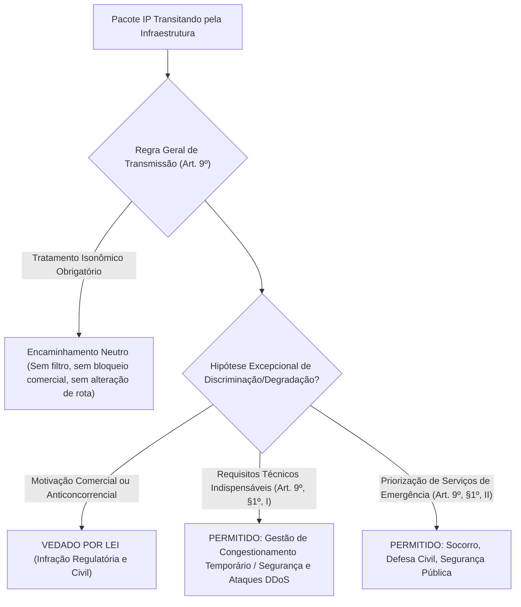
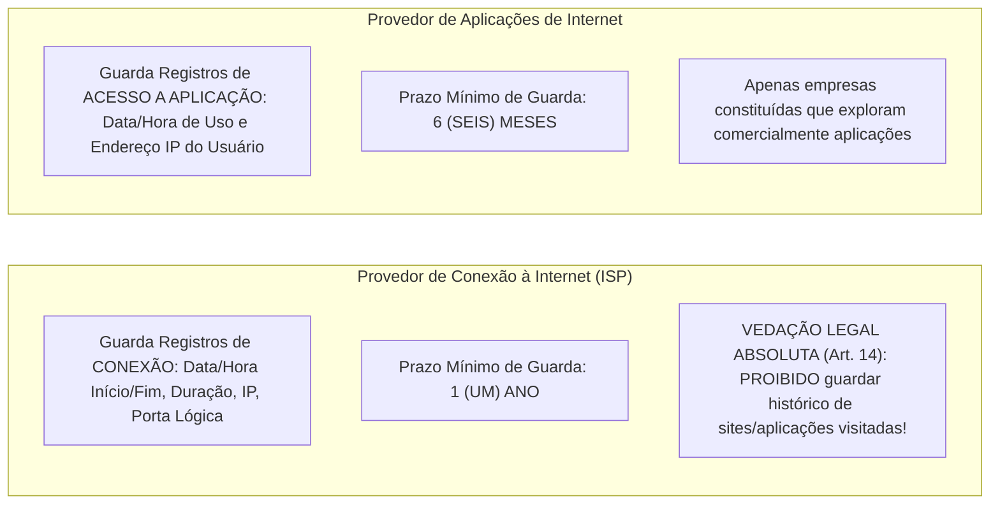
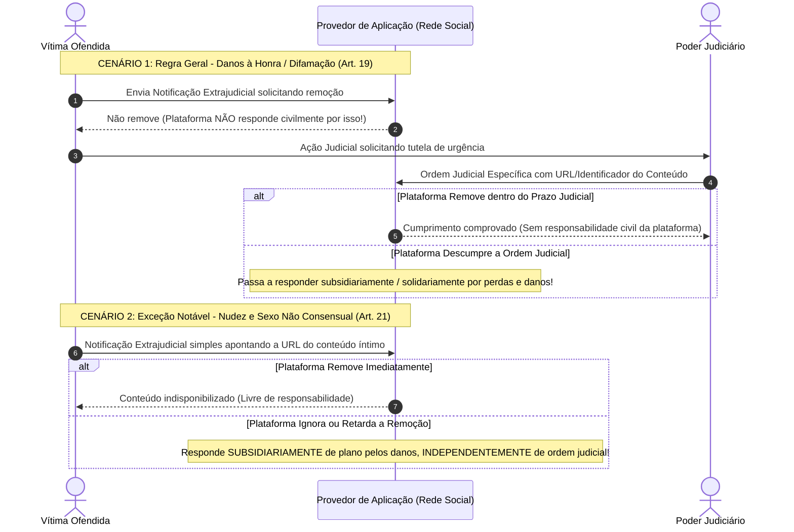

# 02 - Marco Civil da Internet (Lei nº 12.965/2014)

> **Matéria:** Legislação Aplicada à Tecnologia da Informação  
> **Cargo:** B02 – Técnico de Controle Externo – Especialidade: Tecnologia da Informação  
> **Arquivo:** `02_marco_civil_da_internet_lei_12965_2014.md`  
> **Ato Normativo:** Lei Federal nº 12.965, de 23 de abril de 2014 (Marco Civil da Internet) e Decreto nº 8.771, de 11 de maio de 2016

---

## 📌 Ementa / Itens do Edital
- Marco Civil da Internet (Lei nº 12.965/2014)
- Princípios, garantias e direitos dos usuários de Internet no Brasil
- Princípio da Neutralidade de Rede (Art. 9º da Lei e Decreto regulamentador)
- Regras e prazos para Guarda de Registros de Conexão e de Acesso a Aplicações
- Requisição judicial de registros e proteção da privacidade
- Responsabilidade civil por danos decorrentes de conteúdo gerado por terceiros (Arts. 18, 19 e 21)

---

## 🧭 Sumário
- [1. Princípios, Garantias e Conceituação Técnica (Arts. 2º a 8º)](#1-principios-garantias-e-conceituacao-tecnica-arts-2o-a-8o)
    - [1.1 Vocabulário Técnico-Jurídico Essencial (Art. 5º)](#11-vocabulario-tecnico-juridico-essencial-art-5o)
    - [1.2 Princípios e Direitos Fundamentais dos Usuários](#12-principios-e-direitos-fundamentais-dos-usuarios)
- [2. O Princípio da Neutralidade de Rede (Art. 9º e Decreto nº 8.771/2016)](#2-o-principio-da-neutralidade-de-rede-art-9o-e-decreto-no-87712016)
    - [2.1 Regra Geral de Tratamento Isonômico](#21-regra-geral-de-tratamento-isonomico)
    - [2.2 As Duas Únicas Exceções Legais à Neutralidade](#22-as-duas-unicas-excecoes-legais-a-neutralidade)
- [3. Regime de Guarda de Registros: Conexão vs. Aplicações de Internet](#3-regime-de-guarda-de-registros-conexao-vs-aplicacoes-de-internet)
    - [3.1 Distinção Conceitual e Prazos Obrigatórios de Guarda](#31-distincao-conceitual-e-prazos-obrigatorios-de-guarda)
    - [3.2 A Vedação Absoluta aos Provedores de Conexão (Art. 14)](#32-a-vedacao-absoluta-aos-provedores-de-conexao-art-14)
    - [3.3 Padrões de Segurança do Decreto nº 8.771/2016](#33-padroes-de-seguranca-do-decreto-no-87712016)
- [4. Reserva de Jurisdição para Quebra de Sigilo (Arts. 10 e 22)](#4-reserva-de-jurisdicao-para-quebra-de-sigilo-arts-10-e-22)
- [5. Responsabilidade Civil por Conteúdo Gerado por Terceiros (Arts. 18 a 21)](#5-responsabilidade-civil-por-conteudo-gerado-por-terceiros-arts-18-a-21)
    - [5.1 Imunidade Civil dos Provedores de Conexão (Art. 18)](#51-imunidade-civil-dos-provedores-de-conexao-art-18)
    - [5.2 Regra Geral dos Provedores de Aplicação (Art. 19 - Ordem Judicial Prévia)](#52-regra-geral-dos-provedores-de-aplicacao-art-19-ordem-judicial-previa)
    - [5.3 Exceção Crítica do Artigo 21 (Nudez e Sexo Não Consensual)](#53-excecao-critica-do-artigo-21-nudez-e-sexo-nao-consensual)
- [6. Fontes Recomendadas na Internet](#6-fontes-recomendadas-na-internet)

---

## 📖 Teoria Aprofundada & Fundamentos de Infraestrutura e Redes

## 1. Princípios, Garantias e Conceituação Técnica (Arts. 2º a 8º)

A **Lei nº 12.965/2014 (Marco Civil da Internet)** estabelece princípios, garantias, direitos e deveres para o uso da Internet no Brasil, determinando as diretrizes para a atuação da União, dos Estados, do Distrito Federal e dos Municípios.

### 1.1 Vocabulário Técnico-Jurídico Essencial (Art. 5º)

O Marco Civil consolidou definições obrigatórias para os profissionais de TI, especialmente nas áreas de redes de computadores, telecomunicações e desenvolvimento de software:

1. **Internet (Art. 5º, I):** O sistema constituído do conjunto de redes, protocolos e estruturas de comunicação baseado no protocolo IP (*Internet Protocol*), para comunicação entre pacotes de dados e dispositivos computacionais.
2. **Terminal (Art. 5º, II):** O computador ou qualquer dispositivo que se conecte à Internet (smartphones, roteadores, servidores, dispositivos IoT).
3. **Endereço IP - *Internet Protocol* (Art. 5º, III):** O código atribuído a um terminal de uma rede para permitir sua identificação, definido segundo parâmetros internacionais (IPv4 de 32 bits ou IPv6 de 128 bits).
4. **Porta Lógica de Origem (Decreto nº 8.771/2016, Art. 10):** Número que identifica o canal lógico de comunicação em conexões TCP/UDP (camada de transporte). É essencial para a identificação inequívoca de terminais sob arquiteturas de **CGNAT (*Carrier-Grade NAT* / RFC 6598)**, nas quais centenas de usuários compartilham simultaneamente o mesmo endereço IPv4 público.
5. **Administrador de Sistema Autônomo - AS (Art. 5º, IV):** Pessoa física ou jurídica que administra blocos de endereçamento IP e respectivo sistema autônomo de roteamento (ex.: operadoras e provedores com ASNs registrados no Registro.br / LACNIC).
6. **Conexão à Internet (Art. 5º, V):** A habilitação de um terminal para envio e recebimento de pacotes de dados na Internet, mediante a atribuição de um endereço IP.
7. **Provedor de Conexão à Internet (ISP):** Entidade que viabiliza a habilitação de terminais para tráfego de dados na rede (ex.: operadoras de telecomunicações, provedores regionais de banda larga).
8. **Aplicações de Internet (Art. 5º, VII):** O conjunto de funcionalidades que podem ser acessadas por meio de um terminal conectado à Internet (websites, redes sociais, sistemas de e-mail, plataformas de streaming, APIs governamentais).
9. **Provedor de Aplicações de Internet:** Pessoa natural ou jurídica que disponibiliza serviços, plataformas e aplicações na Internet, explorados ou não comercialmente.

---

### Questão 01 (FCC - Analista de Sistemas - Redes e Telecomunicações - Adaptada)
**Enunciado:** O Artigo 5º da Lei nº 12.965/2014 (Marco Civil da Internet) estabelece definições técnicas canônicas para a disciplina do uso da internet no Brasil. Com base nessas definições legais e no Decreto nº 8.771/2016, assinale a afirmativa correta:  

* **A)** O endereço IP é definido como o computador físico ou qualquer dispositivo móvel que se conecte diretamente a uma tomada de energia.
* **B)** A porta lógica de origem é um elemento descartável e sem relevância probatória, sendo expressamente proibido seu registro sob a arquitetura de Carrier-Grade NAT (CGNAT).
* **C)** Provedor de Conexão à Internet é a pessoa jurídica que fornece unicamente serviços de correio eletrônico e streaming de vídeo sob demanda.
* **D)** Conexão à Internet é a habilitação de um terminal para envio e recebimento de pacotes de dados na Internet, mediante a atribuição ou autenticação de um endereço IP.
* **E)** Aplicações de Internet limitam-se exclusivamente aos navegadores web instalados em computadores desktop de repartições públicas.

> **Comentário Detalhado:**
>
> - **A)** Incorreta. Computador ou dispositivo que se conecta à internet é o **Terminal** (Art. 5º, II). O **Endereço IP** é o código atribuído a um terminal para permitir sua identificação lógica (Art. 5º, III).
> - **B)** Incorreta. A porta lógica de origem é essencial para identificar o usuário específico sob CGNAT, no qual dezenas de conexões compartilham o mesmo endereço IPv4 público.
> - **C)** Incorreta. Quem fornece streaming e e-mail é o **Provedor de Aplicações de Internet** (Art. 5º, VII). O Provedor de Conexão habilita o terminal na rede (ISP).
> - **D)** **Correta.** Definição literal do Art. 5º, inciso V do Marco Civil: Conexão à Internet é a habilitação de um terminal para envio e recebimento de pacotes de dados na Internet, mediante a atribuição ou autenticação de um endereço IP.
> - **E)** Incorreta. Aplicações de Internet abrangem qualquer conjunto de funcionalidades acessíveis por terminal conectado à rede (redes sociais, sites, APIs, nuvem).
> 
> **Gabarito: D**

---

### 1.2 Princípios e Direitos Fundamentais dos Usuários

Os princípios da disciplina do uso da Internet no Brasil incluem a garantia da liberdade de expressão, comunicação e manifestação de pensamento; a proteção da privacidade e dos dados pessoais; a preservação da estabilidade, segurança e funcionalidade da rede por meio de padrões técnicos universais; e a neutralidade da rede.

São direitos fundamentais do usuário da internet (Art. 7º):

- Inviolabilidade da intimidade e da vida privada, sua proteção e indenização por dano material ou moral;
- Inviolabilidade e sigilo do fluxo de suas comunicações pela Internet, salvo por expressa **ordem judicial**;
- Não suspensão da conexão à Internet, salvo por débito diretamente decorrente de sua utilização;
- Informações claras e completas sobre coleta, uso, armazenamento e tratamento de dados pessoais.

---

### Questão 02 (FCC - Analista Judiciário - Tecnologia da Informação - Adaptada)
**Enunciado:** Em conformidade com o Art. 7º do Marco Civil da Internet (Lei nº 12.965/2014), o acesso à internet é essencial ao exercício da cidadania, sendo assegurados aos usuários diversos direitos fundamentais. A respeito desses direitos, assinale a afirmativa correta:  

* **A)** O sigilo das comunicações privadas armazenadas e do fluxo de comunicações na internet é inviolável, salvo por expressa e fundamentada ordem judicial nas hipóteses legais.
* **B)** As operadoras de telecomunicações podem suspender unilateralmente a conexão do usuário caso ele publique críticas políticas a autoridades públicas locais.
* **C)** É permitido aos provedores de internet comercializar os dados cadastrais e o histórico de navegação dos usuários sem o seu consentimento livre e informado.
* **D)** A navegação na internet implica renúncia tácita e perpétua a qualquer indenização por dano moral decorrente de violação da intimidade.
* **E)** O usuário não tem direito à exclusão definitiva dos dados pessoais que forneceu a uma aplicação de internet ao término da relação jurídica entre as partes.

> **Comentário Detalhado:**
>
> - **A)** **Correta.** O Art. 7º, incisos II e III da Lei nº 12.965/2014 estabelece a inviolabilidade e o sigilo do fluxo de comunicações e das comunicações privadas armazenadas, admitindo-se a quebra de sigilo exclusivamente por ordem judicial.
> - **B)** Incorreta. A suspensão da conexão só é permitida em decorrência de débito financeiro diretamente decorrente da utilização do serviço (Art. 7º, IV).
> - **C)** Incorreta. A cessão a terceiros de dados requer consentimento expresso, destacado e informado (Art. 7º, VII).
> - **D)** Incorreta. A inviolabilidade da intimidade e o direito à indenização plena por danos materiais e morais são garantias expressas (Art. 7º, I).
> - **E)** Incorreta. O titular tem direito expresso à exclusão definitiva dos seus dados ao término da relação, ressalvadas as hipóteses legais de guarda (Art. 7º, X).
> 
> **Gabarito: A**

---

## 2. O Princípio da Neutralidade de Rede (Art. 9º e Decreto nº 8.771/2016)

A **Neutralidade de Rede** é a garantia legal de que os dados transmitidos pela infraestrutura de telecomunicações devem ser tratados de forma estritamente isonômica, independentemente do tipo de conteúdo, origem, destino, terminal utilizado ou aplicativo gerador.

### 2.1 Regra Geral de Tratamento Isonômico

- O responsável pela transmissão, comutação ou roteamento tem o dever de tratar quaisquer pacotes de dados de forma **isonômica**, sem distinção por conteúdo, origem, destino, terminal ou aplicação.
- **Proibições Rígidas:**
    - Bloquear ou degradar pacotes de protocolos peer-to-peer (P2P/BitTorrent) ou de voz sobre IP (VoIP/WhatsApp) para forçar o consumidor a contratar pacotes de telefonia da própria operadora;
    - Cobrar tarifas adicionais de empresas de streaming para conceder tráfego acelerado prioritário (*fast lanes* comerciais pagas);
    - Monitorar e inspecionar o conteúdo dos pacotes (*Deep Packet Inspection - DPI*) para fins de direcionamento comercial ou degradação seletiva.

---

### 2.2 As Duas Únicas Exceções Legais à Neutralidade

A discriminação ou degradação de tráfego somente poderá decorrer de duas hipóteses taxativas (Art. 9º, § 1º):

1. **Requisitos técnicos indispensáveis à prestação adequada dos serviços e aplicações:**
    - Gestão de congestionamento temporário de redes (garantindo que o tráfego crítico não colapse a rede como um todo);
    - Preservação da segurança e estabilidade da rede (mitigação em tempo real de ataques DDoS, contenção de tráfego de botnets e bloqueio de portas vulneráveis disseminadoras de malware).

2. **Priorização de serviços de emergência:**
    - Roteamento e garantia de banda prioritária para comunicações críticas de socorro, SAMU, Corpo de Bombeiros, Defesa Civil e forças de segurança pública durante catástrofes e desastres.

> 🚨 **ALERTA DE PROVA / PEGADINHA FCC:**  
> A banca FCC frequentemente afirma que o provedor de internet pode degradar tráfego de vídeo ou jogos livremente caso isso conste expressamente em contrato assinado com o consumidor. **ASSERTIVA TOTALMENTE ERRADA!** A neutralidade de rede é norma de ordem pública indisponível. Cláusulas contratuais que prevejam degradação por motivos comerciais ou anticoncorrenciais são absolutamente nulas. As únicas exceções são requisitos técnicos de segurança/estabilidade e serviços de emergência.

---

### Questão 03 (FCC - Técnico Judiciário / Tecnologia da Informação)
**Enunciado:** Uma empresa operadora de telecomunicações que fornece acesso à Internet em banda larga implementou uma política técnica em seus roteadores de borda para estrangular (*traffic shaping*) o tráfego de aplicações de chamadas telefônicas via Internet (VoIP) e de transmissão de vídeo ao vivo pertencentes a concorrentes, alegando em seus contratos de adesão que "a gestão dinâmica de pacotes visa assegurar a viabilidade comercial dos planos básicos". À luz do princípio da Neutralidade de Rede (Art. 9º da Lei nº 12.965/2014 e Decreto nº 8.771/2016):  

* **A)** A conduta da empresa é plenamente lícita, pois as normas de mercado conferem liberdade irrestrita às operadoras para discriminar pacotes conforme interesses comerciais próprios.
* **B)** A prática viola frontalmente o princípio da neutralidade de rede, o qual impõe o dever de tratar quaisquer pacotes de dados de forma isonômica, vedando a degradação motivada por interesses comerciais ou anticoncorrenciais.
* **C)** A degradação de tráfego somente seria considerada ilícita se a velocidade fosse reduzida a zero; reduções parciais de velocidade são expressamente autorizadas pelo Decreto nº 8.771/2016.
* **D)** A neutralidade de rede é um conceito meramente programático e ético, desprovido de qualquer cogência legal ou sanção administrativa no direito brasileiro.
* **E)** A discriminação de pacotes só pode ocorrer se houver anuência prévia e expressa do Conselho Administrativo de Defesa Econômica (CADE) para cada conexão individualizada.

> **Comentário Detalhado:**
>
> - **A)** Incorreta. O Art. 9º, caput, veda expressamente a discriminação ou privilégio de pacotes com base em interesses comerciais. A neutralidade impede que a operadora favoreça serviços próprios ou de parceiros em detrimento de concorrentes.
> - **B)** **Correta.** O Marco Civil da Internet (Art. 9º) e o Decreto nº 8.771/2016 consagram a neutralidade de rede como dever de tratar quaisquer pacotes de dados com isonomia, sem distinção por conteúdo, origem, destino, terminal ou aplicação. As únicas exceções admitidas são requisitos técnicos indispensáveis à estabilidade/segurança da rede ou priorização de serviços de emergência (Art. 9º, § 1º). Motivação comercial constitui infração grave.
> - **C)** Incorreta. Qualquer degradação, ainda que parcial, decorrente de motivações anticoncorrenciais ou comerciais é ilícita perante o Art. 9º.
> - **D)** Incorreta. A neutralidade de rede é norma jurídica vinculante e cogente. Seu descumprimento sujeita o infrator a sanções de advertência, multa de até 10% do faturamento, suspensão temporária e proibição de exercício de atividades (Art. 12).
> - **E)** Incorreta. A lei não prevê autorização caso a caso pelo CADE para discriminação de pacotes em conexões individuais; a regra geral mandatória é a isonomia.
> 
> **Gabarito: B**

---

## 3. Regime de Guarda de Registros: Conexão vs. Aplicações de Internet

O Marco Civil da Internet estabeleceu um regime binário de guarda de registros (*logs*), impondo deveres, prazos e proibições distintos para provedores de conexão e provedores de aplicação:

### 3.1 Distinção Conceitual e Prazos Obrigatórios de Guarda

| Aspecto | Provedor de Conexão à Internet (ISP) | Provedor de Aplicação de Internet |
|---|---|---|
| **Dispositivo Legal** | Art. 13 da Lei nº 12.965/2014 | Art. 15 da Lei nº 12.965/2014 |
| **Quem é obrigado?** | Administrador de Sistema Autônomo (AS) devidamente constituído. | Pessoa jurídica constituída que exerça atividade de forma organizada, profissionalmente e com fins econômicos. |
| **O que é guardado?** | **Registros de Conexão:** Data e hora de início e término, duração da sessão, endereço IP atribuído e porta lógica de origem. | **Registros de Acesso a Aplicações:** Data e hora de início e término do uso da aplicação e respectivo endereço IP de origem. |
| **Prazo Legal de Guarda** | **1 (UM) ANO** | **6 (SEIS) MESES** |
| **Ambiente de Guarda** | Sob sigilo, em ambiente controlado e de segurança (Decreto 8.771/2016). | Sob sigilo, em ambiente controlado e de segurança (Decreto 8.771/2016). |
| **Pode guardar histórico de sites?** | ❌ **TERMINANTEMENTE PROIBIDO (Art. 14)!** Não pode guardar registros de acesso a aplicações. | Apenas registra os acessos à sua própria aplicação (não aos sites concorrentes). |
| **Prorrogação Cautelar** | Autoridade policial ou MP pode requerer cautelarmente que os registros sejam guardados por prazo superior enquanto tramita a ordem judicial (Art. 13, § 2º). | Idem: autoridade policial ou MP pode solicitar cautelarmente a preservação de dados (Art. 15, § 2º). |

> 🚨 **ALERTA DE PROVA / PEGADINHA FCC:**  
> Grave os prazos sem chance de confusão:  
>
> - **C**onexão = **1** ano (palavra "Conexão" lembra início de tudo: 1 ano).  
> - **A**plicação = **6** meses (a metade do tempo da conexão).  
> A FCC adora inverter esses dois prazos em enunciados assertivos!

---

### Questão 04 (FCC - Auditor de Controle Externo / Tecnologia da Informação)
**Enunciado:** Em decorrência de fraude eletrônica em sistema de pagamento de tributos estaduais, a Delegacia Fazendária instaurou inquérito policial e emitiu ofício administrativo diretamente ao provedor de acesso à Internet (ISP) do principal suspeito, determinando:  

I. O fornecimento imediato dos logs completos de conexão à Internet do investigado (endereço IP, porta lógica, data e hora de conexão) referentes aos últimos doze meses.  

II. O fornecimento do histórico detalhado de todas as páginas web, endereços URL e serviços em nuvem visitados pelo usuário no mesmo período.  

Recebido o ofício, a assessoria técnica e jurídica do provedor de conexão analisou os pedidos com base estrita na Lei nº 12.965/2014 (Marco Civil da Internet). O provedor deve:  

* **A)** Atender integralmente a ambos os itens, visto que a autoridade policial detém prerrogativa legal incondicionada de requisição direta de quaisquer dados e logs de rede durante inquéritos.
* **B)** Recusar o fornecimento direto dos logs de conexão do item I por ausência de ordem judicial prévia e declarar a impossibilidade absoluta de cumprimento do item II, haja vista que a legislação veda expressamente aos provedores de conexão a guarda de registros de acesso a aplicações de internet.
* **C)** Atender ao item II, mantendo sob sigilo o item I por se tratar de segredo de telecomunicações regido unicamente pela Anatel.
* **D)** Cumprir o item I apenas pelo período de seis meses, prazo máximo de guarda de conexão permitido por lei, e fornecer o histórico do item II mediante pagamento de custas administrativas.
* **E)** Atender ao item I apenas se o Ministério Público ratificar administrativamente a ordem do Delegado, sendo o item II de fornecimento obrigatório pelo prazo de 5 anos.

> **Comentário Detalhado:**
>
> - **A)** Incorreta. A autoridade policial não possui prerrogativa de requisição direta sobre logs de conexão e de aplicação. O Marco Civil da Internet consagra a estrita reserva de jurisdição (Art. 10, § 1º): a disponibilização desses dados depende indispensavelmente de ordem judicial fundamentada.
> - **B)** **Correta.** A conduta correta do provedor de conexão é exatamente recusar o item I até que sobrevenha decisão judicial fundamentada (Art. 10, § 1º e Art. 13, § 1º) e recusar categoricamente o item II com esteio no Art. 14, que estabelece expressamente: *"Na provisão de conexão à internet, é vedada a guarda dos registros de acesso a aplicações de internet"*. Provedores de conexão não podem rastrear nem armazenar o histórico de navegação.
> - **C)** Incorreta. O item II jamais pode ser atendido pelo ISP, pois a legislação proíbe expressamente a guarda do histórico de sites navegados.
> - **D)** Incorreta. O prazo de guarda de registros de conexão para ISPs é de 1 ano (Art. 13), e não 6 meses. Além disso, o histórico de navegação (aplicações) não pode ser guardado pelo ISP sob hipótese alguma.
> - **E)** Incorreta. A ratificação do MP não substitui a ordem judicial emanada pelo magistrado competente. Não existe previsão legal de guarda de histórico por 5 anos pelo ISP.
> 
> **Gabarito: B**

---

### Questão 05 (FCC - Analista de Redes e Telecomunicações)
**Enunciado:** Um portal de notícias e rede social corporativa com sede e operação no Brasil, mantido por pessoa jurídica com fins lucrativos, armazena registros de seus usuários. Sob as regras específicas de guarda de registros de acesso a aplicações de internet contidas no Art. 15 da Lei nº 12.965/2014, o administrador dessa aplicação:  

* **A)** Deve manter os registros de acesso a aplicações sob sigilo, em ambiente controlado e de segurança, pelo prazo mínimo de 6 (seis) meses.
* **B)** É obrigado a guardar os registros de acesso a aplicações pelo prazo de 1 (um) ano, idêntico ao prazo imposto aos provedores de conexão à internet.
* **C)** Não tem obrigação legal de guardar registros de acesso, salvo se houver requerimento formal de seus acionistas.
* **D)** Pode comercializar os registros de acesso a anunciantes publicitários sem necessidade de consentimento dos usuários.
* **E)** Deve guardar os registros por tempo indeterminado e mantê-los em acesso público aberto em formato JSON.

> **Comentário Detalhado:**
>
> - **A)** **Correta.** O Art. 15 da Lei nº 12.965/2014 preceitua que o provedor de aplicações de internet constituído na forma de pessoa jurídica e que exerça essa atividade de forma organizada, profissionalmente e com fins econômicos deverá manter os respectivos registros de acesso a aplicações de internet, sob sigilo, em ambiente controlado e de segurança, pelo prazo de 6 (seis) meses.
> - **B)** Incorreta. O prazo de 1 ano aplica-se aos provedores de conexão (Art. 13), e não aos provedores de aplicações (cujo prazo é de 6 meses).
> - **C)** Incorreta. A guarda por 6 meses é imposição legal cogente para empresas constituídas com fins econômicos, não dependendo de deliberação de acionistas.
> - **D)** Incorreta. Os registros devem ser guardados sob estrito sigilo. A comercialização sem base legal e consentimento específico viola frontalmente a LGPD e o Marco Civil (Art. 7º, VII).
> - **E)** Incorreta. A guarda perpétua e pública viola o princípio da segurança e a inviolabilidade da intimidade e privacidade dos usuários (Art. 7º, I).
> 
> **Gabarito: A**

---

### 3.2 A Vedação Absoluta aos Provedores de Conexão (Art. 14)

O Art. 14 da Lei nº 12.965/2014 prevê expressamente:
> *"Na provisão de conexão à internet, cabe ao administrador de sistema autônomo respectivo a guarda dos registros de conexão, pelo prazo de 1 (um) ano (...). É VEDADA A GUARDA DOS REGISTROS DE ACESSO A APLICAÇÕES DE INTERNET NA PROVISÃO DE CONEXÃO."*

Isso significa que o provedor de banda larga (como Claro, Vivo, Oi ou provedores locais) **não pode bisbilhotar nem gravar quais sites, vídeos ou serviços o usuário navegou**. O provedor sabe apenas que o usuário estava conectado à internet e qual IP ele utilizou, mas não o que ele consumiu na web.

---

### Questão 06 (FCC - Auditor de Controle Externo / TI - Adaptada)
**Enunciado:** Durante a fiscalização de segurança e conformidade da infraestrutura de telecomunicações de um órgão estadual, os auditores analisaram o cumprimento das obrigações impostas aos provedores de conexão à internet. Nos termos do Art. 14 da Lei nº 12.965/2014 (Marco Civil da Internet), na provisão de conexão à internet:  

* **A)** É obrigatória a gravação em disco e indexação dos títulos de todos os vídeos e páginas web acessados por cada usuário, pelo prazo de cinco anos.
* **B)** É expressamente vedada a guarda dos registros de acesso a aplicações de internet.
* **C)** O provedor de conexão deve compartilhar os logs de navegação dos cidadãos com agências de publicidade mediante pagamento de taxa de administração.
* **D)** O administrador de sistema autônomo é obrigado a monitorar e interceptar o tráfego criptografado HTTPS sem necessidade de autorização judicial.
* **E)** A guarda dos registros de conexão é facultativa, podendo ser excluída a critério de conveniência da operadora de telecomunicações.

> **Comentário Detalhado:**
>
> - **A)** Incorreta. É expressamente proibido aos provedores de conexão vigiar e registrar o histórico de navegação e as páginas que o usuário consome.
> - **B)** **Correta.** O Art. 14 da Lei nº 12.965/2014 veda expressamente a guarda dos registros de acesso a aplicações de internet na provisão de conexão à internet. O ISP guarda unicamente os registros de conexão (endereço IP, data/hora de início e fim da conexão), sem registrar quais sites ou aplicações foram acessados.
> - **C)** Incorreta. A comercialização de registros de navegação é manifestamente ilegal.
> - **D)** Incorreta. O provedor de conexão não pode interceptar nem inspecionar o fluxo de dados dos usuários sem ordem judicial.
> - **E)** Incorreta. A guarda dos registros de conexão é obrigação legal cogente pelo prazo de 1 ano (Art. 13).
> 
> **Gabarito: B**

---

### 3.3 Padrões de Segurança do Decreto nº 8.771/2016

Os responsáveis pela guarda de registros devem obrigatoriamente seguir padrões mínimos de segurança da informação (Art. 13 do Decreto nº 8.771/2016):

1. **Controle Estrito de Acesso:** Definição formal das funções dos colaboradores autorizados a acessar os logs;
2. **Autenticação Segura:** Mecanismos de autenticação de duplo fator para os administradores dos dados;
3. **Registro de Auditoria de Acessos:** Criação de inventário detalhado com data, hora, identidade do operador e arquivo acessado;
4. **Criptografia:** Soluções de cifração robusta para os dados armazenados em repouso e em trânsito.

---

## 4. Reserva de Jurisdição para Quebra de Sigilo (Arts. 10 e 22)

O fornecimento de registros de conexão e de acesso a aplicações de internet submete-se à **estrita cláusula de reserva de jurisdição**:

1. **Inviolabilidade das Comunicações Privadas:** São invioláveis a intimidade, o sigilo do fluxo de comunicações pela Internet e o sigilo de dados armazenados, salvo expressa **ordem judicial** (Art. 7º, II e III).
2. **Dados Cadastrais vs. Logs de Conexão/Aplicação:**
    - *Dados Cadastrais Básicos (Filiação, Endereço residencial, Nome, CPF):* Podem ser requisitados diretamente por autoridades administrativas e policiais nos termos de leis específicas (Lei de Lavagem de Dinheiro nº 9.613/1998 e Lei de Organizações Criminosas nº 12.850/2013).
    - *Logs de Conexão e de Aplicação (IP, porta lógica, data, hora, duração):* Exigem **SEMPRE ordem judicial prévia**. Nenhuma autoridade administrativa (nem Delegado de Polícia, nem Promotor de Justiça, nem Auditor de Controle Externo) pode requisitá-los diretamente sem mandado do juiz competente.

3. **Requisitos da Petição de Quebra de Registros (Art. 22, parágrafo único):**
    - Fundados indícios da ocorrência do ilícito;
    - Justificativa motivada da utilidade dos registros para fins de investigação ou instrução probatória;
    - Período determinado ao qual se referem os registros (são vedadas ordens genéricas de devassa indeterminada).

---

### Questão 07 (FCC - Auditor Estadual de Controle Externo / TI - Adaptada)
**Enunciado:** A requisição de dados perante provedores de internet é regulada pelo Marco Civil da Internet sob rigoroso regime de garantias. Em relação à requisição de dados cadastrais e de registros de conexão e de aplicações (Arts. 10 e 22), assinale a afirmativa correta:  

* **A)** Registros de conexão (IP, data, hora, porta lógica) podem ser requisitados diretamente por qualquer autoridade administrativa sem mandado judicial.
* **B)** A quebra de sigilo de registros de conexão ou de registros de acesso a aplicações de internet exige sempre expressa e motivada ordem judicial, sob pena de nulidade probatória.
* **C)** O juiz pode expedir ordem genérica e indeterminada para que um provedor entregue todos os registros de acessos de todos os cidadãos de um estado durante dez anos, sem indício de ilícito.
* **D)** Dados cadastrais de qualificação pessoal (como nome, filiação e endereço) possuem o mesmo tratamento probatório estrito dos conteúdos de mensagens sigilosas.
* **E)** Os provedores de internet estrangeiros que prestam serviços no Brasil estão dispensados de cumprir a legislação brasileira e ordens judiciais emitidas por juízes nacionais.

> **Comentário Detalhado:**
>
> - **A)** Incorreta. O fornecimento de registros de conexão e de acesso submete-se à cláusula de reserva de jurisdição (exige ordem judicial). Apenas dados cadastrais básicos podem ser solicitados por autoridades legalmente autorizadas.
> - **B)** **Correta.** Conforme os Arts. 10, § 1º e 22 do Marco Civil, os registros de conexão e de acesso a aplicações só podem ser disponibilizados mediante ordem judicial fundamentada que aponte fundados indícios de ilícito, justificativa da utilidade e período determinado.
> - **C)** Incorreta. Ordens genéricas (*fishing expeditions*) são expressamente vedadas pelo Art. 22, parágrafo único (exige período determinado e indícios de crime).
> - **D)** Incorreta. A jurisprudência e a lei diferenciam dados cadastrais (acessíveis com menor formalidade) de registros de conexão e conteúdo de comunicações (protegidos por reserva judicial estrita).
> - **E)** Incorreta. Conforme o Art. 11, aplica-se a lei brasileira a qualquer empresa que preste serviços ao público brasileiro ou que tenha filial no país.
> 
> **Gabarito: B**

---

## 5. Responsabilidade Civil por Conteúdo Gerado por Terceiros (Arts. 18 a 21)

A responsabilização das plataformas por publicações, comentários, postagens e vídeos feitos pelos usuários estrutura-se em um regime jurídico tripartite:

### 5.1 Imunidade Civil dos Provedores de Conexão (Art. 18)

O provedor de conexão à internet **não responderá civilmente** por danos decorrentes de conteúdo gerado por terceiros em nenhuma hipótese. Ele atua como mero conduto de transmissão de pacotes (*mere conduit*), sem poder de gerência sobre o conteúdo transmitido.

---

### 5.2 Regra Geral dos Provedores de Aplicação (Art. 19 - Ordem Judicial Prévia)

- Com o intuito de assegurar a liberdade de expressão e impedir a censura privada pelas empresas de tecnologia, o provedor de aplicações de internet somente poderá ser responsabilizado civilmente por danos decorrentes de conteúdo gerado por terceiros **se, após ordem judicial específica, não tomar as providências para, no âmbito e nos limites técnicos do seu serviço e dentro do prazo assinalado, tornar indisponível o conteúdo apontado como infringente**.
- Notificações extrajudiciais privadas (cartas de advogados, e-mails de reclamação) **não** geram responsabilidade civil para a plataforma na regra geral!

---

### Questão 08 (FCC - Analista Judiciário - Área Apoio Especializado / TI - Adaptada)
**Enunciado:** O regime de responsabilidade civil por danos decorrentes de conteúdo gerado por terceiros na internet foi disciplinado nos artigos 18 e 19 da Lei nº 12.965/2014. A respeito desse regime jurídico, assinale a afirmativa correta:  

* **A)** O provedor de conexão à internet responde solidariamente por todas as postagens caluniosas feitas pelos usuários que utilizam seus cabos de fibra óptica.
* **B)** O provedor de aplicações de internet (como uma rede social) responde civilmente de plano por injúrias publicadas por terceiros assim que recebe uma notificação extrajudicial enviada por e-mail pelo ofendido.
* **C)** O provedor de conexão à internet não responderá civilmente por danos decorrentes de conteúdo gerado por terceiros (Art. 18).
* **D)** A regra geral do Artigo 19 estabelece que o provedor de aplicações é proibido de cumprir ordens judiciais de remoção de conteúdos ilegais.
* **E)** As plataformas de internet são obrigadas a censurar previamente todo e qualquer texto ou comentário antes que ele seja publicado na rede.

> **Comentário Detalhado:**
>
> - **A)** Incorreta. Pelo Art. 18, o provedor de conexão goza de imunidade civil absoluta por danos causados por conteúdos veiculados por terceiros.
> - **B)** Incorreta. Na regra geral (Art. 19), a responsabilidade civil do provedor de aplicação depende de prévia ordem judicial específica; notificações extrajudiciais privadas não geram o dever de indenizar pela manutenção do conteúdo (salvo na exceção de nudez/sexo não consensual do Art. 21).
> - **C)** **Correta.** Redação expressa do Art. 18 da Lei nº 12.965/2014: "O provedor de conexão à internet não responderá civilmente por danos decorrentes de conteúdo gerado por terceiros."
> - **D)** Incorreta. O descumprimento da ordem judicial atrai a responsabilização civil subsidiária da plataforma.
> - **E)** Incorreta. A censura prévia é expressamente vedada pela Constituição Federal e pelo Marco Civil.
> 
> **Gabarito: C**

---

### 5.3 Exceção Crítica do Artigo 21 (Nudez e Sexo Não Consensual)

O Artigo 21 constitui a exceção mais importante e cobrada em provas de concurso:

- Aplica-se à divulgação não autorizada de imagens, vídeos ou materiais contendo **cenas de nudez ou de atos sexuais de caráter privado** ("pornografia de vingança").
- **Condição de Responsabilização:** O provedor responderá subsidiariamente se, **após o recebimento de simples notificação pelo participante ou seu representante legal**, deixar de promover de forma diligente a indisponibilização do conteúdo.
- **NÃO exige ordem judicial!** A notificação extrajudicial da vítima contendo elementos que permitam identificar o material (URL) é suficiente para impor a obrigação de derrubada imediata.

---

### Questão 09 (FCC - Auditor Fiscal / Tecnologia da Informação)
**Enunciado:** Uma usuária de rede social teve fotos íntimas suas, contendo cenas de nudez e atos sexuais de caráter privado, divulgadas sem seu consentimento por um ex-namorado em perfil público de grande alcance. A usuária enviou uma notificação eletrônica fundamentada diretamente aos administradores da rede social, apontando expressamente o endereço eletrônico (URL) das imagens e exigindo a remoção incontinenti do conteúdo íntimo não autorizado. A plataforma recusou a remoção alegando que, nos termos da regra geral do Marco Civil da Internet, só é obrigada a excluir postagens mediante intimação de ordem judicial transitada em julgado.  
Considerando as disposições específicas do Art. 21 da Lei nº 12.965/2014:  

* **A)** A plataforma agiu corretamente, pois nenhuma exceção à exigência de ordem judicial prévia foi recepcionada pela legislação brasileira.
* **B)** A recusa da plataforma enseja sua responsabilidade subsidiária pelas perdas e danos sofridos pela vítima, pois a divulgação não autorizada de nudez ou atos sexuais privados gera o dever de remoção imediata após simples notificação pelo ofendido ou seu representante legal, independentemente de ordem judicial.
* **C)** O conteúdo só poderia ser removido se a vítima registrasse previamente boletim de ocorrência internacional perante a Interpol.
* **D)** A plataforma responde de forma penal por homicídio qualificado em concurso formal com o autor da publicação.
* **E)** A responsabilidade da plataforma restringe-se ao pagamento de multa administrativa à Anatel, vedada qualquer reparação de cunho cível à ofendida.

> **Comentário Detalhado:**
>
> - **A)** Incorreta. O Art. 21 é a exceção expressa à regra do Art. 19. Para os casos de materiais contendo nudez ou atos sexuais de caráter privado divulgados sem autorização ("pornografia de vingança"), dispensa-se a prévia ordem judicial.
> - **B)** **Correta.** O Art. 21 dispõe: *"O provedor de aplicações de internet que disponibilize conteúdo gerado por terceiros será responsabilizado subsidiariamente pela violação da intimidade decorrente da divulgação, sem autorização de seus participantes, de imagens, vídeos ou outros materiais contendo cenas de nudez ou de atos sexuais de caráter privado quando, após o recebimento de notificação pelo participante ou seu representante legal, deixar de promover, de forma diligente, no âmbito e nos limites técnicos do seu serviço, a indisponibilização desse conteúdo"*. Como a plataforma recusou a remoção após notificação com indicação de URL, ela passa a responder subsidiariamente pelos danos.
> - **C)** Incorreta. A lei exige apenas a notificação formal pelo participante contendo elementos que permitam a identificação específica do material. Não há exigência de boletim de ocorrência policial.
> - **D)** Incorreta. O Marco Civil disciplina a responsabilidade civil por danos, e a tipificação de crimes sexuais decorre do Código Penal, inexistindo relação com homicídio no contexto apresentado.
> - **E)** Incorreta. A lei prevê expressamente a responsabilidade civil (reparação de danos morais e materiais à vítima), não se limitando a sanções administrativas.
> 
> **Gabarito: B**

---

### Questão 10 (FCC - Analista Judiciário / Área Apoio Especializado / TI)
**Enunciado:** Determinado usuário de uma popular plataforma de compartilhamento de vídeos publicou material ofensivo atribuindo falsamente a prática de crime de improbidade administrativa a um servidor público. O servidor notificou extrajudicialmente a plataforma por meio de carta com aviso de recebimento (AR), exigindo a retirada imediata do vídeo. A plataforma manteve o vídeo no ar. Posteriormente, o servidor ingressou com ação judicial e o juiz deferiu liminar ordenando a remoção do conteúdo em 24 horas sob pena de multa diária. A plataforma removeu o conteúdo 6 horas após ser formalmente intimada da decisão judicial.  
À luz do regime de responsabilidade civil por danos de terceiros previsto no Art. 19 da Lei nº 12.965/2014:  

* **A)** A plataforma responde solidariamente pelos danos desde o recebimento da notificação extrajudicial com AR, pois tomou ciência inequívoca da ilicitude do vídeo.
* **B)** O provedor de aplicação não responderá civilmente pelos danos decorrentes do conteúdo gerado pelo terceiro, uma vez que cumpriu a ordem judicial específica dentro do prazo estipulado pelo magistrado.
* **C)** Os provedores de aplicações respondem objetivamente por qualquer conteúdo postado por usuários, independentemente de notificação ou ordem judicial.
* **D)** A plataforma é imune à jurisdição brasileira caso seus servidores físicos estejam localizados fora do território nacional.
* **E)** A responsabilidade civil recai exclusivamente sobre a operadora de telecomunicações que forneceu a conexão de internet ao autor do vídeo ofensivo.

> **Comentário Detalhado:**
>
> - **A)** Incorreta. Na regra geral do Art. 19 do Marco Civil, a notificação extrajudicial não gera o dever de remoção nem acarreta responsabilidade civil para a plataforma. O modelo brasileiro adotou o critério da ordem judicial prévia específica para configuração do dever indenizatório do provedor de aplicação.
> - **B)** **Correta.** Pelo Art. 19, o provedor de aplicações só responde civilmente se, após ordem judicial específica, não tomar as providências para tornar o conteúdo indisponível no prazo assinalado. Como a plataforma removeu o vídeo em 6 horas (dentro do prazo judicial de 24 horas), ela cumpriu estritamente a ordem judicial e não incorre em responsabilidade civil.
> - **C)** Incorreta. O Marco Civil expressamente afastou a responsabilidade objetiva das plataformas pelo conteúdo de terceiros para preservar a liberdade de expressão e evitar a censura privada prévia.
> - **D)** Incorreta. O Art. 11 estabelece que a legislação brasileira se aplica a qualquer operação de coleta, guarda e tratamento de dados por pessoas jurídicas que prestem serviços ao público brasileiro, mesmo que os servidores físicos estejam sediados no exterior.
> - **E)** Incorreta. O provedor de conexão possui imunidade civil absoluta por conteúdo de terceiros nos termos do Art. 18 (*"O provedor de conexão à internet não responderá civilmente por danos decorrentes de conteúdo gerado por terceiros"*).
> 
> **Gabarito: B**

---

## 6. Fontes Recomendadas na Internet

* [Lei nº 12.965/2014 (Marco Civil da Internet)](https://www.planalto.gov.br/ccivil_03/_ato2011-2014/2014/lei/l12965.htm) - Estabelece princípios, garantias, direitos e deveres para o uso da Internet no Brasil.
* [Decreto nº 8.771/2016 (Regulamento do Marco Civil da Internet)](https://www.planalto.gov.br/ccivil_03/_ato2015-2018/2016/decreto/d8771.htm) - Regulamenta a neutralidade de rede, a guarda de registros e os padrões de segurança de dados.
* [Comitê Gestor da Internet no Brasil (CGI.br) - Estrutura e Governança](https://cgi.br/sobre/) - Histórico, competências institucionais e princípios fundamentais de governança da Internet no Brasil.
* [IETF RFC 8446 - The Transport Layer Security (TLS) Protocol Version 1.3](https://datatracker.ietf.org/doc/html/rfc8446) - Norma técnica que viabiliza a inviolabilidade e o sigilo das comunicações previsto no art. 7º do Marco Civil.
* [Governo Digital - Infraestrutura Nacional de Dados (IND)](https://www.gov.br/governodigital/pt-br/infraestrutura-nacional-de-dados) - Governança e compartilhamento de dados governamentais conforme as garantias do Marco Civil.
* PINHEIRO, Patricia Peck. **Direito Digital**. 7. ed. São Paulo: SaraivaJur, 2021. (Cap. 3 - Marco Civil da Internet: Responsabilidade e Registros).
* SOUZA, Carlos Affonso; LEMOS, Ronaldo. **Marco Civil da Internet: Construção e Aplicação**. São Paulo: Revista dos Tribunais, 2014. (Cap. 1 - Neutralidade de Rede; Cap. 2 - Guarda de Registros e Privacidade).
* BLUM, Renato Opice. **Marco Civil da Internet Comentado**. São Paulo: Quartier Latin, 2015. (Arts. 9º a 17 - Responsabilidade Civil dos Provedores).
