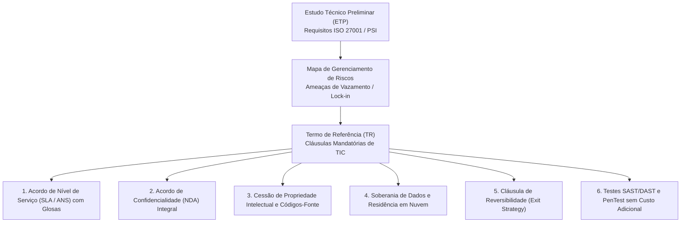
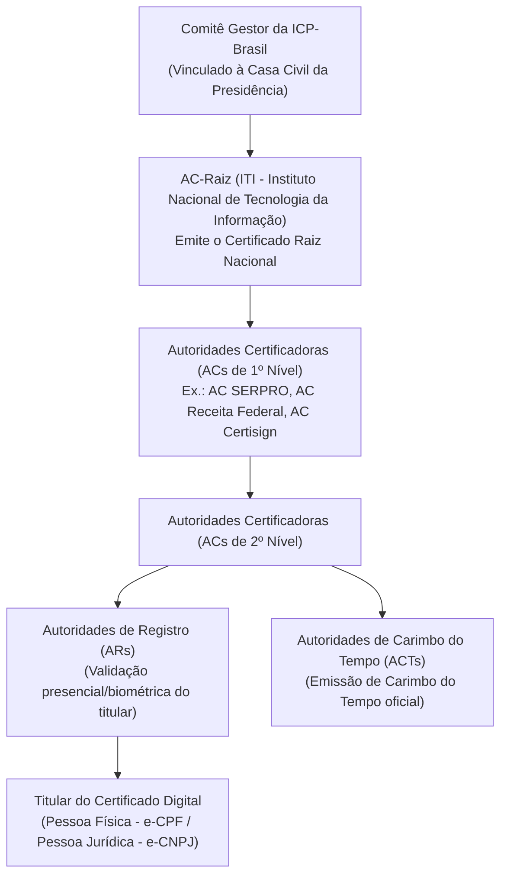
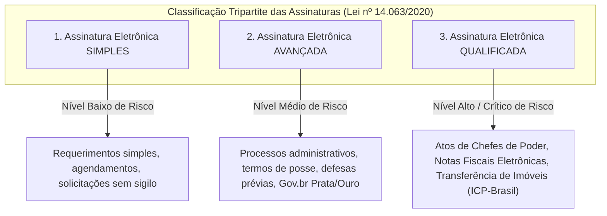

# 03 - Segurança em Contratações de TIC e Certificação Digital

> **Matéria:** Legislação Aplicada à Tecnologia da Informação  
> **Cargo:** B02 – Técnico de Controle Externo – Especialidade: Tecnologia da Informação  
> **Arquivo:** `03_seguranca_em_contratacoes_e_certificacao_digital.md`  
> **Atos Normativos:** Medida Provisória nº 2.200-2/2001 (ICP-Brasil), Lei Federal nº 14.063/2020 (Assinaturas Eletrônicas em Entes Públicos) e Lei Federal nº 14.133/2021 (Lei de Licitações e Contratos Administrativos)

---

## 📌 Ementa / Itens do Edital
- Requisitos de segurança da informação em editais e contratos de soluções de TIC
- Cláusulas essenciais de segurança, confidencialidade (NDA), privacidade e soberania de dados
- Certificação digital e infraestrutura de chaves públicas (MP nº 2.200-2/2001)
- Lei Federal nº 14.063/2020 (Assinaturas Eletrônicas em Interações com Entes Públicos)
- Aplicação prática da certificação digital em sistemas informatizados de processos e auditoria eletrônica

---

## 🧭 Sumário
- [1. Requisitos de Segurança em Contratações de TIC no Setor Público](#1-requisitos-de-segurança-em-contratações-de-tic-no-setor-público)
  - [1.1 Fases do Planejamento e Segurança da Informação](#11-fases-do-planejamento-e-segurança-da-informação)
  - [1.2 Cláusulas Contratuais Críticas de Segurança](#12-cláusulas-contratuais-críticas-de-segurança)
- [2. O Marco Legal da Certificação Digital e a ICP-Brasil (MP nº 2.200-2/2001)](#2-o-marco-legal-da-certificação-digital-e-a-icp-brasil-mp-nº-2200-22001)
  - [2.1 Estrutura e Atores da ICP-Brasil](#21-estrutura-e-atores-da-icp-brasil)
  - [2.2 Tipos de Certificados Digitais ICP-Brasil (A1 vs. A3)](#22-tipos-de-certificados-digitais-icp-brasil-a1-vs-a3)
  - [2.3 Presunção Legal de Veracidade e Validade de Assinaturas Não-ICP](#23-presunção-legal-de-veracidade-e-validade-de-assinaturas-não-icp)
- [3. Classificação Tripartite das Assinaturas Eletrônicas (Lei nº 14.063/2020)](#3-classificação-tripartite-das-assinaturas-eletrônicas-lei-nº-140632020)
  - [3.1 Assinaturas Simples, Avançadas e Qualificadas](#31-assinaturas-simples-avançadas-e-qualificadas)
  - [3.2 Princípio da Proporcionalidade e Hipóteses de Uso](#32-princípio-da-proporcionalidade-e-hipóteses-de-uso)
- [4. Aplicação Prática da Certificação Digital na Auditoria e Processo Eletrônico](#4-aplicação-prática-da-certificação-digital-na-auditoria-e-processo-eletrônico)
- [5. Fontes Recomendadas na Internet](#5-fontes-recomendadas-na-internet)
- [6. Questões Comentadas no Padrão FCC](#6-questões-comentadas-no-padrão-fcc)

---

## 📖 Teoria Aprofundada & Fundamentos de Governança e Criptografia

## 1. Requisitos de Segurança em Contratações de TIC no Setor Público

A contratação de soluções de Tecnologia da Informação e Comunicação (TIC) na Administração Pública rege-se pela Lei nº 14.133/2021 (Lei de Licitações e Contratos Administrativos), em conjunto com normativos de governança digital (como a Instrução Normativa SGD/MGI nº 94/2022) e a jurisprudência consolidada do Tribunal de Contas da União (TCU) e dos Tribunais de Contas Estaduais.

### 1.1 Fases do Planejamento e Segurança da Informação

A segurança da informação não pode ser um apêndice acrescentado após a assinatura do contrato; ela deve ser arquitetada desde o início do planejamento da contratação:

1. **Documento de Oficialização da Demanda (DOD):** Identifica formalmente a necessidade institucional da área requisitante.
2. **Estudo Técnico Preliminar (ETP):** Mapeia a viabilidade técnica e define requisitos mandatórios de segurança da informação, alinhando a contratação à Política de Segurança da Informação (PSI) do Tribunal e aos padrões ABNT NBR ISO/IEC 27001 (Sistemas de Gestão de Segurança da Informação) e 27002 (Controles de Segurança).
3. **Mapa de Gerenciamento de Riscos:** Identifica ameaças cibernéticas, indisponibilidade, dependência de fornecedor (*vendor lock-in*) e vazamento de dados pessoais (LGPD), desenhando planos preventivos e contingenciais.
4. **Termo de Referência (TR):** Especifica objetivamente os requisitos técnicos, indicadores do Instrumento de Medição de Resultado (IMR), níveis mínimos de serviço e cláusulas resolutivas.

---

### 1.2 Cláusulas Contratuais Críticas de Segurança

| Cláusula Contratual | Justificativa Técnica e Jurídica | Regra de Fiscalização e Controle Externo |
|---|---|---|
| **Acordo de Nível de Serviço (SLA / ANS)** | Define metas quantitativas mensuráveis (disponibilidade mínima de 99,8%, tempo de resposta para incidentes críticos $\le 1\text{h}$, RTO e RPO). | É **vedado o pagamento por homem-hora puro** sem atrelamento a resultados mensuráveis e qualidade (Súmula TCU nº 269). O descumprimento do SLA acarreta glosa financeira proporcional na fatura mensal. |
| **Termo de Confidencialidade (NDA)** | Impõe dever de segredo sobre dados, infraestrutura, credenciais, topologia de rede e regras de negócio do órgão. | Deve ser assinado pela pessoa jurídica contratada **e individualmente** por cada profissional ou prestador alocado na execução do contrato. |
| **Propriedade Intelectual e Códigos-Fonte** | Assegura que toda a solução customizada desenvolvida para a Administração pertença ao ente público. | O contrato deve obrigar a entrega periódica de commits no repositório de controle de versão do órgão (Git institucional), documentação técnica, diagramas e scripts de implantação (IaC). |
| **Soberania e Residência de Dados (Cloud)** | Protege a informação governamental contra jurisdições estrangeiras conflitantes (como o *Cloud Act* americano). | Exigência de que os dados sensíveis e críticos sejam armazenados em data centers localizados no território brasileiro ou em países com grau de proteção equivalente reconhecido pela ANPD. |
| **Cláusula de Reversibilidade (*Exit Strategy*)** | Evita o aprisionamento tecnológico (*vendor lock-in*) ao término do contrato. | Obriga o prestador a fornecer, ao fim do contrato ou em caso de rescisão, a exportação integral dos dados em formatos interoperáveis (SQL, JSON, CSV), auxílio na migração e destruição segura comprovada de cópias remanescentes. |
| **Auditoria e PenTest Periódico** | Garante que o software entregue não contenha vulnerabilidades do *OWASP Top 10* ou portas dos fundos (*backdoors*). | O Tribunal reserva-se o direito de executar varreduras estáticas (SAST), dinâmicas (DAST) e testes de intrusão (PenTest), obrigando a contratada a corrigir quaisquer falhas críticas sem ônus. |

> 🚨 **ALERTA DE PROVA / PEGADINHA FCC:**  
> A FCC adora cobrar a Súmula nº 269 do TCU em provas de governança de TIC: *"Nas contratações para prestação de serviços de tecnologia da informação, a remuneração deve ser vinculada a resultados ou ao alcance de níveis de serviço, sendo vedada a contratação com base exclusivamente em homem-hora"*. Além disso, contratos em nuvem sem cláusula de reversibilidade (*Exit Strategy*) são reiteradamente apontados como irregulares por auditorias de controle externo.

---

## 2. O Marco Legal da Certificação Digital e a ICP-Brasil (MP nº 2.200-2/2001)

A **Infraestrutura de Chaves Públicas Brasileira (ICP-Brasil)** foi instituída pela Medida Provisória nº 2.200-2, de 24 de agosto de 2001, com o propósito de garantir a autenticidade, a integridade e a validade jurídica de documentos em forma eletrônica, das aplicações de suporte e das aplicações habilitadas que utilizem certificados digitais.

### 2.1 Estrutura e Atores da ICP-Brasil

1. **Comitê Gestor da ICP-Brasil:** Colegiado interministerial vinculado à Casa Civil responsável por formular políticas públicas e normativos técnicos da certificação digital no país.
2. **Autoridade Certificadora Raiz (AC-Raiz):** Operada privativamente pelo **Instituto Nacional de Tecnologia da Informação (ITI)**, autarquia federal. É a autoridade executiva máxima que emite os certificados das ACs de primeiro nível e credencia/fiscaliza as entidades da infraestrutura.
3. **Autoridade Certificadora (AC):** Entidade pública ou privada credenciada responsável por emitir, renovar, revogar e distribuir certificados digitais, além de manter a Lista de Certificados Revogados (LCR / CRL) e servidores OCSP (*Online Certificate Status Protocol*).
4. **Autoridade de Registro (AR):** Entidade vinculada a uma AC encarregada da verificação documental e validação biométrica do solicitante. A AR **não assina certificados**, apenas confere a identidade do titular.
5. **Autoridade de Carimbo do Tempo (ACT):** Entidade credenciada responsável por atestar, com base na hora legal brasileira emitida pelo Observatório Nacional, que determinado documento eletrônico existia em uma data e horário exatos.

---

### 2.2 Tipos de Certificados Digitais ICP-Brasil (A1 vs. A3)

- **Certificados Tipo A (Assinatura Digital):** Destinados à comprovação de autoria, integridade e não-repúdio.
  - **A1:** Chave privada gerada por software e armazenada diretamente no computador ou dispositivo móvel (arquivo protegido por senha, padrão PKCS#12 / extensão `.pfx` ou `.p12`). Validade máxima de **1 ano**.
  - **A3:** Chave privada gerada e armazenada em hardware inviolável (*Smart Card*, *Token USB* criptográfico ou HSM com padrão mínimo FIPS 140-2 Level 2). A chave privada não pode ser copiada nem extraída do dispositivo. Validade de **até 3 ou 5 anos**.
- **Certificados Tipo S (Sigilo / Criptografia):** Utilizados para garantir a confidencialidade de arquivos e mensagens por meio de cifração assimétrica.
- **Certificados Tipo T (Tempo):** Utilizados pelas ACTs para emissão de carimbos do tempo.

---

### 2.3 Presunção Legal de Veracidade e Validade de Assinaturas Não-ICP

- **Art. 10, § 1º (Regime ICP-Brasil):** Os documentos eletrônicos assinados digitalmente com certificados emitidos no âmbito da ICP-Brasil presumem-se verdadeiros em relação aos signatários na forma do art. 219 do Código Civil. Há **presunção legal relativa (*juris tantum*) de autoria e integridade**.
- **Art. 10, § 2º (Regime Não-ICP-Brasil):** O dispositivo assegura a validade de **outros meios de comprovação da autoria e integridade** de documentos em forma eletrônica, inclusive os que utilizem certificados não emitidos pela ICP-Brasil, **desde que admitido pelas partes como válido ou aceito pela pessoa a quem for oposto o documento**.

> 🚨 **ALERTA DE PROVA / PEGADINHA FCC:**  
> A MP 2.200-2/2001 **não** proibiu nem tornou nulas as assinaturas eletrônicas fora da ICP-Brasil! O Art. 10, § 2º autoriza explicitamente assinaturas não-ICP se aceitas pelos participantes, o que forneceu a base jurídica para as assinaturas Gov.br e sistemas corporativos.

---

## 3. Classificação Tripartite das Assinaturas Eletrônicas (Lei nº 14.063/2020)

A Lei Federal nº 14.063/2020 disciplinou o uso das assinaturas eletrônicas nas interações entre cidadãos e pessoas jurídicas com o Poder Público, dividindo-as em três modalidades:

### 3.1 Assinaturas Simples, Avançadas e Qualificadas

| Modalidade de Assinatura | Requisitos Técnicos Legais | Exemplos Práticos no Setor Público | Hipóteses de Uso Típicas e Vedações |
|---|---|---|---|
| **Simples** (Art. 3º, I) | Permite identificar o seu signatário e anexa ou associa dados a outros dados eletrônicos do signatário. | Login com usuário e senha em portal de ouvidoria; confirmação por link de e-mail ou código SMS; formulário de agendamento. | - Permitida em interações de baixo risco que não envolvam informações protegidas por sigilo. - **Vedada** para transferência de bens imóveis ou atos de segurança de Estado. |
| **Avançada** (Art. 3º, II) | a) Associada ao signatário de maneira unívoca; b) Utiliza dados para criação sob controle exclusivo do signatário; c) Relacionada aos dados de tal modo que qualquer alteração posterior é detectável. | Assinatura no portal **Gov.br (contas nível Prata e Ouro)**; certificados digitais corporativos emitidos pelo Tribunal para seus próprios servidores. | - Amplamente aceita em processos administrativos ordinários, manifestações processuais perante o TCE-GO e celebração de contratos comuns. - **Regra preferencial** para desonerar o cidadão! |
| **Qualificada** (Art. 3º, III) | É **obrigatoriamente** aquela gerada mediante o uso de certificado digital emitido pela **ICP-Brasil** (MP 2.200-2/2001). | Assinatura com token A3 ou arquivo A1 ICP-Brasil em acórdãos de Tribunais, decisões judiciais e emissão de notas fiscais. | - **Exigência mandatória restrita:** 1. Atos assinados por Chefes de Poder, Ministros e titulares de Poder; 2. Emissão de Notas Fiscais Eletrônicas (salvo MEI); 3. Transferência e registro de bens imóveis. |

---

### 3.2 Princípio da Proporcionalidade e Hipóteses de Uso

O Art. 5º, § 2º da Lei nº 14.063/2020 fixou o **Princípio da Vedação ao Excesso de Exigência**:
> *"É VEDADA a exigência de assinatura eletrônica qualificada nas interações com o ente público se a assinatura eletrônica simples ou avançada for suficiente para a mitigação de risco e para o atingimento da finalidade pretendida."*

A regra visa desonerar o cidadão do custo de adquirir certificados digitais pagos em cartórios e autoridades certificadoras para meros requerimentos administrativos ordinários.

> 🚨 **ALERTA DE PROVA / PEGADINHA FCC:**  
> A expressão **"Assinatura Qualificada"** na Lei nº 14.063/2020 é privativa e exclusiva de certificados **ICP-Brasil**. Nenhuma assinatura avançada (nem mesmo a conta Gov.br nível Ouro) pode ser chamada de "qualificada" em prova de concurso!

---

## 4. Aplicação Prática da Certificação Digital na Auditoria e Processo Eletrônico

Nos sistemas informatizados de auditoria governamental e processo eletrônico do Tribunal de Contas do Estado de Goiás (TCE-GO), a certificação digital cumpre funções técnicas fundamentais:

1. **Processo Eletrônico (PAdES e Carimbo do Tempo):**
   - Assinatura no padrão PAdES (*PDF Advanced Electronic Signatures*) com inserção de **Carimbo do Tempo (Timestamp)** emitido por Autoridade de Carimbo do Tempo (ACT) credenciada. O carimbo garante comprovação incontestável de que o relatório de auditoria ou acórdão foi assinado antes do término do prazo legal ou regimental, mesmo que a chave do certificado expire posteriormente.
2. **Autenticação Mútua Máquina-a-Máquina (mTLS):**
   - Na interoperabilidade entre os clusters do TCE-GO e da SEFAZ-GO para coleta automatizada de dados fiscais e contábeis, a comunicação utiliza APIs protegidas por mTLS (*mutual TLS*), em que tanto o cliente quanto o servidor apresentam certificados digitais X.509 no handshake criptográfico, prevenindo ataques do tipo *Man-in-the-Middle*.
3. **Módulos de Segurança em Hardware (HSM - *Hardware Security Module*):**
   - Os certificados digitais institucionais utilizados para emissão de certidões eletrônicas em lote ficam custodiados em hardware inviolável (HSM) certificado FIPS 140-2 Nível 3, impedindo o vazamento da chave privada institucional por invasões cibernéticas.

---

## 5. Fontes Recomendadas na Internet

- [x] **Medida Provisória nº 2.200-2/2001 (Portal do Planalto):**
  - Link Oficial: [Texto Integral da MP nº 2.200-2/2001](http://www.planalto.gov.br/ccivil_03/mpv/2200-2.htm)
  - *Conteúdo:* Criação da ICP-Brasil, atribuições do ITI e validade jurídica de documentos eletrônicos (Art. 10).
- [x] **Lei Federal nº 14.063/2020 (Portal do Planalto):**
  - Link Oficial: [Texto Integral da Lei nº 14.063/2020](http://www.planalto.gov.br/ccivil_03/_ato2019-2022/2020/lei/l14063.htm)
  - *Conteúdo:* Definições de assinatura simples, avançada e qualificada e regras para serviços públicos.
- [x] **Instituto Nacional de Tecnologia da Informação (ITI - Gov.br):**
  - Link Oficial: [Portal Oficial do ITI - AC-Raiz](https://www.gov.br/iti/pt-br)
  - *Conteúdo:* Normas do Comitê Gestor da ICP-Brasil, especificações dos padrões A1/A3 e carimbo do tempo.
- [x] **Guia de Contratações de Soluções de TIC (Secretaria de Governo Digital - MGI):**
  - Link Oficial: [Modelos e Guias de Contratação de TIC](https://www.gov.br/governodigital/pt-br/contratacoes-de-tic)
  - *Conteúdo:* Diretrizes para elaboração de ETP, TR, acordos de níveis de serviço (SLA) e matriz de riscos.

---

## 6. Questões Comentadas no Padrão FCC

### Questão 1 (FCC - Auditor Estadual de Controle Externo / Tecnologia da Informação)
**Enunciado:** O Tribunal de Contas de determinado Estado publicou edital de licitação para contratação de desenvolvimento e sustentação de sistemas de auditoria contábil. No termo de referência e na minuta contratual, a comissão de planejamento estipulou as seguintes cláusulas:  
I. O pagamento mensal à contratada dar-se-á estritamente com base na quantidade bruta de horas trabalhadas apontadas pelos funcionários da empresa terceirizada em folha de ponto, sem qualquer vinculação à conclusão de entregáveis ou cumprimento de acordos de nível de serviço (SLA).  
II. A contratada e todos os seus colaboradores alocados no projeto deverão firmar Acordo de Confidencialidade e Não Divulgação (NDA) sob pena de rescisão contratual e penalidades legais.  
III. Todos os códigos-fonte, esquemas de bancos de dados, scripts de infraestrutura e documentação técnica desenvolvidos no âmbito do contrato pertencerão exclusivamente ao Tribunal de Contas, devendo ser versionados continuamente no repositório institucional do órgão.  
IV. Ao término da vigência contratual, a contratada fica obrigada a realizar a transição assistida, exportar e entregar todos os dados em formatos abertos e estruturados, comprovando a destruição segura de quaisquer cópias em seu poder (cláusula de reversibilidade).  
À luz da legislação de licitações, jurisprudência do controle externo e normas de segurança da informação em TIC:  
A) As cláusulas I, II, III e IV estão em perfeita conformidade com as boas práticas administrativas.  
B) Apenas a cláusula I é irregular perante as normas de controle externo, sendo as cláusulas II, III e IV regulares e essenciais para a segurança e governança de TIC.  
C) A cláusula III é ilegal, pois a legislação de propriedade intelectual veda a transferência de direitos autorais de software para órgãos públicos contratantes.  
D) A cláusula IV é prescindível e contraria o princípio da livre iniciativa por impor custos de desmobilização à contratada.  
E) A cláusula II viola a presunção de boa-fé dos prestadores de serviço e não tem eficácia jurídica na esfera administrativa.  

> **Comentário Detalhado:**
> - **A)** Incorreta. A cláusula I é manifestamente irregular e ilegal perante as normas de finanças públicas e licitações.
> - **B)** **Correta.** A cláusula I é ilegal e contraria frontalmente a Súmula TCU nº 269 (*"Nas contratações para prestação de serviços de TI, a remuneração deve ser vinculada a resultados ou ao alcance de níveis de serviço, sendo vedada a contratação com base exclusivamente em homem-hora"*). As cláusulas II (NDA), III (propriedade intelectual do código-fonte) e IV (cláusula de reversibilidade / *exit strategy*) são obrigatórias para resguardar a soberania e a segurança tecnológica do órgão público.
> - **C)** Incorreta. A legislação de software e a Lei nº 14.133/2021 estabelecem que os direitos patrimoniais sobre códigos desenvolvidos por encomenda no âmbito de contratos públicos pertencem à Administração contratante.
> - **D)** Incorreta. A cláusula de reversibilidade é fundamental para impedir o aprisionamento tecnológico (*vendor lock-in*).
> - **E)** Incorreta. O termo de confidencialidade (NDA) é plenamente válido e mandatório para proteger informações estratégicas.
> 
> **Gabarito: B**

---

### Questão 2 (FCC - Técnico de Controle Externo / Tecnologia da Informação)
**Enunciado:** Um cidadão interessado em acompanhar as contas públicas de seu município acessa o Portal do Cidadão do Tribunal de Contas para solicitar cópia de relatórios de gestão fiscal já publicados no diário oficial. O sistema informatizado exige, para a conclusão do requerimento de acesso à informação (LAI), que o cidadão assine digitalmente o formulário utilizando obrigatoriamente um certificado digital pessoal no padrão ICP-Brasil (token A3 físico).  
Considerando as regras sobre níveis de assinaturas eletrônicas previstas na Lei Federal nº 14.063/2020:  
A) A exigência do Tribunal é plenamente legal, tendo em vista que todo e qualquer ato processual perante entes públicos exige certificado digital ICP-Brasil qualificado.  
B) A exigência é desproporcional e ilegal, pois a Lei nº 14.063/2020 veda que os órgãos públicos imponham exigência de assinatura qualificada quando a assinatura simples ou avançada (como a conta Gov.br) for suficiente para mitigar os riscos da interação.  
C) A assinatura eletrônica simples possui custo financeiro mais elevado do que a assinatura qualificada, justificando a imposição do token pelo Tribunal.  
D) A Lei nº 14.063/2020 aplica-se exclusivamente a empresas privadas concessionárias de serviços públicos, não vinculando os Tribunais de Contas.  
E) O cidadão só pode ser dispensado do certificado físico se outorgar procuração por instrumento público lavrada em cartório de notas.  

> **Comentário Detalhado:**
> - **A)** Incorreta. O Art. 5º da Lei nº 14.063/2020 autoriza expressamente o uso de assinaturas simples e avançadas na grande maioria dos atos com o Poder Público, reservando a qualificada para hipóteses excepcionais.
> - **B)** **Correta.** O Art. 5º, § 2º da Lei nº 14.063/2020 prevê expressamente a vedação ao excesso de exigência: é proibido aos órgãos públicos exigir assinatura qualificada (ICP-Brasil paga) quando a assinatura simples ou avançada for suficiente para atender à finalidade da interação com segurança razoável.
> - **C)** Incorreta. Assinaturas simples e avançadas pelo Gov.br são gratuitas; os certificados ICP-Brasil exigem compra comercial de hardware e taxas de emissão.
> - **D)** Incorreta. A lei vincula expressamente todos os entes públicos da Federação e seus respectivos Poderes e Tribunais de Contas.
> - **E)** Incorreta. A exigência de procuração cartorária violaria a Lei de Acesso à Informação e a Lei do Governo Digital.
> 
> **Gabarito: B**

---

### Questão 3 (FCC - Analista Judiciário / Tecnologia da Informação / Segurança da Informação)
**Enunciado:** A respeito da Infraestrutura de Chaves Públicas Brasileira (ICP-Brasil) instituída pela Medida Provisória nº 2.200-2/2001 e das características de seus certificados digitais:  
A) O certificado digital do tipo A1 possui sua chave privada armazenada de maneira inviolável em hardware criptográfico padrão FIPS 140-2 Level 3 e validade de 5 anos.  
B) A Autoridade Certificadora Raiz (AC-Raiz) da ICP-Brasil é operada de forma compartilhada por um consórcio de empresas privadas de telefonia sob concessão da Anatel.  
C) O certificado digital do tipo A3 armazena sua chave privada em hardware criptográfico (como cartão inteligente ou token criptográfico), impedindo sua cópia ou exportação, enquanto o certificado do tipo A1 é gerado por software e armazenado diretamente no computador ou dispositivo.  
D) Documentos eletrônicos assinados fora da estrutura da ICP-Brasil são nulos de pleno direito no Brasil, mesmo que as partes envolvidas tenham acordado expressamente sobre sua validade.  
E) A Autoridade de Registro (AR) possui a competência exclusiva de assinar digitalmente as Listas de Certificados Revogados (LCR) de todas as ACs subordinadas.  

> **Comentário Detalhado:**
> - **A)** Incorreta. O certificado A1 é gerado por software (arquivo PKCS#12) e possui validade máxima de 1 ano. Quem utiliza hardware inviolável é o certificado A3.
> - **B)** Incorreta. A AC-Raiz da ICP-Brasil é operada com exclusividade pelo ITI (Instituto Nacional de Tecnologia da Informação), autarquia pública federal.
> - **C)** **Correta.** Distinção técnica precisa: o certificado A3 gera e armazena a chave privada em dispositivo físico inviolável (smart card, token USB ou HSM) e não permite exportação; o certificado A1 reside em arquivo protegido por senha no computador.
> - **D)** Incorreta. O Art. 10, § 2º da MP 2.200-2/2001 garante a validade jurídica de outros meios de comprovação de autoria e integridade não vinculados à ICP-Brasil se admitidos pelas partes.
> - **E)** Incorreta. A Autoridade de Registro (AR) realiza apenas a identificação do titular; a emissão e a assinatura de certificados e LCRs são atribuições da Autoridade Certificadora (AC).
> 
> **Gabarito: C**

---

### Questão 4 (FCC - Analista em Gestão e TI / Governança)
**Enunciado:** Nos termos da Lei Federal nº 14.063/2020, assinale a opção que descreve hipóteses em que é **obrigatória** a utilização da **assinatura eletrônica qualificada** (emitida por certificado digital ICP-Brasil):  
A) Requerimentos de agendamento de atendimento presencial em agências do trabalho e consultas cadastrais simples.  
B) Nos atos normativos assinados pelos Chefes de Poder, Ministros de Estado ou titulares de Poder ou de órgão constitucionalmente autônomo de ente federativo, bem como na emissão de notas fiscais eletrônicas (com ressalvas legais para MEI) e em atos de transferência de bens imóveis.  
C) Em todas as petições de esclarecimento em licitações públicas com valor estimado inferior a cinquenta mil reais.  
D) No envio de currículos profissionais para processos seletivos de estágio na administração direta.  
E) Exclusivamente em contratos celebrados entre particulares que versem sobre compra e venda de mercadorias no varejo.  

> **Comentário Detalhado:**
> - **A)** Incorreta. Em interações de baixo risco, a assinatura simples (login/senha) é suficiente.
> - **B)** **Correta.** O Art. 5º, § 1º da Lei nº 14.063/2020 elenca expressamente as situações em que a assinatura qualificada é indispensável: atos normativos de Chefes de Poder e titulares de órgãos autônomos; emissão de notas fiscais eletrônicas (salvo MEIs); e atos de transferência/registro de bens imóveis.
> - **C)** Incorreta. Petições administrativas ordinárias admitem amplamente assinatura eletrônica avançada (Gov.br Prata/Ouro).
> - **D)** Incorreta. Envio de currículos dispensa assinatura qualificada.
> - **E)** Incorreta. A lei disciplina as interações com entes públicos e estabelece a obrigatoriedade da assinatura qualificada para atos estatais solenes.
> 
> **Gabarito: B**

---

### Questão 5 (FCC - Auditor de Controle Externo / Redes e Infraestrutura)
**Enunciado:** O TCE-GO necessita implementar um mecanismo de auditoria contínua em tempo real sobre os sistemas de liquidação de despesa da Secretaria da Fazenda Estadual. Para garantir que a comunicação máquina-a-máquina entre os clusters de microsserviços de ambos os órgãos ocorra com autenticidade mútua, integridade de ponta a ponta e sem risco de ataques do tipo *Man-in-the-Middle*, a melhor prática de engenharia de segurança é:  
A) Implementar o protocolo HTTP plano com envio do token de autorização na URL como parâmetro de consulta (*query parameter*).  
B) Configurar autenticação mútua TLS (mTLS) utilizando certificados digitais X.509 em ambas as pontas da conexão, garantindo que o cliente e o servidor comprovem suas identidades criptograficamente e trafeguem os payloads cifrados com AES-GCM.  
C) Restringir o acesso unicamente por meio de verificação de cabeçalho *Referer* na camada de aplicação.  
D) Dispensar criptografia de transporte e utilizar chaves de API estáticas codificadas em Base64 em tráfego aberto.  
E) Utilizar assinatura eletrônica simples por e-mail para validar cada requisição JSON enviada individualmente.  

> **Comentário Detalhado:**
> - **A)** Incorreta. O protocolo HTTP plano transmite credenciais em texto claro pela rede e parâmetros em query string são gravados em logs intermediários de servidores proxy.
> - **B)** **Correta.** O mTLS (*Mutual Transport Layer Security*) exige certificados digitais X.509 tanto do cliente quanto do servidor, garantindo autenticação criptográfica mútua, sigilo de dados e proteção contra interceptação e ataques *Man-in-the-Middle*.
> - **C)** Incorreta. O cabeçalho *Referer* pode ser facilmente adulterado por atacantes e não oferece garantia criptográfica.
> - **D)** Incorreta. Base64 é mera codificação sem segurança; em tráfego aberto, os dados são interceptados facilmente.
> - **E)** Incorreta. Validação por e-mail é inviável tecnicamente para APIs RESTful de alta velocidade e não provê segurança ao canal de transporte.
> 
> **Gabarito: B**
