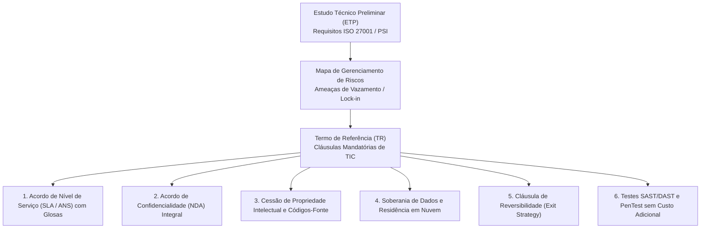
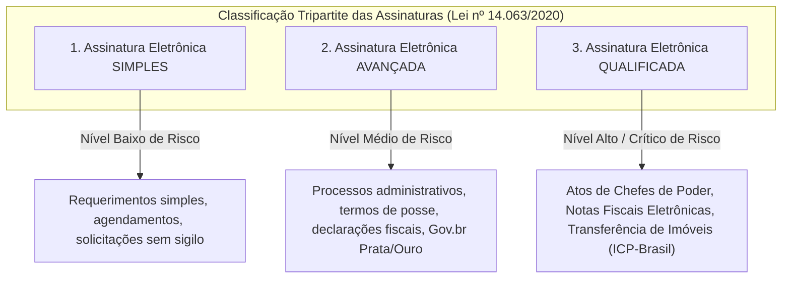

# 03 - Segurança em Contratações de TIC e Certificação Digital

> **Matéria:** Legislação Aplicada à Tecnologia da Informação  
> **Cargo:** B02 – Técnico de Controle Externo – Especialidade: Tecnologia da Informação  
> **Arquivo:** `03_seguranca_em_contratacoes_e_certificacao_digital.md`  
> **Atos Normativos:** Medida Provisória nº 2.200-2/2001 (ICP-Brasil), Lei Federal nº 14.063/2020 (Assinaturas Eletrônicas em Entes Públicos) e Lei Federal nº 14.133/2021 (Lei de Licitações e Contratos Administrativos)

---

## 📌 Ementa / Itens do Edital
- Requisitos de segurança da informação em editais e contratos de soluções de TIC
- Cláusulas essenciais de segurança, confidencialidade (NDA), privacidade e soberania de dados
- Certificação digital e infraestrutura de chaves públicas (MP nº 2.200-2/2001)
- Lei Federal nº 14.063/2020 (Assinaturas Eletrônicas em Interações com Entes Públicos)
- Aplicação prática da certificação digital em sistemas informatizados de processos e auditoria eletrônica

---

## 🌳 Classificação Hierárquica

```text
3. Segurança Contratual em TIC e Aplicação Prática de Certificação Digital
├── 3.1 Requisitos de Segurança da Informação em Contratações de TIC
│   ├── 3.1.1 Segurança por Padrão na Fase de Planejamento da Contratação:
│   │   ├── Definição de requisitos de segurança no Termo de Referência (TR) e no ETP
│   │   ├── Alinhamento com a Política de Segurança da Informação (PSI) do Tribunal
│   │   └── Exigência de conformidade com normas técnicas (família ABNT NBR ISO/IEC 27001 e 27002)
│   ├── 3.1.2 Cláusulas Contratuais Obrigatórias de Segurança:
│   │   ├── Acordo de Não Divulgação e Confidencialidade (NDA - Non-Disclosure Agreement) firmado pela contratada e por todos os colaboradores alocados
│   │   ├── Cláusulas de Propriedade Intelectual (cessão total dos códigos-fonte e documentação técnica à Administração Pública)
│   │   ├── Cláusula de Soberania de Dados: Obrigatoriedade de armazenamento em data centers geograficamente situados em território nacional ou com garantias explícitas de transferência internacional lícita
│   │   └── Cláusulas de Notificação Tempestiva de Incidentes de Segurança e Violação de Dados (Data Breach)
│   ├── 3.1.3 Segurança no Desenvolvimento Terceirizado:
│   │   ├── Obrigatoriedade de práticas de codificação segura (OWASP Top 10)
│   │   ├── Direito da Administração de realizar auditorias de código-fonte (SAST) e testes de invasão (PenTest) antes do aceite definitivo
│   │   └── Garantia e correção sem custos adicionais de vulnerabilidades de segurança detectadas
│   └── 3.1.4 Gestão de Descontinuidade e Saída (Exit Strategy): Reversibilidade de dados, entrega de backups limpos e destruição certificada de cópias em poder da contratada
├── 3.2 O Marco Legal da Certificação Digital e Assinaturas Eletrônicas
│   ├── 3.2.1 Medida Provisória nº 2.200-2/2001 (Instituição da ICP-Brasil):
│   │   ├── Autenticidade, integridade e validade jurídica de documentos em forma eletrônica
│   │   ├── Presunção legal de veracidade em relação aos signatários (§ 1º do Art. 10)
│   │   └── Validade de outros meios de comprovação de autoria e integridade aceitos pelas partes (§ 2º do Art. 10)
│   ├── 3.2.2 A Lei Federal nº 14.063/2020 (Classificação das Assinaturas Eletrônicas):
│   │   ├── 1. Assinatura Eletrônica Simples:
│   │   │   ├── Permite identificar o signatário e anexa dados a outros dados eletrônicos (ex.: login/senha básico, e-mail)
│   │   │   └── Aplicável a interações de menor impacto que não envolvam informações protegidas por sigilo
│   │   ├── 2. Assinatura Eletrônica Avançada:
│   │   │   ├── Associada ao signatário de maneira unívoca, sob seu controle exclusivo e que permite detectar qualquer alteração posterior
│   │   │   └── Exemplos: Assinaturas com autenticação Gov.br (níveis Prata e Ouro), assinaturas por certificado corporativo
│   │   └── 3. Assinatura Eletrônica Qualificada:
│   │       ├── Exclusivamente aquela gerada com utilização de certificado digital emitido no âmbito da ICP-Brasil
│   │       └── Exigência mandatória para: Atos de transferência de imóveis, emissão de notas fiscais eletrônicas e atos normativos assinados por Chefes de Poder
│   └── 3.2.3 Níveis de Exigência de Assinatura nos Serviços Públicos: Proibição de exigir assinatura qualificada quando a avançada ou simples for suficiente (evitar ônus desnecessário ao cidadão)
└── 3.3 Aplicação da Certificação Digital em Sistemas Informatizados
    ├── 3.3.1 Processo Administrativo e Judicial Eletrônico:
    │   ├── Assinatura de despachos, votos, relatórios de auditoria e acórdãos do Tribunal de Contas
    │   └── Validade temporal com Carimbo do Tempo (Timestamp) emitido por Autoridade de Carimbo do Tempo (ACT) credenciada
    ├── 3.3.2 Autenticação Mútua e Comunicação Segura entre Sistemas (mTLS):
    │   └── Uso de certificados digitais para autenticação direta máquina-a-máquina (APIs entre órgãos de controle)
    └── 3.3.3 Assinatura em Lote e Módulos de Segurança em Hardware (HSM - Hardware Security Module):
        └── Armazenamento seguro de chaves criptográficas institucionais em hardware inviolável padrão FIPS 140-2
```

---

## 📖 Teoria Aprofundada & Fundamentos de Governança e Criptografia

### 3.1 Requisitos de Segurança em Contratações de TIC no Setor Público

A contratação de bens e serviços de Tecnologia da Informação e Comunicação (TIC) na Administração Pública rege-se pela Lei nº 14.133/2021 (Nova Lei de Licitações e Contratos), em conjunto com normativos de governança digital (como a Instrução Normativa SGD/ME nº 94/2022) e a jurisprudência consolidada do TCU e tribunais estaduais.

#### 3.1.1 Fases do Planejamento da Contratação e Segurança da Informação
A segurança não pode ser tratada apenas após a assinatura do contrato; ela deve ser parametrizada desde a origem do processo de contratação:
1. **Documento de Formalização da Demanda (DFD):** Identifica a necessidade de negócio e a área requisitante.
2. **Estudo Técnico Preliminar (ETP):** Mapeia a viabilidade técnica e define requisitos mandatórios de segurança da informação, alinhando a solução à Política de Segurança da Informação (PSI) do Tribunal e às normas ABNT NBR ISO/IEC 27001 (Sistemas de Gestão de Segurança) e 27002 (Controles de Segurança).
3. **Mapa de Gerenciamento de Riscos:** Identifica riscos cibernéticos, indisponibilidade, dependência tecnológica (*vendor lock-in*) e vazamento de dados, estipulando planos de mitigação e contingência.
4. **Termo de Referência (TR) / Projeto Básico:** Detalha com precisão os requisitos técnicos, níveis mínimos de serviço e cláusulas contratuais resolutivas.



#### 3.1.2 Cláusulas Contratuais Críticas de Segurança da Informação

| Cláusula Contratual | Justificativa Técnica e Jurídica | Regra de Fiscalização e Controle Externo |
|---|---|---|
| **Acordo de Nível de Serviço (SLA / ANS)** | Define metas quantitativas mensuráveis (disponibilidade de 99,8%, tempo de resposta para incidentes críticos $\le 1\text{h}$, RTO e RPO). | É **vedado o pagamento por homem-hora puro** sem atrelamento a resultados e qualidade (Súmula TCU 269). O descumprimento do SLA acarreta glosa financeira proporcional na fatura mensal. |
| **Termo de Confidencialidade (NDA)** | Impõe dever de segredo sobre dados, infraestrutura, credenciais, topologia de rede e regras de negócio do órgão. | Deve ser assinado pela pessoa jurídica contratada **e individualmente** por cada profissional ou prestador alocado na execução do contrato. |
| **Propriedade Intelectual e Códigos-Fonte** | Assegura que toda a solução customizada desenvolvida para a Administração pertença ao ente público. | O contrato deve obrigar a entrega periódica de commits no repositório de controle de versão do órgão (Git institucional), documentação técnica, diagramas e scripts de implantação (IaC). |
| **Soberania e Residência de Dados (Cloud)** | Protege a informação governamental contra jurisdições estrangeiras conflitantes (como o *Cloud Act* americano). | Exigência de que os dados sensíveis e críticos sejam armazenados em data centers localizados no território brasileiro ou em países com grau de proteção equivalente reconhecido pela ANPD. |
| **Cláusula de Reversibilidade (*Exit Strategy*)** | Evita o aprisionamento tecnológico (*vendor lock-in*) ao término do contrato. | Obriga o prestador a fornecer, ao fim do contrato ou em caso de rescisão, a exportação integral dos dados em formatos interoperáveis (SQL, JSON, CSV), auxílio na migração e destruição segura comprovada de cópias remanescentes. |
| **Auditoria e PenTest Periódico** | Garante que o software entregue não contenha vulnerabilidades do *OWASP Top 10* ou portas dos fundos (*backdoors*). | O Tribunal reserva-se o direito de executar varreduras estáticas (SAST), dinâmicas (DAST) e testes de intrusão (PenTest), obrigando a contratada a corrigir quaisquer falhas críticas sem ônus. |

---

### 3.2 O Marco Legal da Certificação Digital e a ICP-Brasil (MP nº 2.200-2/2001)

A Infraestrutura de Chaves Públicas Brasileira (ICP-Brasil) foi instituída pela Medida Provisória nº 2.200-2, de 24 de agosto de 2001, com o propósito de garantir a autenticidade, a integridade e a validade jurídica de documentos em forma eletrônica, das aplicações de suporte e das aplicações habilitadas que utilizem certificados digitais.


#### 3.2.1 Atores da Estrutura da ICP-Brasil
1. **Comitê Gestor da ICP-Brasil:** Colegiado interministerial responsável por definir as políticas públicas e normativos técnicos da certificação digital no Brasil.
2. **Autoridade Certificadora Raiz (AC-Raiz):** Operada privativamente pelo **Instituto Nacional de Tecnologia da Informação (ITI)**. É a autoridade executiva máxima; emite os certificados das ACs de primeiro nível e fiscaliza as entidades credenciadas.
3. **Autoridade Certificadora (AC):** Entidade pública ou privada credenciada responsável por emitir, renovar, revogar e distribuir certificados digitais, além de manter a Lista de Certificados Revogados (LCR / CRL) e servidores OCSP (*Online Certificate Status Protocol*).
4. **Autoridade de Registro (AR):** Entidade vinculada a uma AC encarregada da identificação física ou biométrica dos solicitantes de certificados. A AR não assina certificados, apenas valida documentalmente a identidade do titular.
5. **Autoridade de Carimbo do Tempo (ACT):** Entidade credenciada responsável por atestar, com base na hora oficial do Brasil (emitida pelo Observatório Nacional), que determinado documento eletrônico existia em uma data e horário precisos.

#### 3.2.2 Tipos de Certificados Digitais ICP-Brasil
- **Certificados Tipo A (Assinatura Digital):** Destinados à comprovação de autoria, integridade e não-repúdio.
  - **A1:** Chave privada gerada por software e armazenada diretamente no computador ou dispositivo móvel (arquivo protegido por senha, PKCS#12 / extensão `.pfx` ou `.p12`). Validade máxima de **1 ano**.
  - **A3:** Chave privada gerada e armazenada em hardware inviolável (*Smart Card*, *Token USB* criptográfico ou HSM com padrão mínimo FIPS 140-2 Level 2). A chave privada não pode ser copiada nem extraída do dispositivo. Validade de **até 3 ou 5 anos**.
- **Certificados Tipo S (Sigilo / Criptografia):** Utilizados para garantir a confidencialidade de mensagens e arquivos por meio de cifração assimétrica.
- **Certificados Tipo T (Tempo):** Utilizados pelas ACTs para emissão de carimbos do tempo.

#### 3.2.3 Presunção Legal de Veracidade (Art. 10 da MP 2.200-2/2001)
- **Art. 10, § 1º (Regime ICP-Brasil):** Os documentos eletrônicos assinados digitalmente com certificados emitidos no âmbito da ICP-Brasil presumem-se verdadeiros em relação aos signatários na forma do art. 219 do Código Civil. Há **presunção legal relativa (*juris tantum*) de autoria e integridade**.
- **Art. 10, § 2º (Regime Não-ICP-Brasil):** O dispositivo legal assegura a utilização de **outros meios de comprovação da autoria e integridade** de documentos em forma eletrônica, inclusive os que utilizem certificados não emitidos pela ICP-Brasil, **desde que admitido pelas partes como válido ou aceito pela pessoa a quem for oposto o documento**.

---

### 3.3 A Lei Federal nº 14.063/2020: Classificação Tripartite das Assinaturas Eletrônicas

A Lei Federal nº 14.063/2020 veio modernizar e disciplinar o uso das assinaturas eletrônicas nas interações entre cidadãos e pessoas jurídicas com o Poder Público, dividindo as assinaturas em três categorias hierarquizadas por robustez tecnológica e nível de confiança:



#### 3.3.1 Tabela Comparativa Detalhada da Lei nº 14.063/2020

| Modalidade de Assinatura | Requisitos Técnicos Legais | Exemplos Práticos no Setor Público | Hipóteses de Uso Típicas e Vedações |
|---|---|---|---|
| **Simples** (Art. 3º, I) | Permite identificar o seu signatário e anexa ou associa dados a outros dados eletrônicos do signatário. | Login com usuário e senha em portal de ouvidoria; clique de confirmação via e-mail ou SMS; preenchimento de formulário básico. | - Permitida em interações de baixo risco que não envolvam informações protegidas por sigilo.<br>- **Vedada** para atos que envolvam transferência de patrimônio ou informações de segurança de Estado. |
| **Avançada** (Art. 3º, II) | a) Está associada ao signatário de maneira unívoca;<br>b) Utiliza dados para a criação da assinatura sob o controle exclusivo do signatário;<br>c) Está relacionada aos dados a ela associados de tal modo que qualquer modificação posterior é detectável. | Assinatura no portal **Gov.br (contas nível Prata e Ouro)**; certificados digitais corporativos emitidos pelo Tribunal para seus próprios servidores. | - Amplamente aceita em processos administrativos ordinários, manifestações em defesas prévias perante o TCE-GO e celebração de contratos comuns.<br>- **Regra preferencial** para desonerar o cidadão! |
| **Qualificada** (Art. 3º, III) | É **obrigatoriamente** aquela gerada mediante o uso de certificado digital emitido pela **ICP-Brasil** (nos termos da MP 2.200-2/2001). | Assinatura com token A3 ou arquivo A1 ICP-Brasil em arquivos PDF de acórdãos, decisões judiciais e emissão de notas fiscais. | - **Exigência mandatória:**<br>1. Atos assinados por Chefes de Poder, Ministros e titulares de Poder;<br>2. Emissão de Notas Fiscais Eletrônicas (salvo exceções para MEI);<br>3. Transferência e registro de bens imóveis. |

> 🚨 **ALERTA DE PROVA / PEGADINHA FCC:**  
> A Lei nº 14.063/2020 estabeleceu expressamente o **Princípio da Proporcionalidade e Vedação ao Excesso de Exigência (Art. 5º, § 2º)**: É vedado aos órgãos da Administração Pública exigir o uso de **assinatura eletrônica qualificada** (que é paga e burocrática via ICP-Brasil) quando os riscos envolvidos puderem ser satisfatoriamente mitigados pelo uso de **assinatura eletrônica avançada** (como a conta Gov.br gratuita). A FCC adora elaborar questões afirmando que o poder público deve sempre exigir certificado ICP-Brasil em qualquer peticionamento eletrônico: **está errado!**

---

### 3.4 Aplicação Prática da Criptografia e Certificação na Auditoria do TCE-GO

Nos sistemas corporativos de auditoria governamental e processo eletrônico do Tribunal de Contas do Estado de Goiás (TCE-GO), a certificação digital cumpre funções técnicas vitais:

1. **Processo Eletrônico (Acórdãos e Votos de Conselheiros):**
   - Assinatura no padrão PAdES (*PDF Advanced Electronic Signatures*) com inserção de **Carimbo do Tempo (Timestamp)** emitido por Autoridade de Carimbo do Tempo (ACT) credenciada. O carimbo garante que o voto foi assinado dentro do prazo regimental, mesmo que a chave do certificado expire anos depois.
2. **Autenticação Mútua Máquina-a-Máquina (mTLS):**
   - Na interoperabilidade entre os sistemas do TCE-GO e da SEFAZ-GO para coleta automática de dados contábeis da folha de pagamento e arrecadação de ICMS, a comunicação utiliza APIs RESTful protegidas por mTLS (*mutual TLS*), em que tanto o cliente quanto o servidor apresentam certificados digitais X.509 para handshake criptográfico.
3. **Módulos de Segurança em Hardware (HSM):**
   - Os certificados digitais institucionais utilizados para assinar notificações em lote, certidões eletrônicas e relatórios automáticos ficam custodiados em hardware criptográfico seguro (HSM) certificado FIPS 140-2 Nível 3, impedindo o comprometimento da chave privada institucional por ataques cibernéticos.

---

## ⚠️ Pontos de Atenção (Estilo FCC)

- **ICP-Brasil x Outros Meios:** A MP 2.200-2/2001 não tornou ilícitas as assinaturas fora da ICP-Brasil. O Art. 10, § 2º autoriza explicitamente assinaturas não-ICP-Brasil se aceitas pelas partes envolvidas.
- **Assinatura Qualificada = ICP-Brasil:** Sob a Lei 14.063/2020, o termo "qualificada" é sinônimo exclusivo de certificado emitido sob a infraestrutura ICP-Brasil. Nenhuma assinatura avançada (mesmo Gov.br Ouro) pode ser chamada de qualificada na prova!
- **Súmula 269 do TCU em TI:** Vedação absoluta à contratação de serviços de TI por homem-hora sem atrelamento a metas de níveis mínimos de serviço e produtos mensuráveis.
- **Reversibilidade Obrigatória:** Contratos de TIC em nuvem (SaaS/IaaS) que não preveem cláusula de migração assistida, entrega dos dados abertos e expurgo seguro ao término violam as boas práticas de governança e ensejam apontamento em auditoria de controle externo.

---

## 🌐 Fontes Recomendadas na Internet (Acesso Direto e Gratuito)

- [x] **Medida Provisória nº 2.200-2/2001 (Portal do Planalto):**
  - Link Oficial: [Texto Integral da MP nº 2.200-2/2001](http://www.planalto.gov.br/ccivil_03/mpv/2200-2.htm)
  - *Conteúdo:* Criação da ICP-Brasil, atribuições do ITI e validade jurídica de documentos eletrônicos (Art. 10).
- [x] **Lei Federal nº 14.063/2020 (Portal do Planalto):**
  - Link Oficial: [Texto Integral da Lei nº 14.063/2020](http://www.planalto.gov.br/ccivil_03/_ato2019-2022/2020/lei/l14063.htm)
  - *Conteúdo:* Definições de assinatura simples, avançada e qualificada e regras para serviços públicos.
- [x] **Instituto Nacional de Tecnologia da Informação (ITI - Gov.br):**
  - Link Oficial: [Portal Oficial do ITI - AC-Raiz](https://www.gov.br/iti/pt-br)
  - *Conteúdo:* Normas do Comitê Gestor da ICP-Brasil, especificações dos padrões A1/A3 e carimbo do tempo.
- [x] **Guia de Contratações de Soluções de TIC (Secretaria de Governo Digital - MGI):**
  - Link Oficial: [Modelos e Guias de Contratação de TIC](https://www.gov.br/governodigital/pt-br/contratacoes-de-tic)
  - *Conteúdo:* Diretrizes para elaboração de ETP, TR, acordos de níveis de serviço (SLA) e matriz de riscos.

---

## 📝 Questões Comentadas & Exemplos (Padrão FCC)

### Questão 1 (FCC - Auditor Estadual de Controle Externo / Tecnologia da Informação)
**Enunciado:** O Tribunal de Contas de determinado Estado publicou edital de licitação para contratação de desenvolvimento e sustentação de sistemas de auditoria contábil. No termo de referência e na minuta contratual, a comissão de planejamento estipulou as seguintes cláusulas:
I. O pagamento mensal à contratada dar-se-á estritamente com base na quantidade bruta de horas trabalhadas apontadas pelos funcionários da empresa terceirizada em folha de ponto, sem qualquer vinculação à conclusão de entregáveis ou cumprimento de acordos de nível de serviço (SLA).  
II. A contratada e todos os seus colaboradores alocados no projeto deverão firmar Acordo de Confidencialidade e Não Divulgação (NDA) sob pena de rescisão contratual e penalidades legais.  
III. Todos os códigos-fonte, esquemas de bancos de dados, scripts de infraestrutura e documentação técnica desenvolvidos no âmbito do contrato pertencerão exclusivamente ao Tribunal de Contas, devendo ser versionados continuamente no repositório institucional do órgão.  
IV. Ao término da vigência contratual, a contratada fica obrigada a realizar a transição assistida, exportar e entregar todos os dados em formatos abertos e estruturados, comprovando a destruição segura de quaisquer cópias em seu poder (cláusula de reversibilidade).  

À luz da legislação de licitações, jurisprudência do controle externo e normas de segurança da informação em TIC:  
A) As cláusulas I, II, III e IV estão em perfeita conformidade com as boas práticas administrativas.  
B) Apenas a cláusula I é irregular perante as normas de controle externo, sendo as cláusulas II, III e IV regulares e essenciais para a segurança e governança de TIC.  
C) A cláusula III é ilegal, pois a legislação de propriedade intelectual veda a transferência de direitos autorais de software para órgãos públicos contratantes.  
D) A cláusula IV é prescindível e contraria o princípio da livre iniciativa por impor custos de desmobilização à contratada.  
E) A cláusula II viola a presunção de boa-fé dos prestadores de serviço e não tem eficácia jurídica na esfera administrativa.  

> **Gabarito: B**  
>  
> **Comentário Analítico Passo a Passo:**  
> - **Análise da Alternativa A (Incorreta):** A cláusula I é frontalmente irregular, tornando a alternativa incorreta.  
> - **Análise da Alternativa B (CORRETA):** A cláusula I é ilegal e contraria a jurisprudência pacífica do Tribunal de Contas da União (Súmula TCU nº 269: *"É vedada a contratação de serviços de TI com base exclusivamente em homem-hora, sem vinculação a resultados ou a níveis mínimos de serviço"*). Em contrapartida, as cláusulas II (NDA), III (cessão de propriedade intelectual/código-fonte) e IV (cláusula de reversibilidade / *exit strategy*) são cláusulas obrigatórias e essenciais nas contratações públicas de TIC para garantir confidencialidade, independência tecnológica e soberania de dados.  
> - **Análise da Alternativa C (Incorreta):** A Lei nº 9.609/1998 (Lei do Software) e a Lei nº 14.133/2021 estabelecem que os direitos patrimoniais sobre softwares desenvolvidos por encomenda no âmbito de contratos públicos pertencem à Administração contratante, salvo expressa disposição em contrário. A exigência de cessão total é a regra nas contratações públicas.  
> - **Análise da Alternativa D (Incorreta):** A cláusula de reversibilidade (*Exit Strategy*) é basilar e obrigatória para mitigar o risco de *vendor lock-in* e assegurar a soberania dos dados do Tribunal de Contas.  
> - **Análise da Alternativa E (Incorreta):** O termo de confidencialidade (NDA) é amplamente aceito, plenamente válido e mandatório para resguardar a integridade e sigilo das informações institucionais.

---

### Questão 2 (FCC - Técnico de Controle Externo / Tecnologia da Informação)
**Enunciado:** Um cidadão interessado em acompanhar as contas públicas de seu município acessa o Portal do Cidadão do Tribunal de Contas para solicitar cópia de relatórios de gestão fiscal já publicados no diário oficial. O sistema informatizado exige, para a conclusão do requerimento de acesso à informação (LAI), que o cidadão assine digitalmente o formulário utilizando obrigatoriamente um certificado digital pessoal no padrão ICP-Brasil (token A3 físico).  
Considerando as regras sobre níveis de assinaturas eletrônicas previstas na Lei Federal nº 14.063/2020:  
A) A exigência do Tribunal é plenamente legal, tendo em vista que todo e qualquer ato processual perante entes públicos exige certificado digital ICP-Brasil qualificado.  
B) A exigência é desproporcional e ilegal, pois a Lei nº 14.063/2020 veda que os órgãos públicos imponham exigência de assinatura qualificada quando a assinatura simples ou avançada (como a conta Gov.br) for suficiente para mitigar os riscos da interação.  
C) A assinatura eletrônica simples possui custo financeiro mais elevado do que a assinatura qualificada, justificando a imposição do token pelo Tribunal.  
D) A Lei nº 14.063/2020 aplica-se exclusivamente a empresas privadas concessionárias de serviços públicos, não vinculando os Tribunais de Contas.  
E) O cidadão só pode ser dispensado do certificado físico se outorgar procuração por instrumento público lavrada em cartório de notas.  

> **Gabarito: B**  
>  
> **Comentário Analítico Passo a Passo:**  
> - **Análise da Alternativa A (Incorreta):** O Art. 5º da Lei nº 14.063/2020 admite o uso de assinaturas simples e avançadas na imensa maioria das interações ordinárias com o Poder Público. Afirmar que todo ato exige certificado ICP-Brasil contraria a própria razão de ser da lei.  
> - **Análise da Alternativa B (CORRETA):** O Art. 5º, § 2º da Lei nº 14.063/2020 estabelece com clareza: *"É vedada a exigência de assinatura eletrônica qualificada nas interações com o ente público se a assinatura eletrônica simples ou avançada for suficiente para a mitigação de risco e para o atingimento da finalidade pretendida"*. Um pedido de acesso a informações públicas não ostenta risco que justifique o ônus financeiro de um token ICP-Brasil pago.  
> - **Análise da Alternativa C (Incorreta):** A assinatura simples e a avançada (via Gov.br) são gratuitas; os certificados ICP-Brasil (qualificados) são produtos comerciais pagos com custos recorrentes.  
> - **Análise da Alternativa D (Incorreta):** O Art. 1º da Lei nº 14.063/2020 define que a lei se aplica expressamente às interações com a Administração Pública de todos os Poderes e esferas da Federação, incluindo os Tribunais de Contas.  
> - **Análise da Alternativa E (Incorreta):** A exigência de procuração em cartório burocratizaria indevidamente o acesso a informações públicas, violando a Lei de Acesso à Informação (Lei 12.527/2011) e a Lei de Governo Digital (Lei 14.129/2021).

---

### Questão 3 (FCC - Analista Judiciário / Tecnologia da Informação / Segurança da Informação)
**Enunciado:** A respeito da Infraestrutura de Chaves Públicas Brasileira (ICP-Brasil) instituída pela Medida Provisória nº 2.200-2/2001 e das características de seus certificados digitais:  
A) O certificado digital do tipo A1 possui sua chave privada armazenada de maneira inviolável em hardware criptográfico padrão FIPS 140-2 Level 3 e validade de 5 anos.  
B) A Autoridade Certificadora Raiz (AC-Raiz) da ICP-Brasil é operada de forma compartilhada por um consórcio de empresas privadas de telefonia sob concessão da Anatel.  
C) O certificado digital do tipo A3 armazena sua chave privada em hardware criptográfico (como cartão inteligente ou token criptográfico), impedindo sua cópia ou exportação, enquanto o certificado do tipo A1 é gerado por software e armazenado diretamente no computador ou dispositivo.  
D) Documentos eletrônicos assinados fora da estrutura da ICP-Brasil são nulos de pleno direito no Brasil, mesmo que as partes envolvidas tenham acordado expressamente sobre sua validade.  
E) A Autoridade de Registro (AR) possui a competência exclusiva de assinar digitalmente as Listas de Certificados Revogados (LCR) de todas as ACs subordinadas.  

> **Gabarito: C**  
>  
> **Comentário Analítico Passo a Passo:**  
> - **Análise da Alternativa A (Incorreta):** O certificado A1 é gerado em software (arquivo PKCS#12) e possui validade de no máximo 1 ano. Quem utiliza hardware inviolável é o certificado A3.  
> - **Análise da Alternativa B (Incorreta):** A AC-Raiz da ICP-Brasil é de operação pública exclusiva do Instituto Nacional de Tecnologia da Informação (ITI), autarquia federal vinculada à Presidência da República, e não de consórcio privado.  
> - **Análise da Alternativa C (CORRETA):** A definição técnica precisa diferencia: o certificado A3 é emitido em mídia física inviolável (smart card ou token USB criptográfico) ou HSM, cuja chave privada é gerada dentro do chip e nunca pode ser exportada; já o A1 reside em arquivo digital no sistema de arquivos do computador, protegido por senha.  
> - **Análise da Alternativa D (Incorreta):** O Art. 10, § 2º da MP 2.200-2/2001 garante expressamente a validade legal de outros meios de comprovação de autoria e integridade de documentos eletrônicos não emitidos pela ICP-Brasil, desde que admitidos pelas partes ou aceitos pelo destinatário.  
> - **Análise da Alternativa E (Incorreta):** A AR apenas faz a conferência documental e validação biométrica do titular. Quem assina e emite certificados e Listas de Certificados Revogados (LCR / CRL) é a Autoridade Certificadora (AC).

---

### Questão 4 (FCC - Analista em Gestão e TI / Governança)
**Enunciado:** Nos termos da Lei Federal nº 14.063/2020, assinale a opção que descreve hipóteses em que é **obrigatória** a utilização da **assinatura eletrônica qualificada** (emitida por certificado digital ICP-Brasil):  
A) Requerimentos de agendamento de atendimento presencial em agências do trabalho e consultas cadastrais simples.  
B) Nos atos normativos assinados pelos Chefes de Poder, Ministros de Estado ou titulares de Poder ou de órgão constitucionalmente autônomo de ente federativo, bem como na emissão de notas fiscais eletrônicas (com ressalvas legais para MEI) e em atos de transferência de bens imóveis.  
C) Em todas as petições de esclarecimento em licitações públicas com valor estimado inferior a cinquenta mil reais.  
D) No envio de currículos profissionais para processos seletivos de estágio na administração direta.  
E) Exclusivamente em contratos celebrados entre particulares que versem sobre compra e venda de mercadorias no varejo.  

> **Gabarito: B**  
>  
> **Comentário Analítico Passo a Passo:**  
> - **Análise da Alternativa A (Incorreta):** Nessas interações simples e de baixo risco, a assinatura eletrônica simples (login e senha) é suficiente e adequada (Art. 5º, I).  
> - **Análise da Alternativa B (CORRETA):** O Art. 5º, § 1º da Lei nº 14.063/2020 lista taxativamente as hipóteses em que a assinatura eletrônica qualificada é mandatória nas interações com entes públicos: I - nos atos normativos assinados por Chefes de Poder, Ministros de Estado ou titulares de Poder/órgão autônomo; II - nas emissões de notas fiscais eletrônicas (salvo exceções para MEIs); III - nos atos de transferência e registro de bens imóveis.  
> - **Análise da Alternativa C (Incorreta):** Petições em licitações e processos administrativos ordinários admitem amplamente a assinatura avançada (Gov.br Prata/Ouro), sendo ilegal a exigência de assinatura qualificada.  
> - **Análise da Alternativa D (Incorreta):** Envio de currículos dispensa até mesmo assinatura avançada, operando sob assinatura simples ou cadastro básico.  
> - **Análise da Alternativa E (Incorreta):** A Lei 14.063/2020 disciplina as interações com entes públicos e entre particulares quando houver envolvimento de serviços públicos, e o rol do Art. 5º, § 1º impõe a assinatura qualificada para atos públicos de alto impacto e relevância institucional.

---

### Questão 5 (FCC - Auditor de Controle Externo / Redes e Infraestrutura)
**Enunciado:** O TCE-GO necessita implementar um mecanismo de auditoria contínua em tempo real sobre os sistemas de liquidação de despesa da Secretaria da Fazenda Estadual. Para garantir que a comunicação máquina-a-máquina entre os clusters de microsserviços de ambos os órgãos ocorra com autenticidade mútua, integridade de ponta a ponta e sem risco de ataques do tipo *Man-in-the-Middle*, a melhor prática de engenharia de segurança é:  
A) Implementar o protocolo HTTP plano com envio do token de autorização na URL como parâmetro de consulta (*query parameter*).  
B) Configurar autenticação mútua TLS (mTLS) utilizando certificados digitais X.509 em ambas as pontas da conexão, garantindo que o cliente e o servidor comprovem suas identidades criptograficamente e trafeguem os payloads cifrados com AES-GCM.  
C) Restringir o acesso unicamente por meio de verificação de cabeçalho *Referer* na camada de aplicação.  
D) Dispensar criptografia de transporte e utilizar chaves de API estáticas codificadas em Base64 em tráfego aberto.  
E) Utilizar assinatura eletrônica simples por e-mail para validar cada requisição JSON enviada individualmente.  

> **Gabarito: B**  
>  
> **Comentário Analítico Passo a Passo:**  
> - **Análise da Alternativa A (Incorreta):** O protocolo HTTP plano transmite dados em texto claro pela rede. Parâmetros na query string são gravados em logs de roteadores e proxies intermediários, expondo as credenciais.  
> - **Análise da Alternativa B (CORRETA):** O mTLS (*Mutual Transport Layer Security*) é o padrão da indústria para conexões máquina-a-máquina (M2M) críticas entre órgãos públicos. Ao exigir certificados digitais X.509 tanto do cliente (TCE) quanto do servidor (SEFAZ), ele estabelece criptografia assimétrica na autenticação e simétrica cifrada em AES-GCM no canal de dados, eliminando vetores de *Man-in-the-Middle* e falsificação de chamadas.  
> - **Análise da Alternativa C (Incorreta):** Cabeçalhos HTTP como *Referer* ou *Origin* são facilmente forjados por atacantes e não oferecem garantia de autenticidade ou integridade criptográfica.  
> - **Análise da Alternativa D (Incorreta):** Base64 é apenas um esquema de codificação reversível sem qualquer segurança criptográfica. Em tráfego aberto, as credenciais são capturadas facilmente por *sniffing*.  
> - **Análise da Alternativa E (Incorreta):** Assinatura por e-mail para APIs REST de alta vazão é inviável tecnicamente, assíncrona e não provê proteção ao canal de comunicação em tempo real.
