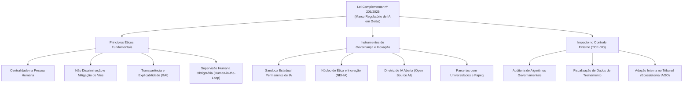
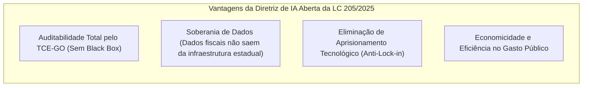
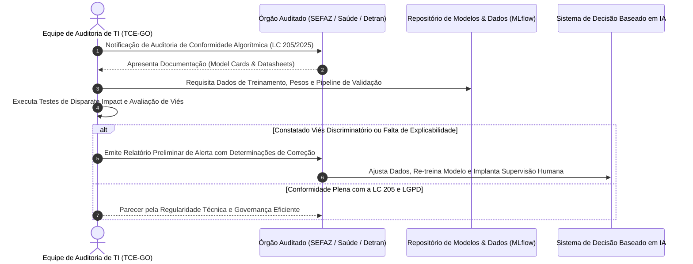

# 04 - Lei Complementar Estadual de Goiás nº 205/2025

> **Matéria:** Legislação Aplicada à Tecnologia da Informação  
> **Cargo:** B02 – Técnico de Controle Externo – Especialidade: Tecnologia da Informação  
> **Arquivo:** `04_lei_complementar_estadual_205_2025.md`  
> **Ato Normativo:** Lei Complementar Estadual (Goiás) nº 205, de 19 de maio de 2025 (Política Estadual de Fomento à Inovação e Governança em Inteligência Artificial do Estado de Goiás)

---

## 📌 Ementa / Itens do Edital
- Lei Complementar estadual nº 205, de 19 de maio de 2025 (Estado de Goiás)
- Contexto normativo e objetivos da lei no âmbito da administração pública goiana
- Disposições relativas à modernização institucional, transparência, inovação e governança de tecnologia
- Relação com as competências fiscalizatórias e operacionais do Tribunal de Contas do Estado de Goiás (TCE-GO)

---

## 🌳 Classificação Hierárquica

```text
4. Lei Complementar Estadual nº 205/2025 - Política Estadual de IA de Goiás
├── 4.1 Objetivos e Princípios da Política Estadual de IA
│   ├── 4.1.1 Fomento à Inovação Tecnológica, Competitividade e Pesquisa em IA no Estado
│   ├── 4.1.2 Princípios Éticos: Respeito à dignidade da pessoa humana, não discriminação e privacidade (LGPD)
│   ├── 4.1.3 Transparência Algorítmica e Explicabilidade dos Modelos
│   └── 4.1.4 Garantia de Supervisão e Revisão Humana em decisões automatizadas
├── 4.2 Instrumentos e Governança Criados pela LC 205/2025
│   ├── 4.2.1 Sandbox Estadual Permanente de Inteligência Artificial (ambiente regulatório experimental)
│   ├── 4.2.2 Núcleo de Ética e Inovação em IA (NEI-IA): Função consultiva e diretrizes de governança
│   ├── 4.2.3 Diretriz de IA Aberta: Preferência pelo uso de softwares e modelos abertos (open source) pela Administração Pública
│   └── 4.2.4 Fomento à Pesquisa e Capacitação Técnica (parcerias com universidades e Fapeg)
└── 4.3 Implicações para a Auditoria e o Controle Externo (TCE-GO)
    ├── 4.3.1 Auditoria Governamental sobre Sistemas de IA implementados pelo Poder Público goiano
    ├── 4.3.2 Verificação de Conformidade com o Sandbox e Mitigação de Vieses Algorítmicos
    └── 4.3.3 Uso de IA no próprio Tribunal de Contas (alinhamento com a RA nº 24/2024 e IAGO)
```

---

## 📖 Teoria Aprofundada & Governança de IA no Estado de Goiás

### 4.1 Contexto e Princípios Fundamentais da LC nº 205/2025

A Lei Complementar Estadual nº 205, sancionada em 19 de maio de 2025, colocou o Estado de Goiás na vanguarda legislativa brasileira ao estabelecer a primeira **Política Estadual de Fomento à Inovação e Governança em Inteligência Artificial** no plano subnacional.

A norma foi concebida para conciliar dois vetores essenciais:
1. **Estímulo à Inovação Econômica e Governança Digital:** Criar um ecossistema fértil para que empresas de base tecnológica, universidades e órgãos governamentais desenvolvam aplicações de inteligência artificial de ponta;
2. **Salvaguardas de Direitos Fundamentais e Ética Algorítmica:** Assegurar que os sistemas de IA empregados na administração pública estadual respeitem os direitos dos cidadãos, a legalidade, a transparência e a privacidade de dados (LGPD).



#### 4.1.1 Princípios Norteadores de IA no Setor Público Goiano

| Princípio da LC nº 205/2025 | Conteúdo Teórico | Tradução Prática em Sistemas de TI |
|---|---|---|
| **Centralidade na Pessoa Humana (*Human-Centric AI*)** | A tecnologia de IA deve servir ao bem-estar coletivo, ampliação de direitos e desenvolvimento socioeconômico sustentável. | Sistemas de IA não podem substituir a dignidade humana ou ser programados para desumanizar o atendimento ao cidadão em serviços públicos. |
| **Não Discriminação e Mitigação de Vieses** | Proibição do uso de parâmetros algorítmicos que reproduzam ou amplifiquem discriminações ilegais ou abusivas por raça, gênero, orientação sexual, classe social ou deficiência. | Testes estatísticos mandatórios de disparidade (*Disparate Impact Analysis*) nos dados de treino e saídas (*outputs*) dos modelos preditivos antes do deploy. |
| **Transparência Algorítmica e Explicabilidade (*XAI*)** | O cidadão e os órgãos de controle têm o direito de conhecer as variáveis determinantes e a lógica geral adotada pelas redes neurais e modelos matemáticos. | Adoção de técnicas de interpretabilidade de modelos (*SHAP values*, *LIME*, árvores substitutas) para justificar atos administrativos baseados em IA. |
| **Supervisão Humana (*Human-in-the-Loop*)** | Nenhuma decisão administrativa que suprima, restrinja ou afete direitos de pessoa física ou jurídica pode ser 100% autônoma e irrevogável por máquina. | Obrigatoriedade de intervenção, validação ou possibilidade de reanálise por um agente público humano capacitado. |
| **Segurança e Robustez Técnica** | Os sistemas de IA devem ser resistentes a falhas técnicas, alucinações perigosas, envenenamento de dados (*data poisoning*) e ataques adversariais. | Implementação de esteiras de MLOps seguras com validação cruzada, testes de estresse e proteção de modelos contra exfiltração de pesos. |

---

### 4.2 Instrumentos Estratégicos Criados pela LC nº 205/2025

A lei não se limita a enunciados programáticos; ela institui instrumentos institucionais e regulatórios concretos:

#### 4.2.1 Sandbox Estadual Permanente de Inteligência Artificial
- **Conceito:** Ambiente regulatório experimental seguro e controlado onde pessoas jurídicas (startups, empresas de base tecnológica, institutos de ciência e tecnologia - ICTs e consórcios) podem testar produtos, serviços e modelos de IA inovadores com dispensa ou flexibilização temporária e monitorada de certas exigências regulatórias estaduais.
- **Diferencial Goiano:** Trata-se de um sandbox **permanente**, ou seja, uma política de Estado contínua, com ciclos regulares de chamadas públicas (editais).
- **Salvaguardas Inegociáveis:**
  - Estrita observância aos direitos fundamentais e à Lei Geral de Proteção de Dados Pessoais (LGPD);
  - Apresentação obrigatória de **Matriz de Riscos e Plano de Mitigação de Danos**;
  - Responsabilidade civil preservada para eventuais danos materiais ou morais causados a terceiros;
  - Limitação temporal de permanência no ambiente experimental.

#### 4.2.2 Núcleo de Ética e Inovação em Inteligência Artificial (NEI-IA)
- Colegiado de natureza consultiva e propositiva, reunindo representantes do Poder Executivo (Secretaria de Ciência, Tecnologia e Inovação - Secti), universidades públicas, comunidade científica, sociedade civil e setor empresarial de tecnologia.
- **Atribuições Principais:**
  1. Elaborar e atualizar o Código de Boas Práticas e Governança Ética de IA para a administração pública goiana;
  2. Emitir pareceres técnicos prévios sobre projetos de IA classificados como de **alto risco** pelo Estado;
  3. Propor diretrizes para a governança de dados governamentais utilizados em modelos analíticos;
  4. Fomentar programas de formação e letramento digital em inteligência artificial para servidores públicos.

#### 4.2.3 A Diretriz Mandatória de IA Aberta (*Open Source AI*)
Um dos artigos mais destacados da LC nº 205/2025 prevê a **preferência pelo uso de soluções, modelos de linguagem e softwares de inteligência artificial de código aberto (*open-source*)** pelos órgãos e entidades da Administração Pública Estadual.
- **Fundamentos Técnicos da Diretriz:**
  1. **Auditabilidade e Controle:** Modelos abertos permitem aos auditores do TCE-GO e especialistas a inspeção integral dos códigos-fonte, pesos sinápticos e arquitetura interna, evitando a opacidade de sistemas proprietários tipo "caixa preta" (*black box*);
  2. **Independência Tecnológica (*Anti-Lock-In*):** Evita que o Estado fique refém de monopólios internacionais de computação em nuvem e licenças de software vultosas com pagamentos em moeda estrangeira;
  3. **Segurança e Privacidade:** Permite a hospedagem (*on-premises* ou em nuvem governamental própria) dos modelos, garantindo que dados fiscais, tributários e pessoais de cidadãos goianos não sejam transferidos para treinamento de modelos de terceiros no exterior;
  4. **Customização Local:** Viabiliza o ajuste fino (*fine-tuning*) dos modelos para atender particularidades regionais, econômicas e legislativas do Estado de Goiás.



---

### 4.3 O Papel Fiscalizatório do TCE-GO sobre Sistemas de IA

A emergência da LC nº 205/2025 redefine as atividades de auditoria de controle externo a cargo do Tribunal de Contas do Estado de Goiás (TCE-GO). O auditor de TI passa a fiscalizar não apenas contratos e infraestrutura, mas **o comportamento probabilístico e as decisões dos algoritmos estaduais**.



#### 4.3.1 As Três Dimensões da Auditoria de IA Governamental
1. **Auditoria dos Dados de Treinamento e Teste (*Data-Centric AI Audit*):**
   - Avaliação da proveniência lícita dos dados sob a LGPD;
   - Verificação de suficiência estatística e representatividade demográfica dos dados históricos;
   - Identificação de rotulagens enviesadas que possam penalizar regiões menos desenvolvidas ou grupos vulneráveis.
2. **Auditoria do Modelo e Desempenho (*Model Audit*):**
   - Validação da arquitetura matemática e métricas de desempenho (Acurácia, Precisão, Recall, F1-Score, Curva ROC-AUC);
   - Teste de robustez a dados ruidosos e mitigação de alucinações;
   - Verificação do cumprimento da diretriz de código aberto da LC nº 205/2025.
3. **Auditoria de Processo e Governança (*Process Audit*):**
   - Garantia da existência efetiva do mecanismo de **Supervisão Humana (*Human-in-the-Loop*)**;
   - Disponibilidade de trilha de auditoria completa: para cada decisão sugerida pelo algoritmo, o sistema deve registrar as variáveis de entrada, o score probabilístico e o ID do servidor humano que aprovou ou rejeitou a sugestão.

#### 4.3.2 Uso Interno de IA no TCE-GO: O Ecossistema IAGO e a RA nº 24/2024
O próprio TCE-GO, alinhado aos mandamentos da LC nº 205/2025, implementou sua regulação interna (Resolução Administrativa nº 24/2024) para o desenvolvimento e emprego de IA generativa e preditiva no controle externo, personificado no **Ecossistema IAGO** (*Inteligência Artificial de Goiás*):
- Análise preditiva de editais de licitação e contratos antes da homologação;
- Detecção automática de sobrepreço em compras públicas governamentais;
- Elaboração assistida de minutas de relatórios técnicos, sempre sob validação humana obrigatória do auditor responsável.

---

## ⚠️ Pontos de Atenção (Estilo FCC)

- **Natureza da LC 205/2025:** Lei Complementar do Estado de Goiás que cria a Política Estadual de Inovação e Governança em IA. Não se trata de lei federal, mas de diploma estadual pioneiro cobrado no edital da área de TI do TCE-GO.
- **Os 3 Pilares Institucionais:**
  1. *Sandbox Permanente de IA*;
  2. *Núcleo de Ética e Inovação (NEI-IA)*;
  3. *Diretriz de IA Aberta (Open Source)*.
- **Vedação de Automação Decisória Plena:** É proibida a decisão administrativa irrecorrível tomada exclusivamente por IA quando envolver restrição de direitos. A supervisão humana (*Human-in-the-Loop*) é garantia cogente.
- **A Relação com a LGPD:** O uso de inteligência artificial em órgãos goianos é estritamente subordinado à LGPD. Nenhum sistema do Sandbox ou em produção estadual pode violar a finalidade e a minimização de dados.

---

## 🌐 Fontes Recomendadas na Internet (Acesso Direto e Gratuito)

- [x] **Legislação Estadual de Goiás - Casa Civil (Legisla Goiás):**
  - Link Oficial: [Portal de Legislação do Estado de Goiás](https://legisla.casacivil.go.gov.br/)
  - *Conteúdo:* Texto Integral da Lei Complementar nº 205, de 19 de maio de 2025.
- [x] **Portal Institucional do Governo do Estado de Goiás:**
  - Link Oficial: [Governo de Goiás - Secretaria de Ciência, Tecnologia e Inovação (Secti)](https://goias.gov.br/secti/)
  - *Conteúdo:* Programas de fomento em IA, editais de Sandbox e diretrizes de IA Aberta.
- [x] **Tribunal de Contas do Estado de Goiás (TCE-GO):**
  - Link Oficial: [Inovação e Tecnologia no TCE-GO](https://portal.tce.go.gov.br/)
  - *Conteúdo:* Normas de Governança de TIC, Resolução Administrativa nº 24/2024 e o Ecossistema IAGO de auditoria eletrônica.

---

## 📝 Questões Comentadas & Exemplos (Padrão FCC)

### Questão 1 (FCC Inédita - Analista de Controle Externo / Tecnologia da Informação)
**Enunciado:** A Lei Complementar Estadual nº 205, de 19 de maio de 2025, disciplinou a Política Estadual de Inovação e Governança em Inteligência Artificial no Estado de Goiás. Ao tratar dos instrumentos para fomento e segurança jurídica, a referida lei instituiu o *Sandbox Estadual Permanente de Inteligência Artificial*. Em relação a esse instrumento regulatório, é correto afirmar:  
A) Consiste em um ambiente fechado e exclusivo para órgãos de repressão criminal do Estado, vedada a participação de startups ou entidades civis.  
B) Permite a experimentação controlada de modelos e soluções tecnológicas de IA com flexibilização temporária e monitorada de certas exigências regulatórias, condicionada à apresentação de plano de gestão de riscos e estrita observância à proteção de dados e direitos fundamentais.  
C) Isenta totalmente as empresas participantes de qualquer responsabilidade civil ou criminal por danos materiais causados a cidadãos durante o período de testes.  
D) Tem duração efêmera e vigência obrigatória de apenas 30 dias contados da publicação da lei complementar, sendo extinto após essa data.  
E) Autoriza o tratamento irrestrito de dados pessoais sensíveis sem necessidade de observância aos preceitos da Lei Geral de Proteção de Dados Pessoais (LGPD).  

> **Gabarito: B**  
>  
> **Comentário Analítico Passo a Passo:**  
> - **Análise da Alternativa A (Incorreta):** O Sandbox de IA de Goiás é amplo, permanente e voltado a estimular o ecossistema econômico de inovação, incluindo expressamente startups, empresas privadas de base tecnológica, universidades e órgãos públicos.  
> - **Análise da Alternativa B (CORRETA):** A definição legal e doutrinária de Sandbox Regulatório adotada pela LC nº 205/2025 prevê um ambiente controlado de testes com relaxamento temporário e supervisionado de certas regras burocráticas estaduais, exigindo salvaguardas essenciais: plano prévio de mitigação de riscos, respeito absoluto aos direitos humanos e submissão irrestrita à LGPD.  
> - **Análise da Alternativa C (Incorreta):** O sandbox não confere imunidade civil ampla; eventuais danos provocados a usuários continuam sujeitos à reparação civil na forma do Código Civil e do Código de Defesa do Consumidor.  
> - **Análise da Alternativa D (Incorreta):** A lei instituiu expressamente o sandbox como permanente (*Sandbox Estadual Permanente de Inteligência Artificial*), estabelecendo uma política pública continuada no Estado de Goiás.  
> - **Análise da Alternativa E (Incorreta):** A conformidade com a LGPD é pré-requisito indispensável e inegociável para a participação em qualquer ciclo do sandbox regulatório.

---

### Questão 2 (FCC Inédita - Técnico de Controle Externo / Tecnologia da Informação)
**Enunciado:** A Administração Pública do Estado de Goiás publicou edital para contratação de solução inteligente de triagem e encaminhamento de atendimentos em unidades hospitalares públicas. Para atender à diretriz estratégica de governança tecnológica instituída expressamente pelo art. 4º da Lei Complementar nº 205/2025, o termo de referência deve priorizar:  
A) A compra de soluções baseadas em modelos proprietários de código fechado (*closed-source*), visando garantir segredo comercial intransponível perante a sociedade.  
B) A preferência pelo uso de sistemas, plataformas e modelos de inteligência artificial de código aberto (*open-source*), assegurando maior transparência, auditabilidade pelo TCE-GO, soberania digital e independência de fornecedor (*anti-lock-in*).  
C) A terceirização integral dos bancos de dados hospitalares para servidores situados em paraísos fiscais sem qualquer mecanismo de auditoria.  
D) A vedação absoluta de contratação de softwares por órgãos públicos estaduais que possuam código-fonte aberto.  
E) A imposição de contratos de licenciamento perpétuo e irrevogável com cláusula de exclusividade com uma única multinacional estrangeira.  

> **Gabarito: B**  
>  
> **Comentário Analítico Passo a Passo:**  
> - **Análise da Alternativa A (Incorreta):** A LC nº 205/2025 combate a opacidade de soluções "caixa preta" (*black box*) nos serviços públicos essenciais, contrariando a imposição de segredo fechado.  
> - **Análise da Alternativa B (CORRETA):** A diretriz de **IA Aberta** é um dos grandes diferenciais da LC estadual nº 205/2025 de Goiás. Ela consagra como diretriz preferencial o uso de tecnologias, softwares e modelos abertos (*open-source*), garantindo auditabilidade técnica direta pelo Tribunal de Contas, economicidade, independência de fornecedor e soberania de dados.  
> - **Análise da Alternativa C (Incorreta):** O envio de dados sensíveis de saúde para paraísos fiscais sem salvaguardas violaria flagrantemente a LGPD e o princípio da segurança e soberania de dados.  
> - **Análise da Alternativa D (Incorreta):** A lei não veda, mas exatamente prioriza o uso de softwares abertos.  
> - **Análise da Alternativa E (Incorreta):** Promove o indesejável aprisionamento tecnológico (*vendor lock-in*), contrariando os objetivos da política estadual de inovação e economicidade.

---

### Questão 3 (FCC Inédita - Auditor Estadual de Controle Externo / TI)
**Enunciado:** Em uma auditoria governamental de conformidade algorítmica realizada pelo TCE-GO sobre o sistema automatizado de cobrança e suspensão cadastral de contribuintes gerido pelo Poder Executivo Estadual, a equipe técnica verificou que o modelo de aprendizado de máquina bloqueava automaticamente as certidões negativas de débito sem qualquer possibilidade de revisão ou recurso por analista humano. À luz dos princípios éticos da LC nº 205/2025:  
A) O procedimento é lícito e exemplar, pois a automação integral sem interferência humana é a meta suprema exigida pela legislação goiana.  
B) O sistema viola a diretriz mandatória de supervisão humana (*Human-in-the-Loop*), que assegura ao cidadão e aos jurisdicionados a explicabilidade do ato e o direito de obter a revisão humana de decisões automatizadas que afetem seus direitos.  
C) O Tribunal de Contas não tem competência funcional para auditar a lógica de algoritmos governamentais, devendo limitar-se ao valor financeiro da nota fiscal da licitação.  
D) A decisão automatizada pura é permitida desde que a taxa de acerto do modelo estatístico seja superior a noventa por cento em dados de teste.  
E) O cidadão deve renunciar previamente ao direito de defesa administrativa para interagir com sistemas de governo digital em Goiás.  

> **Gabarito: B**  
>  
> **Comentário Analítico Passo a Passo:**  
> - **Análise da Alternativa A (Incorreta):** A automação plena sem mecanismo humano em decisões restritivas de direitos é expressamente repudiada pela doutrina de governança de IA e pela LC nº 205/2025.  
> - **Análise da Alternativa B (CORRETA):** A LC nº 205/2025 e os princípios universais de ética em IA determinam que decisões que impactem substancialmente a esfera jurídica e os direitos de pessoas físicas ou jurídicas devem assegurar o princípio do *Human-in-the-Loop* (supervisão humana), com direito a explicações inteligíveis dos critérios adotados e possibilidade de revisão por pessoa natural.  
> - **Análise da Alternativa C (Incorreta):** O TCE-GO possui ampla competência constitucional e legal para fiscalizar a legitimidade, economicidade, eficácia e conformidade legal de quaisquer atos da administração pública, compreendendo as ferramentas tecnológicas e algoritmos utilizados para a gestão estatal.  
> - **Análise da Alternativa D (Incorreta):** Nenhuma métrica estatística de acerto afasta as garantias constitucionais do devido processo legal e a exigência de supervisão humana em atos administrativos restritivos de direitos.  
> - **Análise da Alternativa E (Incorreta):** O direito à ampla defesa e ao contraditório é cláusula pétrea constitucional e não pode ser objeto de renúncia para utilização de serviços públicos.

---

### Questão 4 (FCC Inédita - Analista de Sistemas / Engenharia de Software)
**Enunciado:** O Núcleo de Ética e Inovação em Inteligência Artificial (NEI-IA), criado pela Lei Complementar Estadual nº 205/2025 no Estado de Goiás, possui como uma de suas funções primordiais:  
A) Exercer com exclusividade o julgamento e aplicação de penas de prisão perpétua a hackers e fraudadores de sistemas estaduais.  
B) Atuar como órgão colegiado consultivo e propositivo para estabelecer diretrizes de ética, governança, mitigação de viés algorítmico e boas práticas no desenvolvimento e uso de inteligência artificial na administração estadual.  
C) Monopolizar todo o desenvolvimento de código-fonte de TI no Estado, extinguindo as diretorias de TI dos demais órgãos públicos.  
D) Autorizar previamente a compra de qualquer computador de uso pessoal adquirido por cidadãos residentes em território goiano.  
E) Substituir as câmaras de julgamento de processos de contas do Tribunal de Contas do Estado de Goiás.  

> **Gabarito: B**  
>  
> **Comentário Analítico Passo a Passo:**  
> - **Análise da Alternativa A (Incorreta):** O NEI-IA é órgão consultivo de governança ética, não exercendo funções jurisdicionais penais (ademais, a pena de prisão perpétua é vedada pela CF/88).  
> - **Análise da Alternativa B (CORRETA):** O NEI-IA foi estruturado pela LC nº 205/2025 como uma instância colegiada consultiva, plural e propositiva com a missão de zelar pela ética, transparência algorítmica, mitigação de vieses preconceituosos e emissão de orientações técnicas de boas práticas para os sistemas públicos de IA em Goiás.  
> - **Análise da Alternativa C (Incorreta):** O núcleo não é fábrica monopolista de software; cada órgão (como TCE, SEFAZ, Detran) mantém suas respectivas áreas e diretorias de tecnologia.  
> - **Análise da Alternativa D (Incorreta):** O poder público estadual não exerce controle prévio sobre aquisições privadas de hardware pessoal de cidadãos.  
> - **Análise da Alternativa E (Incorreta):** A competência jurisdicional de controle externo e julgamento de contas públicas é privativa dos Conselheiros do TCE-GO, conferida diretamente pela Constituição Estadual e Federal.

---

### Questão 5 (FCC Inédita - Auditor de Tecnologia da Informação / Ciência de Dados)
**Enunciado:** Em relação à governança de dados e ao uso de ferramentas baseadas em inteligência artificial no âmbito das instituições públicas goianas, nos termos da Lei Complementar Estadual nº 205/2025 combinada com a Resolução Administrativa nº 24/2024 do TCE-GO, assinale a opção correta:  
A) Dados fiscais sigilosos podem ser inseridos livremente em serviços públicos e gratuitos de IA generativa em nuvem aberta internacional, haja vista a prevalência da inovação sobre as normas de sigilo.  
B) As ferramentas de inteligência artificial generativa e preditiva no setor público goiano atuam como instrumentos auxiliares de suporte técnico e eficiência operacional, não dispensando a validação humana e a responsabilidade funcional do servidor público signatário do ato processual.  
C) A explicabilidade algorítmica (*Explainable AI - XAI*) é dispensada caso o sistema seja adquirido de empresas estrangeiras.  
D) Modelos de IA desenvolvidos em parceria com a Fundação de Amparo à Pesquisa do Estado de Goiás (Fapeg) estão isentos de apresentar documentação de arquitetura e mitigação de riscos.  
E) O treinamento de modelos de aprendizado de máquina dispensa quaisquer cuidados quanto à qualidade e limpeza da base de dados histórica.  

> **Gabarito: B**  
>  
> **Comentário Analítico Passo a Passo:**  
> - **Análise da Alternativa A (Incorreta):** Inserir dados sigilosos e fiscais em ferramentas de IA pública na nuvem (como chats gratuitos comerciais) configura quebra gravíssima de sigilo funcional, violação da LGPD e transgressão às normas de segurança da informação (RA 17/2024 e RA 24/2024 do TCE-GO).  
> - **Análise da Alternativa B (CORRETA):** As normas e a LC nº 205/2025 estabelecem expressamente que a inteligência artificial tem caráter de instrumento auxiliar de produtividade e triagem analítica. O servidor público que assina o despacho, relatório de auditoria ou ato decisório permanece integralmente responsável pelo conteúdo, sendo imperativa a revisão humana crítica do que foi sintetizado pelo modelo.  
> - **Análise da Alternativa C (Incorreta):** A explicabilidade é dever do Estado de Goiás e do fornecedor, independentemente da nacionalidade da empresa desenvolvedora.  
> - **Análise da Alternativa D (Incorreta):** Parcerias de pesquisa com a Fapeg e universidades estão plenamente vinculadas às regras de conformidade ética, documentação técnica (*Model Cards*) e mitigação de vieses da lei.  
> - **Análise da Alternativa E (Incorreta):** O princípio basilar do MLOps (*Garbage in, Garbage out*) impõe governança rigorosa de dados de treino para evitar modelos enviesados, imprecisos ou alucinatórios.
