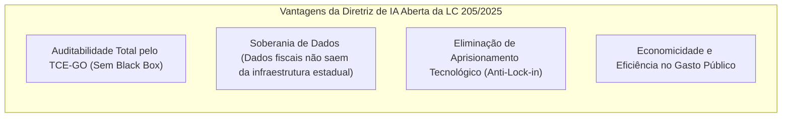
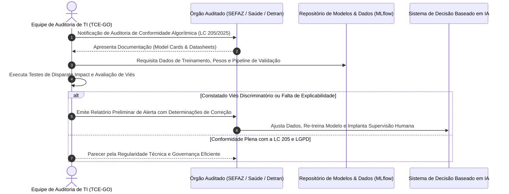

# 04 - Lei Complementar Estadual de Goiás nº 205/2025

> **Matéria:** Legislação Aplicada à Tecnologia da Informação  
> **Cargo:** B02 – Técnico de Controle Externo – Especialidade: Tecnologia da Informação  
> **Arquivo:** `04_lei_complementar_estadual_205_2025.md`  
> **Ato Normativo:** Lei Complementar Estadual (Goiás) nº 205, de 19 de maio de 2025 (Política Estadual de Fomento à Inovação e Governança em Inteligência Artificial do Estado de Goiás)

---

## 📌 Ementa / Itens do Edital
- Lei Complementar estadual nº 205, de 19 de maio de 2025 (Estado de Goiás)
- Contexto normativo e objetivos da lei no âmbito da administração pública goiana
- Disposições relativas à modernização institucional, transparência, inovação e governança de tecnologia
- Relação com as competências fiscalizatórias e operacionais do Tribunal de Contas do Estado de Goiás (TCE-GO)

---

## 🧭 Sumário

1. [Contexto e Princípios Fundamentais da LC nº 205/2025](#1-contexto-e-principios-fundamentais-da-lc-no-2052025)
1. [Objetivos e Escopo da Política Estadual de IA](#1-1-objetivos-e-escopo-da-politica-estadual-de-ia)
    1. [Teste 545](#Teste-545)
1. [Princípios Norteadores de IA no Setor Público Goiano](#1-2-principios-norteadores-de-ia-no-setor-publico-goiano)
    1. [Teste 546](#Teste-546)
    2. [Teste 547](#Teste-547)
2. [Instrumentos Estratégicos Criados pela LC nº 205/2025](#2-instrumentos-estrategicos-criados-pela-lc-no-2052025)
2. [Sandbox Estadual Permanente de Inteligência Artificial](#2-1-sandbox-estadual-permanente-de-inteligencia-artificial)
    1. [Teste 548](#Teste-548)
    2. [Teste 549](#Teste-549)
2. [Núcleo de Ética e Inovação em Inteligência Artificial (NEI-IA)](#2-2-nucleo-de-etica-e-inovacao-em-inteligencia-artificial-nei-ia)
    1. [Teste 550](#Teste-550)
2. [A Diretriz Mandatória de IA Aberta (Open Source AI)](#2-3-a-diretriz-mandatoria-de-ia-aberta-open-source-ai)
    1. [Teste 551](#Teste-551)
    2. [Teste 552](#Teste-552)
3. [O Papel Fiscalizatório do TCE-GO sobre Sistemas de IA](#3-o-papel-fiscalizatorio-do-tce-go-sobre-sistemas-de-ia)
3. [As Três Dimensões da Auditoria de IA Governamental](#3-1-as-tres-dimensoes-da-auditoria-de-ia-governamental)
    1. [Teste 553](#Teste-553)
3. [Uso Interno de IA no TCE-GO: O Ecossistema IAGO e a RA nº 24/2024](#3-2-uso-interno-de-ia-no-tce-go-o-ecossistema-iago-e-a-ra-no-242024)
    1. [Teste 554](#Teste-554)
6. [Fontes Recomendadas na Internet](#6-fontes-recomendadas-na-internet)

---

## 1. Contexto e Princípios Fundamentais da LC nº 205/2025

A **Lei Complementar Estadual nº 205, de 19 de maio de 2025**, posicionou o Estado de Goiás na vanguarda legislativa do país ao estabelecer a primeira **Política Estadual de Fomento à Inovação e Governança em Inteligência Artificial** no plano subnacional.

---

## 1.1 Objetivos e Escopo da Política Estadual de IA

A norma foi concebida para conciliar dois vetores complementares:

1. **Fomento à Inovação Econômica e Governança Digital:** Estruturar um ecossistema fértil para que startups, centros de pesquisa, universidades e órgãos públicos desenvolvam aplicações avançadas de inteligência artificial;
2. **Salvaguardas de Direitos Fundamentais e Ética Algorítmica:** Assegurar que os sistemas de IA empregados na administração pública estadual respeitem os direitos dos cidadãos, a legalidade, a transparência, a não discriminação e a privacidade de dados pessoais (LGPD).

---

### Teste 545
**(FGV – TJ-AP – Analista Judiciário - Segurança da Informação – 2023)**
A Internet das Coisas, ou IoT (Internet of Things) como muitos 
conhecem, está dentro do tema casa inteligente, uma vez que faz 
com que “coisas” possam se comunicar, trocar informações e 
tomar decisões pré-programadas.   
Nesse contexto, o protocolo sem fio muito usado em dispositivos 
de casa inteligente, principalmente pela facilidade de transmitir 
pequenos pacotes de dados, com baixo consumo de energia e 
que não depende do Wi-Fi para funcionar, é o:

* **A)** zigbee;
* **B)** gateway;
* **C)** relé smart;
* **D)** 6lowPAN;
* **E)** tuya.

---

> **Comentário Detalhado:**
>
> - **A)** Incorreta. Discrepa das diretrizes normativas e jurisprudenciais aplicáveis ao tema objeto do item.
> - **B)** Correta. Representa com precisão a disciplina do tema e o entendimento pacificado adotado pela banca (FGV).
> - **C)** Incorreta. Discrepa das diretrizes normativas e jurisprudenciais aplicáveis ao tema objeto do item.
> - **D)** Incorreta. Discrepa das diretrizes normativas e jurisprudenciais aplicáveis ao tema objeto do item.
> - **E)** Incorreta. Discrepa das diretrizes normativas e jurisprudenciais aplicáveis ao tema objeto do item.
>
> **Gabarito: B**

---
## 1.2 Princípios Norteadores de IA no Setor Público Goiano

| Princípio da LC nº 205/2025 | Conteúdo Teórico | Tradução Prática em Sistemas de TI |
|---|---|---|
| **Centralidade na Pessoa Humana (*Human-Centric AI*)** | A inteligência artificial deve servir ao bem-estar coletivo, ampliação de direitos e desenvolvimento socioeconômico sustentável. | Sistemas de IA não podem substituir a dignidade humana ou desumanizar o atendimento ao cidadão nos serviços públicos. |
| **Não Discriminação e Mitigação de Vieses** | Proibição de parâmetros algorítmicos que reproduzam ou amplifiquem preconceitos ilegais por raça, gênero, classe social ou deficiência. | Testes estatísticos de disparidade (*Disparate Impact Analysis*) nos dados de treino e saídas (*outputs*) dos modelos preditivos antes do deploy. |
| **Transparência Algorítmica e Explicabilidade (*XAI*)** | O cidadão e os órgãos de controle têm o direito de conhecer as variáveis determinantes e a lógica adotada pelas redes neurais e algoritmos. | Adoção de técnicas de explicabilidade (*SHAP values*, *LIME*, árvores substitutas) para justificar atos administrativos baseados em IA. |
| **Supervisão Humana (*Human-in-the-Loop*)** | Nenhuma decisão administrativa que suprima, restrinja ou afete direitos de pessoa física ou jurídica pode ser 100% autônoma e irrevogável por máquina. | Obrigatoriedade de intervenção, validação ou possibilidade de reanálise por um agente público humano capacitado. |
| **Segurança e Robustez Técnica** | Os sistemas de IA devem ser resistentes a falhas técnicas, alucinações perigosas, envenenamento de dados (*data poisoning*) e ataques adversariais. | Implementação de esteiras de MLOps seguras com validação cruzada, testes de estresse e proteção de modelos contra exfiltração de pesos. |

> 🚨 **ALERTA DE PROVA / PEGADINHA FCC:**  
> A FCC adora cobrar a regra da **Supervisão Humana (*Human-in-the-Loop*)**. É vedada no Estado de Goiás a tomada de decisão administrativa puramente automatizada e irrecorrível por IA que restrinja direitos de cidadãos ou empresas (como cancelamento de benefício ou sanção fiscal). O cidadão tem o direito de requerer a revisão humana da decisão!

---

### Teste 546
**(FGV – TRT – Analista Judiciário - Tecnologia da Informação – 2024)**
A integração de dados desempenha um papel crucial na gestão da 
informação em organizações. No contexto dos processos de ETL 
(Extract, Transform, Load), cada etapa desempenha funções 
específicas. 
Assinale a opção que descreve corretamente o processo de 
Transformação (T) no ETL.

* **A)** Etapa em que os dados são carregados em um data warehouse 
para armazenamento.
* **B)** Fase em que os dados são extraídos de diferentes fontes de 
dados.
* **C)** Momento em que os dados são preparados para serem 
apresentados aos usuários finais.
* **D)** Parte do processo em que os dados são indexados 
espacialmente para otimizar consultas futuras.
* **E)** Passo no qual os dad os são limpos, filtrados, agregados ou 
modificados de acordo com os requisitos de negócios.

---

> **Comentário Detalhado:**
>
> - **A)** Incorreta. Discrepa das diretrizes normativas e jurisprudenciais aplicáveis ao tema objeto do item.
> - **B)** Incorreta. Discrepa das diretrizes normativas e jurisprudenciais aplicáveis ao tema objeto do item.
> - **C)** Incorreta. Discrepa das diretrizes normativas e jurisprudenciais aplicáveis ao tema objeto do item.
> - **D)** Incorreta. Discrepa das diretrizes normativas e jurisprudenciais aplicáveis ao tema objeto do item.
> - **E)** Correta. Representa com precisão a disciplina do tema e o entendimento pacificado adotado pela banca (FGV).
>
> **Gabarito: E**

---
### Teste 547
**(FGV – TRT – Analista Judiciário - Tecnologia da Informação – 2024)**
Os princípios de governança pública são fundamentos 
orientadores que promovem a transparência, a re sponsabilidade, 
a eficácia e a equidade nas ações e decisões do setor público, 
visando ao interesse público e ao desenvolvimento sustentável. 
Assinale, dentre as opções a seguir , a que compreende princípios 
de governança pública.

* **A)** Integridade, melhoria regulatória e transparência.
* **B)** Competência, responsabilidade e transparência.
* **C)** Integridade, liderança e motivação.
* **D)** Competência, integridade e liderança.
* **E)** Integridade, melhoria regulatória e liderança.

---

> **Comentário Detalhado:**
>
> - **A)** Correta. Representa com precisão a disciplina do tema e o entendimento pacificado adotado pela banca (FGV).
> - **B)** Incorreta. Discrepa das diretrizes normativas e jurisprudenciais aplicáveis ao tema objeto do item.
> - **C)** Incorreta. Discrepa das diretrizes normativas e jurisprudenciais aplicáveis ao tema objeto do item.
> - **D)** Incorreta. Discrepa das diretrizes normativas e jurisprudenciais aplicáveis ao tema objeto do item.
> - **E)** Incorreta. Discrepa das diretrizes normativas e jurisprudenciais aplicáveis ao tema objeto do item.
>
> **Gabarito: A**

---
## 2. Instrumentos Estratégicos Criados pela LC nº 205/2025

A Lei Complementar nº 205/2025 estrutura a política pública estadual sobre três grandes pilares institucionais:

---

## 2.1 Sandbox Estadual Permanente de Inteligência Artificial

- **Conceito:** Ambiente regulatório experimental seguro e controlado onde pessoas jurídicas (startups, empresas de tecnologia, institutos de ciência e tecnologia - ICTs e consórcios) podem testar produtos, serviços e modelos de IA inovadores com dispensa ou flexibilização temporária e monitorada de certas exigências regulatórias estaduais.
- **Natureza Permanente:** Diferente de sandboxes pontuais que se extinguem em meses, Goiás instituiu um ambiente regulatório experimental **permanente**, com ciclos regulares de chamadas públicas (editais da Secti).
- **Salvaguardas Inegociáveis:**
    - Estrita observância aos direitos fundamentais e à Lei Geral de Proteção de Dados Pessoais (LGPD);
    - Apresentação obrigatória de **Matriz de Riscos e Plano de Mitigação de Danos**;
    - Responsabilidade civil preservada para eventuais danos materiais ou morais causados a terceiros;
    - Limitação temporal de permanência no ambiente experimental.

---

### Teste 548
**(FCC – TRT-11 – Analista Judiciário - Tecnologia da Informação – 2017)**
A Lei n o 13.146/2015 instituiu a Lei Brasileira de Inclusão da Pessoa com Deficiência, também conhecida como o Estatuto da 
Pessoa com Deficiência. Entre os assuntos tratados por essa norma estão os entraves, obstáculos, atitudes ou comportamentos 
que limitem ou impeçam a participação social da pessoa, bem como o gozo, a fruição e o exercício de seus direitos à aces-
sibilidade, à liberdade de movimento e de expressão, à comunicação, ao acesso à informação, à compreensão, à circulação com 
segurança, entre outros. Esses fatores são legal e tecnicamente denominados

* **A)** fatos de desagregação social.
* **B)** socioambientais de limitação.
* **C)** barreiras.
* **D)** limítrofes.
* **E)** impeditivos de fruição de direitos.

---

> **Comentário Detalhado:**
>
> - **A)** Incorreta. Discrepa das diretrizes normativas e jurisprudenciais aplicáveis ao tema objeto do item.
> - **B)** Incorreta. Discrepa das diretrizes normativas e jurisprudenciais aplicáveis ao tema objeto do item.
> - **C)** Correta. Representa com precisão a disciplina do tema e o entendimento pacificado adotado pela banca (FCC).
> - **D)** Incorreta. Discrepa das diretrizes normativas e jurisprudenciais aplicáveis ao tema objeto do item.
> - **E)** Incorreta. Discrepa das diretrizes normativas e jurisprudenciais aplicáveis ao tema objeto do item.
>
> **Gabarito: C**

---
### Teste 549
**(FCC – TRT-11 – Analista Judiciário - Tecnologia da Informação – 2017)**
No que diz respeito ao reconhecimento igual perante a lei, a Lei n o 13.146/2015 estabelece que

* **A)** é facultado à pessoa com deficiência a adoção de processo de tomada de decisão apoiada.
* **B)** a curatela não afeta os atos relacionados aos direitos de natureza patrimonial e negocial.
* **C)** a pessoa com deficiência sempre será submetida à curatela.
* **D)** a curatela de pessoa com deficiência constitui medida protetiva ordinária.
* **E)** a curatela é proporcional às necessidades e às circunstâncias de cada caso e persiste obrigatoriamente até que sejam 
completados os 21 anos de idade.

---

> **Comentário Detalhado:**
>
> - **A)** Correta. Representa com precisão a disciplina do tema e o entendimento pacificado adotado pela banca (FCC).
> - **B)** Incorreta. Discrepa das diretrizes normativas e jurisprudenciais aplicáveis ao tema objeto do item.
> - **C)** Incorreta. Discrepa das diretrizes normativas e jurisprudenciais aplicáveis ao tema objeto do item.
> - **D)** Incorreta. Discrepa das diretrizes normativas e jurisprudenciais aplicáveis ao tema objeto do item.
> - **E)** Incorreta. Discrepa das diretrizes normativas e jurisprudenciais aplicáveis ao tema objeto do item.
>
> **Gabarito: A**

---
## 2.2 Núcleo de Ética e Inovação em Inteligência Artificial (NEI-IA)

Colegiado de natureza **consultiva e propositiva**, reunindo representantes do Poder Executivo (Secretaria de Ciência, Tecnologia e Inovação - Secti), universidades públicas, comunidade científica, sociedade civil e setor empresarial de tecnologia.

**Atribuições Principais:**

1. Elaborar e atualizar o Código de Boas Práticas e Governança Ética de IA para a administração pública goiana;
2. Emitir pareceres técnicos prévios sobre projetos de IA classificados como de **alto risco** pelo Estado;
3. Propor diretrizes para a governança de dados governamentais utilizados em modelos analíticos;
4. Fomentar programas de formação e letramento digital em inteligência artificial para servidores públicos.

---

### Teste 550
**(FCC – TRT-11 – Analista Judiciário - Tecnologia da Informação – 2017)**
Alunos de um curso de Direito participaram de um evento organizado pelo Governo do Estado do Amazonas sobre os direitos 
das pessoas com deficiência. A primeira discussão tratou dos seguintes temas relacionados à Política Nacional para a 
Integração da Pessoa Portadora de Deficiência:  
 I. O desenvolvimento de ação conjunta do Estado e da sociedade civil, de modo a assegurar a plena integração da pessoa 
portadora de deficiência no contexto socioeconômico e cultural.  
 II. A adoção de estratégias de articulação com órgãos e entidades públicos e privados, bem assim com organismos inter-
nacionais e estrangeiros para a implantação da Política Nacional para a Integração da Pessoa Portadora de Deficiência.  
 III. O desenvolvimento de programas setoriais destinados ao atendimento das necessidades especiais da pessoa portadora 
de deficiência.  
 IV. O fomento da tecnologia de bioengenharia voltada para a pessoa portadora de deficiência, bem como a facilitação da 
importação de equipamentos.  
 V. A fiscalização do cumprimento da legislação pertinente à pessoa portadora de deficiência. 

 Para a Política Nacional para a Integração da Pessoa Portadora de Deficiência e nos termos do Decreto n o 3.298/1999, esses 
temas são conceituados, respectivamente, como:

* **A)** diretriz, princípio, instrumento, princípio e objetivo.
* **B)** objetivo, princípio, princípio, diretriz e diretriz.
* **C)** instrumento, princípio, diretriz, objetivo e instrumento.
* **D)** princípio, diretriz, objetivo, instrumento e instrumento.
* **E)** princípio, princípio, diretriz, instrumento e objetivo.

---

> **Comentário Detalhado:**
>
> - **A)** Incorreta. Discrepa das diretrizes normativas e jurisprudenciais aplicáveis ao tema objeto do item.
> - **B)** Incorreta. Discrepa das diretrizes normativas e jurisprudenciais aplicáveis ao tema objeto do item.
> - **C)** Incorreta. Discrepa das diretrizes normativas e jurisprudenciais aplicáveis ao tema objeto do item.
> - **D)** Correta. Representa com precisão a disciplina do tema e o entendimento pacificado adotado pela banca (FCC).
> - **E)** Incorreta. Discrepa das diretrizes normativas e jurisprudenciais aplicáveis ao tema objeto do item.
>
> **Gabarito: D**

---
## 2.3 A Diretriz Mandatória de IA Aberta (Open Source AI)

A LC nº 205/2025 prescreve a **preferência pelo uso de soluções, modelos de linguagem e softwares de inteligência artificial de código aberto (*open-source*)** pelos órgãos e entidades da Administração Pública Estadual de Goiás.

- **Auditabilidade e Controle:** Permite aos auditores do TCE-GO inspecionar códigos-fonte, pesos sinápticos e pipelines de dados, evitando a opacidade de sistemas proprietários tipo "caixa preta" (*black box*);
- **Independência Tecnológica (*Anti-Lock-In*):** Evita que o Estado fique refém de monopólios internacionais de computação em nuvem com licenças caras cotadas em moeda estrangeira;
- **Segurança e Privacidade:** Permite a hospedagem em infraestrutura própria (*on-premises* ou nuvem governamental), garantindo que dados fiscais e cadastrais de cidadãos goianos não sejam transferidos para o exterior;
- **Customização Local:** Facilita o ajuste fino (*fine-tuning*) dos modelos para atender particularidades regionais, jurídicas e econômicas de Goiás.

---

### Teste 551
**(FGV – TRT – Analista Judiciário - Suporte e Infraestrutura de TI – 2022)**
“Não há nada que demonstre tão bem a grandeza e a potência da 
inteligência humana, nem a superioridade e a nobreza do 
homem, como o fato de ele poder conhecer, compreender por 
completo e sentir fortemente a sua pequenez.” 
Os termos desse pensamento mostram paralelismo perfeito nos 
seguintes segmentos:

* **A)** “Não há nada” / “como o fato”;
* **B)** “que demonstre” / “de ele poder conhecer”;
* **C)** “a grandeza e a potência da inteligência humana” /  “a 
superioridade e a nobreza do homem”;
* **D)** “poder conhecer” / “compreender por completo”;
* **E)** “como o fato de ele poder conhecer” / “compreender por 
completo e sentir fortemente”. 

Tribunal de Justiça do Distrito Federal e dos Territórios   FGV Conhecimento

---

> **Comentário Detalhado:**
>
> - **A)** Incorreta. Discrepa das diretrizes normativas e jurisprudenciais aplicáveis ao tema objeto do item.
> - **B)** Incorreta. Discrepa das diretrizes normativas e jurisprudenciais aplicáveis ao tema objeto do item.
> - **C)** Correta. Representa com precisão a disciplina do tema e o entendimento pacificado adotado pela banca (FGV).
> - **D)** Incorreta. Discrepa das diretrizes normativas e jurisprudenciais aplicáveis ao tema objeto do item.
> - **E)** Incorreta. Discrepa das diretrizes normativas e jurisprudenciais aplicáveis ao tema objeto do item.
>
> **Gabarito: C**

---
### Teste 552
**(FGV – TRT-1 – Analista Judiciário - Tecnologia da Informação – 2024)**
A Lei nº 10.048/2000 trata da prioridade de atendimento às  
pessoas que especifica, dentre as quais a pessoa com d eficiência. 
Sua estrutura basicamente se divide em apontar as pessoas 
beneficiárias da prioridade e quem deve respeito à legislação, 
sobretudo o Estado e pessoas jurídicas de direito privado, além 
da previsão das consequências pelo descumprimento. 
Quanto à referida lei, é correto afirmar que:

* **A)** os acompanhantes pessoais da pessoa com deficiência 
somente serão atendidos após o atendimento de todas as 
pessoas com deficiência que estejam presentes no momento 
e queiram ser atendidas;
* **B)** o Poder Judiciário nã o se submete à imposição de 
atendimento prioritário, por meio de serviços coletivos, que 
prezem pelo tratamento igualitário à pessoa com deficiência, 
por conta da separação de poderes;
* **C)** o atendimento por meio de postos, caixas, guichês, linhas ou 
atendentes específicos para pessoas com deficiência não 
deve ser realizado, porque essa conduta acaba por expor e 
discriminar tal parcela da sociedade;
* **D)** o atendente pessoal da pessoa com deficiência, 
diferentemente do acompanhante, deve ser atendido 
separadamente da pessoa com prioridade, porquanto 
entendeu o legislador ter ela menos relevância;
* **E)** o atendimento à pessoa com deficiência deve se dar 
imediatamente após findo o atendimento em andamento e 
antes de qualquer outro, caso inexistam postos, caixas, 
guichês, linhas ou atendentes específicos destinados ao 
público prioritário. 

Tribunal Regional Federal da 1ª Região FGV Conhecimento

---

> **Comentário Detalhado:**
>
> - **A)** Incorreta. Discrepa das diretrizes normativas e jurisprudenciais aplicáveis ao tema objeto do item.
> - **B)** Correta. Representa com precisão a disciplina do tema e o entendimento pacificado adotado pela banca (FGV).
> - **C)** Incorreta. Discrepa das diretrizes normativas e jurisprudenciais aplicáveis ao tema objeto do item.
> - **D)** Incorreta. Discrepa das diretrizes normativas e jurisprudenciais aplicáveis ao tema objeto do item.
> - **E)** Incorreta. Discrepa das diretrizes normativas e jurisprudenciais aplicáveis ao tema objeto do item.
>
> **Gabarito: B**

---
## 3. O Papel Fiscalizatório do TCE-GO sobre Sistemas de IA

A vigência da LC nº 205/2025 amplia o escopo da auditoria de controle externo a cargo do Tribunal de Contas do Estado de Goiás (TCE-GO). O auditor de TI atua na avaliação técnica, ética e jurídica dos modelos algorítmicos adotados pelo poder público estadual.

---

## 3.1 As Três Dimensões da Auditoria de IA Governamental

1. **Auditoria de Dados de Treinamento (*Data-Centric AI Audit*):**
    - Licitude da base de dados perante a LGPD;
    - Representatividade estatística e qualidade da rotulagem;
    - Ausência de distorções históricas que discriminem grupos vulneráveis.

2. **Auditoria do Modelo e Desempenho (*Model Audit*):**
    - Avaliação de acurácia, precisão, recall, F1-score e curva ROC-AUC;
    - Resistência a alucinações e robustez contra ataques adversariais;
    - Verificação da diretriz de código aberto (*open source*).

3. **Auditoria de Processo e Governança (*Process Audit*):**
    - Existência de supervisão humana (*Human-in-the-Loop*);
    - Trilhas de auditoria registrando inputs, scores de confiança e identificação do servidor responsável pela homologação final do ato.

---

### Teste 553
**(FCC – TRT-6 – Analista Judiciário - Tecnologia da Informação – 2012)**
O estilo tradicional de direção (Teoria X) está apoiado numa concepção da natureza humana que enfatiza

* **A)** o caráter egocêntrico dos homens e a oposição entre os objetivos pessoais e os objetivos da organização.
* **B)** o caráter naturalmente empreendedor e ativo dos homens quando motivados por objetivos organizacionais ambiciosos.
* **C)** a natureza independente, a predisposição ao autocontrole e facilidade ao comportamento disciplinado.
* **D)** a capacidade de imaginação e de criatividade na solução de problemas como atributo comum à maioria dos homens.
* **E)** a responsabilidade da administração em proporcionar c ondições para que as pessoas reconheçam e desenvolvam suas 
potencialidades.

---

> **Comentário Detalhado:**
>
> - **A)** Correta. Representa com precisão a disciplina do tema e o entendimento pacificado adotado pela banca (FCC).
> - **B)** Incorreta. Discrepa das diretrizes normativas e jurisprudenciais aplicáveis ao tema objeto do item.
> - **C)** Incorreta. Discrepa das diretrizes normativas e jurisprudenciais aplicáveis ao tema objeto do item.
> - **D)** Incorreta. Discrepa das diretrizes normativas e jurisprudenciais aplicáveis ao tema objeto do item.
> - **E)** Incorreta. Discrepa das diretrizes normativas e jurisprudenciais aplicáveis ao tema objeto do item.
>
> **Gabarito: A**

---
## 3.2 Uso Interno de IA no TCE-GO: O Ecossistema IAGO e a RA nº 24/2024

O próprio TCE-GO, alinhado à LC nº 205/2025, implementou regulação interna (Resolução Administrativa nº 24/2024) para o uso ético e seguro de IA generativa e preditiva no controle externo, operacionalizado no **Ecossistema IAGO** (*Inteligência Artificial de Goiás*):

- Análise preditiva e cruzamento massivo de dados em editais de licitação e contratos antes da homologação;
- Detecção automatizada de sobrepreço e cartelização em compras públicas;
- Elaboração assistida de minutas técnicas, **sempre sob validação humana obrigatória do auditor responsável**, mantendo-se a responsabilidade funcional pessoal do agente público.

---

### Teste 554
**(FGV – TJ-AP – Analista Judiciário - Banco de Dados – 2023)**
Em Administração de Dados, os dados de Referência possuem 
elevada importância organizacional pois são utilizados para 
classificar ou categorizar outros dados, incluindo os dados Mestre.  
São administrados como dados de Referência os:

* **A)** índices de busca;
* **B)** dados transacionais;
* **C)** códigos das unidades federativas e dos países;
* **D)** cadastros de cidadãos do estado;
* **E)** registros de entrada e saída de funcionários.

---

> **Comentário Detalhado:**
>
> - **A)** Incorreta. Discrepa das diretrizes normativas e jurisprudenciais aplicáveis ao tema objeto do item.
> - **B)** Incorreta. Discrepa das diretrizes normativas e jurisprudenciais aplicáveis ao tema objeto do item.
> - **C)** Incorreta. Discrepa das diretrizes normativas e jurisprudenciais aplicáveis ao tema objeto do item.
> - **D)** Correta. Representa com precisão a disciplina do tema e o entendimento pacificado adotado pela banca (FGV).
> - **E)** Incorreta. Discrepa das diretrizes normativas e jurisprudenciais aplicáveis ao tema objeto do item.
>
> **Gabarito: D**

---
## 6. Fontes Recomendadas na Internet

* [Lei Complementar Estadual de Goiás nº 205/2025](https://legisla.casacivil.go.gov.br/pesquisa_legislacao/110694/lei-complementar-205) - Norma que dispõe sobre a Política Estadual de Inteligência Artificial no Estado de Goiás.
* [Lei Complementar Estadual de Goiás nº 215/2026](https://legisla.casacivil.go.gov.br/pesquisa_legislacao/117340/lei-complementar-215) - Altera a LC nº 205/2025, aprimorando diretrizes de governança e fomento à inovação.
* [NIST AI Risk Management Framework (AI RMF 1.0)](https://www.nist.gov/itl/ai-risk-management-framework) - Framework de gestão de riscos em IA alinhado aos princípios de transparência e segurança da LC 205/2025.
* [Governo Digital - Inteligência Artificial no Setor Público Brasileiro](https://www.gov.br/governodigital/pt-br/infraestrutura-nacional-de-dados/inteligencia-artificial-1) - Diretrizes éticas e casos de uso de IA na administração pública.
* [TCE-GO - Competências e Jurisdição Institucional](https://portal.tce.go.gov.br/competencias) - Portal institucional com as atribuições de controle externo sobre políticas públicas de inovação do Estado de Goiás.
* RUSSELL, Stuart; NORVIG, Peter. **Inteligência Artificial: Uma Abordagem Moderna**. 4. ed. Rio de Janeiro: GEN LTC, 2022. (Cap. 27 - Ética e Governança da Inteligência Artificial).
* DONEDA, Danilo et al. **Inteligência Artificial e Direito: Ética, Regulação e Responsabilidade**. São Paulo: Thomson Reuters Brasil, 2021. (Cap. 1 a 5 - Princípios de IA e Responsabilidade Algorítmica).
* CHAVES, Francisco Eduardo Carrilho. **Controle Externo da Gestão Pública**. 3. ed. Niterói: Impetus, 2016. (Cap. 4 - Controle Operacional e Avaliação de Políticas Públicas).
