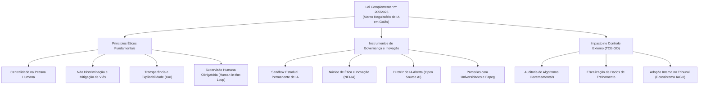
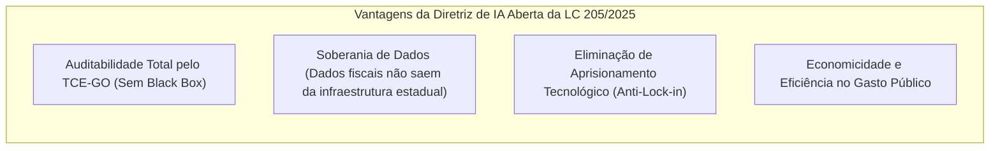
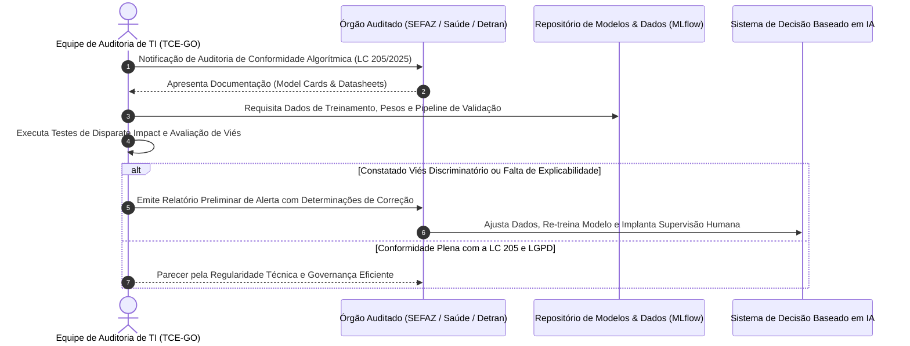

# 04 - Lei Complementar Estadual de Goiás nº 205/2025

> **Matéria:** Legislação Aplicada à Tecnologia da Informação  
> **Cargo:** B02 – Técnico de Controle Externo – Especialidade: Tecnologia da Informação  
> **Arquivo:** `04_lei_complementar_estadual_205_2025.md`  
> **Ato Normativo:** Lei Complementar Estadual (Goiás) nº 205, de 19 de maio de 2025 (Política Estadual de Fomento à Inovação e Governança em Inteligência Artificial do Estado de Goiás)

---

## 📌 Ementa / Itens do Edital
- Lei Complementar estadual nº 205, de 19 de maio de 2025 (Estado de Goiás)
- Contexto normativo e objetivos da lei no âmbito da administração pública goiana
- Disposições relativas à modernização institucional, transparência, inovação e governança de tecnologia
- Relação com as competências fiscalizatórias e operacionais do Tribunal de Contas do Estado de Goiás (TCE-GO)

---

## 🧭 Sumário
- [1. Contexto e Princípios Fundamentais da LC nº 205/2025](#1-contexto-e-princípios-fundamentais-da-lc-nº-2052025)
    - [1.1 Objetivos e Escopo da Política Estadual de IA](#11-objetivos-e-escopo-da-política-estadual-de-ia)
    - [1.2 Princípios Norteadores de IA no Setor Público Goiano](#12-princípios-norteadores-de-ia-no-setor-público-goiano)
- [2. Instrumentos Estratégicos Criados pela LC nº 205/2025](#2-instrumentos-estratégicos-criados-pela-lc-nº-2052025)
    - [2.1 Sandbox Estadual Permanente de Inteligência Artificial](#21-sandbox-estadual-permanente-de-inteligência-artificial)
    - [2.2 Núcleo de Ética e Inovação em Inteligência Artificial (NEI-IA)](#22-núcleo-de-ética-e-inovação-em-inteligência-artificial-nei-ia)
    - [2.3 A Diretriz Mandatória de IA Aberta (Open Source AI)](#23-a-diretriz-mandatória-de-ia-aberta-open-source-ai)
- [3. O Papel Fiscalizatório do TCE-GO sobre Sistemas de IA](#3-o-papel-fiscalizatório-do-tce-go-sobre-sistemas-de-ia)
    - [3.1 As Três Dimensões da Auditoria de IA Governamental](#31-as-três-dimensões-da-auditoria-de-ia-governamental)
    - [3.2 Uso Interno de IA no TCE-GO: O Ecossistema IAGO e a RA nº 24/2024](#32-uso-interno-de-ia-no-tce-go-o-ecossistema-iago-e-a-ra-nº-242024)
- [4. Fontes Recomendadas na Internet](#4-fontes-recomendadas-na-internet)
- [5. Questões Comentadas no Padrão FCC](#5-questões-comentadas-no-padrão-fcc)

---

## 📖 Teoria Aprofundada & Governança de IA no Estado de Goiás

## 1. Contexto e Princípios Fundamentais da LC nº 205/2025

A **Lei Complementar Estadual nº 205, de 19 de maio de 2025**, posicionou o Estado de Goiás na vanguarda legislativa do país ao estabelecer a primeira **Política Estadual de Fomento à Inovação e Governança em Inteligência Artificial** no plano subnacional.

### 1.1 Objetivos e Escopo da Política Estadual de IA

A norma foi concebida para conciliar dois vetores complementares:

1. **Fomento à Inovação Econômica e Governança Digital:** Estruturar um ecossistema fértil para que startups, centros de pesquisa, universidades e órgãos públicos desenvolvam aplicações avançadas de inteligência artificial;
2. **Salvaguardas de Direitos Fundamentais e Ética Algorítmica:** Assegurar que os sistemas de IA empregados na administração pública estadual respeitem os direitos dos cidadãos, a legalidade, a transparência, a não discriminação e a privacidade de dados pessoais (LGPD).

---

### 1.2 Princípios Norteadores de IA no Setor Público Goiano

| Princípio da LC nº 205/2025 | Conteúdo Teórico | Tradução Prática em Sistemas de TI |
|---|---|---|
| **Centralidade na Pessoa Humana (*Human-Centric AI*)** | A inteligência artificial deve servir ao bem-estar coletivo, ampliação de direitos e desenvolvimento socioeconômico sustentável. | Sistemas de IA não podem substituir a dignidade humana ou desumanizar o atendimento ao cidadão nos serviços públicos. |
| **Não Discriminação e Mitigação de Vieses** | Proibição de parâmetros algorítmicos que reproduzam ou amplifiquem preconceitos ilegais por raça, gênero, classe social ou deficiência. | Testes estatísticos de disparidade (*Disparate Impact Analysis*) nos dados de treino e saídas (*outputs*) dos modelos preditivos antes do deploy. |
| **Transparência Algorítmica e Explicabilidade (*XAI*)** | O cidadão e os órgãos de controle têm o direito de conhecer as variáveis determinantes e a lógica adotada pelas redes neurais e algoritmos. | Adoção de técnicas de explicabilidade (*SHAP values*, *LIME*, árvores substitutas) para justificar atos administrativos baseados em IA. |
| **Supervisão Humana (*Human-in-the-Loop*)** | Nenhuma decisão administrativa que suprima, restrinja ou afete direitos de pessoa física ou jurídica pode ser 100% autônoma e irrevogável por máquina. | Obrigatoriedade de intervenção, validação ou possibilidade de reanálise por um agente público humano capacitado. |
| **Segurança e Robustez Técnica** | Os sistemas de IA devem ser resistentes a falhas técnicas, alucinações perigosas, envenenamento de dados (*data poisoning*) e ataques adversariais. | Implementação de esteiras de MLOps seguras com validação cruzada, testes de estresse e proteção de modelos contra exfiltração de pesos. |

> 🚨 **ALERTA DE PROVA / PEGADINHA FCC:**  
> A FCC adora cobrar a regra da **Supervisão Humana (*Human-in-the-Loop*)**. É vedada no Estado de Goiás a tomada de decisão administrativa puramente automatizada e irrecorrível por IA que restrinja direitos de cidadãos ou empresas (como cancelamento de benefício ou sanção fiscal). O cidadão tem o direito de requerer a revisão humana da decisão!

---

## 2. Instrumentos Estratégicos Criados pela LC nº 205/2025

A Lei Complementar nº 205/2025 estrutura a política pública estadual sobre três grandes pilares institucionais:

### 2.1 Sandbox Estadual Permanente de Inteligência Artificial

- **Conceito:** Ambiente regulatório experimental seguro e controlado onde pessoas jurídicas (startups, empresas de tecnologia, institutos de ciência e tecnologia - ICTs e consórcios) podem testar produtos, serviços e modelos de IA inovadores com dispensa ou flexibilização temporária e monitorada de certas exigências regulatórias estaduais.
- **Natureza Permanente:** Diferente de sandboxes pontuais que se extinguem em meses, Goiás instituiu um ambiente regulatório experimental **permanente**, com ciclos regulares de chamadas públicas (editais da Secti).
- **Salvaguardas Inegociáveis:**
    - Estrita observância aos direitos fundamentais e à Lei Geral de Proteção de Dados Pessoais (LGPD);
    - Apresentação obrigatória de **Matriz de Riscos e Plano de Mitigação de Danos**;
    - Responsabilidade civil preservada para eventuais danos materiais ou morais causados a terceiros;
    - Limitação temporal de permanência no ambiente experimental.

---

### 2.2 Núcleo de Ética e Inovação em Inteligência Artificial (NEI-IA)

Colegiado de natureza **consultiva e propositiva**, reunindo representantes do Poder Executivo (Secretaria de Ciência, Tecnologia e Inovação - Secti), universidades públicas, comunidade científica, sociedade civil e setor empresarial de tecnologia.

**Atribuições Principais:**
1. Elaborar e atualizar o Código de Boas Práticas e Governança Ética de IA para a administração pública goiana;
2. Emitir pareceres técnicos prévios sobre projetos de IA classificados como de **alto risco** pelo Estado;
3. Propor diretrizes para a governança de dados governamentais utilizados em modelos analíticos;
4. Fomentar programas de formação e letramento digital em inteligência artificial para servidores públicos.

---

### 2.3 A Diretriz Mandatória de IA Aberta (Open Source AI)

A LC nº 205/2025 prescreve a **preferência pelo uso de soluções, modelos de linguagem e softwares de inteligência artificial de código aberto (*open-source*)** pelos órgãos e entidades da Administração Pública Estadual de Goiás.

- **Auditabilidade e Controle:** Permite aos auditores do TCE-GO inspecionar códigos-fonte, pesos sinápticos e pipelines de dados, evitando a opacidade de sistemas proprietários tipo "caixa preta" (*black box*);
- **Independência Tecnológica (*Anti-Lock-In*):** Evita que o Estado fique refém de monopólios internacionais de computação em nuvem com licenças caras cotadas em moeda estrangeira;
- **Segurança e Privacidade:** Permite a hospedagem em infraestrutura própria (*on-premises* ou nuvem governamental), garantindo que dados fiscais e cadastrais de cidadãos goianos não sejam transferidos para o exterior;
- **Customização Local:** Facilita o ajuste fino (*fine-tuning*) dos modelos para atender particularidades regionais, jurídicas e econômicas de Goiás.

---

## 3. O Papel Fiscalizatório do TCE-GO sobre Sistemas de IA

A vigência da LC nº 205/2025 amplia o escopo da auditoria de controle externo a cargo do Tribunal de Contas do Estado de Goiás (TCE-GO). O auditor de TI atua na avaliação técnica, ética e jurídica dos modelos algorítmicos adotados pelo poder público estadual.

### 3.1 As Três Dimensões da Auditoria de IA Governamental

1. **Auditoria de Dados de Treinamento (*Data-Centric AI Audit*):**
    - Licitude da base de dados perante a LGPD;
    - Representatividade estatística e qualidade da rotulagem;
    - Ausência de distorções históricas que discriminem grupos vulneráveis.
2. **Auditoria do Modelo e Desempenho (*Model Audit*):**
    - Avaliação de acurácia, precisão, recall, F1-score e curva ROC-AUC;
    - Resistência a alucinações e robustez contra ataques adversariais;
    - Verificação da diretriz de código aberto (*open source*).
3. **Auditoria de Processo e Governança (*Process Audit*):**
    - Existência de supervisão humana (*Human-in-the-Loop*);
    - Trilhas de auditoria registrando inputs, scores de confiança e identificação do servidor responsável pela homologação final do ato.

---

### 3.2 Uso Interno de IA no TCE-GO: O Ecossistema IAGO e a RA nº 24/2024

O próprio TCE-GO, alinhado à LC nº 205/2025, implementou regulação interna (Resolução Administrativa nº 24/2024) para o uso ético e seguro de IA generativa e preditiva no controle externo, operacionalizado no **Ecossistema IAGO** (*Inteligência Artificial de Goiás*):

- Análise preditiva e cruzamento massivo de dados em editais de licitação e contratos antes da homologação;
- Detecção automatizada de sobrepreço e cartelização em compras públicas;
- Elaboração assistida de minutas técnicas, **sempre sob validação humana obrigatória do auditor responsável**, mantendo-se a responsabilidade funcional pessoal do agente público.

---

## 4. Fontes Recomendadas na Internet

- [x] **Legislação Estadual de Goiás - Casa Civil (Legisla Goiás):**
    - Link Oficial: [Portal de Legislação do Estado de Goiás](https://legisla.casacivil.go.gov.br/)
    - *Conteúdo:* Texto Integral da Lei Complementar nº 205, de 19 de maio de 2025.
- [x] **Portal Institucional do Governo do Estado de Goiás:**
    - Link Oficial: [Governo de Goiás - Secretaria de Ciência, Tecnologia e Inovação (Secti)](https://goias.gov.br/secti/)
    - *Conteúdo:* Programas de fomento em IA, editais de Sandbox e diretrizes de IA Aberta.
- [x] **Tribunal de Contas do Estado de Goiás (TCE-GO):**
    - Link Oficial: [Inovação e Tecnologia no TCE-GO](https://portal.tce.go.gov.br/)
    - *Conteúdo:* Normas de Governança de TIC, Resolução Administrativa nº 24/2024 e o Ecossistema IAGO de auditoria eletrônica.

---

## 5. Questões Comentadas no Padrão FCC

### Questão 1 (FCC Inédita - Analista de Controle Externo / Tecnologia da Informação)
**Enunciado:** A Lei Complementar Estadual nº 205, de 19 de maio de 2025, disciplinou a Política Estadual de Inovação e Governança em Inteligência Artificial no Estado de Goiás. Ao tratar dos instrumentos para fomento e segurança jurídica, a referida lei instituiu o *Sandbox Estadual Permanente de Inteligência Artificial*. Em relação a esse instrumento regulatório, é correto afirmar:  

* **A)** Consiste em um ambiente fechado e exclusivo para órgãos de repressão criminal do Estado, vedada a participação de startups ou entidades civis.
* **B)** Permite a experimentação controlada de modelos e soluções tecnológicas de IA com flexibilização temporária e monitorada de certas exigências regulatórias, condicionada à apresentação de plano de gestão de riscos e estrita observância à proteção de dados e direitos fundamentais.
* **C)** Isenta totalmente as empresas participantes de qualquer responsabilidade civil ou criminal por danos materiais causados a cidadãos durante o período de testes.
* **D)** Tem duração efêmera e vigência obrigatória de apenas 30 dias contados da publicação da lei complementar, sendo extinto após essa data.
* **E)** Autoriza o tratamento irrestrito de dados pessoais sensíveis sem necessidade de observância aos preceitos da Lei Geral de Proteção de Dados Pessoais (LGPD).

> **Comentário Detalhado:**
> - **A)** Incorreta. O Sandbox de IA de Goiás é amplo, permanente e voltado a estimular o ecossistema econômico de inovação, incluindo startups, empresas de tecnologia, universidades e órgãos públicos.
> - **B)** **Correta.** A definição legal de Sandbox Regulatório na LC nº 205/2025 prevê um ambiente controlado de testes com flexibilização temporária e supervisionada de certas exigências regulatórias, exigindo salvaguardas essenciais: plano prévio de mitigação de riscos, respeito absoluto aos direitos humanos e submissão estrita à LGPD.
> - **C)** Incorreta. O sandbox não confere imunidade civil ampla; eventuais danos provocados a usuários continuam sujeitos à reparação civil na forma da legislação em vigor.
> - **D)** Incorreta. A lei instituiu expressamente o sandbox como permanente (*Sandbox Estadual Permanente de Inteligência Artificial*), estabelecendo uma política pública continuada no Estado de Goiás.
> - **E)** Incorreta. A conformidade com a LGPD é pré-requisito indispensável e inegociável para a participação no sandbox.
> 
> **Gabarito: B**

---

### Questão 2 (FCC Inédita - Técnico de Controle Externo / Tecnologia da Informação)
**Enunciado:** A Administração Pública do Estado de Goiás publicou edital para contratação de solução inteligente de triagem e encaminhamento de atendimentos em unidades hospitalares públicas. Para atender à diretriz estratégica de governança tecnológica instituída expressamente pelo art. 4º da Lei Complementar nº 205/2025, o termo de referência deve priorizar:  

* **A)** A compra de soluções baseadas em modelos proprietários de código fechado (*closed-source*), visando garantir segredo comercial intransponível perante a sociedade.
* **B)** A preferência pelo uso de sistemas, plataformas e modelos de inteligência artificial de código aberto (*open-source*), assegurando maior transparência, auditabilidade pelo TCE-GO, soberania digital e independência de fornecedor (*anti-lock-in*).
* **C)** A terceirização integral dos bancos de dados hospitalares para servidores situados em paraísos fiscais sem qualquer mecanismo de auditoria.
* **D)** A vedação absoluta de contratação de softwares por órgãos públicos estaduais que possuam código-fonte aberto.
* **E)** A imposição de contratos de licenciamento perpétuo e irrevogável com cláusula de exclusividade com uma única multinacional estrangeira.

> **Comentário Detalhado:**
> - **A)** Incorreta. A LC nº 205/2025 combate a opacidade de soluções tipo "caixa preta" (*black box*) nos serviços públicos essenciais, contrariando o segredo fechado injustificado.
> - **B)** **Correta.** A diretriz de IA Aberta é um dos grandes diferenciais da LC estadual nº 205/2025. Ela consagra como diretriz preferencial o uso de tecnologias, softwares e modelos abertos (*open-source*), garantindo auditabilidade técnica direta pelo Tribunal de Contas, economicidade, independência de fornecedor e soberania de dados.
> - **C)** Incorreta. O envio de dados sensíveis de saúde para o exterior sem salvaguardas violaria a LGPD e o princípio da segurança da informação.
> - **D)** Incorreta. A lei não veda, mas exatamente prioriza o uso de modelos abertos.
> - **E)** Incorreta. Promove o aprisionamento tecnológico (*vendor lock-in*), contrariando a política de inovação pública.
> 
> **Gabarito: B**

---

### Questão 3 (FCC Inédita - Auditor Estadual de Controle Externo / TI)
**Enunciado:** Em uma auditoria governamental de conformidade algorítmica realizada pelo TCE-GO sobre o sistema automatizado de cobrança e suspensão cadastral de contribuintes gerido pelo Poder Executivo Estadual, a equipe técnica verificou que o modelo de aprendizado de máquina bloqueava automaticamente as certidões negativas de débito sem qualquer possibilidade de revisão ou recurso por analista humano. À luz dos princípios éticos da LC nº 205/2025:  

* **A)** O procedimento é lícito e exemplar, pois a automação integral sem interferência humana é a meta suprema exigida pela legislação goiana.
* **B)** O sistema viola a diretriz mandatória de supervisão humana (*Human-in-the-Loop*), que assegura ao cidadão e aos jurisdicionados a explicabilidade do ato e o direito de obter a revisão humana de decisões automatizadas que afetem seus direitos.
* **C)** O Tribunal de Contas não tem competência funcional para auditar a lógica de algoritmos governamentais, devendo limitar-se ao valor financeiro da nota fiscal da licitação.
* **D)** A decisão automatizada pura é permitida desde que a taxa de acerto do modelo estatístico seja superior a noventa por cento em dados de teste.
* **E)** O cidadão deve renunciar previamente ao direito de defesa administrativa para interagir com sistemas de governo digital em Goiás.

> **Comentário Detalhado:**
> - **A)** Incorreta. A automação plena sem mecanismo humano em decisões restritivas de direitos é repudiada pela doutrina de governança de IA e pela LC nº 205/2025.
> - **B)** **Correta.** A LC nº 205/2025 e os princípios universais de ética em IA determinam que decisões que impactem substancialmente a esfera jurídica e os direitos de pessoas físicas ou jurídicas devem assegurar o princípio do *Human-in-the-Loop* (supervisão humana), com direito a explicações inteligíveis dos critérios adotados e possibilidade de revisão por pessoa natural.
> - **C)** Incorreta. O TCE-GO possui ampla competência constitucional e legal para fiscalizar a legitimidade, economicidade, eficácia e conformidade legal de quaisquer atos estatais, incluindo os algoritmos decisórios.
> - **D)** Incorreta. Nenhuma métrica estatística afasta as garantias constitucionais do devido processo legal e a exigência de supervisão humana em atos administrativos restritivos de direitos.
> - **E)** Incorreta. O direito à ampla defesa e ao contraditório é cláusula constitucional pétrea que não pode ser objeto de renúncia para utilização de serviços públicos.
> 
> **Gabarito: B**

---

### Questão 4 (FCC Inédita - Analista de Sistemas / Engenharia de Software)
**Enunciado:** O Núcleo de Ética e Inovação em Inteligência Artificial (NEI-IA), criado pela Lei Complementar Estadual nº 205/2025 no Estado de Goiás, possui como uma de suas funções primordiais:  

* **A)** Exercer com exclusividade o julgamento e aplicação de penas de prisão perpétua a hackers e fraudadores de sistemas estaduais.
* **B)** Atuar como órgão colegiado consultivo e propositivo para estabelecer diretrizes de ética, governança, mitigação de viés algorítmico e boas práticas no desenvolvimento e uso de inteligência artificial na administração estadual.
* **C)** Monopolizar todo o desenvolvimento de código-fonte de TI no Estado, extinguindo as diretorias de TI dos demais órgãos públicos.
* **D)** Autorizar previamente a compra de qualquer computador de uso pessoal adquirido por cidadãos residentes em território goiano.
* **E)** Substituir as câmaras de julgamento de processos de contas do Tribunal de Contas do Estado de Goiás.

> **Comentário Detalhado:**
> - **A)** Incorreta. O NEI-IA é órgão consultivo de governança ética, não exercendo funções jurisdicionais penais.
> - **B)** **Correta.** O NEI-IA foi estruturado pela LC nº 205/2025 como uma instância colegiada consultiva, plural e propositiva com a missão de zelar pela ética, transparência algorítmica, mitigação de vieses preconceituosos e emissão de orientações técnicas de boas práticas para os sistemas públicos de IA em Goiás.
> - **C)** Incorreta. O núcleo não é fábrica monopolista de software; cada órgão (como TCE, SEFAZ, Detran) mantém suas respectivas áreas de tecnologia.
> - **D)** Incorreta. O poder público estadual não exerce controle prévio sobre aquisições privadas de hardware pessoal de cidadãos.
> - **E)** Incorreta. A competência jurisdicional de controle externo e julgamento de contas públicas é privativa dos Conselheiros do TCE-GO.
> 
> **Gabarito: B**

---

### Questão 5 (FCC Inédita - Auditor de Tecnologia da Informação / Ciência de Dados)
**Enunciado:** Em relação à governança de dados e ao uso de ferramentas baseadas em inteligência artificial no âmbito das instituições públicas goianas, nos termos da Lei Complementar Estadual nº 205/2025 combinada com a Resolução Administrativa nº 24/2024 do TCE-GO, assinale a opção correta:  

* **A)** Dados fiscais sigilosos podem ser inseridos livremente em serviços públicos e gratuitos de IA generativa em nuvem aberta internacional, haja vista a prevalência da inovação sobre as normas de sigilo.
* **B)** As ferramentas de inteligência artificial generativa e preditiva no setor público goiano atuam como instrumentos auxiliares de suporte técnico e eficiência operacional, não dispensando a validação humana e a responsabilidade funcional do servidor público signatário do ato processual.
* **C)** A explicabilidade algorítmica (*Explainable AI - XAI*) é dispensada caso o sistema seja adquirido de empresas estrangeiras.
* **D)** Modelos de IA desenvolvidos em parceria com a Fundação de Amparo à Pesquisa do Estado de Goiás (Fapeg) estão isentos de apresentar documentação de arquitetura e mitigação de riscos.
* **E)** O treinamento de modelos de aprendizado de máquina dispensa quaisquer cuidados quanto à qualidade e limpeza da base de dados histórica.

> **Comentário Detalhado:**
> - **A)** Incorreta. Inserir dados sigilosos e fiscais em ferramentas de IA pública na nuvem comercial gratuita configura quebra grave de sigilo funcional, violação da LGPD e transgressão às normas de segurança da informação do TCE-GO.
> - **B)** **Correta.** As normas e a LC nº 205/2025 estabelecem expressamente que a inteligência artificial tem caráter de instrumento auxiliar de produtividade e triagem analítica. O servidor público que assina o despacho, relatório de auditoria ou ato decisório permanece integralmente responsável pelo conteúdo, sendo imperativa a revisão humana crítica do que foi sintetizado pelo modelo.
> - **C)** Incorreta. A explicabilidade é dever do Estado de Goiás e do fornecedor, independentemente da nacionalidade da empresa desenvolvedora.
> - **D)** Incorreta. Parcerias de pesquisa com a Fapeg e universidades estão vinculadas às regras de conformidade ética, documentação técnica (*Model Cards*) e mitigação de vieses da lei.
> - **E)** Incorreta. O princípio basilar do MLOps (*Garbage in, Garbage out*) impõe governança rigorosa de dados de treino para evitar modelos enviesados, imprecisos ou alucinatórios.
> 
> **Gabarito: B**
