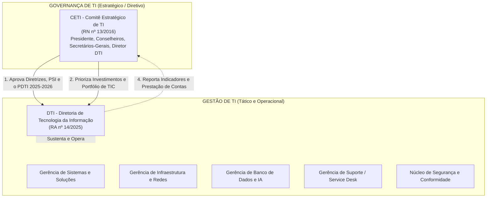
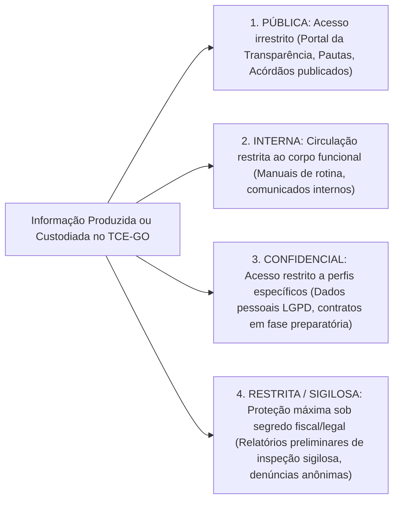
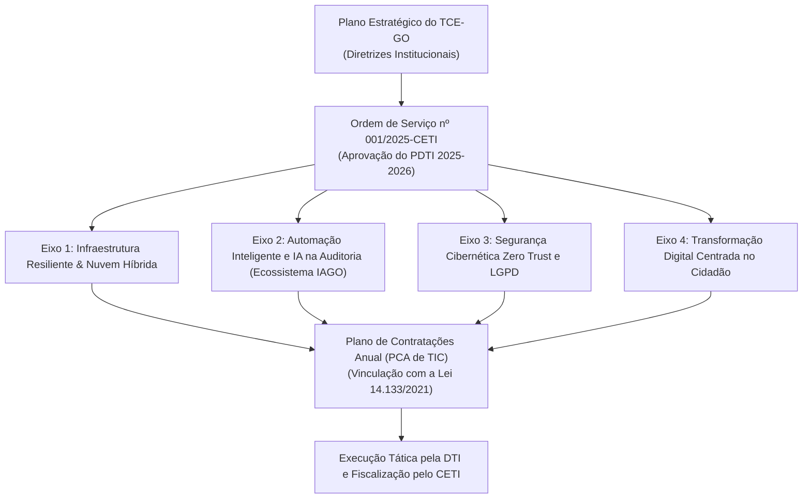

# 05 - Normativos Internos e Planejamento de TI do TCE-GO

> **Matéria:** Legislação Aplicada à Tecnologia da Informação  
> **Cargo:** B02 – Técnico de Controle Externo – Especialidade: Tecnologia da Informação  
> **Arquivo:** `05_normativos_e_planejamento_de_ti_tce_go.md`  
> **Atos Normativos:** Resoluções RN 13/2016, RA 14/2024, RA 17/2024, RA 14/2025 e PDTI 2025–2026 (Ordem de Serviço nº 001/2025-CETI)

---

## 📌 Ementa / Itens do Edital
- Normativos institucionais do Tribunal de Contas do Estado de Goiás sobre Governança, Planejamento e Segurança de TI:
  - **Resolução Normativa nº 13/2016 (compilada):** Instituição, composição e atribuições do Comitê Estratégico de TI (CETI)
  - **Resolução Administrativa nº 14/2024:** Política de Governança Organizacional do TCE-GO
  - **Resolução Administrativa nº 17/2024:** Política de Segurança da Informação (PSI) do TCE-GO
  - **Resolução Administrativa nº 14/2025:** Estrutura e competências privativas da Diretoria de Tecnologia da Informação (DTI) e gerências vinculadas
  - **Plano Diretor de Tecnologia da Informação (PDTI) 2025–2026:** Aprovado pela Ordem de Serviço nº 001/2025-CETI

---

## 🌳 Classificação Hierárquica

```text
5. Governança Interna, Estrutura da DTI e PDTI 2025–2026 do TCE-GO
├── 5.1 O Comitê Estratégico de Tecnologia da Informação - CETI (Resolução Normativa nº 13/2016)
│   ├── 5.1.1 Finalidade e Natureza: Órgão colegiado consultivo e deliberativo de governança superior de TI
│   ├── 5.1.2 Composição do CETI: Membros natos (Presidência, Conselheiros, Secretarias Gerais, Diretor de TI)
│   ├── 5.1.3 Competências Principais:
│   │   ├── Aprovar e revisar o Plano Diretor de TI (PDTI) e a Política de Segurança da Informação (PSI)
│   │   ├── Priorizar o portfólio de investimentos e contratações estratégicas de TIC
│   │   ├── Monitorar a execução orçamentária e o alcance das metas de TI do Tribunal
│   │   └── Decidir sobre alocação de recursos em projetos de grande impacto institucional
│   └── 5.1.4 Funcionamento, reuniões ordinárias e quóruns de deliberação
├── 5.2 Política de Governança Organizacional (Resolução Administrativa nº 14/2024)
│   ├── 5.2.1 Princípios de Governança Institucional: Transparência, Integridade, Prestação de Contas e Sustentabilidade
│   ├── 5.2.2 Instâncias de Governança: Alta Administração, Comitês Temáticos e Unidades de Gestão de Riscos
│   └── 5.2.3 Integração da Governança de TI com o Planejamento Estratégico Global do TCE-GO
├── 5.3 Política de Segurança da Informação - PSI (Resolução Administrativa nº 17/2024)
│   ├── 5.3.1 Diretrizes Corporativas para o Corpo Funcional:
│   │   ├── Gestão de credenciais, complexidade de senhas e autenticação multifator obrigatória
│   │   ├── Regras para uso de correio eletrônico institucional e navegação na Internet
│   │   ├── Segurança no Teletrabalho e Acesso Remoto via VPN corporativa
│   │   └── Proibição do uso não autorizado de dispositivos móveis de armazenamento externo (pendrives/HDs externos)
│   ├── 5.3.2 Classificação e Tratamento da Informação no Tribunal: Informação Pública, Interna, Confidencial e Restrita
│   └── 5.3.3 Gestão de Incidentes de Segurança da Informação e o papel da equipe de resposta (CSIRT do TCE-GO)
├── 5.4 Estrutura e Competências da Diretoria de TI (Resolução Administrativa nº 14/2025)
│   ├── 5.4.1 Missão e Posicionamento da Diretoria de Tecnologia da Informação (DTI) no organograma
│   ├── 5.4.2 Competências da DTI: Planejar, coordenar, executar e manter as soluções de infraestrutura, sistemas e segurança
│   └── 5.4.3 Estrutura das Unidades e Gerências Vinculadas à DTI:
│       ├── Gerência / Divisão de Desenvolvimento e Manutenção de Sistemas
│       ├── Gerência / Divisão de Infraestrutura, Redes e Telecomunicações
│       ├── Gerência / Divisão de Banco de Dados e Ciência de Dados
│       ├── Gerência / Divisão de Suporte ao Usuário (Service Desk / Atendimento)
│       └── Divisão / Núcleo de Segurança da Informação e Conformidade
└── 5.5 Plano Diretor de TI - PDTI 2025–2026 (Ordem de Serviço nº 001/2025-CETI)
    ├── 5.5.1 Metodologia de Elaboração e Alinhamento com o Plano Estratégico Plurianual do Tribunal
    ├── 5.5.2 Diagnóstico do Ambiente de TIC: Análise de forças, fraquezas, oportunidades e ameaças (SWOT)
    ├── 5.5.3 Visão de Futuro e Princípios Norteadores de TI para o Biênio 2025–2026
    ├── 5.5.4 Objetivos Estratégicos de TIC e Metas Institucionais:
    │   ├── Modernização da infraestrutura em nuvem e alta disponibilidade
    │   ├── Fomento ao desenvolvimento assistido por IA e automação inteligente no controle externo
    │   ├── Fortalecimento da segurança cibernética e conformidade com a LGPD
    │   └── Transformação digital da experiência do usuário interno e do jurisdicionado
    └── 5.5.5 Portfólio de Projetos Estratégicos, Ações Táticas e Indicadores de Monitoramento
```

---

## 📖 Teoria Aprofundada & Governança Institucional do TCE-GO

### 5.1 O Comitê Estratégico de Tecnologia da Informação - CETI (Resolução Normativa nº 13/2016)

O Comitê Estratégico de Tecnologia da Informação (CETI) do TCE-GO é o órgão colegiado permanente que materializa a instância máxima de **Governança de TIC** no Tribunal, assegurando a necessária segregação entre as decisões estratégicas da alta administração e a gestão operacional da área técnica.



#### 5.1.1 Composição e Funcionamento do CETI
- **Membros Natos e Designados:** Composto por representantes da alta cúpula decisória do Tribunal:
  - Conselheiro-Presidente (ou Conselheiro designado para presidir o Comitê);
  - Diretor-Geral do Tribunal;
  - Secretário-Geral de Controle Externo (representando a área-fim do negócio de auditoria);
  - Secretário-Geral de Administração (representando a área de gestão de recursos);
  - Diretor de Tecnologia da Informação (que atua como membro executivo e relator técnico das matérias).
- **Competências Primordiais do CETI (RN 13/2016):**
  1. **Deliberação Estratégica:** Aprovar formalmente o Plano Diretor de TI (PDTI) e suas revisões periódicas, alinhando-o ao Plano Estratégico do TCE-GO;
  2. **Política de Segurança:** Apreciar e submeter a Política de Segurança da Informação (PSI) e suas normas complementares;
  3. **Priorização de Demandas:** Estabelecer a ordem de prioridade dos projetos e contratações de TIC de grande vulto, evitando dispersão orçamentária;
  4. **Monitoramento e Avaliação:** Analisar relatórios semestrais de execução do PDTI e desempenho dos serviços de tecnologia;
  5. **Resolução de Conflitos:** Dirimir impasses sobre demandas concorrentes entre a área de controle externo e a área administrativa.

> ⭐ **IMPORTANTE / REGRA DE OURO (Segregação COBIT):**  
> Guarde a distinção conceitual cobrada pela FCC:  
> - **O CETI GOVERNA:** Avalia, direciona e monitora (*Evaluate, Direct, Monitor*). Aprova o PDTI, define prioridades orçamentárias e estabelece diretrizes da PSI. Não põe a mão na massa técnica.  
> - **A DTI GERE E OPERA:** Planeja, constrói, entrega e sustenta (*Plan, Build, Run, Monitor*). Programa código, configura roteadores, gerencia bancos de dados e atende chamados do usuário.

---

### 5.2 Política de Governança Organizacional (Resolução Administrativa nº 14/2024)

A Resolução Administrativa nº 14/2024 consolidou o modelo de Governança Pública no TCE-GO, alinhado aos referenciais do Tribunal de Contas da União (TCU) e da OCDE (*Organização para a Cooperação e Desenvolvimento Econômico*).

1. **Princípios Estruturantes:** Integridade, confiabilidade, transparência, prestação de contas (*accountability*), tempestividade e foco no cidadão.
2. **Modelo das Três Linhas:**
   - **1ª Linha (Gestores Operacionais):** Responsáveis pela execução direta das rotinas e pelos controles internos primários em cada unidade;
   - **2ª Linha (Unidades de Riscos e Integridade):** Responsáveis pelo monitoramento de conformidade, desenho de políticas de riscos e suporte metodológico;
   - **3ª Linha (Auditoria Interna):** Fornece avaliação independente e objetiva da eficácia dos processos de governança e controles institucionais.
3. **Conexão com a TIC:** A Governança de TI não é uma ilha isolada; os objetivos tecnológicos do PDTI são derivados diretamente dos objetivos estratégicos da RA nº 14/2024 para maximizar o valor público entregue pelo Tribunal à sociedade goiana.

---

### 5.3 Política de Segurança da Informação - PSI (Resolução Administrativa nº 17/2024)

A PSI do TCE-GO estabelece os padrões e comportamentos mandatórios para assegurar a **Confidencialidade, Integridade, Disponibilidade, Autenticidade e Não-Repúdio (CIDAN)** dos ativos de informação do Tribunal.

#### 5.3.1 Classificação Corporativa da Informação no TCE-GO



| Nível de Classificação | Definição Normativa | Requisitos de Proteção e Tratamento | Exemplo Típico |
|---|---|---|---|
| **Pública** | Informações de livre acesso à sociedade, em cumprimento à LAI e ao princípio da publicidade. | Não exige controle de confidencialidade; exige garantia de integridade e disponibilidade. | Acórdãos transitados em julgado, relatórios de gestão fiscal publicados. |
| **Interna** | Informações voltadas ao uso operacional cotidiano dos servidores e colaboradores do Tribunal. | Acesso vedado ao público externo sem autorização; compartilhamento limitado ao ambiente institucional. | Modelos de pareceres internos, notas técnicas de rotina, lista de ramais. |
| **Confidencial** | Informações cuja divulgação não autorizada possa comprometer operações ou violar direitos de terceiros (LGPD). | Controle rigoroso de privilégios (RBAC), registro de trilhas de auditoria e criptografia em trânsito e repouso. | Folha de pagamento com dados bancários, atestados de saúde, logs de acesso individualizados. |
| **Restrita / Sigilosa** | Informações protegidas por sigilo legal estrito (fiscal, bancário, judicial ou de auditoria preliminar). | Acesso restrito exclusivamente aos auditores designados na portaria; proibição de cópia externa; custódia em pastas seguras com criptografia de disco. | Relatório de auditoria preliminar de fraude antes da notificação do jurisdicionado; denúncias de corrupção protegidas. |

#### 5.3.2 Diretrizes de Uso Seguro e Operações de TIC
1. **Credenciais e Autenticação:**
   - Senhas pessoais, intransferíveis e secretas com política de complexidade mínima (números, caracteres especiais, maiúsculas e minúsculas);
   - Uso compulsório de **Autenticação Multifator (MFA)** para todos os acessos externos e sistemas corporativos sensíveis.
2. **Teletrabalho e Acesso Remoto:**
   - Conexão remota permitida exclusivamente por meio de túnel criptografado **VPN (*Virtual Private Network*) corporativa** do Tribunal;
   - Proibição de armazenamento de documentos restritos em dispositivos de armazenamento particulares (computadores domésticos sem antivírus gerenciado);
   - Bloqueio automático de tela configurado para tempo máximo de inatividade (ex.: 5 minutos).
3. **Dispositivos Móveis de Armazenamento:**
   - Bloqueio por política de grupo (GPO) do uso de dispositivos USB (*pendrives*, HDs externos) não homologados nas estações do Tribunal, mitigando riscos de contaminação por *malware* e exfiltração de dados.
4. **Tratamento de Incidentes de Segurança:**
   - Existência de equipe especializada de resposta a incidentes cibernéticos (CSIRT / Equipe de Tratamento de Incidentes de Redes);
   - Dever funcional de todo servidor de comunicar imediatamente à DTI qualquer indício de infecção, *phishing* recebido ou perda de equipamento funcional.

---

### 5.4 Estrutura e Competências da Diretoria de TI (Resolução Administrativa nº 14/2025)

A Resolução Administrativa nº 14/2025 modernizou a estrutura organizacional da **Diretoria de Tecnologia da Informação (DTI)** do TCE-GO, fixando suas competências executivas privativas e distribuindo atribuições entre suas gerências setoriais:

1. **Competências Institucionais Privativas da DTI:**
   - Planejar, gerenciar, executar e manter o ecossistema tecnológico do Tribunal;
   - Subsidiar tecnicamente o CETI na elaboração e revisão do PDTI e da PSI;
   - Conduzir o planejamento das contratações de TIC, elaborando os Estudos Técnicos Preliminares (ETP) e Termos de Referência (TR);
   - Gerenciar o ciclo de vida dos softwares corporativos de auditoria e processo eletrônico;
   - Garantir a alta disponibilidade da infraestrutura de servidores, data centers, redes e serviços em nuvem.
2. **Divisão Funcional das Unidades Subordinadas à DTI:**
   - **Gerência de Sistemas de Informação:** Responsável pela análise, desenvolvimento, sustentação e testes de software, empregando metodologias ágeis (Scrum/Kanban) e práticas de DevSecOps;
   - **Gerência de Infraestrutura e Redes:** Responsável pela operação dos data centers primário e secundário, enlaces de fibra óptica, roteadores, switches, virtualização de servidores (VMware/Hyper-V/Kubernetes) e serviços em nuvem híbrida;
   - **Gerência de Banco de Dados e Informações Estratégicas:** Responsável pela administração de bancos relacionais e NoSQL, data lake, pipelines ETL/ELT, inteligência analítica de dados e suporte ao treinamento de modelos de IA (Ecossistema IAGO);
   - **Gerência de Atendimento e Suporte ao Usuário (Service Desk):** Ponto único de contato (SPOC) para suporte a usuários internos e externos, microinformática, gestão de ativos de TI e incidentes operacionais de Nível 1 e 2;
   - **Núcleo de Segurança da Informação e Conformidade:** Gestão contínua de vulnerabilidades, monitoramento de SOC (*Security Operations Center*), auditoria de logs e garantia de conformidade com a PSI (RA 17/2024) e a LGPD.

---

### 5.5 Plano Diretor de TI - PDTI 2025–2026 (Ordem de Serviço nº 001/2025-CETI)

Aprovado formalmente pelo Comitê Estratégico de TI por meio da **Ordem de Serviço nº 001/2025-CETI**, o **PDTI 2025–2026** é o instrumento tático-operacional de planejamento da TIC que estabelece os rumos tecnológicos do TCE-GO para o biênio 2025–2026.



#### 5.5.1 Metodologia de Elaboração e Diagnóstico SWOT
O PDTI foi concebido a partir de um diagnóstico aprofundado do ambiente tecnológico do Tribunal:
- **Forças (Strengths):** Quadro técnico qualificado e especializado; governança institucional madura com o CETI atuante; sistemas de processo eletrônico consolidados.
- **Fraquezas (Weaknesses):** Legados tecnológicos demandando refatoração para microsserviços; necessidade de ampliação contínua da capacidade de armazenamento para dados de auditoria contínua.
- **Oportunidades (Opportunities):** Expansão do uso de Inteligência Artificial generativa e preditiva no controle de despesas públicas estaduais; adoção de soluções de nuvem governamental elástica.
- **Ameaças (Threats):** Sofisticação crescente de ataques cibernéticos globais (*ransomware*); retenção de talentos técnicos em face da concorrência do mercado privado global.

#### 5.5.2 Os Quatro Eixos Estratégicos do PDTI 2025–2026
1. **Eixo Estratégico I - Infraestrutura Resiliente e Nuvem Híbrida:**
   - Modernização do Data Center primário e consolidação do site de recuperação de desastres (*Disaster Recovery*) em nuvem;
   - Metas: Disponibilidade global dos sistemas críticos $\ge 99,5\%$ e tempo máximo de recuperação pós-falha (RTO) inferior a 2 horas.
2. **Eixo Estratégico II - Inteligência Artificial e Automação no Controle Externo:**
   - Expansão do **Ecossistema IAGO** para leitura e cruzamento automatizado de editais de licitação, folhas de pagamento dos municípios e dados fiscais da SEFAZ;
   - Implantação de modelos de processamento de linguagem natural (NLP) de código aberto em conformidade com a LC nº 205/2025 e a RA nº 24/2024.
3. **Eixo Estratégico III - Cibersegurança e Proteção de Dados:**
   - Adoção progressiva do paradigma **Zero Trust Architecture (ZTA)**;
   - Autenticação com múltiplos fatores em 100% dos serviços;
   - Monitoramento 24x7 de eventos de segurança através de SIEM corporativo.
4. **Eixo Estratégico IV - Experiência Digital do Usuário e Jurisdicionado:**
   - Remodelação do portal de serviços e processos do TCE-GO com foco em design centrado no usuário (*UX/UI*) e acessibilidade web (e-MAG);
   - Integração completa ao login único Gov.br nos termos da Lei nº 14.063/2020.

---

## ⚠️ Pontos de Atenção (Estilo FCC)

- **Quem aprova o PDTI?** O PDTI é **aprovado pelo CETI** (Ordem de Serviço nº 001/2025-CETI) e **não** monocraticamente pelo Diretor de TI. A DTI é a unidade que elabora a proposta técnica e o executa.
- **Composição do CETI:** Órgão colegiado composto por membros da alta cúpula (Presidência, Diretor-Geral, Secretários-Gerais de Controle Externo e Administração e Diretor de TI).
- **Vínculo das Contratações com o PDTI:** Nenhuma contratação relevante de TIC pode ser iniciada no TCE-GO sem estar expressamente alinhada e prevista no PDTI vigente, sob pena de violação à Lei nº 14.133/2021 e às normas de controle interno.
- **Classificação da Informação (RA 17/2024):** Conhecer as 4 categorias (Pública, Interna, Confidencial e Restrita/Sigilosa) e saber que relatórios preliminares de auditoria fiscal e denúncias anônimas tramitam em nível **Restrito/Sigiloso**.

---

## 🌐 Fontes Recomendadas na Internet (Acesso Direto e Gratuito)

- [x] **Repositório Normativo Oficial do TCE-GO:**
  - Link Oficial: [Legislação e Atos Normativos do TCE-GO](https://portal.tce.go.gov.br/legislacao)
  - *Textos Oficiais:* Resolução Normativa nº 13/2016 (CETI), Resolução Administrativa nº 14/2024 (Governança Organizacional), Resolução Administrativa nº 17/2024 (PSI) e Resolução Administrativa nº 14/2025 (Estrutura da DTI).
- [x] **Portal de Planejamento Estratégico e TIC do TCE-GO:**
  - Link Oficial: [Planejamento de TIC e Governança Digital TCE-GO](https://portal.tce.go.gov.br/planejamento-estrategico)
  - *Conteúdo:* Publicação oficial do PDTI 2025–2026 e atos do CETI (Ordem de Serviço nº 001/2025-CETI).
- [x] **Referencial Básico de Governança de TI do TCU:**
  - Link Oficial: [Referenciais de Governança de TIC do TCU](https://portal.tcu.gov.br/governanca/gestao-publica/governanca-de-ti/)
  - *Conteúdo:* Princípios de separação de papéis entre governança (CETI) e gestão técnica (DTI).

---

## 📝 Questões Comentadas & Exemplos (Padrão FCC)

### Questão 1 (FCC Inédita - Auditor Estadual de Controle Externo / TI)
**Enunciado:** No desenho da estrutura de governança e gestão de tecnologia da informação do Tribunal de Contas do Estado de Goiás, a Resolução Normativa nº 13/2016 instituiu o Comitê Estratégico de Tecnologia da Informação (CETI). Considerando os preceitos de segregação de funções entre instâncias de governança superior e órgãos executivos de gestão técnica, assinale a opção que expressa uma competência atribuída ao CETI:  
A) Programar rotinas de banco de dados em linguagem SQL e configurar portas de switches de borda no Data Center.  
B) Aprovar formalmente as diretrizes do Plano Diretor de Tecnologia da Informação (PDTI) e priorizar as iniciativas e investimentos estratégicos de TIC alinhados ao planejamento do Tribunal.  
C) Atender a chamados de primeiro nível de suporte técnico de usuários que esqueceram senhas na intranet institucional.  
D) Homologar individualmente cada commit de código-fonte produzido pelos analistas de desenvolvimento da DTI.  
E) Assinar monocraticamente contratos de compra de computadores sem a instauração de procedimento licitatório regular.  

> **Gabarito: B**  
>  
> **Comentário Analítico Passo a Passo:**  
> - **Análise da Alternativa A (Incorreta):** A programação de rotinas de banco de dados e configuração de switches são atribuições estritamente técnicas e operacionais da Diretoria de TI (DTI), e não de um comitê estratégico colegiado de alta direção.  
> - **Análise da Alternativa B (CORRETA):** O CETI (RN nº 13/2016) é o órgão superior colegiado de governança de TIC do TCE-GO. Cabe ao CETI avaliar, direcionar e monitorar a tecnologia, o que compreende privativamente a aprovação formal do PDTI, suas revisões e a priorização do portfólio de projetos e investimentos estratégicos da Corte de Contas.  
> - **Análise da Alternativa C (Incorreta):** O suporte de primeiro nível (Service Desk) compete à Gerência de Atendimento e Suporte da DTI.  
> - **Análise da Alternativa D (Incorreta):** Homologação de commits de código é atividade técnica dos líderes de engenharia de software da Gerência de Sistemas da DTI.  
> - **Análise da Alternativa E (Incorreta):** O CETI delibera estrategicamente de forma colegiada; contratos de compras públicas seguem a Lei 14.133/2021 sob a competência ordenadora da Presidência do Tribunal.

---

### Questão 2 (FCC Inédita - Técnico de Controle Externo / Tecnologia da Informação)
**Enunciado:** Um auditor técnico do TCE-GO, atuando no regime de teletrabalho, necessita acessar a base de dados do sistema de controle de processos administrativos para instruir um relatório de fiscalização. Em conformidade com a Política de Segurança da Informação (PSI) do Tribunal, instituída pela Resolução Administrativa nº 17/2024:  
A) O auditor deve conectar-se obrigatoriamente por meio de Rede Privada Virtual (VPN) corporativa com uso de autenticação de múltiplos fatores (MFA), sendo-lhe vedado armazenar cópias locais desprotegidas de relatórios restritos em computador doméstico compartilhado.  
B) O auditor pode desativar a política de antivírus institucional caso sinta lentidão no processamento de planilhas.  
C) É permitido compartilhar sua senha pessoal de rede com familiares próximos para agilizar a digitação de dados.  
D) O acesso a documentos sigilosos de auditoria pode ser realizado a partir de computadores de uso público em cibercafés ou hotéis sem qualquer proteção criptográfica.  
E) O uso de autenticação de duplo fator é expressamente proibido pela PSI por retardar o trabalho remoto.  

> **Gabarito: A**  
>  
> **Comentário Analítico Passo a Passo:**  
> - **Análise da Alternativa A (CORRETA):** A Resolução Administrativa nº 17/2024 (PSI do TCE-GO) estabelece normas rigorosas para o teletrabalho e segurança da informação: acesso externo somente via túnel VPN corporativo com autenticação multifator (MFA), proteção de credenciais institucionais e proibição categórica de gravação de arquivos de trabalho restritos em mídias particulares não homologadas ou computadores compartilhados.  
> - **Análise da Alternativa B (Incorreta):** A desativação de controles de segurança (como soluções antivírus gerenciadas) é terminantemente proibida e constitui falta funcional.  
> - **Análise da Alternativa C (Incorreta):** O login e a senha são individuais, personalíssimos e intransferíveis; compartilhá-los com terceiros viola a confidencialidade e a integridade da cadeia de custódia da auditoria.  
> - **Análise da Alternativa D (Incorreta):** Equipamentos públicos apresentam alto risco de captura de senhas por keyloggers e malwares, sendo seu uso vedado para tratar dados institucionais restritos.  
> - **Análise da Alternativa E (Incorreta):** O uso de MFA é pilar obrigatório da PSI moderna, exigido categoricamente no Tribunal.

---

### Questão 3 (FCC Inédita - Analista de TI / Governança e Planejamento)
**Enunciado:** O Plano Diretor de Tecnologia da Informação (PDTI) para o biênio 2025–2026 do Tribunal de Contas do Estado de Goiás foi aprovado pela Ordem de Serviço nº 001/2025-CETI. Em relação ao alinhamento estratégico, à estrutura e aos objetivos do PDTI 2025–2026, é correto afirmar:  
A) O PDTI é um instrumento puramente contábil que apenas lista a depreciação de monitores antigos, sem qualquer conexão com os objetivos finalísticos do Tribunal.  
B) As contratações de TIC a serem deflagradas pelo Tribunal devem guardar estrita correlação e previsão no PDTI vigente, o qual estabelece eixos estratégicos voltados à modernização em nuvem resiliente, automação inteligente com IA no controle externo, cibersegurança e transformação digital.  
C) A vigência do PDTI do TCE-GO é perpétua e imutável, sendo dispensada a revisão semestral pelo CETI.  
D) As diretrizes de modernização de infraestrutura do PDTI dispensam a observância aos parâmetros de interoperabilidade com os demais Poderes do Estado de Goiás.  
E) O PDTI veda o uso de inteligência artificial em quaisquer atividades operacionais ou finalísticas do controle externo.  

> **Gabarito: B**  
>  
> **Comentário Analítico Passo a Passo:**  
> - **Análise da Alternativa A (Incorreta):** O PDTI é o instrumento diretor de alinhamento tático de TI com a missão finalística de controle externo do Tribunal de Contas, muito além de mero controle de depreciação de bens.  
> - **Análise da Alternativa B (CORRETA):** Conforme os ditames da Lei nº 14.133/2021, das diretrizes do TCU e da Ordem de Serviço nº 001/2025-CETI, todas as contratações e investimentos de TIC devem originar-se do planejamento consolidado no PDTI 2025–2026. Seus quatro eixos estruturantes englobam infraestrutura e nuvem, inteligência artificial (Ecossistema IAGO), cibersegurança Zero Trust e experiência digital dos usuários e jurisdicionados.  
> - **Análise da Alternativa C (Incorreta):** O PDTI tem vigência bienal (2025–2026) e possui acompanhamento contínuo e monitoramento semestral pelo CETI.  
> - **Análise da Alternativa D (Incorreta):** A interoperabilidade com outros órgãos (como SEFAZ e Judiciário) é diretriz estratégica prioritária para a auditoria eletrônica.  
> - **Análise da Alternativa E (Incorreta):** O Eixo II do PDTI 2025–2026 fomenta ativamente a automação inteligente e o uso de IA no controle externo (Ecossistema IAGO).

---

### Questão 4 (FCC Inédita - Analista de Sistemas / Engenharia de Software)
**Enunciado:** Em conformidade com a Resolução Administrativa nº 14/2025, que reestruturou a Diretoria de Tecnologia da Informação (DTI) do TCE-GO, assinale a opção que descreve atribuições típicas das unidades técnicas subordinadas à DTI:  
A) Julgar as contas prestadas pelos prefeitos municipais goianos com força executiva de título judicial.  
B) Desenvolver, sustentar e testar os softwares corporativos de controle externo, gerenciar a infraestrutura de redes e data centers, administrar bancos de dados corporativos e prestar atendimento de suporte ao usuário (Service Desk).  
C) Elaborar o projeto de lei orçamentária anual do Estado de Goiás para votação na Assembleia Legislativa.  
D) Substituir monocraticamente o Plenário do Tribunal na emissão de pareceres prévios sobre as contas do Governador do Estado.  
E) Fiscalizar presencialmente a regularidade de tráfego de veículos rodoviários nas rodovias estaduais goianas.  

> **Gabarito: B**  
>  
> **Comentário Analítico Passo a Passo:**  
> - **Análise da Alternativa A (Incorreta):** O julgamento de contas municipais é competência de controle externo dos Tribunais de Contas ou das Câmaras Municipais (conforme o tipo de conta), exercida pelos Conselheiros relatores e órgãos deliberativos do TCE, e não pela área técnica de TI.  
> - **Análise da Alternativa B (CORRETA):** A Resolução Administrativa nº 14/2025 define a DTI como o braço executivo de tecnologia da corte, encarregado da engenharia de software (desenvolvimento e sustentação), infraestrutura (redes, telecomunicações e data centers), governança de bancos de dados/IA e atendimento aos usuários por meio do Service Desk.  
> - **Análise da Alternativa C (Incorreta):** A elaboração da LOA estadual é atribuição do Poder Executivo (Secretaria de Economia / Governador).  
> - **Análise da Alternativa D (Incorreta):** O parecer prévio sobre as contas do Governador é ato político-constitucional privativo do Tribunal Pleno do TCE-GO.  
> - **Análise da Alternativa E (Incorreta):** Fiscalização rodoviária é competência da polícia rodoviária estadual e agências de trânsito (Goinfra/Detran).

---

### Questão 5 (FCC Inédita - Auditor Estadual de Controle Externo / TI)
**Enunciado:** Durante uma inspeção extraordinária sobre indícios de fraude em licitação promovida por secretaria de estado, a equipe de auditoria do TCE-GO coletou documentos fiscais sigilosos e relatórios de inteligência financeira. Segundo a Resolução Administrativa nº 17/2024 (Política de Segurança da Informação do TCE-GO), quanto à classificação da informação e tratamento desses ativos:  
A) Esses relatórios preliminares de inspeção sigilosa e dados fiscais devem ser classificados no nível Restrito/Sigiloso, tendo seu acesso restrito unicamente aos auditores legalmente designados e autoridades autorizadas, sendo vedada a disponibilização pública até a formal desclassificação nos termos da lei.  
B) Devem ser imediatamente publicados na página inicial do Portal da Transparência em acesso livre irrestrito, sob a classificação de informação pública ordinária.  
C) Podem ser encaminhados por correio eletrônico comercial gratuito não corporativo para guarda pessoal do auditor.  
D) A classificação de informações no Tribunal de Contas é facultativa, inexistindo diferenciação entre documentos públicos e dados sob segredo fiscal.  
E) Devem ser armazenados em pendrive sem senha e afixados no mural de avisos da recepção do Tribunal.  

> **Gabarito: A**  
>  
> **Comentário Analítico Passo a Passo:**  
> - **Análise da Alternativa A (CORRETA):** De acordo com a RA nº 17/2024 (PSI do TCE-GO) e a legislação arquivística/LAI, informações protegidas por sigilo fiscal, bancário ou referentes a inspeções preliminares de auditoria em curso recebem o nível de classificação **Restrita / Sigilosa**. Esse nível impõe controles rígidos de acesso exclusivo aos auditores formalmente designados e autoridades competentes, visando não frustrar a eficácia da investigação e preservar garantias legais.  
> - **Análise da Alternativa B (Incorreta):** A publicação precoce de relatórios preliminares sigilosos com dados fiscais causaria nulidade probatória, violação de sigilo fiscal (crime previsto no Código Penal e CTN) e infração à PSI.  
> - **Análise da Alternativa C (Incorreta):** A PSI veda o envio de ativos de informação institucionais sigilosos para contas de correio eletrônico particulares ou serviços de nuvem pública não corporativos.  
> - **Análise da Alternativa D (Incorreta):** A classificação da informação é mandatória e subdivide-se formalmente em quatro níveis (Pública, Interna, Confidencial e Restrita/Sigilosa).  
> - **Análise da Alternativa E (Incorreta):** A conduta viola todos os princípios elementares da segurança da informação, da custódia documental e da integridade probatória do controle externo.
