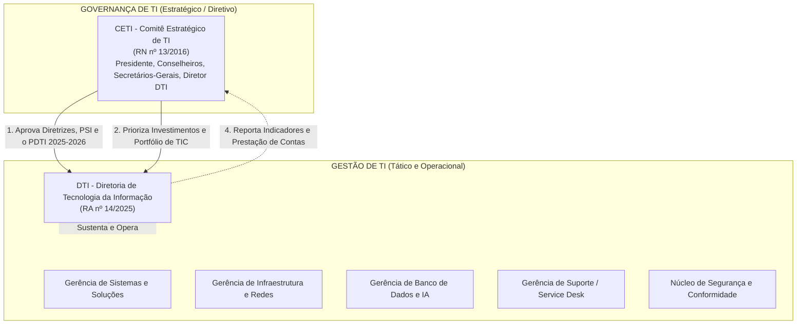
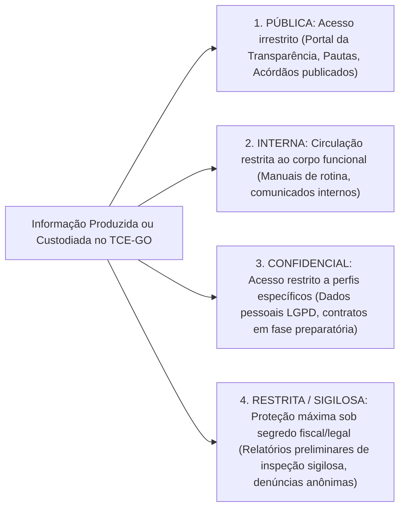
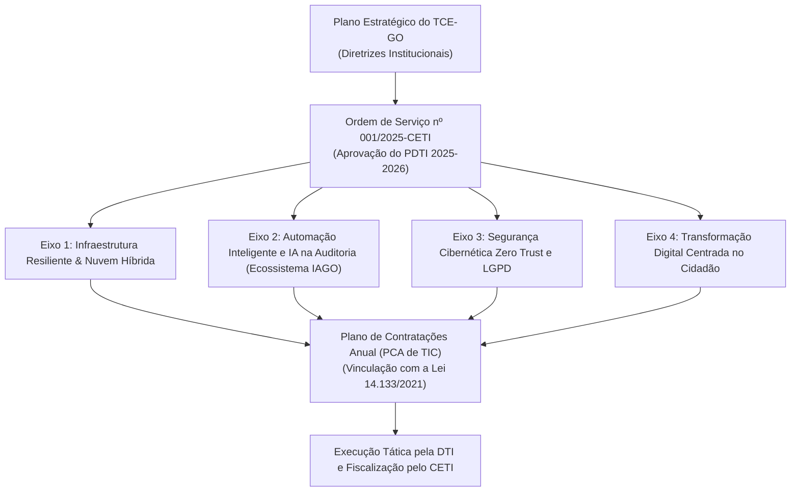

# 05 - Normativos Internos e Planejamento de TI do TCE-GO

> **Matéria:** Legislação Aplicada à Tecnologia da Informação  
> **Cargo:** B02 – Técnico de Controle Externo – Especialidade: Tecnologia da Informação  
> **Arquivo:** `05_normativos_e_planejamento_de_ti_tce_go.md`  
> **Atos Normativos:** Resoluções RN 13/2016, RA 14/2024, RA 17/2024, RA 14/2025 e PDTI 2025–2026 (Ordem de Serviço nº 001/2025-CETI)

---

## 📌 Ementa / Itens do Edital
- Normativos institucionais do Tribunal de Contas do Estado de Goiás sobre Governança, Planejamento e Segurança de TI:
    - **Resolução Normativa nº 13/2016 (compilada):** Instituição, composição e atribuições do Comitê Estratégico de TI (CETI)
    - **Resolução Administrativa nº 14/2024:** Política de Governança Organizacional do TCE-GO
    - **Resolução Administrativa nº 17/2024:** Política de Segurança da Informação (PSI) do TCE-GO
    - **Resolução Administrativa nº 14/2025:** Estrutura e competências privativas da Diretoria de Tecnologia da Informação (DTI) e gerências vinculadas
    - **Plano Diretor de Tecnologia da Informação (PDTI) 2025–2026:** Aprovado pela Ordem de Serviço nº 001/2025-CETI

---

## 🧭 Sumário

1. [O Comitê Estratégico de Tecnologia da Informação - CETI (Resolução Normativa nº 13/2016)](#1-o-comite-estrategico-de-tecnologia-da-informacao-ceti-resolucao-normativa-no-132016)
1. [Natureza e Segregação entre Governança e Gestão](#1-1-natureza-e-segregacao-entre-governanca-e-gestao)
    1. [Teste 555](#Teste-555)
    2. [Teste 556](#Teste-556)
1. [Composição e Competências Primordiais do CETI](#1-2-composicao-e-competencias-primordiais-do-ceti)
    1. [Teste 557](#Teste-557)
2. [Política de Governança Organizacional (Resolução Administrativa nº 14/2024)](#2-politica-de-governanca-organizacional-resolucao-administrativa-no-142024)
    1. [Teste 558](#Teste-558)
3. [Política de Segurança da Informação - PSI (Resolução Administrativa nº 17/2024)](#3-politica-de-seguranca-da-informacao-psi-resolucao-administrativa-no-172024)
3. [Classificação Corporativa da Informação no TCE-GO](#3-1-classificacao-corporativa-da-informacao-no-tce-go)
    1. [Teste 559](#Teste-559)
3. [Diretrizes de Uso Seguro, Teletrabalho e Resposta a Incidentes](#3-2-diretrizes-de-uso-seguro-teletrabalho-e-resposta-a-incidentes)
    1. [Teste 560](#Teste-560)
4. [Estrutura e Competências da Diretoria de TI (Resolução Administrativa nº 14/2025)](#4-estrutura-e-competencias-da-diretoria-de-ti-resolucao-administrativa-no-142025)
4. [Competências Executivas Privativas da DTI](#4-1-competencias-executivas-privativas-da-dti)
    1. [Teste 561](#Teste-561)
4. [Divisão Funcional das Gerências Vinculadas](#4-2-divisao-funcional-das-gerencias-vinculadas)
    1. [Teste 562](#Teste-562)
5. [Plano Diretor de TI - PDTI 2025–2026 (Ordem de Serviço nº 001/2025-CETI)](#5-plano-diretor-de-ti-pdti-20252026-ordem-de-servico-no-0012025-ceti)
5. [Diagnóstico Estratégico SWOT](#5-1-diagnostico-estrategico-swot)
    1. [Teste 563](#Teste-563)
5. [Os Quatro Eixos Estratégicos do PDTI 2025–2026](#5-2-os-quatro-eixos-estrategicos-do-pdti-20252026)
    1. [Teste 564](#Teste-564)
6. [Fontes Recomendadas na Internet](#6-fontes-recomendadas-na-internet)

---

## 1. O Comitê Estratégico de Tecnologia da Informação - CETI (Resolução Normativa nº 13/2016)

O **Comitê Estratégico de Tecnologia da Informação (CETI)** do Tribunal de Contas do Estado de Goiás (TCE-GO) é o órgão colegiado permanente que materializa a instância máxima de **Governança de TIC** no Tribunal, assegurando a necessária segregação entre as decisões estratégicas da alta administração e a gestão operacional da área técnica.

---

## 1.1 Natureza e Segregação entre Governança e Gestão

- **O CETI Governa:** Atua nas funções de avaliar, direcionar e monitorar (*Evaluate, Direct, Monitor*), aprovando formalmente o PDTI, definindo prioridades orçamentárias de TIC e estabelecendo as diretrizes gerais da PSI. O CETI não executa tarefas operacionais.
- **A DTI Gere e Opera:** Atua nas funções de planejar, construir, entregar e sustentar (*Plan, Build, Run, Monitor*). Desenvolve software, configura roteadores e servidores, gerencia bancos de dados e atende aos chamados dos usuários.

> 🚨 **ALERTA DE PROVA / PEGADINHA FCC:**  
> A banca FCC costuma perguntar quem é a autoridade competente para aprovar o PDTI no TCE-GO. O PDTI é **aprovado pelo CETI** (por meio de Ordem de Serviço, como a OS nº 001/2025-CETI) e **não** monocraticamente pelo Diretor de TI! A DTI apenas elabora a proposta técnica e executa as metas aprovadas.

---

### Teste 555
**(FCC Inédita - Auditor Estadual de Controle Externo / TI)**
**Enunciado:** No desenho da estrutura de governança e gestão de tecnologia da informação do Tribunal de Contas do Estado de Goiás, a Resolução Normativa nº 13/2016 instituiu o Comitê Estratégico de Tecnologia da Informação (CETI). Considerando os preceitos de segregação de funções entre instâncias de governança superior e órgãos executivos de gestão técnica, assinale a opção que expressa uma competência atribuída ao CETI:  

* **A)** Programar rotinas de banco de dados em linguagem SQL e configurar portas de switches de borda no Data Center.
* **B)** Aprovar formalmente as diretrizes do Plano Diretor de Tecnologia da Informação (PDTI) e priorizar as iniciativas e investimentos estratégicos de TIC alinhados ao planejamento do Tribunal.
* **C)** Atender a chamados de primeiro nível de suporte técnico de usuários que esqueceram senhas na intranet institucional em estrita conformidade com as normas legais e regulamentares aplicáveis.
* **D)** Homologar individualmente cada commit de código-fonte produzido pelos analistas de desenvolvimento da DTI.
* **E)** Assinar monocraticamente contratos de compra de computadores sem a instauração de procedimento licitatório regular.

---

> **Comentário Detalhado:**
>
> - **A)** Incorreta. A programação de rotinas de banco de dados e configuração de switches são atribuições estritamente técnicas e operacionais da Diretoria de TI (DTI), e não de um comitê estratégico colegiado de alta direção.
> - **B)** **Correta.** O CETI (RN nº 13/2016) é o órgão superior colegiado de governança de TIC do TCE-GO. Cabe ao CETI avaliar, direcionar e monitorar a tecnologia, o que compreende privativamente a aprovação formal do PDTI, suas revisões e a priorização do portfólio de projetos e investimentos estratégicos da Corte de Contas.
> - **C)** Incorreta. O suporte de primeiro nível (Service Desk) compete à Gerência de Atendimento e Suporte da DTI.
> - **D)** Incorreta. Homologação de commits de código é atividade técnica dos líderes de engenharia de software da Gerência de Sistemas da DTI.
> - **E)** Incorreta. O CETI delibera estrategicamente de forma colegiada; contratos de compras públicas seguem a Lei 14.133/2021 sob a competência ordenadora da Presidência do Tribunal.
> 
> **Gabarito: B**

---

### Teste 556
**(FCC Inédita - Analista de Sistemas / Engenharia de Software)**
**Enunciado:** Em conformidade com a Resolução Administrativa nº 14/2025, que reestruturou a Diretoria de Tecnologia da Informação (DTI) do TCE-GO, assinale a opção que descreve atribuições típicas das unidades técnicas subordinadas à DTI:  

* **A)** Julgar as contas prestadas pelos prefeitos municipais goianos com força executiva de título judicial.
* **B)** Desenvolver, sustentar e testar os softwares corporativos de controle externo, gerenciar a infraestrutura de redes e data centers, administrar bancos de dados corporativos e prestar atendimento de suporte ao usuário (Service Desk).
* **C)** Elaborar o projeto de lei orçamentária anual do Estado de Goiás para votação na Assembleia Legislativa.
* **D)** Substituir monocraticamente o Plenário do Tribunal na emissão de pareceres prévios sobre as contas do Governador do Estado considerando os requisitos operacionais de segurança, escalabilidade, auditoria e desempenho corporativo.
* **E)** Fiscalizar presencialmente a regularidade de tráfego de veículos rodoviários nas rodovias estaduais goianas.

---

> **Comentário Detalhado:**
>
> - **A)** Incorreta. O julgamento de contas municipais é competência de controle externo dos Tribunais de Contas ou das Câmaras Municipais (conforme o tipo de conta), exercida pelos Conselheiros relatores e órgãos deliberativos do TCE, e não pela área técnica de TI.
> - **B)** **Correta.** A Resolução Administrativa nº 14/2025 define a DTI como o braço executivo de tecnologia da corte, encarregado da engenharia de software (desenvolvimento e sustentação), infraestrutura (redes, telecomunicações e data centers), governança de bancos de dados/IA e atendimento aos usuários por meio do Service Desk.
> - **C)** Incorreta. A elaboração da LOA estadual é atribuição do Poder Executivo (Secretaria de Economia / Governador).
> - **D)** Incorreta. O parecer prévio sobre as contas do Governador é ato político-constitucional privativo do Tribunal Pleno do TCE-GO.
> - **E)** Incorreta. Fiscalização rodoviária é competência da polícia rodoviária estadual e agências de trânsito (Goinfra/Detran).
> 
> **Gabarito: B**

---

## 1.2 Composição e Competências Primordiais do CETI

#### Composição Colegiada
O CETI é composto por membros natos e designados da alta cúpula decisória do Tribunal:

- Conselheiro-Presidente (ou Conselheiro formalmente designado para presidir o Comitê);
- Diretor-Geral do Tribunal;
- Secretário-Geral de Controle Externo (representando a área finalística de auditoria);
- Secretário-Geral de Administração (representando a área de gestão e infraestrutura);
- Diretor de Tecnologia da Informação (membro executivo e relator técnico das matérias).

#### Competências Primordiais do CETI (RN nº 13/2016)
1. **Deliberação Estratégica:** Aprovar formalmente o Plano Diretor de TI (PDTI) e suas revisões periódicas, alinhando-o ao Plano Estratégico do TCE-GO;
2. **Política de Segurança:** Apreciar e submeter a Política de Segurança da Informação (PSI) e suas normas complementares;
3. **Priorização de Demandas:** Estabelecer a ordem de prioridade dos projetos e contratações de TIC de grande vulto, evitando dispersão orçamentária;
4. **Monitoramento e Avaliação:** Analisar relatórios semestrais de execução do PDTI e desempenho dos serviços de tecnologia;
5. **Resolução de Conflitos:** Dirimir impasses sobre demandas concorrentes entre a área de controle externo e a área administrativa.

---

### Teste 557
**(FCC – Inédita – Padrão TCE-GO - Auditor Estadual de Controle Externo / TI)**
**Enunciado:** O Comitê Estratégico de Tecnologia da Informação (CETI) do Tribunal de Contas do Estado de Goiás, instituído pela Resolução Normativa nº 13/2016, é a instância máxima colegiada de governança de TI. Acerca da composição e das competências privativas do CETI, assinale a afirmativa correta:  

* **A)** O CETI é composto exclusivamente por técnicos terceirizados contratados por empresas de suporte, sendo vedada a presença de membros da alta cúpula do Tribunal em estrita conformidade com as normas legais e regulamentares aplicáveis.
* **B)** Compete ao CETI aprovar formalmente o Plano Diretor de TI (PDTI) e suas revisões periódicas, além de estabelecer a priorização dos projetos e contratações de TIC de grande vulto e apreciar a Política de Segurança da Informação.
* **C)** O CETI tem como atribuição cotidiana o atendimento de chamados de formatação de computadores e a troca de toners de impressoras das secretarias.
* **D)** As decisões deliberadas pelo CETI têm caráter meramente folclórico e não vinculam o planejamento ou a execução orçamentária de tecnologia do Tribunal.
* **E)** O Presidente do Comitê é escolhido por sorteio público entre os jurisdicionados municipais fiscalizados pelo Tribunal de Contas.

---

> **Comentário Detalhado:**
>
> - **A)** Incorreta. O CETI é formado pela alta administração do TCE-GO: Conselheiro-Presidente (ou Conselheiro designado), Diretor-Geral, Secretários-Gerais (Controle Externo e Administração) e o Diretor de TI como relator técnico.
> - **B)** **Correta.** A Resolução Normativa nº 13/2016 confere ao CETI competência deliberativa estratégica: aprovar o PDTI, apreciar a PSI, priorizar grandes projetos e investimentos de TIC, monitorar indicadores de desempenho semestrais e dirimir conflitos institucionais de demandas.
> - **C)** Incorreta. Atividades operacionais de suporte de microinformática pertencem à Gerência de Atendimento e Suporte ao Usuário (DTI), e não à governança do CETI.
> - **D)** Incorreta. As deliberações do CETI possuem força normativa interna vinculante sobre os rumos de TIC no Tribunal.
> - **E)** Incorreta. A presidência do CETI é exercida por membro nato da alta direção do TCE-GO.
> 
> **Gabarito: B**

---

## 2. Política de Governança Organizacional (Resolução Administrativa nº 14/2024)

A Resolução Administrativa nº 14/2024 consolidou o modelo de Governança Pública no TCE-GO, alinhado aos referenciais do Tribunal de Contas da União (TCU) e da OCDE (*Organização para a Cooperação e Desenvolvimento Econômico*):

1. **Princípios Estruturantes:** Integridade, confiabilidade, transparência, prestação de contas (*accountability*), tempestividade e foco no cidadão.
2. **Modelo das Três Linhas:**
    - *1ª Linha (Gestores Operacionais):* Responsáveis pela execução direta das rotinas e pelos controles internos primários em cada unidade;
    - *2ª Linha (Unidades de Riscos e Integridade):* Responsáveis pelo monitoramento de conformidade, desenho de políticas de riscos e suporte metodológico;
    - *3ª Linha (Auditoria Interna):* Fornece avaliação independente e objetiva da eficácia dos processos de governança e controles institucionais.

3. **Conexão com a TIC:** A Governança de TI não é uma ilha isolada; os objetivos tecnológicos do PDTI são derivados diretamente dos objetivos estratégicos da RA nº 14/2024 para maximizar o valor público entregue pelo Tribunal à sociedade goiana.

---

### Teste 558
**(FCC – Inédita – Padrão TCE-GO - Analista de Controle Externo / Governança)**
**Enunciado:** A Resolução Administrativa nº 14/2024 estabeleceu a Política de Governança Organizacional do Tribunal de Contas do Estado de Goiás, adotando referenciais internacionais de controle e o consagrado Modelo das Três Linhas. No que se refere à estrutura de responsabilidades do Modelo das Três Linhas aplicado à gestão e controle no TCE-GO, assinale a afirmativa correta:  

* **A)** A 1ª Linha é exercida pela Auditoria Interna, sendo a única responsável por aplicar penalidades aos jurisdicionados municipais.
* **B)** A 2ª Linha é composta pelos fornecedores privados contratados, que fiscalizam os auditores fiscais concursados do Tribunal.
* **C)** A 1ª Linha é composta pelos gestores operacionais responsáveis pela entrega direta dos serviços e controles primários; a 2ª Linha atua no suporte, conformidade e gestão de riscos; e a 3ª Linha (Auditoria Interna) fornece avaliação objetiva e independente da eficácia dos controles e da governança.
* **D)** O Modelo das Três Linhas extinguiu qualquer dever de prestação de contas (*accountability*) da Diretoria de TI perante o Plenário do Tribunal considerando os requisitos operacionais de segurança, escalabilidade, auditoria e desempenho corporativo.
* **E)** As três linhas operam em subordinação hierárquica direta à empresa vencedora da licitação de outsourcing de informática.

---

> **Comentário Detalhado:**
>
> - **A)** Incorreta. A Auditoria Interna ocupa privativamente a 3ª Linha (avaliação independente).
> - **B)** Incorreta. A 2ª Linha é interna ao Tribunal (unidades de integridade, conformidade e gestão de riscos).
> - **C)** **Correta.** Síntese exata do Modelo das Três Linhas do IIA (*Institute of Internal Auditors*) acolhido pela RA nº 14/2024: 1ª Linha (gestão operacional e controles diretos nas unidades executoras); 2ª Linha (monitoramento metodológico de conformidade, riscos e integridade); e 3ª Linha (auditoria interna independente).
> - **D)** Incorreta. A prestação de contas (*accountability*) é pilar estruturante e permanente da governança pública do Tribunal.
> - **E)** Incorreta. O modelo governa a estrutura institucional pública interna do Tribunal, sem subordinação a empresas privadas terceirizadas.
> 
> **Gabarito: C**

---

## 3. Política de Segurança da Informação - PSI (Resolução Administrativa nº 17/2024)

A PSI do TCE-GO estabelece os padrões e comportamentos mandatórios para assegurar a **Confidencialidade, Integridade, Disponibilidade, Autenticidade e Não-Repúdio (CIDAN)** dos ativos de informação do Tribunal.

---

## 3.1 Classificação Corporativa da Informação no TCE-GO

| Nível de Classificação | Definição Normativa | Requisitos de Proteção e Tratamento | Exemplo Típico |
|---|---|---|---|
| **Pública** | Informações de livre acesso à sociedade, em cumprimento à LAI e ao princípio da publicidade. | Não exige controle de confidencialidade; exige garantia de integridade e disponibilidade. | Acórdãos transitados em julgado, relatórios de gestão fiscal publicados. |
| **Interna** | Informações voltadas ao uso operacional cotidiano dos servidores e colaboradores do Tribunal. | Acesso vedado ao público externo sem autorização; compartilhamento limitado ao ambiente institucional. | Modelos de pareceres internos, notas técnicas de rotina, lista de ramais. |
| **Confidencial** | Informações cuja divulgação não autorizada possa comprometer operações ou violar direitos de terceiros (LGPD). | Controle rigoroso de privilégios (RBAC), registro de trilhas de auditoria e criptografia em trânsito e repouso. | Folha de pagamento com dados bancários, atestados de saúde, logs de acesso individualizados. |
| **Restrita / Sigilosa** | Informações protegidas por sigilo legal estrito (fiscal, bancário, judicial ou de auditoria preliminar). | Acesso restrito exclusivamente aos auditores designados na portaria; proibição de cópia externa; custódia em pastas seguras com criptografia de disco. | Relatório de auditoria preliminar de fraude antes da notificação do jurisdicionado; denúncias de corrupção protegidas. |

> 🚨 **ALERTA DE PROVA / PEGADINHA FCC:**  
> Informações preliminares de fiscalização que envolvam dados bancários ou fiscais de jurisdicionados, bem como denúncias anônimas antes da deliberação plenária, recebem o nível **Restrita / Sigilosa**. Disponibilizar esses dados prematuramente viola a PSI e acarreta responsabilidade funcional e criminal.

---

### Teste 559
**(FCC Inédita - Auditor Estadual de Controle Externo / TI)**
**Enunciado:** Durante uma inspeção extraordinária sobre indícios de fraude em licitação promovida por secretaria de estado, a equipe de auditoria do TCE-GO coletou documentos fiscais sigilosos e relatórios de inteligência financeira. Segundo a Resolução Administrativa nº 17/2024 (Política de Segurança da Informação do TCE-GO), quanto à classificação da informação e tratamento desses ativos:  

* **A)** Esses relatórios preliminares de inspeção sigilosa e dados fiscais devem ser classificados no nível Restrito/Sigiloso, tendo seu acesso restrito unicamente aos auditores legalmente designados e autoridades autorizadas.
* **B)** Devem ser imediatamente publicados na página inicial do Portal da Transparência em acesso livre irrestrito, sob a classificação de informação pública ordinária em conformidade com as diretrizes e padrões de arquitetura corporativa.
* **C)** Podem ser encaminhados por correio eletrônico comercial gratuito não corporativo para guarda pessoal do auditor.
* **D)** A classificação de informações no Tribunal de Contas é facultativa, inexistindo diferenciação entre documentos públicos e dados sob segredo fiscal.
* **E)** Devem ser armazenados em pendrive sem senha e afixados no mural de avisos da recepção do Tribunal.

---

> **Comentário Detalhado:**
>
> - **A)** **Correta.** De acordo com a RA nº 17/2024 (PSI do TCE-GO) e a legislação arquivística/LAI, informações protegidas por sigilo fiscal, bancário ou referentes a inspeções preliminares de auditoria em curso recebem o nível de classificação Restrita / Sigilosa. Esse nível impõe controles rígidos de acesso exclusivo aos auditores formalmente designados e autoridades competentes, visando não frustrar a eficácia da investigação e preservar garantias legais.
> - **B)** Incorreta. A publicação precoce de relatórios preliminares sigilosos com dados fiscais causaria nulidade probatória, violação de sigilo fiscal (crime previsto no Código Penal e CTN) e infração à PSI.
> - **C)** Incorreta. A PSI veda o envio de ativos de informação institucionais sigilosos para contas de correio eletrônico particulares ou serviços de nuvem pública não corporativos.
> - **D)** Incorreta. A classificação da informação é mandatória e subdivide-se formalmente em quatro níveis (Pública, Interna, Confidencial e Restrita/Sigilosa).
> - **E)** Incorreta. A conduta viola todos os princípios elementares da segurança da informação, da custódia documental e da integridade probatória do controle externo.
> 
> **Gabarito: A**

---

## 3.2 Diretrizes de Uso Seguro, Teletrabalho e Resposta a Incidentes

1. **Credenciais e Autenticação:**
    - Senhas pessoais, intransferíveis e secretas com política de complexidade mínima (números, caracteres especiais, maiúsculas e minúsculas);
    - Uso compulsório de **Autenticação Multifator (MFA)** para todos os acessos externos e sistemas corporativos sensíveis.

2. **Teletrabalho e Acesso Remoto:**
    - Conexão remota permitida exclusivamente por meio de túnel criptografado **VPN (*Virtual Private Network*) corporativa** do Tribunal;
    - Proibição de armazenamento de documentos restritos em dispositivos particulares (computadores domésticos compartilhados sem antivírus gerenciado);
    - Bloqueio automático de tela configurado para tempo máximo de inatividade (ex.: 5 minutos).

3. **Dispositivos Móveis de Armazenamento:**
    - Bloqueio por política de grupo (GPO) do uso de dispositivos USB (*pendrives*, HDs externos) não homologados nas estações de trabalho do Tribunal.

4. **Tratamento de Incidentes de Segurança:**
    - Existência de equipe especializada de resposta a incidentes cibernéticos (CSIRT do TCE-GO);
    - Dever funcional de todo servidor de comunicar imediatamente à DTI qualquer indício de infecção por malware, tentativa de *phishing* ou perda de equipamento funcional.

---

### Teste 560
**(FCC Inédita - Técnico de Controle Externo / Tecnologia da Informação)**
**Enunciado:** Um auditor técnico do TCE-GO, atuando no regime de teletrabalho, necessita acessar a base de dados do sistema de controle de processos administrativos para instruir um relatório de fiscalização. Em conformidade com a Política de Segurança da Informação (PSI) do Tribunal, instituída pela Resolução Administrativa nº 17/2024:  

* **A)** O auditor deve conectar-se obrigatoriamente por meio de Rede Privada Virtual (VPN) corporativa com uso de autenticação de múltiplos fatores (MFA).
* **B)** O auditor pode desativar a política de antivírus institucional caso sinta lentidão no processamento de planilhas.
* **C)** É permitido compartilhar sua senha pessoal de rede com familiares próximos para agilizar a digitação de dados.
* **D)** O acesso a documentos sigilosos de auditoria pode ser realizado a partir de computadores de uso público em cibercafés ou hotéis sem qualquer proteção criptográfica no âmbito da administração pública direta e indireta.
* **E)** O uso de autenticação de duplo fator é expressamente proibido pela PSI por retardar o trabalho remoto.

---

> **Comentário Detalhado:**
>
> - **A)** **Correta.** A Resolução Administrativa nº 17/2024 (PSI do TCE-GO) estabelece normas rigorosas para o teletrabalho e segurança da informação: acesso externo somente via túnel VPN corporativo com autenticação multifator (MFA), proteção de credenciais institucionais e proibição categórica de gravação de arquivos de trabalho restritos em mídias particulares não homologadas ou computadores compartilhados.
> - **B)** Incorreta. A desativação de controles de segurança (como soluções antivírus gerenciadas) é terminantemente proibida e constitui falta funcional.
> - **C)** Incorreta. O login e a senha são individuais, personalíssimos e intransferíveis; compartilhá-los com terceiros viola a confidencialidade e a integridade da cadeia de custódia da auditoria.
> - **D)** Incorreta. Equipamentos públicos apresentam alto risco de captura de senhas por keyloggers e malwares, sendo seu uso vedado para tratar dados institucionais restritos.
> - **E)** Incorreta. O uso de MFA é pilar obrigatório da PSI moderna, exigido categoricamente no Tribunal.
> 
> **Gabarito: A**

---

## 4. Estrutura e Competências da Diretoria de TI (Resolução Administrativa nº 14/2025)

A Resolução Administrativa nº 14/2025 modernizou a estrutura organizacional da **Diretoria de Tecnologia da Informação (DTI)** do TCE-GO:

---

## 4.1 Competências Executivas Privativas da DTI

- Planejar, gerenciar, executar e manter o ecossistema tecnológico do Tribunal;
- Subsidiar tecnicamente o CETI na elaboração e revisão do PDTI e da PSI;
- Conduzir o planejamento das contratações de TIC, elaborando os Estudos Técnicos Preliminares (ETP) e Termos de Referência (TR);
- Gerenciar o ciclo de vida dos softwares corporativos de auditoria e processo eletrônico;
- Garantir a alta disponibilidade da infraestrutura de servidores, data centers, redes e serviços em nuvem.

---

### Teste 561
**(FCC – Inédita – Padrão TCE-GO - Analista de TI / Governança e Planejamento)**
**Enunciado:** A Resolução Administrativa nº 14/2025 disciplinou a estrutura organizacional e as atribuições privativas da Diretoria de Tecnologia da Informação (DTI) do TCE-GO. Em face do princípio da segregação entre governança e gestão, assinale a opção que descreve uma atribuição genuinamente executiva da DTI:  

* **A)** Homologar em plenário as contas anuais prestadas pelo Governador do Estado de Goiás.
* **B)** Deliberar de forma autônoma sobre a extinção de cargos efetivos do quadro de controle externo do Tribunal.
* **C)** Planejar, gerenciar, executar e manter as soluções tecnológicas corporativas, elaborar Estudos Técnicos Preliminares (ETP) e Termos de Referência (TR) para aquisições de TIC e subsidiar tecnicamente o CETI.
* **D)** Substituir a Assembleia Legislativa do Estado na votação da Lei Orçamentária Anual.
* **E)** Julgar os recursos de apelação cível interpostos pelos contribuintes do ICMS perante o Tribunal de Justiça considerando os requisitos operacionais de segurança, escalabilidade, auditoria e desempenho corporativo.

---

> **Comentário Detalhado:**
>
> - **A)** Incorreta. A emissão de parecer prévio sobre as contas do Governador é competência privativa do Plenário do TCE-GO.
> - **B)** Incorreta. Matéria reservada a processo legislativo de iniciativa privativa do Presidente do Tribunal.
> - **C)** **Correta.** A DTI exerce a gestão executiva técnica (nível tático-operacional): elabora os artefatos de planejamento de compras (ETP/TR), gerencia o ciclo de vida dos softwares, opera data centers e redes, e atua como braço técnico de suporte ao CETI.
> - **D)** Incorreta. Votação de leis é atribuição privativa do Poder Legislativo.
> - **E)** Incorreta. Matéria jurisdicional afeta ao Tribunal de Justiça de Goiás.
> 
> **Gabarito: C**

---

## 4.2 Divisão Funcional das Gerências Vinculadas

1. **Gerência de Sistemas de Informação:** Análise, desenvolvimento, sustentação e testes de software, empregando metodologias ágeis (Scrum/Kanban) e práticas de DevSecOps.
2. **Gerência de Infraestrutura e Redes:** Operação dos data centers primário e secundário, enlaces de fibra óptica, roteadores, switches, virtualização de servidores (VMware/Hyper-V/Kubernetes) e serviços em nuvem híbrida.
3. **Gerência de Banco de Dados e Informações Estratégicas:** Administração de bancos relacionais e NoSQL, data lake, pipelines ETL/ELT, inteligência analítica de dados e suporte ao treinamento de modelos de IA (Ecossistema IAGO).
4. **Gerência de Atendimento e Suporte ao Usuário (Service Desk):** Ponto único de contato (SPOC) para suporte a usuários internos e externos, microinformática, gestão de ativos de TI e incidentes operacionais de Nível 1 e 2.
5. **Núcleo de Segurança da Informação e Conformidade:** Gestão contínua de vulnerabilidades, monitoramento de SOC (*Security Operations Center*), auditoria de logs e conformidade com a PSI e a LGPD.

---

### Teste 562
**(FCC – Inédita – Padrão TCE-GO - Técnico de Controle Externo / TI)**
**Enunciado:** De acordo com a Resolução Administrativa nº 14/2025 do TCE-GO, a Diretoria de Tecnologia da Informação (DTI) organiza suas competências funcionais em unidades gerenciais vinculadas. Assinale a alternativa que correlaciona corretamente a gerência às suas respectivas atribuições regulamentares:  

* **A)** Gerência de Infraestrutura e Redes: encarregada da gestão de RH e concessão de aposentadorias de servidores.
* **B)** Gerência de Atendimento e Suporte ao Usuário (*Service Desk*): atua como Ponto Único de Contato (SPOC) para atendimento a incidentes, requisições de serviço de TI e microinformática.
* **C)** Gerência de Banco de Dados e Informações Estratégicas: responsável privativa pela aquisição de veículos automotores e controle da frota do Tribunal no âmbito da administração pública direta e indireta.
* **D)** Gerência de Sistemas de Informação: responsável pela limpeza predial e segurança patrimonial armada do edifício-sede.
* **E)** Núcleo de Segurança da Informação: encarregado de proibir que o Tribunal utilize computadores em suas rotinas de trabalho.

---

> **Comentário Detalhado:**
>
> - **A)** Incorreta. Recursos humanos e previdência competem à Secretaria-Geral de Administração.
> - **B)** **Correta.** A Gerência de Atendimento e Suporte ao Usuário (Service Desk) constitui o SPOC (*Single Point of Contact*) da TI do TCE-GO, acolhendo incidentes de Nível 1 e 2, gerindo ativos de microinformática e provendo suporte técnico aos usuários internos e externos.
> - **C)** Incorreta. Gestão de frota é competência de serviços gerais administrativos. A Gerência de Dados cuida de SGBDs, Data Lake e IA (IAGO).
> - **D)** Incorreta. Sistemas de Informação cuida de desenvolvimento, arquitetura de microsserviços e sustentação de código-fonte.
> - **E)** Incorreta. O Núcleo de Segurança cuida da gestão de vulnerabilidades, conformidade com a PSI e monitoramento de SOC.
> 
> **Gabarito: B**

---

## 5. Plano Diretor de TI - PDTI 2025–2026 (Ordem de Serviço nº 001/2025-CETI)

Aprovado formalmente pelo Comitê Estratégico de TI por meio da **Ordem de Serviço nº 001/2025-CETI**, o **PDTI 2025–2026** é o instrumento tático-operacional de planejamento da TIC que estabelece os rumos tecnológicos do TCE-GO para o biênio 2025–2026.

---

## 5.1 Diagnóstico Estratégico SWOT

- **Forças (Strengths):** Quadro técnico qualificado e especializado; governança institucional madura com o CETI atuante; sistemas de processo eletrônico consolidados.
- **Fraquezas (Weaknesses):** Legados tecnológicos demandando refatoração para microsserviços; necessidade de ampliação contínua da capacidade de armazenamento para dados de auditoria contínua.
- **Oportunidades (Opportunities):** Expansão do uso de Inteligência Artificial generativa e preditiva no controle de despesas públicas estaduais; adoção de soluções de nuvem governamental elástica.
- **Ameaças (Threats):** Sofisticação crescente de ataques cibernéticos globais (*ransomware*); retenção de talentos técnicos em face da concorrência do mercado privado global.

---

### Teste 563
**(FCC – Inédita – Padrão TCE-GO - Auditor Estadual de Controle Externo / TI)**
**Enunciado:** O Plano Diretor de TI (PDTI 2025–2026), aprovado pela Ordem de Serviço nº 001/2025-CETI, estruturou suas metas táticas a partir de um rigoroso Diagnóstico Estratégico fundamentado na Matriz SWOT. No contexto desse planejamento, assinale a afirmativa que apresenta uma Ameaça (*Threat*) externa e uma Oportunidade (*Opportunity*) externa identificadas para o ecossistema tecnológico do TCE-GO:  

* **A)** Ameaça: sofisticação crescente de ataques cibernéticos globais (*ransomware*) e forte concorrência do mercado privado na retenção de talentos de TIC; Oportunidade: expansão do uso de inteligência artificial preditiva no controle de despesas e adoção de soluções de nuvem híbrida elástica.
* **B)** Ameaça: posse de servidores concursados de alta qualificação técnica no órgão; Oportunidade: obsolescência forçada de todos os bancos de dados relacionais considerando os requisitos operacionais de segurança, escalabilidade, auditoria e desempenho corporativo.
* **C)** Ameaça: realização de sessões plenárias ao vivo pela internet; Oportunidade: proibição do uso de fibra óptica em órgãos públicos goianos.
* **D)** Ameaça: aprovação da Lei Geral de Proteção de Dados Pessoais; Oportunidade: corte total do orçamento de TIC do Tribunal.
* **E)** Ameaça: extinção de todas as ameaças cibernéticas no mundo digital; Oportunidade: retorno definitivo aos processos judiciais em papel carbono.

---

> **Comentário Detalhado:**
>
> - **A)** **Correta.** A matriz SWOT do PDTI 2025–2026 identifica como Ameaças externas a proliferação de ataques cibernéticos sofisticados (*ransomware*) e a alta demanda e remuneração da iniciativa privada que dificulta a atração/retenção de talentos de TI. Como Oportunidades externas, aponta a revolução da IA (potencializada pela LC 205/2025) para auditorias contínuas massivas e a escalabilidade da nuvem híbrida.
> - **B)** Incorreta. Corpo técnico qualificado é Força (*Strength* interna), não Ameaça.
> - **C)** Incorreta. Transmissão de sessões é prática de transparência consolidada.
> - **D)** Incorreta. Redução orçamentária seria ameaça grave, jamais oportunidade.
> - **E)** Incorreta. Afirmativa sem qualquer nexo com a realidade tecnológica do controle externo.
> 
> **Gabarito: A**

---

## 5.2 Os Quatro Eixos Estratégicos do PDTI 2025–2026

1. **Eixo Estratégico I - Infraestrutura Resiliente e Nuvem Híbrida:** Modernização do Data Center primário e consolidação do site de recuperação de desastres (*Disaster Recovery*) em nuvem; metas de disponibilidade global $\ge 99,5\%$ e tempo máximo de recuperação pós-falha (RTO) inferior a 2 horas.
2. **Eixo Estratégico II - Inteligência Artificial e Automação no Controle Externo:** Expansão do **Ecossistema IAGO** para leitura e cruzamento automatizado de editais de licitação, folhas de pagamento dos municípios e dados fiscais da SEFAZ, empregando modelos de código aberto nos termos da LC nº 205/2025 e da RA nº 24/2024.
3. **Eixo Estratégico III - Cibersegurança e Proteção de Dados:** Adoção progressiva do paradigma **Zero Trust Architecture (ZTA)**, autenticação multifator em 100% dos serviços e monitoramento 24x7 através de SIEM corporativo.
4. **Eixo Estratégico IV - Experiência Digital do Usuário e Jurisdicionado:** Remodelação do portal de serviços e processos do TCE-GO com foco em design centrado no usuário (*UX/UI*), acessibilidade web (e-MAG) e integração completa ao login único Gov.br nos termos da Lei nº 14.063/2020.

> 🚨 **ALERTA DE PROVA / PEGADINHA FCC:**  
> Nenhuma contratação de TIC pode ser iniciada no TCE-GO sem previsão expressa no PDTI vigente e no Plano de Contratações Anual (PCA de TIC), sob pena de nulidade insanável perante a Lei nº 14.133/2021 e normas de controle interno.

---

### Teste 564
**(FCC Inédita - Analista de TI / Governança e Planejamento)**
**Enunciado:** O Plano Diretor de Tecnologia da Informação (PDTI) para o biênio 2025–2026 do Tribunal de Contas do Estado de Goiás foi aprovado pela Ordem de Serviço nº 001/2025-CETI. Em relação ao alinhamento estratégico, à estrutura e aos objetivos do PDTI 2025–2026, é correto afirmar:  

* **A)** O PDTI é um instrumento puramente contábil que apenas lista a depreciação de monitores antigos, sem qualquer conexão com os objetivos finalísticos do Tribunal considerando os requisitos operacionais de segurança, escalabilidade, auditoria e desempenho corporativo.
* **B)** As contratações de TIC a serem deflagradas pelo Tribunal devem guardar estrita correlação e previsão no PDTI vigente, o qual estabelece eixos estratégicos voltados à modernização em nuvem resiliente, automação inteligente com IA no controle externo, cibersegurança e transformação digital.
* **C)** A vigência do PDTI do TCE-GO é perpétua e imutável, sendo dispensada a revisão semestral pelo CETI.
* **D)** As diretrizes de modernização de infraestrutura do PDTI dispensam a observância aos parâmetros de interoperabilidade com os demais Poderes do Estado de Goiás.
* **E)** O PDTI veda o uso de inteligência artificial em quaisquer atividades operacionais ou finalísticas do controle externo.

---

> **Comentário Detalhado:**
>
> - **A)** Incorreta. O PDTI é o instrumento diretor de alinhamento tático de TI com a missão finalística de controle externo do Tribunal de Contas, muito além de mero controle de depreciação de bens.
> - **B)** **Correta.** Conforme os ditames da Lei nº 14.133/2021, das diretrizes do TCU e da Ordem de Serviço nº 001/2025-CETI, todas as contratações e investimentos de TIC devem originar-se do planejamento consolidado no PDTI 2025–2026. Seus quatro eixos estruturantes englobam infraestrutura e nuvem, inteligência artificial (Ecossistema IAGO), cibersegurança Zero Trust e experiência digital dos usuários e jurisdicionados.
> - **C)** Incorreta. O PDTI tem vigência bienal (2025–2026) e possui acompanhamento contínuo e monitoramento semestral pelo CETI.
> - **D)** Incorreta. A interoperabilidade com outros órgãos (como SEFAZ e Judiciário) é diretriz estratégica prioritária para a auditoria eletrônica.
> - **E)** Incorreta. O Eixo II do PDTI 2025–2026 fomenta ativamente a automação inteligente e o uso de IA no controle externo (Ecossistema IAGO).
> 
> **Gabarito: B**

---

## 6. Fontes Recomendadas na Internet

* [TCE-GO - Tecnologia da Informação Institucional](https://portal.tce.go.gov.br/tecnologia-da-informacao2) - Diretrizes, sistemas de processo eletrônico e estrutura de tecnologia da informação do TCE-GO.
* [TCE-GO - Atos Normativos e Resoluções no TCE-Juris](https://portal.tce.go.gov.br/tce-juris/atos-normativos-do-tce-go) - Repositório oficial com as resoluções e instruções normativas de TI do tribunal.
* [TCE-GO - Competências Constitucionais e Legais](https://portal.tce.go.gov.br/competencias) - Atribuições finalísticas do Tribunal de Contas do Estado de Goiás.
* [TCE-GO - Resolução nº 22/2008 (Regimento Interno no GNOI)](https://gnoi.tce.go.gov.br/atoNormativo/Publicado?id=9544) - Regimento Interno do TCE-GO que disciplina a estrutura organizacional e comitês de TI.
* [TCU - Governança Institucional e Fiscalização de TI](https://portal.tcu.gov.br/governanca/governanca-no-tcu/) - Referencial de auditoria e governança de tecnologia adotado em colaboração pelos tribunais de contas.
* FERNANDES, Aguinaldo Aragon; ABREU, Vladimir Ferraz de. **Implantando a Governança de TI: da Estratégia aos Processos**. 4. ed. Rio de Janeiro: Brasport, 2014. (Cap. 1 a 3 - Governança no Setor Público e Comitês Diretivos).
* CHAVES, Francisco Eduardo Carrilho. **Controle Externo da Gestão Pública**. 3. ed. Niterói: Impetus, 2016. (Cap. 6 - Instrumentos de Fiscalização dos Tribunais de Contas).
* ZYMLER, Benjamin. **Direito Administrativo e Controle**. 3. ed. Belo Horizonte: Fórum, 2015. (Cap. 5 - Fiscalização Operacional e Governança da Administração Pública).
