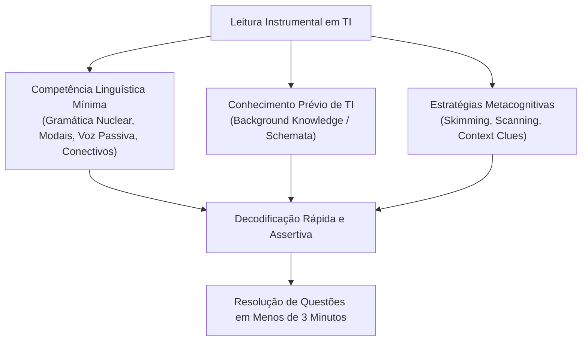
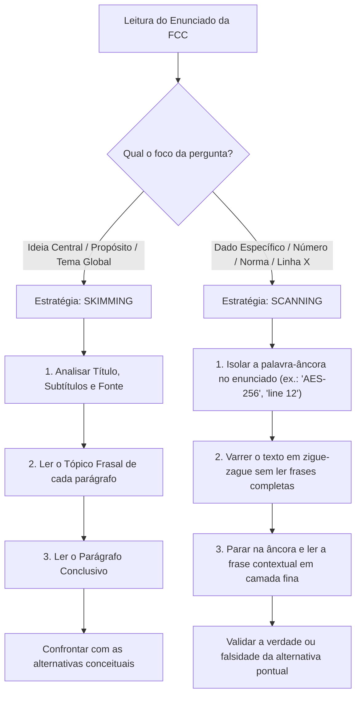
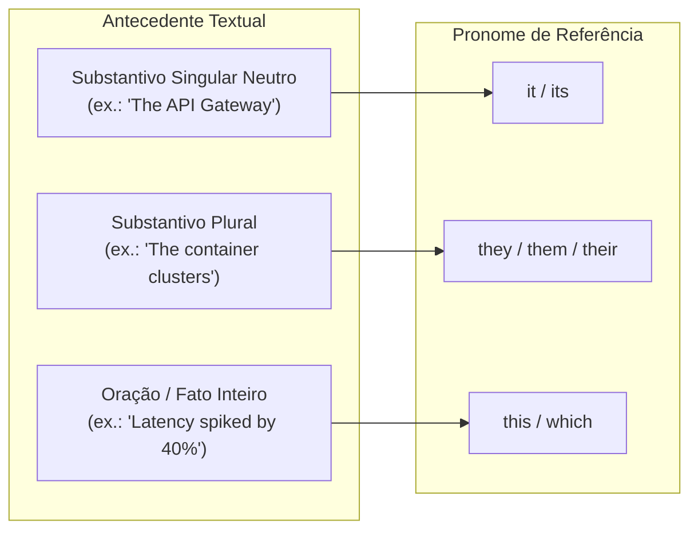

# 01 - Estratégias de Leitura Instrumental: Skimming, Scanning e Inferência

> **Matéria:** Língua Inglesa (Leitura Técnica)  
> **Cargo:** B02 – Técnico de Controle Externo – Especialidade: Tecnologia da Informação  
> **Arquivo:** `01_estrategias_de_leitura_skimming_scanning_e_inferencia.md`  

---

## 📌 Ementa / Itens do Edital
- Compreensão e interpretação de textos técnicos e científicos em língua inglesa
- Estratégias de leitura instrumental: Skimming (identificação da ideia principal)
- Estratégias de leitura instrumental: Scanning (localização de informações específicas)
- Predição, pistas tipográficas e inferência contextual de vocabulário
- Falsos amigos / Falsos cognatos (*False Friends / False Cognates*)

---

## 🧭 Sumário

1. [Fundamentos do Inglês Instrumental (English for Specific Purposes - ESP)](#1-fundamentos-do-ingles-instrumental-english-for-specific-purposes-esp)
    1. [Tripé de Competências Cognitivas](#11-tripe-de-competencias-cognitivas)
    2. [Fases do Processo de Leitura Técnica](#12-fases-do-processo-de-leitura-tecnica)
    3. [Teste 565](#Teste-565)
2. [Skimming: Leitura Rápida Panorâmica (Main Idea & Gist)](#2-skimming-leitura-rapida-panoramica-main-idea-gist)
    1. [Mecânica de Execução e Tópico Frasal](#21-mecanica-de-execucao-e-topico-frasal)
    2. [Identificação de Tipos de Questões FCC](#22-identificacao-de-tipos-de-questoes-fcc)
    3. [Teste 566](#Teste-566)
3. [Scanning: Leitura de Varredura Seletiva (Locating Specific Data)](#3-scanning-leitura-de-varredura-seletiva-locating-specific-data)
    1. [Mecânica de Execução e Pistas Tipográficas](#31-mecanica-de-execucao-e-pistas-tipograficas)
    2. [Matriz Comparativa: Skimming vs. Scanning](#32-matriz-comparativa-skimming-vs-scanning)
    3. [Teste 567](#Teste-567)
4. [Predição e Pistas Contextuais de Vocabulário (Context Clues)](#4-predicao-e-pistas-contextuais-de-vocabulario-context-clues)
    1. [Pistas de Definição, Paráfrase e Exemplificação](#41-pistas-de-definicao-parafrase-e-exemplificacao)
    2. [Pistas de Contraste, Oposição, Causa e Efeito](#42-pistas-de-contraste-oposicao-causa-e-efeito)
    3. [Decomposição Morfológica (Prefixos, Raízes e Sufixos)](#43-decomposicao-morfologica-prefixos-raizes-e-sufixos)
    4. [Vocabulário Crítico de Engenharia e Arquitetura de Software](#44-vocabulario-critico-de-engenharia-e-arquitetura-de-software)
    5. [Teste 568](#Teste-568)
    6. [Teste 569](#Teste-569)
    7. [Teste 570](#Teste-570)
5. [Falsos Cognatos Críticos em TI (False Friends)](#5-falsos-cognatos-criticos-em-ti-false-friends)
    1. [Cognatos Verdadeiros vs. Falsos Amigos](#51-cognatos-verdadeiros-vs-falsos-amigos)
    2. [Quadro Lexical de Falsos Cognatos Críticos](#52-quadro-lexical-de-falsos-cognatos-criticos)
    3. [Teste 571](#Teste-571)
    4. [Teste 572](#Teste-572)
6. [Coesão Textual e Referência Pronominal (Reference Words)](#6-coesao-textual-e-referencia-pronominal-reference-words)
    1. [Anáfora e Catáfora em Textos Técnicos](#61-anafora-e-catafora-em-textos-tecnicos)
    2. [Encapsulamento Conceitual com Demonstrativos](#62-encapsulamento-conceitual-com-demonstrativos)
    3. [Teste 573](#Teste-573)
    4. [Teste 574](#Teste-574)
6. [Fontes Recomendadas na Internet](#6-fontes-recomendadas-na-internet)

---

## 1. Fundamentos do Inglês Instrumental (English for Specific Purposes - ESP)

O **Inglês Instrumental** (*English for Specific Purposes - ESP*) rege-se pelo princípio da **utilidade pragmática**: o propósito do candidato ou técnico não é adquirir fluência de conversação, pronúncia nativa ou redação literária, mas sim a **decodificação rápida, crítica e exata** de textos técnicos especializados no domínio de Tecnologia da Informação.

Em certames públicos organizados pela Fundação Carlos Chagas (FCC) para cargos de Auditoria e Tecnologia de Controle Externo, o tempo médio disponível por questão gira em torno de 3 minutos. Candidatos que adotam a estratégia ingênua de tentar traduzir mentalmente o texto palavra por palavra (*word-by-word translation*) exaurem o tempo de prova, sobrecarregam a memória de trabalho e perdem a percepção da macroestrutura argumentativa do autor.

### 1.1 Tripé de Competências Cognitivas

A proficiência instrumental sólida decorre da integração sinérgica de três dimensões cognitivas:

1. **Competência Linguística Mínima (*Linguistic Competence*):** Domínio de estruturas morfossintáticas centrais (voz passiva abundante em relatórios técnicos, verbos modais que regulam graus de certeza e obrigatoriedade, ordem sintática modificador-núcleo e conectivos de coesão lógica).
2. **Esquemas Prévios de Conhecimento (*Background Knowledge / Schemata*):** O repertório técnico prévio do candidato (conceitos de bancos de dados, governança de TI, microsserviços, criptografia, redes, inteligência artificial) atua como um acelerador de compreensão. As lacunas no vocabulário em língua inglesa são compensadas e preenchidas pela familiaridade com o objeto computacional discutido.
3. **Estratégias Metacognitivas de Leitura (*Metacognitive Reading Strategies*):** Capacidade de monitorar conscientemente o ato de ler, selecionando dinamicamente entre *Skimming*, *Scanning*, *Prediction* e *Inferencing* conforme a demanda da banca avaliadora.

### 1.2 Fases do Processo de Leitura Técnica

Para maximizar a eficiência, a leitura técnica orientada a concurso estrutura-se em três etapas sequenciais:

- **Pré-leitura (*Pre-reading*):** Leitura prévia do enunciado e das alternativas da questão antes de examinar o corpo do texto. Observação rápida do título, subtítulos, autor, fonte bibliográfica e elementos não-verbais (tabelas, figuras, trechos de código).
- **Leitura Atenta / Focada (*While-reading*):** Aplicação de *skimming* para localização da ideia central ou de *scanning* para rastreamento cirúrgico de evidências pontuais.
- **Pós-leitura (*Post-reading*):** Confrontação das evidências colhidas no texto com as asserções de cada alternativa de A a E, desmascarando distorções, generalizações indevidas e falsos cognatos.

---

### Teste 565
**(FCC - Adaptada / Analista de Sistemas - Governança e Métodos)**
*Read the paragraph below regarding English for Specific Purposes (ESP) applied to technical auditing:*

> *"Technical reading in computer science does not require exhaustive vocabulary knowledge of conversational English. Instead, an auditor relies on a tripartite cognitive model: domain-specific schemata (prior background knowledge), minimal grammatical architecture (such as modal auxiliaries and passive voice), and metacognitive reading strategies. During the pre-reading phase, examining the question stem and answer options before confronting the source text allows the reader to establish mental anchors and discard irrelevant details."*

According to the text and instrumental reading fundamentals:  

* **A)** An auditor must master all colloquial idioms and conversational slang of the English language before being able to interpret technical documentation.
* **B)** Prior background knowledge (*schemata*) in IT concepts compensates for lexical gaps in general vocabulary, accelerating comprehension when combined with metacognitive strategies like pre-reading.
* **C)** Pre-reading mandates that the candidate read the entire technical article three times before inspecting the question's alternatives.
* **D)** Metacognitive reading strategies are strictly forbidden in competitive public examinations for IT positions.
* **E)** The passive voice is never employed in formal technical and scientific reports in computing.

---

> **Comentário Detalhado:**
>
> - **A)** Incorreta. O texto afirma expressamente o oposto: a leitura técnica não exige vocabulário exaustivo de conversação geral (*"does not require exhaustive vocabulary knowledge of conversational English"*).
> - **B)** **Correta.** O conhecimento técnico prévio (*schemata*) ativa atalhos cognitivos que permitem ao candidato suprir lacunas vocabulares e focar nos elementos essenciais quando combinado com estratégias como a pré-leitura das alternativas e enunciados.
> - **C)** Incorreta. A pré-leitura (*pre-reading*) consiste justamente em ler primeiro o enunciado e alternativas para fixar âncoras antes de ler o texto longo.
> - **D)** Incorreta. As estratégias metacognitivas são amplamente recomendadas e essenciais para resolução de provas sob pressão de tempo.
> - **E)** Incorreta. A voz passiva é extremamente abundante na literatura técnica em inglês para conferir impessoalidade e objetividade aos relatórios.
> 
> **Gabarito: B**

---

## 2. Skimming: Leitura Rápida Panorâmica (Main Idea & Gist)

O **Skimming** (derivado do verbo *to skim*, "desnatar", retirar a camada superior) consiste em uma leitura acelerada e panorâmica com o objetivo precípuo de **captar a ideia principal (*gist / main idea*), o tema global, o tom e a arquitetura macrotextual**, sem deter-se em pormenores secundários, dados numéricos isolados ou termos desconhecidos.

### 2.1 Mecânica de Execução e Tópico Frasal

1. **Inspeção de Cabeçalho e Metadados:** Ler com atenção o título (*title*), subtítulos (*headings*), notas de rodapé e a referência bibliográfica (veículo como IEEE, ACM, Gartner, NIST, data de publicação).
2. **Priorização do Tópico Frasal (*Topic Sentence*):** Na literatura técnica e acadêmica formal em língua inglesa, a primeira ou a segunda oração de cada parágrafo sintetiza a proposição nuclear que será desenvolvida no restante do parágrafo. Concentrar o foco no início dos parágrafos proporciona um mapa conceitual imediato de todo o texto.
3. **Leitura da Sentença Conclusiva (*Concluding Sentence*):** A última oração do parágrafo frequentemente sintetiza a dedução obtida ou fornece o gancho lógico (*bridge*) para a seção subsequente.
4. **Leitura Aprofundada do Último Parágrafo:** No parágrafo final, os autores habitualmente condensam suas conclusões, recomendações práticas ou implicações (*findings, concluding remarks, takeaways*).
5. **Cadência Visual:** A velocidade recomendada para o *skimming* varia entre 600 e 800 palavras por minuto, o que representa uma velocidade 3 a 4 vezes superior à leitura analítica linear.

### 2.2 Identificação de Tipos de Questões FCC

A FCC recorre frequentemente a comandos que demandam exclusivamente a aplicação de *Skimming*:

- *"The main purpose of the text is to..."* (O objetivo central do texto é...)
- *"Which of the following statements best expresses the primary argument of the author?"* (Qual afirmação melhor resume a tese primordial do autor?)
- *"The central theme discussed in the passage revolves around..."* (O tema central discutido no texto gira em torno de...)
- *"The overall tone of the author can be characterized as..."* (O tom do autor pode ser classificado como neutro, analítico, prescritivo, cético ou laudatório).

> 💡 **Dica de Prova FCC:**  
> Ao resolver questões de ideia principal (*Skimming*), elimine imediatamente alternativas que apresentem fatos verdadeiros contidos no texto, mas que se refiram a detalhes secundários ou exemplos pontuais de um único parágrafo. Uma ideia central deve cobrir a totalidade do texto, e não um aspecto isolado.

---

### Teste 566
**(FCC - Adaptada / Tribunal de Contas - Auditoria de Inteligência Artificial)**
*Carefully read the following excerpt on Artificial General Intelligence (AGI):*

> *"The emergence of Artificial General Intelligence represents a profound inflection point for modern civilization. While current narrow AI systems excel at specialized tasks like pattern matching or matrix multiplication, AGI posits autonomous agents capable of human-level reasoning across multidisciplinary domains. Consequently, organizational leaders must anticipate seismic shifts in workforce dynamics and digital governance. Addressing these challenges demands proactive regulatory frameworks that align autonomous optimization with societal ethics before full deployment occurs."*

Applying the **Skimming** strategy to identify the primary argument (*main idea*), the central thesis of the paragraph is that:  

* **A)** Current narrow AI systems have completely failed at performing matrix operations and mathematical calculations.
* **B)** Regulatory frameworks should be permanently dismantled to accelerate unsupervised algorithmic optimization.
* **C)** The advent of AGI requires anticipatory governance and proactive regulatory frameworks to align autonomous systems with human societal values and ethics.
* **D)** Human-level reasoning is impossible to achieve in computer software under any theoretical circumstance.
* **E)** Matrix multiplication is the ultimate goal of public digital governance in auditing.

---

> **Comentário Detalhado:**
>
> - **A)** Incorreta. O texto diz o oposto: sistemas atuais de IA estreita destacam-se (*excel*) em tarefas especializadas como multiplicação de matrizes.
> - **B)** Incorreta. O autor defende a instituição de marcos regulatórios proativos (*proactive regulatory frameworks*), e não seu desmantelamento.
> - **C)** **Correta.** Por meio do *Skimming* (leitura do tópico frasal e da oração conclusiva), constata-se que a tese central do parágrafo é a necessidade imperiosa de governança antecipada e marcos ético-regulatórios para conciliar o avanço de sistemas autônomos aos interesses da sociedade.
> - **D)** Incorreta. O texto discute a emergência da AGI exatamente como agentes capazes de raciocínio de nível humano.
> - **E)** Incorreta. Trata-se de mero exemplo de operação matemática pontual mencionado no texto, e não do tema central.
> 
> **Gabarito: C**

---

## 3. Scanning: Leitura de Varredura Seletiva (Locating Specific Data)

O **Scanning** (análogo à operação de busca de um comando `grep` ou ao feixe de um leitor óptico) é a estratégia não-linear de leitura orientada à **localização instantânea de uma informação específica pontual**, dispensando por completo a leitura integral do texto.

### 3.1 Mecânica de Execução e Pistas Tipográficas

1. **Definição da Âncora no Enunciado:** Antes de olhar para o texto, o candidato identifica o termo-chave (*anchor word / keyword*) no comando da questão ou nas alternativas (por exemplo: um número de norma ISO/IEC, um percentual de redução, o nome de um algoritmo, uma porta de comunicação, um autor ou uma linha indicada).
2. **Mapeamento do Padrão Gráfico:**
    - **Numéricos e Temporais:** Algarismos arábicos (`2024`, `99.99%`, `128-bit`, `500 ms`).
    - **Nomes Próprios e Acrônimos:** Grafia em caixa alta ou siglas conhecidas (`NIST`, `OAuth 2.0`, `PostgreSQL`, `Kubernetes`).
    - **Termos de Sintaxe / TI:** Palavras grafadas em itálico, com formatação monotipada ou entre aspas (`idempotent`, `deadlock`, `mutex`).

3. **Varredura Ocular Não-Linear:** Percorrer os olhos rapidamente em zigue-zague ou verticalmente pela página, inibindo qualquer subvocalização. Tudo o que não coincide com a âncora gráfica é visualmente descartado.
4. **Foco Cirúrgico Local:** Ao identificar visualmente a âncora, interromper a varredura e realizar uma leitura analítica rigorosa apenas da oração que contém o termo, bem como da oração imediatamente anterior e posterior.

### 3.2 Matriz Comparativa: Skimming vs. Scanning

| Critério de Comparação | *Skimming* (Leitura Panorâmica) | *Scanning* (Varredura Seletiva) |
| :--- | :--- | :--- |
| **Objetivo Central** | Captar a ideia geral (*gist*), o tema primordial e o tom argumentativo | Localizar uma evidência específica e pontual (fato, dado numérico, protocolo) |
| **Ponto de Partida** | Inicia no topo do texto, percorrendo as seções estruturantes | Inicia **no enunciado da questão**, definindo a âncora antes de ir ao texto |
| **Modo de Varredura** | Linear seletivo (lê os tópicos frasais de cima para baixo) | Totalmente não-linear (olhos movem-se em zigue-zague buscando o padrão gráfico) |
| **Velocidade** | Acelerada (600 a 800 palavras por minuto) | Instantânea (tempo estritamente necessário para localizar a âncora) |
| **Comandos Típicos FCC** | *"The main purpose is...", "The author primarily argues..."* | *"According to paragraph 2...", "The latency threshold in 2025 was..."* |

---

### Teste 567
**(FGV - TRT / TCE-GO - Analista de TI - Adaptada)**
*Consider the sentence below extracted from a technical paper on computing scalability:*

> *"Over the past **roughly** fifty thousand hours of continuous automated monitoring, the distributed database cluster handled over ten billion transactional queries without a single unrecoverable data loss event."*

By employing **Scanning** and analyzing the semantic function of the highlighted word in context, the word **"roughly"** expresses:  

* **A)** an exact, indisputable measurement verified by laboratory standards.
* **B)** an estimation or approximation regarding the elapsed time period.
* **C)** a violent or aggressive manner of physical execution.
* **D)** a frequency of occurrence that happens exclusively on weekends.
* **E)** a legal condition that invalidates the operational metrics of the cluster.

---

> **Comentário Detalhado:**
>
> - **A)** Incorreta. O termo não indica exatidão ou rigor métrico absoluto.
> - **B)** **Correta.** No vocabulário técnico e acadêmico em inglês, o advérbio **"roughly"** (quando associado a números e grandezas temporais) funciona como sinônimo de *approximately / about* (aproximadamente, em torno de, em estimativa aproximada).
> - **C)** Incorreta. Embora *rough* na linguagem coloquial possa significar "áspero" ou "bruto", no contexto quantitativo de engenharia de sistemas *roughly* expressa aproximação/estimativa (*estimation*).
> - **D)** Incorreta. Não denota dias da semana ou periodicidade restrita.
> - **E)** Incorreta. Trata-se de qualificador de medida aproximada, sem conotação jurídica de nulidade.
> 
> **Gabarito: B**

---

## 4. Predição e Pistas Contextuais de Vocabulário (Context Clues)

Em certames da FCC para a área de TI, é praxe a inclusão de vocabulário técnico rebuscado, jargões emergentes ou termos polissêmicos. O candidato não precisa conhecer previamente todos os verbetes da língua inglesa; precisa, sim, saber utilizar as **pistas contextuais (*Context Clues*)** para deduzir o significado exato de palavras desconhecidas diretamente da oração em que figuram.

### 4.1 Pistas de Definição, Paráfrase e Exemplificação

- **Definição Direta e Paráfrase (*Definition / Restatement Clues*):** O próprio texto elucida o termo desconhecido na sequência, frequentemente isolado por vírgulas, travessões, parênteses ou conjunções explicativas (*that is, in other words, known as, which means, defined as, namely*).
    - *Exemplo:* *"The distributed service implements an **idempotent** operation—**that is, an action that can be executed multiple times without altering the outcome beyond the initial invocation**—thereby preventing accidental billing duplicates."*  
    $\rightarrow$ A definição formal está dada entre travessões: operação repetível que não altera o estado do sistema além da primeira execução.
- **Exemplificação (*Example Clues*):** O sentido de uma categoria complexa ou abstrata é revelado pela enumeração de exemplos concretos introduzidos por marcadores como *such as, for instance, for example, e.g., including*.
    - *Exemplo:* *"The migration revealed several **ephemeral** storage configurations, **such as temporary in-memory caches and non-persistent container volumes**, that caused data loss upon reboot."*  
    $\rightarrow$ Os exemplos práticos (*temporary, non-persistent*) revelam com precisão que *ephemeral* significa volátil, transitório ou efêmero.

### 4.2 Pistas de Contraste, Oposição, Causa e Efeito

- **Contraste e Antônimos (*Contrast / Antonym Clues*):** O termo opõe-se a uma ideia conhecida por meio de conectivos adversativos ou concessivos (*unlike, whereas, while, in contrast to, instead of, on the contrary, but, however*).
    - *Exemplo:* *"**Unlike** legacy monolithic repositories that are completely **intertwined**, modern cloud applications are composed of **loosely coupled**, independent microservices."*  
    $\rightarrow$ Se os microsserviços são *loosely coupled* (fracamente acoplados / independentes), o conectivo *Unlike* explicita que os monólitos *intertwined* são fortemente entrelaçados ou acoplados.
- **Causa e Efeito (*Cause and Effect Clues*):** A relação de causalidade expressa por *because, since, as a result, consequently, thereby, thus, leading to* permite inferir o significado a partir do resultado prático.
    - *Exemplo:* *"Because the automated script lacked input validation, it allowed arbitrary SQL injection, **leading to catastrophic** data corruption."*  
    $\rightarrow$ A consequência danosa clarifica o teor destrutivo de *catastrophic*.

### 4.3 Decomposição Morfológica (Prefixos, Raízes e Sufixos)

A morfologia vocabular permite dissecar o verbete técnico desconhecido:

- **Prefixos de Negação e Reversão:** *un-* (*unpatched*, não corrigido), *in-/im-* (*immutable*, imutável), *dis-* (*disrupt*, interromper/desestruturar), *mis-* (*misconfiguration*, erro de configuração).
- **Prefixos de Tempo e Escala:** *pre-* (*pre-computation*), *post-* (*postmortem analysis*), *micro-* (*microsegmentation*), *hyper-* (*hypervisor*).
- **Sufixos Gramaticais:**
    - Substantivos: *-tion* (*authentication*), *-ment* (*deployment*), *-ity* (*scalability*), *-ness* (*responsiveness*).
    - Adjetivos: *-able/-ible* (*scalable*, *accessible*), *-ive* (*predictive*), *-al* (*procedural*).
    - Advérbios: *-ly* (*continually*, *actually*).

### 4.4 Vocabulário Crítico de Engenharia e Arquitetura de Software

Determinados termos técnicos de língua inglesa possuem acepções altamente especializadas frequentemente cobradas em provas da FCC:

- **Bottleneck (Gargalo):** Ponto de estrangulamento em uma cadeia de processamento ou infraestrutura de rede que limita a vazão (*throughput*) e o desempenho global do sistema.  
  > ⚠️ **Alerta FCC:** A banca tenta afirmar que *bottleneck* é um facilitador ou acelerador de velocidade. Trata-se de uma restrição/obstáculo de desempenho!
- **Trade-off (Relação de Compromisso / Perda e Ganho):** Decisão de projeto em que a obtenção de um benefício (ex.: agilidade de entrega, escalabilidade) acarreta necessariamente uma contrapartida desfavorável ou custo operacional adicional (ex.: complexidade distribuída, latência de rede).
- **Remediate (Sanar / Remediar / Mitigar):** Ato de aplicar contramedidas técnicas, correções e restaurações em um ambiente violado ou defeituoso para devolvê-lo ao estado seguro e operacional. Não significa "tolerar passivamente".
- **Compromise (Violar a Segurança / Invadir):** Em cibersegurança, *to compromise a system* significa violar sua integridade, confidencialidade ou controle de acesso. Não significa "fazer um acordo amigável" ou "ter um compromisso na agenda".
- **Novel (Inovador / Inédito / Original):** Quando empregado como adjetivo (*a novel approach*), significa inovador, novo ou original. Não significa "novela" de televisão ou literatura romântica.
- **Sensible vs. Sensitive:**  
    - *Sensible:* Sensato, criterioso, razoável, prudente (*a sensible decision*).  
    - *Sensitive:* Sensível, delicado, confidencial (*sensitive data*, dados sensíveis sob a LGPD).

---

### Teste 568
**(FCC - Adaptada / Analista de Sistemas - Segurança da Informação)**
*Carefully read the text excerpt below regarding cybersecurity incident handling:*

> *"During the post-incident investigation, forensics analysts discovered that adversaries managed to **compromise** the primary domain controller by exploiting an unpatched remote code execution vulnerability. Once inside, the attackers deployed sophisticated **ransomware** that encrypted critical databases across multiple physical sites. **Unlike** conventional malware campaigns that disrupt operations immediately, this intrusion remained dormant for weeks to exfiltrate proprietary data. To **remediate** the breach, the security operations center had to revoke all privileged credentials and rebuild directory services from verified cold backups."*

Based on reading strategies and vocabulary inference, select the correct statement:

* **A)** In the first sentence, the word **"compromise"** means that the adversaries entered into an amicable agreement or diplomatic settlement with the domain controller.
* **B)** The connector **"Unlike"** establishes a relation of contrast between the intrusion described and conventional malware campaigns regarding their timing of disruption.
* **C)** By using scanning techniques on the text, one can determine that the ransomware encrypted databases located within a single physical datacenter.
* **D)** The verb **"remediate"** indicates that the security operations center decided to accept and tolerate the breach without executing countermeasures.
* **E)** The pronoun **"this intrusion"** in the third sentence refers specifically to the automated restoration of cold backups.

---

> **Comentário Detalhado:**
>
> - **A)** Incorreta. No léxico técnico de cibersegurança e auditoria de sistemas, **"to compromise"** significa violar a segurança, corromper ou assumir controle indevido de um recurso. A alternativa apoia-se no sentido leigo e diplomático da palavra (acordo/concessão recíproca), descabido no contexto de exploração de vulnerabilidade.
> - **B)** Correta. A preposição **"Unlike"** (ao contrário de / diferentemente de) atua como um marcador contrastivo inequívoco: confronta as campanhas convencionais de malware, que interrompem operações instantaneamente (*disrupt operations immediately*), com a invasão analisada, que permaneceu dormente durante semanas (*remained dormant for weeks*).
> - **C)** Incorreta. Por meio de *Scanning* focado na expressão "physical sites", constata-se a menção expressa a *"across **multiple** physical sites"* (múltiplos locais físicos, e não um único).
> - **D)** Incorreta. O verbo **"remediate"** significa sanar, mitigar, corrigir ou restaurar a higidez do ambiente atacado. O texto demonstra a ação corretiva enérgica: revogação de credenciais e reconstrução dos servidores a partir de backups frios.
> - **E)** Incorreta. O sintagma anafórico **"this intrusion"** refere-se ao ataque do ransomware e à invasão do controlador de domínio perpetrada pelos cibercriminosos, descrita nas orações anteriores, e não à restauração dos backups (que ocorre na frase posterior).
> 
> **Gabarito: B**

---

### Teste 569
**(FCC - Adaptada / Tribunal de Contas - Infraestrutura e Nuvem)**
*Read the technical excerpt concerning cloud architecture evaluation:*

> *"Monolithic systems are often praised for their initial architectural simplicity and straightforward deployment pipelines. However, as organizations scale, maintaining a massive unified codebase introduces a formidable development **bottleneck**. In contrast, a microservices pattern partitions the business domain into autonomous, loosely coupled services that can be scaled independently. **Nonetheless**, adopting microservices entails a non-trivial **trade-off**: while it enhances deployment velocity, it substantially escalates distributed operational complexity, network latency, and the difficulty of enforcing cross-service transactional consistency."*

Through the application of skimming and scanning techniques, it can be concluded that:

* **A)** Skimming the passage reveals that the author unconditionally recommends microservices as a superior solution without any operational drawbacks.
* **B)** The term **"bottleneck"** is used contextually to describe an acceleration mechanism that improves developer delivery speed.
* **C)** According to the text, monolithic architectures present higher network latency and more complex cross-service transactions than microservices.
* **D)** The word **"trade-off"** indicates a compromise where gaining deployment velocity comes at the expense of higher distributed complexity and latency.
* **E)** The linking word **"Nonetheless"** introduces an addition of arguments in favor of monolithic deployment pipelines.

---

> **Comentário Detalhado:**
>
> - **A)** Incorreta. O *skimming* demonstra que o texto adota uma abordagem equilibrada de engenharia, enfatizando que os microsserviços acarretam complexidade operacional distribuída e custos adicionais consideráveis (*operational complexity, network latency*), refutando a tese de recomendação incondicional sem desvantagens.
> - **B)** Incorreta. O termo **"bottleneck"** (gargalo) designa um ponto crítico de estrangulamento ou restrição que retarda o fluxo de trabalho e reduz a produtividade, e nunca um acelerador de velocidade.
> - **C)** Incorreta. O *scanning* localiza que a maior latência de rede (*network latency*) e o desafio de consistência transacional entre serviços (*cross-service transactional consistency*) são ônus inerentes aos **microsserviços**, e não aos sistemas monolíticos.
> - **D)** Correta. O conceito técnico de **"trade-off"** expressa exatamente a relação de concessão ou compromisso mútuo em engenharia: para usufruir de maior velocidade de entrega (*deployment velocity*), a organização é forçada a suportar maior complexidade de infraestrutura distribuída e latência.
> - **E)** Incorreta. O conectivo **"Nonetheless"** (contudo, não obstante, todavia) é um marcador discursivo de concessão e oposição/contraste, e não de adição cumulativa (*furthermore, in addition*).
> 
> **Gabarito: D**

---

### Teste 570
**(FCC - Adaptada / Analista de Sistemas - Arquitetura de Software)**
*Read the architectural decision record below:*

> *"Migrating our core monolith to a microservices architecture introduces a major **trade-off**: although it enhances deployment agility and horizontal scalability, network latency becomes a significant **bottleneck**. To **remediate** this issue and ensure that unauthorized endpoints cannot **compromise** the service mesh, engineers implemented strict mTLS authentication and distributed caching."*

Regarding the technical vocabulary utilized in software engineering (*trade-off, bottleneck, remediate, compromise*), it is correct to state that:  

* **A)** A *trade-off* indicates a decision without any disadvantage, offering purely positive benefits with zero cost.
* **B)** A *bottleneck* represents a critical point of congestion or constraint that restricts the overall performance and throughput of the system.
* **C)** To *remediate* an architectural problem means to ignore it permanently until the hardware crashes.
* **D)** In cybersecurity, to *compromise* a service mesh means to sign an official peace treaty with external hackers.
* **E)** A *bottleneck* in distributed systems is synonymous with an infinite broadband connection.

---

> **Comentário Detalhado:**
>
> - **A)** Incorreta. Um *trade-off* é uma relação de compromisso ou escolha conflitante: ganha-se de um lado (ex.: escalabilidade) perdendo-se necessariamente de outro (ex.: maior complexidade ou latência).
> - **B)** **Correta.** Em arquitetura de software e redes, *bottleneck* (gargalo) é o elemento ou recurso limitante que restringe o fluxo (*throughput*) e a capacidade máxima do sistema como um todo.
> - **C)** Incorreta. *Remediate* significa remediar, corrigir, sanar ou mitigar uma falha.
> - **D)** Incorreta. No jargão de segurança cibernética, *to compromise* significa violar, invadir ou quebrar a integridade/confidencialidade de um sistema (*comprometimento de segurança*).
> - **E)** Incorreta. *Bottleneck* é o oposto de conexão irrestrita; é um ponto de afunilamento/estrangulamento.
> 
> **Gabarito: B**

---

## 5. Falsos Cognatos Críticos em TI (False Friends)

### 5.1 Cognatos Verdadeiros vs. Falsos Amigos

Os **Cognatos Verdadeiros (*True Cognates*)** são termos que compartilham a mesma etimologia e significado em português e inglês (ex.: *computation, memory, protocol, infrastructure, terminal, vulnerability*).

Já os **Falsos Cognatos (*False Friends / False Cognates*)** possuem grafia e pronúncia que lembram palavras do português, mas carregam significados semânticos completamente distintos. A banca FCC utiliza reiteradamente esses vocábulos nas alternativas erradas para capturar candidatos desatentos.

### 5.2 Quadro Lexical de Falsos Cognatos Críticos

| Termo em Inglês | Significado Real no Contexto Técnico | Falsa Tradução (Pegadinha FCC) | Tradução Correta para a Pegadinha | Exemplo Prático em TI |
| :--- | :--- | :--- | :--- | :--- |
| **Actually** | Na verdade, de fato, realmente, efetivamente | Atualmente, nos dias de hoje | *Currently, nowadays, presently* | *"The benchmark **actually** revealed a 30% reduction in query execution time."* |
| **Eventually** | No final das contas, por fim, com o passar do tempo | Eventualmente, de vez em quando, esporadicamente | *Occasionally, intermittently, sporadically* | *"In distributed NoSQL systems, replicas **eventually** achieve full data consistency."* |
| **Pretend** | Fingir, simular, aparentar falsamente | Pretender, ter a intenção de | *Intend, aim to, plan to* | *"The malicious packet **pretended** to originate from an internal gateway."* |
| **Policy** | Política institucional, diretriz de segurança, norma | Polícia (órgão de segurança pública) | *Police* | *"The IAM access **policy** enforces multifactor authentication for all admins."* |
| **Notice** | Notar, perceber; aviso formal, notificação | Notícia jornalística | *News* | *"The automated monitor triggers an alert upon **notice** of thread starvation."* |
| **Push** | Empurrar, enviar para frente / publicar | Puxar (trazer em sua direção) | *Pull* | *"Developers **push** code to the remote repository; servers **pull** configurations."* |
| **Comprehensive** | Abrangente, amplo, exaustivo, minucioso | Compreensivo, tolerante, benevolente | *Understanding, tolerant* | *"The auditors conducted a **comprehensive** review of the cryptographic source code."* |
| **Library** | Biblioteca de código ou de obras bibliográficas | Livraria (loja comercial de livros) | *Bookstore* | *"Developers imported an open-source SSL **library** into the microservice."* |
| **Resume** | Retomar, reiniciar após interrupção | Resumo, síntese condensada | *Summary, abstract* (Nota: *résumé* é currículo) | *"The replication process will **resume** as soon as network connectivity is restored."* |
| **Require** | Exigir, demandar, ser mandatório | Requerer juridicamente em juízo | *Request, petition, file a motion* | *"Strict data privacy regulations **require** encryption of data at rest."* |
| **Assist** | Auxiliar, ajudar, dar suporte técnico | Assistir (ver passivamente, presenciar) | *Watch, witness, attend* | *"AI copilots **assist** engineers in detecting concurrency bugs."* |
| **Attend** | Comparecer, participar ativamente de ato/reunião | Atender (prestar suporte, servir) | *Serve, support, answer* | *"The Chief Information Officer must **attend** the board committee meeting."* |
| **Realize** | Perceber, dar-se conta; concretizar/tornar real | Realizar (fazer uma tarefa ordinária) | *Perform, execute, conduct* | *"The incident response team did not **realize** that the token had expired."* |

> 🚨 **ALERTA MÁXIMO DE PROVA FCC:**  
> A pegadinha com **"Eventually"** é recorrente na FCC. Em arquitetura de software distribuído, o teorema CAP e o modelo BASE definem a consistência eventual (*eventual consistency*). Isso significa que, na ausência de novas atualizações, todos os nós **obrigatoriamente convergirão e se tornarão consistentes com o passar do tempo** (*ultimately / in the end*). As alternativas da banca insistem em traduzir como se o sistema fosse consistente "apenas às vezes" ou "de maneira imprevisível e esporádica" (*occasionally*). Elimine essa assertiva sem hesitar!

---

### Teste 571
**(FCC - Adaptada / Analista de Tecnologia da Informação - SEFAZ)**
*Carefully read the excerpt below regarding modern enterprise infrastructure security:*

> *"Zero Trust is not a single tool, but rather an overarching security model. Traditional perimeter defenses assume that everything inside an organization's internal network can be trusted. In contrast, Zero Trust operates on the principle of 'never trust, always verify'. Consequently, even after users and devices obtain initial access to a subnet, their authorization must be continually re-evaluated using granular policies based on identity, endpoint health, and context. Because legacy systems often lack native support for dynamic telemetry, modernizing them can **eventually** require substantial engineering effort."*

Based on reading comprehension strategies and technical lexicon, it is correct to state that:

* **A)** The term **"eventually"** in the last sentence indicates that migrating legacy systems demands engineering effort only on rare, unpredictable occasions.
* **B)** The main purpose of the paragraph is to demonstrate that legacy perimeter defenses remain technically superior to Zero Trust architectures.
* **C)** According to the text, once a device achieves initial authentication inside an internal subnet, its authorization privileges remain unconditionally static.
* **D)** The author highlights that Zero Trust mandates continuous re-evaluation of authorization privileges, even for internal network traffic.
* **E)** The pronoun **"their"** in the sentence *"their authorization must be continually re-evaluated"* refers syntactically to *"traditional perimeter defenses"*.

---

> **Comentário Detalhado:**
>
> - **A)** Incorreta. Explora a pegadinha clássica do falso cognato (*false friend*). O advérbio **"eventually"** significa "no final das contas", "com o tempo" ou "ao longo do processo" (*in the end / ultimately*). A alternativa tenta induzir o candidato ao erro traduzindo-o por "ocasionalmente / de modo esporádico", o que em inglês seria expresso por *occasionally* ou *sporadically*.
> - **B)** Incorreta. Mediante *Skimming*, nota-se que o parágrafo apresenta a superioridade conceitual e a necessidade do modelo Zero Trust frente às defesas tradicionais de perímetro, que assumiam presunções ingênuas de confiança interna. O autor não afirma que o modelo tradicional é superior.
> - **C)** Incorreta. Mediante *Scanning*, verifica-se que o texto assinala expressamente o oposto: *"even after users and devices obtain initial access to a subnet, their authorization must be continually re-evaluated"* (mesmo após obter acesso inicial, a autorização deve ser continuamente reavaliada, logo não permanece estática).
> - **D)** Correta. Captura com fidelidade a tese central do modelo Zero Trust expressa no texto: a exigência de reavaliação contínua e dinâmica dos privilégios de autorização (*continually re-evaluated using granular policies*), inclusive para dispositivos e usuários já presentes na rede interna.
> - **E)** Incorreta. Análise de referência pronominal (*Reference Words*): o pronome possessivo plural **"their"** retoma anaforicamente o sintagma plural antecedente **"users and devices"** (*"even after users and devices obtain initial access to a subnet, their authorization..."*), e não "traditional perimeter defenses".
> 
> **Gabarito: D**

---

### Teste 572
**(FCC - Adaptada / Tribunal de Contas - Auditoria de TI)**
*Consider the sentence below taken from an official software engineering audit report:*

> *"Although the technical team **pretended** to ignore the severe vulnerabilities discovered during the automated pipeline audit, the directorate implemented a **comprehensive** governance **policy** that **actually** mitigated external threat vectors."*

Na língua portuguesa, as palavras destacadas no trecho (**pretended**, **comprehensive**, **policy**, **actually**) possuem os significados corretos e contextuais expressos em:

* **A)** fingiu – compreensiva – polícia – atualmente
* **B)** pretendeu – abrangente – diretriz – atualmente
* **C)** fingiu – abrangente – política/diretriz – na verdade/efetivamente
* **D)** tentou – tolerante – polícia – realmente
* **E)** planejou – compacta – apólice – futuramente

---

> **Comentário Detalhado:**
>
> - **A)** Incorreta. Erra ao traduzir *comprehensive* como "compreensiva" (tolerante é *understanding*), *policy* como "polícia" (*police*) e *actually* como "atualmente" (*currently*).
> - **B)** Incorreta. Erra ao traduzir *pretended* como "pretendeu" (pretender é *to intend*) e *actually* como "atualmente" (*currently*).
> - **C)** Correta. Decodifica perfeitamente os quatro termos técnicos:
>     1. **To pretend:** fingir, simular (não confundir com *to intend*, pretender).
>     2. **Comprehensive:** abrangente, amplo, exaustivo (não confundir com tolerante/compreensivo).
>     3. **Policy:** diretriz, norma institucional, política de segurança (não confundir com corporação policial).
>     4. **Actually:** na verdade, de fato, efetivamente, realmente (não confundir com nos dias atuais).
>
> - **D)** Incorreta. Erra ao atribuir "tentou" (*attempted*), "tolerante" (*tolerant*) e "polícia" (*police*).
> - **E)** Incorreta. Erra em "planejou" (*planned*), "compacta" (*compact*) e "futuramente" (*in the future*).
> 
> **Gabarito: C**

---

## 6. Coesão Textual e Referência Pronominal (Reference Words)

Um dos tipos de questões favoritos da FCC consiste em destacar um pronome em determinada linha do texto e questionar a qual termo antecedente ou subsequente ele se refere (*referência anafórica ou catafórica*).

### 6.1 Anáfora e Catáfora em Textos Técnicos

- **Referência Anafórica (*Anaphora*):** O pronome retoma um termo ou ideia explicitado anteriormente no fluxo textual.
- **Regras Estritas de Concordância Primitiva:**
    - **It / Its:** Retoma substantivos neutros singulares (um protocolo, um sistema, um servidor, um vetor de ataque).
    - **They / Their / Them:** Retoma substantivos plurais, sejam pessoas (desenvolvedores, peritos) ou entidades neutras (microsserviços, registros, contêineres).
    - **Who / Whom:** Aplica-se exclusivamente a pessoas humanas (*analysts who detected the flaw*).
    - **Which / That:** Aplica-se a coisas, sistemas e conceitos inanimados.

### 6.2 Encapsulamento Conceitual com Demonstrativos

Muitas vezes o pronome demonstrativo neutro singular (**this**, **that**) não retoma uma única palavra isolada, mas atua como um mecanismo de **encapsulamento conceitual**, sintetizando toda a proposição, problema ou processo delineado na oração imediatamente antecedente.

- *Exemplo:* *"Undetected algorithmic bias can unfairly deny social benefits to vulnerable citizens. **To prevent this**, regulators mandated transparent audit logs."*  
  $\rightarrow$ O demonstrativo *"this"* retoma todo o fato de que "o viés algorítmico não detectado prejudica cidadãos vulneráveis negando-lhes benefícios", e não uma palavra solta.

---

### Teste 573
**(FCC - Adaptada / Auditoria Governamental - Tecnologia da Informação)**
*Consider the excerpt below regarding cryptographic hash functions and data integrity:*

> *"Cryptographic hash functions generate a deterministic, fixed-size digest from arbitrary input data. When two distinct inputs produce the identical output hash, **this anomaly** is technically defined as a collision. Security analysts must continuously monitor legacy algorithms, as **they** may become vulnerable over time due to cryptanalytic advances."*

In terms of textual cohesion and pronominal reference in technical texts:  

* **A)** The noun phrase **"this anomaly"** refers conceptually to the fact that *"two distinct inputs produce the identical output hash"*.
* **B)** The personal pronoun **"they"** in the second sentence refers syntactically to *"security analysts"*.
* **C)** The demonstrative **"this"** indicates that the hash algorithm was developed by the author of the text.
* **D)** The pronoun **"they"** refers singular and neutrally to *"a deterministic digest"*.
* **E)** The expression **"this anomaly"** refers strictly to the word *"matrix"* mentioned in another chapter.

---

> **Comentário Detalhado:**
>
> - **A)** **Correta.** Trata-se do clássico mecanismo de **encapsulamento conceitual com pronome demonstrativo** (*this anomaly*): a expressão sintetiza toda a proposição antecedente de que "duas entradas distintas geram o mesmo hash de saída" (fenômeno conhecido como colisão criptográfica).
> - **B)** Incorreta. Pela análise sintático-semântica, o pronome plural **"they"** retoma o substantivo antecedente **"legacy algorithms"** (*"analysts monitor legacy algorithms, as they [the legacy algorithms] may become vulnerable"*), e não os analistas de segurança.
> - **C)** Incorreta. O pronome *this* funciona como recurso anafórico coesivo, sem conotação de autoria pessoal.
> - **D)** Incorreta. *Digest* está no singular (*a digest*), ao passo que *they* é pronome plural que retoma *legacy algorithms*.
> - **E)** Incorreta. A anáfora é intraparágrafo e retoma o evento da colisão explicitado na oração imediatamente anterior.
> 
> **Gabarito: A**

---

### Teste 574
**(FCC - Adaptada / Auditoria Governamental - Inteligência Artificial)**
*Consider the text below on algorithmic governance:*

> *"Auditing modern machine learning models presents **novel** challenges for oversight agencies. Deep neural networks function largely as black boxes, making it difficult to extract explainable decision pathways. When public institutions deploy predictive models to grant social benefits or score fiscal risk, undetected algorithmic bias can harm vulnerable citizens. **To prevent this**, regulatory authorities advocate for strict validation protocols. Data scientists must ensure that training datasets are **sensible**, representative, and sanitized against historical disparities. **They** must also provide comprehensive audit trails before any model enters production."*

Regarding reading comprehension, context clues, and reference words in the text, choose the correct alternative:

* **A)** The adjective **"novel"** in the first sentence indicates that algorithmic auditing challenges are traditional, ancient, and already solved by standard literature.
* **B)** In the phrase **"To prevent this"**, the pronoun *"this"* refers back to the entire problem of undetected algorithmic bias harming citizens.
* **C)** The adjective **"sensible"** indicates that training datasets must be easily hurt by emotional or sensitive reactions.
* **D)** The subject pronoun **"They"** in the final sentence syntactically refers to *"vulnerable citizens"*.
* **E)** The author argues that machine learning models should enter production immediately, dispensing with explainability and audit trails.

---

> **Comentário Detalhado:**
>
> - **A)** Incorreta. Empregada como adjetivo de língua inglesa, a palavra **"novel"** significa novo, inédito, original ou inovador (raiz latina de novidade). Não guarda relação com algo antigo ou tradicional, tampouco com romances literários.
> - **B)** Correta. Ocorre aqui o encapsulamento conceitual anafórico: a locução demonstrativa **"To prevent this"** (Para prevenir que isso aconteça) retoma todo o fato crítico enunciado imediatamente antes: o viés algorítmico inadvertido prejudicar cidadãos em situação vulnerável (*undetected algorithmic bias can harm vulnerable citizens*).
> - **C)** Incorreta. O adjetivo **"sensible"** é falso cognato e traduz-se como sensato, criterioso, razoável e prudente. A noção de suscetibilidade emocional ou dados protegidos traduz-se por *sensitive*.
> - **D)** Incorreta. Na construção sintática da oração anterior (*"Data scientists must ensure that... They must also provide..."*), o pronome pessoal plural **"They"** retoma diretamente os **"Data scientists"** (cientistas de dados), agentes responsáveis por gerar as trilhas de auditoria, e não os cidadãos vulneráveis.
> - **E)** Incorreta. O texto defende expressamente o oposto: os modelos só devem entrar em produção após a garantia de validações rigorosas e trilhas de auditoria abrangentes (*comprehensive audit trails before any model enters production*).
> 
> **Gabarito: B**

---

## 6. Fontes Recomendadas na Internet

* [IETF RFC 2119 - Key words for use in RFCs to Indicate Requirement Levels](https://datatracker.ietf.org/doc/html/rfc2119) - Norma seminal em inglês definindo o significado imperativo de termos como MUST, SHALL, SHOULD e MAY na documentação técnica.
* [Google Technical Writing Courses - Style Guide and Best Practices](https://developers.google.com/tech-writing/one) - Curso oficial do Google para redação e compreensão precisa de textos técnicos de engenharia de software.
* [MDN Web Docs - An Overview of HTTP (English)](https://developer.mozilla.org/en-US/docs/Web/HTTP/Overview) - Texto de referência técnica oficial para aplicação prática de estratégias de leitura de skimming e scanning.
* [Python Official Documentation - Tutorial (English)](https://docs.python.org/3/tutorial/index.html) - Documentação técnica de software amplamente utilizada para treinamento de inferência de significado e leitura estruturada.
* [MDN Web Docs - Accessibility Guidelines (English)](https://developer.mozilla.org/en-US/docs/Web/Accessibility) - Documentação oficial em inglês para prática de leitura direcionada a diretrizes de acessibilidade e padrões web.
* SWALES, John M.; FEAK, Christine B. **Academic Writing for Graduate Students: Essential Tasks and Skills**. 3. ed. Ann Arbor: University of Michigan Press, 2012. (Unit 1 - An Approach to Academic Writing; Unit 4 - Data Commentary).
* MURPHY, Raymond. **English Grammar in Use**. 5. ed. Cambridge: Cambridge University Press, 2019. (Units 26 to 37 - Modals: Must, Should, Can, May).
* GLENDINNING, Eric H.; MCEWAN, John. **Oxford English for Information Technology**. 2. ed. Oxford: Oxford University Press, 2006. (Units 1 to 5 - Computer Architecture and Technical Reading Skills).
