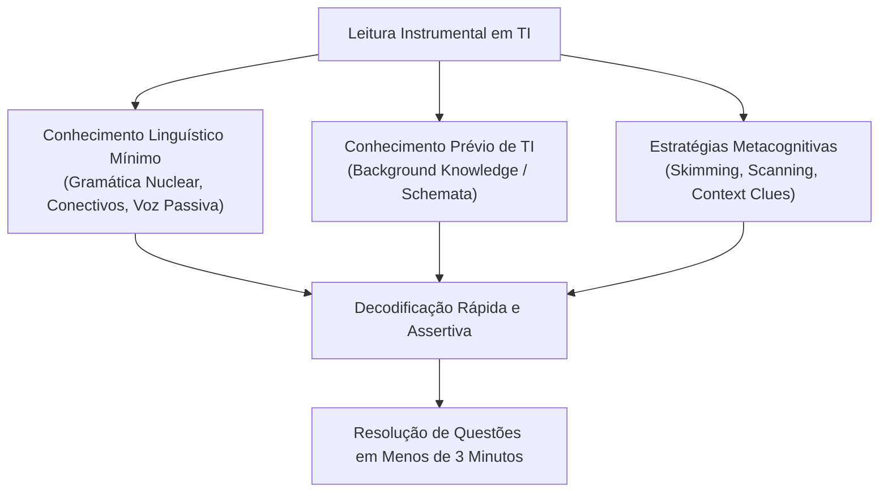
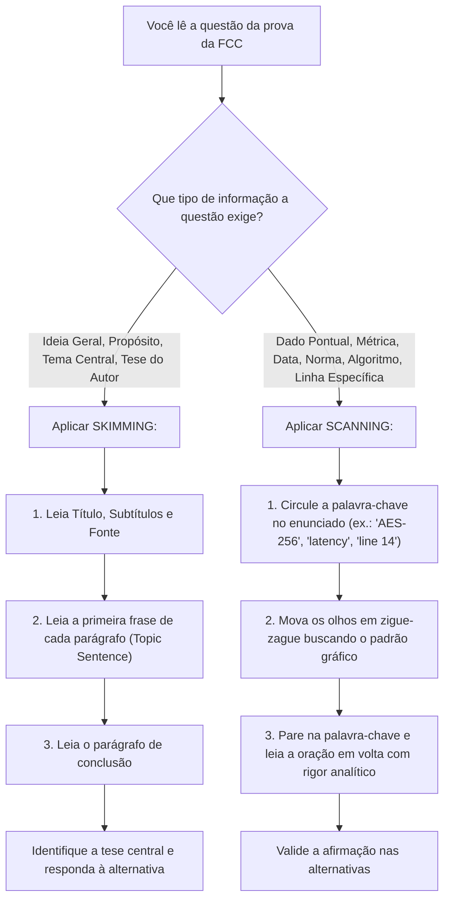
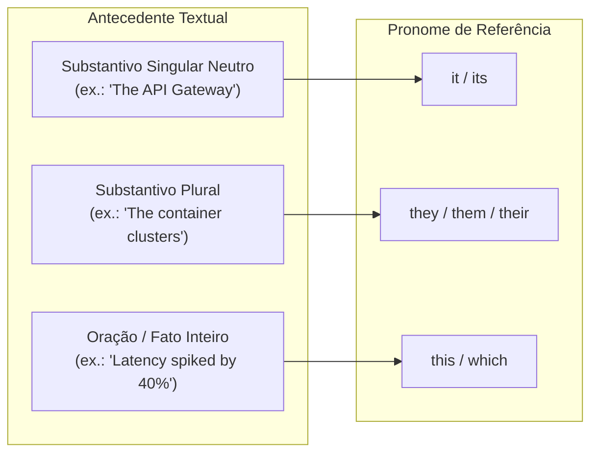

# 01 - Estratégias de Leitura Instrumental: Skimming, Scanning e Inferência

> **Matéria:** Língua Inglesa (Leitura Técnica)  
> **Cargo:** B02 – Técnico de Controle Externo – Especialidade: Tecnologia da Informação  
> **Arquivo:** `01_estrategias_de_leitura_skimming_scanning_e_inferencia.md`  

---

## 📌 Ementa / Itens do Edital
- Compreensão e interpretação de textos técnicos e científicos em língua inglesa
- Estratégias de leitura instrumental: Skimming (identificação da ideia principal)
- Estratégias de leitura instrumental: Scanning (localização de informações específicas)
- Predição, pistas tipográficas e inferência contextual de vocabulário
- Falsos amigos / Falsos cognatos (*False Friends / False Cognates*)

---

## 🌳 Classificação Hierárquica

```text
1. Leitura Instrumental em Inglês para TI
├── 1.1 Fundamentos do Inglês Instrumental (English for Specific Purposes - ESP)
│   ├── 1.1.1 Foco em Leitura Técnica: Compreensão rápida e precisa dispensando pronúncia ou conversação
│   └── 1.1.2 Fases do Processo de Leitura: Pré-leitura (ativação de conhecimento prévio), Leitura atenta e Pós-leitura
├── 1.2 Estratégias Centrais de Leitura Técnica
│   ├── 1.2.1 Skimming (Leitura Rápida Panorâmica):
│   │   ├── Objetivo: Captar o sentido global, o tema central e a ideia principal (Main Idea / Gist)
│   │   ├── Técnica: Leitura rápida do título, subtítulo, primeira frase de cada parágrafo (Topic Sentence), palavras em negrito e parágrafo de conclusão
│   │   └── Resposta a questões do tipo: "The main purpose of the text is to...", "The author's primary argument is that..."
│   ├── 1.2.2 Scanning (Leitura de Varredura Seletiva):
│   │   ├── Objetivo: Localizar uma informação específica pontual no texto sem ler tudo detalhadamente
│   │   ├── Técnica: Os olhos correm pelo texto buscando palavras-chave pré-determinadas (datas, números, acrônimos, nomes de protocolos, classes, autores)
│   │   └── Resposta a questões do tipo: "According to paragraph 3, what is the latency threshold...?", "In which year was the protocol deprecated?"
│   ├── 1.2.3 Predição e Pistas Contextuais:
│   │   ├── Uso de elementos não-verbais: Gráficos, tabelas, blocos de código, diagramas de arquitetura e capturas de tela
│   │   └── Recursos tipográficos: Palavras em itálico, código formatado, listas com marcadores (bullet points)
│   └── 1.2.4 Inferência Contextual (Context Clues):
│       ├── Dedução do significado de termos desconhecidos pela análise de:
│       │   ├── Definição direta ou paráfrase fornecida no próprio texto ("that is", "in other words", "defined as")
│       │   ├── Exemplos fornecidos ("such as", "for instance", "e.g.")
│       │   ├── Relações de contraste e oposição ("unlike", "in contrast to", "instead of")
│       │   └── Análise morfológica da raiz da palavra
├── 1.3 Cognatos e Falsos Cognatos no Inglês Técnico
│   ├── 1.3.1 Cognatos Verdadeiros (True Cognates): Palavras com grafia e sentido semelhantes em inglês e português (computer, protocol, system, architecture, database, network, memory)
│   └── 1.3.2 Falsos Cognatos Críticos em Provas de TI (False Friends):
│       ├── Actually: Na verdade, realmente (NÃO significa "atualmente" -> atualmente é currently)
│       ├── Eventually: No final das contas, finalmente (NÃO significa "eventualmente/às vezes" -> ocasionalmente é occasionally)
│       ├── Pretend: Fingir (NÃO significa "pretender" -> pretender é intend)
│       ├── Policy: Política, diretriz, regulamento (NÃO significa "polícia" -> polícia é police)
│       ├── Notice: Notar, aviso, comunicado (NÃO significa "notícia" -> notícia é news)
│       ├── Push: Empurrar (NÃO significa "puxar" -> puxar é pull)
│       ├── Comprehensive: Abrangente, completo, amplo (NÃO significa "compreensivo/tolerante" -> compreensivo é understanding)
│       ├── Library: Biblioteca de código/livros (NÃO significa "livraria" -> livraria é bookstore)
│       ├── Resume: Retomar, reiniciar (NÃO significa "resumo" -> resumo é summary)
│       └── Require: Exigir, necessitar (NÃO significa "requerer juridicamente" -> peticionar é request/petition)
```

---

## 📖 Teoria Aprofundada & Fundamentos Metodológicos

### 1.1 O Que É Inglês Instrumental (*English for Specific Purposes - ESP*)?

O **Inglês Instrumental** (ou ESP) orienta-se pelo princípio da **utilidade pragmática**: o objetivo do estudante não é desenvolver fluência oral, pronúncia nativa ou produção escrita literária, mas sim dominar a **decodificação rápida e precisa** de textos técnicos especializados em seu domínio de atuação (no caso, a Tecnologia da Informação).

Nas provas da Fundação Carlos Chagas (FCC) para cargos de Auditoria, Controle Externo e Análise de TI, o tempo por questão é um recurso escasso (em média 3 minutos por questão). Candidatos que tentam traduzir mentalmente o texto palavra por palavra (*word-by-word translation*) esgotam o tempo da prova e perdem a visão global da macroestrutura textual. A proficiência instrumental apoia-se em um **tripé de competências cognitivas**:

1. **Conhecimento Linguístico Básico (Linguistic Competence):** Domínio de estruturas sintáticas essenciais (voz passiva, modais, ordem adjetivo-substantivo) e conectivos lógicos (*linking words*).
2. **Conhecimento de Mundo e de TI (Schema / Background Knowledge):** O candidato que já compreende conceitos de arquitetura de microsserviços, concorrência, criptografia e bancos de dados ativa esquemas conceituais (*schemata*) que compensam lacunas lexicais durante a leitura.
3. **Estratégias Metacognitivas de Leitura (Reading Strategies):** Capacidade deliberada de alternar entre *Skimming*, *Scanning*, *Prediction* e *Inferencing* de acordo com a demanda específica de cada questão da banca.



---

### 1.2 Skimming: Leitura Rápida Panorâmica (*Main Idea & Gist*)

O **Skimming** (do inglês *to skim*, "desnatar", retirar a nata da superfície) é uma técnica de leitura acelerada cujo propósito é **captar a ideia central, o tema geral e a estrutura macrotextual** sem se ater a pormenores, dados estatísticos ou vocábulos isolados desconhecidos.

#### Mecânica de Execução do Skimming:
1. **Inspeção Periférica:** Ler atentamente o título (*title*), subtítulos (*headings / subheadings*) e a fonte bibliográfica (autor, veículo, data de publicação).
2. **Tópico Frasal (*Topic Sentence*):** Em artigos técnicos formais de TI, a primeira ou a segunda frase de cada parágrafo sintetiza o argumento central daquele parágrafo. Concentre sua leitura no início de cada bloco textual.
3. **Sentença Conclusiva (*Concluding Sentence*):** Ler a última frase do parágrafo, que frequentemente reforça a tese ou introduz a transição para o próximo tópico.
4. **Parágrafo Conclusivo:** Ler com atenção o último parágrafo do texto, onde o autor costuma recapitular os achados, lições aprendidas ou trabalhos futuros (*findings, remarks, conclusions*).
5. **Velocidade:** A velocidade de leitura no *skimming* deve ser de aproximadamente 600 a 800 palavras por minuto, cerca de 3 a 4 vezes mais rápida do que uma leitura analítica convencional.

#### Tipos de Questões FCC Respondidas por Skimming:
- *"The main purpose of the text is to..."* (O objetivo principal do texto é...)
- *"Which of the following statements best expresses the central idea of the passage?"* (Qual das afirmações expressa melhor a ideia central do trecho?)
- *"The author's primary argument concerning microservices is that..."* (O argumento primordial do autor referente a microsserviços é que...)
- *"The tone of the author can be characterized as..."* (O tom do autor pode ser caracterizado como crítico, neutro, persuasivo, descritivo...)

---

### 1.3 Scanning: Leitura de Varredura Seletiva (*Locating Specific Data*)

O **Scanning** (como o feixe de um leitor de código de barras ou um utilitário `grep`) é a estratégia pela qual o leitor **não lê o texto linearmente**, mas move os olhos em zigue-zague ou verticalmente pela página procurando **uma pista visual ou palavra-chave (*anchor word*) predeterminada**.

#### Mecânica de Execução do Scanning:
1. **Identificar o Alvo no Enunciado:** Antes de retornar ao texto, leia a pergunta da prova e circule a informação solicitada (ex.: um número de porta TCP, um percentual de redução de latência, o nome de um algoritmo, uma norma da ISO/IEC, o nome de um pesquisador ou framework).
2. **Definir o Formato Tipográfico da Pista:**
   - Datas e números: dígitos arábicos (`2024`, `99.999%`, `250 ms`, `4096-bit`).
   - Nomes próprios e siglas: letras maiúsculas ou acrônimos (`NIST`, `OAuth 2.0`, `PostgreSQL`, `DDoS`).
   - Termos técnicos de programação: grafia em caixa alta ou termos entre aspas (`immutable`, `mutex`, `idempotent`).
3. **Varredura Ocular:** Mover o olhar rapidamente sem subvocalizar (sem falar mentalmente as palavras). Ignore todas as palavras que não correspondam ao padrão da pista.
4. **Leitura Pontual em Camada Fina:** Ao colidir visualmente com a pista, interrompa a varredura e leia com minúcia cirúrgica apenas a oração imediatamente anterior e a oração subsequente ao termo localizado.

#### Tabela Comparativa: Skimming vs. Scanning

| Dimensão de Comparação | *Skimming* (Leitura Panorâmica) | *Scanning* (Varredura Seletiva) |
| :--- | :--- | :--- |
| **Objetivo Primário** | Identificar a ideia geral (*gist*), o tema central e o tom do autor | Localizar um dado pontual específico (fato, data, métrica, nome) |
| **Direção do Olhar** | Topo para base, focando nas primeiras e últimas frases dos parágrafos | Movimento em zigue-zague ou vertical veloz buscando pistas visuais |
| **Velocidade de Leitura** | Muito alta (3x a 4x mais rápida que a normal) | Instantânea (focada exclusivamente no termo-alvo) |
| **Leitura Linear?** | Sim, porém filtrada (lê apenas o esqueleto estrutural) | Não, totalmente não-linear (ignora o texto até achar a pista) |
| **Ponto de Partida** | Inicia no texto antes de responder à macroestrutura | Inicia **no enunciado da questão**, identificando o termo de busca |
| **Comandos de Prova Típicos** | *"The text aims to discuss...", "The main topic is..."* | *"According to paragraph 3...", "In 2023, the throughput was..."* |



---

### 1.4 Predição e Pistas Contextuais (*Context Clues*)

Nas provas da FCC, é deliberadamente provável que o candidato encontre palavras raras, arcaicas ou altamente especializadas que não constam do seu vocabulário diário. A técnica de **inferência contextual (*Context Clues*)** permite deduzir o sentido exato do vocábulo a partir do ambiente sintático e semântico em que ele está inserido, dispensando o uso de dicionários.

Existem cinco categorias canônicas de pistas contextuais recorrentes em textos técnicos de TI:

#### 1. Definição Direta ou Paráfrase (*Definition / Restatement Clues*)
O próprio autor define o termo desconhecido logo em seguida, isolado por vírgulas, travessões, parênteses ou conjunções explicativas (*that is, in other words, known as, which means, defined as*).
> *Exemplo:* *"The system relies on an **idempotent** operation—**that is, an operation that can be applied multiple times without changing the result beyond the initial execution**—to prevent accidental duplicate billing."*  
> $\rightarrow$ O texto fornece a definição exata de *idempotent* entre travessões: operação repetível sem alterar o resultado.

#### 2. Exemplificação (*Example Clues*)
O significado da categoria abstrata desconhecida é esclarecido pela enumeração de exemplos concretos introduzidos por *such as, for example, for instance, e.g., including*.
> *Exemplo:* *"The audit identified severe **ephemeral** storage configurations, **such as temporary RAM disks and non-persistent container scratchpads**, which led to data loss after host reboots."*  
> $\rightarrow$ Mesmo que o candidato não soubesse o significado de *ephemeral* (efêmero/transitório), os exemplos (*temporary RAM disks, non-persistent*) revelam o conceito com clareza.

#### 3. Contraste e Oposição (*Contrast / Antonym Clues*)
O termo desconhecido é contraposto a um conceito familiar por meio de conectivos adversativos ou concessivos (*unlike, in contrast to, whereas, while, on the other hand, instead of, but*).
> *Exemplo:* *"**Unlike** legacy monolithic repositories that are completely **intertwined**, modern cloud services are **loosely coupled** and fully independent."*  
> $\rightarrow$ Sabendo que *loosely coupled* significa "fracamente acoplado/independente", a oposição marcada por *Unlike* prova que *intertwined* significa "entrelaçado, dependente, fortemente acoplado".

#### 4. Causa e Efeito (*Cause and Effect Clues*)
O contexto demonstra a causa que originou a situação ou o efeito produzido por ela (*because, since, as a result, consequently, thereby, leading to*).
> *Exemplo:* *"Due to the **exponential** surge in network packets that overwhelmed the firewall buffers, the entire gateway became completely **unresponsive**."*  
> $\rightarrow$ A causa (*surge that overwhelmed*) associada à consequência (*became completely unresponsive*) evidencia o sentido de colapso/paralisação.

#### 5. Decomposição Morfológica (Prefixos e Sufixos)
A palavra desconhecida pode ser dividida em seus blocos constitutivos:
- **Prefixo:** Denota negação (*un-, in-, dis-, mis-*), tempo/ordem (*pre-, post-*), grau/escala (*micro-, macro-, hyper-*).
- **Raiz / Radical:** Núcleo semântico.
- **Sufixo:** Revela a classe gramatical (substantivo em *-tion, -ment, -ity*; adjetivo em *-able, -ive, -al*; advérbio em *-ly*).

---

### 1.5 Falsos Cognatos Críticos no Inglês Técnico de TI (*False Friends*)

Cognatos verdadeiros (*True Cognates*) são palavras de mesma raiz latina que possuem grafia semelhante e exatamente o mesmo significado em português e inglês (ex.: *computation, algorithm, memory, security, protocol, infrastructure, terminal*).

No entanto, a FCC utiliza reiteradamente os **Falsos Cognatos (*False Friends*)** para induzir o candidato ao erro por associação superficial. A tabela abaixo cataloga os falsos cognatos de maior frequência e impacto nas provas de tecnologia:

| Falso Amigo (*Inglês*) | Tradução Técnica Real | O que NÃO significa (Pegadinha) | Termo correto para a pegadinha | Exemplo Prático de TI |
| :--- | :--- | :--- | :--- | :--- |
| **Actually** | Na verdade, de fato, realmente | Atualmente, nos dias de hoje | *Currently, nowadays, presently* | *"The benchmark **actually** demonstrated lower latency under high load."* |
| **Eventually** | No final das contas, por fim, com o tempo | Eventualmente, de vez em quando | *Occasionally, intermittently, sometimes* | *"The distributed cluster will **eventually** achieve full consistency."* |
| **Pretend** | Fingir, simular | Pretender, ter intenção de | *Intend, plan, aim to* | *"The bad actor **pretended** to be an authenticated proxy server."* |
| **Policy** | Política institucional, diretriz, regra | Polícia (corporação policial) | *Police* | *"The IAM security **policy** denies public read access to the S3 bucket."* |
| **Notice** | Notar, perceber; aviso, notificação | Notícia jornalística | *News* | *"The monitoring agent will trigger an alert upon **notice** of CPU throttling."* |
| **Push** | Empurrar, enviar para frente | Puxar (trazer para si) | *Pull* | *"Developers **push** code commits to GitHub; clients **pull** updates."* |
| **Comprehensive**| Abrangente, amplo, exaustivo | Compreensivo, tolerante | *Understanding, tolerant* | *"The team performed a **comprehensive** source code audit across all repos."* |
| **Library** | Biblioteca de código ou de livros | Livraria (loja que vende livros)| *Bookstore* | *"Import the cryptographic **library** to generate asymmetric keypairs."* |
| **Resume** | Retomar, reiniciar após pausa | Resumo, síntese | *Summary, abstract* (Nota: *résumé* é currículo) | *"The database ingestion pipeline will **resume** processing after failover."* |
| **Require** | Exigir, demandar, ser indispensável| Requerer formalmente em juízo | *Request, petition, file a motion* | *"Microservices **require** an automated service mesh for mTLS traffic."* |
| **Assist** | Auxiliar, ajudar, dar suporte | Assistir a (ver espetáculo/jogo) | *Watch, attend* | *"The AI copilot can **assist** engineers in refactoring legacy code."* |
| **Attend** | Comparecer, participar, assistir a reunião | Atender (prestar suporte/responder)| *Serve, answer, support* | *"The database administrator must **attend** the incident postmortem meeting."* |
| **Realize** | Perceber, dar-se conta; concretizar| Realizar (executar tarefa comum) | *Perform, execute, carry out* | *"Engineers did not **realize** that the cache had become stale."* |
| **Compromise** | Comprometer a segurança; fazer concessão mútuo | Compromisso, agendamento de horário | *Commitment, appointment* | *"A weak master key will **compromise** the confidentiality of the database."* |
| **Sensible** | Sensato, razoável, prudente | Sensível (que sofre com estímulos) | *Sensitive (ex.: sensitive data = dados sensíveis)* | *"Setting an automated timeout of 30 seconds is a **sensible** architectural choice."* |
| **Novel** | Inovador, inédito, original (adjetivo) | Novela televisiva ou de romance | *Soap opera / romance book* | *"The researchers proposed a **novel** consensus algorithm for blockchain."* |

---

### 1.6 Referência Pronominal e Coesão Anafórica (*Reference Words*)

Outro alvo predileto da banca FCC em provas de leitura instrumental é a **identificação do referente de pronomes** (*anaphora*). A banca destaca um pronome na linha $X$ e indaga a qual elemento do texto ele se refere sintaticamente.

> ⭐ **IMPORTANTE / REGRA DE OURO:**  
> Os pronomes neutros e relativos do inglês seguem regras estritas de concordância de número e entidade:
> - **It / Its:** Refere-se a substantivo singular neutro (uma ferramenta, um protocolo, uma falha, um servidor).
> - **They / Their / Them:** Refere-se a substantivo plural (dispositivos, servidores, vulnerabilidades, usuários).
> - **Which:** Refere-se à coisa ou oração precedente imediata.
> - **Who / Whom:** Refere-se exclusivamente a pessoas humanas (desenvolvedores, administradores, atacantes).
> - **This / These:** Frequentemente sintetizam **toda a ideia ou processo** descrito na oração imediatamente anterior (*encapsulamento conceitual*).



---

## ⚠️ Pontos de Atenção (Estilo FCC)

> 🚨 **ALERTA DE PROVA / PEGADINHA FCC:**  
> 1. **"Eventually" NÃO é "Eventualmente":** A FCC adora colocar em alternativas que uma ação de TI ocorre "de modo esporádico ou incerto" traduzindo *eventually*. Lembre-se: *eventual consistency* em bancos NoSQL significa que o cluster **certamente atingirá** a consistência final com o tempo, e não que ele "às vezes" fica consistente!  
> 2. **"Policy" vs. "Police":** Em textos de segurança da informação da FCC, *policy* é **diretriz, norma interna ou política de segurança**. Alternativas que mencionam "forças policiais" ou "apólices de seguro" devem ser eliminadas sumariamente.  
> 3. **A Ordem das Operações em Prova:** NUNCA comece lendo um texto longo de 40 linhas do início ao fim sem rumo. **Leia primeiro o enunciado da questão e as 5 alternativas**. Se a questão pedir a ideia principal, faça *Skimming*; se pedir um detalhe específico (número, protocolo, autor), faça *Scanning*.

---

## 🌐 Fontes Recomendadas na Internet

- [BBC Learning English - Reading Skills & Academic ESP](https://www.bbc.co.uk/learningenglish/)
  - Portal educativo da BBC contendo módulos de leitura instrumental, tópicos frasais (*Topic Sentences*) e dedução de vocabulário pelo contexto.
- [British Council - Reading for Professionals and Academics](https://learnenglish.britishcouncil.org/skills/reading)
  - Plataforma do British Council com textos analíticos voltados a leitura instrumental em níveis B2 e C1, exercícios de inferência e estrutura argumentativa.
- [Cambridge Grammar Guide - Discourse Markers and Connectives](https://dictionary.cambridge.org/grammar/british-grammar/)
  - Dicionário e gramática de referência sobre conectivos discursivos (*linking words*), falsos cognatos (*false friends*) e mecanismos de coesão textual.
- [IEEE Spectrum - Computing and Emerging Technology Insights](https://spectrum.ieee.org/computing)
  - Revista técnica oficial do IEEE. Fonte primária padrão para os textos autênticos de computação e telecomunicações selecionados pela FCC.
- [ACM TechNews - Association for Computing Machinery](https://technews.acm.org/)
  - Resumos executivos de pesquisas em ciência da computação. Excelente para treino de *skimming* em resumos técnicos de alta densidade.

---

## 📝 Questões Comentadas & Exemplos (Padrão FCC)

### Questão 1 (FCC - Adaptada / Analista de Tecnologia da Informação - SEFAZ)
*Carefully read the excerpt below regarding modern enterprise infrastructure security:*

> *"Zero Trust is not a single tool, but rather an overarching security model. Traditional perimeter defenses assume that everything inside an organization's internal network can be trusted. In contrast, Zero Trust operates on the principle of 'never trust, always verify'. Consequently, even after users and devices obtain initial access to a subnet, their authorization must be continually re-evaluated using granular policies based on identity, endpoint health, and context. Because legacy systems often lack native support for dynamic telemetry, modernizing them can **eventually** require substantial engineering effort."*

Based on reading comprehension strategies and technical lexicon, it is correct to state that:

A) The term **"eventually"** in the last sentence indicates that migrating legacy systems demands engineering effort only on rare, unpredictable occasions.  
B) The main purpose of the paragraph is to demonstrate that legacy perimeter defenses remain technically superior to Zero Trust architectures.  
C) According to the text, once a device achieves initial authentication inside an internal subnet, its authorization privileges remain unconditionally static.  
D) The author highlights that Zero Trust mandates continuous re-evaluation of authorization privileges, even for internal network traffic.  
E) The pronoun **"their"** in the sentence *"their authorization must be continually re-evaluated"* refers syntactically to *"traditional perimeter defenses"*.  

> **Gabarito: D**  
>
> **Comentário Analítico Passo a Passo:**  
> - **A (Incorreta):** A alternativa explora a pegadinha clássica do falso cognato (*false friend*). O termo **"eventually"** significa *"no final das contas"*, *"com o passar do tempo"* ou *"ao longo do processo"* (*in the end / ultimately*). A alternativa tenta traduzi-lo erradamente por "ocasionalmente / de modo esporádico", que em inglês seria *occasionally* ou *sporadically*.  
> - **B (Incorreta):** Aplicação de *Skimming*: o texto contrapõe o modelo tradicional (que confia ingenuamente em tudo o que está dentro do perímetro) ao modelo Zero Trust, que é apresentado como o paradigma moderno necessário. O autor não afirma que o modelo tradicional é superior.  
> - **C (Incorreta):** Aplicação de *Scanning*: o texto assevera textualmente o oposto: *"even after users and devices obtain initial access to a subnet, their authorization must be continually re-evaluated"* (mesmo após obterem acesso inicial, a autorização deve ser continuamente reavaliada, logo não é estática).  
> - **D (Correta):** Captura com fidelidade a asserção central do modelo Zero Trust descrita no texto: a verificação contínua e dinâmica (*continually re-evaluated using granular policies*) mesmo para entidades já conectadas à rede interna (*inside an organization's internal network*).  
> - **E (Incorreta):** Análise de referência anafórica (*Reference Words*): o pronome possessivo plural **"their"** refere-se a **"users and devices"** (mencionados imediatamente antes: *"even after users and devices obtain initial access to a subnet, their authorization..."*), e não a *"perimeter defenses"*.

---

### Questão 2 (FCC - Adaptada / Tribunal de Contas - Auditoria de TI)
*Consider the sentence below taken from an official software engineering audit report:*

> *"Although the technical team **pretended** to ignore the severe vulnerabilities discovered during the automated pipeline audit, the directorate implemented a **comprehensive** governance **policy** that **actually** mitigated external threat vectors."*

Na língua portuguesa, as palavras destacadas no trecho (**pretended**, **comprehensive**, **policy**, **actually**) possuem os significados corretos e contextuais expressos em:

A) fingiu – compreensiva – polícia – atualmente  
B) pretendeu – abrangente – diretriz – atualmente  
C) fingiu – abrangente – política/diretriz – na verdade/efetivamente  
D) tentou – tolerante – polícia – realmente  
E) planejou – compacta – apólice – futuramente  

> **Gabarito: C**  
>
> **Comentário Analítico Passo a Passo:**  
> - **Análise sistemática dos quatro termos:**  
>   1. **To pretend:** Verbo que significa *fingir* ou *simular*. O verbo em inglês para "pretender ter a intenção" é *to intend*. Logo, *"pretended to ignore"* = fingiu ignorar.  
>   2. **Comprehensive:** Adjetivo que significa *abrangente*, *amplo*, *completo*, *global*. A palavra para "compreensivo/tolerante" em inglês é *understanding* ou *tolerant*.  
>   3. **Policy:** Substantivo que significa *política institucional*, *diretriz*, *conjunto de normas*. A corporação policial é *police*; apólice de seguro é *insurance policy*.  
>   4. **Actually:** Advérbio que significa *na verdade*, *de fato*, *efetivamente*, *realmente*. As expressões para "atualmente / nos dias de hoje" são *currently*, *nowadays* ou *presently*.  
> - **Análise das alternativas:**  
>   - **A (Incorreta):** Erra em "compreensiva" (*understanding*), "polícia" (*police*) e "atualmente" (*currently*).  
>   - **B (Incorreta):** Erra em "pretendeu" (*intended*) e "atualmente" (*currently*).  
>   - **C (Correta):** Traduz os quatro vocábulos com precisão cirúrgica de acordo com o léxico técnico.  
>   - **D (Incorreta):** Erra em "tentou" (*tried/attempted*), "tolerante" (*tolerant*) e "polícia" (*police*).  
>   - **E (Incorreta):** Erra em "planejou" (*planned*), "compacta" (*compact*) e "futuramente" (*in the future*).

---

### Questão 3 (FCC - Adaptada / Analista de Sistemas - Segurança da Informação)
*Carefully read the text excerpt below regarding cybersecurity incident handling:*

> *"During the post-incident investigation, forensics analysts discovered that adversaries managed to **compromise** the primary domain controller by exploiting an unpatched remote code execution vulnerability. Once inside, the attackers deployed sophisticated **ransomware** that encrypted critical databases across multiple physical sites. **Unlike** conventional malware campaigns that disrupt operations immediately, this intrusion remained dormant for weeks to exfiltrate proprietary data. To **remediate** the breach, the security operations center had to revoke all privileged credentials and rebuild directory services from verified cold backups."*

Based on reading strategies and vocabulary inference, select the correct statement:

A) In the first sentence, the word **"compromise"** means that the adversaries entered into an amicable agreement or diplomatic settlement with the domain controller.  
B) The connector **"Unlike"** establishes a relation of contrast between the intrusion described and conventional malware campaigns regarding their timing of disruption.  
C) By using scanning techniques on the text, one can determine that the ransomware encrypted databases located within a single physical datacenter.  
D) The verb **"remediate"** indicates that the security operations center decided to accept and tolerate the breach without executing countermeasures.  
E) The pronoun **"this intrusion"** in the third sentence refers specifically to the automated restoration of cold backups.  

> **Gabarito: B**  
>
> **Comentário Analítico Passo a Passo:**  
> - **A (Incorreta):** No vocabulário técnico de segurança da informação, **"compromise"** significa *violar a segurança*, *comprometer a integridade ou confidencialidade*, *invadir*. A alternativa explora o sentido leigo do termo (fazer um acordo ou concessão mútua), o que é um absurdo no contexto de um controlador de domínio.  
> - **B (Correta):** A preposição **"Unlike"** (ao contrário de / diferentemente de) introduz uma relação límpida de **contraste**: campanhas convencionais de malware causam interrupção imediata (*disrupt operations immediately*), ao passo que a invasão analisada permaneceu dormente por semanas (*remained dormant for weeks*) para exfiltrar dados.  
> - **C (Incorreta):** Aplicando *Scanning* na expressão "physical", o texto afirma expressamente: *"encrypted critical databases across **multiple** physical sites"* (múltiplos locais físicos, e não um único).  
> - **D (Incorreta):** O verbo **"remediate"** significa *sanar*, *remediar*, *corrigir*, *restaurar o estado seguro*. A alternativa afirma incorretamente que a equipe aceitou o incidente sem contra-medidas, quando o texto relata a revogação de credenciais e a reconstrução dos servidores.  
> - **E (Incorreta):** "This intrusion" é uma referência anafórica que retoma o ataque do ransomware e a violação do controlador de domínio perpetrada pelos invasores, descrita nas frases anteriores, e não os backups frios (que só aparecem na última frase).

---

### Questão 4 (FCC - Adaptada / Tribunal de Contas - Infraestrutura e Nuvem)
*Read the technical excerpt concerning cloud architecture evaluation:*

> *"Monolithic systems are often praised for their initial architectural simplicity and straightforward deployment pipelines. However, as organizations scale, maintaining a massive unified codebase introduces a formidable development **bottleneck**. In contrast, a microservices pattern partitions the business domain into autonomous, loosely coupled services that can be scaled independently. **Nonetheless**, adopting microservices entails a non-trivial **trade-off**: while it enhances deployment velocity, it substantially escalates distributed operational complexity, network latency, and the difficulty of enforcing cross-service transactional consistency."*

Through the application of skimming and scanning techniques, it can be concluded that:

A) Skimming the passage reveals that the author unconditionally recommends microservices as a superior solution without any operational drawbacks.  
B) The term **"bottleneck"** is used contextually to describe an acceleration mechanism that improves developer delivery speed.  
C) According to the text, monolithic architectures present higher network latency and more complex cross-service transactions than microservices.  
D) The word **"trade-off"** indicates a compromise where gaining deployment velocity comes at the expense of higher distributed complexity and latency.  
E) The linking word **"Nonetheless"** introduces an addition of arguments in favor of monolithic deployment pipelines.  

> **Gabarito: D**  
>
> **Comentário Analítico Passo a Passo:**  
> - **A (Incorreta):** O *skimming* demonstra que o autor adota uma postura analítica e balanceada. O autor pontua claramente que os microsserviços trazem desvantagens operacionais severas (*distributed operational complexity, network latency*), refutando a ideia de recomendação incondicional.  
> - **B (Incorreta):** **"Bottleneck"** (gargalo de garrafa) é uma metáfora universal em engenharia que designa um ponto de estrangulamento, restrição ou lentidão que limita o desempenho global do sistema, e não um mecanismo de aceleração.  
> - **C (Incorreta):** O *scanning* localiza que maior latência de rede (*network latency*) e complexidade de consistência transacional entre serviços (*cross-service transactional consistency*) são ônus dos **microsserviços**, e não dos monólitos.  
> - **D (Correta):** **"Trade-off"** é um termo canônico da engenharia de software que designa uma relação de compromisso ou escolha conflitante: para obter determinado ganho (*deployment velocity*), é imperativo aceitar certas perdas ou custos adicionais (*escalates distributed operational complexity and latency*).  
> - **E (Incorreta):** **"Nonetheless"** (contudo, todavia, no entanto) é um conectivo adversativo de **contraste/concessão**, e não de adição (*furthermore, moreover*).

---

### Questão 5 (FCC - Adaptada / Auditoria Governamental - Inteligência Artificial)
*Consider the text below on algorithmic governance:*

> *"Auditing modern machine learning models presents **novel** challenges for oversight agencies. Deep neural networks function largely as black boxes, making it difficult to extract explainable decision pathways. When public institutions deploy predictive models to grant social benefits or score fiscal risk, undetected algorithmic bias can harm vulnerable citizens. **To prevent this**, regulatory authorities advocate for strict validation protocols. Data scientists must ensure that training datasets are **sensible**, representative, and sanitized against historical disparities. **They** must also provide comprehensive audit trails before any model enters production."*

Regarding reading comprehension, context clues, and reference words in the text, choose the correct alternative:

A) The adjective **"novel"** in the first sentence indicates that algorithmic auditing challenges are traditional, ancient, and already solved by standard literature.  
B) In the phrase **"To prevent this"**, the pronoun *"this"* refers back to the entire problem of undetected algorithmic bias harming citizens.  
C) The adjective **"sensible"** indicates that training datasets must be easily hurt by emotional or sensitive reactions.  
D) The subject pronoun **"They"** in the final sentence syntactically refers to *"vulnerable citizens"*.  
E) The author argues that machine learning models should enter production immediately, dispensing with explainability and audit trails.  

> **Gabarito: B**  
>
> **Comentário Analítico Passo a Passo:**  
> - **A (Incorreta):** **"Novel"** como adjetivo significa *novo*, *inédito*, *inovador*, *original* (do latim *novellus*). Não significa tradicional nem antigo, e muito menos "romance/novela literária".  
> - **B (Correta):** Coesão anafórica e encapsulamento: a estrutura demonstrativa **"To prevent this"** (Para prevenir isso / Para evitar que isso ocorra) retoma o fato narrado na frase imediatamente antecedente: o viés algorítmico não detectado prejudicar cidadãos vulneráveis (*undetected algorithmic bias can harm vulnerable citizens*).  
> - **C (Incorreta):** Falso cognato crítico: **"Sensible"** significa *sensato*, *razoável*, *criterioso*, *coerente*. A palavra para "sensível a estímulos / magoável" é *sensitive* (como em *sensitive data* = dados sensíveis).  
> - **D (Incorreta):** Na frase *"Data scientists must ensure that... They must also provide..."*, o pronome plural **"They"** refere-se ao sujeito da oração anterior: os **"Data scientists"** (cientistas de dados), que são os responsáveis por fornecer as trilhas de auditoria, e não os cidadãos vulneráveis.  
> - **E (Incorreta):** O texto afirma categoricamente o contrário: os cientistas de dados devem garantir trilhas de auditoria abrangentes (*comprehensive audit trails*) antes que o modelo entre em produção (*before any model enters production*).
