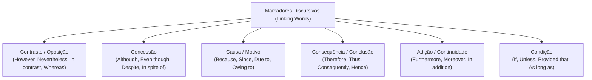
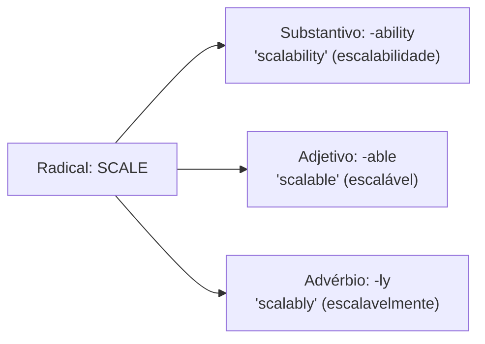
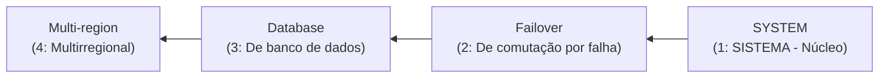

# 02 - Vocabulário Técnico de TI, Coesão e Conectivos

> **Matéria:** Língua Inglesa (Leitura Técnica)  
> **Cargo:** B02 – Técnico de Controle Externo – Especialidade: Tecnologia da Informação  
> **Arquivo:** `02_vocabulario_tecnico_de_ti_e_conjuncoes.md`  

---

## 📌 Ementa / Itens do Edital
- Vocabulário técnico especializado da área de Tecnologia da Informação
- Formação de palavras em inglês (Prefixos, Sufixos e Compostos)
- Marcadores discursivos e conectivos lógicos (Linking Words / Transition Words)
- Relações semânticas de causa, consequência, contraste, concessão, condição e adição

---

## 🧭 Sumário

1. [Conectivos Lógicos e Marcadores Discursivos (Linking Words)](#1-conectivos-logicos-e-marcadores-discursivos-linking-words)
    1. [Relações de Contraste e Adversidade](#11-relacoes-de-contraste-e-adversidade)
    2. [Relações de Concessão e a Regra do Despite](#12-relacoes-de-concessao-e-a-regra-do-despite)
    3. [Relações de Causa, Explicação e Motivo](#13-relacoes-de-causa-explicacao-e-motivo)
    4. [Relações de Consequência, Efeito e Conclusão](#14-relacoes-de-consequencia-efeito-e-conclusao)
    5. [Relações de Adição, Continuidade e Ênfase](#15-relacoes-de-adicao-continuidade-e-enfase)
    6. [Relações de Condição e a Lógica do Unless](#16-relacoes-de-condicao-e-a-logica-do-unless)
    7. [Tabela Canônica de Conectivos e Substituições Intercambiáveis](#17-tabela-canonica-de-conectivos-e-substituicoes-intercambiaveis)
    8. [Teste 575](#Teste-575)
    9. [Teste 576](#Teste-576)
    10. [Teste 577](#Teste-577)
    11. [Teste 578](#Teste-578)
    12. [Teste 579](#Teste-579)
2. [Morfologia e Formação de Palavras Técnicas (Word Formation)](#2-morfologia-e-formacao-de-palavras-tecnicas-word-formation)
    1. [Prefixos Técnicos Recorrentes em Computação](#21-prefixos-tecnicos-recorrentes-em-computacao)
    2. [Famílias de Palavras e Sufixos Gramaticais](#22-familias-de-palavras-e-sufixos-gramaticais)
    3. [Substantivos Compostos e Leitura Reversa (Noun Adjuncts)](#23-substantivos-compostos-e-leitura-reversa-noun-adjuncts)
    4. [Teste 580](#Teste-580)
    5. [Teste 581](#Teste-581)
3. [Glossário Técnico Essencial por Domínio de TI](#3-glossario-tecnico-essencial-por-dominio-de-ti)
    1. [Arquitetura e Engenharia de Software](#31-arquitetura-e-engenharia-de-software)
    2. [Concorrência e Sistemas Operacionais](#32-concorrencia-e-sistemas-operacionais)
    3. [Computação em Nuvem e Infraestrutura](#33-computacao-em-nuvem-e-infraestrutura)
    4. [Segurança Cibernética e Auditoria de Sistemas](#34-seguranca-cibernetica-e-auditoria-de-sistemas)
    5. [Teste 582](#Teste-582)
    6. [Teste 583](#Teste-583)
    7. [Teste 584](#Teste-584)
6. [Fontes Recomendadas na Internet](#6-fontes-recomendadas-na-internet)

---

## 1. Conectivos Lógicos e Marcadores Discursivos (Linking Words)

Os conectivos lógicos (também categorizados na literatura linguística como *Transition Words*, *Discourse Markers* ou *Connectors*) configuram os nós estruturais que asseguram a coesão referencial e a progressão lógica do pensamento em textos formais. 

Nas avaliações da Fundação Carlos Chagas (FCC) para cargos de Auditoria e Tecnologia da Informação, os testes acerca de conectivos concentram-se em dois formatos essenciais:

1. **Identificação da Relação Semântica Primária:** Exige classificar se a partícula expressa *contraste*, *concessão*, *causa*, *consequência/conclusão*, *condição* ou *adição*.
2. **Substituição sem Prejuízo de Sentido ou Gramática:** Demanda apontar o termo perfeitamente intercambiável (*synonymous transition*) respeitando rigorosamente as exigências de regência sintática (por exemplo, diferenciação entre conjunções seguidas de oração completa vs. preposições seguidas de sintagmas nominais).

### 1.1 Relações de Contraste e Adversidade

Os conectivos de contraste indicam oposição, contraposição direta ou divergência entre duas ideias, componentes ou sistemas concorrentes:

- **However, Nevertheless, Nonetheless (No entanto, todavia, contudo, não obstante):** Conectivos coordenados que introduzem ressalvas ou contra-argumentos à declaração precedente. São costumeiramente posicionados no início de uma oração independente seguidos de vírgula, ou após ponto e vírgula.
    - *Exemplo:* *"The microservices architecture offers superior scalability; **nevertheless**, it introduces non-trivial operational complexity."*
- **In contrast, On the contrary, Conversely (Em contrapartida, pelo contrário, inversamente):** Estabelecem um contraponto simétrico entre dois paradigmas tecnológicos distintos.
    - *Exemplo:* *"Relational databases enforce strict schemas. **In contrast**, document stores provide dynamic schemas."*
- **Whereas, While (Ao passo que, enquanto que):** Conjunções subordinativas que operam a comparação simultânea entre dois fatos ou entidades em paralelo.
    - *Exemplo:* *"SQL systems prioritize ACID transactions, **whereas** NoSQL systems emphasize eventual consistency and horizontal elasticity."*

### 1.2 Relações de Concessão e a Regra do Despite

A concessão introduz uma circunstância desfavorável, limitação técnica ou obstáculo que, embora real, **não impede a realização do fato principal** (quebra de expectativa):

- **Although, Even though, Though (Embora, ainda que, se bem que):** Conjunções subordinativas concessivas que exigem **oração completa com Sujeito e Verbo conjugado** (*Subject + Finite Verb*).
    - *Exemplo:* *"**Although** the cluster experienced hardware failures, no transaction was lost."*
- **Despite, In spite of (Apesar de, a despeito de, não obstante):** Locuções prepositivas que exigem **obrigatoriamente um Sintagma Nominal (*Noun Phrase*)** ou um verbo na forma nominal de **gerúndio (*-ing*)**.
    - *Exemplo:* *"**Despite** the heavy network traffic, the load balancer maintained sub-second response times."*

> 🚨 **ALERTA CRÍTICO DE PROVA FCC:**  
> A forma **"Despite of" NÃO EXISTE** na língua inglesa padrão! É uma armadilha sintática que a FCC insere deliberadamente nas alternativas de substituição. 
>
> - Correto: **Despite** + Substantivo (*despite the error*).  
> - Correto: **In spite of** + Substantivo (*in spite of the error*).  
> - Totalmente incorreto: *Despite of the error*. Descarte de imediato qualquer opção que use "despite of"!

### 1.3 Relações de Causa, Explicação e Motivo

Indicam o fundamento, premissa ou razão determinante para que determinado evento computacional ocorra:

- **Because, Since, As, For, Inasmuch as (Porque, já que, visto que, dado que):** Conjunções causais que introduzem orações subordinadas explicativas estruturadas com sujeito e predicado verbal.
    - *Exemplo:* *"The Kubernetes pod crashed **because** it exceeded its memory limit."*
- **Due to, Owing to, Because of, On account of (Devido a, em razão de, em virtude de):** Expressões prepositivas que introduzem diretamente sintagmas nominais causais.
    - *Exemplo:* *"The latency degradation occurred **due to** excessive garbage collection cycles."*

### 1.4 Relações de Consequência, Efeito e Conclusão

Indicam o resultado lógico derivado, a dedução ou a conclusão necessária a partir do que foi explanado:

- **Therefore, Thus, Hence, Consequently, Accordingly (Portanto, por conseguinte, logo, assim, desse modo):** Advérbios conectivos plenamente intercambiáveis que conectam a premissa à sua decorrência inevitável.
    - *Exemplo:* *"The primary node failed health checks; **therefore**, the orchestrator initiated an automated failover."*
- **As a result, For this reason (Como resultado, por este motivo):** Locuções conclusivas que fecham cadeias argumentativas de causa e efeito.

### 1.5 Relações de Adição, Continuidade e Ênfase

Acrescentam argumentos adicionais alinhados à mesma linha de raciocínio, sem introduzir restrições:

- **Furthermore, Moreover, In addition, Additionally, Besides (Além disso, ademais, outrossim):** Conectivos aditivos cumulativos que introduzem novos fatos reforçadores.
    - *Exemplo:* *"The firewall blocks unauthorized IP subnets; **furthermore**, it inspects deep application payloads."*
- **Not only... but also... (Não apenas... mas também...):** Estrutura correlativa de soma e reforço enfático.

### 1.6 Relações de Condição e a Lógica do Unless

Estabelecem os pré-requisitos lógicos para que determinada asserção técnica se concretize:

- **If (Se):** Condição direta afirmativa.
- **Provided that, Providing that, As long as, On condition that (Contanto que, desde que):** Conectivos que introduzem condições necessárias ou restrições de conformidade.
    - *Exemplo:* *"The gateway accepts API requests **provided that** a valid JWT bearer token is supplied."*
- **Unless (A não ser que, a menos que):** Conjunção que embute semanticamente uma condição negativa, equivalendo estritamente a **"if... not"** ou **"except if"**.
    - *Exemplo:* *"The transaction will not be committed **unless** all distributed replicas acknowledge receipt."*  
    $\equiv$ *"The transaction will not be committed **if** all distributed replicas **do not** acknowledge receipt."*

> ⚠️ **Ponto de Atenção FCC:**  
> A partícula *Unless* já é inerentemente negativa. Construções que associam *unless* a verbos no negativo (*unless you don't comply*) criam dupla negação confusa, explorada pela banca em itens interpretativos capciosos.

### 1.7 Tabela Canônica de Conectivos e Substituições Intercambiáveis

| Relação Semântica | Conectivos Canônicos | Estrutura Sintática Requerida | Substitutos Plenamente Equivalentes | Exemplo Prático de TI |
| :--- | :--- | :--- | :--- | :--- |
| **Contraste / Oposição** | *However, Nevertheless, Nonetheless* | Seguidos de vírgula ou entre pontuação forte; orações independentes | *However $\leftrightarrow$ Nevertheless $\leftrightarrow$ Nonetheless* | *"The query returned in 5ms; **however**, the cache failed."* |
| **Contraste Direto** | *Whereas, While, In contrast* | Paralelismo comparativo entre duas cláusulas | *Whereas $\leftrightarrow$ While* | *"C prioritizes speed, **whereas** Python emphasizes readability."* |
| **Concessão (Oração)** | *Although, Even though, Though* | Sujeito + Verbo finito conjugado | *Although $\leftrightarrow$ Even though $\leftrightarrow$ Though* | *"**Although** CPU usage was at 90%, throughput did not drop."* |
| **Concessão (Sintagma)** | *Despite, In spite of* | Apenas Substantivo ou Verbo em *-ing* (NUNCA *despite of*) | *Despite $\leftrightarrow$ In spite of* | *"**In spite of** the replication lag, data consistency held."* |
| **Causa (Oração)** | *Because, Since, As, Inasmuch as* | Oração com verbo conjugado | *Because $\leftrightarrow$ Since $\leftrightarrow$ As* | *"The build failed **since** unit tests did not pass."* |
| **Causa (Sintagma)** | *Due to, Owing to, Because of* | Seguidos de sintagma nominal | *Due to $\leftrightarrow$ Owing to $\leftrightarrow$ Because of* | *"Network slowdowns occurred **due to** routing packet loss."* |
| **Consequência / Conclusão** | *Therefore, Thus, Hence, Consequently* | Oração conclusiva decorrente | *Therefore $\leftrightarrow$ Thus $\leftrightarrow$ Consequently $\leftrightarrow$ Hence* | *"The token expired; **hence**, access was denied."* |
| **Adição / Continuidade** | *Furthermore, Moreover, In addition* | Adiciona proposição cumulativa | *Furthermore $\leftrightarrow$ Moreover $\leftrightarrow$ Additionally* | *"The tool scans code; **moreover**, it audits cloud IAM roles."* |
| **Condição Negativa** | *Unless* | Equivale logicamente a *if... not* | *Unless $\equiv$ Except if $\equiv$ If not* | *"Data will be deleted **unless** archives are verified."* |
| **Condição Restritiva** | *Provided that, As long as* | Condição mandatória requerida | *Provided that $\leftrightarrow$ As long as* | *"Requests succeed **provided that** rate limits are respected."* |

---

### Teste 575
**(FCC - Adaptada / TRT - Analista Judiciário - Tecnologia da Informação)**
*Carefully read the technical excerpt below on distributed systems:*

> *"**Despite** the sudden network partition and sporadic hardware failures, the distributed ledger maintained strong data consistency across all active nodes. **Although** write throughput temporarily stalled during leader election, no uncommitted transactions were lost. The engineering team, **however**, scheduled an emergency firmware update to mitigate residual latency spikes."*

Com base no texto técnico e nas regras morfossintáticas e coesivas da língua inglesa, assinale a afirmação correta:

* **A)** A substituição do conectivo **"Despite"** pela locução **"Despite of"** preservaria a correção gramatical e o sentido original do período.
* **B)** A oração introduzida por **"Although"** expressa uma concessão que poderia ser substituída sem prejuízo sintático ou semântico por **"Even though"**.
* **C)** O termo **"however"** introduz uma oração subordinada causal explicativa sobre a atualização de firmware.
* **D)** A expressão **"in spite of"** não poderia substituir **"Despite"** no primeiro período, pois exige oração subordinada com verbo conjugado.
* **E)** O vocábulo **"Although"** deve ser necessariamente acompanhado de substantivo simples desacompanhado de verbo finito.

---

> **Comentário Detalhado:**
>
> - **A)** Incorreta. A forma **"Despite of" NÃO EXISTE** na língua inglesa padrão. É uma clássica armadilha de bancas de concurso (FCC/FGV). O correto é utilizar **"Despite"** (sem preposição) ou **"In spite of"** (com preposição).
> - **B)** Correta. As conjunções subordinativas concessivas **"Although"**, **"Even though"** e **"Though"** são semanticamente intercambiáveis e exigem a mesma estrutura sintática (sujeito + verbo finito conjugado: *"write throughput temporarily stalled"*).
> - **C)** Incorreta. O vocábulo **"however"** é um advérbio conjuntivo adversativo que expressa **contraste, ressalva ou oposição** (no entanto, porém, contudo), e não causa ou explicação.
> - **D)** Incorreta. A locução prepositiva **"in spite of"** é sinônima exata de **"despite"** e exige sintagma nominal (*noun phrase*): *"In spite of the sudden network partition..."* seria plenamente correto.
> - **E)** Incorreta. **"Although"** é uma conjunção e exige oração completa com verbo (*"write throughput temporarily stalled"*). Quem exige sintagma nominal é *despite* ou *in spite of*.
> 
> **Gabarito: B**

---

### Teste 576
**(FCC - Adaptada / Tribunal de Contas - Auditoria Governamental de TI)**
*Read the continuous delivery policy statement below:*

> *"The automated deployment pipeline will not release the production artifact into the sovereign cloud cluster **unless** all static code analysis checks report zero critical vulnerabilities **and** the regression suite passes with 100% compliance."*

No contexto da infraestrutura de CI/CD apresentada e da semântica dos conectivos na língua inglesa, a diretriz condicional regida pela conjunção **"unless"** expressa que o artefato só será publicado se:

* **A)** Todos os testes estáticos reportarem zero vulnerabilidades críticas e os testes de regressão obtiverem 100% de conformidade.
* **B)** Os testes estáticos acusarem vulnerabilidades críticas ou os testes de regressão falharem.
* **C)** A equipe de auditoria dispensar formalmente a verificação de vulnerabilidades em virtude de prazos urgentes.
* **D)** O cluster de nuvem registrar latência nula, independentemente do resultado dos analisadores estáticos.
* **E)** O deploy ocorrer em ambiente de homologação (*staging*) desprovido de regras de integridade.

---

> **Comentário Detalhado:**
>
> - **A)** Correta. A conjunção condicional **"unless"** equivale estritamente a **"if... not"** (*a não ser que, a menos que, exceto se*). A frase estabelece: *"O pipeline não fará o release a não ser que (unless) A e B ocorram"*. Portanto, para que haja o release, é mandatório que **ambas** as condições (A e B) sejam plenamente satisfeitas.
> - **B)** Incorreta. Se houver vulnerabilidades ou se os testes de regressão falharem, o pipeline **bloqueará** a implantação, exatamente o inverso da afirmativa.
> - **C)** Incorreta. A regra é automatizada e não prevê dispensa por urgência no texto técnico.
> - **D)** Incorreta. Não há menção a latência ou dispensa de analisadores estáticos.
> - **E)** Incorreta. O texto restringe o envio para o cluster sovereign de produção.
> 
> **Gabarito: A**

---

### Teste 577
**(FCC - Adaptada / Tribunal de Contas - Auditoria de TI)**
Na redação técnica em língua inglesa sobre infraestrutura distribuída e bancos de dados, o enunciado:

> *"Engineers must balance the trade-off between strict consistency and high availability; **in spite of** the replication lag, the distributed database guarantees eventual consistency."*

apresenta a expressão conectiva **"in spite of"**. Assinale a opção que indica a função sintático-semântica de **"in spite of"** e o termo que poderia substituí-la mantendo rigorosamente a correção gramatical e o sentido original:

* **A)** Adição de argumentos; substituível por *"furthermore"*.
* **B)** Concessão; substituível por *"despite"*.
* **C)** Finalidade ou propósito; substituível por *"in order to"*.
* **D)** Causa direta; substituível por *"due to"*.
* **E)** Condição restritiva; substituível por *"as long as"*.

---

> **Comentário Detalhado:**
>
> - **A)** Incorreta. Marcadores aditivos (*furthermore, moreover*) agregam novos elementos cumulativos. *"In spite of"* denota uma barreira que não foi suficiente para impedir o evento.
> - **B)** Correta. A locução prepositiva **"in spite of"** (a despeito de, apesar de) possui valor semântico de **concessão**. As formas **"in spite of"** e **"despite"** são preposições seguidas diretamente por sintagmas nominais (*noun phrases*) ou gerúndios (*-ing*), atuando como equivalentes estritos (*despite the replication lag* = a despeito do atraso de replicação).
> - **C)** Incorreta. Conectivos de finalidade (*in order to, so as to*) expressam propósito ou objetivo pretendido, exigindo verbos no infinitivo.
> - **D)** Incorreta. *"Due to"* expressa causalidade primária (devido a, por causa de). Sua introdução distorceria o texto, afirmando que a consistência foi gerada pelo atraso de replicação, o que é um contrassenso.
> - **E)** Incorreta. *"As long as"* expressa condição restritiva (desde que, contanto que), exigindo oração completa com sujeito e predicado.
> 
> **Gabarito: B**

---

### Teste 578
**(FCC - Adaptada / Auditor de TI - Fiscalização de Contratos de Nuvem)**
*Consider the analytical report below regarding multi-tenant cloud storage:*

> *"Relational engines enforce strict schema validation; **whereas**, document databases store unstructured documents. **Due to** recent compliance audits, administrators had to verify that cryptographic logs were **tamper-proof**. **Furthermore**, the cloud provider agreed to **mitigate** all critical hypervisor flaws discovered during penetration testing."*

A respeito das relações semânticas e do vocabulário técnico empregados no parágrafo, assinale a alternativa correta:

* **A)** A conjunção **"whereas"** expressa uma relação de consequência, podendo ser substituída por *"hence"*.
* **B)** A locução **"Due to"** expressa concessão e equivale semanticamente a *"in spite of"*.
* **C)** O termo **"tamper-proof"** indica registros protegidos contra alterações ou adulterações não autorizadas.
* **D)** O conectivo **"Furthermore"** introduz uma oposição direta à frase antecedente.
* **E)** O verbo **"mitigate"** significa potencializar e agravar as vulnerabilidades do hipervisor para testes de estresse.

---

> **Comentário Detalhado:**
>
> - **A)** Incorreta. A conjunção **"whereas"** (ao passo que, enquanto que) estabelece **contraste direto e comparação em paralelo** entre dois modelos de banco de dados, e não consequência (*hence / therefore*).
> - **B)** Incorreta. **"Due to"** (devido a, em razão de) introduz uma relação de **causa/motivo**, e não de concessão (*in spite of*).
> - **C)** Correta. O adjetivo composto técnico **"tamper-proof"** (à prova de adulteração/violação) define registros, logs ou mídias cuja integridade é garantida criptograficamente, inviabilizando ou delatando qualquer alteração indevida.
> - **D)** Incorreta. O conectivo **"Furthermore"** (além disso, ademais) expressa **adição cumulativa**, somando uma nova ação do provedor de nuvem, e não oposição adversativa.
> - **E)** Incorreta. O verbo **"mitigate"** (mitigar, atenuar, reduzir a gravidade) significa implementar controles para abrandar os impactos das vulnerabilidades detectadas, e não agravá-las.
> 
> **Gabarito: C**

---

### Teste 579
**(FCC - Adaptada / Analista de Governança de TI - SEFAZ)**
*Consider the sentence extracted from a technical systems architecture evaluation:*

> *"The newly adopted microservices architecture offers superior horizontal scalability; **nevertheless**, it introduces substantial operational **overhead** and network latency. **Therefore**, the development team decided not to migrate the mission-critical core service **unless** rigorous benchmark metrics prove that throughput remains acceptable."*

A respeito dos marcadores discursivos e do vocabulário técnico empregados no trecho, assinale a afirmação correta:

* **A)** A palavra **"nevertheless"** estabelece uma relação semântica de causa e explicação, podendo ser substituída por *"because"* sem alterar o sentido do texto.
* **B)** O termo **"overhead"** refere-se exclusivamente aos encargos financeiros de licenciamento cobrados pelo fornecedor do software de orquestração.
* **C)** O conectivo **"Therefore"** expressa conclusão/consequência lógica e pode ser substituído, sem alteração substancial de significado, por *"Consequently"*.
* **D)** A conjunção **"unless"** introduz uma concessão incondicional, com o mesmo valor sintático e semântico de *"although"*.
* **E)** A oração iniciada por *"unless rigorous benchmark metrics prove..."* indica que o serviço central será migrado de imediato, independentemente dos testes de vazão.

---

> **Comentário Detalhado:**
>
> - **A)** Incorreta. O conectivo **"Nevertheless"** (contudo, todavia, no entanto, não obstante) é um marcador discursivo coordenativo de **contraste/adversidade**. Ele pontua uma ressalva ou restrição à proposição anterior, e não uma relação explicativa de causa (*because*).
> - **B)** Incorreta. Em arquitetura de sistemas e computação distribuída, o vocábulo **"overhead"** exprime a sobrecarga operacional computacional de processamento, consumo adicional de memória/CPU ou comunicações de rede para coordenação. Não denota despesas financeiras ou royalties.
> - **C)** Correta. O conectivo **"Therefore"** (portanto, logo, por conseguinte) estabelece uma dedução lógica de **consequência/conclusão**. Possui equivalência perfeita de sentido com **"Consequently"**, **"Thus"** e **"Hence"**.
> - **D)** Incorreta. A conjunção **"unless"** expressa uma **condição negativa** (*a menos que*, *a não ser que*, equivalente lógico a *if... not*), e não uma oração concessiva (*although*).
> - **E)** Incorreta. O trecho assevera o oposto: a equipe deliberou **NÃO migrar** o serviço de missão crítica a não ser que testes rigorosos de benchmark comprovem que a vazão (*throughput*) permaneça satisfatória. A migração está explicitamente condicionada ao sucesso métrico.
> 
> **Gabarito: C**

---

## 2. Morfologia e Formação de Palavras Técnicas (Word Formation)

A morfologia vocabular em língua inglesa fornece as ferramentas analíticas para decodificar neologismos, jargões técnicos e famílias de palavras sem a necessidade de memorização isolada.

### 2.1 Prefixos Técnicos Recorrentes em Computação

Os prefixos acoplam-se ao radical modificando sua polaridade, direção ou escala:

- **un- (Inversão / Negação / Privação):** *unauthorized* (não autorizado), *unpatched* (sem correção de segurança), *unresponsive* (sem resposta/travado), *untrusted* (não confiável).
- **in- / im- / il- / ir- (Negação Estrita):** *immutable* (imutável — propriedade de estruturas que não admitem alteração após a criação), *inaccessible* (inacessível), *invalid* (inválido).
- **dis- (Separação / Desativação / Ruptura):** *disabled* (desativado), *disrupt* (interromper/desestruturar), *disconnected* (desconectado).
- **mis- (Execução Errônea ou Inadequada):** *misconfiguration* (falha ou erro de configuração — causa primordial de vazamentos em nuvem), *misleading* (enganoso), *misuse* (uso indevido).
- **de- (Reversão / Desfazimento / Remoção):** *decouple* (desacoplar), *deprecate* (descontinuar/tornar obsoleto), *decommission* (descomissionar/desativar infraestrutura), *decrypt* (descriptografar).
- **inter- vs. intra-:** *interoperability* (interoperabilidade entre sistemas heterogêneos distintos) vs. *intranet* (rede interna privativa).
- **multi- vs. mono-:** *multitenant* (arquitetura multilocatária compartilhada) vs. *monolithic* (monolítico unificado).

### 2.2 Famílias de Palavras e Sufixos Gramaticais

Os sufixos definem a classe gramatical da palavra (*part of speech*). Saber identificar o sufixo impede que o candidato confunda uma propriedade abstrata (substantivo) com uma qualidade do componente (adjetivo) ou com a forma de execução (advérbio):

- **Sufixos Formadores de Substantivos:**
    - *-ity / -ty:* Qualidade, estado ou métrica formal (*availability, elasticity, scalability, integrity, latency*).
    - *-tion / -sion:* Ação, processo ou resultado (*authentication, serialization, compression, migration*).
    - *-ment:* Instrumento, estado ou resultado prático (*deployment, enhancement, containment*).
    - *-ance / -ence:* Condição ou propriedade contínua (*compliance, persistence, tolerance, resilience*).
    - *-er / -or:* Agente processador, software ou pessoa responsável (*scheduler, compiler, dispatcher, load balancer, auditor*).
- **Sufixos Formadores de Adjetivos:**
    - *-able / -ible:* Denota capacidade, passibilidade ou viabilidade técnica (*scalable* = capaz de escalar; *feasible* = viável; *reliable* = confiável; *accessible* = acessível).
    - *-ive:* Natureza dinâmica ou operacional (*predictive, recursive, preventive, defensive*).
    - *-al:* Pertinência conceitual (*transactional, architectural, operational, computational*).
- **Sufixos Formadores de Advérbios:**
    - *-ly:* Adicionado ao adjetivo para exprimir o modo de execução (*seamlessly* = perfeitamente, sem interrupção perceptível; *concurrently* = simultaneamente; *asynchronously* = de maneira assíncrona).

### 2.3 Substantivos Compostos e Leitura Reversa (Noun Adjuncts)

Na redação técnica de computação, sequências de três, quatro ou cinco palavras justapostas formam conceitos compostos complexos (*Noun Adjuncts / Compound Nouns*).

#### A Regra de Interpretação da Direita para a Esquerda:
O substantivo núcleo (*Head Noun*) situa-se **sempre na última posição**. Todas as palavras que o precedem funcionam como qualificadores adjetivos. O leitor brasileiro deve localizar o último vocábulo e interpretá-lo lendo de trás para frente:

- *Exemplo 1:* `Fault-tolerant high-availability cluster provisioning system`  
  $\rightarrow$ 1. *System* (Sistema) $\rightarrow$ 2. *provisioning* (de provisionamento) $\rightarrow$ 3. *cluster* (de cluster) $\rightarrow$ 4. *high-availability* (de alta disponibilidade) $\rightarrow$ 5. *fault-tolerant* (tolerante a falhas).  
  **Sentido:** *Sistema de provisionamento de cluster de alta disponibilidade tolerante a falhas*.
- *Exemplo 2:* `Automated source code security vulnerability scanner`  
  $\rightarrow$ *Scanner de vulnerabilidades de segurança em código-fonte automatizado*.
- *Exemplo 3:* `Zero-downtime database schema migration procedure`  
  $\rightarrow$ *Procedimento de migração de esquema de banco de dados sem tempo de inatividade*.

---

### Teste 580
**(FCC - Adaptada / Analista de Sistemas - Desenvolvimento)**
*Analyze the technical sentence below regarding cloud computing architecture:*

> *"The architectural **maintainability** and **scalability** of cloud-native microservices ensure that distributed workloads degrade **gracefully** during unexpected traffic bursts."*

Em relação à morfologia das palavras em destaque e seus sufixos na língua inglesa, assinale a afirmativa correta:

* **A)** Os vocábulos **"maintainability"** e **"scalability"** são substantivos abstratos derivados de adjetivos com sufixo *-able* acrescidos do sufixo nominalizador *-ity*.
* **B)** A terminação *-ly* em **"gracefully"** caracteriza um adjetivo descritivo invariável que qualifica o substantivo *workloads*.
* **C)** O sufixo *-ity* transforma substantivos em verbos no infinitivo.
* **D)** As palavras *maintainability* e *scalability* funcionam sintaticamente como advérbios de modo que indicam tempo de resposta.
* **E)** A terminação *-able* presente na raiz das palavras traduz uma impossibilidade ou veto técnico categórico.

---

> **Comentário Detalhado:**
>
> - **A)** Correta. O processo de formação é claro: *maintain* (verbo) $
ightarrow$ *maintainable* (adjetivo) $
ightarrow$ *maintainability* (substantivo que expressa qualidade/capacidade); e *scale* (verbo) $
ightarrow$ *scalable* (adjetivo) $
ightarrow$ *scalability* (substantivo). O sufixo derivacional **-ity** forma **substantivos abstratos** indicando condição, estado ou propriedade técnica.
> - **B)** Incorreta. O sufixo **-ly** em *gracefully* forma um **advérbio de modo** (*de forma graciosa / suavemente / sem colapsar*), que modifica o verbo *degrade*, e não um adjetivo.
> - **C)** Incorreta. O sufixo *-ity* forma substantivos, nunca verbos.
> - **D)** Incorreta. *Maintainability* e *scalability* são substantivos nucleares do sujeito oracional, e não advérbios.
> - **E)** Incorreta. O sufixo *-able / -ible* denota capacidade, passibilidade ou viabilidade técnica (passível de manutenção, passível de escalabilidade).
> 
> **Gabarito: A**

---

### Teste 581
**(FCC - Adaptada / Analista de Infraestrutura e Redes)**
*Read the excerpt from an infrastructure deployment manual:*

> *"To guarantee zero downtime during datacenter updates, our team configured a **fault-tolerant high-availability cluster provisioning system**. The infrastructure operates **seamlessly** across two distinct availability zones, ensuring that failover occurs automatically without dropping active user sessions."*

Com base nas regras de formação de palavras, morfologia e substantivos compostos da língua inglesa, analise os itens:

I. No composto *"fault-tolerant high-availability cluster provisioning system"*, a palavra principal (*head noun*) é *"system"*, e todos os termos precedentes funcionam como modificadores adjetivos.  

II. O vocábulo *"seamlessly"* é um advérbio formado pelo acréscimo do sufixo *-ly* ao adjetivo *"seamless"*, significando de forma integrada, fluida e sem interrupções visíveis.  

III. O termo *"failover"* indica uma falha catastrófica definitiva que exige o desligamento manual de toda a rede elétrica da organização.  

Está correto o que se afirma em:

* **A)** I e II, apenas.
* **B)** I e III, apenas.
* **C)** II e III, apenas.
* **D)** III, apenas.
* **E)** I, II e III.

---

> **Comentário Detalhado:**
>
> - **A)** Correta. Apenas as proposições I e II estão alinhadas com a gramática instrumental e os conceitos de TI:
>     - **I (Verdadeiro):** Pela regra dos *Noun Adjuncts*, a última palavra da cadeia é o núcleo substantivo (*system*). Lendo da direita para a esquerda: *sistema de provisionamento de cluster de alta disponibilidade tolerante a falhas*.
>     - **II (Verdadeiro):** O radical *seam* (costura) recebe o sufixo privativo *-less* (sem costura/sem emendas), gerando o adjetivo *seamless*. Com o acréscimo do sufixo adverbial *-ly*, forma-se *seamlessly* (perfeitamente, sem interrupção perceptível, fluidamente).
>     - **III (Falso):** O termo técnico **"failover"** designa a comutação automática e transparente de um recurso defeituoso para um nó redundante funcional, preservando a continuidade operacional, e não um desligamento manual.
> - **B)** Incorreta. O item III é falso.
> - **C)** Incorreta. O item I é verdadeiro e o III é falso.
> - **D)** Incorreta. O item III é falso.
> - **E)** Incorreta. O item III é incorreto.
> 
> **Gabarito: A**

---

## 3. Glossário Técnico Essencial por Domínio de TI

### 3.1 Arquitetura e Engenharia de Software

- **Throughput (Vazão / Taxa de Processamento):** Volume de unidades de trabalho ou requisições processadas com êxito por unidade de tempo (ex.: transações por segundo - TPS).
- **Latency (Latência):** Intervalo de tempo entre o envio de uma requisição e a recepção da resposta correspondente.
- **Bottleneck (Gargalo / Ponto de Estrangulamento):** Componente, recurso computacional ou enlace que restringe e dita a capacidade máxima de todo o ecossistema.
- **Overhead (Sobrecarga Computacional / Custo de Processamento Adicional):** Consumo extra de CPU, memória, ciclos de clock ou bytes de cabeçalho incorrido para prover abstrações, controle, criptografia ou orquestração.  
  > ⚠️ **Alerta FCC:** A banca costuma tentar fazer o candidato interpretar *overhead* como despesa monetária de licença. Em arquitetura de software, *overhead* é sobrecarga técnica de processamento!
- **Trade-off (Concessão Mútua / Relação de Compromisso):** Decisão de projeto em que uma vantagem obtida implica forçosamente a aceitação de uma contrapartida desfavorável.
- **Deprecate / Deprecated (Descontinuar / Obsoleto):** Recurso que permanece temporariamente disponível para fins de compatibilidade retroativa, mas cuja utilização é desaconselhada devido à descontinuação iminente.
- **Boilerplate (Código Padronizado / Repetitivo):** Seções de código repetitivo e verboso necessárias para compilação ou configuração inicial, sem valor funcional direto de negócio.

### 3.2 Concorrência e Sistemas Operacionais

- **Deadlock (Impasse Mútuo / Travamento Recíproco):** Condição anômala em que dois ou mais processos ou threads concorrentes ficam eternamente paralisados aguardando a liberação de recursos bloqueados entre si.
- **Race Condition (Condição de Corrida):** Defeito concorrencial em que a saída final do programa torna-se imprevisível ou corrompida em função da ordem temporal aleatória de execução das threads sobre dados compartilhados.
- **Thread-safe (Seguro para Execução Concorrente):** Propriedade de classes ou estruturas projetadas para suportar acessos simultâneos por múltiplas threads sem incorrer em corrupção de estado.
- **Polling (Sondagem Ativa / Consulta Periódica):** Mecanismo síncrono em que um cliente envia requisições repetidas ao servidor para verificar se houve atualização.
- **Payload (Carga Útil):** O conteúdo substantivo de dados de negócio transportado por um pacote ou mensagem, expurgados os metadados de protocolo.
- **Spawn (Gerar / Instanciar Processo Filho):** Ação pela qual um processo pai invoca o kernel do sistema operacional para criar uma nova linha de execução.

### 3.3 Computação em Nuvem e Infraestrutura

- **On-premises (Infraestrutura Local Própria):** Modelo de implantação em que servidores e equipamentos físicos operam fisicamente dentro das dependências prediais da entidade governamental.
- **Failover (Comutação Automática por Falha):** Mecanismo de contingência operacional que transfere a carga de processamento de um nó primário indisponível para um nó secundário em espera de forma autônoma e transparente.
- **Outage (Interrupção Geral de Serviço / Apagão):** Período crítico de inatividade em que serviços essenciais ficam completamente inacessíveis aos usuários.
- **Provisioning (Provisionamento de Recursos):** Ação de orquestrar, configurar e disponibilizar máquinas virtuais, balanceadores, IPs e discos na infraestrutura de nuvem.
- **Cold Start (Inicialização a Frio):** Latência adicional experimentada em arquiteturas *serverless* quando a plataforma precisa instanciar um novo contêiner de execução para atender a uma requisição inaugural.

### 3.4 Segurança Cibernética e Auditoria de Sistemas

- **Breach (Violação / Vazamento de Dados):** Incidente de segurança formalmente comprovado no qual informações confidenciais foram expostas, furtadas ou violadas.
- **Flaw / Vulnerability (Falha / Vulnerabilidade):** Fragilidade lógica de design ou implementação que pode ser explorada por agentes hostis.
- **Patch (Atualização / Correção de Segurança):** Pacote binário ou código corretivo liberado pelo mantenedor para sanar falhas reportadas.
- **Tamper / Tampering / Tamper-proof (Adulteração / À Prova de Adulteração):** Ação não autorizada de modificar dados ou trilhas de log. Registros *tamper-proof* garantem integridade imutável que impossibilita a alteração silenciosa.
- **Spoofing (Falsificação de Identidade / Mascaramento):** Técnica de usurpação de identidade digital (IP spoofing, DNS spoofing, e-mail spoofing).
- **Bypass (Burlar / Contornar):** Ato de contornar ou neutralizar controles e barreiras de segurança pré-existentes.
- **Mitigate / Mitigation (Mitigar / Atenuar):** Adoção de salvaguardas técnicas destinadas a minimizar a severidade, o impacto ou a probabilidade de exploração de um risco de segurança.

---

### Teste 582
**(FCC - Adaptada / TCE-GO - Engenharia de Software)**
*Read the architectural review summary below:*

> *"The audit team observed excessive **boilerplate** code across the data access layer, coupled with high **coupling** and low **cohesion** between payment services. To resolve this technical debt, the lead architect proposed continuous **refactoring**, acknowledging the inevitable **trade-off** between immediate delivery speed and long-term maintainability."*

Com base na terminologia técnica consagrada na engenharia de software e no texto acima:

* **A)** O termo **"refactoring"** designa a reescrita de código com a finalidade exclusiva de alterar as saídas e regras de negócio externas observáveis pelos usuários.
* **B)** A expressão **"trade-off"** refere-se a uma decisão de engenharia na qual a obtenção de uma vantagem técnica implica forçosamente abrir mão de outro benefício ou aceitar um custo correlato.
* **C)** O conceito de **"boilerplate"** define módulos de software altamente customizados e exclusivos que encerram algoritmos confidenciais de negócio.
* **D)** O estado de **"high coupling"** (alto acoplamento) constitui a melhor prática arquitetural recomendada, pois assegura que módulos dependam criticamente uns dos outros para operar.
* **E)** O vocábulo **"cohesion"** (coesão) indica a quantidade de pacotes de dados perdidos em uma transmissão de rede local.

---

> **Comentário Detalhado:**
>
> - **A)** Incorreta. O termo **"refactoring"** (refatoração) consiste na melhoria da estrutura interna do código fonte **sem alterar seu comportamento observável externo**. Se o comportamento externo é alterado, não é refatoração pura, mas redesign ou nova feature.
> - **B)** Correta. Na literatura técnica e em provas de concurso, **"trade-off"** define a relação de compromisso ou concessão mútua: escolher uma abordagem arquitetural vantajosa em determinado aspecto (ex.: velocidade de entrega) acarretando desvantagens em outro (ex.: manutenibilidade).
> - **C)** Incorreta. **"Boilerplate"** refere-se a código repetitivo, verboso e padronizado necessário para suporte ou configuração, desprovido de valor específico de negócio.
> - **D)** Incorreta. A regra áurea de design arquitetural prega **baixo acoplamento** (*low coupling*) e **alta coesão** (*high cohesion*). Alto acoplamento gera dependências frágeis e propagação de falhas em cascata.
> - **E)** Incorreta. **"Cohesion"** (coesão) mede o grau de afinidade e foco das responsabilidades de uma classe ou módulo (responsabilidade única), nada tendo a ver com perda de pacotes de rede.
> 
> **Gabarito: B**

---

### Teste 583
**(FCC - Adaptada / Analista Judiciário - TRT - Tecnologia da Informação)**
*Carefully read the technical paragraph below regarding concurrent programming:*

> *"When multiple threads concurrently access shared memory without proper synchronization, a hazardous **race condition** may emerge. If two threads enter a circular dependency while competing for exclusive locks, the operating system enters a permanent **deadlock**. To avoid these anomalies, developers can employ immutable data structures, **provided that** the garbage collector can efficiently recycle discarded instances **without** triggering disruptive latency spikes."*

Com base no texto técnico e nas regras gramaticais da língua inglesa, assinale a afirmação correta:

* **A)** A expressão **"race condition"** designa uma rotina otimizada de alta performance em que threads disputam para finalizar tarefas mais rapidamente sem qualquer risco de erro.
* **B)** O estado denominado **"deadlock"** ocorre quando todas as threads liberam seus locks simultaneamente, acelerando o processamento do banco.
* **C)** A locução conjuntiva **"provided that"** estabelece uma relação semântica de condição (contanto que / desde que).
* **D)** No trecho *"without triggering disruptive latency spikes"*, a palavra *"without"* introduz uma finalidade deliberada de elevar a latência.
* **E)** O termo **"immutable"** é um adjetivo que caracteriza dados que podem ser modificados livremente por qualquer thread concorrente sem restrições.

---

> **Comentário Detalhado:**
>
> - **A)** Incorreta. O termo **"race condition"** (condição de corrida) não é uma técnica de otimização, mas sim um bug grave de concorrência em que operações simultâneas sobre memória compartilhada levam a inconsistências e perda de dados.
> - **B)** Incorreta. O termo **"deadlock"** (impasse / travamento mútuo) define o cenário patológico em que duas ou mais threads ficam paralisadas de forma indeterminada aguardando recursos mutuamente retidos, travando o sistema.
> - **C)** Correta. A locução **"provided that"** (contanto que, desde que) introduz uma **oração subordinada condicional restritiva**, condicionando a adoção de estruturas imutáveis à eficiência do coletor de lixo.
> - **D)** Incorreta. A preposição privativa **"without"** (sem) denota exclusão/ausência circunstancial (*sem desencadear picos de latência*), e não finalidade ou objetivo intencional.
> - **E)** Incorreta. Pelo prefixo negativo *im-*, o adjetivo **"immutable"** (imutável) qualifica dados que **NUNCA** podem ser modificados após sua instanciação, conferindo-lhes segurança intrínseca para concorrência (*thread safety*).
> 
> **Gabarito: C**

---

### Teste 584
**(FCC - Adaptada / Segurança Cibernética e Auditoria de Sistemas)**
*Read the cybersecurity incident report excerpt below:*

> *"During the external penetration test, the adversary attempted to bypass perimeter firewalls via **IP spoofing** and gain administrative access through targeted **phishing**. However, cryptographic **tamper-proof** event logs maintained on an immutable write-once store allowed forensic auditors to establish **non-repudiation** and swiftly execute threat **mitigation** procedures."*

No âmbito da segurança da informação e auditoria de sistemas, a correta interpretação dos termos destacados indica que:

* **A)** **"IP spoofing"** consiste na criptografia legítima do endereço IP de origem para acelerar o roteamento de pacotes prioritários.
* **B)** Registros descritos como **"tamper-proof"** são trilhas de auditoria dotadas de salvaguardas que impedem ou evidenciam qualquer adulteração ou manipulação não autorizada de dados.
* **C)** O princípio de **"non-repudiation"** (não repúdio) confere ao autor da ação a faculdade técnica de negar a autoria de qualquer transação efetuada no sistema.
* **D)** O termo **"mitigation"** descreve a intensificação intencional de vulnerabilidades operacionais em servidores expostos na internet.
* **E)** **"Phishing"** caracteriza a exclusão definitiva de logs de eventos mediante ataques de inundação de pacotes syn-flood.

---

> **Comentário Detalhado:**
>
> - **A)** Incorreta. **"IP spoofing"** (falsificação/mascaramento de IP) é uma técnica de ataque em que o invasor forja o cabeçalho IP para se passar por um endereço de confiança.
> - **B)** Correta. A expressão **"tamper-proof"** (à prova de adulteração) qualifica repositórios, trilhas ou mecanismos criptográficos imutáveis (como WORM - *Write Once, Read Many*) projetados para impossibilitar a modificação ou exclusão de registros de auditoria por usuários maliciosos ou comprometidos.
> - **C)** Incorreta. O princípio de **"non-repudiation"** (não repúdio ou irrefutabilidade) **garante a impossibilidade de negar** a autoria ou integridade da transação realizada.
> - **D)** Incorreta. **"Mitigation"** (mitigação) consiste na redução, contenção e controle de riscos ou danos decorrentes de vulnerabilidades ou incidentes.
> - **E)** Incorreta. **"Phishing"** é técnica de engenharia social voltada a induzir usuários a fornecer senhas e dados confidenciais, não exclusão de logs.
> 
> **Gabarito: B**

---

## 6. Fontes Recomendadas na Internet

* [IETF RFC 2119 - Requirement Levels Vocabulary](https://datatracker.ietf.org/doc/html/rfc2119) - Especificação padrão do vocabulário mandatório e condicional em especificações internacionais de tecnologia.
* [MDN Web Docs - Glossary of Web Terms](https://developer.mozilla.org/en-US/docs/Glossary) - Glossário oficial e terminologia primária de engenharia web, redes e desenvolvimento de software.
* [OpenAPI Specification 3.1.0 (English)](https://spec.openapis.org/oas/v3.1.0) - Especificação técnica formal em inglês ideal para identificação de conectivos, sufixos, prefixos e vocabulário técnico de APIs.
* [PostgreSQL 17 Official Documentation - Architecture Fundamentals](https://www.postgresql.org/docs/current/overview.html) - Manual técnico avançado em inglês com vocabulário de persistência, índices e concorrência.
* [Google Technical Writing Courses - Clarifying Ambiguities](https://developers.google.com/tech-writing/one/words) - Guia de precisão lexical, conectivos lógicos e eliminação de ambiguidades em documentação técnica.
* HEWINGS, Martin. **Advanced Grammar in Use**. 3. ed. Cambridge: Cambridge University Press, 2013. (Units 71 to 78 - Linking Words and Conjunctions: Reason, Purpose, Contrast and Condition).
* MURPHY, Raymond. **English Grammar in Use**. 5. ed. Cambridge: Cambridge University Press, 2019. (Units 113 to 120 - Conjunctions and Prepositions: Although, In Spite Of, Unless, As Long As).
* GLENDINNING, Eric H.; MCEWAN, John. **Oxford English for Information Technology**. 2. ed. Oxford: Oxford University Press, 2006. (Units 10 to 15 - Software Engineering Vocabulary and Connectors).
