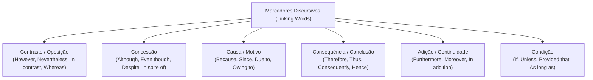
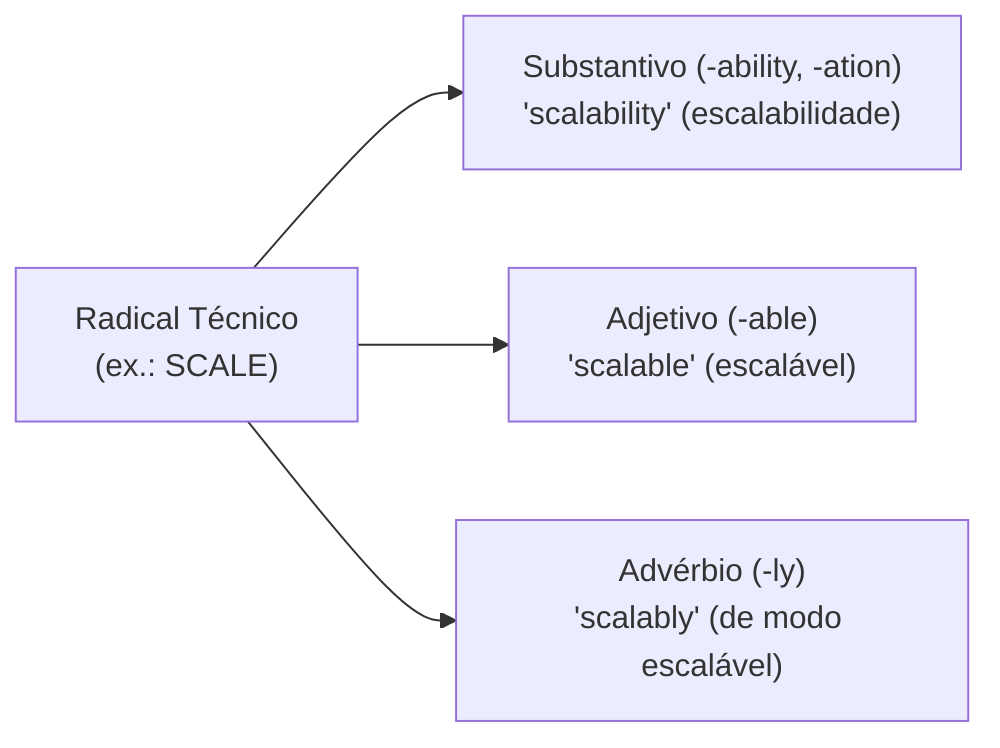
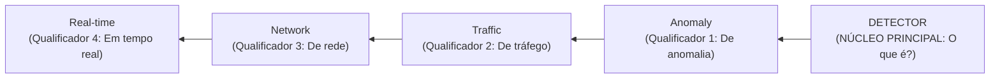

# 02 - Vocabulário Técnico de TI, Coesão e Conectivos

> **Matéria:** Língua Inglesa (Leitura Técnica)  
> **Cargo:** B02 – Técnico de Controle Externo – Especialidade: Tecnologia da Informação  
> **Arquivo:** `02_vocabulario_tecnico_de_ti_e_conjuncoes.md`  

---

## 📌 Ementa / Itens do Edital
- Vocabulário técnico especializado da área de Tecnologia da Informação
- Formação de palavras em inglês (Prefixos, Sufixos e Compostos)
- Marcadores discursivos e conectivos lógicos (Linking Words / Transition Words)
- Relações semânticas de causa, consequência, contraste, concessão, condição e adição

---

## 🌳 Classificação Hierárquica

```text
2. Léxico Técnico de TI, Morfologia e Marcadores de Coesão Lógica
├── 2.1 Conectivos Lógicos e Marcadores Discursivos (Linking Words)
│   ├── 2.1.1 Relação de Contraste e Oposição (Adversidade):
│   │   ├── However, Nevertheless, Nonetheless (No entanto, contudo, todavia)
│   │   ├── On the other hand, In contrast, Conversely (Por outro lado, em contraste)
│   │   └── While, Whereas (Enquanto que, ao passo que)
│   ├── 2.1.2 Relação de Concessão:
│   │   ├── Although, Even though, Though (Embora, ainda que - seguidos de oração completa: Sujeito + Verbo)
│   │   └── Despite, In spite of (Apesar de - seguidos de substantivo ou gerúndio -ing)
│   ├── 2.1.3 Relação de Causa e Explicação:
│   │   ├── Because, Since, As, For (Porque, já que, visto que)
│   │   └── Due to, Owing to, Because of, On account of (Devido a, em razão de - seguidos de substantivo)
│   ├── 2.1.4 Relação de Consequência e Conclusão:
│   │   ├── Therefore, Thus, Hence, Consequently (Portanto, por conseguinte, logo, assim)
│   │   └── As a result, For this reason (Como resultado, por esta razão)
│   ├── 2.1.5 Relação de Adição e Continuidade:
│   │   ├── Furthermore, Moreover, In addition, Additionally, Besides (Além disso, ademais)
│   │   └── Not only... but also... (Não apenas... mas também...)
│   ├── 2.1.6 Relação de Condição:
│   │   ├── If, Unless (A não ser que, a menos que = if... not)
│   │   └── Provided that, As long as (Contanto que, desde que)
│   └── 2.1.7 Relação de Exemplificação e Ênfase:
│       ├── For example, For instance, Such as, Namely (Por exemplo, tais como, a saber)
│       └── Indeed, In fact, Particularly, Especially (De fato, em particular)
├── 2.2 Morfologia e Formação de Palavras Técnicas
│   ├── 2.2.1 Prefixos Técnicos Recorrentes:
│   │   ├── Negação / Oposição: un- (unauthorized), in-/im- (immutable), dis- (disabled), mis- (misconfiguration)
│   │   ├── Relações Temporais/Espaciais: pre- (precondition), post- (postmortem), inter- (interoperability), intra- (intranet)
│   │   └── Escala e Quantidade: micro- (microservices), multi- (multitenant), sub- (subnet)
│   ├── 2.2.2 Sufixos de Classe Gramatical (Word Families):
│   │   ├── Sufixos Formadores de Substantivo: -tion/-sion (authentication), -ment (deployment), -ity (scalability, availability), -ance/-ence (compliance, latency), -er/-or (scheduler, compiler)
│   │   ├── Sufixos Formadores de Adjetivo: -able/-ible (scalable, reliable, feasible), -al (computational), -ive (predictive, recursive)
│   │   └── Sufixos Formadores de Advérbio: -ly (seamlessly, concurrently, asynchronously)
│   └── 2.2.3 Substantivos Compostos (Noun Adjuncts): A regra de ler de trás para frente no inglês (ex.: Cloud Security Threat Assessment -> Avaliação de ameaças de segurança em nuvem)
└── 2.3 Glossário Técnico Essencial por Domínio de TI
    ├── 2.3.1 Arquitetura e Engenharia: Throughput (vazão), Latency (latência), Bottleneck (gargalo), Overhead (custo adicional/sobrecarga), Trade-off (relação de compromisso/escolha), Deprecate (descontinuar/obsoleto), Boilerplate (código padrão repetitivo)
    ├── 2.3.2 Concorrência e Sistemas Operacionais: Deadlock (impasse/travamento mútuo), Thread-safe (seguro para concorrência), Race condition (condição de corrida), Polling (sondagem periódica), Payload (carga útil/dados transmitidos), Spawn (gerar/iniciar processo)
    ├── 2.3.3 Nuvem e Infraestrutura: On-premises (infraestrutura local própria), Failover (comutação automática em falha), Outage (interrupção/queda geral de serviço), Provisioning (provisionamento), Cold start (inicialização a frio)
    └── 2.3.4 Segurança Cibernética: Breach (violação/vazamento), Flaw / Vulnerability (falha/brecha), Patch (correção/remendo), Tamper (adulterar/violar integridade), Spoofing (falsificação de identidade), Bypass (burlar/contornar)
```

---

## 📖 Teoria Aprofundada & Fundamentos Metodológicos

### 2.1 Conectivos Lógicos e Marcadores Discursivos (*Linking Words*)

Os conectivos lógicos (também chamados de *Transition Words*, *Discourse Markers* ou *Connectors*) constituem a espinha dorsal da coerência e coesão textual em língua inglesa. Em provas de TI da FCC, as questões sobre conectivos costumam assumir dois formatos clássicos:
1. **Identificação da Relação Semântica:** A banca indaga se determinado conectivo introduz uma relação de *causa*, *consequência*, *contraste*, *concessão*, *condição* ou *adição*.
2. **Substituição sem Prejuízo de Sentido:** A banca solicita ao candidato qual vocábulo pode substituir o termo destacado mantendo intactos o significado e a correção gramatical da frase.



#### Tabela Canônica de Conectivos e Equivalências Intercambiáveis

| Relação Semântica | Conectivos Canônicos | Estrutura Sintática Requerida | Termos Plenamente Intercambiáveis | Exemplo Técnico em TI |
| :--- | :--- | :--- | :--- | :--- |
| **Contraste / Adversidade** | *However, Nevertheless, Nonetheless* | Seguidos de vírgula ou entre ponto e vírgula; iniciam oração coordenada independente | *However $\leftrightarrow$ Nevertheless $\leftrightarrow$ Nonetheless* | *"The query returned in 5ms; **however**, cache invalidation failed."* |
| **Contraste Direto** | *Whereas, While, On the contrary, In contrast* | Contrastam duas entidades ou estados opostos em paralelo | *Whereas $\leftrightarrow$ While* | *"SQL ensures ACID properties, **whereas** NoSQL prioritizes partition tolerance."* |
| **Concessão (Oração)** | *Although, Even though, Though* | Seguidos de **Oração Completa** com Sujeito e Verbo conjugado | *Although $\leftrightarrow$ Even though $\leftrightarrow$ Though* | *"**Although** the cluster was under heavy load, no packets were dropped."* |
| **Concessão (Sintagma)**| *Despite, In spite of* | Seguidos diretamente de **Substantivo** ou Verbo com terminação **-ing** | *Despite $\leftrightarrow$ In spite of* (NUNCA usar *despite of*) | *"**Despite** the hardware failure, the system sustained high availability."* |
| **Causa (Oração)** | *Because, Since, As, Inasmuch as* | Seguidos de oração subordinada causal com verbo | *Since $\leftrightarrow$ Because $\leftrightarrow$ As* | *"The pod restarted **because** it exceeded its memory limit."* |
| **Causa (Sintagma)** | *Due to, Owing to, Because of, On account of* | Seguidos diretamente de sintagma nominal | *Due to $\leftrightarrow$ Owing to $\leftrightarrow$ Because of* | *"The latency spike occurred **due to** garbage collection pauses."* |
| **Consequência / Conclusão** | *Therefore, Thus, Hence, Consequently, Accordingly* | Seguidos de oração conclusiva que decorre da anterior | *Therefore $\leftrightarrow$ Thus $\leftrightarrow$ Consequently $\leftrightarrow$ Hence* | *"The database was locked; **therefore**, the transaction was aborted."* |
| **Adição / Continuidade** | *Furthermore, Moreover, In addition, Additionally, Besides* | Somam argumentos de mesma orientação argumentativa | *Furthermore $\leftrightarrow$ Moreover $\leftrightarrow$ In addition* | *"The firewall blocks port 22; **moreover**, it logs all brute-force attempts."* |
| **Condição Negativa** | *Unless* | Equivale logicamente a **if... not** (a não ser que, a menos que) | *Unless $\equiv$ Except if $\equiv$ If not* | *"The commit will not proceed **unless** the pipeline tests pass."* |
| **Condição Positiva** | *Provided that, Providing that, As long as* | Condição necessária/suficiente (contanto que, desde que) | *Provided that $\leftrightarrow$ As long as $\leftrightarrow$ On condition that* | *"The API accepts requests **provided that** a valid JWT is supplied."* |

---

### 2.2 Morfologia e Formação de Palavras Técnicas (*Word Formation*)

A compreensão da estrutura morfológica da língua inglesa permite que o candidato deduza a função sintática e o significado exato de milhares de palavras técnicas a partir de suas raízes, prefixos e sufixos.

#### 1. Prefixos de Negação e Alteração de Estado em TI
- **un-** (*inversão / desfazimento / ausência*): *unauthorized* (não autorizado), *unmanaged* (não gerenciado), *unencrypted* (não criptografado), *unresponsive* (sem resposta).
- **in- / im- / il- / ir-** (*negação estrita*): *immutable* (imutável - fundamental em containers e blockchains), *inaccessible* (inacessível), *irregular* (irregular).
- **dis-** (*separação / privação / desativação*): *disabled* (desativado), *disconnected* (desconectado), *disaster* (desastre).
- **mis-** (*execução errônea ou incorreta*): *misconfiguration* (configuração incorreta / falha de configuração), *misuse* (mau uso), *misleading* (enganoso).
- **de-** (*reversão / remoção*): *decrypt* (descriptografar), *deprecate* (descontinuar), *decouple* (desacoplar), *decommission* (descomissionar/desativar).

#### 2. Sufixos e Classes Gramaticais (*Word Families*)
A FCC frequentemente explora se o candidato distingue um substantivo de um adjetivo ou advérbio. Observe as terminações canônicas:



- **Sufixos de Substantivo:**
  - *-ity / -ness:* Indicam estado ou qualidade (*scalability, availability, elasticity, robustness, darkness*).
  - *-tion / -sion:* Indicam ação ou resultado do processo (*authentication, encryption, replication, compression*).
  - *-ment:* Indicam ação, resultado ou artefato (*deployment, environment, enhancement*).
  - *-ance / -ence:* Indicam propriedade ou medida (*compliance, latency, persistence, tolerance*).
  - *-er / -or:* Indicam o agente que executa a ação, seja software ou humano (*scheduler, compiler, balancer, attacker, developer*).
- **Sufixos de Adjetivo:**
  - *-able / -ible:* Expressam potencialidade, capacidade ou viabilidade (*scalable* = capaz de escalar; *reliable* = confiável; *feasible* = viável; *accessible* = acessível).
  - *-ive:* Expressa característica ativa (*predictive, recursive, preventive, reactive*).
  - *-al:* Expressa pertinência relacional (*computational, operational, transactional, directional*).
- **Sufixos de Advérbio:**
  - *-ly:* Transforma o adjetivo em advérbio de modo (*seamlessly* = perfeitamente/sem interrupção; *concurrently* = concorrentemente; *asynchronously* = assincronamente).

---

### 2.3 Substantivos Compostos e Modificadores Nominais (*Noun Adjuncts*)

Um dos aspectos mais marcantes do inglês técnico de computação é a formação de **expressões nominais complexas (*Compound Nouns / Noun Adjuncts*)**, em que vários substantivos são enfileirados consecutivamente para formar um único conceito.

#### A Regra de Ouro da Leitura Reversa:
Em inglês, o substantivo principal (denominado *head noun*) fica **obrigatoriamente na última posição** da cadeia de palavras. Todos os substantivos que o antecedem funcionam morfossintaticamente como **adjetivos qualificadores**, definindo o tipo, a finalidade ou a propriedade daquele núcleo.



> ⭐ **IMPORTANTE / REGRA DE OURO:**  
> Para traduzir ou interpretar um composto nominal sem titubear, localize a **última palavra** e leia o composto **da direita para a esquerda**:
> - `Cloud Security Threat Assessment`:
>   1. Localize a última palavra: *Assessment* (Avaliação).
>   2. Mova para a esquerda: de *Threat* (ameaças)...
>   3. ... de *Security* (de segurança)...
>   4. ... em *Cloud* (na nuvem).  
>   $\rightarrow$ **Tradução:** *Avaliação de ameaças à segurança na nuvem*.
> - `High Availability Disaster Recovery Plan`:
>   $\rightarrow$ *Plano* de *Recuperação de Desastres* com *Alta Disponibilidade*.
> - `Zero Downtime Database Migration Strategy`:
>   $\rightarrow$ *Estratégia* de *Migração de Banco de Dados* com *Zero Tempo de Inatividade*.

---

### 2.4 Glossário Técnico Essencial por Domínio da FCC

Para garantir velocidade e segurança na prova, o candidato deve dominar os termos técnicos nucleares catalogados nos quatro domínios a seguir:

#### Domínio 1: Arquitetura e Engenharia de Software
- **Throughput (Vazão / Taxa de Transferência):** Quantidade de dados ou transações processadas com sucesso por unidade de tempo (ex.: requisições por segundo - RPS).
- **Latency (Latência):** O tempo de atraso que uma requisição leva para viajar da origem ao destino e retornar a resposta.
- **Bottleneck (Gargalo / Ponto de Estrangulamento):** O componente ou recurso que restringe e limita o desempenho global de todo o sistema.
- **Overhead (Sobrecarga Computacional / Custo Operacional Adicional):** Recursos extras de processamento, memória ou rede demandados para gerenciar um serviço (não confundir com custo meramente financeiro).
- **Trade-off (Relação de Compromisso / Concessão Mútua):** Dilema de engenharia no qual a melhoria de um atributo exige necessariamente o sacrifício de outro (ex.: consistência estrita vs. baixa latência).
- **Deprecate (Descontinuar / Tornar Obsoleto):** Declarar oficialmente que determinado recurso ou biblioteca de software não deve mais ser utilizado e será removido em versões futuras.
- **Boilerplate (Código Padronizado / Repetitivo):** Seções de código repetitivas necessárias para configurar uma aplicação, mas sem lógica de negócio direta.

#### Domínio 2: Concorrência e Sistemas Operacionais
- **Deadlock (Impasse / Travamento Mútuo):** Situação em que dois ou mais processos concorrentes ficam eternamente bloqueados esperando por recursos retidos uns pelos outros.
- **Race Condition (Condição de Corrida):** Anomalia de concorrência em que o resultado da execução depende da ordem temporal imprevisível em que as threads acessam dados compartilhados.
- **Thread-safe (Seguro para Concorrência):** Código ou estrutura de dados projetada para ser invocada por múltiplas threads simultâneas sem risco de corrupção de memória.
- **Polling (Sondagem Periódica):** Técnica em que o cliente consulta o servidor repetidamente em intervalos fixos para checar se novos eventos ocorreram (oposto a push/webhooks).
- **Payload (Carga Útil):** Os dados reais de negócio transportados em uma mensagem ou pacote, excluindo os cabeçalhos de controle (*headers/metadata*).
- **Spawn (Gerar / Criar Processo Filho):** Ação do sistema operacional de iniciar uma nova thread ou processo a partir de um processo existente.

#### Domínio 3: Computação em Nuvem e Infraestrutura
- **On-premises (Infraestrutura Local / Própria):** Instalações de datacenters físicos mantidas nas dependências da própria organização governamental, em oposição a datacenters na nuvem pública.
- **Failover (Comutação Automática por Falha):** Mecanismo de alta disponibilidade que transfere a carga de trabalho de um servidor primário defeituoso para um secundário íntegro de forma autônoma.
- **Outage (Interrupção de Serviço / Queda Geral):** Período de indisponibilidade no qual um sistema ou infraestrutura fica inacessível aos usuários finais.
- **Provisioning (Provisionamento):** Processo de alocar, configurar e disponibilizar servidores, bancos de dados e regras de rede sob demanda.
- **Cold Start (Inicialização a Frio):** O atraso inicial de latência que ocorre em ambientes *serverless* quando uma função precisa ser instanciada pela primeira vez do zero.

#### Domínio 4: Segurança Cibernética e Auditoria
- **Breach (Violação / Vazamento de Dados):** Incidente de segurança confirmado em que dados confidenciais foram acessados ou exfiltrados por partes não autorizadas.
- **Flaw / Vulnerability (Falha / Vulnerabilidade):** Defeito no projeto ou implementação de software que pode ser explorado por um atacante.
- **Patch (Correção / Atualização de Segurança):** Pacote de software distribuído pelo fabricante para corrigir falhas e fechar brechas de segurança.
- **Tamper / Tampering (Adulteração / Violação de Integridade):** Modificação não autorizada de dados, configurações ou trilhas de log com a intenção de comprometer a integridade do sistema.
- **Spoofing (Falsificação de Identidade):** Técnica em que uma entidade maliciosa mascara sua identidade para se passar por um emissor confiável (ex.: IP spoofing, DNS spoofing).
- **Bypass (Burlar / Contornar):** Ação de contornar um controle de segurança, filtro ou autenticação existente.

---

## ⚠️ Pontos de Atenção (Estilo FCC)

> 🚨 **ALERTA DE PROVA / PEGADINHA FCC:**  
> 1. **"Despite of" NÃO EXISTE em Inglês:** É um erro clássico construído pela banca. Ou se usa **"Despite"** diretamente acompanhado do substantivo (*despite the error*), ou se usa a locução de 3 palavras **"In spite of"** (*in spite of the error*). NUNCA aceite uma alternativa que traga *"despite of"*.  
> 2. **A Dupla Negação com "Unless":** O conectivo *Unless* já embute a negação (*if not*). Quando o enunciado traz *"unless you don't..."*, isso gera uma dupla negação semanticamente confusa que a banca usa para desorientar o candidato.  
> 3. **"Overhead" NÃO é Despesa Financeira em TI:** Em textos de arquitetura de software, *overhead* refere-se à taxa de processamento extra de CPU, tráfego adicional de pacotes de controle ou consumo de memória RAM imposto por determinado protocolo de comunicação (ex.: TLS handshake overhead).

---

## 🌐 Fontes Recomendadas na Internet

- [Gartner Information Technology (IT) Glossary](https://www.gartner.com/en/information-technology/glossary)
  - Glossário enciclopédico oficial da Gartner com definições rigorosas e padronizadas de mais de mil termos técnicos modernos em arquitetura de TI, nuvem, IA e governança.
- [NIST CSRC Glossary - Computer Security Resource Center](https://csrc.nist.gov/glossary)
  - Glossário oficial de termos técnicos de segurança da informação mantido pelo National Institute of Standards and Technology. Referência normativa para definições de *vulnerability*, *threat*, *breach*, *tampering* e *spoofing*.
- [IETF RFC 4949 - Internet Security Glossary, Version 2](https://datatracker.ietf.org/doc/html/rfc4949)
  - Padrão canônico do IETF que formaliza a terminologia internacional de segurança cibernética e redes de computadores.
- [Cambridge Grammar - Linking Words and Discourse Markers](https://dictionary.cambridge.org/grammar/british-grammar/linking-words-and-expressions)
  - Compêndio gramatical britânico de referência para conectivos lógicos de transição discursiva (*linking words*).
- [Oxford Learner's Dictionaries - Academic and Technical Lexicon](https://www.oxfordlearnersdictionaries.com/)
  - Dicionário com Academic Word List (AWL), detalhando formações morfológicas por prefixos e sufixos técnicos.

---

## 📝 Questões Comentadas & Exemplos (Padrão FCC)

### Questão 1 (FCC - Adaptada / Analista de Governança de TI - SEFAZ)
*Consider the sentence extracted from a technical systems architecture evaluation:*

> *"The newly adopted microservices architecture offers superior horizontal scalability; **nevertheless**, it introduces substantial operational **overhead** and network latency. **Therefore**, the development team decided not to migrate the mission-critical core service **unless** rigorous benchmark metrics prove that throughput remains acceptable."*

A respeito dos marcadores discursivos e do vocabulário técnico empregados no trecho, assinale a afirmação correta:

A) A palavra **"nevertheless"** estabelece uma relação semântica de causa e explicação, podendo ser substituída por *"because"* sem alterar o sentido do texto.  
B) O termo **"overhead"** refere-se exclusivamente aos encargos financeiros de licenciamento cobrados pelo fornecedor do software de orquestração.  
C) O conectivo **"Therefore"** expressa conclusão/consequência lógica e pode ser substituído, sem alteração substancial de significado, por *"Consequently"*.  
D) A conjunção **"unless"** introduz uma concessão incondicional, com o mesmo valor sintático e semântico de *"although"*.  
E) A oração iniciada por *"unless rigorous benchmark metrics prove..."* indica que o serviço central será migrado de imediato, independentemente dos testes de vazão.  

> **Gabarito: C**  
>
> **Comentário Analítico Passo a Passo:**  
> - **A (Incorreta):** O conectivo **"Nevertheless"** (no entanto, todavia, contudo, não obstante) é um marcador discursivo de **contraste/adversidade**. Ele introduz um contra-argumento ou restrição à oração anterior, e não uma relação de causa (*because*).  
> - **B (Incorreta):** No domínio de arquitetura de software e sistemas operacionais, o vocábulo **"overhead"** designa a sobrecarga computacional de processamento, consumo adicional de recursos de memória/CPU ou coordenação de rede demandada para operar os microsserviços. Não possui vínculo com taxas financeiras ou royalties de licenciamento.  
> - **C (Correta):** O conectivo **"Therefore"** (portanto, logo, por conseguinte) expressa uma relação semântica de **consequência/conclusão lógica** decorrente do fato anterior. Ele é plenamente intercambiável com **"Consequently"**, **"Thus"** ou **"Hence"**.  
> - **D (Incorreta):** A conjunção **"unless"** expressa uma **condição negativa** (*a menos que*, *a não ser que*, equivalente lógico a *if... not*), e não uma concessão (*although*).  
> - **E (Incorreta):** O enunciado expressa exatamente o oposto: a equipe de desenvolvimento decidiu **NÃO** migrar o serviço crítico a não ser que os testes de benchmark provem que a vazão (*throughput*) permaneça satisfatória. A migração está condicionada ao sucesso métrico.

---

### Questão 2 (FCC - Adaptada / Tribunal de Contas - Auditoria de TI)
Na redação técnica em língua inglesa sobre infraestrutura distribuída e bancos de dados, o enunciado:

> *"Engineers must balance the trade-off between strict consistency and high availability; **in spite of** the replication lag, the distributed database guarantees eventual consistency."*

apresenta a expressão conectiva **"in spite of"**. Assinale a opção que indica a função sintático-semântica de **"in spite of"** e o termo que poderia substituí-la mantendo rigorosamente a correção gramatical e o sentido original:

A) Adição de argumentos; substituível por *"furthermore"*.  
B) Concessão; substituível por *"despite"*.  
C) Finalidade ou propósito; substituível por *"in order to"*.  
D) Causa direta; substituível por *"due to"*.  
E) Condição restritiva; substituível por *"as long as"*.  

> **Gabarito: B**  
>
> **Comentário Analítico Passo a Passo:**  
> - **A (Incorreta):** Conectivos aditivos (*furthermore, moreover*) adicionam novas informações que corroboram a asserção anterior. *"In spite of"* contrapõe uma dificuldade que não impediu o resultado.  
> - **B (Correta):** A locução prepositiva **"in spite of"** (apesar de / a despeito de) possui valor semântico de **concessão** (indica um fato que contraria uma expectativa sem, todavia, impedi-la). Tanto **"in spite of"** quanto **"despite"** são preposições seguidas diretamente por sintagmas nominais (*noun phrases*) ou verbos com *-ing*, constituindo equivalentes perfeitos (*despite the replication lag* = a despeito do atraso de replicação).  
> - **C (Incorreta):** Conectivos de finalidade (*in order to, so as to*) expressam objetivo/intenção e são seguidos por verbos no infinitivo.  
> - **D (Incorreta):** *"Due to"* expressa causalidade (devido a, por causa de). Se substituído, alteraria radicalmente o sentido: afirmaria que a garantia de consistência foi causada pelo atraso, o que é falso.  
> - **E (Incorreta):** *"As long as"* introduz uma oração condicional (contanto que, desde que), exigindo estrutura oracional completa com sujeito e verbo.

---

### Questão 3 (FCC - Adaptada / Analista de Infraestrutura e Redes)
*Read the excerpt from an infrastructure deployment manual:*

> *"To guarantee zero downtime during datacenter updates, our team configured a **fault-tolerant high-availability cluster provisioning system**. The infrastructure operates **seamlessly** across two distinct availability zones, ensuring that failover occurs automatically without dropping active user sessions."*

Com base nas regras de formação de palavras, morfologia e substantivos compostos da língua inglesa, analise os itens:

I. No composto *"fault-tolerant high-availability cluster provisioning system"*, a palavra principal (*head noun*) é *"system"*, e todos os termos precedentes funcionam como modificadores adjetivos.  
II. O vocábulo *"seamlessly"* é um advérbio formado pelo acréscimo do sufixo *-ly* ao adjetivo *"seamless"*, significando de forma integrada, fluida e sem interrupções visíveis.  
III. O termo *"failover"* indica uma falha catastrófica definitiva que exige o desligamento manual de toda a rede elétrica da organização.  

Está correto o que se afirma em:

A) I e II, apenas.  
B) I e III, apenas.  
C) II e III, apenas.  
D) III, apenas.  
E) I, II e III.  

> **Gabarito: A**  
>
> **Comentário Analítico Passo a Passo:**  
> - **Item I (Correto):** Aplicação estrita da regra dos **Noun Adjuncts**: em sequências nominais longas, a última palavra é o substantivo núcleo (*head noun* $\rightarrow$ *system*). A tradução correta, lendo da direita para a esquerda, é: "sistema de provisionamento de cluster de alta disponibilidade tolerante a falhas".  
> - **Item II (Correto):** Análise morfológica precisa: a raiz *seam* (costura) recebe o sufixo privativo *-less* (sem costura / sem emenda), gerando o adjetivo *seamless*. A seguir, recebe o sufixo adverbial *-ly*, originando o advérbio *seamlessly* (de maneira suave, sem interrupção perceptível, fluidamente).  
> - **Item III (Incorreto):** O vocábulo técnico **"failover"** designa exatamente o oposto de desligamento manual catastrófico: trata-se da comutação automática e transparente de um componente em falha para um nó redundante funcional, preservando a disponibilidade do serviço.  
> - Conclusão: Itens I e II corretos; Item III incorreto $\rightarrow$ Alternativa A.

---

### Questão 4 (FCC - Adaptada / Auditor de TI - Fiscalização de Contratos de Nuvem)
*Consider the analytical report below regarding multi-tenant cloud storage:*

> *"Relational engines enforce strict schema validation; **whereas**, document databases store unstructured documents. **Due to** recent compliance audits, administrators had to verify that cryptographic logs were **tamper-proof**. **Furthermore**, the cloud provider agreed to **mitigate** all critical hypervisor flaws discovered during penetration testing."*

A respeito das relações semânticas e do vocabulário técnico empregados no parágrafo, assinale a alternativa correta:

A) A conjunção **"whereas"** expressa uma relação de consequência, podendo ser substituída por *"hence"*.  
B) A locução **"Due to"** expressa concessão e equivale semanticamente a *"in spite of"*.  
C) O termo **"tamper-proof"** indica registros protegidos contra alterações ou adulterações não autorizadas.  
D) O conectivo **"Furthermore"** introduz uma oposição direta à frase antecedente.  
E) O verbo **"mitigate"** significa potencializar e agravar as vulnerabilidades do hipervisor para testes de estresse.  

> **Gabarito: C**  
>
> **Comentário Analítico Passo a Passo:**  
> - **A (Incorreta):** A conjunção **"whereas"** (ao passo que, enquanto que) expressa uma relação de **contraste direto / oposição** entre motores relacionais e bancos de documentos, e não consequência (*hence* / *therefore*).  
> - **B (Incorreta):** **"Due to"** (devido a, em razão de) expressa **causa / motivo**, e não concessão (*in spite of*).  
> - **C (Correta):** O vocábulo técnico **"tamper-proof"** (à prova de adulteração) indica registros imutáveis e auditáveis que não podem ser manipulados, alterados ou corrompidos sem detecção imediata.  
> - **D (Incorreta):** O conectivo **"Furthermore"** (além disso, ademais) introduz uma relação de **adição / continuidade argumentativa**, e não uma oposição direta (*on the other hand / however*).  
> - **E (Incorreta):** O verbo técnico **"mitigate"** significa *mitigar*, *atenuar*, *reduzir a gravidade* ou *remediar* os impactos das falhas identificadas, e não agravá-las ou potencializá-las.

---

### Questão 5 (FCC - Adaptada / Analista Judiciário - TRT - Tecnologia da Informação)
*Carefully read the technical paragraph below regarding concurrent programming:*

> *"When multiple threads concurrently access shared memory without proper synchronization, a hazardous **race condition** may emerge. If two threads enter a circular dependency while competing for exclusive locks, the operating system enters a permanent **deadlock**. To avoid these anomalies, developers can employ immutable data structures, **provided that** the garbage collector can efficiently recycle discarded instances **without** triggering disruptive latency spikes."*

Com base no texto técnico e nas regras gramaticais da língua inglesa, assinale a afirmação correta:

A) A expressão **"race condition"** designa uma rotina otimizada de alta performance em que threads disputam para finalizar tarefas mais rapidamente sem qualquer risco de erro.  
B) O estado denominado **"deadlock"** ocorre quando todas as threads liberam seus locks simultaneamente, acelerando o processamento do banco.  
C) A locução conjuntiva **"provided that"** estabelece uma relação semântica de condição (contanto que / desde que).  
D) No trecho *"without triggering disruptive latency spikes"*, a palavra *"without"* introduz uma finalidade deliberada de elevar a latência.  
E) O termo **"immutable"** é um adjetivo que caracteriza dados que podem ser modificados livremente por qualquer thread concorrente sem restrições.  

> **Gabarito: C**  
>
> **Comentário Analítico Passo a Passo:**  
> - **A (Incorreta):** **"Race condition"** (condição de corrida) não é um mecanismo de otimização, mas sim uma grave falha/anomalia de concorrência onde o resultado do processamento se torna imprevisível e incorreto devido à sincronização inadequada entre threads.  
> - **B (Incorreta):** **"Deadlock"** (impasse mútuo / travamento) é uma falha em que processos ficam paralisados indefinidamente esperando que o outro libere recursos travados, travando o sistema em vez de acelerá-lo.  
> - **C (Correta):** A locução **"provided that"** (contanto que, desde que) introduz uma **oração subordinada condicional**, estabelecendo a premissa sob a qual as estruturas imutáveis são viáveis (o coletor de lixo reciclar instâncias eficientemente).  
> - **D (Incorreta):** A preposição *"without"* é privativa e negativa (sem provocar picos de latência disruptivos), indicando ausência de perturbação e não finalidade de aumentar o tempo de resposta.  
> - **E (Incorreta):** Análise morfológica: o prefixo negativo *im-* anexado a *mutable* indica o exato oposto: dados **imutáveis** são aqueles cujo estado NÃO pode ser alterado após a criação, garantindo que sejam inerentemente *thread-safe*.
