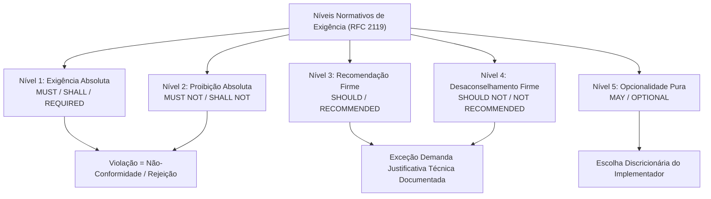
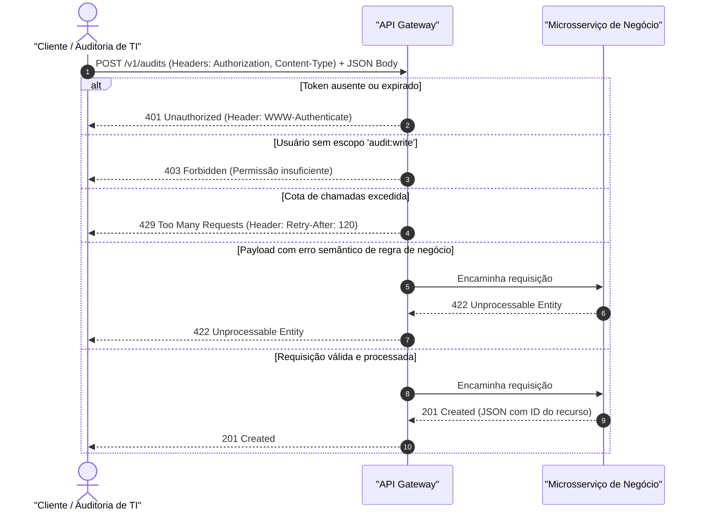
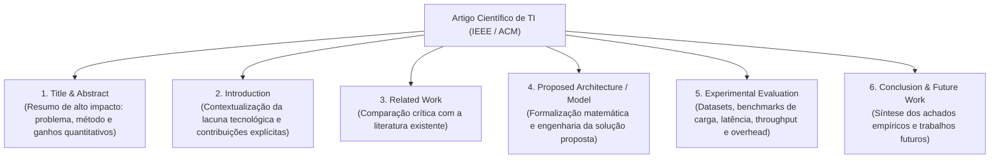

# 03 - Interpretação de Documentação de APIs, Manuais e Artigos

> **Matéria:** Língua Inglesa (Leitura Técnica)  
> **Cargo:** B02 – Técnico de Controle Externo – Especialidade: Tecnologia da Informação  
> **Arquivo:** `03_interpretacao_de_documentacao_de_apis_e_manuais.md`  

---

## 📌 Ementa / Itens do Edital
- Interpretação e leitura de documentações técnicas de APIs (REST, GraphQL)
- Interpretação de manuais de instalação, configuração e guias de software
- Leitura crítica de artigos científicos e papers de tecnologia da informação
- Linguagem prescritiva e advertências técnicas (RFC 2119: MUST, SHOULD, MAY)

---

## 🧭 Sumário

1. [Linguagem Normativa e Prescritiva de Engenharia (RFC 2119 / RFC 8174)](#1-linguagem-normativa-e-prescritiva-de-engenharia-rfc-2119-rfc-8174)
    1. [Os Níveis Normativos Canônicos](#11-os-niveis-normativos-canonicos)
    2. [Matriz de Conformidade Técnica da RFC 2119](#12-matriz-de-conformidade-tecnica-da-rfc-2119)
    3. [Teste 585](#Teste-585)
    4. [Teste 586](#Teste-586)
    5. [Teste 587](#Teste-587)
2. [Interpretação de Documentação de APIs (REST, OpenAPI, Swagger e GraphQL)](#2-interpretacao-de-documentacao-de-apis-rest-openapi-swagger-e-graphql)
    1. [Estrutura de Rotas, Métodos HTTP e Idempotência](#21-estrutura-de-rotas-metodos-http-e-idempotencia)
    2. [Parâmetros de Requisição e Schemas de Dados JSON](#22-parametros-de-requisicao-e-schemas-de-dados-json)
    3. [Códigos de Status HTTP Críticos e Cabeçalhos de Resposta](#23-codigos-de-status-http-criticos-e-cabecalhos-de-resposta)
    4. [Documentação de APIs GraphQL (Queries, Mutations e Types)](#24-documentacao-de-apis-graphql-queries-mutations-e-types)
    5. [Teste 588](#Teste-588)
    6. [Teste 589](#Teste-589)
    7. [Teste 590](#Teste-590)
    8. [Teste 591](#Teste-591)
3. [Interpretação de Manuais Técnicos e Guias de Configuração de Sistemas](#3-interpretacao-de-manuais-tecnicos-e-guias-de-configuracao-de-sistemas)
    1. [Verbos Operacionais no Modo Imperativo](#31-verbos-operacionais-no-modo-imperativo)
    2. [Seções Estruturantes de um Manual de Implantação](#32-secoes-estruturantes-de-um-manual-de-implantacao)
    3. [Categorização e Gravidade das Advertências Técnicas](#33-categorizacao-e-gravidade-das-advertencias-tecnicas)
    4. [Ciclo de Vida: Deprecated vs. Decommissioned](#34-ciclo-de-vida-deprecated-vs-decommissioned)
    5. [Teste 592](#Teste-592)
4. [Leitura Crítica de Artigos Científicos e Papers de TI (IEEE / ACM / ArXiv)](#4-leitura-critica-de-artigos-cientificos-e-papers-de-ti-ieee-acm-arxiv)
    1. [Anatomia Estrutural de um Artigo de Vanguarda](#41-anatomia-estrutural-de-um-artigo-de-vanguarda)
    2. [A Metodologia Three-Pass sob Pressão de Tempo de Prova](#42-a-metodologia-three-pass-sob-pressao-de-tempo-de-prova)
    3. [Léxico de Validação Experimental e Evidências Empíricas](#43-lexico-de-validacao-experimental-e-evidencias-empiricas)
    4. [Teste 593](#Teste-593)
    5. [Teste 594](#Teste-594)
6. [Fontes Recomendadas na Internet](#6-fontes-recomendadas-na-internet)

---

## 1. Linguagem Normativa e Prescritiva de Engenharia (RFC 2119 / RFC 8174)

Nas áreas de engenharia de software, redes de comunicação e governança de tecnologia avaliadas pela Fundação Carlos Chagas (FCC), a leitura de especificações técnicas formais (padrões da IETF, W3C, ISO/IEC e NIST) exige a compreensão rigorosa dos **termos normativos prescritivos grafados em letras maiúsculas**, disciplinados pela clássica **RFC 2119** (e reafirmados pela RFC 8174).

Esses vocábulos não exercem função decorativa ou meramente estilística; constituem **imposições contratuais e técnicas de conformidade estrita**.

### 1.1 Os Níveis Normativos Canônicos

1. **MUST / SHALL / REQUIRED (Obrigatório / Mandatório):** Designam uma exigência absoluta da especificação (*absolute requirement*). O sistema, serviço ou cliente que não implementar ou violar este item é classificado como em **não-conformidade** (*non-compliant*).
2. **MUST NOT / SHALL NOT (Terminantemente Proibido):** Expressam um veto categórico (*absolute prohibition*). A inclusão do comportamento vedado invalida a conformidade da solução perante o padrão internacional.
3. **SHOULD / RECOMMENDED (Fortemente Recomendado):** Indicam que o comportamento prescrito representa a boa prática recomendada. Podem existir razões válidas em circunstâncias particulares para ignorar a diretriz, mas as implicações técnicas de tal desvio devem ser plenamente compreendidas, avaliadas e formalmente documentadas.
4. **SHOULD NOT / NOT RECOMMENDED (Fortemente Desaconselhado):** Expressam que determinada conduta técnica deve ser evitada sob condições normais de operação. Desvios somente são tolerados em situações excepcionais de contorno devidamente motivadas.
5. **MAY / OPTIONAL (Opcional / Facultativo):** Indicam um recurso verdadeiramente opcional (*truly optional*). O implementador detém a faculdade discricionária de incluir ou omitir o atributo sem comprometer a interoperabilidade com outros sistemas que seguem o padrão.

### 1.2 Matriz de Conformidade Técnica da RFC 2119

| Termo em Maiúsculas | Definição Oficial IETF | Significado Prático em Auditoria e TI | O que NÃO Significa (Pegadinha FCC) |
| :--- | :--- | :--- | :--- |
| **MUST** / **SHALL** / **REQUIRED** | Exigência absoluta da especificação. | Mandatório. Ausência implica rejeição e não-conformidade estrita. | NÃO é sugestão, boa prática ou opcionalidade. |
| **MUST NOT** / **SHALL NOT** | Proibição absoluta da especificação. | Proibição expressa. Qualquer execução viola o padrão. | NÃO é mera ressalva dispensável. |
| **SHOULD** / **RECOMMENDED** | Fortemente recomendado com abertura para exceções fundamentadas. | Padrão ouro a ser seguido; desvios exigem justificativa técnica formal. | NÃO é uma imposição cega inegociável, e NÃO é uma opção arbitrária sem critérios. |
| **SHOULD NOT** / **NOT RECOMMENDED** | Desaconselhamento enfático em operação padrão. | Conduta indesejada; implementação aceitável apenas em exceções marginais. | NÃO é um veto absoluto em 100% dos casos marginais. |
| **MAY** / **OPTIONAL** | Funcionalidade totalmente discricionária. | Facultativo. Não gera penalidades de conformidade. | NÃO é uma recomendação preferencial e NÃO é obrigatório. |

> 🚨 **ALERTA DE PROVA / PEGADINHA FCC:**  
> A FCC adora afirmar que o termo **"SHOULD"** impõe um mandamento inegociável sob qualquer pretexto. Trata-se de erro recorrente. A RFC 2119 expressamente ressalva que podem existir cenários peculiares que justifiquem a não observância do *SHOULD*, cabendo ao engenheiro mensurar os impactos (*the full implications must be understood and carefully weighed*).

---

### Teste 585
**(FGV – TRT – Analista Judiciário - Tecnologia da Informação – 2024)**
The word “roughly” in “Over the past roughly 50,000 ye ars” (5 th 
paragraph) indicates a(n)

* **A)** prevalence.
* **B)** estimation.
* **C)** exactness.
* **D)** manner.
* **E)** time.

---

> **Comentário Detalhado:**
>
> - **A)** Incorreta. Discrepa das diretrizes normativas e jurisprudenciais aplicáveis ao tema objeto do item.
> - **B)** Correta. Representa com precisão a disciplina do tema e o entendimento pacificado adotado pela banca (FGV).
> - **C)** Incorreta. Discrepa das diretrizes normativas e jurisprudenciais aplicáveis ao tema objeto do item.
> - **D)** Incorreta. Discrepa das diretrizes normativas e jurisprudenciais aplicáveis ao tema objeto do item.
> - **E)** Incorreta. Discrepa das diretrizes normativas e jurisprudenciais aplicáveis ao tema objeto do item.
>
> **Gabarito: B**

---
### Teste 586
**(FGV – TRT – Analista Judiciário - Tecnologia da Informação – 2024)**
The opposite of “the smartest” (4th paragraph) is

* **A)** the least naïve.
* **B)** the most clever.
* **C)** the most stupid.
* **D)** the least foolish.
* **E)** the most sensible.

---

> **Comentário Detalhado:**
>
> - **A)** Incorreta. Discrepa das diretrizes normativas e jurisprudenciais aplicáveis ao tema objeto do item.
> - **B)** Incorreta. Discrepa das diretrizes normativas e jurisprudenciais aplicáveis ao tema objeto do item.
> - **C)** Correta. Representa com precisão a disciplina do tema e o entendimento pacificado adotado pela banca (FGV).
> - **D)** Incorreta. Discrepa das diretrizes normativas e jurisprudenciais aplicáveis ao tema objeto do item.
> - **E)** Incorreta. Discrepa das diretrizes normativas e jurisprudenciais aplicáveis ao tema objeto do item.
>
> **Gabarito: C**

---
### Teste 587
**(FGV – TRT – Analista Judiciário - Tecnologia da Informação – 2024)**
In the second paragraph, “on the flip side” means

* **A)** on purpose.
* **B)** on principle.
* **C)** on behalf of.
* **D)** on no account.
* **E)** on the other hand.

---

> **Comentário Detalhado:**
>
> - **A)** Incorreta. Discrepa das diretrizes normativas e jurisprudenciais aplicáveis ao tema objeto do item.
> - **B)** Incorreta. Discrepa das diretrizes normativas e jurisprudenciais aplicáveis ao tema objeto do item.
> - **C)** Incorreta. Discrepa das diretrizes normativas e jurisprudenciais aplicáveis ao tema objeto do item.
> - **D)** Incorreta. Discrepa das diretrizes normativas e jurisprudenciais aplicáveis ao tema objeto do item.
> - **E)** Correta. Representa com precisão a disciplina do tema e o entendimento pacificado adotado pela banca (FGV).
>
> **Gabarito: E**

---
## 2. Interpretação de Documentação de APIs (REST, OpenAPI, Swagger e GraphQL)

A análise de contratos de interface entre sistemas constitui atividade primordial tanto no desenvolvimento quanto na auditoria de dados fiscais e orçamentários.

### 2.1 Estrutura de Rotas, Métodos HTTP e Idempotência

O design RESTful organiza as interações por meio de URIs de recursos e verbos padronizados pelo protocolo HTTP:

- **GET:** Recupera a representação de um recurso. Operação **segura** (não altera o estado no servidor) e **idempotente** (múltiplas chamadas idênticas produzem o mesmo efeito de uma única chamada).
- **POST:** Submete dados para criação de novo recurso ou processamento interno. Operação **não-segura** e **não-idempotente** (cada envio gera uma nova entidade ou cobrança).
- **PUT:** Substitui integralmente o recurso existente na URI especificada. Operação **idempotente**.
- **PATCH:** Aplica modificações parciais a atributos pontuais do recurso.
- **DELETE:** Remove o recurso indicado. Operação **idempotente** (a exclusão de um recurso já excluído mantém o estado de recurso ausente).

### 2.2 Parâmetros de Requisição e Schemas de Dados JSON

Nas especificações OpenAPI 3.0 / Swagger, os parâmetros distribuem-se em quatro categorias fundamentais:

- **Path Parameters (`/taxpayers/{id}`):** Integram a hierarquia da URL e identificam instâncias unívocas de recursos. São invariavelmente obrigatórios.
- **Query Parameters (`?fiscal_year=2026&status=audited&limit=50&offset=100`):** Utilizados para filtragem, ordenação (*sorting*) e paginação de coleções.
- **Header Parameters:** Transportam metadados essenciais de rede e segurança:
    - `Authorization: Bearer <token_jwt>`: Credencial criptográfica de autenticação.
    - `Content-Type: application/json`: Informa a codificação do payload transmitido.
    - `Accept: application/json`: Comunica o formato que o cliente está apto a receber.
- **Request Body (Corpo da Requisição / Payload):** Estrutura hierárquica contendo os campos de dados:
    - `required: true`: Sinaliza que o bloco ou os campos listados no array `required:` são indispensáveis. A omissão acarreta rejeição da mensagem.
    - `properties`: Mapeia cada atributo com suas restrições de validação (`type: string`, `pattern: '^\d{14}$'`, `minimum: 0.0`).

### 2.3 Códigos de Status HTTP Críticos e Cabeçalhos de Resposta

A compreensão precisa das famílias de códigos de status HTTP é intensamente avaliada em provas:

- **Família 2xx (Success):**
    - `200 OK`: Requisição bem-sucedida com retorno de dados.
    - `201 Created`: Criação bem-sucedida de um novo recurso no servidor (resposta clássica a `POST`).
    - `204 No Content`: Ação processada com êxito, sem corpo textual de retorno (comum em `DELETE`).
- **Família 4xx (Client Error - Erros Originados no Cliente):**
    - `400 Bad Request`: Erro de sintaxe da requisição (JSON malformado, quebra de delimitadores, tipos primitivos ilegíveis).
    - `401 Unauthorized`: Falha de **autenticação**. O cliente não forneceu credenciais válidas ou o token expirou.
    - `403 Forbidden`: O cliente está autenticado com sucesso, mas suas permissões/papéis (*roles*) **não autorizam** o acesso à rota solicitada.
    - `404 Not Found`: A URI solicitada não corresponde a nenhum recurso existente.
    - `409 Conflict`: Conflito com o estado atual do recurso (ex.: tentativa de cadastrar registro com chave primária já existente).
    - `422 Unprocessable Entity`: A sintaxe do JSON está impecável, mas os dados contêm **erros semânticos ou violações de regras de negócio** (ex.: valor negativo em receita declarada, CPF com dígitos verificadores inválidos).
    - `429 Too Many Requests`: Limite de taxa de requisições excedido (*rate limiting / throttling*). Vem associado ao cabeçalho `Retry-After: <segundos>`, que estipula o tempo de espera obrigatório antes de nova tentativa.
- **Família 5xx (Server Error - Falhas Internas do Provedor):**
    - `500 Internal Server Error`: Exceção inesperada não tratada pela aplicação.
    - `502 Bad Gateway`: O proxy reverso ou gateway recebeu resposta corrompida do microsserviço de backend.
    - `503 Service Unavailable`: Servidor temporariamente incapacitado por sobrecarga ou manutenção programada.
    - `504 Gateway Timeout`: O gateway expirou aguardando a resposta do serviço interno.

> 💡 **Diferença Crítica FCC (401 vs. 403):**  
>
> - **401 Unauthorized** $\rightarrow$ *Quem é você?* (Problema de Identidade / Autenticação).  
> - **403 Forbidden** $\rightarrow$ *Eu sei quem você é, mas você não tem permissão para entrar aqui.* (Problema de Privilégio / Autorização).

### 2.4 Documentação de APIs GraphQL (Queries, Mutations e Types)

Diferentemente do padrão REST, no qual cada recurso ocupa uma URI distinta, o padrão GraphQL opera via endpoint único (`POST /graphql`). A documentação orienta-se por esquemas de tipagem estrita (*Schema Definition Language - SDL*):

- **Query:** Operação de consulta somente-leitura.
- **Mutation:** Operação de escrita que gera efeitos colaterais de criação, atualização ou remoção.
- **Modifiers de Obrigatoriedade:** O caractere de exclamação `!` ao final do tipo indica campo não-nulo e mandatório (ex.: `id: ID!`, `revenue: Float!`).

---

### Teste 588
**(FGV – TRT – Analista Judiciário - Tecnologia da Informação – 2024)**
Quanto aos métodos de financiamento, é correto afirmar que

* **A)** no método Idade Normal de Entrada, as contribuições são 
calculadas com base na idade do participante no momento da 
adesão ao plano, garantindo que as contribuições sejam 
suficientes para cobrir os benefícios futuros, levando em 
consideração a expectativa de vida e outros fatores atuariais 
relevantes. Com isso, não há exigência de reservas atuariais.
* **B)** o método Crédito Unitário Projetado é utilizado para 
determinar o custo dos benefícios futuros com base nas 
projeções de salários e tempo de serviço dos participantes, 
ajustando as contribuições ao longo do tempo para assegurar 
o equilíbrio financeiro do plano de previdência. Desta forma, 
as contribuições são calculadas com base no serviço 
projetado, mas não no passado.
* **C)** o método Crédito Unitário Projetado difere do método 
Crédito Unitário por considerar os efeitos da projeção da 
inflação futura e, consequentemente, o fator de capacidade.
* **D)** o método Prêmio Nivelado Individual é um método de 
financiamento onde as contribuições são uniformemente 
niveladas ao longo do tempo, independentemente da idade 
ou do tempo de serviço do participante, facilitando a gestão 
do plano de previdência e uma arrecadação mais constante.
* **E)** o método Agregado é um método de financiamento onde as 
contribuições dos participantes são somadas e comparadas 
com os benefícios totais projetados, ajustando -se as 
contribuições ao longo do tempo para manter o equilíbrio 
financeiro do plano, portanto, sem considerar o ativo 
garantidor do plano.

---

> **Comentário Detalhado:**
>
> - **A)** Incorreta. Discrepa das diretrizes normativas e jurisprudenciais aplicáveis ao tema objeto do item.
> - **B)** Incorreta. Discrepa das diretrizes normativas e jurisprudenciais aplicáveis ao tema objeto do item.
> - **C)** Incorreta. Discrepa das diretrizes normativas e jurisprudenciais aplicáveis ao tema objeto do item.
> - **D)** Correta. Representa com precisão a disciplina do tema e o entendimento pacificado adotado pela banca (FGV).
> - **E)** Incorreta. Discrepa das diretrizes normativas e jurisprudenciais aplicáveis ao tema objeto do item.
>
> **Gabarito: D**

---
### Teste 589
**(FGV – TRT – Analista Judiciário - Tecnologia da Informação – 2024)**
Uma bomba se encontra instalada em um local 300 m acima do 
nível do mar (pressão atmosférica de 10 mca) com reservatório 
de sucção abaixo da bomba, a uma altura de 3,0 m. Sabendo que 
a pressão de vapor do fluido é de 0,5 mca (hv) e a perda de carga 
total na linha de sucção é de 1,0 (dprs). 
Assim, o NPSH disponível para essa bomba vale

* **A)** 4,9mca.
* **B)** 5,4mca.
* **C)** 5,9mca.
* **D)** 7,9mca.
* **E)** 10,9mca.

---

> **Comentário Detalhado:**
>
> - **A)** Correta. Representa com precisão a disciplina do tema e o entendimento pacificado adotado pela banca (FGV).
> - **B)** Incorreta. Discrepa das diretrizes normativas e jurisprudenciais aplicáveis ao tema objeto do item.
> - **C)** Incorreta. Discrepa das diretrizes normativas e jurisprudenciais aplicáveis ao tema objeto do item.
> - **D)** Incorreta. Discrepa das diretrizes normativas e jurisprudenciais aplicáveis ao tema objeto do item.
> - **E)** Incorreta. Discrepa das diretrizes normativas e jurisprudenciais aplicáveis ao tema objeto do item.
>
> **Gabarito: A**

---
### Teste 590
**(FGV – TRT-DA 13-REGIÃO – Analista Judiciário - Tecnologia da Informação – 2022)**
Uma aplicação mobile enviou a um gateway de APIs REST várias 
solicitações idênticas em sequência utilizando o método HTTP 
PUT.  
Essas solicitações idênticas r esultaram em nenhuma alteração de 
estado do sistema de backend, a exceção da primeira solicitação 
que atualizou um registro no banco de dados.  
Nesse contexto, é correto afirmar que essa solicitação HTTP é

* **A)** acoplada.
* **B)** balanceada.
* **C)** full-duplex.
* **D)** idempotente.
* **E)** segura.

---

> **Comentário Detalhado:**
>
> - **A)** Correta. Representa com precisão a disciplina do tema e o entendimento pacificado adotado pela banca (FGV).
> - **B)** Incorreta. Discrepa das diretrizes normativas e jurisprudenciais aplicáveis ao tema objeto do item.
> - **C)** Incorreta. Discrepa das diretrizes normativas e jurisprudenciais aplicáveis ao tema objeto do item.
> - **D)** Incorreta. Discrepa das diretrizes normativas e jurisprudenciais aplicáveis ao tema objeto do item.
> - **E)** Incorreta. Discrepa das diretrizes normativas e jurisprudenciais aplicáveis ao tema objeto do item.
>
> **Gabarito: A**

---
### Teste 591
**(FGV – TRT-13 – Analista Judiciário - Tecnologia da Informação – 2022)**
Uma aplicação mobile enviou a um gateway de APIs REST várias 
solicitações idênticas em sequência utilizando o método HTTP 
PUT.  
Essas solicitações idênticas r esultaram em nenhuma alteração de 
estado do sistema de backend, a exceção da primeira solicitação 
que atualizou um registro no banco de dados.  
Nesse contexto, é correto afirmar que essa solicitação HTTP é

* **A)** acoplada.
* **B)** balanceada.
* **C)** full-duplex.
* **D)** idempotente.
* **E)** segura.

---

> **Comentário Detalhado:**
>
> - **A)** Incorreta. Discrepa das diretrizes normativas e jurisprudenciais aplicáveis ao tema objeto do item.
> - **B)** Correta. Representa com precisão a disciplina do tema e o entendimento pacificado adotado pela banca (FGV).
> - **C)** Incorreta. Discrepa das diretrizes normativas e jurisprudenciais aplicáveis ao tema objeto do item.
> - **D)** Incorreta. Discrepa das diretrizes normativas e jurisprudenciais aplicáveis ao tema objeto do item.
> - **E)** Incorreta. Discrepa das diretrizes normativas e jurisprudenciais aplicáveis ao tema objeto do item.
>
> **Gabarito: B**

---
## 3. Interpretação de Manuais Técnicos e Guias de Configuração de Sistemas

Manuais operacionais de infraestrutura (Linux manpages, guias do Kubernetes, PostgreSQL, Docker) empregam linguagem estritamente procedimental e estruturada.

### 3.1 Verbos Operacionais no Modo Imperativo

No manual técnico, instruções diretas abrem as sentenças com o verbo no infinitivo sem "to", expressando comando executivo:

- **Ensure:** *"Ensure that NTP synchronization is active before joining nodes"* $\rightarrow$ *Garanta que* a sincronização de relógio esteja ativa.
- **Provision:** *"Provision persistent storage classes with dynamic allocation"* $\rightarrow$ *Aloque / provisione* classes de armazenamento.
- **Purge / Prune:** *"Prune unreferenced objects to recover disk blocks"* $\rightarrow$ *Expurgue / limpe* objetos não referenciados.
- **Enforce:** *"Enforce least-privilege IAM policies"* $\rightarrow$ *Imponha / faça cumprir* políticas de menor privilégio.
- **Bypass:** *"Do not attempt to bypass input sanitation filters"* $\rightarrow$ *Não tente burlar / contornar* filtros de sanitização.

### 3.2 Seções Estruturantes de um Manual de Implantação

1. **Overview / Architecture:** Visão conceitual e topologia do sistema.
2. **Prerequisites (Pré-requisitos):** Condições mandatórias que devem ser atendidas antes da instalação (versão de kernel, bibliotecas, portas de firewall abertas). O descumprimento impede a instalação.
3. **Installation & Configuration:** Procedimentos passo a passo de implantação.
4. **Troubleshooting (Resolução de Problemas):** Procedimentos de diagnóstico e mitigação de erros comuns.

### 3.3 Categorização e Gravidade das Advertências Técnicas

As caixas de alerta dos manuais de engenharia são padronizadas por nível de risco:

- **Note / Tip (Nota / Dica):** Informação complementar útil ou sugestão de atalho operacional.
- **Important (Importante):** Diretriz de conformidade essencial; sua inobservância causa mau funcionamento do serviço.
- **Caution (Cuidado):** Risco de comportamento inesperado, degradação severa de desempenho ou instabilidade na topologia (ex.: formar clusters com número par de nós, arriscando *split-brain*).
- **Warning (Advertência):** Alerta formal de perda iminente de compatibilidade ou quebra de fluxo operacional.
- **Danger / Fatal (Perigo / Fatalidade):** Risco crítico de perda irreversível de dados, danos físicos ao hardware ou colapso total de segurança cibernética.

### 3.4 Ciclo de Vida: Deprecated vs. Decommissioned

A correta interpretação do ciclo de vida de componentes de software é essencial para a gestão e auditoria de TI:

- **Deprecated (Descontinuado / Tornado Obsoleto):** O método, protocolo ou versão **continua plenamente funcional** na versão em execução do software. Contudo, o fabricante adverte formalmente que o recurso não receberá novas funcionalidades nem suporte futuro, estando com remoção agendada. Não deve ser empregado em novos projetos.
- **Decommissioned / Removed (Descomissionado / Removido):** O recurso foi definitivamente excluído da base de código. Qualquer invocação resultará em erro imediato de método inexistente (`404` ou `410 Gone`).

---

### Teste 592
**(FGV – TJ-BA – Analista Judiciário - Tecnologia da Informação – 2015)**
Uma determinada agência reguladora disponibiliza um schema 
para validação de mensagens XML que estabelece, entre outras 
coisas, os tipos simples tais como datas, códigos de serviços, etc. 
Um desses tipos deve admitir apenas strings contendo de 1 a 5 
caracteres, formadas pelas letras OLMVDIP. A definição correta 
para essa restrição de valor é:

* **A)** <restriction base="substring"> 
    <pattern value="OLMVDIP” size=5/> 
<restriction>
* **B)** <restriction base="string"> 
    <pattern value="[OLMVDIP]{1,5}"/> 
<restriction>
* **C)** <restriction base="string"> 
    <pattern 
     value="[O][L][M][V][D][I][P]1,5"/> 
<restriction>
* **D)** <restriction base="string"> 
    <pattern value= 
     substring of "OLMVDIP"/> 
<restriction>
* **E)** <restriction base="substring"> 
    <pattern value="OLMVDIP” 1 to 5"/> 
<restriction>

---

> **Comentário Detalhado:**
>
> - **A)** Incorreta. Discrepa das diretrizes normativas e jurisprudenciais aplicáveis ao tema objeto do item.
> - **B)** Incorreta. Discrepa das diretrizes normativas e jurisprudenciais aplicáveis ao tema objeto do item.
> - **C)** Incorreta. Discrepa das diretrizes normativas e jurisprudenciais aplicáveis ao tema objeto do item.
> - **D)** Incorreta. Discrepa das diretrizes normativas e jurisprudenciais aplicáveis ao tema objeto do item.
> - **E)** Correta. Representa com precisão a disciplina do tema e o entendimento pacificado adotado pela banca (FGV).
>
> **Gabarito: E**

---
## 4. Leitura Crítica de Artigos Científicos e Papers de TI (IEEE / ACM / ArXiv)

Em certames da FCC para cargos de alta remuneração de Tecnologia da Informação, os textos de prova costumam ser extraídos de publicações acadêmicas e anais de conferências de renome mundial (como *IEEE Transactions on Software Engineering, ACM SIGMOD, USENIX OSDI*).

### 4.1 Anatomia Estrutural de um Artigo de Vanguarda

1. **Title & Abstract:** O núcleo de maior densidade do paper. Sintetiza a motivação central, a fraqueza das abordagens tradicionais, a solução inovadora formulada e os ganhos numéricos consolidados (ex.: redução de latência em 42%).
2. **Introduction:** Expõe a relevância do problema e lista textualmente as contribuições primárias do trabalho (*"In this paper, our main contributions are.."*).
3. **Related Work:** Confronta a solução com trabalhos anteriores (*prior art*).
4. **Proposed Architecture / Algorithm:** Detalhamento da arquitetura técnica ou algoritmo implementado.
5. **Experimental Evaluation & Discussion:** Apresentação rigorosa das métricas de desempenho sob carga de trabalho corporativa real (*enterprise workloads*).
6. **Threats to Validity:** Reconhecimento das premissas e limitações do estudo.
7. **Conclusion:** Recapitulação das deduções finais.

### 4.2 A Metodologia Three-Pass sob Pressão de Tempo de Prova

Conforme preconizado pelo Prof. S. Keshav, a leitura de papers em ambientes de prova deve ser estratificada em camadas:

- **Passada 1 (Abordagem Panorâmica - 3 a 5 minutos):** Leitura concentrada do título, do *Abstract*, da introdução preliminar e da conclusão final. Essa varredura inicial responde com clareza:
    - Qual o problema central atacado pelo autor?
    - A tecnologia proposta substitui ou aprimora os modelos vigentes?
    - O tom é de refutação ou de proposição de nova técnica?
- **Passada 2 (Varredura Analítica para Itens Específicos):** Inspeção de figuras de arquitetura, gráficos de desempenho e tabelas comparativas.

### 4.3 Léxico de Validação Experimental e Evidências Empíricas

- **Benchmark / Workload:** Carga de trabalho de teste executada para aferir limites operacionais de um sistema.
- **Tail Latency (Latência de Cauda - P99 / P99.9):** O tempo de resposta experimentado pelos percentis mais lentos das requisições; indicador crítico em sistemas de tempo real.
- **Overhead:** Custo operacional computacional marginal incorrido em ciclos de CPU, memória RAM ou rede para suportar a nova ferramenta (ex.: menos de 3% de consumo extra de CPU).
- **Outperform:** Superar o desempenho de uma solução concorrente (*"Our model outperforms traditional heuristics"*).

---

### Teste 593
**(FGV – TJ-RR – Analista Judiciário - Suporte e Infraestrutura de TI – 2024)**
Assinale a frase a seguir em que a comparação realizada não aparece 
explicada, como nas demais frases.

* **A)** A vida é como um balão: quando nos deparamos com ventos 
fortes, a solução não é lutar contra eles, mas procurar novas 
altitudes, novos ventos que levem na direção certa.
* **B)** A vida é como um jogo de cartas. A mão que as distribui 
representa determinismo. A forma como você joga é o livre 
arbítrio.
* **C)** A vida é como um cobertor curto. Se você puxa para cima, seus 
dedos ficam descobertos, se você cobre os  pés, descobre seus 
ombros.
* **D)** A vida é como uma grande tela: jogue toda a tinta que puder e 
aproveite cada espaço para fazer bons quadros, dando bons 
exemplos.
* **E)** O jogo da vida é como o jogo de bumerangue. Nossos 
pensamentos, realizações e palavras voltam para nós mais cedo 
ou mais tarde, com uma precisão impressionante.

---

> **Comentário Detalhado:**
>
> - **A)** Incorreta. Discrepa das diretrizes normativas e jurisprudenciais aplicáveis ao tema objeto do item.
> - **B)** Incorreta. Discrepa das diretrizes normativas e jurisprudenciais aplicáveis ao tema objeto do item.
> - **C)** Correta. Representa com precisão a disciplina do tema e o entendimento pacificado adotado pela banca (FGV).
> - **D)** Incorreta. Discrepa das diretrizes normativas e jurisprudenciais aplicáveis ao tema objeto do item.
> - **E)** Incorreta. Discrepa das diretrizes normativas e jurisprudenciais aplicáveis ao tema objeto do item.
>
> **Gabarito: C**

---
### Teste 594
**(FGV – TJ-RR – Analista Judiciário - Governança e Gestão de TI – 2024)**
Assinale a frase a seguir em que a comparação realizada não aparece 
explicada, como nas demais frases.

* **A)** A vida é como um balão: quando nos deparamos com ventos 
fortes, a solução não é lutar contra eles, mas procurar novas 
altitudes, novos ventos que levem na direção certa.
* **B)** A vida é como um jogo de cartas. A mão que as distribui 
representa determinismo. A forma como você joga é o livre 
arbítrio.
* **C)** A vida é como um cobertor curto. Se você puxa para cima, seus 
dedos ficam descobertos, se você cobre os  pés, descobre seus 
ombros.
* **D)** A vida é como uma grande tela: jogue toda a tinta que puder e 
aproveite cada espaço para fazer bons quadros, dando bons 
exemplos.
* **E)** O jogo da vida é como o jogo de bumerangue. Nossos 
pensamentos, realizações e palavras voltam para nós mais cedo 
ou mais tarde, com uma precisão impressionante.

---

> **Comentário Detalhado:**
>
> - **A)** Incorreta. Discrepa das diretrizes normativas e jurisprudenciais aplicáveis ao tema objeto do item.
> - **B)** Incorreta. Discrepa das diretrizes normativas e jurisprudenciais aplicáveis ao tema objeto do item.
> - **C)** Correta. Representa com precisão a disciplina do tema e o entendimento pacificado adotado pela banca (FGV).
> - **D)** Incorreta. Discrepa das diretrizes normativas e jurisprudenciais aplicáveis ao tema objeto do item.
> - **E)** Incorreta. Discrepa das diretrizes normativas e jurisprudenciais aplicáveis ao tema objeto do item.
>
> **Gabarito: C**

---
## 6. Fontes Recomendadas na Internet

* [OpenAPI Specification 3.1.0 Official Documentation](https://spec.openapis.org/oas/v3.1.0) - Padrão de especificação formal em inglês para modelagem e consumo de interfaces RESTful.
* [IETF RFC 9110 - HTTP Semantics and Status Codes](https://datatracker.ietf.org/doc/html/rfc9110) - Norma de referência global em inglês para semântica de métodos, cabeçalhos e respostas de APIs na Web.
* [Docker Official Documentation - Dockerfile Reference (English)](https://docs.docker.com/reference/dockerfile/) - Manual técnico oficial para interpretação de comandos, sintaxe declarativa e boas práticas de containers.
* [Kubernetes Official Concepts - Pods and Workloads (English)](https://kubernetes.io/docs/concepts/workloads/pods/) - Documentação técnica primária em inglês para interpretação de especificações YAML e orquestração de microsserviços.
* [Google Technical Writing Courses - Organizing Complex Documents](https://developers.google.com/tech-writing/two) - Melhores práticas para leitura crítica e estruturação de manuais técnicos de arquitetura e APIs.
* SWALES, John M.; FEAK, Christine B. **Academic Writing for Graduate Students: Essential Tasks and Skills**. 3. ed. Ann Arbor: University of Michigan Press, 2012. (Unit 3 - Reading and Writing Technical Instructions).
* GLENDINNING, Eric H.; MCEWAN, John. **Oxford English for Information Technology**. 2. ed. Oxford: Oxford University Press, 2006. (Units 20 to 25 - Reading Technical Manuals and System Specifications).
* HEWINGS, Martin. **Advanced Grammar in Use**. 3. ed. Cambridge: Cambridge University Press, 2013. (Units 80 to 85 - Complex Sentences and Technical Documentation Structures).
