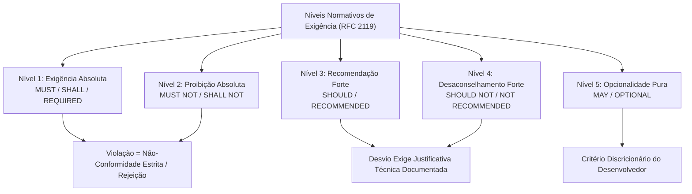
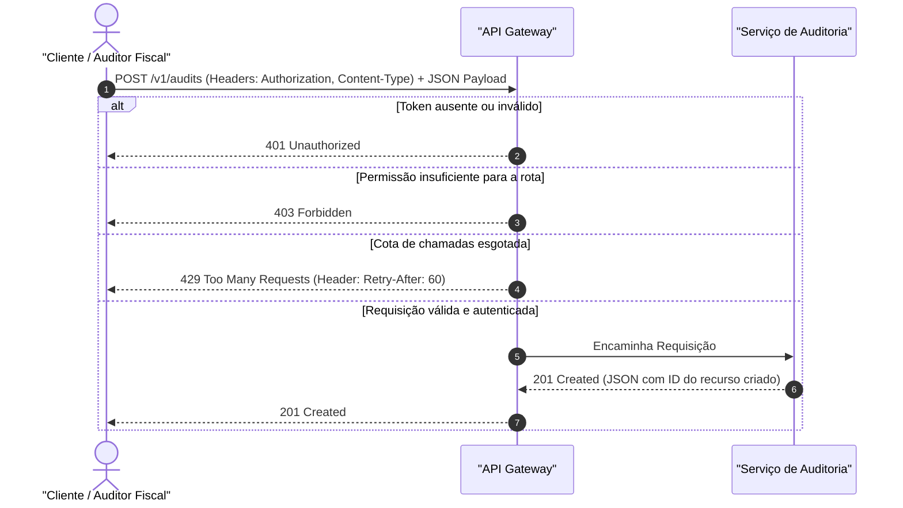

# 03 - Interpretação de Documentação de APIs, Manuais e Artigos

> **Matéria:** Língua Inglesa (Leitura Técnica)  
> **Cargo:** B02 – Técnico de Controle Externo – Especialidade: Tecnologia da Informação  
> **Arquivo:** `03_interpretacao_de_documentacao_de_apis_e_manuais.md`  

---

## 📌 Ementa / Itens do Edital
- Interpretação e leitura de documentações técnicas de APIs (REST, GraphQL)
- Interpretação de manuais de instalação, configuração e guias de software
- Leitura crítica de artigos científicos e papers de tecnologia da informação
- Linguagem prescritiva e advertências técnicas (RFC 2119: MUST, SHOULD, MAY)

---

## 🌳 Classificação Hierárquica

```text
3. Interpretação Aplicada de Documentações de Software, APIs e Artigos Científicos
├── 3.1 Interpretação de Documentação de APIs em Inglês
│   ├── 3.1.1 Estrutura de Documentações de API (Swagger, OpenAPI, Redoc, Postman):
│   │   ├── Visão Geral (Overview): Autenticação requerida (Bearer Token, API Key nos cabeçalhos Authorization: Bearer <token>)
│   │   ├── Endpoints e Métodos: GET /api/v1/audits, POST /api/v1/reports
│   │   ├── Parâmetros de Requisição:
│   │   │   ├── Path Parameters (/users/{id})
│   │   │   ├── Query Parameters (?page=1&limit=20&sort=desc)
│   │   │   └── Request Body / Payload (estruturas JSON com chaves e tipos esperados)
│   │   └── Respostas e Códigos HTTP: Status 200 OK, 401 Unauthorized, 404 Not Found, 429 Too Many Requests (Rate Limiting)
│   ├── 3.1.2 Leitura de Esquemas de Dados (Data Schemas): Tipos primitivos, campos obrigatórios (required), opcionais (nullable/optional) e restrições de validação
│   └── 3.1.3 Padrões de Paginação e Mensagens de Erro Estruturadas (Error Handling Objects: error, code, message, details)
├── 3.2 Interpretação de Manuais Técnicos, Manpages e Guias de Configuração
│   ├── 3.2.1 Linguagem Normativa e Níveis de Exigência (RFC 2119 - Padrão IETF):
│   │   ├── MUST / REQUIRED / SHALL: Exigência absoluta, mandatório, obrigatório
│   │   ├── MUST NOT / SHALL NOT: Proibição absoluta
│   │   ├── SHOULD / RECOMMENDED: Fortemente recomendado; pode haver razões válidas para ignorar em circunstâncias específicas, mas com cautela
│   │   ├── SHOULD NOT / NOT RECOMMENDED: Fortemente desaconselhado
│   │   └── MAY / OPTIONAL: Verdadeiramente opcional; a escolha fica a critério do implementador
│   ├── 3.2.2 Modos Verbais Imperativos e Instruções Passo a Passo:
│   │   ├── Verbos Operacionais: Ensure (garanta que), Verify (verifique), Deploy (implante), Provision (provisione), Fetch (busque), Trigger (dispare)
│   │   └── Seções Críticas: Prerequisites (pré-requisitos), Installation (instalação), Usage (uso), Configuration (configuração), Troubleshooting (resolução de problemas)
│   └── 3.2.3 Seções de Alerta e Ressalvas:
│       ├── Note: Informação complementar útil
│       ├── Important: Requisito operacional essencial
│       ├── Caution / Warning: Risco de comportamento inesperado ou quebra de serviço
│       ├── Danger: Risco iminente de perda irreversível de dados ou falha catastrófica
│       └── Deprecated: Funcionalidade antiga que será removida em versões futuras
└── 3.3 Interpretação de Artigos Científicos e Papers de TI (IEEE / ACM / ArXiv)
    ├── 3.3.1 Estrutura Canônica de um Artigo Científico:
    │   ├── Title e Abstract: Resumo executivo contendo o problema, a proposta, a metodologia e os principais resultados quantitativos
    │   ├── Introduction: Contextualização da área, lacuna de pesquisa e contribuições explícitas do trabalho
    │   ├── Related Work: Estado da arte e comparação com abordagens existentes
    │   ├── Proposed Method / Architecture: Detalhamento do algoritmo, modelo ou arquitetura de software proposta
    │   ├── Experimental Setup & Results: Conjunto de dados (datasets), métricas (acurácia, latência, throughput) e gráficos de desempenho
    │   └── Conclusion & Future Work: Conclusões do estudo e próximos passos de pesquisa
    ├── 3.3.2 Linguagem Acadêmica em Inglês: Expressões de contraste de hipóteses ("Our findings demonstrate that...", "In contrast to previous work, our approach outperforms...")
    └── 3.3.3 Interpretação Rápida sob Pressão de Tempo em Prova: Focar no Abstract e nas conclusões para responder às questões conceituais
```

---

## 📖 Teoria Aprofundada & Fundamentos Metodológicos

### 3.1 Linguagem Normativa de Especificações de Engenharia (RFC 2119 / RFC 8174)

Nas áreas de redes de computadores, protocolos de internet e engenharia de software da FCC, a interpretação de padrões técnicos (como RFCs da IETF, especificações da W3C, ISO e NIST) exige domínio absoluto dos **termos normativos em letras maiúsculas** definidos formalmente pela **RFC 2119** (complementada pela RFC 8174).

Essas palavras não são meras escolhas estilísticas; elas possuem **valor jurídico e normativo estrito de conformidade técnica**:



#### Tabela Normativa da RFC 2119 para Concursos Públicos

| Termo em Maiúsculas | Definição Oficial IETF | Significado Prático em Auditoria e TI | O que NÃO Significa (Pegadinha FCC) |
| :--- | :--- | :--- | :--- |
| **MUST** / **SHALL** / **REQUIRED** | Exigência absoluta da especificação (*absolute requirement*). | **Obrigatório / Mandatório**. O software ou hardware que não atender a este item está em **não-conformidade** (*non-compliant*). | NÃO é opcional, recomendável ou preferencial. |
| **MUST NOT** / **SHALL NOT** | Proibição absoluta da especificação (*absolute prohibition*). | **Terminantemente proibido**. A inclusão ou aceitação desse recurso invalida o sistema perante o padrão. | NÃO é um mero conselho; é veto técnico irrevogável. |
| **SHOULD** / **RECOMMENDED** | Há razões válidas em circunstâncias particulares para ignorar, mas as implicações devem ser ponderadas. | **Fortemente recomendado / Boa prática**. Seguir é o padrão; desviar é permitido apenas com justificativa técnica sólida documentada. | NÃO é uma obrigação cega inegociável; mas também NÃO é uma opção arbitrária sem critérios. |
| **SHOULD NOT** / **NOT RECOMMENDED** | Há razões particulares válidas sob as quais o comportamento é aceitável, mas as implicações devem ser compreendidas. | **Fortemente desaconselhado**. Não deve ser feito em condições normais de operação. | NÃO é uma proibição irrestrita em 100% dos casos marginais. |
| **MAY** / **OPTIONAL** | O item é verdadeiramente opcional (*truly optional*). | **Facultativo / Discricionário**. O implementador tem total liberdade de incluir ou omitir o recurso sem violar a interoperabilidade. | NÃO é uma recomendação preferencial e NÃO é obrigatório. |

---

### 3.2 Interpretação de Documentação de APIs (REST, OpenAPI e JSON Schemas)

A leitura de documentações modernas de APIs públicas ou de controle fiscal (especificadas em formatos como OpenAPI / Swagger / Postman) é um dos tópicos mais cobrados em provas práticas e objetivas de TI da FCC.



#### 1. Anatomia de uma Requisição REST
- **Métodos HTTP (HTTP Verbs):**
  - `GET`: Recuperação segura e idempotente de recursos.
  - `POST`: Criação de novo recurso ou disparo de processamento no servidor (não-idempotente).
  - `PUT`: Substituição completa do recurso identificado pela URI (idempotente).
  - `PATCH`: Atualização parcial de atributos específicos de um recurso.
  - `DELETE`: Remoção do recurso identificado (idempotente).
- **Tipos de Parâmetros:**
  - **Path Parameters (`/taxpayers/{id}/declarations`):** Identificam o recurso específico na hierarquia de rotas.
  - **Query Parameters (`?status=pending&limit=50&offset=100`):** Utilizados para filtragem, ordenação (*sorting*) e paginação de coleções.
  - **Header Parameters:** Metadados de controle técnico:
    - `Authorization: Bearer <token>`: Envio de credenciais JWT ou chaves de API.
    - `Content-Type: application/json`: Formato de codificação do corpo enviado.
    - `Accept: application/json`: Formato desejado na resposta pelo cliente.
- **Request Body (Payload):** Bloco de dados JSON enviado no corpo da mensagem.
  - Campos marcados como `required`: Obrigatórios; sua omissão resulta em código de erro `400 Bad Request` ou `422 Unprocessable Entity`.
  - Campos `nullable` ou `optional`: Podem conter valor nulo ou ser omitidos.

#### 2. Códigos de Status HTTP Recorrentes na FCC
- **Família 2xx (Success):**
  - `200 OK`: Requisição atendida com êxito.
  - `201 Created`: Novo recurso criado com sucesso (típico de respostas a `POST`).
  - `204 No Content`: Ação realizada com êxito, porém sem corpo na resposta (típico de `DELETE`).
- **Família 4xx (Client Error):**
  - `400 Bad Request`: Erro de sintaxe na requisição (JSON malformado ou parâmetros inválidos).
  - `401 Unauthorized`: O cliente não se autenticou (ausência ou invalidade do token).
  - `403 Forbidden`: O cliente está autenticado, mas seu perfil de acesso **não possui permissão** para o recurso solicitado.
  - `404 Not Found`: Recurso não localizado na URI indicada.
  - `409 Conflict`: Conflito de estado no recurso (ex.: violação de unicidade de chave).
  - `422 Unprocessable Entity`: A sintaxe do JSON está correta, mas há erros semânticos de validação de negócio nos campos.
  - `429 Too Many Requests`: Limite de chamadas excedido (*rate limiting / throttling*). Vem acompanhado do cabeçalho `Retry-After: <segundos>`.
- **Família 5xx (Server Error):**
  - `500 Internal Server Error`: Falha inesperada não tratada no backend.
  - `502 Bad Gateway`: O servidor proxy/gateway recebeu uma resposta inválida do servidor upstream.
  - `503 Service Unavailable`: Servidor temporariamente sobrecarregado ou em manutenção programada.
  - `504 Gateway Timeout`: O servidor intermediário expirou o tempo limite aguardando o processamento do backend.

---

### 3.3 Interpretação de Manuais Técnicos e Guias de Configuração

Manuais de engenharia de software e guias de implantação em nuvem (como manuais do Kubernetes, Docker, Linux manpages e PostgreSQL) apoiam-se em **verbos operacionais no modo imperativo** e em seções padronizadas de advertência:

#### 1. Verbos Operacionais no Modo Imperativo
No inglês técnico, a frase iniciada diretamente pelo verbo na forma básica expressa um comando de execução direta:
- **Ensure:** *"Ensure that port 443 is open before proceeding"* $\rightarrow$ *Garanta que* a porta 443 esteja aberta antes de prosseguir.
- **Provision:** *"Provision a dedicated persistent volume"* $\rightarrow$ *Provisione / aloque* um volume persistente dedicado.
- **Purge / Prune:** *"Purge unused container images to reclaim disk space"* $\rightarrow$ *Expurgue / limpe* imagens não utilizadas para recuperar espaço em disco.
- **Enforce:** *"Enforce multi-factor authentication across all administrator accounts"* $\rightarrow$ *Faça cumprir / imponha obrigatoriamente* autenticação em dois fatores.
- **Deprecate:** *"Deprecate the legacy v1 endpoint in favor of v2"* $\rightarrow$ *Descontinue / torne obsoleto* o endpoint legado em favor do v2.

#### 2. Classificação de Seções de Alerta em Manuais
- **Note / Tip:** Esclarecimento complementar ou sugestão de melhoria operacional.
- **Important:** Requisito imprescindível de arquitetura; sua negligência causa mau funcionamento.
- **Caution / Warning:** Alerta de risco iminente de instabilidade, quebra de contrato de API ou degradação severa de desempenho.
- **Danger / Fatal:** Risco de perda permanente de dados, corrupção de sistema de arquivos ou comprometimento de segurança cibernética.
- **Deprecated vs. Decommissioned:**
  - *Deprecated (Descontinuado):* O recurso ainda existe e funciona no software, mas o fabricante alerta que ele não receberá mais melhorias e será excluído no futuro.
  - *Decommissioned / Removed (Removido):* O recurso foi apagado definitivamente do código-fonte; qualquer chamada resultará em falha imediata.

---

### 3.4 Leitura Crítica de Artigos Científicos e Papers de TI (IEEE / ACM / ArXiv)

A FCC frequentemente extrai textos para provas de alto nível a partir de artigos de conferências internacionais de computação (como *ACM SIGCOMM, IEEE Transactions on Software Engineering, USENIX*).

#### Estrutura Canônica de um Paper Científico:
1. **Title & Abstract (Resumo):** O parágrafo mais denso do artigo. Apresenta o problema computacional investigado, a limitação dos trabalhos anteriores, a abordagem proposta pelo autor e os resultados quantitativos obtidos (ex.: redução de latência em 35%).
2. **Introduction:** Contextualiza o estado da arte e detalha as contribuições pontuais da pesquisa.
3. **Related Work:** Análise comparativa com a literatura concorrente.
4. **Proposed Architecture / Algorithm:** Especificação matemática e formal da solução desenvolvida.
5. **Experimental Evaluation & Discussion:** Apresentação dos testes empíricos, benchmarks de carga, ambientes de teste e validação estatística.
6. **Threats to Validity:** Reconhecimento honesto das limitações metodológicas e cenários em que o algoritmo não atinge o desempenho ideal.
7. **Conclusion & Future Work:** Síntese dos achados e direcionamentos de pesquisa futura.

#### A Metodologia "Three-Pass" (Prof. S. Keshav):
Sob a pressão de tempo da prova do concurso:
- **Primeira Passada (5 minutos):** Ler cuidadosamente o título, o *Abstract*, a introdução preliminar e a seção de conclusões. Identificar:
  - *Category:* Que tipo de trabalho é este? (uma nova arquitetura, uma medição empírica, uma prova formal?)
  - *Context:* Com quais sistemas existentes ele se relaciona?
  - *Correctness:* As premissas parecem válidas?
  - *Contributions:* Quais são os principais achados do autor?
- **Segunda Passada (se a questão exigir detalhes de scanning):** Examinar figuras, tabelas e legendas de gráficos comparativos.

---

## ⚠️ Pontos de Atenção (Estilo FCC)

> 🚨 **ALERTA DE PROVA / PEGADINHA FCC:**  
> 1. **401 Unauthorized vs. 403 Forbidden:** A FCC adora trocar esses dois conceitos. No `401 Unauthorized`, o problema é de **autenticação** (o cliente não apresentou credenciais válidas ou não se identificou). No `403 Forbidden`, o cliente **está devidamente autenticado**, mas não possui **autorização / privilégio** suficiente para acessar aquele recurso.  
> 2. **O Significado Estrito de "SHOULD" (RFC 2119):** A banca formula assertivas dizendo que uma diretriz iniciada por *"SHOULD"* é uma imposição estrita sem exceções. Isso é incorreto! *"SHOULD"* é uma recomendação firme, admitindo exceções desde que devidamente justificadas pelo engenheiro de software.  
> 3. **"Deprecated" NÃO Significa Removido:** Quando uma documentação técnica classifica uma API ou biblioteca como *deprecated*, ela **ainda funciona** na versão corrente. Significa que ela foi marcada para obsolescência futura e não deve ser empregada em novos projetos.

---

## 🌐 Fontes Recomendadas na Internet

- [IETF RFC 2119 - Key words for use in RFCs to Indicate Requirement Levels](https://datatracker.ietf.org/doc/html/rfc2119)
  - Padrão normativo fundamental do IETF que formaliza a semântica estrita de `MUST`, `MUST NOT`, `REQUIRED`, `SHALL`, `SHOULD`, `SHOULD NOT`, `RECOMMENDED`, `MAY` e `OPTIONAL`.
- [OpenAPI Specification (OAS) 3.1.0 Standard](https://spec.openapis.org/oas/v3.1.0)
  - Especificação oficial da Linux Foundation para documentação agnóstica de serviços web HTTP e APIs RESTful.
- [MDN Web Docs - HTTP Response Status Codes and Headers](https://developer.mozilla.org/en-US/docs/Web/HTTP/Status)
  - Documentação da Mozilla de códigos de status HTTP e cabeçalhos de controle de conexões distribuídas.
- [Prof. S. Keshav (University of Waterloo) - "How to Read a Paper"](http://ccr.sigcomm.org/online/files/p83-keshav.pdf)
  - Artigo publicado no ACM SIGCOMM Computer Communication Review descrevendo a metodologia prática *three-pass* para leitura rápida e crítica de artigos de TI.
- [Kubernetes Official Documentation - Core Concepts](https://kubernetes.io/docs/concepts/)
  - Documentação padrão da Cloud Native Computing Foundation (CNCF) para leitura de especificações declarativas YAML e arquitetura distribuída.

---

## 📝 Questões Comentadas & Exemplos (Padrão FCC)

### Questão 1 (FCC - Adaptada / Analista de Sistemas - Integração de Plataformas)
*Consider the excerpt below from a technical specification draft for a public auditory API:*

> *"Section 4.2 – Authentication and Message Security  
> 1. All incoming client requests **MUST** include a cryptographically signed JSON Web Token (JWT) in the `Authorization` header.  
> 2. The authentication gateway **MUST NOT** accept tokens signed with the deprecated 'none' algorithm.  
> 3. Implementers **SHOULD** configure an asymmetric RSA-256 signature scheme rather than a shared symmetric secret.  
> 4. Clients **MAY** compress the payload using gzip when sending audit records exceeding 100 kilobytes."*

According to the normative definitions established by RFC 2119, it is correct to deduce that:

A) Compressing payloads larger than 100 kilobytes with gzip is an absolute requirement for client implementations.  
B) Servers are strictly permitted to validate tokens signed with the 'none' algorithm in development environments.  
C) Asymmetric RSA-256 signature is a recommended practice, meaning that valid reasons may exist to employ an alternative, but the full implications must be weighed.  
D) Including a cryptographic JWT in the `Authorization` header is an optional feature that can be ignored at the client's discretion.  
E) The term **"SHOULD"** in item 3 implies that asymmetric RSA-256 signature is strictly mandatory and cannot be substituted under any circumstances.  

> **Gabarito: C**  
>
> **Comentário Analítico Passo a Passo:**  
> - **Item 1 (`MUST`):** Trata-se de uma exigência absoluta (*absolute requirement*). Logo, o envio do JWT no cabeçalho `Authorization` é obrigatório, o que invalida a alternativa D (que afirma ser opcional).  
> - **Item 2 (`MUST NOT`):** Proibição absoluta (*absolute prohibition*). O gateway de autenticação é expressamente vetado de aceitar tokens com o algoritmo 'none'. A alternativa B erra ao alegar que o padrão autoriza tal algoritmo em ambientes de desenvolvimento (a regra não abre tal exceção).  
> - **Item 3 (`SHOULD`):** Pela definição formal da RFC 2119, **"SHOULD"** (ou *RECOMMENDED*) indica que o comportamento é fortemente recomendado como boa prática. Podem existir circunstâncias particulares para agir de outra forma (ex.: uso temporário de HMAC compartilhado), mas as implicações técnicas devem ser cuidadosamente ponderadas. Logo, a **alternativa C está rigorosamente correta**, enquanto a alternativa E está errada ao taxar *SHOULD* como exigência absoluta intransigível.  
> - **Item 4 (`MAY`):** O termo **"MAY"** define uma funcionalidade verdadeiramente opcional (*truly optional*), desmentindo a alternativa A (que afirma ser um requisito absoluto).

---

### Questão 2 (FCC - Adaptada / Tribunal de Contas - Especialidade Tecnologia da Informação)
*Carefully analyze the API documentation response snippet provided below:*

```http
HTTP/1.1 429 Too Many Requests
Date: Wed, 07 Oct 2026 14:30:00 GMT
Content-Type: application/json; charset=utf-8
Retry-After: 120
Warning: 299 - "This endpoint is deprecated and will be decommissioned on 2027-01-01"

{
  "error": "rate_limit_exceeded",
  "message": "Quota limit reached. Client is temporarily throttled."
}
```

A partir da leitura técnica da documentação e dos cabeçalhos HTTP apresentados, é correto afirmar:

A) A requisição foi processada com êxito pelo servidor, mas o cliente foi alertado de que o formato JSON é inválido.  
B) O cliente excedeu a cota de requisições permitida (*rate limit*) e foi instruído, por meio do cabeçalho `Retry-After`, a aguardar 120 segundos antes de reenviar a chamada.  
C) A mensagem `Warning` adverte que o serviço falhou catastroficamente e seus dados foram corrompidos permanentemente no banco de dados.  
D) O termo *deprecated* indica que o endpoint acabou de ser atualizado para uma versão de maior desempenho recomendada para novas integrações.  
E) O status 429 indica um erro interno de falha de infraestrutura no lado do servidor (*Internal Server Error*).  

> **Gabarito: B**  
>
> **Comentário Analítico Passo a Passo:**  
> - **A (Incorreta):** O status 429 não indica sucesso (que seria 2xx), mas sim uma rejeição temporária por erro originado no cliente (família 4xx).  
> - **B (Correta):** O código de status **429 Too Many Requests** indica formalmente que o cliente disparou mais requisições do que o limite contratado (*rate limiting / throttling*). O cabeçalho padrão **`Retry-After: 120`** informa que o cliente deve aguardar exatamente 120 segundos antes de tentar submeter novas requisições.  
> - **C (Incorreta):** O cabeçalho de aviso *Warning: 299* trata de ciclo de vida de software (obsolescência futura programada), sem qualquer relação com corrupção física de dados.  
> - **D (Incorreta):** **"Deprecated"** é um termo técnico crucial: significa que o endpoint foi **descontinuado / tornado obsoleto**, tendo sua remoção definitiva (*decommissioning*) agendada para 01/01/2027. Ele NÃO deve ser adotado em novas integrações.  
> - **E (Incorreta):** A classe 4xx representa erros do lado do cliente (*Client Error*). Falhas internas de servidor pertencem exclusivamente à classe 5xx (como 500 ou 503).

---

### Questão 3 (FCC - Adaptada / SEFAZ - Auditoria Fiscal da Receita Estadual - Especialidade TI)
*Examine the following OpenAPI 3.0 specification excerpt describing an electronic fiscal auditing endpoint:*

```yaml
paths:
  /v1/audits/tax-returns:
    post:
      summary: Submit electronic tax returns for batch validation
      security:
        - BearerAuth: [audit:write]
      requestBody:
        required: true
        content:
          application/json:
            schema:
              type: object
              required:
                - taxpayer_id
                - fiscal_year
                - declared_revenue
              properties:
                taxpayer_id:
                  type: string
                  pattern: '^\d{14}$'
                fiscal_year:
                  type: integer
                  minimum: 2020
                declared_revenue:
                  type: number
                  minimum: 0.0
      responses:
        '201':
          description: Returns successfully validated and queued
        '400':
          description: Malformed JSON syntax or unparseable payload
        '403':
          description: Insufficient privileges; client lacks 'audit:write' scope
        '422':
          description: Semantic validation failure (e.g., negative revenue or invalid tax ID)
```

Com base na especificação técnica acima e nos princípios de arquitetura de APIs, analise as afirmativas:

I. O envio do corpo da requisição (*requestBody*) é mandatório (`required: true`), e a ausência do campo `taxpayer_id` causará a rejeição da mensagem.  
II. Caso um cliente apresente um token de autenticação válido, porém desprovido do escopo de segurança `audit:write`, o endpoint retornará o status HTTP 403 Forbidden.  
III. O envio de um valor negativo para o campo `declared_revenue` gerará um status HTTP 400 Bad Request, haja vista que a restrição `minimum: 0.0` constitui erro sintático de transporte HTTP.  

Está correto o que se afirma em:

A) I e II, apenas.  
B) I e III, apenas.  
C) II e III, apenas.  
D) I, apenas.  
E) I, II e III.  

> **Gabarito: A**  
>
> **Comentário Analítico Passo a Passo:**  
> - **Item I (Correto):** A especificação define textualmente `requestBody: required: true`, tornando o envio do payload indispensável. No esquema de dados, o campo `taxpayer_id` está listado explicitamente na chave `required:`, logo a sua ausência impede o processamento do lote.  
> - **Item II (Correto):** Na seção `security: BearerAuth: [audit:write]`, exige-se o escopo `audit:write`. Se o cliente estiver autenticado mas não possuir essa permissão específica, o status retornado é expressamente o **403 Forbidden** (*client lacks audit:write scope*), conforme documentado na seção de respostas.  
> - **Item III (Incorreto):** O envio de um número negativo para `declared_revenue` é um erro de **validação semântica / regra de negócio** (o JSON é sintaticamente válido, mas viola a restrição `minimum: 0.0`). A documentação prevê textualmente o status **422 Unprocessable Entity** para esse cenário (*Semantic validation failure, e.g., negative revenue*), e não o status 400 (que é reservado para JSON malformado e sintaxe corrompida).  
> - Conclusão: Itens I e II corretos; Item III incorreto $\rightarrow$ Alternativa A.

---

### Questão 4 (FCC - Adaptada / Tribunal de Contas - Infraestrutura e Engenharia de Dados)
*Read the excerpt extracted from a distributed database configuration guide:*

> *"Section 6: Network Partitioning and Split-Brain Prevention  
> **Prerequisites:** Before establishing a multi-region cluster, administrators **MUST** synchronize system clocks across all physical hosts using Network Time Protocol (NTP). Clock drift exceeding 250 milliseconds will trigger immediate heartbeat dropouts.  
> **Caution:** Do not configure an even number of voting nodes. When a network partition divides the cluster, nodes require a strict majority quorum ($N/2 + 1$) to elect a primary leader. An even topology risks a fatal split-brain scenario where isolated partitions simultaneously accept conflicting writes, resulting in irrecoverable data divergence."*

Based on reading technical manuals and understanding operational directives, it is correct to state that:

A) The manual indicates that synchronizing system clocks with NTP is an optional step that can be safely bypassed in multi-region deployments.  
B) A clock drift higher than 250 milliseconds is considered normal and will not impact heartbeat communications between nodes.  
C) The directive labeled **"Caution"** advises configuring an even number of voting nodes to maximize electoral redundancy during partitions.  
D) According to the guide, a strict majority quorum is indispensable to elect a primary leader and prevent the emergence of conflicting writes in distinct partitions.  
E) The text states that irrecoverable data divergence can be automatically repaired by the operating system without manual intervention.  

> **Gabarito: D**  
>
> **Comentário Analítico Passo a Passo:**  
> - **A (Incorreta):** A seção *Prerequisites* emprega a palavra normativa **"MUST"** (*administrators MUST synchronize system clocks*). Trata-se de uma exigência absoluta que não pode ser contornada (*bypassed*).  
> - **B (Incorreta):** O texto afirma expressamente o oposto: um atraso de relógio (*clock drift*) superior a 250 milissegundos causará quedas imediatas de pacotes de heartbeat (*will trigger immediate heartbeat dropouts*).  
> - **C (Incorreta):** O aviso de advertência (*Caution*) recomenda enfaticamente **NÃO** configurar um número par de nós votantes (*"Do not configure an even number of voting nodes"*), visto que topologias pares favorecem o cenário de empate e *split-brain*.  
> - **D (Correta):** O texto estabelece claramente que, diante de uma partição de rede, os nós demandam um quórum de maioria estrita ($N/2 + 1$) para eleger um líder primário, evitando que partições isoladas aceitem escritas conflitantes em simultâneo (*prevent fatal split-brain resulting in irrecoverable data divergence*).  
> - **E (Incorreta):** O texto afirma que a divergência de dados resultante do split-brain é **irreversível / irrecuperável** (*irrecoverable data divergence*), desmentindo a alegação de reparação automática pelo sistema operacional.

---

### Questão 5 (FCC - Adaptada / Analista de TI - Avaliação de Arquiteturas de Nuvem)
*Read the abstract of an IEEE computer systems research paper:*

> *"Abstract—Serverless computing has emerged as a compelling paradigm for event-driven microservices due to its elastic autoscale and pay-per-use billing. **However**, cold-start latency remains a severe impediment for latency-sensitive public services. In this paper, we propose *KubeWarm*, a lightweight proactive container pre-warming framework integrated with Kubernetes. **Unlike** conventional reactive autoscalers that spawn container runtimes only after incoming HTTP requests arrive, *KubeWarm* utilizes an autoregressive machine learning model to predict invocation spikes. Our extensive experimental results on enterprise workloads demonstrate that *KubeWarm* reduces tail latency by 42% and eliminates 87% of cold starts, while incurring less than 3% CPU **overhead**."*

Based on paper reading techniques (*Abstract comprehension*) and technical vocabulary, select the correct alternative:

A) The authors conclude that conventional reactive autoscalers are superior to proactive pre-warming frameworks in handling sudden invocation spikes.  
B) The term **"overhead"** in the last sentence refers to a 3% financial tax imposed by cloud service providers on serverless function invocations.  
C) According to the abstract, *KubeWarm* is designed to wait until HTTP requests arrive before initiating any container runtime provisioning.  
D) The connector **"However"** is used to introduce the primary drawback of serverless computing addressed by the paper: cold-start latency.  
E) The proposed framework proved inefficient, as experimental results demonstrated a 42% increase in latency and higher server costs.  

> **Gabarito: D**  
>
> **Comentário Analítico Passo a Passo:**  
> - **A (Incorreta):** O abstract demonstra que o *KubeWarm* (proativo) supera os autoscalers tradicionais reativos, pois elimina 87% dos cold starts e reduz a latência de cauda (*tail latency*) em 42%.  
> - **B (Incorreta):** No jargão da computação em nuvem e sistemas operacionais, o termo **"overhead"** designa o custo computacional operacional de processamento extra de hardware (neste caso, menos de 3% de consumo extra de CPU consumido pelo framework para rodar seus algoritmos), e não tarifas de impostos financeiros.  
> - **C (Incorreta):** Essa característica (esperar a chegada da requisição HTTP para só então inicializar o container) pertence aos escaladores **reativos convencionais** (*conventional reactive autoscalers*), dos quais o *KubeWarm* se diferencia justamente por agir de maneira proativa (*proactive pre-warming*).  
> - **D (Correta):** O conectivo adversativo **"However"** introduz com precisão o problema/desafio central de pesquisa abordado pelo paper: embora a computação serverless ofereça elasticidade e redução de custos, ela sofre com o severo obstáculo da latência de inicialização a frio (*cold-start latency*).  
> - **E (Incorreta):** Os resultados experimentais comprovaram alta eficiência: houve **redução** de 42% na latência de cauda (*reduces tail latency by 42%*), e não aumento.
