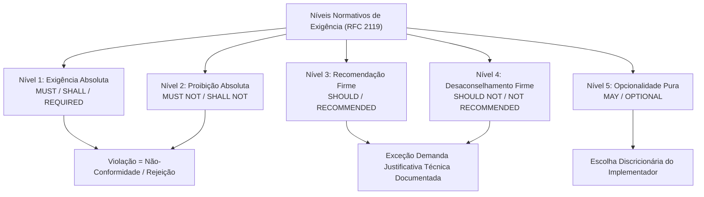
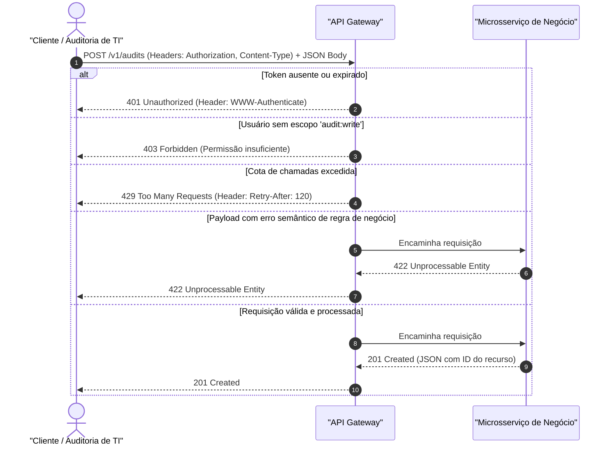
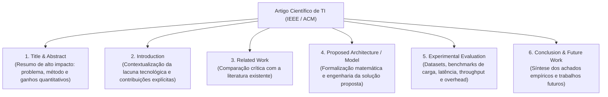

# 03 - Interpretação de Documentação de APIs, Manuais e Artigos

> **Matéria:** Língua Inglesa (Leitura Técnica)  
> **Cargo:** B02 – Técnico de Controle Externo – Especialidade: Tecnologia da Informação  
> **Arquivo:** `03_interpretacao_de_documentacao_de_apis_e_manuais.md`  

---

## 📌 Ementa / Itens do Edital
- Interpretação e leitura de documentações técnicas de APIs (REST, GraphQL)
- Interpretação de manuais de instalação, configuração e guias de software
- Leitura crítica de artigos científicos e papers de tecnologia da informação
- Linguagem prescritiva e advertências técnicas (RFC 2119: MUST, SHOULD, MAY)

---

## 🧭 Sumário
- [1. Linguagem Normativa e Prescritiva de Engenharia (RFC 2119 / RFC 8174)](#1-linguagem-normativa-e-prescritiva-de-engenharia-rfc-2119-rfc-8174)
    - [1.1 Os Níveis Normativos Canônicos](#11-os-niveis-normativos-canonicos)
    - [1.2 Matriz de Conformidade Técnica da RFC 2119](#12-matriz-de-conformidade-tecnica-da-rfc-2119)
- [2. Interpretação de Documentação de APIs (REST, OpenAPI, Swagger e GraphQL)](#2-interpretacao-de-documentacao-de-apis-rest-openapi-swagger-e-graphql)
    - [2.1 Estrutura de Rotas, Métodos HTTP e Idempotência](#21-estrutura-de-rotas-metodos-http-e-idempotencia)
    - [2.2 Parâmetros de Requisição e Schemas de Dados JSON](#22-parametros-de-requisicao-e-schemas-de-dados-json)
    - [2.3 Códigos de Status HTTP Críticos e Cabeçalhos de Resposta](#23-codigos-de-status-http-criticos-e-cabecalhos-de-resposta)
    - [2.4 Documentação de APIs GraphQL (Queries, Mutations e Types)](#24-documentacao-de-apis-graphql-queries-mutations-e-types)
- [3. Interpretação de Manuais Técnicos e Guias de Configuração de Sistemas](#3-interpretacao-de-manuais-tecnicos-e-guias-de-configuracao-de-sistemas)
    - [3.1 Verbos Operacionais no Modo Imperativo](#31-verbos-operacionais-no-modo-imperativo)
    - [3.2 Seções Estruturantes de um Manual de Implantação](#32-secoes-estruturantes-de-um-manual-de-implantacao)
    - [3.3 Categorização e Gravidade das Advertências Técnicas](#33-categorizacao-e-gravidade-das-advertencias-tecnicas)
    - [3.4 Ciclo de Vida: Deprecated vs. Decommissioned](#34-ciclo-de-vida-deprecated-vs-decommissioned)
- [4. Leitura Crítica de Artigos Científicos e Papers de TI (IEEE / ACM / ArXiv)](#4-leitura-critica-de-artigos-cientificos-e-papers-de-ti-ieee-acm-arxiv)
    - [4.1 Anatomia Estrutural de um Artigo de Vanguarda](#41-anatomia-estrutural-de-um-artigo-de-vanguarda)
    - [4.2 A Metodologia Three-Pass sob Pressão de Tempo de Prova](#42-a-metodologia-three-pass-sob-pressao-de-tempo-de-prova)
    - [4.3 Léxico de Validação Experimental e Evidências Empíricas](#43-lexico-de-validacao-experimental-e-evidencias-empiricas)
- [5. Fontes Recomendadas na Internet](#5-fontes-recomendadas-na-internet)
- [6. Questões Comentadas & Exemplos (Padrão FCC)](#6-questoes-comentadas-exemplos-padrao-fcc)

---

## 1. Linguagem Normativa e Prescritiva de Engenharia (RFC 2119 / RFC 8174)

Nas áreas de engenharia de software, redes de comunicação e governança de tecnologia avaliadas pela Fundação Carlos Chagas (FCC), a leitura de especificações técnicas formais (padrões da IETF, W3C, ISO/IEC e NIST) exige a compreensão rigorosa dos **termos normativos prescritivos grafados em letras maiúsculas**, disciplinados pela clássica **RFC 2119** (e reafirmados pela RFC 8174).

Esses vocábulos não exercem função decorativa ou meramente estilística; constituem **imposições contratuais e técnicas de conformidade estrita**.



### 1.1 Os Níveis Normativos Canônicos

1. **MUST / SHALL / REQUIRED (Obrigatório / Mandatório):** Designam uma exigência absoluta da especificação (*absolute requirement*). O sistema, serviço ou cliente que não implementar ou violar este item é classificado como em **não-conformidade** (*non-compliant*).
2. **MUST NOT / SHALL NOT (Terminantemente Proibido):** Expressam um veto categórico (*absolute prohibition*). A inclusão do comportamento vedado invalida a conformidade da solução perante o padrão internacional.
3. **SHOULD / RECOMMENDED (Fortemente Recomendado):** Indicam que o comportamento prescrito representa a boa prática recomendada. Podem existir razões válidas em circunstâncias particulares para ignorar a diretriz, mas as implicações técnicas de tal desvio devem ser plenamente compreendidas, avaliadas e formalmente documentadas.
4. **SHOULD NOT / NOT RECOMMENDED (Fortemente Desaconselhado):** Expressam que determinada conduta técnica deve ser evitada sob condições normais de operação. Desvios somente são tolerados em situações excepcionais de contorno devidamente motivadas.
5. **MAY / OPTIONAL (Opcional / Facultativo):** Indicam um recurso verdadeiramente opcional (*truly optional*). O implementador detém a faculdade discricionária de incluir ou omitir o atributo sem comprometer a interoperabilidade com outros sistemas que seguem o padrão.

### 1.2 Matriz de Conformidade Técnica da RFC 2119

| Termo em Maiúsculas | Definição Oficial IETF | Significado Prático em Auditoria e TI | O que NÃO Significa (Pegadinha FCC) |
| :--- | :--- | :--- | :--- |
| **MUST** / **SHALL** / **REQUIRED** | Exigência absoluta da especificação. | Mandatório. Ausência implica rejeição e não-conformidade estrita. | NÃO é sugestão, boa prática ou opcionalidade. |
| **MUST NOT** / **SHALL NOT** | Proibição absoluta da especificação. | Proibição expressa. Qualquer execução viola o padrão. | NÃO é mera ressalva dispensável. |
| **SHOULD** / **RECOMMENDED** | Fortemente recomendado com abertura para exceções fundamentadas. | Padrão ouro a ser seguido; desvios exigem justificativa técnica formal. | NÃO é uma imposição cega inegociável, e NÃO é uma opção arbitrária sem critérios. |
| **SHOULD NOT** / **NOT RECOMMENDED** | Desaconselhamento enfático em operação padrão. | Conduta indesejada; implementação aceitável apenas em exceções marginais. | NÃO é um veto absoluto em 100% dos casos marginais. |
| **MAY** / **OPTIONAL** | Funcionalidade totalmente discricionária. | Facultativo. Não gera penalidades de conformidade. | NÃO é uma recomendação preferencial e NÃO é obrigatório. |

> 🚨 **ALERTA DE PROVA / PEGADINHA FCC:**  
> A FCC adora afirmar que o termo **"SHOULD"** impõe um mandamento inegociável sob qualquer pretexto. Trata-se de erro recorrente. A RFC 2119 expressamente ressalva que podem existir cenários peculiares que justifiquem a não observância do *SHOULD*, cabendo ao engenheiro mensurar os impactos (*the full implications must be understood and carefully weighed*).

---

## 2. Interpretação de Documentação de APIs (REST, OpenAPI, Swagger e GraphQL)

A análise de contratos de interface entre sistemas constitui atividade primordial tanto no desenvolvimento quanto na auditoria de dados fiscais e orçamentários.



### 2.1 Estrutura de Rotas, Métodos HTTP e Idempotência

O design RESTful organiza as interações por meio de URIs de recursos e verbos padronizados pelo protocolo HTTP:

- **GET:** Recupera a representação de um recurso. Operação **segura** (não altera o estado no servidor) e **idempotente** (múltiplas chamadas idênticas produzem o mesmo efeito de uma única chamada).
- **POST:** Submete dados para criação de novo recurso ou processamento interno. Operação **não-segura** e **não-idempotente** (cada envio gera uma nova entidade ou cobrança).
- **PUT:** Substitui integralmente o recurso existente na URI especificada. Operação **idempotente**.
- **PATCH:** Aplica modificações parciais a atributos pontuais do recurso.
- **DELETE:** Remove o recurso indicado. Operação **idempotente** (a exclusão de um recurso já excluído mantém o estado de recurso ausente).

### 2.2 Parâmetros de Requisição e Schemas de Dados JSON

Nas especificações OpenAPI 3.0 / Swagger, os parâmetros distribuem-se em quatro categorias fundamentais:

- **Path Parameters (`/taxpayers/{id}`):** Integram a hierarquia da URL e identificam instâncias unívocas de recursos. São invariavelmente obrigatórios.
- **Query Parameters (`?fiscal_year=2026&status=audited&limit=50&offset=100`):** Utilizados para filtragem, ordenação (*sorting*) e paginação de coleções.
- **Header Parameters:** Transportam metadados essenciais de rede e segurança:
    - `Authorization: Bearer <token_jwt>`: Credencial criptográfica de autenticação.
    - `Content-Type: application/json`: Informa a codificação do payload transmitido.
    - `Accept: application/json`: Comunica o formato que o cliente está apto a receber.
- **Request Body (Corpo da Requisição / Payload):** Estrutura hierárquica contendo os campos de dados:
    - `required: true`: Sinaliza que o bloco ou os campos listados no array `required:` são indispensáveis. A omissão acarreta rejeição da mensagem.
    - `properties`: Mapeia cada atributo com suas restrições de validação (`type: string`, `pattern: '^\d{14}$'`, `minimum: 0.0`).

### 2.3 Códigos de Status HTTP Críticos e Cabeçalhos de Resposta

A compreensão precisa das famílias de códigos de status HTTP é intensamente avaliada em provas:

- **Família 2xx (Success):**
    - `200 OK`: Requisição bem-sucedida com retorno de dados.
    - `201 Created`: Criação bem-sucedida de um novo recurso no servidor (resposta clássica a `POST`).
    - `204 No Content`: Ação processada com êxito, sem corpo textual de retorno (comum em `DELETE`).
- **Família 4xx (Client Error - Erros Originados no Cliente):**
    - `400 Bad Request`: Erro de sintaxe da requisição (JSON malformado, quebra de delimitadores, tipos primitivos ilegíveis).
    - `401 Unauthorized`: Falha de **autenticação**. O cliente não forneceu credenciais válidas ou o token expirou.
    - `403 Forbidden`: O cliente está autenticado com sucesso, mas suas permissões/papéis (*roles*) **não autorizam** o acesso à rota solicitada.
    - `404 Not Found`: A URI solicitada não corresponde a nenhum recurso existente.
    - `409 Conflict`: Conflito com o estado atual do recurso (ex.: tentativa de cadastrar registro com chave primária já existente).
    - `422 Unprocessable Entity`: A sintaxe do JSON está impecável, mas os dados contêm **erros semânticos ou violações de regras de negócio** (ex.: valor negativo em receita declarada, CPF com dígitos verificadores inválidos).
    - `429 Too Many Requests`: Limite de taxa de requisições excedido (*rate limiting / throttling*). Vem associado ao cabeçalho `Retry-After: <segundos>`, que estipula o tempo de espera obrigatório antes de nova tentativa.
- **Família 5xx (Server Error - Falhas Internas do Provedor):**
    - `500 Internal Server Error`: Exceção inesperada não tratada pela aplicação.
    - `502 Bad Gateway`: O proxy reverso ou gateway recebeu resposta corrompida do microsserviço de backend.
    - `503 Service Unavailable`: Servidor temporariamente incapacitado por sobrecarga ou manutenção programada.
    - `504 Gateway Timeout`: O gateway expirou aguardando a resposta do serviço interno.

> 💡 **Diferença Crítica FCC (401 vs. 403):**  
>
> - **401 Unauthorized** $\rightarrow$ *Quem é você?* (Problema de Identidade / Autenticação).  
> - **403 Forbidden** $\rightarrow$ *Eu sei quem você é, mas você não tem permissão para entrar aqui.* (Problema de Privilégio / Autorização).

### 2.4 Documentação de APIs GraphQL (Queries, Mutations e Types)

Diferentemente do padrão REST, no qual cada recurso ocupa uma URI distinta, o padrão GraphQL opera via endpoint único (`POST /graphql`). A documentação orienta-se por esquemas de tipagem estrita (*Schema Definition Language - SDL*):

- **Query:** Operação de consulta somente-leitura.
- **Mutation:** Operação de escrita que gera efeitos colaterais de criação, atualização ou remoção.
- **Modifiers de Obrigatoriedade:** O caractere de exclamação `!` ao final do tipo indica campo não-nulo e mandatório (ex.: `id: ID!`, `revenue: Float!`).

---

## 3. Interpretação de Manuais Técnicos e Guias de Configuração de Sistemas

Manuais operacionais de infraestrutura (Linux manpages, guias do Kubernetes, PostgreSQL, Docker) empregam linguagem estritamente procedimental e estruturada.

### 3.1 Verbos Operacionais no Modo Imperativo

No manual técnico, instruções diretas abrem as sentenças com o verbo no infinitivo sem "to", expressando comando executivo:

- **Ensure:** *"Ensure that NTP synchronization is active before joining nodes"* $\rightarrow$ *Garanta que* a sincronização de relógio esteja ativa.
- **Provision:** *"Provision persistent storage classes with dynamic allocation"* $\rightarrow$ *Aloque / provisione* classes de armazenamento.
- **Purge / Prune:** *"Prune unreferenced objects to recover disk blocks"* $\rightarrow$ *Expurgue / limpe* objetos não referenciados.
- **Enforce:** *"Enforce least-privilege IAM policies"* $\rightarrow$ *Imponha / faça cumprir* políticas de menor privilégio.
- **Bypass:** *"Do not attempt to bypass input sanitation filters"* $\rightarrow$ *Não tente burlar / contornar* filtros de sanitização.

### 3.2 Seções Estruturantes de um Manual de Implantação

1. **Overview / Architecture:** Visão conceitual e topologia do sistema.
2. **Prerequisites (Pré-requisitos):** Condições mandatórias que devem ser atendidas antes da instalação (versão de kernel, bibliotecas, portas de firewall abertas). O descumprimento impede a instalação.
3. **Installation & Configuration:** Procedimentos passo a passo de implantação.
4. **Troubleshooting (Resolução de Problemas):** Procedimentos de diagnóstico e mitigação de erros comuns.

### 3.3 Categorização e Gravidade das Advertências Técnicas

As caixas de alerta dos manuais de engenharia são padronizadas por nível de risco:

- **Note / Tip (Nota / Dica):** Informação complementar útil ou sugestão de atalho operacional.
- **Important (Importante):** Diretriz de conformidade essencial; sua inobservância causa mau funcionamento do serviço.
- **Caution (Cuidado):** Risco de comportamento inesperado, degradação severa de desempenho ou instabilidade na topologia (ex.: formar clusters com número par de nós, arriscando *split-brain*).
- **Warning (Advertência):** Alerta formal de perda iminente de compatibilidade ou quebra de fluxo operacional.
- **Danger / Fatal (Perigo / Fatalidade):** Risco crítico de perda irreversível de dados, danos físicos ao hardware ou colapso total de segurança cibernética.

### 3.4 Ciclo de Vida: Deprecated vs. Decommissioned

A correta interpretação do ciclo de vida de componentes de software é essencial para a gestão e auditoria de TI:

- **Deprecated (Descontinuado / Tornado Obsoleto):** O método, protocolo ou versão **continua plenamente funcional** na versão em execução do software. Contudo, o fabricante adverte formalmente que o recurso não receberá novas funcionalidades nem suporte futuro, estando com remoção agendada. Não deve ser empregado em novos projetos.
- **Decommissioned / Removed (Descomissionado / Removido):** O recurso foi definitivamente excluído da base de código. Qualquer invocação resultará em erro imediato de método inexistente (`404` ou `410 Gone`).

---

## 4. Leitura Crítica de Artigos Científicos e Papers de TI (IEEE / ACM / ArXiv)

Em certames da FCC para cargos de alta remuneração de Tecnologia da Informação, os textos de prova costumam ser extraídos de publicações acadêmicas e anais de conferências de renome mundial (como *IEEE Transactions on Software Engineering, ACM SIGMOD, USENIX OSDI*).

### 4.1 Anatomia Estrutural de um Artigo de Vanguarda



1. **Title & Abstract:** O núcleo de maior densidade do paper. Sintetiza a motivação central, a fraqueza das abordagens tradicionais, a solução inovadora formulada e os ganhos numéricos consolidados (ex.: redução de latência em 42%).
2. **Introduction:** Expõe a relevância do problema e lista textualmente as contribuições primárias do trabalho (*"In this paper, our main contributions are..."*).
3. **Related Work:** Confronta a solução com trabalhos anteriores (*prior art*).
4. **Proposed Architecture / Algorithm:** Detalhamento da arquitetura técnica ou algoritmo implementado.
5. **Experimental Evaluation & Discussion:** Apresentação rigorosa das métricas de desempenho sob carga de trabalho corporativa real (*enterprise workloads*).
6. **Threats to Validity:** Reconhecimento das premissas e limitações do estudo.
7. **Conclusion:** Recapitulação das deduções finais.

### 4.2 A Metodologia Three-Pass sob Pressão de Tempo de Prova

Conforme preconizado pelo Prof. S. Keshav, a leitura de papers em ambientes de prova deve ser estratificada em camadas:

- **Passada 1 (Abordagem Panorâmica - 3 a 5 minutos):** Leitura concentrada do título, do *Abstract*, da introdução preliminar e da conclusão final. Essa varredura inicial responde com clareza:
    - Qual o problema central atacado pelo autor?
    - A tecnologia proposta substitui ou aprimora os modelos vigentes?
    - O tom é de refutação ou de proposição de nova técnica?
- **Passada 2 (Varredura Analítica para Itens Específicos):** Inspeção de figuras de arquitetura, gráficos de desempenho e tabelas comparativas.

### 4.3 Léxico de Validação Experimental e Evidências Empíricas

- **Benchmark / Workload:** Carga de trabalho de teste executada para aferir limites operacionais de um sistema.
- **Tail Latency (Latência de Cauda - P99 / P99.9):** O tempo de resposta experimentado pelos percentis mais lentos das requisições; indicador crítico em sistemas de tempo real.
- **Overhead:** Custo operacional computacional marginal incorrido em ciclos de CPU, memória RAM ou rede para suportar a nova ferramenta (ex.: menos de 3% de consumo extra de CPU).
- **Outperform:** Superar o desempenho de uma solução concorrente (*"Our model outperforms traditional heuristics"*).

---

## 5. Fontes Recomendadas na Internet

- [IETF RFC 2119 - Key words for use in RFCs to Indicate Requirement Levels](https://datatracker.ietf.org/doc/html/rfc2119)  
  Especificação normativa primordial da IETF formalizando as definições contratuais e técnicas de MUST, MUST NOT, SHOULD, SHOULD NOT e MAY.
- [OpenAPI Specification (OAS) 3.1.0 Standard](https://spec.openapis.org/oas/v3.1.0)  
  Documentação técnica oficial mantida pela Linux Foundation para especificação padronizada de APIs RESTful agnósticas.
- [MDN Web Docs - HTTP Response Status Codes](https://developer.mozilla.org/en-US/docs/Web/HTTP/Status)  
  Guia completo da Mozilla catalogando a semântica de códigos de status das famílias 2xx, 4xx e 5xx e cabeçalhos de controle HTTP.
- [Prof. S. Keshav - "How to Read a Paper"](http://ccr.sigcomm.org/online/files/p83-keshav.pdf)  
  Publicação clássica do ACM SIGCOMM detalhando o método de leitura eficiente em três passadas (*three-pass method*).
- [Kubernetes Documentation - Concepts and Architecture](https://kubernetes.io/docs/concepts/)  
  Manual oficial da CNCF que serve de modelo para formulação de questões práticas de infraestrutura e orquestração.

---

## 6. Questões Comentadas & Exemplos (Padrão FCC)

### Questão 1 (FCC - Adaptada / Analista de Sistemas - Integração de Plataformas)
*Consider the excerpt below from a technical specification draft for a public auditory API:*

> *"Section 4.2 – Authentication and Message Security  
>
> 1. All incoming client requests **MUST** include a cryptographically signed JSON Web Token (JWT) in the `Authorization` header.  
> 2. The authentication gateway **MUST NOT** accept tokens signed with the deprecated 'none' algorithm.  
> 3. Implementers **SHOULD** configure an asymmetric RSA-256 signature scheme rather than a shared symmetric secret.  
> 4. Clients **MAY** compress the payload using gzip when sending audit records exceeding 100 kilobytes."*

According to the normative definitions established by RFC 2119, it is correct to deduce that:

* **A)** Compressing payloads larger than 100 kilobytes with gzip is an absolute requirement for client implementations.
* **B)** Servers are strictly permitted to validate tokens signed with the 'none' algorithm in development environments.
* **C)** Asymmetric RSA-256 signature is a recommended practice, meaning that valid reasons may exist to employ an alternative, but the full implications must be weighed.
* **D)** Including a cryptographic JWT in the `Authorization` header is an optional feature that can be ignored at the client's discretion.
* **E)** The term **"SHOULD"** in item 3 implies that asymmetric RSA-256 signature is strictly mandatory and cannot be substituted under any circumstances.

> **Comentário Detalhado:**
>
> - **A)** Incorreta. O item 4 emprega o modal **"MAY"**, que expressa uma funcionalidade verdadeiramente opcional (*truly optional*), e não uma exigência absoluta.
> - **B)** Incorreta. O item 2 estabelece uma proibição absoluta: **"MUST NOT"** (*absolute prohibition*). O gateway está terminantemente impedido de aceitar tokens com algoritmo 'none', sem qualquer exceção para ambientes de teste.
> - **C)** Correta. De acordo com a RFC 2119, o termo **"SHOULD"** (ou *RECOMMENDED*) tipifica uma recomendação forte de boa prática técnica. Podem existir circunstâncias particulares em que a alternativa seja válida (ex.: chaves pré-compartilhadas em canais isolados), contanto que as implicações integrais de segurança sejam formalmente compreendidas e sopesadas.
> - **D)** Incorreta. O item 1 utiliza a partícula normativa **"MUST"**, determinando que o envio do JWT no cabeçalho `Authorization` é mandatório e indispensável, e não opcional.
> - **E)** Incorreta. O vocábulo normativo que indica obrigatoriedade incondicional e mandatória sem substituição é *MUST* ou *SHALL*, e não *SHOULD*.
> 
> **Gabarito: C**

---

### Questão 2 (FCC - Adaptada / Tribunal de Contas - Especialidade Tecnologia da Informação)
*Carefully analyze the API documentation response snippet provided below:*

```http
HTTP/1.1 429 Too Many Requests
Date: Wed, 07 Oct 2026 14:30:00 GMT
Content-Type: application/json; charset=utf-8
Retry-After: 120
Warning: 299 - "This endpoint is deprecated and will be decommissioned on 2027-01-01"

{
  "error": "rate_limit_exceeded",
  "message": "Quota limit reached. Client is temporarily throttled."
}
```

A partir da leitura técnica da documentação e dos cabeçalhos HTTP apresentados, é correto afirmar:

* **A)** A requisição foi processada com êxito pelo servidor, mas o cliente foi alertado de que o formato JSON é inválido.
* **B)** O cliente excedeu a cota de requisições permitida (*rate limit*) e foi instruído, por meio do cabeçalho `Retry-After`, a aguardar 120 segundos antes de reenviar a chamada.
* **C)** A mensagem `Warning` adverte que o serviço falhou catastroficamente e seus dados foram corrompidos permanentemente no banco de dados.
* **D)** O termo *deprecated* indica que o endpoint acabou de ser atualizado para uma versão de maior desempenho recomendada para novas integrações.
* **E)** O status 429 indica um erro interno de falha de infraestrutura no lado do servidor (*Internal Server Error*).

> **Comentário Detalhado:**
>
> - **A)** Incorreta. Respostas com código 429 pertencem à classe de erros de cliente (4xx) e indicam rejeição temporária por estrangulamento de chamadas, e não sucesso de processamento.
> - **B)** Correta. O código HTTP **429 Too Many Requests** indica que o cliente ultrapassou a taxa máxima de requisições admitida pela política de governança da API (*throttling*). O cabeçalho padronizado **`Retry-After: 120`** estipula expressamente que o cliente deve aguardar um intervalo de 120 segundos antes de emitir novas requisições.
> - **C)** Incorreta. O cabeçalho `Warning: 299` veicula um aviso de gerenciamento de ciclo de vida de software, alertando sobre a obsolescência da rota, sem nenhuma conexão com corrupção de banco de dados.
> - **D)** Incorreta. O adjetivo técnico **"deprecated"** (descontinuado / obsoleto) significa que a funcionalidade foi marcada para desativação futura e não deve receber novas implantações, sendo agendado seu descomissionamento definitivo (*decommissioning*) para 01/01/2027.
> - **E)** Incorreta. A família 4xx sinaliza inconformidades geradas pelo cliente (*Client Error*). Erros de infraestrutura interna do servidor pertencem privativamente à família 5xx (como 500, 502 ou 503).
> 
> **Gabarito: B**

---

### Questão 3 (FCC - Adaptada / SEFAZ - Auditoria Fiscal da Receita Estadual - Especialidade TI)
*Examine the following OpenAPI 3.0 specification excerpt describing an electronic fiscal auditing endpoint:*

```yaml
paths:
  /v1/audits/tax-returns:
    post:
      summary: Submit electronic tax returns for batch validation
      security:
        - BearerAuth: [audit:write]
      requestBody:
        required: true
        content:
          application/json:
            schema:
              type: object
              required:
                - taxpayer_id
                - fiscal_year
                - declared_revenue
              properties:
                taxpayer_id:
                  type: string
                  pattern: '^\d{14}$'
                fiscal_year:
                  type: integer
                  minimum: 2020
                declared_revenue:
                  type: number
                  minimum: 0.0
      responses:
        '201':
          description: Returns successfully validated and queued
        '400':
          description: Malformed JSON syntax or unparseable payload
        '403':
          description: Insufficient privileges; client lacks 'audit:write' scope
        '422':
          description: Semantic validation failure (e.g., negative revenue or invalid tax ID)
```

Com base na especificação técnica acima e nos princípios de arquitetura de APIs, analise as afirmativas:

I. O envio do corpo da requisição (*requestBody*) é mandatório (`required: true`), e a ausência do campo `taxpayer_id` causará a rejeição da mensagem.  

II. Caso um cliente apresente um token de autenticação válido, porém desprovido do escopo de segurança `audit:write`, o endpoint retornará o status HTTP 403 Forbidden.  

III. O envio de um valor negativo para o campo `declared_revenue` gerará um status HTTP 400 Bad Request, haja vista que a restrição `minimum: 0.0` constitui erro sintático de transporte HTTP.  

Está correto o que se afirma em:

* **A)** I e II, apenas.
* **B)** I e III, apenas.
* **C)** II e III, apenas.
* **D)** I, apenas.
* **E)** I, II e III.

> **Comentário Detalhado:**
>
> - **A)** Correta. Apenas os itens I e II estão alinhados à especificação e às boas práticas de API:
>     - **Item I (Verdadeiro):** A linha `requestBody: required: true` torna o corpo obrigatório. A chave `taxpayer_id` figura expressamente no bloco `required:`, tornando sua ausência causa mandatória de recusa da submissão.
>     - **Item II (Verdadeiro):** A seção `security: BearerAuth: [audit:write]` exige que o token possua o escopo `audit:write`. A resposta para credenciais autenticadas porém carentes do privilégio necessário é textualmente documentada como **403 Forbidden** (*client lacks audit:write scope*).
>     - **Item III (Falso):** O envio de valor negativo para `declared_revenue` configura violação semântica de regra de negócio (`minimum: 0.0`), e não falha sintática de formatação. O schema associa essa falha textualmente ao código **422 Unprocessable Entity** (*Semantic validation failure, e.g., negative revenue*), reservando o status 400 para payloads corrompidos.
> - **B)** Incorreta. O item III é falso.
> - **C)** Incorreta. O item I é verdadeiro e o III é falso.
> - **D)** Incorreta. O item II também é verdadeiro.
> - **E)** Incorreta. O item III é falso.
> 
> **Gabarito: A**

---

### Questão 4 (FCC - Adaptada / Tribunal de Contas - Infraestrutura e Engenharia de Dados)
*Read the excerpt extracted from a distributed database configuration guide:*

> *"Section 6: Network Partitioning and Split-Brain Prevention  
> **Prerequisites:** Before establishing a multi-region cluster, administrators **MUST** synchronize system clocks across all physical hosts using Network Time Protocol (NTP). Clock drift exceeding 250 milliseconds will trigger immediate heartbeat dropouts.  
> **Caution:** Do not configure an even number of voting nodes. When a network partition divides the cluster, nodes require a strict majority quorum ($N/2 + 1$) to elect a primary leader. An even topology risks a fatal split-brain scenario where isolated partitions simultaneously accept conflicting writes, resulting in irrecoverable data divergence."*

Based on reading technical manuals and understanding operational directives, it is correct to state that:

* **A)** The manual indicates that synchronizing system clocks with NTP is an optional step that can be safely bypassed in multi-region deployments.
* **B)** A clock drift higher than 250 milliseconds is considered normal and will not impact heartbeat communications between nodes.
* **C)** The directive labeled **"Caution"** advises configuring an even number of voting nodes to maximize electoral redundancy during partitions.
* **D)** According to the guide, a strict majority quorum is indispensable to elect a primary leader and prevent the emergence of conflicting writes in distinct partitions.
* **E)** The text states that irrecoverable data divergence can be automatically repaired by the operating system without manual intervention.

> **Comentário Detalhado:**
>
> - **A)** Incorreta. A seção *Prerequisites* expressa um mandamento absoluto com o termo normativo **"MUST"** (*administrators MUST synchronize system clocks*), impedindo que o procedimento seja contornado (*bypassed*).
> - **B)** Incorreta. O guia afirma expressamente que um desvio de relógio (*clock drift*) além de 250 milissegundos causará quedas imediatas no tráfego de controle e sinalização de heartbeat (*trigger immediate heartbeat dropouts*).
> - **C)** Incorreta. A advertência técnica (*Caution*) desaconselha formalmente o uso de número par de nós votantes (*"Do not configure an even number of voting nodes"*), visto que topologias simétricas causam impasses eleitorais e risco de *split-brain*.
> - **D)** Correta. O manual estabelece com precisão que a formação de um quórum de maioria estrita ($N/2 + 1$) é condição indispensável para a eleição do nó líder primário, salvaguardando o cluster contra aceitação de escritas conflitantes em partições desconectadas (*resulting in irrecoverable data divergence*).
> - **E)** Incorreta. A documentação classifica expressamente a divergência de dados resultante como irrecuperável e definitiva (*irrecoverable data divergence*), inexistindo reparação automática transparente.
> 
> **Gabarito: D**

---

### Questão 5 (FCC - Adaptada / Analista de TI - Avaliação de Arquiteturas de Nuvem)
*Read the abstract of an IEEE computer systems research paper:*

> *"Abstract—Serverless computing has emerged as a compelling paradigm for event-driven microservices due to its elastic autoscale and pay-per-use billing. **However**, cold-start latency remains a severe impediment for latency-sensitive public services. In this paper, we propose *KubeWarm*, a lightweight proactive container pre-warming framework integrated with Kubernetes. **Unlike** conventional reactive autoscalers that spawn container runtimes only after incoming HTTP requests arrive, *KubeWarm* utilizes an autoregressive machine learning model to predict invocation spikes. Our extensive experimental results on enterprise workloads demonstrate that *KubeWarm* reduces tail latency by 42% and eliminates 87% of cold starts, while incurring less than 3% CPU **overhead**."*

Based on paper reading techniques (*Abstract comprehension*) and technical vocabulary, select the correct alternative:

* **A)** The authors conclude that conventional reactive autoscalers are superior to proactive pre-warming frameworks in handling sudden invocation spikes.
* **B)** The term **"overhead"** in the last sentence refers to a 3% financial tax imposed by cloud service providers on serverless function invocations.
* **C)** According to the abstract, *KubeWarm* is designed to wait until HTTP requests arrive before initiating any container runtime provisioning.
* **D)** The connector **"However"** is used to introduce the primary drawback of serverless computing addressed by the paper: cold-start latency.
* **E)** The proposed framework proved inefficient, as experimental results demonstrated a 42% increase in latency and higher server costs.

> **Comentário Detalhado:**
>
> - **A)** Incorreta. A avaliação empírica do artigo evidencia a superioridade do modelo preditivo e proativo proposto (*KubeWarm*), o qual reduziu a latência de cauda em 42% e expurgou 87% das inicializações a frio frente aos modelos reativos tradicionais.
> - **B)** Incorreta. Na engenharia de software e computação em nuvem, o vocábulo **"overhead"** traduz o custo computacional marginal de processamento de hardware (neste caso, menos de 3% de consumo extra de ciclos de CPU para operar o algoritmo inteligente), e não tributos monetários.
> - **C)** Incorreta. O ato de postergar a inicialização do runtime de contêineres até a chegada efetiva do pacote HTTP é a assinatura dos mecanismos tradicionais reativos (*conventional reactive autoscalers*), superada pelo dinamismo proativo do *KubeWarm*.
> - **D)** Correta. O conectivo adversativo **"However"** (no entanto, todavia) é estrategicamente empregado para contrapor os benefícios atrativos da computação serverless (elasticidade e faturamento sob demanda) ao seu obstáculo estrutural determinante atacado pelo artigo: a latência de inicialização a frio (*cold-start latency*).
> - **E)** Incorreta. O framework atingiu desempenho exitoso: reduziu (*reduces*) a latência em 42% e eliminou 87% dos cold starts sob sobrecarga computacional desprezível.
> 
> **Gabarito: D**
