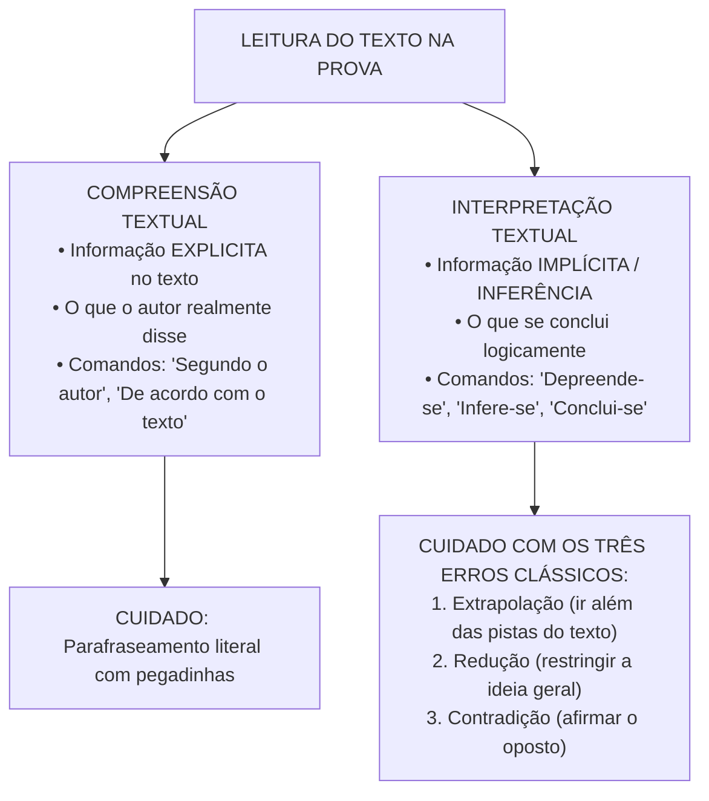
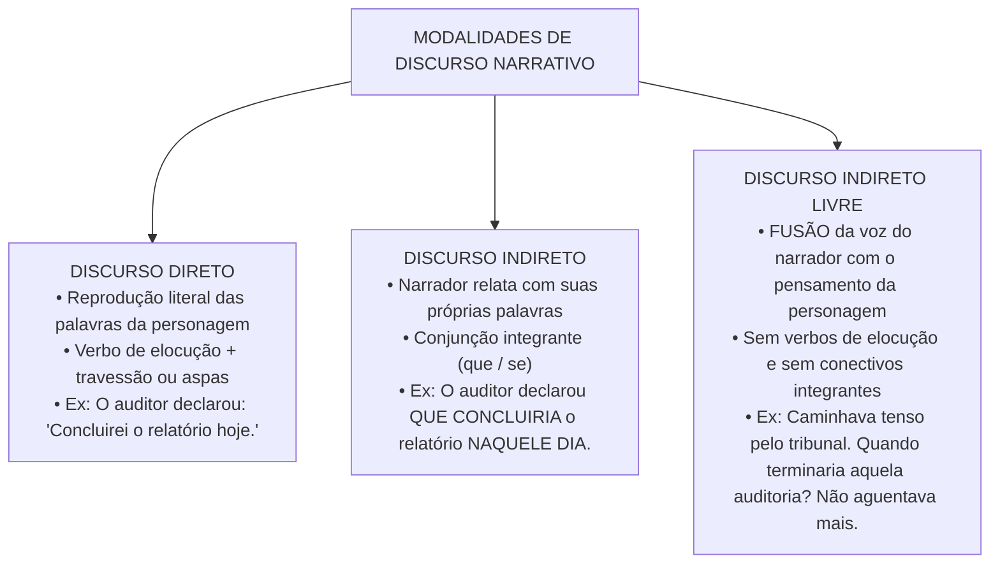

# 01 - Compreensão, Interpretação e Tipologia Textual

> **Matéria:** Língua Portuguesa  
> **Cargos:** A01 – Técnico de Controle Externo (Adm) / B02 – Técnico de Controle Externo (TI)  
> **Arquivo:** `01_compreensao_e_interpretacao_de_texto.md`  
> **Referência Temática:** Teoria do Texto, Tipologias, Discurso Narrativo e Estilística na Banca FCC

---

## 📌 Ementa / Itens do Edital
- Compreensão e interpretação de textos de gêneros variados (ensaios filosóficos, editoriais, crônicas e artigos de opinião);
- Relação do texto com seu contexto histórico, cultural e ideológico;
- Níveis de linguagem: Denotação (sentido literal/dicionarizado) e Conotação (sentido figurado/plurissignificativo);
- Modalidades de discurso: Discurso Direto, Discurso Indireto e Discurso Indireto Livre;
- Regras de transposição de tempos e modos verbais, pronomes e advérbios na passagem de discursos;
- Relações intertextuais: Paráfrase, Paródia, Citação, Epígrafe e Alusão;
- Figuras de linguagem e recursos expressivos (Semânticas, Sintáticas/de Construção e Fonéticas);
- Identificação de tese, estratégias argumentativas, pressupostos e subentendidos na tipologia dissertativa.

---

## 🧭 Sumário
- [1. Compreensão vs. Interpretação na Tradição da FCC](#1-compreensao-vs-interpretacao-na-tradicao-da-fcc)
    - [1.1 Compreensão Textual e Informação Explícita](#11-compreensao-textual-e-informacao-explicita)
    - [1.2 Interpretação Textual e Inferência Autorizada](#12-interpretacao-textual-e-inferencia-autorizada)
    - [1.3 Os Três Erros Clássicos de Leitura](#13-os-tres-erros-classicos-de-leitura)
    - [1.4 Método Prático de Resolução](#14-metodo-pratico-de-resolucao)
- [2. Gêneros Textuais e Contexto de Produção](#2-generos-textuais-e-contexto-de-producao)
    - [2.1 Tipo Textual vs. Gênero Textual](#21-tipo-textual-vs-genero-textual)
    - [2.2 Ensaio, Editorial, Crônica e Artigo de Opinião](#22-ensaio-editorial-cronica-e-artigo-de-opiniao)
    - [2.3 Contexto Histórico, Cultural e Ideológico](#23-contexto-historico-cultural-e-ideologico)
- [3. Tipologias Textuais](#3-tipologias-textuais)
    - [3.1 Quadro Comparativo das Tipologias](#31-quadro-comparativo-das-tipologias)
    - [3.2 Narração e Descrição](#32-narracao-e-descricao)
    - [3.3 Exposição e Injunção](#33-exposicao-e-injuncao)
- [4. Argumentação na Tipologia Dissertativa](#4-argumentacao-na-tipologia-dissertativa)
    - [4.1 Tese e Estrutura do Texto Argumentativo](#41-tese-e-estrutura-do-texto-argumentativo)
    - [4.2 Estratégias Argumentativas](#42-estrategias-argumentativas)
    - [4.3 Operadores Argumentativos](#43-operadores-argumentativos)
    - [4.4 Pressupostos e Subentendidos](#44-pressupostos-e-subentendidos)
- [5. Níveis de Linguagem e Denotação e Conotação](#5-niveis-de-linguagem-e-denotacao-e-conotacao)
    - [5.1 Linguagem Denotativa](#51-linguagem-denotativa)
    - [5.2 Linguagem Conotativa](#52-linguagem-conotativa)
- [6. Modalidades de Discurso](#6-modalidades-de-discurso)
    - [6.1 Discurso Direto](#61-discurso-direto)
    - [6.2 Discurso Indireto](#62-discurso-indireto)
    - [6.3 Discurso Indireto Livre](#63-discurso-indireto-livre)
- [7. Transposição de Discursos](#7-transposicao-de-discursos)
    - [7.1 Tabela de Transposição do Direto para o Indireto](#71-tabela-de-transposicao-do-direto-para-o-indireto)
    - [7.2 Correlação Verbal e Armadilhas na Transposição](#72-correlacao-verbal-e-armadilhas-na-transposicao)
- [8. Intertextualidade](#8-intertextualidade)
    - [8.1 Paráfrase](#81-parafrase)
    - [8.2 Paródia](#82-parodia)
    - [8.3 Citação, Epígrafe e Alusão](#83-citacao-epigrafe-e-alusao)
- [9. Figuras de Linguagem](#9-figuras-de-linguagem)
    - [9.1 Figuras Semânticas ou de Palavra](#91-figuras-semanticas-ou-de-palavra)
    - [9.2 Figuras de Pensamento](#92-figuras-de-pensamento)
    - [9.3 Figuras de Construção ou de Sintaxe](#93-figuras-de-construcao-ou-de-sintaxe)
    - [9.4 Figuras Sonoras ou Fonéticas](#94-figuras-sonoras-ou-foneticas)
- [Fontes Oficiais e Referências Bibliográficas](#fontes-oficiais-e-referencias-bibliograficas)
- [Questões de Concurso FCC Comentadas](#questoes-de-concurso-fcc-comentadas)
    - [Questão 01](#questao-01)
    - [Questão 02](#questao-02)
    - [Questão 03](#questao-03)
    - [Questão 04](#questao-04)
    - [Questão 05](#questao-05)

---

## 1. Compreensão vs. Interpretação na Tradição da FCC

A Fundação Carlos Chagas (FCC) constrói enunciados rigorosos em que a distinção entre **compreensão** e **interpretação** define o método de resolução. Ler bem, para a banca, não é "achar a resposta que parece bonita", mas verificar, palavra por palavra, se a alternativa encontra **autorização no texto**. Toda questão de leitura é, no fundo, um teste de fidelidade: o candidato deve demonstrar que sabe distinguir o que o autor disse, o que o autor permite concluir e o que o autor jamais afirmou.

### 1.1 Compreensão Textual e Informação Explícita

**Compreender** é decodificar aquilo que está **explicitamente** escrito. A pergunta implícita é: *o que o texto diz?* Os comandos típicos são "segundo o texto", "de acordo com o autor", "o texto afirma que", "conforme o 2º parágrafo". Nessas questões, a resposta correta costuma ser uma **paráfrase** de um trecho do texto — isto é, a mesma ideia dita com outras palavras (ver item 8.1).

O perigo da compreensão é justamente a paráfrase "envenenada": a banca copia quase todas as palavras do texto, mas troca um único elemento — um quantificador ("alguns" vira "todos"), um tempo verbal (algo que "pode ocorrer" vira algo que "ocorreu"), uma relação de causa (o efeito vira causa) ou um sujeito (o que foi dito de um grupo passa a ser dito de outro). Por isso, ao comparar alternativa e texto, o candidato deve conferir: **quem** fez, **o quê**, **em que grau** (certeza ou possibilidade), **em que extensão** (todos ou alguns) e **por qual motivo**.

Um exemplo simples: se o texto diz que "os sistemas algorítmicos *podem* reproduzir desigualdades", a alternativa que afirma que eles "*necessariamente* reproduzem desigualdades" troca possibilidade por certeza e, portanto, deixa de ser fiel ao texto, ainda que use praticamente as mesmas palavras.

### 1.2 Interpretação Textual e Inferência Autorizada

**Interpretar** é extrair do texto informações **implícitas**, isto é, conclusões que o autor não escreveu literalmente, mas que decorrem logicamente do que escreveu. A pergunta implícita é: *o que se pode concluir a partir do texto?* Os comandos típicos são "depreende-se", "infere-se", "conclui-se", "o autor sugere", "o texto permite entender que".

A palavra-chave é **inferência autorizada**: a conclusão precisa estar amparada em pistas do próprio texto (vocabulário valorativo, conectivos, exemplos, ironias, contrastes). Por exemplo, se um autor chama certa promessa de "aparente panaceia" (panaceia = remédio para todos os males), ele não precisa dizer "discordo dessa promessa": o adjetivo *aparente* já autoriza a inferência de que o autor a vê com ceticismo. Já concluir que o autor "defende a proibição" daquilo que critica seria ir além do que as pistas permitem.

A interpretação também envolve reconhecer a **postura do autor** (crítica, irônica, neutra, entusiasmada), a **intenção comunicativa** (convencer, informar, denunciar, divertir) e o **sentido global** do texto. Um texto que começa apresentando uma visão otimista e, em seguida, usa um conectivo adversativo ("contudo", "entretanto") para desconstruí-la tem sua tese **depois** do conectivo: a visão inicial é a posição que o autor pretende refutar.

> ⭐ **IMPORTANTE:** Na FCC, "depreende-se" e "infere-se" **não** autorizam opinião pessoal do candidato. A inferência deve ser aquela que **qualquer leitor atento** extrairia das pistas do texto. Se você precisou usar conhecimento externo para justificar a alternativa, desconfie.

### 1.3 Os Três Erros Clássicos de Leitura

A maioria das alternativas erradas em questões de leitura da FCC cai em uma de três categorias. Saber nomeá-las acelera a eliminação.

1. **Extrapolação:** O candidato introduz conhecimentos prévios ou juízos de valor que podem até ser verdadeiros no mundo real, mas **não encontram respaldo ou autorização nas linhas do texto**. A extrapolação costuma aparecer como:
    - **a)** uma **proposta de solução** que o autor não fez (ex.: "a tecnologia deve ser suspensa")
    - **b)** uma **atribuição de culpa ou intenção** não mencionada (ex.: "os engenheiros agem de má-fé")
    - **c)** uma **comparação quantitativa** inexistente (ex.: "as máquinas erram tanto quanto os humanos")
    - **d)** uma **generalização** indevida.

2. **Redução:** A alternativa pinça um detalhe secundário ou aspecto particular do texto e o apresenta como se fosse a tese central ou a conclusão definitiva do autor. A alternativa reduzida até contém algo verdadeiro, mas é **parcial**: responde a uma pergunta diferente da feita (ex.: a questão pede a ideia central e a alternativa traz um exemplo usado em um parágrafo).
3. **Contradição:** A alternativa inverte as relações lógicas de causa e efeito ou assevera o exato oposto daquilo que o texto defendeu. Um caso muito frequente é tratar como **fato consumado** aquilo que o texto apresentou como mera **promessa, hipótese ou ilusão** (ex.: o texto fala em "promessa de erradicação do erro" e a alternativa diz que "a erradicação do erro já foi alcançada").

> 🚨 **ALERTA DE PROVA / PEGADINHA FCC:** Ao responder questões que indagam o que se *"depreende"* ou *"infere"* do texto, elimine sumariamente alternativas que contenham palavras de valor absoluto e generalizante, tais como **"sempre"**, **"nunca"**, **"exclusivamente"**, **"todos"**, **"necessariamente"**, **"rigorosamente"** e **"somente"**, salvo se o próprio texto original tiver utilizado expressamente essa mesma restrição categórica!

### 1.4 Método Prático de Resolução

Um roteiro eficiente para questões de leitura é:

1. ler o **enunciado antes** do texto, para saber se a questão é de compreensão (explícito) ou interpretação (implícito)
2. ler o texto identificando a **tese** e os **conectivos** que organizam a argumentação
3. para cada alternativa, localizar o **trecho correspondente** no texto
4. classificar o erro de cada alternativa descartada (extrapolação, redução ou contradição)
5. desconfiar de alternativas com linguagem extremada ou que tragam soluções, culpados e números ausentes do texto.

Outro ponto importante é o **vocabulário em contexto**: a FCC frequentemente pergunta o sentido de uma palavra "no contexto". A resposta não é necessariamente o primeiro sentido do dicionário, mas aquele que a frase ativa. "Panaceia", "asséptica", "miopia ética", por exemplo, são usados em sentido figurado em textos ensaísticos (ver item 5.2).

> 💡 **DICA DE RESOLUÇÃO / RECONHECIMENTO DE TESE:** O primeiro parágrafo de um texto dissertativo da FCC normalmente contextualiza o tema e apresenta a tese. O último parágrafo sintetiza a conclusão. Se a questão indagar a ideia central, releia atentamente o início e o fim do texto antes de analisar as alternativas intermediárias.

---

## 2. Gêneros Textuais e Contexto de Produção

### 2.1 Tipo Textual vs. Gênero Textual

É essencial não confundir **tipo** (ou tipologia) com **gênero** textual. O **tipo textual** é uma categoria abstrata, definida por traços linguísticos internos: tempos verbais predominantes, relações lógicas, presença de sequência temporal etc. Os tipos são poucos e fixos — narração, descrição, dissertação (expositiva e argumentativa) e injunção (alguns autores acrescentam o tipo dialogal). O **gênero textual**, por sua vez, é a forma concreta e socialmente reconhecida que o texto assume no dia a dia: notícia, editorial, crônica, receita, edital, ofício, sentença, ensaio, carta de leitor. Os gêneros são praticamente infinitos e mudam com a sociedade (o *e-mail* e o *post* são gêneros recentes).

Um mesmo gênero pode combinar vários tipos. Uma crônica pode narrar um episódio cotidiano (tipo narrativo), descrever o ambiente (tipo descritivo) e terminar com uma reflexão (tipo dissertativo). Quando a banca pergunta sobre a **tipologia predominante**, o candidato deve observar qual sequência estrutura o texto como um todo, e não apenas um trecho isolado.

### 2.2 Ensaio, Editorial, Crônica e Artigo de Opinião

A ementa destaca quatro gêneros, todos muito explorados pela FCC:

- **Ensaio (inclusive o filosófico):** texto reflexivo, de extensão variável, em que o autor examina um tema (ética, tecnologia, linguagem, cultura) de forma pessoal, mas fundamentada. Caracteriza-se por vocabulário abstrato e elaborado, períodos longos, uso frequente de citações e referências a outros pensadores, e por uma argumentação que muitas vezes avança por **contraste** de ideias ("pode-se pensar que... contudo..."). É o gênero que mais exige atenção a nuances de sentido e ao vocabulário em contexto.
- **Editorial:** texto opinativo que expressa a **posição oficial do veículo de comunicação** (jornal, revista), e não a de um autor individual. Por isso, normalmente não é assinado e evita marcas de primeira pessoa do singular; usa a terceira pessoa ou o "nós" institucional. Trata de temas da atualidade (economia, política, administração pública) com tom sóbrio e argumentativo.
- **Artigo de opinião:** texto argumentativo **assinado**, em que um autor identificado (jornalista, especialista, colunista) defende seu ponto de vista sobre um tema. Diferentemente do editorial, admite marcas de subjetividade e primeira pessoa, e a responsabilidade pela opinião é do autor, não do veículo.
- **Crônica:** texto curto, geralmente publicado em jornal ou revista, que parte de um **fato cotidiano** aparentemente banal para extrair dele uma reflexão, uma emoção ou um humor. Mistura narração, descrição e comentário; tem linguagem mais leve, próxima da oralidade, e frequentemente emprega ironia, humor e lirismo. Na FCC são comuns crônicas de autores como Rubem Braga, Carlos Drummond de Andrade, Machado de Assis e Lima Barreto.

> 📌 **NOTA EXPLICATIVA / EDITORIAL X ARTIGO DE OPINIÃO:** Ambos são argumentativos. A diferença está na **autoria**: o editorial fala em nome da instituição (não assinado); o artigo de opinião fala em nome de um autor (assinado). A FCC pode explorar essa distinção ao perguntar "quem" sustenta a opinião no texto.

### 2.3 Contexto Histórico, Cultural e Ideológico

Nenhum texto surge do nada: ele é produzido por alguém, em determinada época, para determinado público, sob certos valores. Relacionar o texto ao seu **contexto** significa perceber como esses fatores condicionam o sentido. O **contexto histórico** diz respeito ao momento em que o texto foi escrito (uma crônica de Machado de Assis sobre a escravidão no século XIX deve ser lida à luz daquela sociedade). O **contexto cultural** envolve os costumes, crenças e referências partilhadas por autor e leitores (uma alusão bíblica ou a um poema canônico só é percebida por quem conhece a referência). O **contexto ideológico** refere-se ao conjunto de valores e visões de mundo que o texto assume, defende ou critica — por exemplo, um texto que denuncia a "neutralidade" da tecnologia adota uma posição crítica em relação à ideologia tecnicista.

Na prova, isso aparece em perguntas sobre o **ponto de vista** do autor, sobre o **efeito de sentido** de uma referência histórica ou sobre a **crítica social** implícita em uma narrativa. Atenção, porém: a relação com o contexto deve ser **sugerida pelo próprio texto** (datas, nomes, vocabulário de época, referências explícitas); usar o contexto para atribuir ao autor ideias que ele não expressou é extrapolação (ver item 1.3).

> 🚨 **ALERTA DE PROVA / PEGADINHA FCC:** Em textos antigos (Machado, Lima Barreto), a banca pode testar se o candidato reconhece a **ironia** do narrador diante dos valores da época. Ler literalmente um elogio irônico à elite do século XIX é um erro de contradição.

---

## 3. Tipologias Textuais

### 3.1 Quadro Comparativo das Tipologias

| Tipologia | Objetivo Comunicativo | Marcas Linguísticas Caracterizadoras | Foco na FCC |
| :--- | :--- | :--- | :--- |
| **Dissertativo-Argumentativo** | Defender um ponto de vista (tese) e persuadir o leitor mediante argumentos lógicos. | Presença de operadores argumentativos (*portanto, contudo, por conseguinte*), juízos de valor, dados estatísticos e citações. | É a tipologia **campeã da FCC**. Textos de reflexão filosófica, sociológica e política. |
| **Dissertativo-Expositivo** | Apresentar ideias, conceitos ou teorias de forma estritamente informativa e impessoal. | Verbos na 3ª pessoa, linguagem técnica/denotativa, ausência de juízos morais subjetivos. | Textos científicos ou técnicos sobre administração, finanças públicas e tecnologia. |
| **Narrativo** | Relatar uma sequência temporal de acontecimentos reais ou ficcionais envolvendo personagens. | Verbos de ação no pretérito perfeito/imperfeito, marcadores temporais (*então, depois, subitamente*), progressão de tempo. | Trechos de romances clássicos (Machado de Assis, Lima Barreto, Clarice Lispector). |
| **Descritivo** | Caracterizar seres, objetos, ambientes ou estados com riqueza de detalhes sensoriais. | Predomínio de adjetivos, orações sem verbos de ação dinâmica, retrato estático no tempo. | Surge acoplado à narrativa ou à crônica reflexiva. |
| **Injuntivo / Instrucional** | Indicar ordens, orientações ou procedimentos que o leitor deve seguir. | Verbos no imperativo (*faça, siga, clique*), orações no infinitivo impessoal, enumerações ordenadas. | Editais, manuais de auditoria, regulamentos e leis. |

A tipologia dissertativo-argumentativa, por sua importância, é tratada em seção própria (item 4).

### 3.2 Narração e Descrição

A **narração** relata fatos que se sucedem no tempo, envolvendo personagens em determinado espaço. Seus elementos são: **narrador** (quem conta), **personagens** (quem vive os fatos), **enredo** (a sequência de acontecimentos, geralmente com situação inicial, conflito, clímax e desfecho), **tempo** (cronológico, marcado pelo relógio e pelo calendário, ou psicológico, que acompanha as emoções da personagem) e **espaço** (onde a ação ocorre). O **foco narrativo** pode ser em **1ª pessoa** (narrador-personagem, que participa da história e tem visão limitada) ou em **3ª pessoa** (narrador-observador, que apenas relata, ou narrador onisciente, que conhece pensamentos e sentimentos das personagens). O narrador onisciente é justamente o que abre espaço para o **discurso indireto livre** (item 6.3).

A **descrição** constrói um "retrato verbal" de um ser, objeto, ambiente ou estado de espírito, como se o tempo estivesse suspenso. Predominam adjetivos, locuções adjetivas, verbos de estado (*ser, estar, parecer*) e o pretérito imperfeito ("A sala era ampla; as janelas davam para o pátio"). A descrição pode ser **objetiva** (precisa, denotativa, como em um laudo técnico) ou **subjetiva** (impregnada das impressões de quem descreve, com linguagem conotativa).

### 3.3 Exposição e Injunção

A **exposição** (dissertação expositiva) tem por finalidade **informar e explicar** um assunto, sem pretender convencer o leitor de uma tese polêmica. Usa linguagem predominantemente denotativa, terceira pessoa, presente atemporal ("O Tribunal de Contas *é* órgão de controle externo") e recursos como definição, classificação, enumeração e exemplificação. Textos didáticos, verbetes e relatórios técnicos são predominantemente expositivos.

A **injunção** orienta o comportamento do leitor: diz o que fazer e como fazer. Caracteriza-se pelo imperativo ("preencha", "anexe"), pelo infinitivo com valor de ordem ("Encaminhar o processo ao setor competente") e por enumerações sequenciais. Manuais, editais, receitas e normas procedimentais são exemplos típicos.

> 🚨 **ALERTA DE PROVA / PEGADINHA FCC:** A presença de um **trecho** narrativo dentro de um texto não o torna narrativo. Um ensaio que conta uma pequena anedota para ilustrar sua tese continua sendo **predominantemente dissertativo-argumentativo**: a narrativa ali é apenas uma estratégia de argumentação (argumento por exemplificação).

---

## 4. Argumentação na Tipologia Dissertativa

### 4.1 Tese e Estrutura do Texto Argumentativo

A **tese** é a ideia central que o autor defende — o ponto de vista que ele quer que o leitor aceite. Ela é diferente do **tema** (o assunto genérico tratado). Exemplo: o tema pode ser "inteligência artificial na administração pública"; a tese pode ser "a pretensa neutralidade dos algoritmos oculta a reprodução de desigualdades sociais". Toda questão sobre "ideia central", "ponto de vista defendido" ou "propósito do autor" está, na verdade, perguntando pela tese.

A estrutura clássica do texto argumentativo tem três partes: **introdução** (apresenta o tema e, geralmente, a tese), **desenvolvimento** (expõe os argumentos que sustentam a tese e, por vezes, refuta posições contrárias) e **conclusão** (retoma a tese, sintetiza a argumentação ou propõe soluções). Na FCC, é muito comum a **estrutura concessivo-adversativa**: o autor primeiro apresenta a opinião corrente ou o senso comum ("Muitos acreditam que...", "As novas tecnologias prometem...") e, em seguida, introduz sua própria posição com um conectivo adversativo ("Contudo", "No entanto", "Todavia"). Nesse caso, a **tese está depois do conectivo**, e a visão inicial é aquela que o autor critica.

### 4.2 Estratégias Argumentativas

Estratégias (ou tipos de argumento) são os recursos usados para sustentar a tese. Os mais cobrados são:

- **Argumento de autoridade:** apoia-se na fala de especialista, instituição reconhecida ou pensador consagrado ("Segundo o filósofo X..."). Vale pela credibilidade da fonte.
- **Argumento por exemplificação ou ilustração:** usa casos concretos, episódios ou pequenas narrativas para tornar a tese palpável.
- **Argumento por evidência ou provas concretas:** recorre a dados estatísticos, números, fatos verificáveis.
- **Argumento por causa e consequência:** demonstra que determinado fenômeno produz certos efeitos (ou decorre de certas causas). Atenção às relações causais na prova: inverter causa e efeito é erro de contradição.
- **Argumento por analogia ou comparação:** aproxima a situação analisada de outra semelhante para transferir conclusões (ex.: comparar algoritmos a "espelhos" que refletem a sociedade).
- **Contra-argumentação ou refutação:** o autor antecipa a objeção contrária e a desmonta, fortalecendo sua posição.
- **Argumento por senso comum ou consenso:** apoia-se em ideias amplamente aceitas ("É sabido que a educação transforma vidas").
- **Recursos retóricos:** perguntas retóricas (que não esperam resposta, mas conduzem o leitor), ironia, metáforas argumentativas e escolha de vocabulário valorativo ("pretensa", "aparente", "sedutora").

> 💡 **DICA DE RESOLUÇÃO:** Adjetivos e advérbios como *pretenso, suposto, aparente, ilusório, alegado* indicam que o autor **não endossa** a ideia a que se referem. São pistas valiosas para identificar postura crítica e para eliminar alternativas que tratam como fato o que o autor tratou como ilusão.

### 4.3 Operadores Argumentativos

Os **operadores argumentativos** (conectivos e expressões de articulação) revelam a orientação do raciocínio e são a principal ferramenta de leitura da FCC:

| Relação | Operadores típicos | Efeito na leitura |
| :--- | :--- | :--- |
| **Oposição / Adversidade** | *mas, porém, contudo, todavia, entretanto, no entanto* | Introduz o argumento mais forte; geralmente a posição do autor vem depois. |
| **Concessão** | *embora, ainda que, mesmo que, conquanto, apesar de* | Admite um argumento contrário para, em seguida, superá-lo. |
| **Conclusão** | *portanto, logo, por conseguinte, assim, pois (posposto ao verbo)* | Introduz a conclusão (frequentemente a tese ou sua retomada). |
| **Causa / Explicação** | *porque, pois, visto que, uma vez que, já que* | Justifica uma afirmação anterior. |
| **Adição / Gradação** | *e, além disso, ademais, não só... mas também, até, inclusive* | Soma argumentos na mesma direção; *até* e *inclusive* marcam o argumento mais forte. |
| **Restrição / Retificação** | *longe de, ao contrário, em vez de, aliás, ou melhor* | Nega uma visão para afirmar outra ("Longe de serem neutros, os algoritmos..."). |

### 4.4 Pressupostos e Subentendidos

Nem tudo o que o texto comunica está dito diretamente. A linguística distingue dois tipos de informação implícita:

O **pressuposto** é uma informação implícita **marcada linguisticamente** na frase, ou seja, decorre necessariamente de certas palavras ou construções e não pode ser negada sem contradição. Em "O auditor **voltou a** atrasar o relatório", pressupõe-se que ele já atrasou antes (marcador: *voltar a*). Em "O gestor **deixou de** fraudar licitações", pressupõe-se que antes fraudava. Outros marcadores de pressuposição são: verbos que indicam mudança ou permanência (*continuar, passar a, tornar-se, ainda, já*), advérbios (*novamente, ainda, também*), adjetivos ("o **novo** sistema" pressupõe um antigo), orações adjetivas e verbos factivos (*lamentar, saber, perceber* pressupõem a verdade do complemento: "Lamento que o prazo tenha expirado" pressupõe que expirou). Um teste prático: o pressuposto **permanece verdadeiro** mesmo quando a frase é negada ou transformada em pergunta ("O auditor não voltou a atrasar?" — continua pressuposto que atrasou antes).

O **subentendido** é uma insinuação que **depende do contexto** e da interpretação do ouvinte; não está preso a marcas linguísticas e o falante pode negá-lo ("Eu não quis dizer isso"). Se alguém diz, em uma sala abafada, "Está calor aqui, não?", pode estar subentendendo um pedido para abrir a janela. A responsabilidade pelo subentendido é partilhada com o ouvinte.

> 🚨 **ALERTA DE PROVA / PEGADINHA FCC:** A FCC pergunta frequentemente "a palavra X pressupõe que..." ou "o emprego de 'ainda' permite inferir que...". Procure o **marcador linguístico** (*ainda, já, voltar a, deixar de, também, até*). Se a alternativa propõe uma insinuação que depende de contexto externo, trata-se de subentendido — ou de extrapolação.

---

## 5. Níveis de Linguagem e Denotação e Conotação

### 5.1 Linguagem Denotativa

A **denotação** é o uso da palavra em seu **sentido literal, objetivo e dicionarizado**, aquele que é compartilhado por todos os falantes independentemente do contexto. A linguagem denotativa busca **precisão** e **unissignificação** (cada termo tem um só sentido possível no contexto), evitando ambiguidades e cargas emocionais. Por isso é a linguagem própria de textos técnicos, científicos, jurídicos, normativos, jornalísticos informativos e relatórios de auditoria.

Exemplos típicos de enunciados denotativos são as frases técnico-jurídicas: "O contrato foi rescindido unilateralmente pela administração", "A receita registrou crescimento de quatro por cento no trimestre", "O Tribunal de Contas é composto por sete Conselheiros", "O prazo prescricional é de cinco anos". Repare que nelas não há imagens, comparações ou juízos emotivos: cada palavra designa exatamente o que diz o dicionário ou a terminologia técnica. A presença de **termos técnicos**, **números** e **referências normativas** é um indício forte de linguagem denotativa — embora não seja uma garantia absoluta, pois um texto técnico pode conter uma metáfora isolada.

### 5.2 Linguagem Conotativa

A **conotação** é o uso da palavra em **sentido figurado**, ampliado ou associativo, que depende do contexto e carrega valores afetivos, críticos ou estéticos. A linguagem conotativa é **plurissignificativa** (admite mais de uma leitura) e **expressiva**: ela não apenas informa, mas também emociona, critica, ironiza. Em "A burocracia estatal **engoliu** os anseios da população em um **pântano** de formulários", nenhuma palavra destacada está em sentido literal: a burocracia não tem boca (*engolir* é figurado, atribuindo ação de ser vivo a um ente abstrato) e não há pântano real (a palavra sugere lentidão, atoleiro, imobilidade).

A conotação está na base das **figuras de linguagem** (item 9), especialmente da metáfora e da prosopopeia, e é predominante em textos literários, crônicas, ensaios e publicidade. A mesma palavra pode ser denotativa ou conotativa conforme o contexto: "O pântano fica ao sul da cidade" (denotação) × "O processo afundou num pântano de exigências" (conotação).

> ⭐ **IMPORTANTE:** Para decidir se há conotação, faça o **teste da literalidade**: "isso pode acontecer, ao pé da letra, no mundo real?" Uma burocracia não engole; um coração não chora lágrimas de ferro; dados de planilha não gritam. Se a resposta é "não", há sentido figurado.

---

## 6. Modalidades de Discurso

Quando um narrador precisa apresentar a fala ou o pensamento de uma personagem, pode fazê-lo de três maneiras, chamadas **modalidades de discurso** (ou tipos de discurso relatado):

### 6.1 Discurso Direto

No **discurso direto**, o narrador reproduz **literalmente** as palavras da personagem, como se lhe passasse a palavra. Suas marcas são: **verbo de elocução** (ou *dicendi*: *dizer, afirmar, perguntar, responder, declarar, exclamar, retrucar, murmurar*), que pode vir antes, no meio ou depois da fala; **pontuação específica** — dois-pontos seguidos de travessão ou de aspas; e a manutenção da perspectiva da personagem (1ª pessoa, presente, dêiticos como *este, aqui, hoje, amanhã*). Exemplo: *O auditor afirmou aos gestores: "Concluirei a fiscalização amanhã."* O discurso direto confere vivacidade, autenticidade e dramaticidade ao texto.

### 6.2 Discurso Indireto

No **discurso indireto**, o narrador **reformula com suas próprias palavras** o que a personagem disse. A fala passa a ser uma **oração subordinada substantiva** (geralmente objetiva direta) do verbo de elocução, introduzida por **conjunção integrante** (*que*, para afirmações; *se*, para perguntas totais) ou por pronome/advérbio interrogativo (*como, quando, onde, por que, quem*, para perguntas parciais). Desaparecem os travessões e as aspas, e ajustam-se pessoas, tempos verbais e dêiticos (item 7). Exemplo: *O relator perguntou a si mesmo **como** solucionaria aquele impasse.* O discurso indireto é mais sóbrio e permite ao narrador resumir ou filtrar a fala.

Observe que o discurso indireto **não** é introduzido por conectivo causal (*porque, pois*): a relação entre o verbo de elocução e a fala relatada é de **complementação** (o conteúdo dito é o objeto do verbo *dizer*), e não de causa.

### 6.3 Discurso Indireto Livre

O **discurso indireto livre** é uma modalidade **híbrida**: a fala ou o pensamento da personagem é inserido **diretamente na narração em 3ª pessoa**, **sem verbo de elocução, sem conjunção integrante e sem travessão ou aspas**. A voz do narrador e a da personagem se **fundem**, de modo que o leitor "ouve" o fluxo de consciência da personagem por dentro do relato. É recurso típico do narrador onisciente e da prosa moderna (Graciliano Ramos, Clarice Lispector, Machado de Assis em alguns trechos).

Como reconhecer:

- **a)** a narração está em 3ª pessoa
- **b)** de repente surgem **perguntas, exclamações, reticências ou expressões coloquiais** que claramente pertencem à mente da personagem, e não ao narrador
- **c)** não há marca formal de introdução dessas falas.

Exemplo: *"O relator permaneceu em silêncio. **Como solucionar aquele impasse sem ferir a jurisprudência?** Era preciso decidir."* A pergunta não é feita pelo narrador ao leitor; é a hesitação íntima do relator, inserida livremente no relato.

> ⭐ **IMPORTANTE / DISCURSO INDIRETO LIVRE:** O sinal característico do Discurso Indireto Livre em provas de Língua Portuguesa da FCC é a presença de frases interrogativas ou exclamativas súbitas inseridas na terceira pessoa do singular, expressando a hesitação interna da personagem sem que haja travessão ou oração subordinada integrante (*"Estava diante do tribunal. Entraria ou fugiria? Já não restava alternativa"*).

> 🚨 **ALERTA DE PROVA / PEGADINHA FCC:** Discurso indireto livre **não é figura de linguagem** (não é metáfora, metonímia nem prosopopeia) e **não é tipologia textual** (não é dissertação). É um recurso de **foco narrativo**, ou seja, de organização da voz no texto narrativo. Alternativas que o classificam como figura de estilo ou como "discurso dissertativo" estão erradas.

---

## 7. Transposição de Discursos

### 7.1 Tabela de Transposição do Direto para o Indireto

Ao passar uma fala do discurso direto para o indireto, o ponto de referência deixa de ser o **momento e o lugar da fala da personagem** e passa a ser o **momento e o lugar da narração**, que é posterior. Por isso, tudo o que se ancorava no "agora" da personagem precisa ser deslocado para o passado e para a distância: pessoas (1ª → 3ª), tempos verbais (recuam um grau), advérbios de tempo e lugar e pronomes demonstrativos.

| Elemento Gramatical | No Discurso Direto | No Discurso Indireto | Exemplo Prático |
| :--- | :--- | :--- | :--- |
| **Tempo Verbal (Presente)** | Presente do Indicativo | **Pretérito Imperfeito do Indicativo** | *"Estudo agora"* → Disse que *estudava* então. |
| **Tempo Verbal (Passado)** | Pretérito Perfeito | **Pretérito Mais-Que-Perfeito** | *"Estudei ontem"* → Disse que *estudara* (ou *tinha estudado*) na véspera. |
| **Tempo Verbal (Futuro)** | Futuro do Presente | **Futuro do Pretérito** | *"Estudarei amanhã"* → Disse que *estudaria* no dia seguinte. |
| **Modo Verbal (Imperativo)** | Imperativo / Presente do Subjuntivo | **Pretérito Imperfeito do Subjuntivo** | *"Faça a análise!"* → Mandou que ele *fizesse* a análise. |
| **Pessoa** | 1ª e 2ª pessoas (*eu, nós, você*) | 3ª pessoa (*ele, eles*) | *"Eu concluirei"* → Disse que *ele* concluiria. |
| **Advérbios de Tempo** | *Hoje*, *ontem*, *amanhã*, *agora* | *Naquele dia*, *na véspera*, *no dia seguinte*, *então* | Ajuste ao ponto de vista do narrador. |
| **Advérbios de Lugar** | *Aqui*, *cá* | *Ali*, *lá* | *"Fico aqui"* → Disse que ficava *ali*. |
| **Pronomes Demonstrativos** | *Este*, *esta*, *isto* / *esse*, *essa*, *isso* | *Aquele*, *aquela*, *aquilo* | Afastamento espacial e temporal. |
| **Pronomes Possessivos** | *Meu*, *nosso* | *Seu*, *dele* | *"Meu relatório"* → Disse que *seu* relatório... |

### 7.2 Correlação Verbal e Armadilhas na Transposição

A regra dos tempos decorre da **correlação verbal** (ou *consecutio temporum*): quando o verbo de elocução está no **pretérito** (*afirmou, disse, perguntou*), os verbos da oração subordinada devem acompanhá-lo no plano do passado. Assim, o futuro do presente (*concluirei*), que indica um fato posterior ao momento da fala, converte-se em **futuro do pretérito** (*concluiria*), que indica um fato posterior a um momento passado. Manter o futuro do presente (*afirmou que concluirá*) quebra essa correlação. Na língua corrente, essa forma pode aparecer quando o fato ainda é futuro em relação ao momento em que se narra, mas, nas questões de transposição da FCC, o gabarito segue a correlação canônica: **pretérito no verbo principal → futuro do pretérito na subordinada**.

Também é preciso respeitar o **sentido temporal** original: o futuro (algo que *ainda vai* acontecer) não pode virar pretérito mais-que-perfeito (*concluíra* = algo que já tinha acontecido), e *amanhã* não pode virar *na véspera* (que equivale a *ontem*). Do mesmo modo, o **modo** verbal deve ser preservado: uma afirmação no indicativo não se converte em subjuntivo (*que tenha concluído*), que exprime hipótese, desejo ou dúvida, salvo quando o original já era uma ordem (imperativo → imperfeito do subjuntivo: "Faça!" → que fizesse).

A transposição exige **ajuste simultâneo** de todos os elementos: uma alternativa que corrige o tempo verbal, mas mantém *amanhã* ou *este*, está errada. Na transposição inversa (indireto → direto), faz-se o caminho contrário: restaura-se a 1ª pessoa, o presente/futuro do presente, os dêiticos de proximidade (*este, aqui, hoje, amanhã*) e a pontuação própria (dois-pontos, travessão ou aspas).

> 🚨 **ALERTA DE PROVA / PEGADINHA FCC:** Nas questões de transposição, confira **três itens** em cada alternativa:
>
> 1. o tempo verbal (futuro do presente → futuro do pretérito)
> 2. os advérbios (*amanhã* → *no dia seguinte*; *hoje* → *naquele dia*; *ontem* → *na véspera*)
> 3. os demonstrativos (*este/esse* → *aquele*).
>
> Basta um elemento não ajustado para a alternativa ser incorreta.

---

## 8. Intertextualidade

A **intertextualidade** é o diálogo entre textos: um texto retoma, cita, imita ou subverte outro texto anterior (chamado *texto-fonte*). Ela pode ser **explícita** (quando a fonte é indicada, como na citação com autor) ou **implícita** (quando o leitor precisa reconhecer a referência por conta própria, como na alusão e na paródia). Também se distingue a intertextualidade **por semelhança** (o novo texto concorda com a fonte, como na paráfrase) da intertextualidade **por diferença** (o novo texto contesta ou ridiculariza a fonte, como na paródia).

### 8.1 Paráfrase

A **paráfrase** é a reescrita de um texto com **outras palavras**, mas **mantendo o sentido original**. É intertextualidade de **adesão** ou endosso: o novo texto concorda com o texto-fonte. Em provas, a paráfrase está no coração das questões de reescrita ("a frase X pode ser reescrita, sem prejuízo do sentido, por...") e de compreensão (a alternativa correta é frequentemente uma paráfrase do trecho do texto). Uma boa paráfrase preserva os **mesmos agentes, as mesmas relações lógicas e o mesmo grau de certeza** do original. Na literatura, exemplo clássico é a retomada respeitosa da "Canção do Exílio" de Gonçalves Dias por outros poetas que mantêm seu tom saudosista.

### 8.2 Paródia

A **paródia** retoma um texto conhecido para **subvertê-lo**, invertendo ou deslocando seu sentido com intenção **crítica, cômica ou irônica**. É intertextualidade de **ruptura**. Para funcionar, a paródia precisa ser reconhecida: ela imita a forma (ritmo, estrutura, palavras-chave) do original, mas altera o conteúdo. Exemplo célebre é o "Canto de regresso à pátria", de Oswald de Andrade, que parodia a "Canção do Exílio" ("Minha terra tem palmares / onde gorjeia o mar"), substituindo o ufanismo romântico por uma visão crítica. Alguns autores distinguem ainda o **pastiche**, que imita o estilo de um autor ou escola sem intenção necessariamente crítica.

### 8.3 Citação, Epígrafe e Alusão

A **citação** é a transcrição de um trecho de outro texto, com indicação da fonte. Pode ser **direta** (literal, entre aspas) ou **indireta** (a ideia do autor reformulada, sem aspas, mas com referência à autoria). No texto argumentativo, a citação é a base do **argumento de autoridade** (item 4.2).

A **epígrafe** é uma citação curta colocada **no início** de um livro, capítulo, poema ou artigo, antes do texto propriamente dito, para antecipar o tema, sugerir uma chave de leitura ou homenagear um autor. Ela dialoga com o conteúdo que virá a seguir.

A **alusão** é uma **referência indireta**, breve e sem citação literal, a uma obra, personagem, fato histórico ou texto conhecido, cabendo ao leitor reconhecê-la. Dizer que um processo "é um verdadeiro *calcanhar de Aquiles* da gestão" ou que alguém "abriu a *caixa de Pandora*" são alusões mitológicas; dizer que uma reforma "foi um *presente de grego*" alude ao cavalo de Troia.

> 📌 **NOTA EXPLICATIVA:** Paráfrase = mesmas ideias, outras palavras (concorda). Paródia = mesma forma, ideias subvertidas (contesta). Citação = palavras do outro com fonte. Epígrafe = citação no início do texto. Alusão = referência indireta que o leitor deve reconhecer.

---

## 9. Figuras de Linguagem

As **figuras de linguagem** (ou figuras de estilo) são recursos que afastam a expressão do uso literal e comum para obter maior expressividade, ênfase, beleza ou efeito crítico. A FCC explora intensamente figuras de linguagem em textos poéticos e ensaísticos, geralmente pedindo que o candidato as identifique ou explique seu **efeito de sentido**. Para fins didáticos, dividem-se em quatro grupos: figuras **semânticas ou de palavra**, figuras **de pensamento**, figuras **de construção ou sintaxe** e figuras **sonoras ou fonéticas**. (Algumas gramáticas reúnem as de palavra e de pensamento sob o rótulo "semânticas"; a ementa adota essa divisão tripartida.)

### 9.1 Figuras Semânticas ou de Palavra

Atuam sobre o **significado** das palavras, transferindo-as para um sentido diferente do habitual.

- **Metáfora:** comparação **implícita**, sem conectivo comparativo expresso, baseada em uma semelhança percebida entre dois elementos (*"A mente humana é um labirinto escuro"*; *"um pântano de formulários"*; *"o manto pesado do silêncio"*). É a figura mais frequente e base da linguagem conotativa.
- **Comparação ou Símile:** confronto analógico **explícito**, mediado por conectivo (*como, tal qual, feito, assim como, parecer*): *"A mente humana é como um labirinto"*. Diferença essencial em relação à metáfora: o conectivo.
- **Metonímia:** substituição de um termo por outro com o qual mantém relação lógica de **contiguidade** (proximidade, pertença, causa), e não de semelhança. Casos típicos: o autor pela obra (*"Li Machado de Assis"*), a parte pelo todo (*"Várias cabeças pensavam na solução"* — esta modalidade é também chamada **sinédoque**), o continente pelo conteúdo (*"Bebeu dois copos"*), a marca pelo produto (*"Comprou uma gilete"*), o símbolo pela coisa (*"A coroa decidiu"* = o rei), o lugar pela instituição (*"O Planalto vetou o projeto"*).
- **Catacrese:** metáfora **desgastada pelo uso**, que se incorporou à língua para nomear algo que não tinha nome próprio, a ponto de não ser mais percebida como figura (*"pé da mesa"*, *"braço da cadeira"*, *"céu da boca"*, *"embarcar no ônibus"*). Por ser automática e sem efeito expressivo, a catacrese não se confunde com metáforas criativas como *"lágrimas de ferro"*.
- **Sinestesia:** fusão de sensações percebidas por **órgãos sensoriais distintos** (*"Sua voz áspera e fria ecoou na sala"* — tato aplicado à audição; *"um perfume doce"* — paladar aplicado ao olfato; *"cor gritante"* — audição aplicada à visão).
- **Antonomásia:** substituição de um nome próprio por uma característica ou epíteto conhecido (*"o Águia de Haia"* = Rui Barbosa; *"o Poeta dos Escravos"* = Castro Alves).

### 9.2 Figuras de Pensamento

Atuam sobre o **sentido global** do enunciado, combinando ideias de forma expressiva.

- **Antítese:** aproximação de palavras ou ideias de **sentidos opostos**, sem contradição lógica, pois cada termo se refere a um aspecto ou momento distinto (*"O amor é riso e choro, luz e sombra"*; *"Nasce o sol e não dura mais que um dia"*).
- **Paradoxo ou Oximoro:** reunião, **no mesmo ser ou na mesma ideia**, de termos que se excluem logicamente, criando uma aparente contradição que provoca reflexão (*"O amor é fogo que arde sem se ver; é ferida que dói e não se sente"*; *"silêncio ensurdecedor"*; *"lúcida loucura"*). O oximoro é, mais precisamente, o paradoxo condensado em um par de palavras (geralmente substantivo + adjetivo).
- **Ironia:** afirmação do **oposto** daquilo que se pensa, com intenção crítica, humorística ou sarcástica, reconhecível pelo contexto (*"Excelente trabalho! O sistema caiu três vezes em dez minutos"*).
- **Hipérbole:** **exagero** intencional e expressivo da realidade (*"Esperei um século pela homologação"*; *"Chorou rios de lágrimas"*).
- **Eufemismo:** **suavização** de uma ideia desagradável, dolorosa, rude ou chocante (*"Ele partiu desta para uma melhor"* = morreu; *"faltou com a verdade"* = mentiu). Uma forma especial de eufemismo é a **litotes**, que afirma algo **pela negação do contrário** (*"Ele não era exatamente uma fonte de sabedoria"* = era pouco sábio; *"Não é feio"* = é bonito), atenuando a crítica.
- **Prosopopeia ou Personificação:** atribuição de qualidades, sentimentos ou ações **humanas** (ou de seres vivos) a seres inanimados, abstratos ou irracionais (*"Os dados da planilha gritavam a fraude"*; *"A burocracia engoliu os anseios da população"*; *"O coração chorava"* — o órgão, tomado como ente, realiza a ação humana de chorar). Frequentemente aparece combinada com a metáfora.
- **Gradação ou Clímax:** sequência de ideias em progressão crescente (clímax) ou decrescente (anticlímax) de intensidade (*"Cheguei, vi, venci"*; *"uma palavra, uma frase, um discurso inteiro"*).
- **Apóstrofe:** invocação ou interpelação enfática de um ser, real ou imaginário, presente ou ausente (*"Deus! ó Deus! onde estás que não respondes?"*).

> 📌 **NOTA EXPLICATIVA / ANTÍTESE X PARADOXO:** Na antítese, os opostos coexistem no mundo real (dia e noite, amor e ódio). No paradoxo, os termos opostos fundem-se na mesma entidade de modo a desafiar o princípio da não contradição (*"uma lúcida loucura"*, *"um silêncio ensurdecedor"*).

> 🚨 **ALERTA DE PROVA / PEGADINHA FCC:** **Eufemismo × Ironia:** o eufemismo **atenua** uma verdade incômoda sem inverter seu sentido ("não era exatamente sábio" continua dizendo que ele não era sábio, apenas de forma branda); a ironia **inverte** o sentido ("Que gênio!", dito de quem errou). **Metáfora × Catacrese:** se a imagem é criativa e expressiva, é metáfora; se é a forma corriqueira de nomear algo (pé da mesa), é catacrese.

### 9.3 Figuras de Construção ou de Sintaxe

Atuam sobre a **estrutura da frase**: omissões, repetições e inversões.

- **Elipse:** omissão de um termo **facilmente subentendido** pelo contexto, que **não** foi mencionado antes (*"Na sala, muito silêncio"* — omissão do verbo *havia*).
- **Zeugma:** omissão de um termo **já mencionado anteriormente** na frase; é uma elipse de termo expresso (*"Eu comprei o livro de controle; ele, o de informática"* — omissão de *comprou*). A vírgula costuma marcar o lugar do termo omitido.
- **Pleonasmo:** repetição de uma ideia já expressa, com finalidade de **ênfase** (*"Vi com meus próprios olhos"*; *"Ao gestor, nada lhe foi informado"* — pleonasmo de objeto). Quando não tem valor expressivo e decorre de descuido, é vício de linguagem (pleonasmo vicioso: *"subir para cima"*, *"elo de ligação"*). Atenção: pleonasmo é **repetição de sentido**, não contradição — por isso "silêncio ensurdecedor" jamais é pleonasmo.
- **Hipérbato:** inversão da ordem direta dos termos da oração (sujeito–verbo–complemento) (*"Ouviram do Ipiranga as margens plácidas de um povo heroico o brado retumbante"*). Quando a inversão é tão violenta que dificulta a compreensão, chama-se **sínquise**.
- **Anáfora:** repetição da mesma palavra ou expressão no **início** de versos, frases ou orações sucessivas (*"É preciso fiscalizar. É preciso punir. É preciso prevenir."*).
- **Polissíndeto:** repetição enfática de **conjunções** (geralmente *e*), sugerindo acúmulo ou movimento contínuo (*"E chora, e grita, e geme, e implora"*).
- **Assíndeto:** ausência de conjunções entre termos ou orações coordenadas, separados apenas por vírgulas, gerando ritmo rápido (*"Cheguei, vi, venci"*).
- **Anacoluto:** quebra da estrutura sintática da frase, deixando um termo "solto", sem função sintática, típico da oralidade (*"O auditor, ninguém lhe deu ouvidos"*).
- **Silepse:** concordância feita com a **ideia**, e não com a forma gramatical do termo; pode ser de **gênero** (*"Vossa Excelência está preocupado"*), de **número** (*"A multidão chegou; gritavam palavras de ordem"*) ou de **pessoa** (*"Os brasileiros somos otimistas"*).

> 🚨 **ALERTA DE PROVA / PEGADINHA FCC:** **Elipse × Zeugma:** pergunte-se se o termo omitido **apareceu antes** na frase. Se sim, zeugma; se não (é apenas subentendido pelo contexto), elipse. Uma frase sem nenhuma omissão de termo (ex.: "o coração chorava lágrimas de ferro") não pode conter zeugma.

### 9.4 Figuras Sonoras ou Fonéticas

Exploram a **sonoridade** das palavras, sendo frequentes em poesia, publicidade e títulos.

- **Aliteração:** repetição de **sons consonantais** (*"Vozes veladas, veludosas vozes"* — repetição do /v/).
- **Assonância:** repetição de **sons vocálicos** (*"Sou Ana, da cama, da cana, fulana, bacana"* — repetição do /a/).
- **Onomatopeia:** palavra que **imita um som** ou ruído (*tique-taque, zum-zum, cocoricó*).
- **Paronomásia:** aproximação de palavras de **sons semelhantes** e sentidos diferentes, criando jogo sonoro (*"Quem casa quer casa"*; *"tradutor, traidor"*).

---

## 🌐 Fontes Oficiais e Referências Bibliográficas

* [Manual de Comunicação do Senado Federal — Fundamentos e Diretrizes de Texto](https://www12.senado.leg.br/manualdecomunicacao/fundamentos-e-diretrizes) - Diretrizes oficiais sobre clareza, estrutura textual, argumentação, gêneros informativos e adequação discursiva.
* [Manual de Comunicação do Senado Federal — Redação e Estilo (Índice Geral)](https://www12.senado.leg.br/manualdecomunicacao/redacao-e-estilo) - Orientações estilísticas sobre escolha vocabular, níveis de linguagem, discurso relatado e construção do texto.
* [Manual de Comunicação do Senado Federal — Coesão e Redundância](https://www12.senado.leg.br/manualdecomunicacao/estilos/redundancia) - Estudo sobre pleonasmos, concisão, pressupostos semânticos e eliminação de vícios de linguagem.
* [Manual de Comunicação do Senado Federal — Verbos Declaratórios e Tempos Verbais](https://www12.senado.leg.br/manualdecomunicacao/estilos/verbo-presente-e-futuro) - Emprego de verbos de elocução (*dicendi*) e correlação temporal na transposição entre discurso direto e indireto.
* [Manual de Redação da Presidência da República — 3ª Edição (PDF Oficial Planalto)](https://www4.planalto.gov.br/centrais-de-conteudos/publicacoes/manual-de-redacao-da-presidencia-da-republica-1.pdf) - Fundamentos de coesão, coerência, fidelidade interpretativa e linguagem denotativa em textos públicos.
* KOCH, Ingedore Villaça; ELIAS, Vanda Maria. **Ler e Compreender: os sentidos do texto**. 3. ed. São Paulo: Contexto, 2018. (Cap. 2 e 4 -Compreensão, Inferência, Pressupostos, Subentendidos e Intertextualidade).
* GARCIA, Othon M. **Comunicação em Prosa Moderna**. 27. ed. Rio de Janeiro: Editora FGV, 2010. (Segunda e Quarta Partes - Discurso Direto, Indireto e Indireto Livre, Figuras de Estilo e Argumentação).
* BECHARA, Evanildo. **Moderna Gramática Portuguesa**. 39. ed. Rio de Janeiro: Nova Fronteira, 2019. (Cap. 18 e Apêndice - Estilística, Figuras de Sintaxe, de Palavras e de Pensamento).

---

## 📝 Questões de Concurso FCC Comentadas

### Questão 01
**(FCC – TCE-GO – Analista de Controle Externo)**  
*Considere o seguinte excerto:*  
*"A velocidade vertiginosa com que as novas tecnologias de inteligência artificial são integradas ao cotidiano suscita promessas sedutoras de eficiência administrativa absoluta e erradicação do erro humano. Contudo, essa aparente panaceia obscurece o fato de que os sistemas algorítmicos herdaram os próprios vieses, preconceitos e miopias éticas dos dados históricos que os alimentam. Longe de representarem uma objetividade asséptica, tais instrumentos podem operar como sofisticados espelhos que reproduzem, com roupagem matemática, as velhas assimetrias sociais"*.

A partir da leitura atenta do texto, depreende-se corretamente que:

* **A)** A tecnologia de inteligência artificial deve ter sua aplicação sumariamente suspensa nas repartições públicas, por constituir ameaça insanável aos direitos fundamentais.
* **B)** A eficiência operacional proporcionada pelos algoritmos revelou-se ilusória, uma vez que as máquinas cometem rigorosamente a mesma quantidade de falhas que os seres humanos.
* **C)** O autor adota uma postura crítica ao evidenciar que a pretensa neutralidade da inteligência artificial pode ocultar a perpetuação de distorções e desigualdades preexistentes na sociedade.
* **D)** A erradicação dos erros administrativos é um objetivo já alcançado nas esferas em que a tecnologia algorítmica substituiu o juízo humano.
* **E)** Os vieses algorítmicos decorrem da imperícia intencional dos engenheiros de computação que desenvolvem modelos visando discriminar grupos sociais específicos.

> **Comentário Detalhado:**
>
> - **A)** Incorreta. O texto não defende o banimento ou a suspensão sumária da tecnologia, mas alerta para o perigo de considerá-la neutra ou imune a falhas. A alternativa propõe uma solução que o autor não formulou: erro clássico de **extrapolação**.
> - **B)** Incorreta. O texto não afirma que as máquinas cometem "rigorosamente a mesma quantidade de falhas" que os humanos; não há comparação quantitativa alguma. O texto diz que os sistemas herdam os vieses e preconceitos dos dados históricos. Há extrapolação, agravada pelo termo absoluto "rigorosamente".
> - **C)** Correta. O núcleo argumentativo do excerto (introduzido pelo conectivo adversativo *"Contudo"*, reforçado pela expressão retificadora *"Longe de"*) desconstrói a visão ingênua da IA como "objetividade asséptica", demonstrando que os modelos funcionam como "espelhos que reproduzem, com roupagem matemática, as velhas assimetrias sociais". A alternativa traduz com precisão essa tese crítica, inclusive preservando o grau de possibilidade ("pode ocultar" ↔ "podem operar").
> - **D)** Incorreta. O autor classifica a erradicação do erro como mera "promessa sedutora" e "aparente panaceia", não como um fato concretizado. Tratar a promessa como fato consumado é erro de **contradição**.
> - **E)** Incorreta. O texto esclarece que os vieses decorrem dos "dados históricos que os alimentam", e não de má-fé ou dolo intencional dos desenvolvedores. A atribuição de culpa e intenção é extrapolação sem amparo no excerto.
>
> **Gabarito: C**

---

### Questão 02
**(FCC – TRT – Analista Judiciário)**  
*Observe o fragmento a seguir:*  
*"O relator permaneceu em silêncio por longos minutos diante dos autos volumosos. Como solucionar aquele impasse procedimental sem ferir a jurisprudência consolidada da Casa? Sabia que os olhares de todos os presentes convergiam para sua bancada. Era preciso decidir, e decidir imediatamente"*.

No fragmento acima, a passagem assinalada pela oração interrogativa (*"Como solucionar aquele impasse procedimental sem ferir a jurisprudência consolidada da Casa?"*) exemplifica o emprego do:

* **A)** Discurso direto pontuado por elipse de aspas.
* **B)** Discurso indireto clássico subordinado por conectivo causal.
* **C)** Discurso indireto livre, em que o pensamento íntimo da personagem se mescla diretamente à narração em terceira pessoa.
* **D)** Recurso estilístico de metonímia personificada.
* **E)** Discurso dissertativo de autoridade estrita.

> **Comentário Detalhado:**
>
> - **A)** Incorreta. Não há discurso direto, pois faltam verbos de elocução introdutórios e a pontuação típica (dois-pontos, travessão ou aspas). "Elipse de aspas" não é categoria gramatical reconhecida; a ausência das marcas é justamente o que afasta o discurso direto.
> - **B)** Incorreta. O discurso indireto convencional exigiria a mediação formal do narrador mediante verbo de elocução e conjunção integrante ou pronome interrogativo (*"O relator perguntou a si mesmo como solucionaria..."*). Além disso, o discurso indireto não se estrutura por conectivo causal, mas por oração subordinada substantiva.
> - **C)** Correta. Configura-se tipicamente o **Discurso Indireto Livre**: a voz do narrador (em terceira pessoa) funde-se instantaneamente ao fluxo de consciência e à indagação íntima da personagem (*"Como solucionar aquele impasse...?"*), sem marcas formais de abertura de fala ou conectivos de subordinação.
> - **D)** Incorreta. Não se trata de figura de linguagem (metonímia é substituição por contiguidade; personificação é atribuição de traços humanos a seres inanimados — nada disso ocorre na pergunta), mas de recurso de estruturação do foco narrativo.
> - **E)** Incorreta. O fragmento tem natureza narrativa/ficcional e não dissertativa conceitual; tampouco há citação de especialista ou instituição que configure argumento de autoridade.
>
> **Gabarito: C**

---

### Questão 03
**(FCC – TCE-PI – Auditor de Controle Externo)**  
Transpondo-se a oração em discurso direto:  
*O auditor afirmou aos gestores: "Concluirei a fiscalização amanhã e entregarei este relatório à presidência"*  
para o discurso indireto, a forma verbal e os elementos dêiticos ajustam-se corretamente em:

* **A)** O auditor afirmou aos gestores que concluiria a fiscalização amanhã e entregaria este relatório à presidência.
* **B)** O auditor afirmou aos gestores que concluiria a fiscalização no dia seguinte e entregaria aquele relatório à presidência.
* **C)** O auditor afirmou aos gestores que concluíra a fiscalização na véspera e entregara esse relatório à presidência.
* **D)** O auditor afirmou aos gestores que concluirá a fiscalização no dia subsequente e entregará aquele relatório à presidência.
* **E)** O auditor afirmou aos gestores que tenha concluído a fiscalização amanhã e entregue aquele relatório à presidência.

> **Comentário Detalhado:**
>
> - **A)** Incorreta. Ajustou corretamente os verbos para o futuro do pretérito, mas errou ao manter os dêiticos temporal e demonstrativo ancorados no momento da fala (*amanhã* e *este*).
> - **B)** Correta. Na transposição do Discurso Direto para o Indireto, as regras gramaticais exigem três ajustes simultâneos:
>     1. **Tempos Verbais:** Futuro do Presente (*concluirei*, *entregarei*) transforma-se em **Futuro do Pretérito** (*concluiria*, *entregaria*);
>     2. **Advérbio de Tempo:** *Amanhã* passa para **no dia seguinte** (ou *no dia subsequente*);
>     3. **Pronome Demonstrativo:** *Este* passa para **aquele**, marcando o distanciamento temporal e espacial da enunciação.
>
> - **C)** Incorreta. O Pretérito Mais-Que-Perfeito (*concluíra*, *entregara*) e a locução *na véspera* corresponderiam a fatos passados, e não ao futuro original; além disso, *esse* não marca o distanciamento exigido.
> - **D)** Incorreta. Ajustou o advérbio e o demonstrativo, mas manteve o verbo no futuro do presente (*concluirá*, *entregará*), o que fere a correlação com a oração principal no pretérito (*afirmou*).
> - **E)** Incorreta. Emprega o pretérito perfeito do subjuntivo (*tenha concluído*, *entregue*), alterando o modo (de certeza para hipótese) e desfigurando a ideia de futurição original; também manteve *amanhã*.
>
> **Gabarito: B**

---

### Questão 04
**(FCC – METRÔ-SP – Analista de Comunicação)**  
Considere os versos e expressões a seguir:  

I. *"A cidade dormia sob o manto pesado de um silêncio ensurdecedor."*  

II. *"Ele não era exatamente uma fonte de sabedoria; faltava-lhe perspicácia para lidar com o público."*  

III. *"Nas horas de angústia, o coração do fiscal chorava lágrimas de ferro."*  

As figuras de linguagem presentes nos trechos I, II e III são, respectivamente:

* **A)** Paradoxo (Oximoro), Eufemismo e Prosopopeia (Personificação).
* **B)** Antítese, Hipérbole e Metonímia.
* **C)** Pleonasmo, Ironia e Catacrese.
* **D)** Paradoxo (Oximoro), Antítese e Sinestesia.
* **E)** Metáfora, Eufemismo e Zeugma.

> **Comentário Detalhado:**
> Análise dos trechos:
>
> - **Trecho I:** *"silêncio ensurdecedor"* reúne, no mesmo ser, termos logicamente excludentes (o silêncio não pode ensurdecer), configurando **paradoxo (oximoro)**.
> - **Trecho II:** *"não era exatamente uma fonte de sabedoria"* suaviza a constatação rude de que a pessoa era pouco sábia ou despreparada, caracterizando **eufemismo** (na modalidade litotes: afirmação pela negação do contrário).
> - **Trecho III:** *"o coração (...) chorava lágrimas de ferro"* atribui ação humana (chorar) ao órgão, caracterizando **prosopopeia (personificação)**, combinada com metáfora expressiva ("lágrimas de ferro").
>
> Análise das alternativas:
>
> - **A)** Correta. É a única sequência em que os três trechos estão corretamente classificados: paradoxo, eufemismo e prosopopeia.
> - **B)** Incorreta. Em I não há antítese, pois os opostos não se referem a aspectos distintos, mas se fundem no mesmo ser (paradoxo); em II não há exagero (hipérbole), mas atenuação; em III não há substituição por contiguidade (metonímia).
> - **C)** Incorreta. Em I não há pleonasmo (repetição de ideia), mas contradição; em II não há inversão de sentido (ironia) — a frase diz, de modo brando, exatamente o que pensa; em III a imagem é criativa, e não uma metáfora cristalizada pelo uso (catacrese).
> - **D)** Incorreta. Acerta o trecho I, mas erra em II (não há termos opostos, logo não há antítese) e em III (não há mistura de sensações de órgãos diferentes, logo não há sinestesia).
> - **E)** Incorreta. Embora o trecho I contenha uma metáfora secundária ("manto pesado") e o II seja de fato eufemismo, a figura central de I é o oximoro "silêncio ensurdecedor" e, sobretudo, em III não há omissão de termo já expresso, o que exclui o zeugma.
>
> **Gabarito: A**

---

### Questão 05
**(FCC – DPE-RS – Analista Jurídico)**  
Assinale a alternativa em que a relação entre orações do texto expressa valor semântico de conotação e linguagem figurada:

* **A)** *"O contrato administrativo foi rescindido unilateralmente pela administração com base no artigo 137 da legislação vigente."*
* **B)** *"A receita tributária estadual registrou crescimento nominal de quatro por cento no terceiro trimestre do exercício financeiro."*
* **C)** *"A burocracia estatal engoliu os anseios da população em um pântano de formulários intermináveis e carimbos inertes."*
* **D)** *"O Tribunal de Contas é composto por sete Conselheiros nomeados segundo os ditames da Constituição Estadual."*
* **E)** *"O prazo prescricional para o ajuizamento da execução fiscal de créditos tributários é de cinco anos."*

> **Comentário Detalhado:**
>
> - **A)** Incorreta. Frase de linguagem estritamente **denotativa**, técnico-jurídica: "rescindido unilateralmente" e a remissão a artigo de lei têm sentido literal e unívoco.
> - **B)** Incorreta. Linguagem **denotativa** de natureza contábil-financeira: dado numérico ("quatro por cento") e terminologia técnica ("crescimento nominal", "exercício financeiro"), sem qualquer figura.
> - **C)** Correta. A frase emprega linguagem eminentemente **conotativa (figurada)**: a burocracia não tem boca para *"engolir"* nada (prosopopeia/metáfora), a tramitação documental é metaforizada como um *"pântano"* e os carimbos são qualificados como *"inertes"*, transmitindo expressividade e juízo crítico de valor ao leitor.
> - **D)** Incorreta. Enunciado **denotativo** e informativo sobre a composição de um órgão, com termos institucionais em sentido literal.
> - **E)** Incorreta. Enunciado **denotativo** de conteúdo normativo (prazo prescricional), com terminologia jurídica precisa e sem sentido figurado.
>
> **Gabarito: C**
