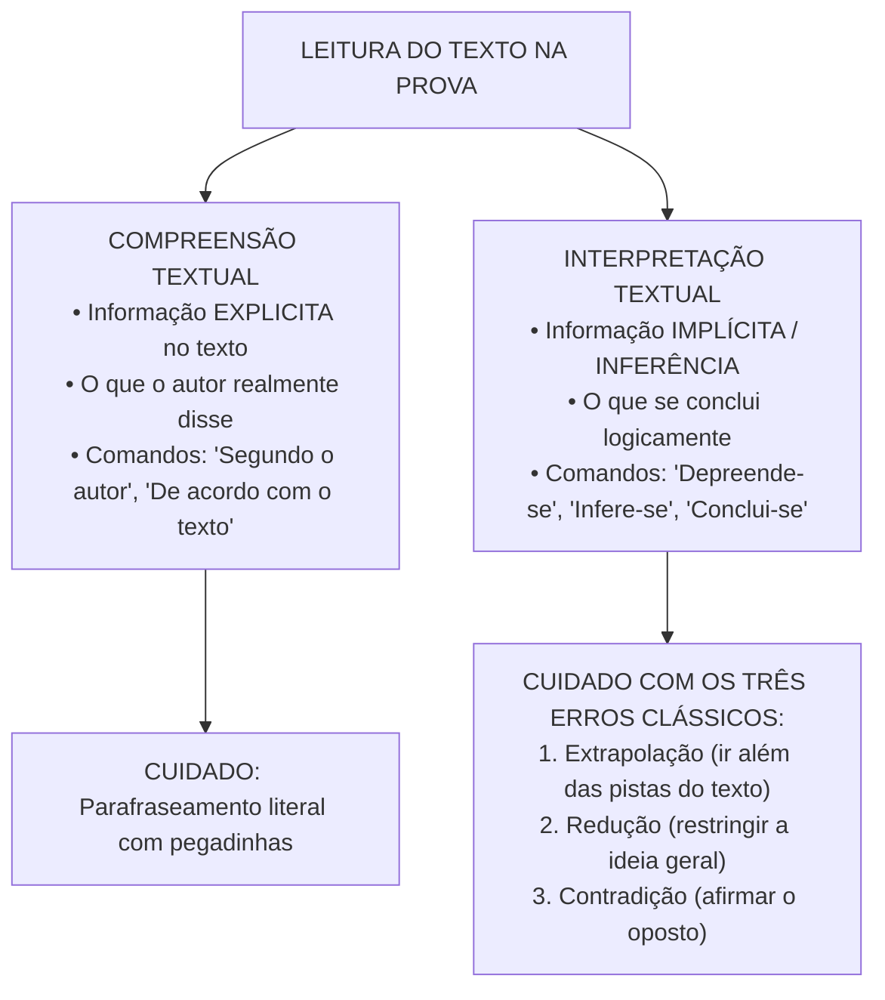
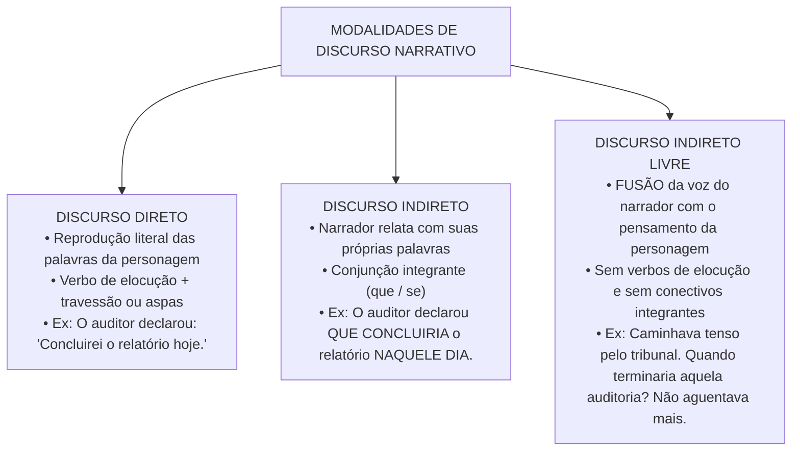

# 01 - Compreensão, Interpretação e Tipologia Textual

> **Matéria:** Língua Portuguesa  
> **Cargos:** A01 – Técnico de Controle Externo (Adm) / B02 – Técnico de Controle Externo (TI)  
> **Arquivo:** `01_compreensao_e_interpretacao_de_texto.md`  
> **Referência Temática:** Teoria do Texto, Tipologias, Discurso Narrativo e Estilística na Banca FCC

---

## 📌 Ementa / Itens do Edital
- Compreensão e interpretação de textos de gêneros variados (ensaios filosóficos, editoriais, crônicas e artigos de opinião);
- Relação do texto com seu contexto histórico, cultural e ideológico;
- Níveis de linguagem: Denotação (sentido literal/dicionarizado) e Conotação (sentido figurado/plurissignificativo);
- Modalidades de discurso: Discurso Direto, Discurso Indireto e Discurso Indireto Livre;
- Regras de transposição de tempos e modos verbais, pronomes e advérbios na passagem de discursos;
- Relações intertextuais: Paráfrase, Paródia, Citação, Epígrafe e Alusão;
- Figuras de linguagem e recursos expressivos (Semânticas, Sintáticas/de Construção e Fonéticas);
- Identificação de tese, estratégias argumentativas, pressupostos e subentendidos na tipologia dissertativa.

---

## 🌳 Classificação Hierárquica

```text
1. Compreensão, Interpretação e Tipologia Textual
├── 1.1 Mecanismos de Leitura e Níveis de Compreensão Textual
│   ├── 1.1.1 Compreensão Textual (Decodificação e Informações Explícitas - "Segundo o texto")
│   ├── 1.1.2 Interpretação Textual (Inferência Lógica, Dedução Autorizada - "Depreende-se do texto")
│   └── 1.1.3 Erros Clássicos de Leitura: Extrapolação, Redução (Restrição) e Contradição
├── 1.2 Tipologias e Gêneros Textuais
│   ├── 1.2.1 Tipologia Dissertativo-Argumentativa: Tese, argumentos de autoridade, contra-argumentação
│   ├── 1.2.2 Tipologia Dissertativo-Expositiva: Apresentação neutra de conceitos, dados e fatos
│   ├── 1.2.3 Tipologia Narrativa: Narrador, personagens, tempo, espaço e enredo
│   ├── 1.2.4 Tipologia Descritiva: Retrato estático de objetos, ambientes e estados de espírito
│   └── 1.2.5 Tipologia Injuntiva / Instrucional: Verbos no imperativo, instruções e manuais
├── 1.3 Sentido Literal vs. Sentido Figurado
│   ├── 1.3.1 Linguagem Denotativa: Precisão conceitual, objetividade e unissignificação
│   └── 1.3.2 Linguagem Conotativa: Polissemia, expressividade, carga valorativa e metáfora
├── 1.4 Modalidades de Discurso e Transposição
│   ├── 1.4.1 Discurso Direto: Verbos de elocução, dois-pontos, aspas e travessões
│   ├── 1.4.2 Discurso Indireto: Mediação da voz do narrador com conjunções integrantes (que, se)
│   ├── 1.4.3 Discurso Indireto Livre: Fusão da voz narrativa com o fluxo de consciência da personagem
│   └── 1.4.4 Tabela de Transposição: Ajustes de tempos verbais, pronomes demonstrativos e dêiticos de tempo
├── 1.5 Intertextualidade e Diálogo entre Textos
│   ├── 1.5.1 Paráfrase: Reescrita com manutenção do sentido original (endosso)
│   ├── 1.5.2 Paródia: Subversão cômica, crítica ou irônica do texto-fonte
│   └── 1.5.3 Alusão, Epígrafe e Citação Direta
└── 1.6 Figuras de Linguagem (Estilística)
    ├── 1.6.1 Figuras de Palavra / Pensamento: Metáfora, Comparação, Metonímia, Antítese, Paradoxo, Oximoro, Hipérbole, Eufemismo, Ironia, Prosopopeia, Sinestesia
    └── 1.6.2 Figuras de Construção / Sintaxe: Elipse, Zeugma, Hipérbato, Pleonasmo, Anáfora, Polissíndeto e Assíndeto
```

---

## 📖 Resumo Teórico & Pontos-Chave

### 1. Compreensão vs. Interpretação na Tradição da FCC

A Fundação Carlos Chagas (FCC) constrói enunciados rigorosos em que a distinção entre **compreensão** e **interpretação** define o método de resolução:



#### Os Três Pecados da Leitura Crítica:
1. **Extrapolação:** O candidato introduz conhecimentos prévios ou juízos de valor que podem até ser verdadeiros no mundo real, mas **não encontram respaldo ou autorização nas linhas do texto**.
2. **Redução:** A alternativa pinça um detalhe secundário ou aspecto particular do texto e o apresenta como se fosse a tese central ou a conclusão definitiva do autor.
3. **Contradição:** A alternativa inverte as relações lógicas de causa e efeito ou assevera o exato oposto daquilo que o texto defendeu.

---

### 2. Tipologias Textuais Predominantes em Concursos

| Tipologia | Objetivo Comunicativo | Marcas Linguísticas Caracterizadoras | Foco na FCC |
| :--- | :--- | :--- | :--- |
| **Dissertativo-Argumentativo** | Defender um ponto de vista (tese) e persuadir o leitor mediante argumentos lógicos. | Presença de operadores argumentativos (*portanto, contudo, por conseguinte*), juízos de valor, dados estatísticos e citações. | É a tipologia **campeã da FCC**. Textos de reflexão filosófica, sociológica e política. |
| **Dissertativo-Expositivo** | Apresentar ideias, conceitos ou teorias de forma estritamente informativa e impessoal. | Verbos na 3ª pessoa, linguagem técnica/denotativa, ausência de juízos morais subjetivos. | Textos científicos ou técnicos sobre administração, finanças públicas e tecnologia. |
| **Narrativo** | Relatar uma sequência temporal de acontecimentos reais ou ficcionais envolvendo personagens. | Verbos de ação no pretérito perfeito/imperfeito, marcadores temporais (*então, depois, subitamente*), progressão de tempo. | Trechos de romances clássicos (Machado de Assis, Lima Barreto, Clarice Lispector). |
| **Descritivo** | Caracterizar seres, objetos, ambientes ou estados com riqueza de detalhes sensoriais. | Predomínio de adjetivos, orações sem verbos de ação dinâmica, retrato estático no tempo. | Surge acoplado à narrativa ou à crônica reflexiva. |
| **Injuntivo / Instrucional** | Indicar ordens, orientações ou procedimentos que o leitor deve seguir. | Verbos no imperativo (*faça, siga, clique*), orações no infinitivo impessoal, enumerações ordenadas. | Editais, manuais de auditoria, regulamentos e leis. |

---

### 3. Modalidades de Discurso e Transposição Verbal

O discurso narrativo estrutura-se em três modalidades fundamentais:



#### Tabela de Transposição (Discurso Direto $\rightarrow$ Discurso Indireto):

| Elemento Gramatical | No Discurso Direto | No Discurso Indireto | Exemplo Prático |
| :--- | :--- | :--- | :--- |
| **Tempo Verbal (Presente)** | Presente do Indicativo | **Pretérito Imperfeito do Indicativo** | *"Estudo agora"* $\rightarrow$ Disse que *estudava* então. |
| **Tempo Verbal (Passado)** | Pretérito Perfeito | **Pretérito Mais-Que-Perfeito** | *"Estudei ontem"* $\rightarrow$ Disse que *estudara* na véspera. |
| **Tempo Verbal (Futuro)** | Futuro do Presente | **Futuro do Pretérito** | *"Estudarei amanhã"* $\rightarrow$ Disse que *estudaria* no dia seguinte. |
| **Modo Verbal (Imperativo)** | Imperativo / Presente do Subjuntivo | **Pretérito Imperfeito do Subjuntivo** | *"Faça a análise!"* $\rightarrow$ Mandou que ele *fizesse* a análise. |
| **Advérbios de Tempo** | *Hoje*, *ontem*, *amanhã*, *agora* | *Naquele dia*, *na véspera*, *no dia seguinte*, *então* | Ajuste ao ponto de vista do narrador. |
| **Pronomes Demonstrativos** | *Este*, *esta*, *isto* | *Aquele*, *aquela*, *aquilo* | Afastamento espacial e temporal. |

---

### 4. Figuras de Linguagem: Guia de Bolso para a FCC

A FCC explora intensamente figuras de linguagem em textos poéticos e ensaísticos:

* **Metáfora:** Comparação implícita sem conectivo comparativo expresso (*"A mente humana é um labirinto escuro"*).
* **Símile (Comparação Explicita):** Confronto analógico mediado por conectivo (*"A mente humana é como um labirinto"*).
* **Metonímia:** Substituição de um termo por outro em virtude de relação lógica de contiguidade (o autor pela obra: *"Li Machado de Assis"*; a parte pelo todo: *"Várias cabeças pensavam na solução"*).
* **Antítese vs. Paradoxo (Oximoro):**
  * *Antítese:* Aproximação de palavras de sentidos opostos sem contradição lógica (*"O amor é riso e choro, luz e sombra"*).
  * *Paradoxo (Oximoro):* Reunião de ideias aparentemente inconciliáveis que chocam a lógica formal (*"O amor é fogo que arde sem se ver; é ferida que dói e não se sente"*).
* **Ironia:** Afirmação do oposto daquilo que se pensa, com intenção crítica ou sarcástica (*"Excelente trabalho! O sistema caiu três vezes em dez minutos"*).
* **Hipérbole:** Exagero intencional e expressivo da realidade (*"Esperei um século pela homologação"*).
* **Eufemismo:** Suavização de ideia desagradável, dolorosa ou chocante (*"Ele partiu desta para uma melhor"* = morreu).
* **Prosopopeia (Personificação):** Atribuição de qualidades, sentimentos ou ações humanas a seres inanimados ou irracionais (*"Os dados da planilha gritavam a fraude"*).
* **Sinestesia:** Fusão de sensações de órgãos sensoriais distintos (*"Sua voz áspera e fria ecoou na sala"* - tato + audição).
* **Hipérbato:** Inversão brusca da ordem direta dos termos da oração (*"Ouviram do Ipiranga as margens plácidas de um povo heroico o brado retumbante"*).
* **Elipse vs. Zeugma:**
  * *Elipse:* Omissão de termo facilmente subentendido no contexto (*"Na sala, muito silêncio"* - omissão do verbo *havia*).
  * *Zeugma:* Omissão de termo que já foi mencionado anteriormente na frase (*"Eu comprei o livro de controle; ele, o de informática"* - omissão de *comprou*).

---

## ⚠️ Alertas de Prova & Pegadinhas da FCC

> 🚨 **ALERTA DE PROVA / PEGADINHA FCC:** Ao responder questões que indagam o que se *"depreende"* ou *"infere"* do texto, elimine sumariamente alternativas que contenham palavras de valor absoluto e generalizante, tais como **"sempre"**, **"nunca"**, **"exclusivamente"**, **"todos"**, **"necessariamente"** e **"somente"**, salvo se o próprio texto original tiver utilizado expressamente essa mesma restrição categórica!

> ⭐ **IMPORTANTE / DISCURSO INDIRETO LIVRE:** O sinal característico do Discurso Indireto Livre em provas de Língua Portuguesa da FCC é a presença de frases interrogativas ou exclamativas súbitas inseridas na terceira pessoa do singular, expressando a hesitação interna da personagem sem que haja travessão ou oração subordinada integrante (*"Estava diante do tribunal. Entraria ou fugiria? Já não restava alternativa"*).

> 📌 **NOTA EXPLICATIVA / ANTÍTESE X PARADOXO:** Na antítese, os opostos coexistem no mundo real (dia e noite, amor e ódio). No paradoxo, os termos opostos fundem-se na mesma entidade de modo a desafiar o princípio da não contradição (*"uma lúcida loucura"*, *"um silêncio ensurdecedor"*).

> 💡 **DICA DE RESOLUÇÃO / RECONHECIMENTO DE TESE:** O primeiro parágrafo de um texto dissertativo da FCC normalmente contextualiza o tema e apresenta a tese. O último parágrafo sintetiza a conclusão. Se a questão indagar a ideia central, releia atentamente o início e o fim do texto antes de analisar as alternativas intermediárias.

---

## 🌐 Fontes Oficiais e Referências Bibliográficas

* [Portal Domínio Público (Ministério da Educação - MEC)](http://www.dominiopublico.gov.br/) - Repositório oficial de ensaios, obras de Machado de Assis, Lima Barreto e crônicas clássicas exploradas pela banca FCC.
* [Só Português - Portal Gramatical e Estilística](https://www.soportugues.com.br/secoes/estilistica/) - Teoria da comunicação, tipologia textual, modalidades de discurso e catálogo de figuras de linguagem.
* [Escola Virtual de Governo (EV.G / ENAP) - Leitura Crítica e Interpretação Textual](https://www.escolavirtual.gov.br/) - Cursos abertos de análise argumentativa e estruturação lógica do discurso no serviço público.
* CEGALLA, Domingos Paschoal. *Novíssima Gramática da Língua Portuguesa*. São Paulo: Companhia Editora Nacional. (Capítulo sobre Estilística e Figuras de Estilo).
* PLATÃO & FIORIN. *Para Entender o Texto: Leitura e Redação*. São Paulo: Ática. (Obra de referência para análise de discursos e tipologias).

---

## 📝 Questões de Concurso FCC Comentadas

### Questão 01
**(FCC – TCE-GO – Analista de Controle Externo)**  
*Considere o seguinte excerto:*  
*"A velocidade vertiginosa com que as novas tecnologias de inteligência artificial são integradas ao cotidiano suscita promessas sedutoras de eficiência administrativa absoluta e erradicação do erro humano. Contudo, essa aparente panaceia obscurece o fato de que os sistemas algorítmicos herdaram os próprios vieses, preconceitos e miopias éticas dos dados históricos que os alimentam. Longe de representarem uma objetividade asséptica, tais instrumentos podem operar como sofisticados espelhos que reproduzem, com roupagem matemática, as velhas assimetrias sociais"*.

A partir da leitura atenta do texto, depreende-se corretamente que:

* **A)** A tecnologia de inteligência artificial deve ter sua aplicação sumariamente suspensa nas repartições públicas, por constituir ameaça insanável aos direitos fundamentais.
* **B)** A eficiência operacional proporcionada pelos algoritmos revelou-se ilusória, uma vez que as máquinas cometem rigorosamente a mesma quantidade de falhas que os seres humanos.
* **C)** O autor adota uma postura crítica ao evidenciar que a pretensa neutralidade da inteligência artificial pode ocultar a perpetuação de distorções e desigualdades preexistentes na sociedade.
* **D)** A erradicação dos erros administrativos é um objetivo já alcançado nas esferas em que a tecnologia algorítmica substituiu o juízo humano.
* **E)** Os vieses algorítmicos decorrem da imperícia intencional dos engenheiros de computação que desenvolvem modelos visando discriminar grupos sociais específicos.

> **Gabarito: C**  
> **Comentário Detalhado:**  
> - **A) Incorreta.** O texto não defende o banimento ou a suspensão sumária da tecnologia, mas alerta para o perigo de considerá-la neutra ou imune a falhas. Trata-se de erro clássico de **extrapolação**.  
> - **B) Incorreta.** O texto não afirma que as máquinas cometem "a mesma quantidade de falhas", mas sim que os sistemas herdam os vieses e preconceitos dos dados históricos.  
> - **C) CORRETA.** O núcleo argumentativo do excerto (introduzido pelo conectivo adversativo *"Contudo"*) desconstrói a visão ingênua da IA como "objetividade asséptica", demonstrando que os modelos funcionam como "espelhos que reproduzem, com roupagem matemática, as velhas assimetrias sociais". A alternativa traduz com precisão essa tese crítica.  
> - **D) Incorreta.** O autor classifica a erradicação do erro como mera "promessa sedutora" e "aparente panaceia", não como um fato concretizado. É erro de **contradição**.  
> - **E) Incorreta.** O texto esclarece que os vieses decorrem dos "dados históricos que os alimentam", e não de má-fé ou dolo intencional dos desenvolvedores. Trata-se de extrapolação sem amparo no excerto.

---

### Questão 02
**(FCC – TRT – Analista Judiciário)**  
*Observe o fragmento a seguir:*  
*"O relator permaneceu em silêncio por longos minutos diante dos autos volumosos. Como solucionar aquele impasse procedimental sem ferir a jurisprudência consolidada da Casa? Sabia que os olhares de todos os presentes convergiam para sua bancada. Era preciso decidir, e decidir imediatamente"*.

No fragmento acima, a passagem assinalada pela oração interrogativa (*"Como solucionar aquele impasse procedimental sem ferir a jurisprudência consolidada da Casa?"*) exemplifica o emprego do:

* **A)** Discurso direto pontuado por elipse de aspas.
* **B)** Discurso indireto clássico subordinado por conectivo causal.
* **C)** Discurso indireto livre, em que o pensamento íntimo da personagem se mescla diretamente à narração em terceira pessoa.
* **D)** Recurso estilístico de metonímia personificada.
* **E)** Discurso dissertativo de autoridade estrita.

> **Gabarito: C**  
> **Comentário Detalhado:**  
> - **A) Incorreta.** Não há discurso direto, pois faltam verbos de elocução introdutórios e pontuação típica (dois-pontos, travessão ou aspas).  
> - **B) Incorreta.** O discurso indireto convencional exigiria a mediação formal do narrador mediante conjunção integrante (*"O relator perguntou a si mesmo como solucionaria..."*).  
> - **C) CORRETA.** Configura-se tipicamente o **Discurso Indireto Livre**: a voz do narrador (em terceira pessoa) funde-se instantaneamente ao fluxo de consciência e à indagação íntima da personagem (*"Como solucionar aquele impasse...?"*), sem marcas formais de abertura de fala ou conectivos de subordinação.  
> - **D) Incorreta.** Não se trata de figura metonímica, mas de recurso de estruturação do foco narrativo.  
> - **E) Incorreta.** O fragmento tem natureza narrativa/ficcional e não dissertativa conceitual.

---

### Questão 03
**(FCC – TCE-PI – Auditor de Controle Externo)**  
Transpondo-se a oração em discurso direto:  
*O auditor afirmou aos gestores: "Concluirei a fiscalização amanhã e entregarei este relatório à presidência"*  
para o discurso indireto, a forma verbal e os elementos dêiticos ajustam-se corretamente em:

* **A)** O auditor afirmou aos gestores que concluiria a fiscalização amanhã e entregaria este relatório à presidência.
* **B)** O auditor afirmou aos gestores que concluiria a fiscalização no dia seguinte e entregaria aquele relatório à presidência.
* **C)** O auditor afirmou aos gestores que concluíra a fiscalização na véspera e entregara esse relatório à presidência.
* **D)** O auditor afirmou aos gestores que concluirá a fiscalização no dia subsequente e entregará aquele relatório à presidência.
* **E)** O auditor afirmou aos gestores que tenha concluído a fiscalização amanhã e entregue aquele relatório à presidência.

> **Gabarito: B**  
> **Comentário Detalhado:**  
> - **A) Incorreta.** Errou ao manter os dêiticos temporais e espaciais no presente (*amanhã* e *este*).  
> - **B) CORRETA.** Na transposição do Discurso Direto para o Indireto, as regras gramaticais exigem três ajustes simultâneos:  
>   1. **Tempos Verbais:** Futuro do Presente (*concluirei*, *entregarei*) transforma-se em **Futuro do Pretérito** (*concluiria*, *entregaria*);  
>   2. **Advérbio de Tempo:** *Amanhã* passa para **no dia seguinte** (ou *no dia subsequente*);  
>   3. **Pronome Demonstrativo:** *Este* passa para **aquele**, marcando o distanciamento temporal e espacial da enunciação.  
> - **C) Incorreta.** O Pretérito Mais-Que-Perfeito (*concluíra*) e a locução *na véspera* corresponderiam ao passado, e não ao futuro original.  
> - **D) Incorreta.** Manteve o verbo no futuro do presente (*concluirá*), o que fere a correlação com a oração principal no pretérito (*afirmou*).  
> - **E) Incorreta.** Emprega o pretérito perfeito do subjuntivo (*tenha concluído*), desfigurando a ideia de futurição original.

---

### Questão 04
**(FCC – METRÔ-SP – Analista de Comunicação)**  
Considere os versos e expressões a seguir:  
I. *"A cidade dormia sob o manto pesado de um silêncio ensurdecedor."*  
II. *"Ele não era exatamente uma fonte de sabedoria; faltava-lhe perspicácia para lidar com o público."*  
III. *"Nas horas de angústia, o coração do fiscal chorava lágrimas de ferro."*

As figuras de linguagem presentes nos trechos I, II e III são, respectivamente:

* **A)** Paradoxo (Oximoro), Eufemismo e Prosopopeia (Personificação).
* **B)** Antítese, Hipérbole e Metonímia.
* **C)** Pleonasmo, Ironia e Catacrese.
* **D)** Paradoxo (Oximoro), Antítese e Sinestesia.
* **E)** Metáfora, Eufemismo e Zeugma.

> **Gabarito: A**  
> **Comentário Detalhado:**  
> - **Trecho I:** *"silêncio ensurdecedor"* reúne termos contraditórios que desafiam a lógica sensorial (o silêncio não pode ensurdecer), configurando **paradoxo (oximoro)**.  
> - **Trecho II:** *"não era exatamente uma fonte de sabedoria"* suaviza a constatação rude de que a pessoa era tola ou despreparada, caracterizando **eufemismo**.  
> - **Trecho III:** *"o coração (...) chorava lágrimas de ferro"* atribui ação humana ao órgão e usa imagem figurada de sentimento, caracterizando **prosopopeia (personificação)** com metáfora expressiva.  
> - Portanto, a única sequência correta e completa é a da alternativa A.

---

### Questão 05
**(FCC – DPE-RS – Analista Jurídico)**  
Assinale a alternativa em que a relação entre orações do texto expressa valor semântico de conotação e linguagem figurada:

* **A)** *"O contrato administrativo foi rescindido unilateralmente pela administração com base no artigo 137 da legislação vigente."*
* **B)** *"A receita tributária estadual registrou crescimento nominal de quatro por cento no terceiro trimestre do exercício financeiro."*
* **C)** *"A burocracia estatal engoliu os anseios da população em um pântano de formulários intermináveis e carimbos inertes."*
* **D)** *"O Tribunal de Contas é composto por sete Conselheiros nomeados segundo os ditames da Constituição Estadual."*
* **E)** *"O prazo prescricional para o ajuizamento da execução fiscal de créditos tributários é de cinco anos."*

> **Gabarito: C**  
> **Comentário Detalhado:**  
> - **A), B), D) e E) Incorretas.** Todas essas frases utilizam linguagem estritamente **denotativa** (literal, técnica, unívoca e jurídica), sem emprego de figuras de estilo ou conotação.  
> - **C) CORRETA.** A frase emprega linguagem eminentemente **conotativa (figurada)**: a burocracia não tem boca para *"engolir"* nada (prosopopeia/metáfora), a tramitação documental é metaforizada como um *"pântano"* e os carimbos são qualificados como *"inertes"*, transmitindo expressividade e juízo crítico de valor ao leitor.
