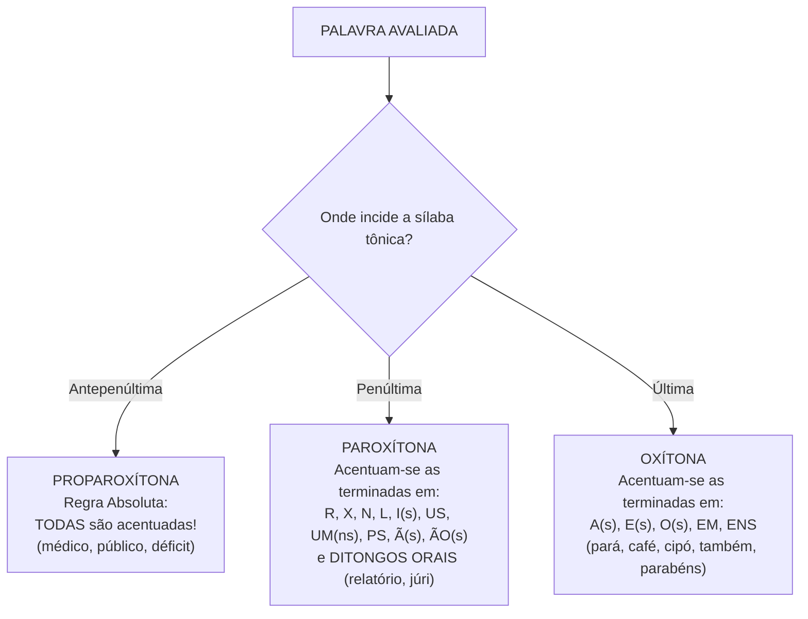
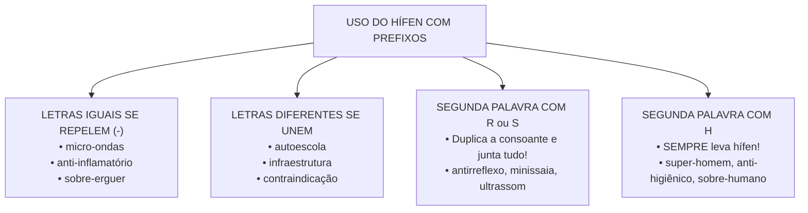
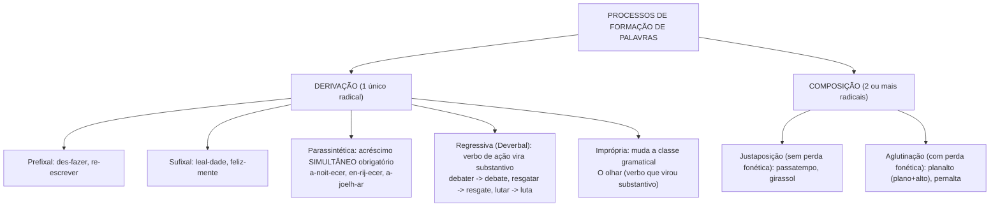

# 02 - Fonética, Ortografia, Vocabulário e Formação de Palavras

> **Matéria:** Língua Portuguesa  
> **Cargos:** A01 – Técnico de Controle Externo (Adm) / B02 – Técnico de Controle Externo (TI)  
> **Arquivo:** `02_ortografia_acentuacao_e_formacao_de_palavras.md`  
> **Referência Temática:** Ortografia Oficial, Acentuação Gráfica, Novo Acordo e Morfologia na Banca FCC

---

## 📌 Ementa / Itens do Edital
- Ortografia oficial e acentuação gráfica segundo o Acordo Ortográfico vigente (Decreto nº 6.583/2008);
- Regras gerais e especiais de acentuação: proparoxítonas, paroxítonas, oxítonas e monossílabos tônicos;
- Acentuação de ditongos abertos (éi, ói, éu), hiatos (i e u tônicos) e acento diferencial obrigatório;
- Emprego do hífen com prefixos e falsos prefixos: regras de aglutinação, duplicação de consoantes e exceções;
- Semântica lexical: sinonímia, antonímia, hiperonímia, hiponímia e polissemia;
- Homônimos e parônimos de alta incidência em concursos públicos;
- Elementos mórficos estruturais: radical, vogal temática, tema, afixos (prefixos e sufixos) e desinências nominais/verbais;
- Processos de formação de palavras: derivação (prefixal, sufixal, parassintética, regressiva e imprópria) e composição (justaposição e aglutinação).

---

## 🌳 Classificação Hierárquica

```text
2. Fonética, Ortografia, Vocabulário e Formação de Palavras
├── 2.1 Acentuação Gráfica e Novo Acordo Ortográfico
│   ├── 2.1.1 Posição da Sílaba Tônica: Oxítonas, Paroxítonas e Proparoxítonas
│   ├── 2.1.2 Regra das Proparoxítonas: Todas acentuadas (proparoxítonas reais e aparentes/eventuais)
│   ├── 2.1.3 Regra das Paroxítonas: Terminações em R, X, N, L, I/IS, US, UM/UNS, PS, Ã/ÃS, ÃOS e Ditongos orais
│   ├── 2.1.4 Regra das Oxítonas: Terminações em A(s), E(s), O(s), EM e ENS
│   ├── 2.1.5 Monossílabos Tônicos: Terminações em A(s), E(s) e O(s)
│   ├── 2.1.6 Ditongos Abertos (ÉI, ÓI, ÉU):
│   │   ├── Mantêm acento em oxítonas e monossílabos (herói, troféu, pastéis, réu)
│   │   └── Perderam acento em paroxítonas (ideia, jiboia, heroico, plateia)
│   ├── 2.1.7 Regra do Hiato: I e U tônicos sozinhos ou com S (saúde, saída vs. rainha, feiura)
│   └── 2.1.8 Acento Diferencial Obrigatório: pôde/pode, pôr/por, têm/tem, vêm/vem (e compostos mantêm/mantém)
├── 2.2 Emprego do Hífen com Prefixos
│   ├── 2.2.1 Regra dos Opostos: Letras iguais se separam com hífen; letras diferentes se unem
│   ├── 2.2.2 Letras R e S no segundo elemento: Unem-se e duplicam a consoante (antirreflexo, minissaia)
│   ├── 2.2.3 Letra H no segundo elemento: Sempre com hífen (anti-higiênico, super-homem)
│   └── 2.2.4 Prefixos Especiais: ex-, vice-, sem-, recém-, além-, aquém- (sempre com hífen); co- e re- (aglutinam sempre)
├── 2.3 Semântica Vocabular: Homônimos, Parônimos e Relações Lexicais
│   ├── 2.3.1 Parônimos Clássicos: eminente/iminente, flagrante/fragrante, mandado/mandato, retificar/ratificar
│   ├── 2.3.2 Homônimos Homófonos: cessão/sessão/seção, censo/senso, acento/assento, concerto/conserto
│   └── 2.3.3 Hiperonímia (conceito geral/englobante) vs. Hiponímia (conceito específico/englobado)
└── 2.4 Morfologia e Processos de Formação de Palavras
    ├── 2.4.1 Elementos Mórmicos: Radical, afixos, desinências e vogais/consoantes de ligação
    ├── 2.4.2 Derivação Prefixal, Sufixal e Prefixal-Sufixal (acréscimos independentes)
    ├── 2.4.3 Derivação Parassintética: Acréscimo simultâneo e obrigatório (esfriar, anoitecer, enlouquecer)
    ├── 2.4.4 Derivação Regressiva (Deverbal): Substantivos abstratos que indicam ação (combate, resgate, debate)
    ├── 2.4.5 Derivação Imprópria (Conversão): Mudança de classe gramatical sem alteração de forma
    └── 2.4.6 Composição por Justaposição (sem perda fonética) vs. Aglutinação (com fusão e perda fonética)
```

---

## 📖 Resumo Teórico & Pontos-Chave

### 1. Sistema Geral de Acentuação Gráfica



#### 1.1 O Caso Especial das Paroxítonas Terminadas em Ditongo Crescente (FCC):
* Palavras como *se-cre-tá-ria*, *re-la-tó-rio*, *his-tó-ria*, *cél-cia* possuem dupla classificação admitida pela gramática normativa:
  1. **Corrente Tradicional:** São paroxítonas terminadas em ditongo oral crescente.
  2. **Corrente Fonológica (Proparoxítonas Aparentes / Eventuais):** Podem sofrer divisão silábica estendida (*re-la-tó-ri-o*), comportando-se como proparoxítonas.
* **Comportamento da FCC em prova:** A FCC aceita as duas justificativas! Porém, a banca formula a maioria dos seus gabaritos agrupando essas palavras na regra das **paroxítonas terminadas em ditongo oral crescente**.

#### 1.2 Regra Especial dos Hiatos e Ditongos Abertos:
* **Hiatos (I e U tônicos):** Acentuam-se a segunda vogal do hiato quando for **I** ou **U** tônico, sozinho na sílaba ou com **S**, desde que:
  * Não seja seguido por **NH** na sílaba seguinte (*ra-i-nha*, *mo-i-nho* não levam acento);
  * Não seja precedido de ditongo decrescente em palavras paroxítonas (*fei-u-ra*, *chei-i-nho*, *ba-i-u-ca* perderam o acento; mas se for oxítona mantém: *Pi-au-í*).
* **Ditongos Abertos (ÉI, ÓI, ÉU):**
  * **Oxítonas e Monossílabos:** MANTÊM o acento gráfico (*herói*, *pastéis*, *chapéu*, *céu*, *dói*);
  * **Paroxítonas:** PERDERAM o acento com o Novo Acordo (*ideia*, *jiboia*, *heroico*, *boia*, *plateia*, *coreia*).

#### 1.3 Acento Diferencial Obrigatório:
* **Pôde** (pretérito perfeito do indicativo) $\neq$ **Pode** (presente do indicativo);
* **Pôr** (verbo) $\neq$ **Por** (preposição essencial);
* **Têm / Vêm** (3ª pessoa do plural) $\neq$ **Tem / Vem** (3ª pessoa do singular);
* **Compostos de Ter e Vir (Manter, Conter, Intervir):**
  * Singular com agudo: *ele mantém*, *ele intervém*;
  * Plural com circunflexo: *eles mantêm*, *eles intervêm*.

---

### 2. Guia Prático do Emprego do Hífen (Novo Acordo)



#### Tabela Resumo do Hífen com Prefixos:

| Regra / Contexto | Diretriz do Acordo | Exemplos Corretos |
| :--- | :--- | :--- |
| **Vogal + Vogal Igual** | Usa-se Hífen | *micro-ondas, anti-inflamatório, semi-interno, arqui-inimigo* |
| **Vogal + Vogal Diferente** | Não se usa Hífen (aglutina) | *autoescola, semiaberto, coautor, infraestrutura, agroindústria* |
| **Vogal + Consoante R ou S** | Dobra-se a consoante (rr / ss) | *antirrábico, microssistema, ultrassom, cosseno, minissaia* |
| **Vogal + Demais Consoantes** | Junta-se sem alteração | *antiprojeto, autopeça, geopolítica, semicírculo* |
| **Consoante + Consoante Igual** | Usa-se Hífen | *inter-regional, sub-base, super-resistente, hiper-requintado* |
| **Consoante + Consoante Diferente** | Junta-se sem hífen | *intermunicipal, hipermercado, subchefe, superpopulação* |
| **Segundo Elemento com 'H'** | Usa-se Hífen SEMPRE | *anti-herói, super-homem, sobre-humano, pan-helênico* |
| **Prefixos Especiais** | Sempre com hífen | *ex-diretor, sem-terra, vice-presidente, recém-nascido, pró-ativo* |

---

### 3. Processos de Formação de Palavras: Quadro Comparativo



#### Distinção Crítica: Derivação Prefixal-Sufixal vs. Parassíntese:
* **Prefixal e Sufixal:** O prefixo e o sufixo são anexados de forma independente. Se você retirar um dos afixos, a palavra restante **continua existindo** no vocabulário!
  * Exemplo: *des-leal-dade* $\rightarrow$ existe *desleal* e existe *lealdade*.
* **Parassíntese (Derivação Parassintética):** A agregação do prefixo e do sufixo ocorre de forma **simultânea e indissociável**. Se você retirar qualquer um dos afixos, o vocábulo resultante **NÃO existe** no idioma!
  * Exemplo: *a-noit-ecer* $\rightarrow$ não existe *"anoite"* nem *"noitecer"*; *en-surd-ecer* $\rightarrow$ não existe *"ensurdo"* nem *"surdecer"*.

---

## ⚠️ Alertas de Prova & Pegadinhas da FCC

> 🚨 **ALERTA DE PROVA / PEGADINHA FCC:** A FCC adora comparar palavras como *história*, *notícia*, *espécie* e *país*. As três primeiras são acentuadas por serem **paroxítonas terminadas em ditongo oral crescente** (ou proparoxítonas aparentes), ao passo que *país* é acentuada pela **regra do hiato** (I tônico isolado na sílaba). Elas **não** pertencem à mesma regra!

> ⭐ **IMPORTANTE / NOVO ACORDO:** Palavras paroxítonas que contêm os ditongos abertos **EI** e **OI** perderam o acento! Portanto, grafam-se sem acento: *ideia*, *estreia*, *jiboia*, *coreia*, *heroico*, *paranoia*. Se a palavra for oxítona, o acento permanece: *herói*, *dói*, *troféu*, *pastéis*.

> 📌 **NOTA EXPLICATIVA / DERIVAÇÃO REGRESSIVA:** Na derivação regressiva (deverbal), forma-se sempre um **substantivo abstrato indicador de ação** a partir de um verbo primitivo (*comprar* $\rightarrow$ *a compra*; *pescar* $\rightarrow$ *a pesca*; *censurar* $\rightarrow$ *a censura*). Se o substantivo designar um objeto concreto, ele é que é a palavra primitiva (*âncora* $\rightarrow$ *ancorar*; *martelo* $\rightarrow$ *martelar*).

> 💡 **DICA DE MEMORIZAÇÃO / PARÔNIMOS:**
> * **Sessão:** reunião de pessoas / tempo de duração (sessão plenária do TCE-GO, sessão de cinema);
> * **Seção / Secção:** divisão, corte, repartição (seção de auditoria, seção eleitoral);
> * **Cessão:** ato de ceder / transferir direitos (cessão de servidores, cessão de posse);
> * **Mandado:** ordem da autoridade (mandado de segurança, mandado de prisão);
> * **Mandato:** procuração / tempo de cargo eletivo (mandato de Conselheiro ou Governador).

---

## 🌐 Fontes Oficiais e Referências Bibliográficas

* [Academia Brasileira de Letras (ABL) - Vocabulário Ortográfico da Língua Portuguesa (VOLP)](https://www.academia.org.br/nossa-lingua/busca-no-vocabulario) - Base oficial de consulta léxica e grafia no Brasil.
* [Portal da Presidência da República - Decreto Federal nº 6.583/2008](http://www.planalto.gov.br/ccivil_03/_ato2007-2010/2008/decreto/d6583.htm) - Promulgação do Acordo Ortográfico da Língua Portuguesa.
* [Portal da Língua Portuguesa (ILTEC)](http://www.portaldalinguaportuguesa.org/) - Guia explicativo e tabelas comparativas das regras de transição ortográfica.
* BECHARA, Evanildo. *Moderna Gramática Portuguesa*. Rio de Janeiro: Nova Fronteira. (Seções sobre Fonética, Ortografia e Estrutura das Palavras).
* CUNHA, Celso & CINTRA, Lindley. *Nova Gramática do Português Contemporâneo*. Rio de Janeiro: Lexikon.

---

## 📝 Questões de Concurso FCC Comentadas

### Questão 01
**(FCC – TCE-GO – Analista de Controle Externo)**  
Assinale a alternativa em que ambos os vocábulos sublinhados são acentuados com fundamento na **mesma regra gramatical**:

* **A)** *"O relatório do Tribunal contém dados sobre a renúncia de receita."*
* **B)** *"A autoridade pública examinou o processo na sessão de julgamento."*
* **C)** *"A atuação do Estado em saúde preventiva é imprescindível para o país."*
* **D)** *"O órgão de auditoria apurou o prejuízo e aplicou a sanção cabível."*
* **E)** *"O auditor demonstrou perspicácia ao desvendar o desvio de recursos."* (perspicácia – desvendar)

> **Gabarito: A**  
> **Comentário Detalhado:**  
> - **A) CORRETA.** Os vocábulos *relatório* (re-la-tó-rio) e *renúncia* (re-nún-cia) são ambos acentuados pela regra das **paroxítonas terminadas em ditongo oral crescente** (ou proparoxítonas eventuais/aparentes, conforme nomenclatura gramatical adotada pela banca FCC). Ambos compartilham rigorosamente a mesma regra de justificação acentual!  
> - **B) Incorreta.** *pública* é acentuada por ser **proparoxítona** (todas são acentuadas), ao passo que a frase não apresenta outro termo acentuado pela mesma regra.  
> - **C) Incorreta.** *saúde* e *país* pertencem à regra do hiato, mas comparados com *imprescindível* (paroxítona terminada em L), as regras são distintas.  
> - **D) Incorreta.** *órgão* é paroxítona terminada em -ão, enquanto *prejuízo* é acentuada pela regra do hiato (U tônico formando hiato com o E anterior).  
> - **E) Incorreta.** *desvendar* é oxítona terminada em R e sequer recebe acento gráfico.

---

### Questão 02
**(FCC – TRF – Analista Judiciário)**  
Quanto ao emprego do hífen em palavras formadas por derivação prefixal em consonância com o Acordo Ortográfico vigente, assinale a opção inteiramente correta:

* **A)** anti-inflamatório, auto-escola, micro-ondas, hiper-resistente.
* **B)** antiinflamatório, autoescola, microondas, hiperresistente.
* **C)** anti-inflamatório, autoescola, micro-ondas, hiper-resistente.
* **D)** anti-inflamatório, autoescola, micro-ondas, hiperresistente.
* **E)** antiinflamatório, auto-escola, micro-ondas, hiper-resistente.

> **Gabarito: C**  
> **Comentário Detalhado:**  
> - Aplicando as regras do Novo Acordo Ortográfico:  
>   1. **anti-inflamatório:** O prefixo *anti-* termina na mesma vogal com que se inicia o segundo elemento (*i*). Letras iguais se repelem com **hífen** (*anti-inflamatório*).  
>   2. **autoescola:** O prefixo *auto-* termina com *o* e o segundo elemento começa com *e*. Letras diferentes se unem **sem hífen** (*autoescola*).  
>   3. **micro-ondas:** O prefixo *micro-* termina em *o* e o segundo elemento inicia em *o*. Vogais iguais exigem **hífen** (*micro-ondas*).  
>   4. **hiper-resistente:** O prefixo *hiper-* termina na consoante *r* e o segundo elemento começa pela mesma consoante *r*. Consoantes iguais se separam com **hífen** (*hiper-resistente*).  
> - A única alternativa que apresenta todas as formas grafadas com perfeição é a letra C.

---

### Questão 03
**(FCC – TCE-PI – Auditor de Controle Externo)**  
Considere os vocábulos destacados nas frases abaixo:  
I. *"O plenário do Tribunal encerrou a <ins>sessão</ins> extraordinária às dezoito horas."*  
II. *"A empresa cometeu ato ilícito e foi autuada em <ins>flagrante</ins> delito pela equipe fiscal."*  
III. *"O Governador do Estado cumpriu integralmente os quatro anos de seu <ins>mandato</ins> eletivo."*  
IV. *"O engenheiro responsável promoveu a <ins>retificação</ins> das falhas apontadas no projeto original."*

A grafia e o emprego semântico dos vocábulos sublinhados estão corretos em:

* **A)** I, II, III e IV.
* **B)** I e III, apenas.
* **C)** II e IV, apenas.
* **D)** I, II e IV, apenas.
* **E)** II, III e IV, apenas.

> **Gabarito: A**  
> **Comentário Detalhado:**  
> - **Item I: Correto.** *Sessão* (com iniciais S e dígrafo SS) designa a reunião de um colegiado deliberativo ou o tempo em que uma assembleia delibera.  
> - **Item II: Correto.** *Flagrante* delito significa o ato evidente, manifesto, que está sendo presenciado no momento de sua realização (não confundir com *fragrante*, que significa aromático/cheiroso).  
> - **Item III: Correto.** *Mandato* refere-se à procuração política ou período de exercício de uma função pública eletiva (não confundir com *mandado*, que é a ordem judicial de prisão, segurança ou busca).  
> - **Item IV: Correto.** *Retificação* é o ato de corrigir, retificar ou emendar algo que continha falhas (não confundir com *ratificação*, que significa confirmar ou validar algo já feito).  
> - Todos os quatro itens estão impecavelmente empregados. Gabarito: A.

---

### Questão 04
**(FCC – AL-SP – Técnico Legislativo)**  
Em relação aos processos morfológicos de formação das palavras, assinale a alternativa em que a palavra destacada é formada por **derivação parassintética**:

* **A)** *"A leitura do processo revelou a <ins>deslealdade</ins> do administrador perante o erário."*
* **B)** *"O auditor constatou que era urgente <ins>esfriar</ins> os ânimos acalorados durante a inspeção."*
* **C)** *"O governo estadual implementou o <ins>resgate</ins> das apólices da dívida pública."*
* **D)** *"O relatório final foi concluído <ins>infelizmente</ins> fora do prazo regulamentar."*
* **E)** *"O <ins>passatempo</ins> preferido dos funcionários consistia em desvendar charadas lógicas."*

> **Gabarito: B**  
> **Comentário Detalhado:**  
> - **A) Incorreta.** *deslealdade* é formada por derivação prefixal e sufixal independente (des- + leal + -dade). Se retirarmos o prefixo, existe *lealdade*; se retirarmos o sufixo, existe *desleal*.  
> - **B) CORRETA.** *esfriar* é formada por derivação **parassintética** (e- + frio/fri- + -ar). O acréscimo do prefixo e do sufixo verbal dá-se de modo simultâneo: não existe no português o substantivo/adjetivo *"esfrio"* nem o verbo *"friar"*. A eliminação de qualquer um dos afixos destrói a palavra.  
> - **C) Incorreta.** *resgate* é formada por derivação regressiva (deverbal), originada do verbo de ação *resgatar*.  
> - **D) Incorreta.** *infelizmente* é formada por derivação sufixal a partir de *infeliz* (ou prefixal e sufixal independente, pois existem *felizmente* e *infeliz*).  
> - **E) Incorreta.** *passatempo* é formada por composição por justaposição (passa + tempo), unindo dois radicais sem perda fonética.

---

### Questão 05
**(FCC – METRÔ-SP – Analista de Gestão)**  
O vocábulo formado por **derivação regressiva** (também denominada deverbal) encontra-se presente na frase:

* **A)** *"O debate entre os candidatos à vaga de conselheiro prolongou-se pela madrugada."*
* **B)** *"O envelhecimento prematuro das pontes estaduais alarmou o setor de engenharia."*
* **C)** *"Os técnicos agiram com rapidez invejável no reestabelecimento dos servidores de dados."*
* **D)** *"O girassol plantado nos canteiros da corte simbolizava a busca pela transparência."*
* **E)** *"O saber acumulado pelo fiscal garantiu a correta instrução probatória dos autos."*

> **Gabarito: A**  
> **Comentário Detalhado:**  
> - **A) CORRETA.** O substantivo abstrato *debate* deriva regressivamente do verbo de ação *debater* (debater $\rightarrow$ debate). Na derivação regressiva, o verbo primitivo perde suas desinências e reduz-se a um substantivo abstrato que nomeia a própria ação verbal.  
> - **B) Incorreta.** *envelhecimento* é formada por derivação sufixal a partir do verbo parassintético *envelhecer*.  
> - **C) Incorreta.** *rapidez* é formada por derivação sufixal a partir do adjetivo *rápido* (rápido + -ez).  
> - **D) Incorreta.** *girassol* é formada por composição por justaposição (gira + sol).  
> - **E) Incorreta.** *o saber* é exemplo de derivação imprópria (conversão), pois o verbo *saber* foi substantivado pelo artigo *o*.
