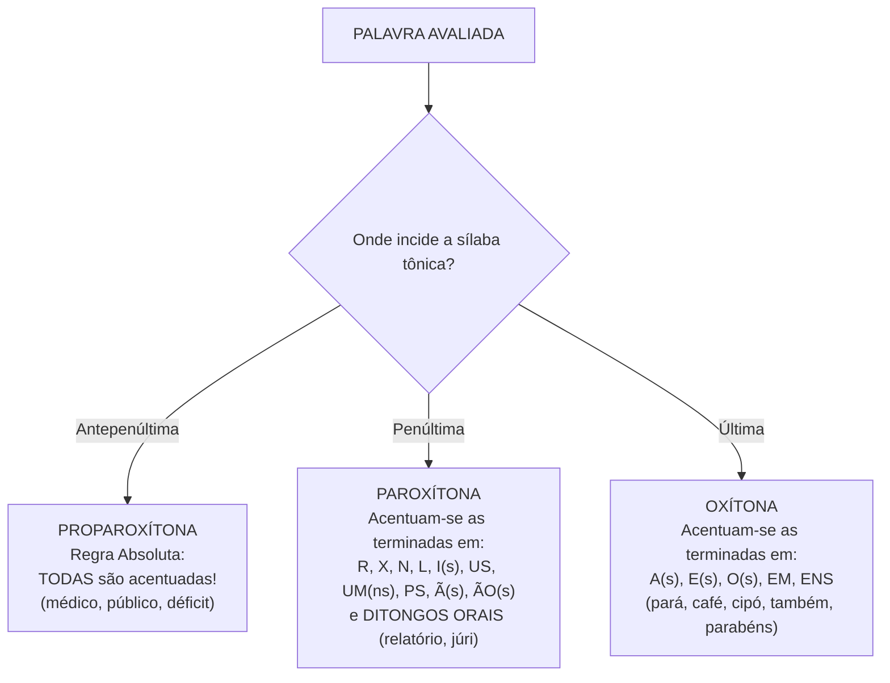
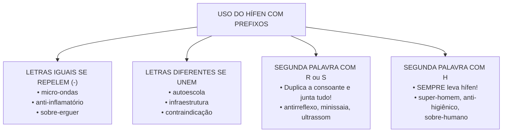
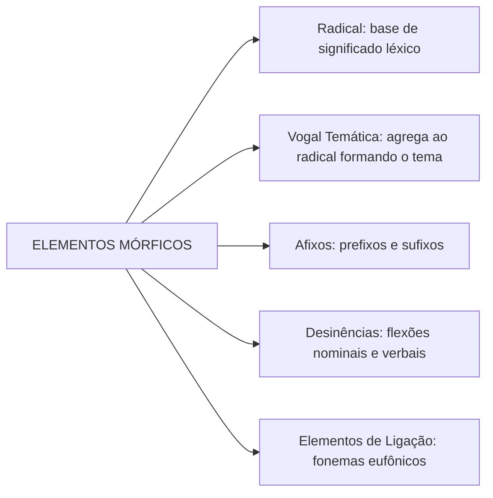
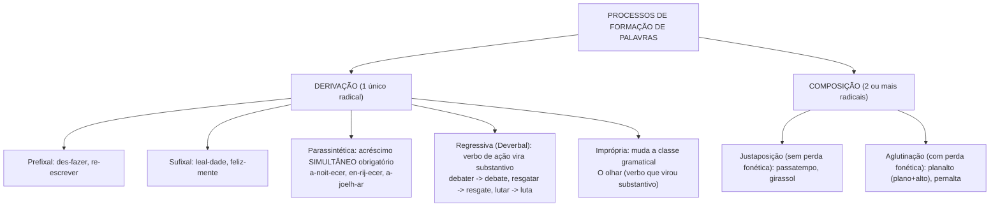

# 02 - Fonética, Ortografia, Vocabulário e Formação de Palavras

> **Matéria:** Língua Portuguesa  
> **Cargos:** A01 – Técnico de Controle Externo (Adm) / B02 – Técnico de Controle Externo (TI)  
> **Arquivo:** `02_ortografia_acentuacao_e_formacao_de_palavras.md`  
> **Referência Temática:** Ortografia Oficial, Acentuação Gráfica, Novo Acordo e Morfologia na Banca FCC

---

## 📌 Ementa / Itens do Edital
- Ortografia oficial e acentuação gráfica segundo o Acordo Ortográfico vigente (Decreto nº 6.583/2008);
- Regras gerais e especiais de acentuação: proparoxítonas, paroxítonas, oxítonas e monossílabos tônicos;
- Acentuação de ditongos abertos (éi, ói, éu), hiatos (i e u tônicos) e acento diferencial obrigatório;
- Emprego do hífen com prefixos e falsos prefixos: regras de aglutinação, duplicação de consoantes e exceções;
- Semântica lexical: sinonímia, antonímia, hiperonímia, hiponímia e polissemia;
- Homônimos e parônimos de alta incidência em concursos públicos;
- Elementos mórficos estruturais: radical, vogal temática, tema, afixos (prefixos e sufixos) e desinências nominais/verbais;
- Processos de formação de palavras: derivação (prefixal, sufixal, parassintética, regressiva e imprópria) e composição (justaposição e aglutinação).

---

## 🧭 Sumário

1. [Sistema Geral de Acentuação Gráfica e Acordo Ortográfico](#1-sistema-geral-de-acentuacao-grafica-e-acordo-ortografico)
    1. [Posição da Sílaba Tônica e Tonicidade Vocálica](#11-posicao-da-silaba-tonica-e-tonicidade-vocalica)
    2. [Regra das Proparoxítonas e Proparoxítonas Eventuais na FCC](#12-regra-das-proparoxitonas-e-proparoxitonas-eventuais-na-fcc)
    3. [Regra das Paroxítonas e Ditongos Orais](#13-regra-das-paroxitonas-e-ditongos-orais)
    4. [Regra das Oxítonas e Monossílabos Tônicos](#14-regra-das-oxitonas-e-monossilabos-tonicos)
    5. [Teste 012](#Teste-012)
2. [Regras Especiais de Acentuação](#2-regras-especiais-de-acentuacao)
    1. [Regra dos Hiatos Tônicos (I e U)](#21-regra-dos-hiatos-tonicos-i-e-u)
    2. [Ditongos Abertos (ÉI, ÓI, ÉU) e o Novo Acordo](#22-ditongos-abertos-ei-oi-eu-e-o-novo-acordo)
    3. [Formas Verbais com Pronomes Enclíticos](#23-formas-verbais-com-pronomes-encliticos)
    4. [Acento Diferencial Obrigatório e Facultativo](#24-acento-diferencial-obrigatorio-e-facultativo)
    5. [Teste 013](#Teste-013)
3. [Emprego do Hífen com Prefixos e Elementos de Composição](#3-emprego-do-hifen-com-prefixos-e-elementos-de-composicao)
    1. [Regra Geral dos Opostos e Casos com Consoante H](#31-regra-geral-dos-opostos-e-casos-com-consoante-h)
    2. [Teste 014](#Teste-014)
    3. [Duplicação das Consoantes R e S](#32-duplicacao-das-consoantes-r-e-s)
    4. [Prefixos Especiais, Acentuados e Casos de Aglutinação Forçada](#33-prefixos-especiais-acentuados-e-casos-de-aglutinacao-forcada)
    5. [Hífen em Compostos por Justaposição e Expressões Consagradas](#34-hifen-em-compostos-por-justaposicao-e-expressoes-consagradas)
    6. [Teste 015](#Teste-015)
4. [Semântica Lexical: Relações de Sentido e Vocabulário](#4-semantica-lexical-relacoes-de-sentido-e-vocabulario)
    1. [Sinonímia e Antonímia](#41-sinonimia-e-antonimia)
    2. [Hiperonímia e Hiponímia](#42-hiperonimia-e-hiponimia)
    3. [Polissemia e Homonímia](#43-polissemia-e-homonimia)
    4. [Parônimos e Homófonos de Alta Incidência em Concursos](#44-paronimos-e-homofonos-de-alta-incidencia-em-concursos)
    5. [Teste 016](#Teste-016)
    6. [Teste 017](#Teste-017)
5. [Morfologia: Elementos Estruturais da Palavra](#5-morfologia-elementos-estruturais-da-palavra)
    1. [Radical, Alomorfia e Vogal Temática](#51-radical-alomorfia-e-vogal-tematica)
    2. [Tema e Afixos Formadores (Prefixos e Sufixos)](#52-tema-e-afixos-formadores-prefixos-e-sufixos)
    3. [Teste 018](#Teste-018)
    4. [Desinências Nominais e Desinências Verbais](#53-desinencias-nominais-e-desinencias-verbais)
    5. [Vogais e Consoantes de Ligação](#54-vogais-e-consoantes-de-ligacao)
6. [Processos de Formação de Palavras](#6-processos-de-formacao-de-palavras)
    1. [Derivação Prefixal, Sufixal e Prefixal-Sufixal](#61-derivacao-prefixal-sufixal-e-prefixal-sufixal)
    2. [Derivação Parassintética](#62-derivacao-parassintetica)
    3. [Teste 019](#Teste-019)
    4. [Derivação Regressiva ou Deverbal](#63-derivacao-regressiva-ou-deverbal)
    5. [Derivação Imprópria ou Conversão](#64-derivacao-impropria-ou-conversao)
    6. [Teste 020](#Teste-020)
    7. [Composição: Justaposição e Aglutinação](#65-composicao-justaposicao-e-aglutinacao)
    8. [Outros Processos: Hibridismo, Siglonimização, Abreviação e Neologismo](#66-outros-processos-hibridismo-siglonimizacao-abreviacao-e-neologismo)
    9. [Teste 021](#Teste-021)
7. [Fontes Oficiais e Referências Bibliográficas](#fontes-oficiais-e-referencias-bibliograficas)

---

## 1. Sistema Geral de Acentuação Gráfica e Acordo Ortográfico

A acentuação gráfica na língua portuguesa tem por objetivo assinalar, na escrita, a sílaba de maior intensidade fonética (sílaba tônica) de determinadas palavras e, em situações específicas, indicar o timbre aberto ou fechado da vogal. O sistema gráfico oficial brasileiro é regido pelo Acordo Ortográfico da Língua Portuguesa de 1990, promulgado no território nacional pelo Decreto nº 6.583/2008 e tornado obrigatório a partir de 1º de janeiro de 2016.

A estrutura acentual do idioma apoia-se em um princípio de economia: a grande maioria dos vocábulos da língua portuguesa é paroxítona terminada nas vogais mais comuns (*-a*, *-e*, *-o* seguidas ou não de *-s*). Por essa razão estatística, tais vocábulos não recebem acento gráfico (como em *mesa*, *parede*, *livro*). O acento é reservado àquelas palavras cuja terminação ou estrutura silábica contraria o padrão fonológico predominante.

### 1.1 Posição da Sílaba Tônica e Tonicidade Vocálica

A correta identificação da sílaba tônica depende do reconhecimento da divisão silábica e da intensidade com que cada vogal é articulada:

1. **Oxítonas (ou oxítonos):** a sílaba tônica recai na última sílaba do vocábulo (*ca-fée*, *ca-ná-rio* não, mas *ru-bim*, *pa-pel*, *a-raz*).
2. **Paroxítonas (ou paroxítonos):** a tonicidade incide na penúltima sílaba (*ca-der-no*, *re-lór-gio*, *es-co-la*). Representam mais de 70% do léxico em português.
3. **Proparoxítonas (ou proparoxítonos):** a sílaba tônica situa-se na antepenúltima posição (*lâmp-a-da*, *ár-vo-re*, *vér-ti-ce*). Na língua portuguesa, nenhuma palavra de padrão vernáculo recebe tonicidade anterior à antepenúltima sílaba.

> 📌 **NOTA EXPLICATIVA / SÍLABA SUBTÔNICA:** As palavras derivadas por sufixação (como *cafezinho*, *rapidamente*) desenvolvem uma sílaba de intensidade secundária, chamada de subtônica, que coincide historicamente com a sílaba tônica do termo primitivo. Essa sílaba subtônica jamais recebe acento gráfico agudo ou circunflexo, perdendo qualquer acento original que a base continha (*café* $\rightarrow$ *cafezinho*; *fácil* $\rightarrow$ *facilmente*).

### 1.2 Regra das Proparoxítonas e Proparoxítonas Eventuais na FCC

A regra basilar do idioma determina que **todas as palavras proparoxítonas reais são acentuadas graficamente**, sem exceção, sejam elas de origem vernácula ou vocábulos latinos e estrangeiros aportuguesados que se integraram ao léxico (*médico*, *álvoroço*, *espírito*, *déficit*, *superávit*, *habitat*).

Existe, contudo, uma divergência clássica na doutrina gramatical a respeito das palavras paroxítonas terminadas em ditongo oral crescente (vogal precedida de semivogal: *-ia*, *-ie*, *-io*, *-ua*, *-uo*), tais como *se-cre-tá-ria*, *re-la-tó-rio*, *his-tó-ria*, *sê-rie*, *má-goa*, *espécie*, *tênue*:

1. **Visão Tradicional (Paroxítonas Terminadas em Ditongo):** Autores como Evanildo Bechara e a ABL registram primordialmente que tais vocábulos são paroxítonos, pois na linguagem fluida a semivogal e a vogal final formam uma única sílaba (*re-la-tó-rio*).
2. **Visão Fonológica / Ortográfica Ampla (Proparoxítonas Aparentes, Relativas ou Eventuais):** Autores como Celso Cunha e Lindley Cintra explicam que, em pronúncia enfática, poética ou distendida, o ditongo crescente final pode se bipartir em hiato (*re-la-tó-ri-o*), deslocando a tonicidade para a antepenúltima sílaba e conferindo-lhes natureza proparoxítona aparente.

> 🚨 **ALERTA DE PROVA / COMO A FCC COBRA:** Em questões de justificativa de acentuação, a Fundação Carlos Chagas com frequência agrupa termos como *relatório*, *secretária*, *renúncia* e *prévio* sob a regra das **paroxítonas terminadas em ditongo oral crescente**. Caso o enunciado traga a expressão "proparoxítonas eventuais ou aparentes", a justificativa é igualmente válida. O ponto inegociável para a FCC é que palavras como *relatório* e *renúncia* pertencem à **mesma regra**, ao passo que confrontadas com *médico* (proparoxítona real pura) ou *saúde* (regra do hiato) configuram regras distintas.

### 1.3 Regra das Paroxítonas e Ditongos Orais

Acentuam-se graficamente as palavras paroxítonas cuja terminação fuja ao padrão de natural atonicidade. Memoriza-se esse rol por meio de terminações específicas:

* **R:** *revólver, açúcar, caráter, cadáver, éter*;
* **X:** *tórax, córtex, látex, fênix, clímax*;
* **N:** *pólen, hífen, cânon, elétron* (Atenção: o plural dessas palavras perde o acento, pois termina em *-ens*: *polens, hifens, canons, eletrons* — ver alerta abaixo);
* **L:** *fácil, amável, fóssil, réptil, imprescindível, túnel*;
* **I / IS:** *táxi, júri, beribéri, lápis, grátis, oásis*;
* **US:** *vírus, bônus, ônus, húmus, Vênus*;
* **UM / UNS:** *álbum, álbuns, fórum, fóruns, médium, médiuns*;
* **PS:** *bíceps, tríceps, fórceps*;
* **Ã / ÃS:** *ímã, ímãs, órfã, órfãs*;
* **ÃO / ÃOS:** *órgão, órgãos, bênção, bênçãos, sótão, sótãos*;
* **ON / ONS:** *próton, prótons, nêutron, nêutrons, íon, íons*;
* **Ditongos Orais (crescentes ou decrescentes, seguidos ou não de S):** *relatório, renúncia, perspicácia, vácuo, colégio, água, pônei, fósseis, fáceis*.

> 🚨 **ALERTA DE PROVA / PEGADINHA DO PLURAL DE HÍFEN:** A palavra *hífen* é acentuada por ser paroxítona terminada em -N. Contudo, em seu plural vernáculo, *hifens*, o acento gráfico **desaparece**, pois passa a recair na terminação *-ens*, análoga a *homens, nuvens, jovens*, que são paroxítonas não acentuadas. Caso se utilize o plural erudito *hífenes*, a palavra passa a ser proparoxítona e recebe acento obrigatoriamente.

### 1.4 Regra das Oxítonas e Monossílabos Tônicos

Acentuam-se as oxítonas que apresentam terminações bem definidas, contrapondo-se às paroxítonas:

* Terminadas em **A(s):** *Pará, maracujá, sofás, vatapá*;
* Terminadas em **E(s):** *você, café, pontapés, jacaré*;
* Terminadas em **O(s):** *cipó, avô, avó, jiló, compôs*;
* Terminadas em **EM / ENS (com duas ou mais sílabas):** *também, porém, vintém, armazém, parabéns, retém*.

Oxítonas terminadas em *-i* ou *-u* (como *rubi, saci, urubu, caju*) não levam acento gráfico geral, salvo se incidirem na regra específica dos hiatos (*Piauí, baú*).

Já os **Monossílabos Tônicos** constituem regra autônoma em relação às oxítonas. Enquanto as oxítonas possuem duas ou mais sílabas, os monossílabos contêm apenas uma sílaba forte proferida com autonomia fonética e semântica. Acentuam-se os monossílabos tônicos terminados em:

* **A(s):** *pá, pás, má, más, já, lá*;
* **E(s):** *pé, pés, fé, mês, três, lê*;
* **O(s):** *pó, nós, vós, cós, dó, sós*.

Monossílabos tônicos terminados em *-i* ou *-u* (*ti, vi, tu, cru, nus*) não são acentuados, exceto quando formam ditongos abertos tônicos (*dói, céu, réu*).

> ⭐ **IMPORTANTE / MONOSSÍLABO TÔNICO VS. OXÍTONA:** Jamais justifique o acento de *pá* ou *mês* pela "regra das oxítonas". Para as bancas examinadoras, notadamente a FCC, a regra dos monossílabos tônicos é estruturalmente distinta da regra das oxítonas polissilábicas (*maracujá* e *pé* não compartilham a mesma regra).

### Teste 012
**(FCC – TRT – Analista Judiciário)**  
Considere as seguintes palavras retiradas de um relatório de fiscalização contábil:  
*relatório* – *órgão* – *auditoria* – *público* – *responsável*

Quanto às regras de acentuação gráfica previstas no sistema ortográfico vigente e cobradas pela banca FCC, assinale a afirmação correta:

* **A)** O vocábulo *relatório* recebe acento gráfico pela mesma regra que justifica o acento no vocábulo *público*, haja vista serem ambos proparoxítonos clássicos.
* **B)** A palavra *auditoria* deveria receber acento gráfico na penúltima sílaba, por ser paroxítona terminada em ditongo crescente, constituindo sua grafia sem acento uma exceção arbitrária.
* **C)** Os vocábulos *relatório* e *órgão* são acentuados por pertencerem à regra geral das paroxítonas (terminada em ditongo crescente e terminada em -ão, respectivamente), ao passo que a FCC também admite classificar *relatório* como proparoxítona aparente ou eventual.
* **D)** A palavra *responsável* é acentuada por ser oxítona terminada na consoante -l.
* **E)** Todos os vocábulos citados são acentuados em razão da regra dos hiatos tônicos.

---

> **Comentário Detalhado:**
>
> - **A)** Incorreta. *Público* é proparoxítona real/estrita (antepenúltima sílaba tônica: *pú-bli-co*). *Relatório* é paroxítona terminada em ditongo oral (*re-la-tó-rio*), admitida pela tradição gramatical e pela FCC como proparoxítona eventual/relativa, mas não uma proparoxítona estrita originária.
> - **B)** Incorreta. Em *auditoria*, a sílaba tônica é *ri* (*au-di-to-ri-a*), tratando-se de hiato átono final, sem acento gráfico; não há ditongo crescente tônico nem qualquer irregularidade na grafia.
> - **C)** Correta. A regra geral das paroxítonas acentua as palavras com tonicidade na penúltima sílaba terminadas em ditongo oral crescente/decrescente (*re-la-tó-rio*) e terminadas em *-ão* (*ór-gão*). A FCC reconhece a dupla classificação fonética de *relatório* (paroxítona terminada em ditongo ou proparoxítona eventual), o que é tema recorrente da banca.
> - **D)** Incorreta. *Responsável* é paroxítona (*res-pon-sá-vel*), e não oxítona; acentua-se por terminar na consoante *-l*.
> - **E)** Incorreta. Nenhum dos vocábulos acentuados recai na regra dos hiatos tônicos (*I* ou *U* tônicos isolados na sílaba).
>
> **Gabarito: C**

---

## 2. Regras Especiais de Acentuação

Além das regras gerais dependentes unicamente da terminação e da contagem silábica, o português adota regras que consideram a qualidade do encontro vocálico e a necessidade de desambiguação morfológica.

### 2.1 Regra dos Hiatos Tônicos (I e U)

Acentuam-se a segunda vogal de um hiato quando for **I** ou **U** tônico, sozinho na sílaba ou acompanhado apenas da letra **S**:

* Exemplos com vogal sozinha: *sa-ú-de, sa-í-da, ba-ú, pre-ju-í-zo, fa-ís-ca, ju-í-zes, ci-ú-me*;
* Exemplos acompanhados de S: *pa-ís, fa-ís-cas, ba-la-ús-tre, e-go-ís-mo*.

A regra do hiato possui duas restrições determinantes:

1. **Seguidos de NH:** Se a letra *i* ou *u* tônico for seguida pelo dígrafo *nh* na sílaba subsequente, **não** recebe acento gráfico: *ra-i-nha, ta-i-nha, la-i-nha, mo-i-nho*. A nasalidade exercida pelo dígrafo foneticamente já fecha a vogal anterior, tornando o acento desnecessário.
2. **Precedidos de Ditongo Decrescente em Palavras Paroxítonas (Regra do Novo Acordo):** Se a vogal tônica *i* ou *u* vier antecedida de ditongo em uma palavra paroxítona, ela **perdeu o acento gráfico**: *fei-u-ra, bo-i-u-no, chei-i-nho, ba-i-u-ca*. Contudo, caso a palavra seja **oxítona**, o acento permanece obrigatório: *Pi-au-í, tui-ui-ú*.
3. **Vogais dobradas:** As formas paroxítonas com vogais idênticas dobradas perderam o acento circunflexo pelo Acordo Ortográfico (*voo, perdoo, abençoo, leem, deem, veem, creem*).

> 🚨 **ALERTA DE PROVA / HIATOS ACOMPANHADOS DE OUTRAS CONSOANTES:** Se a vogal *i* ou *u* formar sílaba com qualquer consoante que não seja o *s*, o acento não é aplicado, pois a consoante trava a sílaba e marca a tonicidade por si mesma: *ju-iz* (sem acento, termina em Z) vs. *ju-í-zes* (com acento, I sozinho na sílaba); *ru-im* (sem acento, termina em M); *a-in-da* (sem acento, o I forma sílaba com N: *a-in-da*).

### 2.2 Ditongos Abertos (ÉI, ÓI, ÉU) e o Novo Acordo

Os ditongos orais com pronúncia aberta (*-éi, -ói, -éu*) sofreram alteração significativa com a vigência do Decreto nº 6.583/2008:

* **Nas Oxítonas e Monossílabos Tônicos:** O acento gráfico **permanece obrigatório**:
    * *herói, constrói, corrói, pastéis, bacharéis, anéis, chapéu, troféu, céu, réu, dói, mói*.
* **Nas Paroxítonas:** O acento gráfico foi **integralmente abolido**:
    * *ideia, assembleia, plateia, europeia, estreia, jiboia, heroico, paranoico, boia, joia, Coreia, apoia (do verbo apoiar)*.

> ⭐ **IMPORTANTE / CONTRASTE HERÓI VS. HEROICO:** Esse é um dos pares favoritos da banca examinadora FCC. Em *herói*, a palavra é oxítona terminada no ditongo aberto *-ói*, mantendo o acento agudo. Já em *he-roi-co*, a sílaba tônica recai na penúltima sílaba (*-roi-*), tratando-se de paroxítona que perdeu o acento com o Acordo Ortográfico.

### 2.3 Formas Verbais com Pronomes Enclíticos

Na conjugação de verbos acompanhados de pronomes oblíquos enclíticos (*-lo, -la, -los, -las, -no, -na*), a análise da tonicidade e das regras de acentuação deve isolar completamente o pronome e incidir exclusivamente sobre a terminação da forma verbal residual:

* *Cantar + a* $\rightarrow$ *cantá-la* (oxítona terminada na vogal *a*);
* *Fazer + o* $\rightarrow$ *fazê-lo* (oxítona terminada na vogal *e*);
* *Pôr + o* $\rightarrow$ *pô-lo* (oxítona/monossílabo tônico terminado na vogal *o*);
* *Partir + o* $\rightarrow$ *parti-lo* (oxítona terminada na vogal *i*, logo não recebe acento);
* *Distribuir + o* $\rightarrow$ *distribuí-lo* (recebe acento pela regra especial do hiato tônico isolado).

### 2.4 Acento Diferencial Obrigatório e Facultativo

O Novo Acordo Ortográfico eliminou a quase totalidade dos acentos diferenciais que distinguiam palavras homógrafas tônicas de átonas (foram eliminados acentos como *pêlo/pelo, péla/pela, pólo/polo*). Todavia, foram mantidos os acentos diferenciais de extrema relevância sintática e semântica:

#### Acentos Diferenciais Obrigatórios:
1. **Pôde (Pretérito Perfeito) $\neq$ Pode (Presente do Indicativo):** O verbo *poder* recebe acento circunflexo na 3ª pessoa do singular do pretérito perfeito (*"Ontem o auditor não pôde comparecer"*) para se distinguir da forma homógrafa no presente do indicativo (*"Hoje ele pode analisar o processo"*).
2. **Pôr (Verbo) $\neq$ Por (Preposição):** O verbo *pôr* mantém o acento circunflexo (*"É preciso pôr ordem no setor"*) para diferenciar-se da preposição monossilábica átona *por* (*"Caminhou por aquele corredor"*).
3. **Têm e Vêm (Plural) $\neq$ Tem e Vem (Singular):** Os verbos *ter* e *vir* levam acento circunflexo na 3ª pessoa do plural do presente do indicativo:
    * *O auditor tem competência técnica* (singular, sem acento);
    * *Os auditores têm competência técnica* (plural, circunflexo);
    * *O recurso vem tempestivamente* (singular, sem acento);
    * *Os recursos vêm tempestivamente* (plural, circunflexo).

4. **Derivados de Ter e Vir (Manter, Conter, Deter, Intervir, Provir):** Por serem oxítonas com duas ou mais sílabas, recebem acento agudo no singular por regra geral das oxítonas em *-em*, e acento circunflexo no plural por acento diferencial:
    * Singular (acento agudo): *ele mantém, ele intervém, o cofre contém, o Estado detém*;
    * Plural (acento circunflexo): *eles mantêm, eles intervêm, os cofres contêm, os Estados detêm*.

#### Acentos Diferenciais Facultativos:
* **Fôrma / Forma:** O emprego do acento circunflexo no substantivo *fôrma* (molde, vasilha) é facultativo, sendo recomendado pelo formulário ortográfico apenas quando houver risco evidente de ambiguidade com o substantivo ou verbo *forma* (aparência exterior, conformação, do verbo formar): *"Cada um tem sua própria forma de usar a fôrma de bolo"*.

### Teste 013
**(FCC – TCE-GO – Analista de Controle Externo)**  
Avalie os seguintes grupos de vocábulos quanto à aplicação das regras especiais de acentuação gráfica do Acordo Ortográfico vigente:  

I. *juízes*, *saúde*, *baú*, *balaústre*  
II. *ideia*, *heroico*, *jiboia*, *coreia*  
III. *eles têm*, *eles vêm*, *ele mantém*, *eles mantêm*  

Está em total conformidade com as regras gramaticais o que se afirma em:

* **A)** No grupo I, as palavras perdem o acento gráfico quando seguidas de consoante na mesma sílaba.
* **B)** No grupo II, os vocábulos perderam o acento gráfico porque o Novo Acordo extinguiu a acentuação dos ditongos abertos (*éi*, *ói*) nas palavras paroxítonas, mantendo-o apenas nas oxítonas e monossílabos tônicos (*herói*, *pastéis*, *dói*).
* **C)** No grupo III, as formas verbais *têm* e *vêm* recebem acento circunflexo na 3ª pessoa do singular e perdem o acento no plural.
* **D)** O acento diferencial foi completamente abolido pelo Acordo Ortográfico em todas as palavras da língua portuguesa, sem nenhuma exceção.
* **E)** Em *saúde* e *baú*, o acento gráfico justifica-se por serem paroxítonas terminadas em vogal temática.

---

> **Comentário Detalhado:**
>
> - **A)** Incorreta. No grupo I, os hiatos tônicos em *i* e *u* são acentuados quando sozinhos na sílaba ou seguidos de *-s* (*ju-í-zes*, *sa-ú-de*, *ba-ú*, *ba-la-ús-tre*). Se fossem seguidos de outras consoantes (como *-z* em *juiz*), não levariam acento.
> - **B)** Correta. O Acordo Ortográfico aboliu expressamente o acento nos ditongos abertos *éi* e *ói* das palavras **paroxítonas** (*i-dei-a*, *he-roi-co*, *ji-boi-a*). Todavia, preservou rigorosamente o acento nas oxítonas (*he-rói*, *pa-péis*, *tro-féu*) e nos monossílabos tônicos (*dói*, *céu*, *réis*).
> - **C)** Incorreta. É o oposto: na 3ª pessoa do singular não há acento (*ele tem*, *ele vem*); na 3ª pessoa do plural o acento circunflexo diferencial é obrigatório (*eles têm*, *eles vêm*). Já nos derivados (*manter*), o singular leva agudo (*ele mantém*) e o plural circunflexo (*eles mantêm*).
> - **D)** Incorreta. O acento diferencial obrigatório foi expressamente mantido em *pôde* (pretérito) / *pode* (presente) e no verbo *pôr* / preposição *por*, além de facultativo em *fôrma* / *forma*.
> - **E)** Incorreta. Trata-se da regra especial dos hiatos tônicos (*I* e *U*), e não da regra geral das paroxítonas.
>
> **Gabarito: B**

---

## 3. Emprego do Hífen com Prefixos e Elementos de Composição

O emprego do hífen em palavras formadas por prefixação ou falsos prefixos (radicais de origem grega ou latina que atuam como elementos compositivos) obedece a um sistema harmonizado pelo Acordo Ortográfico.

### 3.1 Regra Geral dos Opostos e Casos com Consoante H

A regra motriz da reforma ortográfica estabelece o **princípio da atração dos diferentes e repulsão dos iguais**:

1. **Letras Iguais se Separam com Hífen:** Se o prefixo terminar pela mesma letra (seja vogal ou consoante) com que se inicia o segundo elemento, o uso do hífen é **obrigatório**:
    * *micro-ondas, anti-inflamatório, semi-interno, contra-ataque, sobre-erguer, arqui-inimigo*;
    * *inter-regional, hiper-requintado, super-resistente, sub-base*.

2. **Letras Diferentes se Unem sem Hífen (Aglutinação):** Se o prefixo terminar por letra distinta daquela que abre o segundo elemento, os elementos aglutinam-se diretamente:
    * *autoescola, infraestrutura, contraindicação, semiaberto, agroindústria, hidroelétrica*;
    * *intermunicipal, hipermercado, subchefe, supersônico*.

3. **Segundo Elemento Iniciado por Consoante H:** O fonema inicial mudo da letra *h* não admite fusão ortográfica direta com prefixos na língua padrão. Logo, diante de palavra iniciada por *h*, o uso do hífen é **sempre obrigatório**, qualquer que seja o prefixo:
    * *anti-higiênico, super-homem, sobre-humano, pan-helênico, macro-história, sub-hepático, geo-história*.

> 🚨 **ALERTA DE PROVA / EXCEÇÃO DA PALAVRA SUBUMANO:** Quando o elemento *humano* une-se ao prefixo *des-* ou *in-*, o *h* cai por etimologia histórica (*desumano, inumano*). Com o prefixo *sub-*, o vocabulário oficial registra tanto a forma hifenizada *sub-humano* quanto a forma aglutinada sem H *subumano*. A FCC costuma cobrar preferencialmente a forma geral hifenizada (*sub-humano*).

---

### Teste 014
**(FCC – TRF – Analista Judiciário)**  
Quanto ao emprego do hífen em palavras formadas por derivação prefixal em consonância com o Acordo Ortográfico vigente, assinale a opção inteiramente correta:

* **A)** anti-inflamatório, auto-escola, micro-ondas, hiper-resistente.
* **B)** antiinflamatório, autoescola, microondas, hiperresistente.
* **C)** anti-inflamatório, autoescola, micro-ondas, hiper-resistente.
* **D)** anti-inflamatório, autoescola, micro-ondas, hiperresistente.
* **E)** antiinflamatório, auto-escola, micro-ondas, hiper-resistente.

---

> **Comentário Detalhado:**
> Análise de cada vocábulo à luz do Acordo Ortográfico:
>
> 1. *anti-inflamatório:* o prefixo *anti-* termina na mesma vogal com que se inicia o segundo elemento (*i*). Letras iguais repelem-se com hífen.
> 2. *autoescola:* o prefixo *auto-* termina com a vogal *o* e o segundo elemento inicia-se com a vogal *e*. Vogais diferentes atraem-se, unindo-se sem hífen.
> 3. *micro-ondas:* o prefixo *micro-* termina em *o* e o segundo elemento inicia em *o*. Vogais idênticas exigem hífen.
> 4. *hiper-resistente:* o prefixo *hiper-* termina na consoante *r* e o segundo elemento inicia pela mesma consoante *r*. Consoantes idênticas separam-se com hífen.
>
> Análise das alternativas:
>
> - **A)** Incorreta. Erra ao colocar hífen em *auto-escola* (o correto é *autoescola*, aglutinado).
> - **B)** Incorreta. Erra ao aglutinar *antiinflamatório*, *microondas* e *hiperresistente* (todos exigem hífen por reunirem letras idênticas).
> - **C)** Correta. Todos os quatro vocábulos estão impecavelmente grafados de acordo com a norma ortográfica vigente.
> - **D)** Incorreta. Erra ao aglutinar *hiperresistente* sem hífen (prefixo em consoante R seguido de palavra iniciada por R exige hífen).
> - **E)** Incorreta. Erra em *antiinflamatório* (falta hífen) e em *auto-escola* (hífen indevido).
> 
> **Gabarito: C**

---

### 3.2 Duplicação das Consoantes R e S

Se o prefixo terminar em **vogal** e o segundo elemento principiar pelas consoantes **R** ou **S**, o hífen é eliminado e a consoante correspondente deve ser **duplicada** (*rr* ou *ss*), a fim de manter o valor sonoro original do fonema:

* Exemplos com R duplicado: *antirreflexo, antirrábico, contrarregra, microrradiografia, ultrarrápido, semirreta*;
* Exemplos com S duplicado: *minissaia, ultrassom, microssistema, cosseno, antissocial, pressuposto*.

> ⭐ **IMPORTANTE / PREFIXOS TERMINADOS EM CONSOANTE DIANTE DE R E S:** A regra da duplicação aplica-se exclusivamente a prefixos terminados em **vogal**. Se o prefixo terminar por consoante (como *inter-, hiper-, super-, sub-*), a regra que vigora é a regra geral:
>
> - Diante de letra igual (R), usa-se hífen: *inter-relação, super-rápido, hiper-reativo*;
> - Diante de letra diferente (S), junta-se sem duplicar e sem hífen: *intersindical, supersônico, hipertenso*.

### 3.3 Prefixos Especiais, Acentuados e Casos de Aglutinação Forçada

Determinados elementos mórficos obedecem a prescrições pontuais da norma:

* **Prefixos Sempre Hifenizados:** Os prefixos tônicos acentuados graficamente (*pós-, pré-, pró-*) e os prefixos *ex-* (com sentido de estado anterior/cessação), *vice-, vizo-, sem-, além-, aquém-, recém-* exigem hífen em qualquer contexto:
    * *ex-diretor, ex-presidente, vice-governador, sem-terra, além-mar, aquém-fronteiras, recém-empossado, pós-graduação, pré-edital, pró-ativo*.
    * Atenção: se o elemento for átono e sem acento próprio, aglutina-se sem hífen: *proativo, predeterminado, pospor*.
* **O Prefixo CO- e RE- (Aglutinação Forçada):** Os prefixos *co-* e *re-* unem-se ao elemento seguinte mesmo quando este principia pela mesma vogal *o* ou *e*, sem necessidade de hífen:
    * *coordenar, cooperação, coobrigado, coautor, coexistir, reeleger, reencontro, reestruturar*.
* **Os Prefixos CIRCUM- e PAN-:** Exigem hífen diante de palavras iniciadas por vogal, pela letra *h* ou pelas consoantes *m* e *n*:
    * *pan-americano, circum-navegação, pan-helênico*.

| Prefixo / Contexto | Diretriz do Acordo | Exemplos Corretos |
| :--- | :--- | :--- |
| **Vogal + Vogal Igual** | Usa-se Hífen | *micro-ondas, anti-inflamatório, semi-interno, arqui-inimigo* |
| **Vogal + Vogal Diferente** | Não se usa Hífen (aglutina) | *autoescola, semiaberto, coautor, infraestrutura, agroindústria* |
| **Vogal + Consoante R ou S** | Dobra-se a consoante (rr / ss) | *antirrábico, microssistema, ultrassom, cosseno, minissaia* |
| **Vogal + Demais Consoantes** | Junta-se sem alteração | *antiprojeto, autopeça, geopolítica, semicírculo* |
| **Consoante + Consoante Igual** | Usa-se Hífen | *inter-regional, sub-base, super-resistente, hiper-requintado* |
| **Consoante + Consoante Diferente** | Junta-se sem hífen | *intermunicipal, hipermercado, subchefe, superpopulação* |
| **Segundo Elemento com H** | Usa-se Hífen SEMPRE | *anti-herói, super-homem, sobre-humano, pan-helênico* |
| **Prefixos Especiais** | Sempre com hífen | *ex-diretor, sem-terra, vice-presidente, recém-nascido, pós-graduação* |

### 3.4 Hífen em Compostos por Justaposição e Expressões Consagradas

Em palavras compostas por justaposição que formam uma unidade sintagmática e semântica mantendo autonomia fonética, o hífen deve ser mantido (*arco-íris, decreto-lei, segunda-feira, conta-gotas, guarda-chuva*).

Entretanto, o Acordo Ortográfico determinou o **fim do hífen nas locuções de qualquer natureza** (substantivas, adjetivas, adverbiais, prepositivas ou conjuntivas):

* *fim de semana, sala de jantar, cão de guarda, cor de café, dia a dia, à toa, ponto e vírgula, passo a passo*.
* **Exceções consagradas pela tradição:** Mantêm o hífen as consagradas *cor-de-rosa, água-de-colônia, arco-da-velha, mais-que-perfeito, pé-de-meia*, bem como os nomes botânicos e zoológicos ligados por hífen (*couve-flor, bem-te-vi, erva-doce*).

### Teste 015
**(FCC – DPE-RS – Analista Jurídico)**  
Assinale a opção em que todas as palavras estão grafadas em perfeita conformidade com as normas de emprego do hífen estabelecidas pelo Acordo Ortográfico:

* **A)** auto-escola, anti-social, micro-ondas, semi-aberto.
* **B)** autoescola, antissocial, micro-ondas, semiaberto.
* **C)** autoescola, anti-social, microondas, semi-aberto.
* **D)** auto-escola, antissocial, microondas, semiaberto.
* **E)** autoescola, anti-social, micro-ondas, semiaberto.

---

> **Comentário Detalhado:**
>
> - **A)** Incorreta. Diante de vogal diferente, não se usa hífen (*autoescola*, *semiaberto*); diante de *s*, duplica-se a consoante (*antissocial*).
> - **B)** Correta. Aplicação perfeita das três regras básicas: 1) Vogais diferentes se juntam sem hífen (*autoescola*, *semiaberto*); 2) Prefixo terminado em vogal seguido de *r* ou *s* exige duplicação da consoante (*antissocial*, *minissaia*, *autorretrato*); 3) Letras iguais se repelem com hífen (*micro-ondas*, *anti-inflamatório*).
> - **C)** Incorreta. Falhou em *anti-social* (o correto é *antissocial*), em *microondas* (o correto é *micro-ondas*) e em *semi-aberto* (*semiaberto*).
> - **D)** Incorreta. Falhou em *auto-escola* (o correto é *autoescola*) e em *microondas* (o correto é *micro-ondas*).
> - **E)** Incorreta. Falhou em *anti-social* (deve-se dobrar o 's': *antissocial*).
>
> **Gabarito: B**

---

## 4. Semântica Lexical: Relações de Sentido e Vocabulário

O estudo da semântica vocabular foca as relações de significação estabelecidas entre as palavras de uma língua, permitindo analisar a coesão referencial, a precisão textual e os desvios de significação em textos técnicos e jurídicos.

### 4.1 Sinonímia e Antonímia

* **Sinonímia:** Relação que se estabelece entre dois ou mais termos que possuem significados idênticos ou muito próximos no mesmo contexto discursivo (*conceder / outorgar; rescindir / anular; célere / ágil; prudente / cauteloso*). A sinonímia absoluta é raríssima no idioma, pois nuances de formalidade, regionalismo ou intensidade quase sempre diferenciam os vocábulos.
* **Antonímia:** Relação existente entre palavras que expressam significados opostos ou contraditórios (*legalidade / ilegalidade; público / privado; eficiência / ineficiência; reter / liberar*).

### 4.2 Hiperonímia e Hiponímia

Conceitos capitais na estruturação de mecanismos de substituição coesiva em redação e interpretação textual:

* **Hiperônimo (Hiperonímia):** Vocábulo de sentido geral, amplo, abrangente, que engloba sob sua extensão semântica outros termos mais específicos. O hiperônimo funciona como a "classe" ou o gênero.
    * Exemplo: *Tribunal* é hiperônimo de *TCE-GO*; *veículo* é hiperônimo de *viatura*; *documento* é hiperônimo de *relatório de auditoria*.
* **Hipônimo (Hiponímia):** Vocábulo de sentido restrito, específico, pontual, que integra a classe de um termo maior. O hipônimo funciona como a "espécie".
    * Exemplo: *TCE-GO* é hipônimo de *órgão de controle*; *auditoria de conformidade* é hipônimo de *fiscalização*.

> 💡 **DICA DE RESOLUÇÃO / COESÃO POR HIPERONÍMIA:** A banca FCC frequentemente formula itens elogiando o uso de hiperônimos para evitar repetições vocabulares no texto (*"O TCE-GO julgou a tomada de contas especial. A corte de contas concluiu pela condenação do gestor"*). A substituição de *TCE-GO* por *corte de contas* opera um mecanismo exemplar de hiperonímia anafórica.

### 4.3 Polissemia e Homonímia

* **Polissemia:** Propriedade de uma **única palavra** que pode assumir múltiplos significados distintos a depender do contexto discursivo em que é empregada, preservando entretanto uma raiz semântica comum de parentesco conceitual (*"A <ins>linha</ins> de raciocínio do parecer"*, *"A <ins>linha</ins> telefônica do gabinete"*, *"A <ins>linha</ins> divisória do município"*).
* **Homonímia:** Fenômeno pelo qual duas palavras inteiramente **distintas**, de etimologias e origens históricas diferentes, convergem para a mesma forma gráfica e/ou sonora. Subdivide-se em:
    * **Homófonos heterográficos:** Possuem o mesmo som, mas grafias e significados diferentes (*sessão / seção / cessão; censo / senso; acento / assento*);
    * **Homógrafos heterofônicos:** Apresentam a mesma grafia, mas pronúncia e significados divergentes (*o almoço* [ô] / *eu almoço* [ó]; *a sede* [ê] / *eu tenho sede* [é]);
    * **Homônimos perfeitos:** Coincidem integralmente no som e na grafia, guardando origens e acepções díspares (*manga* [fruta] / *manga* [parte da camisa]; *canto* [ângulo] / *canto* [verbo cantar]).

### 4.4 Parônimos e Homófonos de Alta Incidência em Concursos

Os parônimos são palavras muito semelhantes na grafia e na pronúncia, mas que possuem significados totalmente diferentes. O domínio exato desses pares é requisito frequente nas provas de controle e tribunais:

1. **Eminente $\neq$ Iminente:**
    * *Eminente:* ilustre, notável, elevado, de alta estirpe (*"O eminente Conselheiro proferiu o voto"*);
    * *Iminente:* que está prestes a ocorrer a qualquer instante (*"O risco de desabamento da ponte era iminente"*).

2. **Flagrante $\neq$ Fragrante:**
    * *Flagrante:* evidente, manifesto, testemunhado no calor da ação (*"O servidor foi autuado em flagrante"*);
    * *Fragrante:* aromático, perfumado, que exala odor agradável (*"Flores fragrantes enfeitavam a bancada"*).

3. **Mandado $\neq$ Mandato:**
    * *Mandado:* ordem formal emanada de autoridade judiciária (*"mandado de segurança", "mandado de prisão", "mandado de busca e apreensão"*);
    * *Mandato:* procuração jurídica ou período temporário de representação e investidura política (*"O mandato do Governador encerra-se em 2026"*).

4. **Retificar $\neq$ Ratificar:**
    * *Retificar:* emendar, corrigir, alterar o que continha vício (*"O engenheiro retificou a planilha de custos"*);
    * *Ratificar:* confirmar, validar, comprovar, reafirmar (*"O plenário ratificou a medida cautelar expedida"*).

5. **Sessão $\neq$ Seção / Secção $\neq$ Cessão:**
    * *Sessão (com S inicial e SS medial):* intervalo de tempo dedicado a uma assembleia, deliberação de colegiado ou espetáculo (*"A sessão plenária teve início às 14 horas"*);
    * *Seção ou Secção (com S e Ç):* ato de cortar, partição, fração, divisão interna ou departamento administrativo (*"A seção de protocolo autuou o expediente"*);
    * *Cessão (com C inicial e SS medial):* ato voluntário de ceder, transferir posse, bens ou direitos (*"A cessão onerosa de servidores públicos foi autorizada"*).

6. **Censo $\neq$ Senso:**
    * *Censo (com C):* levantamento estatístico de dados da população (*"O IBGE apresentou o censo demográfico"*);
    * *Senso (com S):* faculdade de julgar, discernimento, prudência, bom juízo (*"Faltou-lhe bom senso na condução dos debates"*).

7. **Prescrever $\neq$ Proscrever:**
    * *Prescrever:* perder a eficácia jurídica pelo decurso do prazo temporal legal; receitar ou determinar (*"A ação punitiva prescreveu em 5 anos"*);
    * *Proscrever:* banir, extinguir, condenar ao exílio, proibir formalmente (*"A Constituição proscreve as penas cruéis"*).

8. **Incipiente $\neq$ Insipiente:**
    * *Incipiente (com C):* principiante, inicial, que está no começo (*"A análise de riscos ainda está em fase incipiente"*);
    * *Insipiente (com S):* ignorante, tolo, desprovido de sabedoria (*"Trata-se de juízo insipiente sobre o tema"*).

---

### Teste 016
**(FCC – TCE-PI – Auditor de Controle Externo)**  
Considere os vocábulos destacados nas frases abaixo:  

I. *"O plenário do Tribunal encerrou a <ins>sessão</ins> extraordinária às dezoito horas."*  

II. *"A empresa cometeu ato ilícito e foi autuada em <ins>flagrante</ins> delito pela equipe fiscal."*  

III. *"O Governador do Estado cumpriu integralmente os quatro anos de seu <ins>mandato</ins> eletivo."*  

IV. *"O engenheiro responsável promoveu a <ins>retificação</ins> das falhas apontadas no projeto original."*  

A grafia e o emprego semântico dos vocábulos sublinhados estão corretos em:

* **A)** I, II, III e IV.
* **B)** I e III, apenas.
* **C)** II e IV, apenas.
* **D)** I, II e IV, apenas.
* **E)** II, III e IV, apenas.

---

> **Comentário Detalhado:**
> Avaliação individual das proposições:
>
> - **Item I: Correto.** *Sessão* (iniciado por S e com dígrafo SS) designa a reunião de um corpo colegiado, o intervalo de tempo em que delibera uma corte de contas ou um parlamento. Não se confunde com *seção* (repartição/divisão) nem com *cessão* (ato de ceder).
> - **Item II: Correto.** *Flagrante* delito designa o ato ilícito que está sendo presenciado, evidente, manifesto no ato da execução. Não se confunde com *fragrante* (aromático, cheiroso).
> - **Item III: Correto.** *Mandato* é o poder conferido pelo voto popular ou a procuração para o exercício temporário de cargo diretivo/eletivo. Não se confunde com *mandado* (ordem judicial escrita).
> - **Item IV: Correto.** *Retificação* é o ato de retificar, consertar, emendar ou corrigir vícios e incorreções. Não se confunde com *ratificação* (ato de confirmar ou validar formalmente).
>
> Análise das opções:
>
> - **A)** Correta. Todas as quatro ocorrências estão perfeitamente adequadas quanto ao léxico e à ortografia.
> - **B)** Incorreta. Desconsidera o acerto evidente dos itens II e IV.
> - **C)** Incorreta. Desconsidera o acerto evidente dos itens I e III.
> - **D)** Incorreta. Omite o item III, que também está rigorosamente correto.
> - **E)** Incorreta. Omite o item I, cuja grafia está irrepreensível.
> 
> **Gabarito: A**

### Teste 017
**(FCC – METRÔ-SP – Advogado)**  
Considere as lacunas no seguinte texto administrativo:  
*"O Tribunal Pleno realizou extraordinária __________ para deliberar sobre a __________ de uso de bem público imóvel aos servidores. O parecer técnico apontou risco __________ de desmoronamento estrutural na ala sul do edifício."*

As palavras que preenchem correta e respectivamente as lacunas da frase são:

* **A)** sessão – cessão – iminente
* **B)** seção – cessão – eminente
* **C)** cessão – sessão – iminente
* **D)** sessão – seção – eminente
* **E)** seção – sessão – iminente

---

> **Comentário Detalhado:**
>
> - **1ª lacuna:** Refere-se à reunião de um colegiado ou intervalo de tempo de trabalho. O termo correto é **sessão** (com dois esses, derivado do latim *sessio*, ato de sentar-se).
> - **2ª lacuna:** Refere-se ao ato de ceder, transferir posse, uso ou direito. O termo correto é **cessão** (com c inicial e dois esses, derivado do verbo *ceder*). Seção (com ç) significa divisão, subdivisão departamental ou repartição.
> - **3ª lacuna:** Refere-se a algo prestes a acontecer ou que ameaça ocorrer a qualquer instante. O termo correto é **iminente** (com i). *Eminente* (com e) significa ilustre, notável, elevado ou superior.
> - **Análise das alternativas:** A alternativa **A** é a única que traz a sequência correta: *sessão – cessão – iminente*.
>
> **Gabarito: A**

---

## 5. Morfologia: Elementos Estruturais da Palavra

As palavras na língua portuguesa são formadas pela articulação lógica de unidades mínimas portadoras de significado, denominadas **morfemas** ou **elementos mórficos**.

### 5.1 Radical, Alomorfia e Vogal Temática

* **Radical:** É o núcleo mórfico irredutível e invariável que encerra a significação básica da família de palavras cognatas (*<ins>livr</ins>-o, <ins>livr</ins>-eiro, <ins>livr</ins>-aria*).
    * *Alomorfia:* Ocorre quando o mesmo radical se manifesta sob formas fonéticas ligeiramente alteradas em virtude da evolução fonética histórica. Exemplo: *faz-er, fiz, faç-o* apresentam alomorfes do mesmo radical.
* **Vogal Temática (VT):** É o elemento mórfico vocálico que se une diretamente ao radical com a finalidade de prepará-lo para o recebimento das desinências flexionais:
    * **Vogal Temática Verbal:** Identifica a conjugação à qual o verbo pertence:
    * 1ª conjugação: vogal temática **A** (*cant-<ins>a</ins>-r, louv-<ins>a</ins>-va*);
    * 2ª conjugação: vogal temática **E** (*vend-<ins>e</ins>-r, bat-<ins>e</ins>-sse*);
    * 3ª conjugação: vogal temática **I** (*part-<ins>i</ins>-r, divid-<ins>i</ins>-mos*).
    * O verbo *pôr* e seus compostos pertencem historicamente à 2ª conjugação (do arcaico *poer*).
    * **Vogal Temática Nominal:** Ocorre no final de substantivos e adjetivos átonos que não marcam flexão de gênero opositora (*livr-<ins>o</ins>, mes-<ins>a</ins>, dent-<ins>e</ins>, trib-<ins>u</ins>*). Nestes casos, a letra *a* de *mesa* ou o *o* de *livro* não indicam feminino ou masculino, pois não existe *"o meso"* ou *"a livra"*; são vogais temáticas nominais.

### 5.2 Tema e Afixos Formadores (Prefixos e Sufixos)

* **Tema:** É a unidade resultante da fusão do radical com a sua respectiva vogal temática:
  $$\text{Tema} = \text{Radical} + \text{Vogal Temática}$$
    * Em *cant-a-r*, o tema verbal é *canta-*; em *livr-o*, o tema nominal é *livro-*. Quando a palavra não possui vogal temática (como em vocábulos terminados em consoante forte: *mar, dor, sol*), o tema confunde-se diretamente com o próprio radical.
* **Afixos:** São morfemas derivacionais agregados à raiz ou ao tema para produzir novas palavras:
    * **Prefixos:** Morfemas antepostos ao radical, operando predominantemente mudança de sentido lexical sem alterar a classe gramatical primitiva: *<ins>des</ins>-leal, <ins>in</ins>-apto, <ins>re</ins>-fazer, <ins>sub</ins>-chefe*.
    * **Sufixos:** Morfemas pospostos ao radical, possuindo alta capacidade de converter a palavra em outra classe gramatical: *leal $\rightarrow$ leal-<ins>dade</ins>* (adjetivo em substantivo); *atual $\rightarrow$ atual-<ins>izar</ins>* (adjetivo em verbo); *rápido $\rightarrow$ rapida-<ins>mente</ins>* (adjetivo em advérbio).

---

### Teste 018
**(FCC – TCE-GO – Analista de Controle Externo)**  
Assinale a alternativa em que ambos os vocábulos sublinhados são acentuados com fundamento na **mesma regra gramatical**:

* **A)** *"O <ins>relatório</ins> do Tribunal contém dados sobre a <ins>renúncia</ins> de receita."*
* **B)** *"A autoridade <ins>pública</ins> examinou o processo na <ins>sessão</ins> de julgamento."*
* **C)** *"A atuação do Estado em <ins>saúde</ins> preventiva é imprescindível para o <ins>país</ins>."* (comparando saúde/país com imprescindível)
* **D)** *"O <ins>órgão</ins> de auditoria apurou o <ins>prejuízo</ins> e aplicou a sanção cabível."*
* **E)** *"O auditor demonstrou perspicácia ao desvendar o desvio de recursos."* (perspicácia – desvendar)

---

> **Comentário Detalhado:**
>
> - **A)** Correta. Os vocábulos *relatório* (re-la-tó-rio) e *renúncia* (re-nún-cia) são ambos acentuados pela regra das paroxítonas terminadas em ditongo oral crescente (ou proparoxítonas eventuais/aparentes, nomenclatura consagrada pela FCC). Compartilham rigorosamente a mesma regra de justificação ortográfica.
> - **B)** Incorreta. O vocábulo *pública* é acentuado por ser proparoxítona real (todas são acentuadas), ao passo que *sessão* não recebe acento gráfico (o til não é acento tônico primário, mas marca de nasalidade em outras palavras, e aqui sequer há til).
> - **C)** Incorreta. Embora *saúde* e *país* compartilhem a regra do hiato tônico (I e U tônicos formando sílaba sozinhos ou com S), a análise comparativa com *imprescindível* (paroxítona terminada na consoante L) desfaz a uniformidade da assertiva.
> - **D)** Incorreta. *Órgão* é acentuada por ser paroxítona terminada em ditongo nasal *-ão*, enquanto *prejuízo* é acentuada com base na regra especial dos hiatos (I tônico isolado na sílaba sem consoante nasal).
> - **E)** Incorreta. *Perspicácia* é paroxítona terminada em ditongo oral, ao passo que *desvendar* é oxítona terminada na consoante R e sequer recebe acento gráfico.
> 
> **Gabarito: A**

---

### 5.3 Desinências Nominais e Desinências Verbais

As desinências são morfemas flexionais que se localizam na extremidade da palavra para indicar alterações puramente gramaticais:

1. **Desinências Nominais:**
    * **De Gênero:** Distinguem o masculino do feminino (*menino / menin-<ins>a</ins>; autor / autor-<ins>a</ins>*);
    * **De Número:** Indicam a oposição singular versus plural (*casa / casa-<ins>s</ins>; papel / papéi-<ins>s</ins>*).

2. **Desinências Verbais:**
    * **Modo-Temporais (DMT):** Indicam o tempo cronológico e o modo em que se desenvolve a ação verbal (*cant-<ins>va</ins>-mos* [pretérito imperfeito do indicativo]; *cant-a-<ins>sse</ins>-mos* [pretérito imperfeito do subjuntivo]; *cant-a-<ins>ra</ins>-mos* [pretérito mais-que-perfeito]);
    * **Número-Pessoais (DNP):** Indicam a pessoa do discurso (1ª, 2ª ou 3ª) e o número gramatical (singular ou plural): *cantava-<ins>mos</ins>* (1ª pessoa do plural); *cantava-<ins>s</ins>* (2ª pessoa do singular); *cantara-<ins>m</ins>* (3ª pessoa do plural).

### 5.4 Vogais e Consoantes de Ligação

São fonemas inseridos unicamente por imperativo de eufonia, isto é, para viabilizar ou facilitar a pronúncia da junção entre radicais ou entre radical e sufixo, evitando a dissonância fonética. **Não possuem qualquer valor significativo ou semântico**:

* *chaleira:* *chá* (radical) + *-eira* (sufixo) + **l** (consoante de ligação);
* *gasômetro:* *gás* (radical) + *-metro* (radical) + **o** (vogal de ligação);
* *cafeicultura:* *café* (radical) + *cultura* (radical) + **i** (vogal de ligação).

---

## 6. Processos de Formação de Palavras

A ampliação do acervo vocabular do idioma opera-se fundamentalmente por meio de dois mecanismos estruturais: a **derivação** (que parte de um único radical já existente) e a **composição** (que congrega dois ou mais radicais para conceber uma nova entidade semântica).

### 6.1 Derivação Prefixal, Sufixal e Prefixal-Sufixal

* **Derivação Prefixal (ou Prefixação):** Incorporação de um prefixo ao radical de uma palavra primitiva, mantendo-se a categoria gramatical básica: *in-justo, des-leal, re-ver, pré-história*.
* **Derivação Sufixal (ou Sufixação):** Acréscimo de um sufixo à raiz primitiva, modificando frequentemente a classe gramatical original ou seu significado estilístico: *leal-dade, feliz-mente, auditor-ia, flor-ista*.
* **Derivação Prefixal e Sufixal:** Situação em que o vocábulo recebe concomitantemente um prefixo e um sufixo, mas os dois afixos atuam de modo **independente**. A prova definitiva desse processo reside no fato de que a palavra resiste à retirada de qualquer um dos morfemas agregados, permanecendo um vocábulo semanticamente existente no léxico:
    * Exemplo: *des-leal-dade* $\rightarrow$ existe a forma *desleal* (apenas prefixo) e existe a forma *lealdade* (apenas sufixo).
    * Exemplo: *in-feliz-mente* $\rightarrow$ existe a forma *infeliz* e existe a forma *felizmente*.

### 6.2 Derivação Parassintética

A derivação parassintética (ou parassíntese) configura-se quando o prefixo e o sufixo associam-se ao radical de forma **estritamente simultânea e indissociável**. Trata-se de mecanismo empregado comumente para formar verbos a partir de substantivos ou adjetivos primitivos:

* Em *a-noit-ecer* (de *noite*): não existe o vocábulo *"anoite"* nem existe *"noitecer"*;
* Em *es-fri-ar* (de *frio*): não existe o vocábulo *"esfrio"* nem existe o verbo transitivo *"friar"*;
* Em *en-louqu-ecer* (de *louco*): não existe *"enlouco"* nem *"louquecer"*;
* Em *a-benço-ar* (de *bênção*): não existe *"abenção"* nem *"bençoar"*;
* Em *en-surd-ecer* (de *surdo*): não existe *"ensurdo"* nem *"surdecer"*.

> 🚨 **ALERTA DE PROVA / DIFERENÇA VITAL (PREFIXAL-SUFIXAL VS. PARASSÍNTESE):** Para a FCC, o teste do desmonte é soberano: retire mentalmente o prefixo da palavra. Se a forma remanescente com o sufixo fizer sentido na língua padrão, trata-se de **derivação prefixal e sufixal** (*deslealdade* $\rightarrow$ *lealdade* existe). Se a forma remanescente for inexistente, o processo é obrigatoriamente **parassintético** (*esfriar* $\rightarrow$ *friar* não existe; logo, é parassíntese).

---

### Teste 019
**(FCC – AL-SP – Técnico Legislativo)**  
Em relação aos processos morfológicos de formação das palavras, assinale a alternativa em que a palavra destacada é formada por **derivação parassintética**:

* **A)** *"A leitura do processo revelou a <ins>deslealdade</ins> do administrador perante o erário."*
* **B)** *"O auditor constatou que era urgente <ins>esfriar</ins> os ânimos acalorados durante a inspeção."*
* **C)** *"O governo estadual implementou o <ins>resgate</ins> das apólices da dívida pública."*
* **D)** *"O relatório final foi concluído <ins>infelizmente</ins> fora do prazo regulamentar."*
* **E)** *"O <ins>passatempo</ins> preferido dos funcionários consistia em desvendar charadas lógicas."*

---

> **Comentário Detalhado:**
>
> - **A)** Incorreta. O vocábulo *deslealdade* resulta de derivação prefixal e sufixal independente (*des-* + *leal* + *-dade*). Se subtrairmos o prefixo, subsiste o termo legítimo *lealdade*; se suprimirmos o sufixo, permanece a forma legítima *desleal*.
> - **B)** Correta. O verbo *esfriar* é formado por derivação parassintética (*e-* + *frio/fri-* + *-ar*). A agregação do prefixo e do sufixo verbal dá-se de modo estritamente simultâneo: não existe no português moderno o vocábulo *"esfrio"* nem o verbo transitivo *"friar"*. A eliminação de qualquer um dos afixos invalida o vocábulo.
> - **C)** Incorreta. O vocábulo *resgate* origina-se de derivação regressiva (deverbal) a partir do verbo de ação *resgatar*.
> - **D)** Incorreta. O termo *infelizmente* é originado de derivação prefixal e sufixal (ou sufixal a partir do adjetivo *infeliz*), havendo plena autonomia das bases cognatas *infeliz* e *felizmente*.
> - **E)** Incorreta. A palavra *passatempo* forma-se pelo processo de composição por justaposição (*passa* + *tempo*), reunindo dois radicais sem perda de substância fonética.
> 
> **Gabarito: B**

---

### 6.3 Derivação Regressiva ou Deverbal

A derivação regressiva caracteriza-se pela **redução formal** da palavra primitiva. Quase a totalidade das ocorrências na língua consiste na formação de um **substantivo abstrato indicador de ação a partir de um verbo primitivo**, motivo pelo qual a gramática a denomina derivação deverbal:

* *debater* $\rightarrow$ *o debate*;
* *resgatar* $\rightarrow$ *o resgate*;
* *alcançar* $\rightarrow$ *o alcance*;
* *pescar* $\rightarrow$ *a pesca*;
* *comprar* $\rightarrow$ *a compra*;
* *atacar* $\rightarrow$ *o ataque*;
* *censurar* $\rightarrow$ *a censura*.

> 📌 **NOTA EXPLICATIVA / IDENTIFICAÇÃO DO SENTIDO PRIMITIVO:** Nem todo substantivo correlato a um verbo decorre de derivação regressiva. Se o substantivo designar um **objeto físico concreto**, a palavra primitiva é o substantivo e o verbo é que surge por derivação sufixal:
>
> - *martelo* (concreto, primitivo) $\rightarrow$ *martel-ar* (derivado sufixal);
> - *âncora* (concreto, primitivo) $\rightarrow$ *ancor-ar* (derivado sufixal);
> - Em contrapartida, *o corte* (abstrato, nomeia a ação de cortar) deriva regressivamente de *cortar*.

### 6.4 Derivação Imprópria ou Conversão

Ocorre derivação imprópria quando uma palavra muda de classe gramatical e altera seu significado contextual sem sofrer nenhuma modificação na sua estrutura morfológica exterior:

* **Verbo convertido em Substantivo:** *"O <ins>olhar</ins> do auditor era penetrante"* (o artigo transformou o verbo em substantivo); *"O <ins>saber</ins> acumulado na fiscalização"* (verbo substantivado);
* **Adjetivo convertido em Substantivo:** *"Os <ins>maus</ins> serão penalizados pela corte"*;
* **Substantivo convertido em Adjetivo:** *"Ele deu uma resposta <ins>monstro</ins>"*;
* **Palavra invariável convertida em Substantivo:** *"Não compreendi o <ins>porquê</ins> de sua relutância"*.

---

### Teste 020
**(FCC – METRÔ-SP – Analista de Gestão)**  
O vocábulo formado por **derivação regressiva** (também denominada deverbal) encontra-se presente na frase:

* **A)** *"O <ins>debate</ins> entre os candidatos à vaga de conselheiro prolongou-se pela madrugada."*
* **B)** *"O <ins>envelhecimento</ins> prematuro das pontes estaduais alarmou o setor de engenharia."*
* **C)** *"Os técnicos agiram com <ins>rapidez</ins> invejável no reestabelecimento dos servidores de dados."*
* **D)** *"O <ins>girassol</ins> plantado nos canteiros da corte simbolizava a busca pela transparência."*
* **E)** *"O <ins>saber</ins> acumulado pelo fiscal garantiu a correta instrução probatória dos autos."*

---

> **Comentário Detalhado:**
>
> - **A)** Correta. O substantivo abstrato *debate* resulta de derivação regressiva a partir do verbo primitivo de ação *debater* (*debater* $\rightarrow$ *o debate*). O verbo perde sua desinência de infinitivo e forma um substantivo indicador da própria ação.
> - **B)** Incorreta. A palavra *envelhecimento* resulta de derivação sufixal (*-mento*) aplicada sobre o verbo parassintético prévio *envelhecer*.
> - **C)** Incorreta. O vocábulo *rapidez* constitui derivação sufixal abstrata gerada a partir do adjetivo primitivo *rápido* (*rápido* + *-ez*).
> - **D)** Incorreta. A palavra *girassol* constitui exemplo de composição por justaposição de dois radicais (*gira* + *sol*).
> - **E)** Incorreta. A expressão *o saber* constitui exemplo lídimo de derivação imprópria (conversão funcional), haja vista que o verbo no infinitivo *saber* foi convertido em substantivo pela anteposição do artigo definido *o*.
> 
> **Gabarito: A**

---

### 6.5 Composição: Justaposição e Aglutinação

A composição ocorre quando dois ou mais radicais autônomos unem-se para estruturar um vocábulo composto:

1. **Justaposição:** Os radicais constituintes aproximam-se mantendo integralmente sua autonomia fonética, sem perda de fonemas ou modificação acentual de suas bases primitivas (com ou sem hífen):
    * *passatempo* (*passa* + *tempo*);
    * *girassol* (*gira* + *sol* — o acréscimo de um 's' é meramente ortográfico para conservar o fonema consonantal sibilante surdo, não havendo perda de matéria sonora);
    * *guarda-chuva, pontapé, segunda-feira, pé-de-moleque*.

2. **Aglutinação:** Na fusão dos radicais, verifica-se alteração, supressão ou perda de fonemas e deslocamento do centro tônico original das palavras primitivas:
    * *planalto* (*plano* + *alto* — perda da vogal 'o');
    * *embora* (*em* + *boa* + *hora*);
    * *vinagre* (*vinho* + *acre*);
    * *aguardente* (*água* + *ardente*);
    * *pernalta* (*perna* + *alta*).

### 6.6 Outros Processos: Hibridismo, Siglonimização, Abreviação e Neologismo

Além dos processos clássicos, a língua recorre a outros expedientes formais:

* **Hibridismo:** Vocábulos construídos pela justaposição de elementos mórficos originários de línguas distintas: *sociologia* (*latim* sócio + *grego* logia); *televisão* (*grego* tele + *latim* visão); *automóvel* (*grego* auto + *latim* móvel); *burocracia* (*francês* bureau + *grego* cracia).
* **Abreviação Vocabular (Redução):** Eliminação de parte da palavra original para produzir uma forma curta comunicativamente eficaz: *foto* (de fotografia); *moto* (de motocicleta); *pneu* (de pneumático); *cine* (de cinematógrafo).
* **Siglonimização e Acrônimos:** Junção de letras iniciais que passam a se comportar como palavras autônomas: *TCE-GO, TCU, Petrobras, Mercosul*.
* **Neologismo Lexical:** Criação de novos vocábulos impulsionados pela evolução social ou tecnológica: *deletar, tuitar, escanear, empoderamento*.

### Teste 021
**(FCC – TRT – Técnico Judiciário)**  
Considere os vocábulos destacados nas frases abaixo:  

I. *"O **desembarque** da equipe de auditoria ocorreu nas primeiras horas da manhã."*  
II. *"Ouviram-se vários **comentários infundados** durante o almoço."*  
III. *"O **olhar** atento do relator detectou inconsistências no edital."*  

Quanto aos processos de formação das palavras destacadas, é correto afirmar que:

* **A)** O vocábulo *desembarque* formou-se por derivação parassintética, visto que o prefixo e o sufixo foram anexados simultaneamente ao radical.
* **B)** A palavra *desembarque* é fruto de derivação regressiva (deverbal), pois provém do verbo *desembarcar*, com perda do sufixo verbal e formação de substantivo abstrato que indica ação.
* **C)** No vocábulo *infundados*, constata-se processo de composição por aglutinação, com alteração fonética de seus elementos formadores.
* **D)** A palavra *olhar*, em III, constitui caso de derivação prefixal com acréscimo de desinência de modo-tempo.
* **E)** O vocábulo *olhar*, em III, exemplifica a derivação parassintética de base nominal.

---

> **Comentário Detalhado:**
>
> - **A)** Incorreta. Derivação parassintética exige acréscimo simultâneo e inseparável de prefixo e sufixo a um radical (ex.: *envernizar*, *esfriar*). *Desembarque* deriva de um verbo pré-existente por regressão.
> - **B)** Correta. Na derivação regressiva (ou deverbal), forma-se um substantivo abstrato indicador de ação a partir de um verbo, mediante a redução da terminação verbal e inserção de uma vogal temática nominal (*a*, *e*, *o*): *desembarcar* $
ightarrow$ *desembarque*; *atrasar* $
ightarrow$ *atraso*; *resgatar* $
ightarrow$ *resgate*. É um dos tópicos mais cobrados pela FCC.
> - **C)** Incorreta. *Infundados* forma-se por derivação prefixal e sufixal (prefixo de negação *in-* + radical *fund-* + sufixo *-ado*), e não por composição.
> - **D) e E)** Incorretas. Em III, a palavra *olhar* (originalmente verbo) é antecedida pelo artigo definido "O", mudando de classe gramatical para substantivo sem qualquer alteração mórfica na sua forma externa. Esse processo chama-se **derivação imprópria (ou conversão)**.
>
> **Gabarito: B**

---

## 🌐 Fontes Oficiais e Referências Bibliográficas

* [Decreto Federal nº 6.583/2008 — Acordo Ortográfico da Língua Portuguesa (Planalto)](https://www.planalto.gov.br/ccivil_03/_ato2007-2010/2008/decreto/d6583.htm) - Texto integral das Bases I a XXI do Novo Acordo Ortográfico (acentuação gráfica, ditongos abertos, hiatos e emprego do hífen).
* [Academia Brasileira de Letras (ABL) — Vocabulário Ortográfico da Língua Portuguesa (VOLP)](https://www.academia.org.br/nossa-lingua/busca-no-vocabulario) - Base oficial e normativa para consulta de grafia, tonicidade, hifenização e dupla prosódia no Brasil.
* [Academia Brasileira de Letras (ABL) — Formulário Ortográfico Oficial](https://www.academia.org.br/nossa-lingua/formulario-ortografico) - Regras oficiais de ortografia, divisão silábica, homônimos, parônimos e notações léxicas.
* [Manual de Comunicação do Senado Federal — Regras de Acentuação Gráfica](https://www12.senado.leg.br/manualdecomunicacao/estilos/acentuacao) - Síntese prática das regras gerais e especiais de acentuação e acentos diferenciais pós-Acordo Ortográfico.
* [Manual de Comunicação do Senado Federal — Emprego do Hífen](https://www12.senado.leg.br/manualdecomunicacao/estilos/hifen) - Tabelas e casos práticos de uso do hífen com prefixos, falsos prefixos e compostos por justaposição.
* [Academia Brasileira de Letras (ABL) — Reduções, Siglas e Abreviaturas](https://www.academia.org.br/nossa-lingua/reducoes) - Normas para abreviação vocabular, siglonimização e acrônimos na língua culta.
* BECHARA, Evanildo. **Moderna Gramática Portuguesa**. 39. ed. Rio de Janeiro: Nova Fronteira, 2019. (Cap. 2 e Cap. 9 - Fonética, Ortografia Oficial, Estrutura Mórfica e Formação de Palavras).
* CUNHA, Celso; CINTRA, Lindley. **Nova Gramática do Português Contemporâneo**. 7. ed. Rio de Janeiro: Lexikon, 2017. (Cap. 3 e Cap. 5 - Acentuação Gráfica, Morfemas e Processos de Derivação e Composição).
* CEGALLA, Domingos Paschoal. **Novíssima Gramática da Língua Portuguesa**. 49. ed. São Paulo: Companhia Editora Nacional, 2020. (Parte 1 e Parte 2 - Ortografia, Semântica Lexical, Homônimos e Parônimos).
