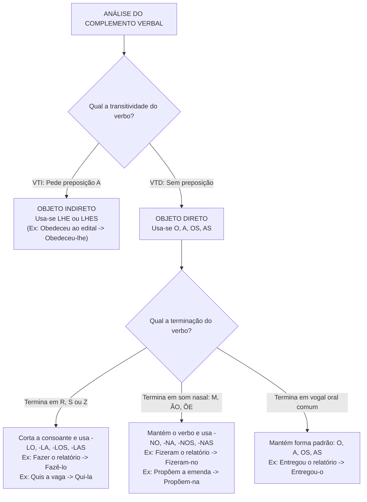
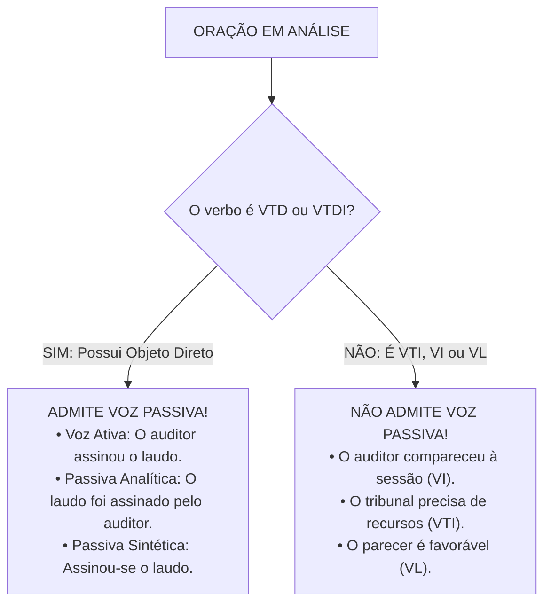

# 03 - Morfossintaxe, Pronomes e Sistema Verbal

> **Matéria:** Língua Portuguesa  
> **Cargos:** A01 – Técnico de Controle Externo (Adm) / B02 – Técnico de Controle Externo (TI)  
> **Arquivo:** `03_morfossintaxe_pronomes_e_verbos.md`  
> **Referência Temática:** Morfossintaxe, Substituição Pronominal, Vozes Verbais e Correlação na Banca FCC

---

## 📌 Ementa / Itens do Edital
- Morfossintaxe: correlação entre classe de palavras (morfologia) e função sintática na oração;
- Pronomes: classificação, valores semânticos, relações anafóricas e catafóricas;
- Pronomes pessoais retos e oblíquos átonos/tônicos: funções sintáticas de sujeito vs. complementos verbais;
- Regras de substituição pronominal com formas variantes (-lo, -la, -no, -na) e emprego de *lhe/lhes*;
- Pronome relativo *cujo* e regência com preposições antepostas;
- Colocação pronominal: Próclise (fatores atrativos obrigatórios), Ênclise e Mesóclise;
- Flexão verbal: conjugação de verbos regulares, irregulares, defectivos e anômalos de alta incidência;
- Vozes do verbo: ativa, passiva analítica, passiva sintética (pronominal), reflexiva e recíproca;
- Condições gramaticais para transposição entre voz ativa e voz passiva;
- Distinção funcional da partícula `SE`: Pronome Apassivador vs. Índice de Indeterminação do Sujeito;
- Correlação de tempos e modos verbais (*consecutio temporum*).

---

## 🌳 Classificação Hierárquica

```text
3. Morfossintaxe, Classes de Palavras e Dinâmica Verbal
├── 3.1 Morfossintaxe e Termos da Oração
│   ├── 3.1.1 Termos Essenciais: Sujeito (determinado, indeterminado, oração sem sujeito) e Predicado
│   ├── 3.1.2 Termos Integrantes: Objeto Direto, Objeto Indireto, Complemento Nominal e Agente da Passiva
│   └── 3.1.3 Termos Acessórios: Adjunto Adnominal, Adjunto Adverbial, Aposto e Vocativo
├── 3.2 Emprego dos Pronomes e Substituição Pronominal
│   ├── 3.2.1 Pessoais Retos (função subjetiva) vs. Oblíquos Átonos (função de complemento verbal)
│   ├── 3.2.2 Complemento de VTD: o, a, os, as (transformações para -lo/-la e -no/-na)
│   ├── 3.2.3 Complemento de VTI: lhe, lhes (regidos pelas preposições a ou para)
│   ├── 3.2.4 Pronomes Demonstrativos: Este (presente/catáfora), Esse (passado recente/anáfora), Aquele (passado remoto)
│   └── 3.2.5 Pronome Relativo 'Cujo': Ideia de posse, concordância com o consequente, vedação a artigo
├── 3.3 Colocação Pronominal (Sintaxe de Posição)
│   ├── 3.3.1 Próclise Obrigatória: Palavras negativas, pronomes relativos, indefinidos, conjunções subordinativas
│   ├── 3.3.2 Mesóclise: Verbos no futuro do presente ou do pretérito no início de oração sem atração
│   └── 3.3.3 Ênclise: Verbo no início de frase, imperativo afirmativo e vedações à próclise
├── 3.4 Vozes do Verbo e Regras de Transposição
│   ├── 3.4.1 Voz Ativa: Sujeito é o agente da ação verbal
│   ├── 3.4.2 Voz Passiva Analítica: Sujeito Paciente + Verbo Auxiliar 'SER' + Particípio + Agente da Passiva
│   ├── 3.4.3 Voz Passiva Sintética: VTD + Pronome Apassivador 'SE' + Sujeito Paciente
│   ├── 3.4.4 Requisito da Transposição: Apenas verbos VTD ou VTDI admitem passagem para a voz passiva
│   └── 3.4.5 Partícula 'SE': Partícula Apassivadora (com VTD) vs. Índice de Indeterminação do Sujeito (com VTI/VI)
└── 3.5 Conjugação e Correlação de Tempos e Modos Verbais
    ├── 3.5.1 Verbos Notáveis e Irregulares: ter, vir, ver, pôr, haver (impessoal) e reaver
    ├── 3.5.2 Correlação Imperfeito do Subjuntivo (-sse) + Futuro do Pretérito do Indicativo (-ria)
    └── 3.5.3 Correlação Futuro do Subjuntivo (-r) + Futuro do Presente do Indicativo (-rá)
```

---

## 📖 Resumo Teórico & Pontos-Chave

### 1. Substituição Pronominal de Complementos Verbais (Padrão Ouro da FCC)

Nas provas da FCC, a troca de termos preposicionados ou nominais por pronomes oblíquos obedece à transitividade verbal e à terminação fonética do verbo:



#### Quadro de Transformações dos Pronomes Oblíquos:

| Verbo + Complemento | Transitividade | Terminação | Pronome Resultante | Frase Final Correta |
| :--- | :--- | :--- | :--- | :--- |
| *Fiscalizar as contas* | VTD | Termina em -R | *-las* | *Fiscalizá-las* |
| *Propuseram o recurso* | VTD | Termina em -M (nasal) | *-no* | *Propuseram-no* |
| *Fizemos a auditoria* | VTD | Termina em -S | *-la* | *Fizemo-la* |
| *Avisou aos secretários* | VTI (rege preposição *a*) | Não altera | *lhes* | *Avisou-lhes* |
| *Estimou o valor* | VTD | Termina em vogal | *-o* | *Estimou-o* |

---

### 2. Vozes Verbais e Regras Rígidas de Transposição



#### Mecânica de Conversão (Ativa $\rightarrow$ Passiva Analítica):
1. **O Objeto Direto** da voz ativa torna-se o **Sujeito Paciente** da voz passiva;
2. **O Sujeito Agente** da voz ativa torna-se o **Agente da Passiva** (preposicionado por *por/pelo*);
3. **O Verbo Simples** converte-se em **Locução Verbal** (*verbo auxiliar SER + Particípio do verbo principal*):
   * O verbo auxiliar *SER* assume **rigorosamente o mesmo tempo e modo** do verbo primitivo da voz ativa!
   * O particípio concorda em gênero e número com o novo sujeito paciente.

#### Tabela de Correspondência Temporal na Transposição:

| Voz Ativa (Verbo Simples) | Tempo do Verbo Ativo | Voz Passiva Analítica (Locução) |
| :--- | :--- | :--- |
| *O auditor analisa as contas.* | Presente do Indicativo | *As contas **são analisadas** pelo auditor.* |
| *O auditor analisou as contas.* | Pretérito Perfeito Indicativo | *As contas **foram analisadas** pelo auditor.* |
| *O auditor analisava as contas.* | Pretérito Imperfeito Indicativo | *As contas **eram analisadas** pelo auditor.* |
| *O auditor analisara as contas.* | Pretérito Mais-Que-Perfeito | *As contas **tinham sido / foram analisadas**.* |
| *O auditor analisará as contas.* | Futuro do Presente Indicativo | *As contas **serão analisadas** pelo auditor.* |
| *O auditor analisaria as contas.* | Futuro do Pretérito Indicativo | *As contas **seriam analisadas** pelo auditor.* |

---

### 3. A Partícula SE: Apassivadora vs. Índice de Indeterminação

* **Partícula Apassivadora (Pronome Apassivador):**
  * Ocorre com verbo **Transitivo Direto (VTD)** ou **Transitivo Direto e Indireto (VTDI)**;
  * Há Sujeito Paciente na oração;
  * O verbo **obrigatoriamente flexiona** no singular ou plural para concordar com o sujeito:
    * *Apurou-se a denúncia.* (Sujeito singular $\rightarrow$ verbo singular)
    * *Apuraram-se as denúncias.* (Sujeito plural $\rightarrow$ verbo plural)
* **Índice de Indeterminação do Sujeito (IIS):**
  * Ocorre com verbo **Transitivo Indireto (VTI)**, **Intransitivo (VI)** ou **de Ligação (VL)**;
  * Não há sujeito paciente; o sujeito é indeterminado;
  * O verbo fica **obrigatoriamente fixado na 3ª pessoa do singular**:
    * *Necessita-se de peritos judiciais.* (Correto) $\rightarrow$ *Necessitam-se de peritos* (ERRADO!)
    * *Trata-se de processos complexos.* (Correto) $\rightarrow$ *Tratam-se de processos* (ERRADO!)

---

### 4. Correlação Verbal (*Consecutio Temporum*)

A harmonia entre os tempos verbais nas orações coordenadas e subordinadas é cobrada pela FCC por meio de estruturas fixas:

1. **Condição Hipotética no Passado / Presente:**
   * **Pretérito Imperfeito do Subjuntivo** (-sse) $\Longleftrightarrow$ **Futuro do Pretérito do Indicativo** (-ria)
   * *"Se o fiscal **verificasse** as notas fiscais, **descobriria** o sobrepreço."*
2. **Condição Provável no Futuro:**
   * **Futuro do Subjuntivo** (-r) $\Longleftrightarrow$ **Futuro do Presente do Indicativo** (-rá) / **Presente**
   * *"Quando o plenário **deliberar** sobre a matéria, a decisão **será** publicada."*
3. **Verbos Críticos em Subjuntivo:**
   * *Ver* no Futuro do Subjuntivo: *quando eu vir, quando nós virmos* (e não *"quando eu ver"*);
   * *Vir* no Futuro do Subjuntivo: *quando eu vier, quando nós viermos*;
   * *Pôr* no Futuro do Subjuntivo: *quando eu puser, quando nós pusermos* (e não *"quando eu pôr"*).

---

## ⚠️ Alertas de Prova & Pegadinhas da FCC

> 🚨 **ALERTA DE PROVA / PEGADINHA FCC:** A banca FCC frequentemente cria frases com verbos Transitivos Indiretos e pluraliza o verbo junto com a partícula SE: *"Tratam-se de normas constitucionais"* ou *"Precisam-se de novos auditores"*. **Atenção:** Como o termo preposicionado é objeto indireto, o SE é Índice de Indeterminação do Sujeito e o verbo **DEVE FICAR NO SINGULAR**: *"Trata-se de normas"*, *"Precisa-se de novos auditores"*.

> ⭐ **IMPORTANTE / PRONOME RELATIVO "CUJO":**
> 1. *"Cujo"* indica posse e liga dois substantivos;
> 2. Concorda com a coisa possuída em gênero e número (*cujo relatório*, *cuja decisão*, *cujos termos*);
> 3. **NUNCA** aceita artigo posterior (*cujo o*, *cuja a* são erros graves eliminatórios);
> 4. Se o verbo posterior exigir preposição, ela deve ser colocada **antes de cujo**: *"O tribunal a cujas normas aludimos"* (quem alude, alude **a**).

> 📌 **NOTA EXPLICATIVA / VERBO HAVER IMPESSOAL:** O verbo *haver*, no sentido de existir, ocorrer ou indicando tempo decorrido, é impessoal: **não tem sujeito e não flexiona no plural** (*"Havia muitas irregularidades nas contas"*, *"Deve haver três meses que o processo parou"*). Se trocado por *existir*, este último é pessoal e flexiona: *"Existiam muitas irregularidades"*.

> 💡 **DICA DE SUBSTITUIÇÃO PRONOMINAL:** Quando o verbo terminar em **-R**, **-S** ou **-Z**, a consoante desaparece e surgem as formas com **L** (*amar + a = amá-la*; *quis + o = qui-lo*; *conduz + o = condu-lo*). Não confunda com a terminação nasal (-m), que mantém a palavra intacta e apenas adiciona **N** (*disseram + o = disseram-no*).

---

## 🌐 Fontes Oficiais e Referências Bibliográficas

* [Guia Gramatical do Senado Federal - Manual de Redação e Estilo](https://www12.senado.leg.br/manualdecomunicacao/redacao-e-estilo/guia-gramatical) - Uso de pronomes oblíquos, correlação de modos verbais e concordância.
* [Dicionário Priberam da Língua Portuguesa - Conjugador Verbal Oficial](https://dicionario.priberam.org/) - Paradigma flexional de verbos anômalos, defectivos e irregulares.
* [Só Português - Guia Completo de Vozes Verbais e Sintaxe](https://www.soportugues.com.br/) - Estrutura de vozes verbais, partícula SE e complementos verbais.
* CUNHA, Celso & CINTRA, Lindley. *Nova Gramática do Português Contemporâneo*. Rio de Janeiro: Lexikon. (Capítulos de Pronomes, Sintaxe de Colocação e Dinâmica Verbal).
* BECHARA, Evanildo. *Moderna Gramática Portuguesa*. Rio de Janeiro: Nova Fronteira.

---

## 📝 Questões de Concurso FCC Comentadas

### Questão 01
**(FCC – TCE-GO – Analista de Controle Externo)**  
A frase que admite transposição para a **voz passiva** de modo inteiramente compatível com a norma-padrão da língua é:

* **A)** *"O plenário do Tribunal anuiu expressamente aos termos da consulta formulada pelo Secretário."*
* **B)** *"A equipe de fiscalização deparou com graves impropriedades nos contratos de infraestrutura."*
* **C)** *"Os técnicos de controle externo apuraram todas as inconsistências no cronograma financeiro da obra."*
* **D)** *"O Ministério Público de Contas interveio no processo com zelo exemplar."*
* **E)** *"O conselheiro relator presidiu à sessão extraordinária com extrema serenidade."*

> **Gabarito: C**  
> **Comentário Detalhado:**  
> - **A) Incorreta.** O verbo *anuir* é Transitivo Indireto (VTI), regendo preposição *a* (*anuiu aos termos*). Verbos que exigem preposição não possuem objeto direto e não admitem voz passiva.  
> - **B) Incorreta.** *deparar com* é empregado como VTI com preposição *com*, não admitindo conversão passiva.  
> - **C) CORRETA.** O verbo *apurar* é Transitivo Direto (VTD) — quem apura, apura algo: *"todas as inconsistências no cronograma financeiro da obra"* é o **Objeto Direto**. Há, portanto, objeto que se converterá em sujeito paciente na passiva analítica: *"Todas as inconsistências no cronograma financeiro da obra foram apuradas pelos técnicos de controle externo"*.  
> - **D) Incorreta.** *intervir* é VTI (rege preposição *em*).  
> - **E) Incorreta.** *presidir a* é VTI (rege preposição *a*).

---

### Questão 02
**(FCC – TRT – Técnico Judiciário)**  
Considere a oração:  
*"O diretor da comissão <ins>apresentou as justificativas técnicas</ins> e <ins>remeteu o parecer conclusivo</ins> ao setor de compras."*  
Substituindo-se adequadamente as expressões sublinhadas pelos respectivos pronomes oblíquos átonos, obtém-se:

* **A)** O diretor da comissão apresentou-as e remeteu-lhe ao setor de compras.
* **B)** O diretor da comissão apresentou-as e remeteu-o ao setor de compras.
* **C)** O diretor da comissão apresentou-lhes e remeteu-o ao setor de compras.
* **D)** O diretor da comissão as apresentou e lhe remeteu ao setor de compras.
* **E)** O diretor da comissão apresentou-as e remeteu-no ao setor de compras.

> **Gabarito: B**  
> **Comentário Detalhado:**  
> - **1º segmento:** *apresentou as justificativas técnicas* $\rightarrow$ *apresentar* é VTD; *as justificativas técnicas* é objeto direto feminino plural $\rightarrow$ pronome **as**. Como o verbo termina em vogal, mantém-se a forma pura com ênclise: *apresentou-as*.  
> - **2º segmento:** *remeteu o parecer conclusivo* $\rightarrow$ *remeter* é VTD (quem remete algo a alguém/lugar); *o parecer conclusivo* é objeto direto masculino singular $\rightarrow$ pronome **o**. Como termina em vogal, resulta: *remeteu-o*. (*ao setor de compras* já é o objeto indireto preposicionado da frase).  
> - A alternativa que faz a substituição correta de ambos os objetos diretos pelos pronomes *as* e *o* é a letra B.

---

### Questão 03
**(FCC – TCE-PI – Auditor de Controle Externo)**  
O emprego da partícula `SE` e a concordância verbal estão plenamente corretos em:

* **A)** *"Tratam-se de apurações preliminares que demandam sigilo documental absoluto."*
* **B)** *"Identificou-se, durante a inspeção matutina, diversos pagamentos desprovidos de nota fiscal."*
* **C)** *"Identificaram-se, durante a inspeção matutina, diversos pagamentos desprovidos de nota fiscal."*
* **D)** *"Precisam-se de novos analistas de controle externo para a instrução de processos."*
* **E)** *"Atribuiu-se aos peritos contábeis os pareceres definitivos sobre o balanço patrimonial."*

> **Gabarito: C**  
> **Comentário Detalhado:**  
> - **A) Incorreta.** *Tratar de* é VTI. O `SE` atua como Índice de Indeterminação do Sujeito. O verbo deve ficar compulsoriamente no singular: *"Trata-se de apurações..."*.  
> - **B) Incorreta.** *Identificar* é VTD. O `SE` é Pronome Apassivador. O termo *"diversos pagamentos"* é o Sujeito Paciente no plural, exigindo que o verbo vá para o plural (*Identificaram-se*).  
> - **C) CORRETA.** *Identificar* é VTD + pronome apassivador `SE` + sujeito paciente plural (*diversos pagamentos*). O verbo concorda corretamente no plural: *"Identificaram-se (...) diversos pagamentos"*.  
> - **D) Incorreta.** *Precisar de* é VTI. O `SE` é IIS, exigindo verbo no singular: *"Precisa-se de novos analistas"*.  
> - **E) Incorreta.** *Atribuir* é VTDI. O termo *"os pareceres definitivos"* é sujeito paciente plural, exigindo verbo no plural: *"Atribuíram-se aos peritos contábeis os pareceres definitivos"*.

---

### Questão 04
**(FCC – DPE-RS – Analista Jurídico)**  
A frase em que a articulação entre tempos e modos verbais observa a **correlação verbal** adequada é:

* **A)** *"Se o conselheiro propusesse a realização de nova auditoria, o presidente acataria a solicitação de pronto."*
* **B)** *"Se o conselheiro proporia a realização de nova auditoria, o presidente acatava a solicitação de pronto."*
* **C)** *"Caso o conselheiro propor nova auditoria, o presidente acatará a solicitação de pronto."*
* **D)** *"Se o conselheiro propôs nova auditoria, o presidente acataria a solicitação de pronto."*
* **E)** *"Quando o conselheiro ver as irregularidades do balanço, proporá a anulação do contrato."*

> **Gabarito: A**  
> **Comentário Detalhado:**  
> - **A) CORRETA.** Aplica com exatidão a correlação modal clássica: **Pretérito Imperfeito do Subjuntivo** (*propusesse*) articulado com o **Futuro do Pretérito do Indicativo** (*acataria*).  
> - **B) Incorreta.** É incorreto usar o futuro do pretérito (*proporia*) na oração condicional iniciada pela conjunção subordinativa "se".  
> - **C) Incorreta.** O verbo *pôr* e seus derivados flexionam-se no futuro do subjuntivo como *propuser* (*"Caso o conselheiro propuser..."*), sendo erro usar a forma no infinitivo *"propor"*.  
> - **D) Incorreta.** Mistura pretérito perfeito do indicativo (*propôs*) com futuro do pretérito (*acataria*), rompendo a harmonia da hipótese.  
> - **E) Incorreta.** O verbo *ver* no futuro do subjuntivo conjuga-se como *vir* (*"Quando o conselheiro vir as irregularidades..."*). A forma *"quando ver"* é vício gramatical.

---

### Questão 05
**(FCC – METRÔ-SP – Analista de Comunicação)**  
O pronome relativo antecedido de preposição está empregado em estrita conformidade com a norma-padrão em:

* **A)** *"Este é o gestor cujo o comportamento foi elogiado em sessão plenária."*
* **B)** *"A diretriz orçamentária a cujas determinações todos os órgãos estaduais devem obedecer foi publicada hoje."*
* **C)** *"O departamento em cujo os funcionários operam os sistemas de auditoria foi reformado."*
* **D)** *"A decisão judicial cuja a eficácia dependia de trânsito em julgado foi confirmada."*
* **E)** *"As metas fiscais de cujas todos duvidavam foram atingidas com sobras."*

> **Gabarito: B**  
> **Comentário Detalhado:**  
> - **A) Incorreta.** É inadmissível o emprego de artigo definido após o pronome relativo *cujo* (*cujo o* é erro crasso).  
> - **B) CORRETA.** 1) O pronome *cujas* estabelece relação de posse com *determinações*, com o qual concorda em gênero e número; 2) Não há artigo posterior; 3) O verbo *obedecer* é VTI e rege a preposição **a** (*obedecer a algo*), a qual foi corretamente anteposta ao pronome relativo: *"a cujas determinações (...) devem obedecer"*.  
> - **C) Incorreta.** Erro pelo uso indevido de artigo (*em cujo os*).  
> - **D) Incorreta.** Erro pelo uso indevido de artigo (*cuja a eficácia*).  
> - **E) Incorreta.** Quem duvida, duvida **de** algo. O termo subsequente seria *de que todos duvidavam*, pois *cujo* exige ligação entre dois substantivos em relação de posse (não cabe *de cujas todos* sem substantivo consequente).
