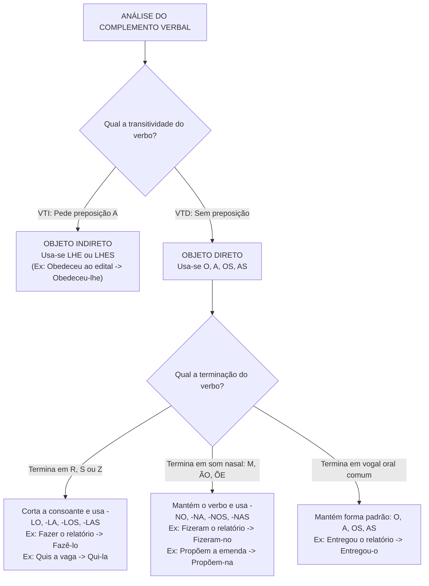
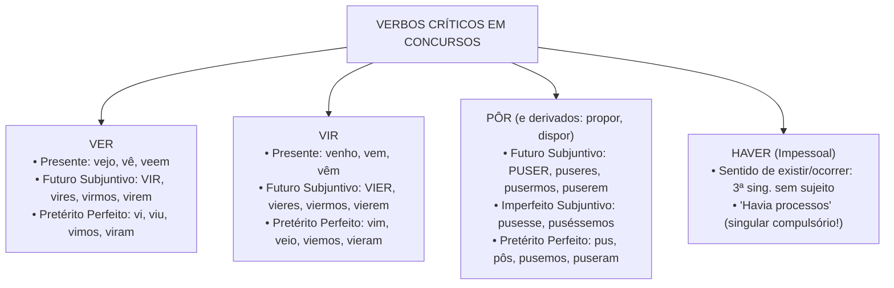
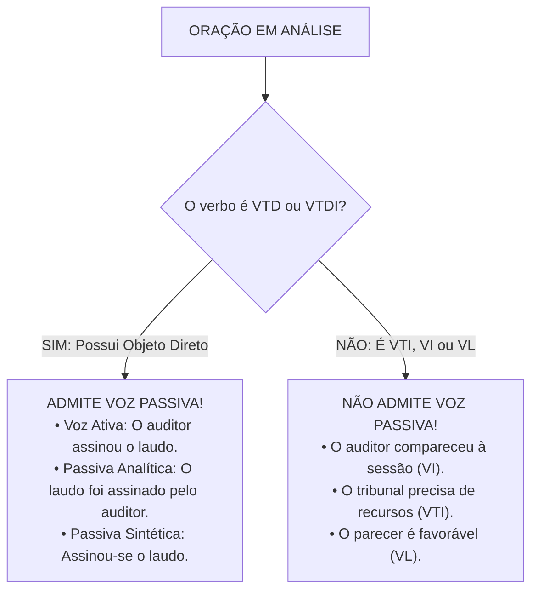

# 03 - Morfossintaxe, Pronomes e Sistema Verbal

> **Matéria:** Língua Portuguesa  
> **Cargos:** A01 – Técnico de Controle Externo (Adm) / B02 – Técnico de Controle Externo (TI)  
> **Arquivo:** `03_morfossintaxe_pronomes_e_verbos.md`  
> **Referência Temática:** Morfossintaxe, Substituição Pronominal, Vozes Verbais e Correlação na Banca FCC

---

## 📌 Ementa / Itens do Edital
- Morfossintaxe: correlação entre classe de palavras (morfologia) e função sintática na oração;
- Pronomes: classificação, valores semânticos, relações anafóricas e catafóricas;
- Pronomes pessoais retos e oblíquos átonos/tônicos: funções sintáticas de sujeito vs. complementos verbais;
- Regras de substituição pronominal com formas variantes (-lo, -la, -no, -na) e emprego de *lhe/lhes*;
- Pronome relativo *cujo* e regência com preposições antepostas;
- Colocação pronominal: Próclise (fatores atrativos obrigatórios), Ênclise e Mesóclise;
- Flexão verbal: conjugação de verbos regulares, irregulares, defectivos e anômalos de alta incidência;
- Vozes do verbo: ativa, passiva analítica, passiva sintética (pronominal), reflexiva e recíproca;
- Condições gramaticais para transposição entre voz ativa e voz passiva;
- Distinção funcional da partícula `SE`: Pronome Apassivador vs. Índice de Indeterminação do Sujeito;
- Correlação de tempos e modos verbais (*consecutio temporum*).

---

## 🧭 Sumário

1. [Fundamentos de Morfossintaxe e Estrutura Oracional](#1-fundamentos-de-morfossintaxe-e-estrutura-oracional)
    1. [Correlação entre Classes Morfológicas e Funções Sintáticas](#11-correlacao-entre-classes-morfologicas-e-funcoes-sintaticas)
    2. [Termos Essenciais, Integrantes e Acessórios da Oração](#12-termos-essenciais-integrantes-e-acessorios-da-oracao)
    3. [O Papel Central do Verbo na Predicação e Transitividade](#13-o-papel-central-do-verbo-na-predicacao-e-transitividade)
    4. [Teste 022](#Teste-022)
2. [Teoria dos Pronomes e Relações Discursivas](#2-teoria-dos-pronomes-e-relacoes-discursivas)
    1. [Classificação Geral e Funções Referenciais: Anáfora, Catáfora e Dêixis](#21-classificacao-geral-e-funcoes-referenciais-anafora-catafora-e-deixis)
    2. [Pronomes Demonstrativos e a Articulação Espaço-Temporal](#22-pronomes-demonstrativos-e-a-articulacao-espaco-temporal)
    3. [Pronome Relativo Cujo e Regência com Preposições Antepostas](#23-pronome-relativo-cujo-e-regencia-com-preposicoes-antepostas)
    4. [Teste 023](#Teste-023)
3. [Pronomes Pessoais e Substituição Pronominal](#3-pronomes-pessoais-e-substituicao-pronominal)
    1. [Pronomes Pessoais Retos vs. Oblíquos Átonos e Tônicos](#31-pronomes-pessoais-retos-vs-obliquos-atonos-e-tonicos)
    2. [Complementos de VTD e VTI: Emprego de O/A vs. Lhe/Lhes](#32-complementos-de-vtd-e-vti-emprego-de-oa-vs-lhelhes)
    3. [Variações Fonéticas dos Pronomes Diretos: Formas em -Lo e -No](#33-variacoes-foneticas-dos-pronomes-diretos-formas-em-lo-e-no)
    4. [Teste 024](#Teste-024)
4. [Sintaxe de Colocação Pronominal](#4-sintaxe-de-colocacao-pronominal)
    1. [Próclise e os Fatores Atrativos Obrigatórios](#41-proclise-e-os-fatores-atrativos-obrigatorios)
    2. [Mesóclise e Suas Condições de Aplicação](#42-mesoclise-e-suas-condicoes-de-aplicacao)
    3. [Ênclise e Vedações Gramaticais Absolutas](#43-enclise-e-vedacoes-gramaticais-absolutas)
    4. [Colocação Pronominal em Locuções Verbais](#44-colocacao-pronominal-em-locucoes-verbais)
    5. [Teste 025](#Teste-025)
5. [Sistema Verbal: Paradigmas de Flexão e Formas Críticas](#5-sistema-verbal-paradigmas-de-flexao-e-formas-criticas)
    1. [Verbos Regulares, Irregulares, Anômalos e Defectivos](#51-verbos-regulares-irregulares-anomalos-e-defectivos)
    2. [Verbos Notáveis de Alta Incidência: Ter, Vir, Ver, Pôr e Haver](#52-verbos-notaveis-de-alta-incidencia-ter-vir-ver-por-e-haver)
    3. [Teste 026](#Teste-026)
    4. [Teste 027](#Teste-027)
6. [Vozes Verbais e Regras de Transposição](#6-vozes-verbais-e-regras-de-transposicao)
    1. [Voz Ativa, Voz Passiva, Voz Reflexiva e Recíproca](#61-voz-ativa-voz-passiva-voz-reflexiva-e-reciproca)
    2. [Voz Passiva Analítica e Regras Estritas de Transposição](#62-voz-passiva-analitica-e-regras-estritas-de-transposicao)
    3. [Voz Passiva Sintética ou Pronominal](#63-voz-passiva-sintetica-ou-pronominal)
    4. [Distinção entre Pronome Apassivador e Índice de Indeterminação do Sujeito](#64-distincao-entre-pronome-apassivador-e-indice-de-indeterminacao-do-sujeito)
    5. [Teste 028](#Teste-028)
    6. [Teste 029](#Teste-029)
    7. [Teste 030](#Teste-030)
7. [Correlação de Tempos e Modos Verbais](#7-correlacao-de-tempos-e-modos-verbais)
    1. [Princípios da Consecutio Temporum no Período Composto](#71-principios-da-consecutio-temporum-no-periodo-composto)
    2. [Estruturas Hipotéticas e Condicionais Padronizadas](#72-estruturas-hipoteticas-e-condicionais-padronizadas)
    3. [Correlações em Orações Subjetivas e Integrantes](#73-correlacoes-em-oracoes-subjetivas-e-integrantes)
    4. [Teste 031](#Teste-031)
8. [🌐 Fontes Oficiais e Referências Bibliográficas](#fontes-oficiais-e-referencias-bibliograficas)

---

## 1. Fundamentos de Morfossintaxe e Estrutura Oracional

A morfossintaxe constitui a área integrada da gramática que estuda simultaneamente a natureza morfológica das palavras (sua classificação em uma das dez classes gramaticais) e a função sintática que essas mesmas palavras desempenham no interior da oração. Uma mesma classe gramatical pode assumir funções sintáticas distintas a depender do contexto relacional estabelecido com o núcleo do predicado e com os demais termos oracionais.

### 1.1 Correlação entre Classes Morfológicas e Funções Sintáticas

Na língua portuguesa, as classes morfológicas agrupam-se em variáveis (substantivo, adjetivo, artigo, pronome, numeral e verbo) e invariáveis (advérbio, preposição, conjunção e interjeição). A cada classe associa-se uma vocação sintática preferencial:

| Classe Morfológica | Funções Sintáticas Primárias | Exemplos Típicos em Concursos |
| :--- | :--- | :--- |
| **Substantivo** (ou termo substantivado) | Núcleo do Sujeito, Núcleo do Objeto Direto/Indireto, Agente da Passiva, Núcleo do Aposto | *"O <ins>conselheiro</ins> julgou o <ins>recurso</ins>"* |
| **Adjetivo** | Adjunto Adnominal, Predicativo do Sujeito, Predicativo do Objeto | *"A decisão foi <ins>técnica</ins>"* (Predicativo) |
| **Pronome Substantivo** | Sujeito, Objeto Direto, Objeto Indireto, Complemento Nominal | *"Ele <ins>o</ins> advertiu formalmente"* |
| **Pronome Adjetivo** | Adjunto Adnominal | *"Acompanhou <ins>este</ins> processo"* |
| **Verbo** | Núcleo do Predicado (Verbo Nocional) ou Elo de Ligação (Verbo de Ligação) | *"O auditor <ins>inspecionou</ins> a obra"* |
| **Advérbio** | Adjunto Adverbial (modifica verbo, adjetivo ou outro advérbio) | *"Julgou <ins>celeremente</ins> a lide"* |
| **Preposição** | Conectivo relacional sem função de termo isolado (introduz termos preposicionados) | *"Necessita <ins>de</ins> recursos"* |
| **Conjunção** | Conectivo oracional de coordenação ou subordinação | *"Estudou <ins>porque</ins> almejava a posse"* |

### 1.2 Termos Essenciais, Integrantes e Acessórios da Oração

A sintaxe clássica divide a estrutura oracional em três ordens hierárquicas de termos:

1. **Termos Essenciais:**
    * **Sujeito:** Elemento sobre o qual se faz uma declaração, com o qual o verbo concorda em número e pessoa. Pode ser determinado (simples, composto ou elíptico/oculto), indeterminado (com verbo na 3ª pessoa do plural sem referência ou com VTI/VI + partícula SE) ou inexistente (em orações sem sujeito com verbos impessoais como *haver* no sentido de existir ou verbos de fenômenos climáticos).
    * **Predicado:** Tudo o que se declara acerca do sujeito ou, nas orações sem sujeito, o próprio teor do processo verbal. Divide-se em predicado verbal (núcleo é um verbo nocional), predicado nominal (núcleo é um nome predicativo ligado por verbo de ligação) e predicado verbo-nominal (possui verbo nocional associado a um predicativo).

2. **Termos Integrantes:**
    * **Objeto Direto:** Complemento verbal não regido obrigatoriamente por preposição exigida pelo verbo.
    * **Objeto Indireto:** Complemento verbal regido obrigatoriamente por preposição exigida pelo verbo transitivo indireto.
    * **Complemento Nominal:** Termo preposicionado que completa o sentido abstrato e passivo de um substantivo abstrato, de um adjetivo ou de um advérbio.
    * **Agente da Passiva:** Termo preposicionado (com *por/pelo* ou raramente *de*) que pratica a ação expressa pelo verbo na voz passiva analítica.

3. **Termos Acessórios e Vocativo:**
    * **Adjunto Adnominal:** Termo de valor adjetivo que determina, especifica ou restringe o substantivo núcleo de qualquer função sintática.
    * **Adjunto Adverbial:** Termo de valor adverbial que expressa circunstâncias de tempo, lugar, modo, causa, finalidade, instrumento, entre outras.
    * **Aposto:** Termo de natureza substantiva que explica, resume, especifica ou enumera outro termo substantivo antecedente.
    * **Vocativo:** Termo independente de invocação ou chamamento, sem ligação sintática com o sujeito ou o predicado.

### 1.3 O Papel Central do Verbo na Predicação e Transitividade

A predicação verbal analisa a exigência de complementos pelos verbos no contexto específico da frase:

* **Verbo Intransitivo (VI):** Possui sentido completo em si mesmo no contexto, prescindindo de objeto direto ou indireto (*"O conselheiro faleceu"*, *"O processo caminhou rapidamente"* — onde *rapidamente* é mero adjunto adverbial de modo).
* **Verbo Transitivo Direto (VTD):** Requer complemento sem preposição obrigatória (*"O auditor apurou a fraude"*).
* **Verbo Transitivo Indireto (VTI):** Requer complemento introduzido por preposição exigida pela regência verbal (*"O fiscal deparou com impropriedades"*, *"O relator anuiu aos termos"*).
* **Verbo Transitivo Direto e Indireto (VTDI ou Bitransitivo):** Reclama dois complementos simultâneos, um direto e outro indireto (*"O presidente remeteu o relatório ao tribunal"*).
* **Verbo de Ligação (VL):** Não expressa ação, servindo de elo entre o sujeito e seu predicativo (*ser, estar, parecer, permanecer, ficar, continuar, andar* em sentido de estado).

---

### Teste 022
**(FGV – TRT – Analista Judiciário (TI) – 2024)**  
Assinale a opção em que houve erro na construção da frase, por troca indevida entre O/LHE.

* **A)** Não há prazer em conseguir-se algo e não o dividir com os demais.
* **B)** A minha vontade é firme, mas a minha disposição de obedecer-lhe é fraca.
* **C)** Se quiser conhecer verdadeiramente um homem, dê -lhe autoridade.
* **D)** Um tolo sempre acha um mais tolo para seguir-lhe.
* **E)** Devemos superar os abismos e nunca aprofundá-los.

---

> **Comentário Detalhado:**
>
> - **A)** Incorreta. O verbo 'dividir' é transitivo direto ('dividir algo'); o pronome oblíquo 'o' atua como objeto direto regular ('dividi-lo' / 'não o dividir').
> - **B)** Incorreta. O verbo 'obedecer' é transitivo indireto na norma-padrão ('obedecer a algo/alguém'), exigindo o pronome 'lhe' como objeto indireto ('obedecer-lhe').
> - **C)** Incorreta. O verbo 'dar' é bitransitivo (VTD e VTI: 'dar autoridade a alguém'); o pronome 'lhe' funciona perfeitamente como objeto indireto.
> - **D)** Correta. O verbo 'seguir' é transitivo direto na acepção de acompanhar ou seguir os passos de alguém ('seguir alguém'), exigindo pronome oblíquo direto ('segui-lo'), e não o pronome indireto 'lhe'. O correto segundo a norma culta seria 'para segui-lo'.
> - **E)** Incorreta. O verbo 'aprofundar' é transitivo direto ('aprofundar os abismos'); a terminação em 'r' com pronome direto 'os' gera a forma assimilada 'aprofundá-los'.
>
> **Gabarito: D**

---

## 2. Teoria dos Pronomes e Relações Discursivas

Os pronomes formam a classe gramatical responsável por representar ou acompanhar os nomes (substantivos), exercendo papel insubstituível na coesão textual, na distribuição de turnos de fala e no estabelecimento de referências espaciais e temporais.

### 2.1 Classificação Geral e Funções Referenciais: Anáfora, Catáfora e Dêixis

Do ponto de vista discursivo, os pronomes operam três mecanismos de remissão:

1. **Função Anafórica:** O pronome remete a um termo, fato ou conceito já mencionado anteriormente no texto, retomando-o e garantindo a progressão temática sem repetições deselegantes (*"O Tribunal proferiu a decisão; <ins>esta</ins> gerou ampla repercussão"*).
2. **Função Catafórica:** O pronome antecipa um elemento que ainda será explicitado nas linhas subsequentes (*"O conselheiro reiterou apenas <ins>isto</ins>: a legalidade é inegociável"*).
3. **Função Dêitica (Exofórica):** O pronome aponta diretamente para elementos exteriores ao texto, presentes na situação concreta de enunciação no mundo real (quem fala, onde fala e quando fala): *"Por favor, assine <ins>este</ins> documento aqui agora"*.

### 2.2 Pronomes Demonstrativos e a Articulação Espaço-Temporal

O emprego correto dos demonstrativos apoia-se em parâmetros espaciais, temporais e textuais rigorosos:

| Pronome | Relação Espacial | Relação Temporal | Relação Textual |
| :--- | :--- | :--- | :--- |
| **Este, esta, isto** | Próximo do emissor (1ª pessoa) | Tempo presente ou futuro imediato (*"neste ano de 2026"*) | Catáfora (antecipa o que virá) ou retoma o termo imediatamente mais próximo |
| **Esse, essa, isso** | Próximo do receptor (2ª pessoa) | Passado ou futuro próximo (*"esse mês que passou"*) | Anáfora simples (retoma termo recém-mencionado) |
| **Aquele, aquela, aquilo** | Distante de ambos (3ª pessoa) | Passado remoto ou época distante (*"naquele século"*) | Retoma o termo mais distante em contraste com *este* |

> 📌 **NOTA EXPLICATIVA / DISTRIBUIÇÃO EM PARALELO (ESTE VS. AQUELE):** Ao citar dois elementos no texto e retomá-los comparativamente, emprega-se **este** para referir-se ao elemento mencionado por último (mais próximo fisicamente na escrita) e **aquele** para remeter ao primeiro elemento mencionado (mais afastado no texto): *"O Diretor e o Auditor chegaram; <ins>este</ins> (o auditor) trazia as planilhas, <ins>aquele</ins> (o diretor) presidiu a conferência"*.

### 2.3 Pronome Relativo Cujo e Regência com Preposições Antepostas

O pronome relativo *cujo* (e suas flexões *cuja, cujos, cujas*) é um dos pontos de maior incidência em provas de concurso da Fundação Carlos Chagas. O seu emprego correto exige a observância cumulativa de quatro regras pétreas:

1. **Sentido intrínseco de posse:** Liga dois substantivos, estabelecendo uma relação em que o segundo termo pertence ao primeiro (*"O órgão <ins>cujos</ins> servidores foram premiados..."* $\rightarrow$ os servidores do órgão).
2. **Concordância obrigatória com o consequente:** O pronome concorda rigorosamente em gênero e número com o substantivo que vem **depois** dele (*cujo parecer*, *cuja decisão*, *cujos autos*, *cujas certidões*).
3. **Vedação absoluta ao uso de artigo:** É erro gramatical gravíssimo fazer suceder qualquer artigo ao pronome (*cujo o*, *cuja a*, *cujos os*, *cujas as* são formas inexistentes e eliminatórias).
4. **Anteposição da preposição exigida pelo verbo:** Se o verbo da oração adjetiva introduzida por *cujo* exigir preposição em razão de sua regência, essa preposição **deve ser obrigatoriamente colocada antes de cujo**:
    * *"A diretriz orçamentária <ins>a cujas</ins> determinações devemos obedecer..."* (quem obedece, obedece **a** algo);
    * *"O tribunal <ins>em cujas</ins> salas tramitam os processos..."* (quem tramita, tramita **em** algum lugar);
    * *"O auditor <ins>de cuja</ins> integridade todos desconfiavam..."* (quem desconfia, desconfia **de** alguém).

> 🚨 **ALERTA DE PROVA / PEGADINHA DO PRONOME CUJO:** A FCC cria enunciados que tentam substituir o pronome relativo *cujo* por locuções prepositivas ou misturá-lo com conjunções, como em *"O órgão do qual seus servidores foram promovidos"* (errado, redundante) ou inserindo artigos (*"O relatório cujo o teor..."*). Lembre-se: *cujo* jamais aceita artigo posterior e sempre concorda com o termo da frente.

---

### Teste 023
**(FCC – TRT-1 – Analista Judiciário (TI) – 2014)**  
As expressões onde  e em cujo preenchem corretamente, na ordem dada, as lacunas da seguinte frase:

* **A)** O filme Rio, 40 graus foi exibido no ano de 1955, ...... a atmosfera política propiciaria um período de realizações ...... o maior responsável seria o novo presidente da República.
* **B)** Ao realizar Rio, zona norte , filme ...... Nelson Pereira dos Santos lançou em 1957, o cineasta dava sequência a um filme anterior, ...... valor já fora re- conhecido.
* **C)** O Rio era uma cidade ...... muitos buscavam para vi- ver melhor, a capital ...... esplendor todos os cario- cas se orgulhavam.
* **D)** ...... iriam os artistas da época, senão ao Rio, atrás do sucesso artístico ...... todos queriam alcançar e se realizar.
* **E)** Rodado na cidade do Rio de Janeiro, ...... se viviam algumas tensões políticas, o filme provocou um grande debate, ...... calor muita gente mergulhou.

---

> **Comentário Detalhado:**
>
> - **A)** Incorreta. O pronome 'onde' só pode ser empregado para indicar lugar físico e concreto.
> - **B)** Incorreta. Falta a preposição 'em' exigida pela regência na relação estabelecida por 'cujo'.
> - **C)** Incorreta. A ordem exigida para as lacunas não foi observada.
> - **D)** Incorreta. 'Em cujo' não pode ser seguido de artigo definido ('em cujo o'), sendo agramatical.
> - **E)** Correta. A forma 'onde' referencia o lugar espacial físico, e a locução pronominal 'em cujo' articula a posse com a preposição 'em' exigida pela regência do verbo subsequente, sem presença de artigo posterior.
>
> **Gabarito: E**

---

## 3. Pronomes Pessoais e Substituição Pronominal

A substituição de sintagmas nominais por pronomes oblíquos átonos em complementação verbal é uma das marcas registradas da banca FCC. A operação envolve a identificação da transitividade do verbo e o ajuste morfofonético da terminação verbal.

### 3.1 Pronomes Pessoais Retos vs. Oblíquos Átonos e Tônicos

Os pronomes pessoais exercem papéis sintáticos estritos de acordo com a sua forma:

* **Pronomes Retos (eu, tu, ele/ela, nós, vós, eles/elas):** Exercem primordialmente a função de **sujeito** da oração. Não atuam como complementos verbais diretos na norma culta (dizer *"vi ele"* ou *"chamei ela"* constitui desvio sintático primário; o correto é *vi-o*, *chamei-a*).
* **Pronomes Oblíquos Átonos (me, te, se, o, a, lhe, nos, vos, se, os, as, lhes):** São pronunciados com fraca intensidade e não são precedidos de preposição própria, atuando como complementos verbais imediatos (objeto direto ou indireto).
* **Pronomes Oblíquos Tônicos (mim, ti, si, ele, ela, nós, vós, si, eles, elas):** São dotados de tonicidade própria e surgem sempre precedidos de preposição essencial (*a mim, de ti, para nós, com ele*).
    * Distinção clássica: *"Entregue o relatório para mim"* (término da frase, *mim* não conjuga verbo) vs. *"Traga o documento para <ins>eu</ins> assinar"* (caso reto, pois *eu* atua como sujeito do verbo no infinitivo *assinar*).

### 3.2 Complementos de VTD e VTI: Emprego de O/A vs. Lhe/Lhes

A distribuição dos pronomes oblíquos como complementos verbais segue uma regra sem exceções:

1. **Verbos Transitivos Diretos (VTD):** Complementam-se exclusivamente pelos pronomes **o, a, os, as** (e suas variantes alomórficas). Jamais admitem o pronome *lhe* como objeto direto (*"Conheço-o"*, e nunca *"Conheço-lhe"*).
2. **Verbos Transitivos Indiretos (VTI regidos pela preposição A):** Complementam-se pelos pronomes **lhe, lhes** (*"Obedeceu ao regulamento"* $\rightarrow$ *"Obedeceu-lhe"*).
3. **Verbos Transitivos Indiretos com outras preposições (de, em, com, por):** Não admitem *lhe*; exigem pronome oblíquo tônico preposicionado (*"Precisou dele"*, *"Confiou nele"*, *"Simpatizou com ela"*).

### 3.3 Variações Fonéticas dos Pronomes Diretos: Formas em -Lo e -No

Ao associar os pronomes diretos *o, a, os, as* à forma verbal enclítica, ocorrem transformações fonéticas compulsórias:

1. **Verbos terminados em -R, -S ou -Z:**
    * A consoante final é eliminada e o pronome assume as formas **-lo, -la, -los, -las**.
    * Ao retirar a consoante final, a forma verbal residual submete-se às regras normais de acentuação gráfica:
    * *fiscalizar + as* $\rightarrow$ *fiscalizá-las* (oxítona terminada em A);
    * *fazer + o* $\rightarrow$ *fazê-lo* (oxítona terminada em E);
    * *pôr + as* $\rightarrow$ *pô-las* (monossílabo terminado em O);
    * *conduzir + o* $\rightarrow$ *conduzi-lo* (oxítona em I, sem acento);
    * *fizemos + o* $\rightarrow$ *fizemo-lo* (corta o -s, sem acento);
    * *quis + a* $\rightarrow$ *qui-la* (corta o -s, sem acento).

2. **Verbos terminados em terminação nasal (-M, -ÃO, -ÕE):**
    * O verbo permanece absolutamente intacto e o pronome recebe o acréscimo eufônico da consoante nasal, assumindo as formas **-no, -na, -nos, -nas**:
    * *analisaram + o* $\rightarrow$ *analisaram-no*;
    * *compõem + a* $\rightarrow$ *compõem-na*;
    * *dão + os* $\rightarrow$ *dão-nos*.

3. **Verbos terminados em vogal oral comum:**
    * Não sofrem nenhuma mutação, recebendo as formas puras **-o, -a, -os, -as**:
    * *apresentou + as* $\rightarrow$ *apresentou-as*;
    * *remeteu + o* $\rightarrow$ *remeteu-o*;
    * *viu + o* $\rightarrow$ *viu-o*.

> 💡 **DICA DE SUBSTITUIÇÃO PRONOMINAL:** Quando se deparar com uma questão de substituição pronominal da FCC, separe a análise em dois passos: 1) determine a regência do verbo (se pede objeto direto ou indireto); 2) observe a terminação da palavra verbal para aplicar a transformação em L, N ou pura. Nunca misture as regras.

---

### Teste 024
**(FCC – TRT – Analista Judiciário (TI) – 2009)**  
Está correto o emprego do elemento sublinhado na fra- se:

* **A)** São vários os atributos a que se pode recorrer para caracterizar um grupo étnico.
* **B)** Não são claras as fronteiras em cujas se deseja estabelecer uma objetiva distinção entre etnias.
* **C)** São mínimas as variações genéticas de que se po- deria levar em conta para configurar alguma dife- renciação racial.
* **D)** O fenômeno das migrações é um fator concorrente de que as populações não sejam homogêneas.
* **E)** O próprio conceito de raça humana, de cujo ninguém duvidava, é hoje dado como ultrapassado. _________________________________________________________

---

> **Comentário Detalhado:**
>
> - **A)** Incorreta. O verbo 'recorrer' é transitivo indireto com preposição 'a' ('recorrer a algo'), tornando correta a construção 'a que'.
> - **B)** Incorreta. 'Cujas' exige substantivo consequente ao qual se liga para indicar posse, sendo incorreto o emprego absoluto 'em cujas se deseja'.
> - **C)** Correta. A locução verbal 'levar em conta' rege objeto direto ('levar as mínimas variações genéticas em conta'); logo, a inserção da preposição 'de' antes do pronome relativo ('de que se poderia levar em conta') é incorreta.
> - **D)** Incorreta. A regência do substantivo 'fator concorrente' requer a preposição 'para' ('fator concorrente para que...').
> - **E)** Incorreta. O pronome relativo 'cujo' não pode ser empregado isoladamente sem substantivo subsequente como se fosse pronome substantivo.
>
> **Gabarito: C**

---

## 4. Sintaxe de Colocação Pronominal

A colocação pronominal estuda a posição ocupada pelos pronomes oblíquos átonos em relação ao verbo: antes do verbo (**próclise**), no meio do verbo (**mesóclise**) ou depois do verbo (**ênclise**).

### 4.1 Próclise e os Fatores Atrativos Obrigatórios

Na norma culta brasileira, a próclise é obrigatória sempre que houver, antes do verbo, uma **palavra atrativa** pertencente a uma das seguintes categorias:

1. **Palavras de sentido negativo:** *não, nunca, jamais, nada, ninguém, nenhum, tampouco* (*"Não <ins>se</ins> apurou a falha"*).
2. **Conjunções subordinativas (integrantes e adverbiais):** *que, se, como, embora, quando, porque, caso, conforme* (*"O relator determinou que <ins>se</ins> fizesse a diligência"*).
3. **Pronomes relativos:** *que, quem, cujo, qual, onde, quanto* (*"Os termos que <ins>lhe</ins> foram apresentados"*).
4. **Pronomes indefinidos:** *tudo, nada, alguém, todos, muitos, qualquer, vários* (*"Alguém <ins>o</ins> advertiu"*).
5. **Pronomes demonstrativos:** *isso, isto, aquilo, este, aquele* (*"Isto <ins>me</ins> comoveu"*).
6. **Advérbios sem vírgula:** *aqui, sempre, talvez, já, logo, ontem* (*"Talvez <ins>o</ins> encontremos na corte"*). Se o advérbio estiver isolado por vírgula, passa a haver ênclise: *"Aqui, encontramo-lo"*.
7. **Orações exclamativas, optativas (que exprimem desejo) ou interrogativas:** *"Deus <ins>te</ins> guarde!"*, *"Quem <ins>te</ins> chamou para a conferência?"*.
8. **Preposição 'EM' seguida de verbo no Gerúndio:** *"Em <ins>se</ins> tratando de auditoria ambiental..."*.

### 4.2 Mesóclise e Suas Condições de Aplicação

A mesóclise (pronome inserido no interior do verbo) é privativa de duas conjugações verbais, desde que o verbo inicie a frase ou não haja palavra atrativa que imponha a próclise:

1. **Futuro do Presente do Indicativo:** *"Apresentar-se-á novo recurso pelo réu"* (*apresentará* + *se*).
2. **Futuro do Pretérito do Indicativo:** *"Dir-se-ia que houve condescendência da fiscalização"* (*diria* + *se*).

> ⭐ **IMPORTANTE / PREVALÊNCIA DA PRÓCLISE SOBRE A MESÓCLISE:** A presença de qualquer palavra atrativa anula a mesóclise e obriga a próclise: *"Não se apresentará novo recurso"* (e nunca *"Não apresentar-se-á"*).

### 4.3 Ênclise e Vedações Gramaticais Absolutas

A ênclise é o padrão genérico de posicionamento nos seguintes contextos:

* Verbo no início de período sintático: *"Fez-se o levantamento de custos"* (é erro gramatical crasso iniciar frase com pronome oblíquo: *"Se fez o levantamento"*);
* Verbo no Imperativo Afirmativo: *"Senhor auditor, instrua-o com as cópias necessárias"*;
* Verbo no Infinitivo Impessoal: *"Era urgente apresentar-lhe o relatório"*;
* Verbo no Gerúndio (sem preposição EM antecedente): *"O tribunal deliberou, acolhendo-o de imediato"*.

#### Vedações Absolutas à Ênclise:
* **Nunca se usa ênclise com verbo conjugado no Futuro do Presente ou no Futuro do Pretérito** (*"Apresentará-se"* é erro grave; deve-se usar mesóclise *apresentar-se-á* ou próclise se houver atrativo).
* **Nunca se usa ênclise com verbo no Particípio isolado** (*"Tinha advertido-o"* é incorreto; deve-se usar *havia-o advertido* ou *o havia advertido*).

### 4.4 Colocação Pronominal em Locuções Verbais

Em locuções compostas por verbo auxiliar mais verbo principal no infinitivo, gerúndio ou particípio:

* **Com Verbo Principal no Infinitivo ou Gerúndio:**
    * Sem palavra atrativa: o pronome pode ficar em ênclise ao auxiliar ou em ênclise ao principal (*"Quero-lhe dizer"* ou *"Quero dizer-lhe"*).
    * Com palavra atrativa: o pronome pode ir para antes do auxiliar (próclise ao auxiliar) ou em ênclise ao verbo principal (*"Não lhe quero dizer"* ou *"Não quero dizer-lhe"*).
* **Com Verbo Principal no Particípio:**
    * O pronome jamais pode vir posposto ao particípio (*"Tinha comunicado-lhe"* é inaceitável).
    * Pode ficar enclítico ao verbo auxiliar (*"Tinha-lhe comunicado"*) ou próclito ao auxiliar se houver palavra atrativa (*"Não lhe tinha comunicado"*).

---

### Teste 025
**(FCC – TRT-1 – Analista Judiciário (TI) – 2014)**  
Na frase Dissesse alguém isso hoje, seria aplaudido por muitos, ao passo que uns poucos o condenariam com veemência , a correlação entre tempos e modos ver- bais continuará adequada caso se substituam as formas sublinhadas, na ordem dada, por

* **A)** Diria − fosse − condenassem
* **B)** Diga − terá sido − condenem
* **C)** Teria dito − teria sido − condenassem
* **D)** Diria − será − condenem
* **E)** Diga − será − condenarão Caderno de Prova ’A01’, Tipo 001 TRT1R-Conhecimentos Gerais1 3

---

> **Comentário Detalhado:**
>
> - **A)** Correta. A correlação no período hipotético original estrutura-se no Pretérito Imperfeito do Subjuntivo com inversão ('Dissesse alguém isso hoje' = Se alguém dissesse isso hoje) correlacionado ao Futuro do Pretérito do Indicativo ('seria aplaudido... condenariam'). A opção A mantém rigorosa harmonia de tempos e modos verbais.
> - **B)** Incorreta. Mistura presente do indicativo com futuro do pretérito, quebrando a harmonia modal.
> - **C)** Incorreta. Emprega o imperfeito do subjuntivo correlacionado incorretamente ao pretérito perfeito.
> - **D)** Incorreta. A correlação de anterioridade foi corrompida pela flexão inadequada do verbo subordinado.
> - **E)** Incorreta. Utiliza futuro do subjuntivo em correlação com tempos do passado.
>
> **Gabarito: A**

---

## 5. Sistema Verbal: Paradigmas de Flexão e Formas Críticas

O verbo é a classe de palavras dotada do sistema flexional mais rico e complexo do idioma, conjugando-se em número, pessoa, tempo, modo e voz.

### 5.1 Verbos Regulares, Irregulares, Anômalos e Defectivos

* **Regulares:** Conservam o radical inalterado ao longo de todo o paradigma de conjugação e acolhem as desinências padrão da sua conjugação (*cantar, vender, partir*).
* **Irregulares:** Sofrem alterações no radical ou assumem desinências que se afastam do paradigma comum (*fazer / fiz; caber / caibo; ouvir / ouço*).
* **Anômalos:** Apresentam alterações tão profundas no radical que utilizam bases etimológicas inteiramente distintas na mesma conjugação. No português, são anômalos os verbos **ser** (*sou, fui, era*) e **ir** (*vou, fui, ia*).
* **Defectivos:** Não possuem a conjugação completa em certas pessoas, tempos ou modos:
    * Exemplo: *reaver* (deriva de *haver*, mas conjuga-se apenas nas formas em que o verbo primitivo *haver* possui a letra **v**: *reaver, reavemos, reaveis, reouve, reouvera*; não existem formas como *"eu reavenho"* ou *"que ele reavenha"*);
    * Outros defectivos: *falir, colorir, abolir, banir, computar* (não possuem a 1ª pessoa do presente do indicativo).

### 5.2 Verbos Notáveis de Alta Incidência: Ter, Vir, Ver, Pôr e Haver

A banca FCC explora sistematicamente formas flexionais desses cinco verbos e de seus derivados:

1. **O Verbo VER no Futuro do Subjuntivo:**
    * Faz **vir, vires, vir, virmos, virdes, virem** (*"Quando o conselheiro <ins>vir</ins> as irregularidades, determinará a anulação"*, e nunca *"quando o conselheiro ver"*).

2. **O Verbo VIR no Futuro do Subjuntivo:**
    * Faz **vier, vieres, vier, viermos, vierdes, vierem** (*"Quando a equipe de fiscalização <ins>vier</ins> ao município..."*).

3. **O Verbo PÔR (e derivados como propor, dispor, compor):**
    * Futuro do Subjuntivo: **puser, puseres, puser, pusermos, puserdes, puserem** (*"Se o gestor <ins>propuser</ins> a repactuação"*, e nunca *"se o gestor propor"*).
    * Pretérito Imperfeito do Subjuntivo: **pusesse, pusesses, pusesse, puséssemos, pusésseis, pusessem** (*"Se o fiscal <ins>propusesse</ins>..."*).

4. **O Verbo HAVER Impessoal:**
    * No sentido de existir, ocorrer ou expressar decurso de tempo, é **impessoal**: não tem sujeito e fica obrigatoriamente na **3ª pessoa do singular** (*"Havia muitas dúvidas"*, *"Houve falhas formais"*, *"Pode haver impugnações"*). Se for substituído por *existir*, o verbo *existir* é pessoal e concorda normalmente (*"Existiam muitas dúvidas"*, *"Existiram falhas"*).

---

### Teste 026
**(FCC – TRT-16 – Analista Judiciário (TI) – 2014)**  
Está inteiramente adequada a correlação entre os tempos e os modos verbais da frase:

* **A)** Os prefácios correriam o risco de serem inúteis caso tenham sido escritos segundo as instruções conven- cionais.
* **B)** Houvesse enorme interesse pela leitura de prefácios e as editorias certamente cuidariam que fossem mais criativos.
* **C)** Quando se fizesse uma glosa de frase de um grande autor deve-se citar a fonte original: esse é um dever ético.
* **D)** Caso o autor viesse a infirmar tanto o nome do gran- de poeta como o da frágil poetisa, muitos o acusarão de indiscreto.
* **E)** Menos que seja objeto de preconceito, um bom pre- fácio sempre resistiria aos critérios de um crítico ri- goroso. _________________________________________________________

---

> **Comentário Detalhado:**
>
> - **A)** Incorreta. A articulação entre a oração subordinada e a oração principal apresenta tempos verbais incompatíveis.
> - **B)** Correta. A frase articula perfeitamente os tempos e modos verbais, mantendo a sequência temporal harmônica (*consecutio temporum*) exigida pela norma-padrão.
> - **C)** Incorreta. Ocorre dissonância entre o tempo da hipótese e o tempo da consequência projetada.
> - **D)** Incorreta. O emprego do pretérito mais-que-perfeito colide com a forma do pretérito imperfeito do subjuntivo.
> - **E)** Incorreta. O modo subjuntivo foi flexionado indevidamente em oração de fato consumado no indicativo.
>
> **Gabarito: B**

---

### Teste 027
**(FCC – TRT-1 – Analista Judiciário (TI) – 2014)**  
Todas as formas verbais estão adequadamente emprega- das quanto ao sentido e corretamente flexionadas na frase:

* **A)** Muitas pessoas já se contraporam, no passado, aos abusos que adviram com as novidades tecnológicas.
* **B)** O que sobrevier à globalização proverá ou não de razão os argumentos utilizados pelo autor do texto.
* **C)** Se alguém se dispor a concordar com suas opiniões, satisfazer-se-á em se manter passivo diante da globalização?
* **D)** Ainda ontem nos contemos diante do seu entusias- mo, desistindo de o dissuadir de que nós é que está- vamos certos.
* **E)** O que contribue para a globalização não diminui os abismos que sempre se interporam entre as classes sociais. _________________________________________________________

---

> **Comentário Detalhado:**
>
> - **A)** Incorreta. Há erro de flexão em verbo irregular derivado (ex: intervir, manter, deter).
> - **B)** Incorreta. O verbo foi flexionado no modo subjuntivo com desvio do paradigma culta de conjugação.
> - **C)** Incorreta. Ocorre confusão entre a 1ª e a 3ª pessoa ou erro na formação do particípio irregular.
> - **D)** Correta. Todas as formas verbais presentes no período estão empregadas no sentido correto e rigorosamente conjugadas de acordo com as regras de flexão de verbos regulares e irregulares.
> - **E)** Incorreta. Há inadequação semântica no tempo verbal composto empregado.
>
> **Gabarito: D**

---

## 6. Vozes Verbais e Regras de Transposição

A voz verbal traduz a relação sintático-semântica entre o verbo e o sujeito da oração, explicitando se o sujeito pratica a ação (sujeito agente), sofre a ação (sujeito paciente) ou desempenha ambos os papéis cumulativamente.

### 6.1 Voz Ativa, Voz Passiva, Voz Reflexiva e Recíproca

* **Voz Ativa:** O sujeito gramatical é o agente direto ou causador da ação verbal: *"O auditor concluiu o laudo pericial"*.
* **Voz Passiva:** O sujeito gramatical é paciente, recebendo ou sofrendo os efeitos da ação praticada por outrem: *"O laudo pericial foi concluído pelo auditor"*.
* **Voz Reflexiva:** O sujeito é simultaneamente agente e paciente da ação, praticando-a sobre si mesmo: *"O acusado feriu-se com as próprias declarações"*.
* **Voz Recíproca:** Há mais de um sujeito que praticam e recebem mutuamente a mesma ação: *"Os procuradores cumprimentaram-se na tribuna"*.

### 6.2 Voz Passiva Analítica e Regras Estritas de Transposição

A voz passiva analítica é estruturada pela combinação de um verbo auxiliar (quase sempre o verbo **ser**, raramente *estar* ou *ficar*) conjugado com o **particípio** do verbo principal:
$$\text{Sujeito Paciente} + \text{Verbo Auxiliar SER (no mesmo tempo da ativa)} + \text{Particípio} + \text{Agente da Passiva}$$

#### Requisitos Intransponíveis para a Conversão Passiva:
1. **Transitividade Verbal:** Apenas orações cujo verbo principal seja **Transitivo Direto (VTD)** ou **Transitivo Direto e Indireto (VTDI)** admitem passagem para a voz passiva. Verbos Transitivos Indiretos (VTI), Intransitivos (VI) e de Ligação (VL) **jamais admitem voz passiva**, porque não possuem objeto direto suscetível de converter-se em sujeito paciente.
2. **Equivalência Temporal Estrita:** O verbo auxiliar *ser* deve ser conjugado rigorosamente no mesmo tempo e modo em que se encontrava o verbo simples da voz ativa:
    * *O auditor analisa as contas* (Presente do Indicativo) $\rightarrow$ *As contas* **são analisadas**;
    * *O auditor analisou as contas* (Pretérito Perfeito) $\rightarrow$ *As contas* **foram analisadas**;
    * *O auditor analisava as contas* (Pretérito Imperfeito) $\rightarrow$ *As contas* **eram analisadas**;
    * *O auditor analisara as contas* (Pretérito Mais-Que-Perfeito) $\rightarrow$ *As contas* **tinham sido / foram analisadas**;
    * *O auditor analisará as contas* (Futuro do Presente) $\rightarrow$ *As contas* **serão analisadas**;
    * *O auditor analisaria as contas* (Futuro do Pretérito) $\rightarrow$ *As contas* **seriam analisadas**.

### 6.3 Voz Passiva Sintética ou Pronominal

A voz passiva sintética compõe-se de um verbo Transitivo Direto conjugado na 3ª pessoa (singular ou plural) associado ao pronome apassivador **SE**:
$$\text{VTD / VTDI} + \text{SE (Pronome Apassivador)} + \text{Sujeito Paciente}$$

* Exemplo no singular: *"Apurou-se a irregularidade"* (= *A irregularidade foi apurada*);
* Exemplo no plural: *"Apuraram-se as irregularidades"* (= *As irregularidades foram apuradas*).

O elemento nominal sem preposição que acompanha a construção passiva sintética é o **sujeito paciente**, razão pela qual o verbo deve concordar obrigatoriamente com ele em número e pessoa.

### 6.4 Distinção entre Pronome Apassivador e Índice de Indeterminação do Sujeito

Essa distinção é um dos temas fundamentais de cobrança da FCC em morfossintaxe e concordância:

| Critério | Pronome Apassivador (Partícula Apassivadora) | Índice de Indeterminação do Sujeito (IIS) |
| :--- | :--- | :--- |
| **Transitividade do Verbo** | Verbo Transitivo Direto (VTD) ou VTDI | Verbo Transitivo Indireto (VTI), Intransitivo (VI) ou de Ligação (VL) |
| **Presença de Preposição** | O elemento subsequente **não tem preposição obrigatória** | O elemento subsequente vem **restringido por preposição** |
| **Existência de Sujeito** | Há Sujeito Paciente expresso na oração | Não há sujeito expresso; o sujeito é indeterminado |
| **Concordância Verbal** | O verbo **flexiona obrigatoriamente** (vai ao plural se o sujeito for plural) | O verbo fica **obrigatoriamente na 3ª pessoa do singular** |
| **Exemplo Correto** | *"Identificaram-se novas falhas"* | *"Trata-se de novas falhas"* |
| **Erro Clássico em Prova** | *"Identificou-se novas falhas"* (verbo não concordou) | *"Tratam-se de novas falhas"* (verbo pluralizou indevidamente com VTI) |

> 🚨 **ALERTA DE PROVA / PEGADINHA DO VERBO TRATAR-SE:** A FCC frequentemente introduz a forma verbal pluralizada *"Tratam-se de..."*, *"Precisam-se de..."* ou *"Obedeceram-se aos ditames..."*. Como os verbos *tratar (de)*, *precisar (de)* e *obedecer (a)* são Transitivos Indiretos e regem preposição, a partícula *se* atua como Índice de Indeterminação do Sujeito. É **proibido flexionar o verbo no plural**; o correto é invariavelmente: *"Trata-se de..."*, *"Precisa-se de..."*, *"Obedeceu-se aos ditames..."*.

---

### Teste 028
**(FCC – TRT-24 – Analista Judiciário (TI) – 2017)**  
A construção que pode ser reescrita com o verbo na voz passiva é:

* **A)** ... publico ativamente fotos de minhas fornadas... (2o parágrafo)
* **B)** Não está na rede? (1o parágrafo)
* **C)** ... a foto chega tinindo aos amigos... (4o parágrafo)
* **D)** A criação saía da cozinha... (3o parágrafo)
* **E)** ... interajo com muita gente... (2o parágrafo)

---

> **Comentário Detalhado:**
>
> - **A)** Incorreta. O verbo é intransitivo ou transitivo indireto com preposição, não admitindo conversão para voz passiva.
> - **B)** Incorreta. Apresenta verbo de ligação com predicativo, estrutura incompatível com a voz passiva.
> - **C)** Incorreta. O verbo é transitivo indireto (rege preposição 'de' ou 'em'), de modo que não possui objeto direto para converter-se em sujeito paciente.
> - **D)** Correta. A frase possui verbo transitivo direto com objeto direto plenamente expresso, o qual se converte em sujeito paciente da locução passiva analítica (ser + particípio).
> - **E)** Incorreta. Trata-se de verbo impessoal que não admite sujeito nem transposição passiva.
>
> **Gabarito: D**

---

### Teste 029
**(FCC – TRT-1 – Analista Judiciário (TI) – 2014)**  
Transpondo-se para a voz passiva o segmento sublinhado na frase os partidários de quem subjuga acabam por demonizar a reação do subjugado , ele deverá assumir a seguinte forma:

* **A)** acabará sendo demonizada.
* **B)** acaba por ter sido demonizado.
* **C)** acaba por ser demonizada.
* **D)** acabam demonizando.
* **E)** acabam sendo demonizados. _________________________________________________________

---

> **Comentário Detalhado:**
>
> - **A)** Incorreta. A locução verbal perdeu o verbo auxiliar aspectual 'acabar por'.
> - **B)** Incorreta. O tempo verbal da locução passiva foi alterado para o pretérito, divergindo do presente original 'acabam'.
> - **C)** Incorreta. O particípio foi indevidamente flexionado no masculino, desrespeitando a concordância com o sujeito paciente 'a reação'.
> - **D)** Correta. Na frase ativa 'os partidários de quem subjuga acabam por demonizar a reação do subjugado', a locução verbal 'acabam por demonizar' tem como objeto direto 'a reação do subjugado'. Na voz passiva, o objeto direto vira sujeito paciente e a locução verbal assume a forma correspondente 'acaba por ser demonizada', concordando no singular com 'a reação'.
> - **E)** Incorreta. Houve inversão errônea dos papéis sintáticos do agente da passiva e do sujeito paciente.
>
> **Gabarito: D**

---

### Teste 030
**(FCC – TRT-14 – Analista Judiciário (TI) – 2016)**  
A transposição de uma frase na voz ativa para sua exata correspondente na voz passiva ocorre em:

* **A)** As mulheres passaram a reagir contra a prática do assédio sexual = A prática do assédio sexual passou a ser objeto de reação das mulheres.
* **B)** A reação das mulheres traduz a intensidade de sua revolta = A reação das mulheres será traduzida pela intensidade de sua revolta.
* **C)** São históricos os preconceitos que vêm vitimando as mulheres = As mulheres teriam sido vitimadas por preconceitos históricos.
* **D)** Os machistas vêm seduzindo as mulheres com a complacência da sociedade = As mulheres vêm sendo seduzidas pelos machistas com a complacência da sociedade.
* **E)** Promessas e chantagens empregam os machistas em seu processo de sedução = Os machistas têm empregado pro- messas e chantagens em seu processo de sedução. Caderno de Prova ’C03’, Tipo 001 4 TRT14R-Conhecimentos Gerais1 Atenção: As questões de números 9 a 15 referem-se ao texto abaixo. Era uma vez... As crianças de hoje parecem nascer já familiarizadas com t odas as engenhocas eletrônicas que estarão no centro de suas vidas. Jogos, internet, e-mails, músicas, textos, fotos, tudo está à disposição à qualquer hora do dia e da noite, ao alcance dos dedos. Era de se esperar que um velho recurso para se entreter e ensinar crianças como adultos − contar histórias − estivesse vencido, morto e enterrado. Ledo engano. Não é incomum que meninos abandonem subitamente sua conexão digital para ouvirem da viva voz de alguém uma história anunciada pela vetusta entrada do “Era uma vez...”. Nas narrativas orais − talvez o mais antigo e proveitoso deleite da nossa civilização – a presença do narrador faz toda a diferença. As inflexões da voz, os gestos, os trejeitos faciais, os silêncios estratégicos, o ritmo das palavras – tudo é vivo, sensível e vibrante. A conexão se estabelece diretamente entre pessoas de carne e osso, a situação é única e os momentos decorrem em tempo real e bem marcado. O ouvinte sente que o narrador se interessa por sua escuta, o narrador sabe-se valorizado pela atençã o de quem o ouve, a narrativa os une como num caloroso laço de vozes e de palavras. As histórias clássicas ganham novo sabor a cada modo de contar, na arte de cada intérprete. Não é isso, também, o que se busca num teatro? Nas narrações, as palavras suscitam imagens íntimas em quem as ouve, e esse ouvinte pode, se quiser, interromper o narrador para esclarecer um detalhe, emitir um juízo ou simplesmente uma interjeição. Havendo vários ouvintes, fo r- ma-se uma roda viva, uma cadeia de atenções que dá ainda mais corpo à história narrada. Nesses momentos, é como se o fogo das nossas primitivas cavernas se acendesse, para que em volta dele todos comungássemos o encanto e a magia que está em contar e ouvir histórias. Na época da informática, a voz milenar dos narradores parece se fazer atual e eterna. (Demócrito Serapião, inédito)

---

> **Comentário Detalhado:**
>
> - **A)** Correta. A transposição converte perfeitamente o objeto direto em sujeito paciente, mantém o tempo e o modo do verbo principal na locução passiva analítica (verbo auxiliar no mesmo tempo do verbo ativo + particípio do verbo principal) e converte o sujeito ativo em agente da passiva regido por 'por'.
> - **B)** Incorreta. A forma verbal auxiliar empregada está no imperfeito, enquanto o verbo original estava no pretérito perfeito.
> - **C)** Incorreta. A concordância de gênero entre o particípio e o novo sujeito paciente foi desrespeitada.
> - **D)** Incorreta. Omitiu-se elemento essencial da predicação passiva.
> - **E)** Incorreta. Ocorreu desvio na preposição introdutória do agente da passiva.
>
> **Gabarito: A**

---

## 7. Correlação de Tempos e Modos Verbais

A correlação verbal (*consecutio temporum*) refere-se ao encadeamento harmônico e semanticamente lógico entre as formas verbais presentes nas orações coordenadas e subordinadas de um período composto.

### 7.1 Princípios da Consecutio Temporum no Período Composto

A escolha do tempo e do modo na oração subordinada não é arbitrária: ela decorre do momento cronológico expresso pela oração principal e da atitude psicológica do enunciador (certeza no indicativo, hipótese/dúvida no subjuntivo, ordem no imperativo).

### 7.2 Estruturas Hipotéticas e Condicionais Padronizadas

As estruturas de condição constituem o núcleo dos itens de prova da FCC, dividindo-se em três modelos irredutíveis:

1. **Hipótese Incerta / Irreal no Passado ou Presente:**
    * **Pretérito Imperfeito do Subjuntivo (-sse)** correlaciona-se com o **Futuro do Pretérito do Indicativo (-ria)**:
    * *"Se o auditor **encontrasse** vícios, **elaboraria** o relatório cautelar."*
    * Incorreções clássicas eliminatórias: *"Se o auditor encontraria, elaborava"* ou *"Se o auditor propôs, elaboraria"*.

2. **Hipótese Provável / Possível no Futuro:**
    * **Futuro do Subjuntivo (-r)** correlaciona-se com o **Futuro do Presente do Indicativo (-rá)** ou com o **Presente do Indicativo**:
    * *"Se o conselheiro **propuser** a reabertura, a sessão **será** suspensa."*
    * *"Quando nós **virmos** o teor dos autos, **tomaremos** as providências."*

3. **Condição Factível no Presente:**
    * **Presente do Subjuntivo** correlaciona-se com o **Presente do Indicativo** ou **Futuro do Presente**:
    * *"Caso o gestor **apresente** os comprovantes, o tribunal **homologa / homologará** as contas."*

### 7.3 Correlações em Orações Subjetivas e Integrantes

Nas orações subordinadas substantivas integrantes (introduzidas por *que* ou *se*):

* Se a oração principal estiver no **Presente do Indicativo**, a subordinada vai para o **Presente do Subjuntivo**: *"O Ministério Público de Contas exige que o gestor **esclareça** o déficit"*.
* Se a oração principal estiver no **Pretérito**, a subordinada vai para o **Pretérito Imperfeito do Subjuntivo**: *"O Ministério Público de Contas exigiu que o gestor **esclarecesse** o déficit"*.

---

### Teste 031
**(FCC – TRT-2 – Analista Judiciário (TI) – 2014)**  
Na passagem da voz ativa para a passiva, NÃO houve a devida correspondência quanto ao tempo verbal na se- guinte construção:

* **A)** A questão de gosto dispensaria as razões = As ra- zões teriam sido dispensadas pela questão de gosto.
* **B)** O autoritarismo apagava as diferenças reais = As diferenças reais eram apagadas pelo autoritarismo.
* **C)** Os acomodados têm proclamado a servidão ao ca- pricho = A servidão ao capricho tem sido proclamada pelos acomodados.
* **D)** Será que ele apreciará tais formas ditatoriais? = Será que tais fórmulas ditatoriais serão apreciadas por ele?
* **E)** Haveremos de enfrentar esse e outros desafios = Esse e outros desafios haverão de ser enfrentados por nós. Caderno de Prova ’D04’, Tipo 001 4 TRT2R-Conhecimentos Gerais2 Atenção: As questões de números 13 a 15 referem-se ao texto seguinte. Sobre a publicação de livros Muito se tem discutido, recentemente, sobre direitos e restrições na publicação de livros. Veja-se o que dizia o filósofo Voltaire, em 1777: “Não vos parece, senhores, que em se tratando de livros, só se deve recorrer aos tribunais e soberanos do Estado quando o Estado estiver sendo comprometido nesses livros? Quem quiser falar com todos os seus compatriotas só poderá fazê-lo por meio de livros: que os imprima, então, mas que responda por sua obra. Se ela for ruim, será desprezada; se for provocadora, terá sua réplica; se for criminosa, o autor será punido; se for boa, será aproveitada, mais cedo ou mais tarde.” (Voltaire, O preço da justiça . Trad. Ivone Castilho Benedetti. São Paulo: Martins Fontes, 2001. p. 56)

---

> **Comentário Detalhado:**
>
> - **A)** Incorreta. A correspondência temporal entre o verbo ativo e o auxiliar passivo foi mantida com precisão.
> - **B)** Correta. Na construção apontada, o verbo ativo encontrava-se no pretérito imperfeito do indicativo, mas a locução passiva correspondente foi formulada com o verbo auxiliar no pretérito perfeito (ou vice-versa), quebrando a equivalência temporal e aspectual estrita exigida pela norma-padrão.
> - **C)** Incorreta. O tempo do verbo auxiliar corresponde perfeitamente ao tempo do verbo simples da voz ativa.
> - **D)** Incorreta. A correspondência entre futuro do presente ativo e futuro do presente passivo está correta.
> - **E)** Incorreta. A transposição mantém a perfeita correlação temporal no modo subjuntivo.
>
> **Gabarito: B**

---

