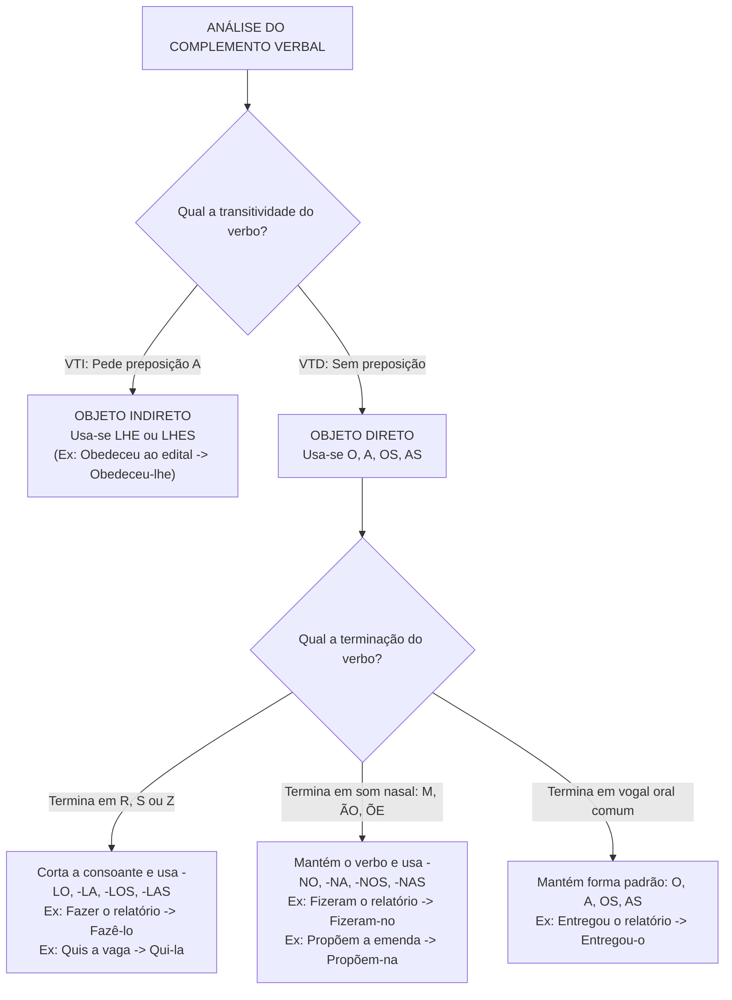
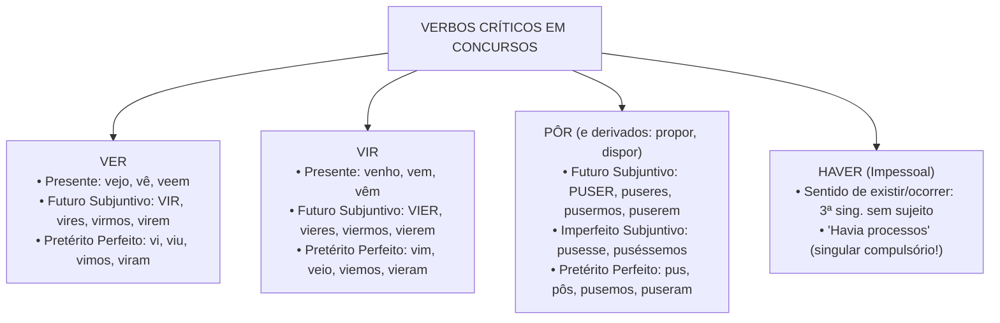
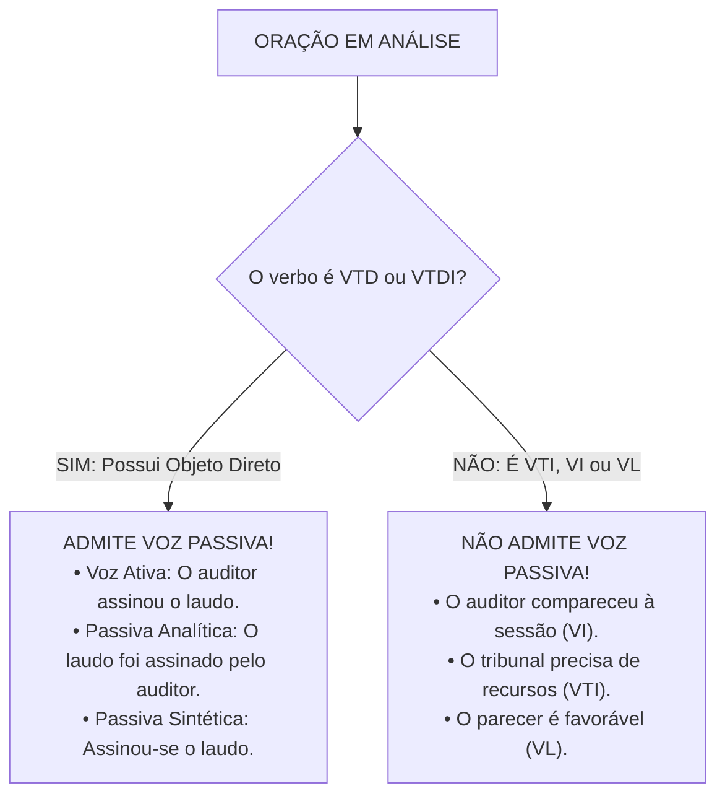

# 03 - Morfossintaxe, Pronomes e Sistema Verbal

> **Matéria:** Língua Portuguesa  
> **Cargos:** A01 – Técnico de Controle Externo (Adm) / B02 – Técnico de Controle Externo (TI)  
> **Arquivo:** `03_morfossintaxe_pronomes_e_verbos.md`  
> **Referência Temática:** Morfossintaxe, Substituição Pronominal, Vozes Verbais e Correlação na Banca FCC

---

## 📌 Ementa / Itens do Edital
- Morfossintaxe: correlação entre classe de palavras (morfologia) e função sintática na oração;
- Pronomes: classificação, valores semânticos, relações anafóricas e catafóricas;
- Pronomes pessoais retos e oblíquos átonos/tônicos: funções sintáticas de sujeito vs. complementos verbais;
- Regras de substituição pronominal com formas variantes (-lo, -la, -no, -na) e emprego de *lhe/lhes*;
- Pronome relativo *cujo* e regência com preposições antepostas;
- Colocação pronominal: Próclise (fatores atrativos obrigatórios), Ênclise e Mesóclise;
- Flexão verbal: conjugação de verbos regulares, irregulares, defectivos e anômalos de alta incidência;
- Vozes do verbo: ativa, passiva analítica, passiva sintética (pronominal), reflexiva e recíproca;
- Condições gramaticais para transposição entre voz ativa e voz passiva;
- Distinção funcional da partícula `SE`: Pronome Apassivador vs. Índice de Indeterminação do Sujeito;
- Correlação de tempos e modos verbais (*consecutio temporum*).

---

## 🧭 Sumário

1. [Fundamentos de Morfossintaxe e Estrutura Oracional](#1-fundamentos-de-morfossintaxe-e-estrutura-oracional)
    1. [Correlação entre Classes Morfológicas e Funções Sintáticas](#11-correlacao-entre-classes-morfologicas-e-funcoes-sintaticas)
    2. [Termos Essenciais, Integrantes e Acessórios da Oração](#12-termos-essenciais-integrantes-e-acessorios-da-oracao)
    3. [O Papel Central do Verbo na Predicação e Transitividade](#13-o-papel-central-do-verbo-na-predicacao-e-transitividade)
    4. [Teste 022](#Teste-022)
2. [Teoria dos Pronomes e Relações Discursivas](#2-teoria-dos-pronomes-e-relacoes-discursivas)
    1. [Classificação Geral e Funções Referenciais: Anáfora, Catáfora e Dêixis](#21-classificacao-geral-e-funcoes-referenciais-anafora-catafora-e-deixis)
    2. [Pronomes Demonstrativos e a Articulação Espaço-Temporal](#22-pronomes-demonstrativos-e-a-articulacao-espaco-temporal)
    3. [Pronome Relativo Cujo e Regência com Preposições Antepostas](#23-pronome-relativo-cujo-e-regencia-com-preposicoes-antepostas)
    4. [Teste 023](#Teste-023)
3. [Pronomes Pessoais e Substituição Pronominal](#3-pronomes-pessoais-e-substituicao-pronominal)
    1. [Pronomes Pessoais Retos vs. Oblíquos Átonos e Tônicos](#31-pronomes-pessoais-retos-vs-obliquos-atonos-e-tonicos)
    2. [Complementos de VTD e VTI: Emprego de O/A vs. Lhe/Lhes](#32-complementos-de-vtd-e-vti-emprego-de-oa-vs-lhelhes)
    3. [Variações Fonéticas dos Pronomes Diretos: Formas em -Lo e -No](#33-variacoes-foneticas-dos-pronomes-diretos-formas-em-lo-e-no)
    4. [Teste 024](#Teste-024)
4. [Sintaxe de Colocação Pronominal](#4-sintaxe-de-colocacao-pronominal)
    1. [Próclise e os Fatores Atrativos Obrigatórios](#41-proclise-e-os-fatores-atrativos-obrigatorios)
    2. [Mesóclise e Suas Condições de Aplicação](#42-mesoclise-e-suas-condicoes-de-aplicacao)
    3. [Ênclise e Vedações Gramaticais Absolutas](#43-enclise-e-vedacoes-gramaticais-absolutas)
    4. [Colocação Pronominal em Locuções Verbais](#44-colocacao-pronominal-em-locucoes-verbais)
    5. [Teste 025](#Teste-025)
5. [Sistema Verbal: Paradigmas de Flexão e Formas Críticas](#5-sistema-verbal-paradigmas-de-flexao-e-formas-criticas)
    1. [Verbos Regulares, Irregulares, Anômalos e Defectivos](#51-verbos-regulares-irregulares-anomalos-e-defectivos)
    2. [Verbos Notáveis de Alta Incidência: Ter, Vir, Ver, Pôr e Haver](#52-verbos-notaveis-de-alta-incidencia-ter-vir-ver-por-e-haver)
    3. [Teste 026](#Teste-026)
    4. [Teste 027](#Teste-027)
6. [Vozes Verbais e Regras de Transposição](#6-vozes-verbais-e-regras-de-transposicao)
    1. [Voz Ativa, Voz Passiva, Voz Reflexiva e Recíproca](#61-voz-ativa-voz-passiva-voz-reflexiva-e-reciproca)
    2. [Voz Passiva Analítica e Regras Estritas de Transposição](#62-voz-passiva-analitica-e-regras-estritas-de-transposicao)
    3. [Voz Passiva Sintética ou Pronominal](#63-voz-passiva-sintetica-ou-pronominal)
    4. [Distinção entre Pronome Apassivador e Índice de Indeterminação do Sujeito](#64-distincao-entre-pronome-apassivador-e-indice-de-indeterminacao-do-sujeito)
    5. [Teste 028](#Teste-028)
    6. [Teste 029](#Teste-029)
    7. [Teste 030](#Teste-030)
7. [Correlação de Tempos e Modos Verbais](#7-correlacao-de-tempos-e-modos-verbais)
    1. [Princípios da Consecutio Temporum no Período Composto](#71-principios-da-consecutio-temporum-no-periodo-composto)
    2. [Estruturas Hipotéticas e Condicionais Padronizadas](#72-estruturas-hipoteticas-e-condicionais-padronizadas)
    3. [Correlações em Orações Subjetivas e Integrantes](#73-correlacoes-em-oracoes-subjetivas-e-integrantes)
    4. [Teste 031](#Teste-031)
8. [🌐 Fontes Oficiais e Referências Bibliográficas](#fontes-oficiais-e-referencias-bibliograficas)

---

## 1. Fundamentos de Morfossintaxe e Estrutura Oracional

A morfossintaxe constitui a área integrada da gramática que estuda simultaneamente a natureza morfológica das palavras (sua classificação em uma das dez classes gramaticais) e a função sintática que essas mesmas palavras desempenham no interior da oração. Uma mesma classe gramatical pode assumir funções sintáticas distintas a depender do contexto relacional estabelecido com o núcleo do predicado e com os demais termos oracionais.

### 1.1 Correlação entre Classes Morfológicas e Funções Sintáticas

Na língua portuguesa, as classes morfológicas agrupam-se em variáveis (substantivo, adjetivo, artigo, pronome, numeral e verbo) e invariáveis (advérbio, preposição, conjunção e interjeição). A cada classe associa-se uma vocação sintática preferencial:

| Classe Morfológica | Funções Sintáticas Primárias | Exemplos Típicos em Concursos |
| :--- | :--- | :--- |
| **Substantivo** (ou termo substantivado) | Núcleo do Sujeito, Núcleo do Objeto Direto/Indireto, Agente da Passiva, Núcleo do Aposto | *"O <ins>conselheiro</ins> julgou o <ins>recurso</ins>"* |
| **Adjetivo** | Adjunto Adnominal, Predicativo do Sujeito, Predicativo do Objeto | *"A decisão foi <ins>técnica</ins>"* (Predicativo) |
| **Pronome Substantivo** | Sujeito, Objeto Direto, Objeto Indireto, Complemento Nominal | *"Ele <ins>o</ins> advertiu formalmente"* |
| **Pronome Adjetivo** | Adjunto Adnominal | *"Acompanhou <ins>este</ins> processo"* |
| **Verbo** | Núcleo do Predicado (Verbo Nocional) ou Elo de Ligação (Verbo de Ligação) | *"O auditor <ins>inspecionou</ins> a obra"* |
| **Advérbio** | Adjunto Adverbial (modifica verbo, adjetivo ou outro advérbio) | *"Julgou <ins>celeremente</ins> a lide"* |
| **Preposição** | Conectivo relacional sem função de termo isolado (introduz termos preposicionados) | *"Necessita <ins>de</ins> recursos"* |
| **Conjunção** | Conectivo oracional de coordenação ou subordinação | *"Estudou <ins>porque</ins> almejava a posse"* |

### 1.2 Termos Essenciais, Integrantes e Acessórios da Oração

A sintaxe clássica divide a estrutura oracional em três ordens hierárquicas de termos:

1. **Termos Essenciais:**
    * **Sujeito:** Elemento sobre o qual se faz uma declaração, com o qual o verbo concorda em número e pessoa. Pode ser determinado (simples, composto ou elíptico/oculto), indeterminado (com verbo na 3ª pessoa do plural sem referência ou com VTI/VI + partícula SE) ou inexistente (em orações sem sujeito com verbos impessoais como *haver* no sentido de existir ou verbos de fenômenos climáticos).
    * **Predicado:** Tudo o que se declara acerca do sujeito ou, nas orações sem sujeito, o próprio teor do processo verbal. Divide-se em predicado verbal (núcleo é um verbo nocional), predicado nominal (núcleo é um nome predicativo ligado por verbo de ligação) e predicado verbo-nominal (possui verbo nocional associado a um predicativo).

2. **Termos Integrantes:**
    * **Objeto Direto:** Complemento verbal não regido obrigatoriamente por preposição exigida pelo verbo.
    * **Objeto Indireto:** Complemento verbal regido obrigatoriamente por preposição exigida pelo verbo transitivo indireto.
    * **Complemento Nominal:** Termo preposicionado que completa o sentido abstrato e passivo de um substantivo abstrato, de um adjetivo ou de um advérbio.
    * **Agente da Passiva:** Termo preposicionado (com *por/pelo* ou raramente *de*) que pratica a ação expressa pelo verbo na voz passiva analítica.

3. **Termos Acessórios e Vocativo:**
    * **Adjunto Adnominal:** Termo de valor adjetivo que determina, especifica ou restringe o substantivo núcleo de qualquer função sintática.
    * **Adjunto Adverbial:** Termo de valor adverbial que expressa circunstâncias de tempo, lugar, modo, causa, finalidade, instrumento, entre outras.
    * **Aposto:** Termo de natureza substantiva que explica, resume, especifica ou enumera outro termo substantivo antecedente.
    * **Vocativo:** Termo independente de invocação ou chamamento, sem ligação sintática com o sujeito ou o predicado.

### 1.3 O Papel Central do Verbo na Predicação e Transitividade

A predicação verbal analisa a exigência de complementos pelos verbos no contexto específico da frase:

* **Verbo Intransitivo (VI):** Possui sentido completo em si mesmo no contexto, prescindindo de objeto direto ou indireto (*"O conselheiro faleceu"*, *"O processo caminhou rapidamente"* — onde *rapidamente* é mero adjunto adverbial de modo).
* **Verbo Transitivo Direto (VTD):** Requer complemento sem preposição obrigatória (*"O auditor apurou a fraude"*).
* **Verbo Transitivo Indireto (VTI):** Requer complemento introduzido por preposição exigida pela regência verbal (*"O fiscal deparou com impropriedades"*, *"O relator anuiu aos termos"*).
* **Verbo Transitivo Direto e Indireto (VTDI ou Bitransitivo):** Reclama dois complementos simultâneos, um direto e outro indireto (*"O presidente remeteu o relatório ao tribunal"*).
* **Verbo de Ligação (VL):** Não expressa ação, servindo de elo entre o sujeito e seu predicativo (*ser, estar, parecer, permanecer, ficar, continuar, andar* em sentido de estado).

---

### Teste 022
**(FCC – TRT-23 – Analista Judiciário)**  
Considere o seguinte período:  
*"A comissão de auditoria encaminhou aos diretores da autarquia o relatório conclusivo sobre os contratos de tecnologia."*

Em relação à morfossintaxe dos termos que compõem o período acima, assinale a opção correta:

* **A)** O segmento *"A comissão de auditoria"* exerce a função sintática de objeto direto da oração.
* **B)** O termo *"o relatório conclusivo sobre os contratos de tecnologia"* funciona como objeto direto do verbo transitivo direto e indireto *"encaminhou"*.
* **C)** A expressão *"aos diretores da autarquia"* atua como adjunto adnominal do substantivo *"comissão"*.
* **D)** O verbo *"encaminhou"* classifica-se como transitivo indireto puro, exigindo exclusivamente complemento preposicionado em conformidade com as diretrizes e padrões de arquitetura corporativa.
* **E)** O vocábulo *"conclusivo"* é um advérbio de modo que modifica o verbo *"encaminhou"*.

---

> **Comentário Detalhado:**
>
> - **A)** Incorreta. *"A comissão de auditoria"* é o **sujeito simples** da oração (núcleo substantivo: *comissão*), praticante da ação verbal.
> - **B)** Correta. O verbo *encaminhar* é bitransitivo (Transitivo Direto e Indireto - VTDI): quem encaminha, encaminha algo (*o relatório conclusivo sobre os contratos de tecnologia* = Objeto Direto) a alguém (*aos diretores da autarquia* = Objeto Indireto).
> - **C)** Incorreta. *"Aos diretores da autarquia"* é **objeto indireto**, termo integrante regido pela preposição "a" exigida pela predicação de *encaminhou*.
> - **D)** Incorreta. O verbo é transitivo direto e indireto (VTDI), possuindo dois complementos de naturezas distintas.
> - **E)** Incorreta. *"Conclusivo"* é adjetivo que caracteriza o substantivo *"relatório"*, desempenhando função sintática de adjunto adnominal.
>
> **Gabarito: B**

---

## 2. Teoria dos Pronomes e Relações Discursivas

Os pronomes formam a classe gramatical responsável por representar ou acompanhar os nomes (substantivos), exercendo papel insubstituível na coesão textual, na distribuição de turnos de fala e no estabelecimento de referências espaciais e temporais.

### 2.1 Classificação Geral e Funções Referenciais: Anáfora, Catáfora e Dêixis

Do ponto de vista discursivo, os pronomes operam três mecanismos de remissão:

1. **Função Anafórica:** O pronome remete a um termo, fato ou conceito já mencionado anteriormente no texto, retomando-o e garantindo a progressão temática sem repetições deselegantes (*"O Tribunal proferiu a decisão; <ins>esta</ins> gerou ampla repercussão"*).
2. **Função Catafórica:** O pronome antecipa um elemento que ainda será explicitado nas linhas subsequentes (*"O conselheiro reiterou apenas <ins>isto</ins>: a legalidade é inegociável"*).
3. **Função Dêitica (Exofórica):** O pronome aponta diretamente para elementos exteriores ao texto, presentes na situação concreta de enunciação no mundo real (quem fala, onde fala e quando fala): *"Por favor, assine <ins>este</ins> documento aqui agora"*.

### 2.2 Pronomes Demonstrativos e a Articulação Espaço-Temporal

O emprego correto dos demonstrativos apoia-se em parâmetros espaciais, temporais e textuais rigorosos:

| Pronome | Relação Espacial | Relação Temporal | Relação Textual |
| :--- | :--- | :--- | :--- |
| **Este, esta, isto** | Próximo do emissor (1ª pessoa) | Tempo presente ou futuro imediato (*"neste ano de 2026"*) | Catáfora (antecipa o que virá) ou retoma o termo imediatamente mais próximo |
| **Esse, essa, isso** | Próximo do receptor (2ª pessoa) | Passado ou futuro próximo (*"esse mês que passou"*) | Anáfora simples (retoma termo recém-mencionado) |
| **Aquele, aquela, aquilo** | Distante de ambos (3ª pessoa) | Passado remoto ou época distante (*"naquele século"*) | Retoma o termo mais distante em contraste com *este* |

> 📌 **NOTA EXPLICATIVA / DISTRIBUIÇÃO EM PARALELO (ESTE VS. AQUELE):** Ao citar dois elementos no texto e retomá-los comparativamente, emprega-se **este** para referir-se ao elemento mencionado por último (mais próximo fisicamente na escrita) e **aquele** para remeter ao primeiro elemento mencionado (mais afastado no texto): *"O Diretor e o Auditor chegaram; <ins>este</ins> (o auditor) trazia as planilhas, <ins>aquele</ins> (o diretor) presidiu a conferência"*.

### 2.3 Pronome Relativo Cujo e Regência com Preposições Antepostas

O pronome relativo *cujo* (e suas flexões *cuja, cujos, cujas*) é um dos pontos de maior incidência em provas de concurso da Fundação Carlos Chagas. O seu emprego correto exige a observância cumulativa de quatro regras pétreas:

1. **Sentido intrínseco de posse:** Liga dois substantivos, estabelecendo uma relação em que o segundo termo pertence ao primeiro (*"O órgão <ins>cujos</ins> servidores foram premiados..."* $\rightarrow$ os servidores do órgão).
2. **Concordância obrigatória com o consequente:** O pronome concorda rigorosamente em gênero e número com o substantivo que vem **depois** dele (*cujo parecer*, *cuja decisão*, *cujos autos*, *cujas certidões*).
3. **Vedação absoluta ao uso de artigo:** É erro gramatical gravíssimo fazer suceder qualquer artigo ao pronome (*cujo o*, *cuja a*, *cujos os*, *cujas as* são formas inexistentes e eliminatórias).
4. **Anteposição da preposição exigida pelo verbo:** Se o verbo da oração adjetiva introduzida por *cujo* exigir preposição em razão de sua regência, essa preposição **deve ser obrigatoriamente colocada antes de cujo**:
    * *"A diretriz orçamentária <ins>a cujas</ins> determinações devemos obedecer..."* (quem obedece, obedece **a** algo);
    * *"O tribunal <ins>em cujas</ins> salas tramitam os processos..."* (quem tramita, tramita **em** algum lugar);
    * *"O auditor <ins>de cuja</ins> integridade todos desconfiavam..."* (quem desconfia, desconfia **de** alguém).

> 🚨 **ALERTA DE PROVA / PEGADINHA DO PRONOME CUJO:** A FCC cria enunciados que tentam substituir o pronome relativo *cujo* por locuções prepositivas ou misturá-lo com conjunções, como em *"O órgão do qual seus servidores foram promovidos"* (errado, redundante) ou inserindo artigos (*"O relatório cujo o teor..."*). Lembre-se: *cujo* jamais aceita artigo posterior e sempre concorda com o termo da frente.

---

### Teste 023
**(FCC – METRÔ-SP – Analista de Comunicação)**  
O pronome relativo antecedido de preposição está empregado em estrita conformidade com a norma-padrão em:

* **A)** *"Este é o gestor cujo o comportamento foi elogiado em sessão plenária."*
* **B)** *"A diretriz orçamentária a cujas determinações todos os órgãos estaduais devem obedecer foi publicada hoje."*
* **C)** *"O departamento em cujo os funcionários operam os sistemas de auditoria foi reformado."* em conformidade com as diretrizes e padrões de arquitetura corporativa.
* **D)** *"A decisão judicial cuja a eficácia dependia de trânsito em julgado foi confirmada."*
* **E)** *"As metas fiscais de cujas todos duvidavam foram atingidas com sobras."*

---

> **Comentário Detalhado:**
>
> - **A)** Incorreta. O pronome relativo *cujo* nunca admite artigo definido antecedente ou consequente (*cujo o* é vício gramatical repudiado pela norma culta).
> - **B)** Correta. 1) O pronome *cujas* estabelece relação semântica de posse entre *determinações* e *diretriz orçamentária*; 2) Concorda em gênero e número com o consequente (*determinações*, feminino plural); 3) Prescinde totalmente de artigo; 4) O verbo da oração adjetiva (*obedecer*) é Transitivo Indireto e rege a preposição **a** (*quem obedece, obedece a algo*), a qual foi adequadamente anteposta ao pronome relativo (*"a cujas determinações (...) devem obedecer"*).
> - **C)** Incorreta. Incorre em erro ao acrescentar o artigo definido masculino plural após o pronome (*em cujo os*).
> - **D)** Incorreta. Incorre em erro ao pospor o artigo definido feminino singular (*cuja a eficácia*).
> - **E)** Incorreta. O pronome *cujo* exige ligar necessariamente dois substantivos em relação de dependência possessiva. Como não há substantivo após o pronome na oração (*"de cujas todos duvidavam"*), a construção correta deveria utilizar o pronome relativo *que* precedido de preposição (*"de que todos duvidavam"*).
> 
> **Gabarito: B**

---

## 3. Pronomes Pessoais e Substituição Pronominal

A substituição de sintagmas nominais por pronomes oblíquos átonos em complementação verbal é uma das marcas registradas da banca FCC. A operação envolve a identificação da transitividade do verbo e o ajuste morfofonético da terminação verbal.

### 3.1 Pronomes Pessoais Retos vs. Oblíquos Átonos e Tônicos

Os pronomes pessoais exercem papéis sintáticos estritos de acordo com a sua forma:

* **Pronomes Retos (eu, tu, ele/ela, nós, vós, eles/elas):** Exercem primordialmente a função de **sujeito** da oração. Não atuam como complementos verbais diretos na norma culta (dizer *"vi ele"* ou *"chamei ela"* constitui desvio sintático primário; o correto é *vi-o*, *chamei-a*).
* **Pronomes Oblíquos Átonos (me, te, se, o, a, lhe, nos, vos, se, os, as, lhes):** São pronunciados com fraca intensidade e não são precedidos de preposição própria, atuando como complementos verbais imediatos (objeto direto ou indireto).
* **Pronomes Oblíquos Tônicos (mim, ti, si, ele, ela, nós, vós, si, eles, elas):** São dotados de tonicidade própria e surgem sempre precedidos de preposição essencial (*a mim, de ti, para nós, com ele*).
    * Distinção clássica: *"Entregue o relatório para mim"* (término da frase, *mim* não conjuga verbo) vs. *"Traga o documento para <ins>eu</ins> assinar"* (caso reto, pois *eu* atua como sujeito do verbo no infinitivo *assinar*).

### 3.2 Complementos de VTD e VTI: Emprego de O/A vs. Lhe/Lhes

A distribuição dos pronomes oblíquos como complementos verbais segue uma regra sem exceções:

1. **Verbos Transitivos Diretos (VTD):** Complementam-se exclusivamente pelos pronomes **o, a, os, as** (e suas variantes alomórficas). Jamais admitem o pronome *lhe* como objeto direto (*"Conheço-o"*, e nunca *"Conheço-lhe"*).
2. **Verbos Transitivos Indiretos (VTI regidos pela preposição A):** Complementam-se pelos pronomes **lhe, lhes** (*"Obedeceu ao regulamento"* $\rightarrow$ *"Obedeceu-lhe"*).
3. **Verbos Transitivos Indiretos com outras preposições (de, em, com, por):** Não admitem *lhe*; exigem pronome oblíquo tônico preposicionado (*"Precisou dele"*, *"Confiou nele"*, *"Simpatizou com ela"*).

### 3.3 Variações Fonéticas dos Pronomes Diretos: Formas em -Lo e -No

Ao associar os pronomes diretos *o, a, os, as* à forma verbal enclítica, ocorrem transformações fonéticas compulsórias:

1. **Verbos terminados em -R, -S ou -Z:**
    * A consoante final é eliminada e o pronome assume as formas **-lo, -la, -los, -las**.
    * Ao retirar a consoante final, a forma verbal residual submete-se às regras normais de acentuação gráfica:
    * *fiscalizar + as* $\rightarrow$ *fiscalizá-las* (oxítona terminada em A);
    * *fazer + o* $\rightarrow$ *fazê-lo* (oxítona terminada em E);
    * *pôr + as* $\rightarrow$ *pô-las* (monossílabo terminado em O);
    * *conduzir + o* $\rightarrow$ *conduzi-lo* (oxítona em I, sem acento);
    * *fizemos + o* $\rightarrow$ *fizemo-lo* (corta o -s, sem acento);
    * *quis + a* $\rightarrow$ *qui-la* (corta o -s, sem acento).

2. **Verbos terminados em terminação nasal (-M, -ÃO, -ÕE):**
    * O verbo permanece absolutamente intacto e o pronome recebe o acréscimo eufônico da consoante nasal, assumindo as formas **-no, -na, -nos, -nas**:
    * *analisaram + o* $\rightarrow$ *analisaram-no*;
    * *compõem + a* $\rightarrow$ *compõem-na*;
    * *dão + os* $\rightarrow$ *dão-nos*.

3. **Verbos terminados em vogal oral comum:**
    * Não sofrem nenhuma mutação, recebendo as formas puras **-o, -a, -os, -as**:
    * *apresentou + as* $\rightarrow$ *apresentou-as*;
    * *remeteu + o* $\rightarrow$ *remeteu-o*;
    * *viu + o* $\rightarrow$ *viu-o*.

> 💡 **DICA DE SUBSTITUIÇÃO PRONOMINAL:** Quando se deparar com uma questão de substituição pronominal da FCC, separe a análise em dois passos: 1) determine a regência do verbo (se pede objeto direto ou indireto); 2) observe a terminação da palavra verbal para aplicar a transformação em L, N ou pura. Nunca misture as regras.

---

### Teste 024
**(FCC – TRT – Técnico Judiciário)**  
Considere a oração:  
*"O diretor da comissão <ins>apresentou as justificativas técnicas</ins> e <ins>remeteu o parecer conclusivo</ins> ao setor de compras."*  
Substituindo-se adequadamente as expressões sublinhadas pelos respectivos pronomes oblíquos átonos, obtém-se:

* **A)** O diretor da comissão apresentou-as e remeteu-lhe ao setor de compras.
* **B)** O diretor da comissão apresentou-as e remeteu-o ao setor de compras.
* **C)** O diretor da comissão apresentou-lhes e remeteu-o ao setor de compras.
* **D)** O diretor da comissão as apresentou e lhe remeteu ao setor de compras.
* **E)** O diretor da comissão apresentou-as e remeteu-no ao setor de compras.

---

> **Comentário Detalhado:**
>
> - **A)** Incorreta. Embora acerte a primeira forma (*apresentou-as*), erra grosseiramente no segundo verbo ao empregar *remeteu-lhe*: o pronome *lhe* atua como objeto indireto, ao passo que *o parecer conclusivo* é objeto direto de *remeteu* (além disso, a oração já possui seu objeto indireto preposicionado: *ao setor de compras*).
> - **B)** Correta. 1) No primeiro segmento (*apresentou as justificativas técnicas*), o verbo *apresentar* é VTD e termina na vogal oral comum *u*; o objeto direto feminino plural é substituído pelo pronome puro *as*, resultando em *apresentou-as*. 2) No segundo segmento (*remeteu o parecer conclusivo*), o verbo *remeter* é VTD e termina na vogal oral comum *u*; o objeto direto masculino singular é substituído pelo pronome puro *o*, gerando *remeteu-o*. Ambas as substituições estão impecáveis.
> - **C)** Incorreta. Erra ao empregar *apresentou-lhes*, visto que o verbo *apresentar* ali rege objeto direto, descabendo o pronome *lhes*.
> - **D)** Incorreta. Não há palavra atrativa justificadora da próclise na oração (*as apresentou*), além de reiterar o erro no emprego do pronome *lhe* como objeto direto.
> - **E)** Incorreta. Erra ao usar a forma *remeteu-no*: a variante com *N* (-no/-na) aplica-se exclusivamente a formas verbais encerradas em som nasal (-m, -ão, -õe), o que não ocorre com *remeteu* (terminado em ditongo oral).
> 
> **Gabarito: B**

---

## 4. Sintaxe de Colocação Pronominal

A colocação pronominal estuda a posição ocupada pelos pronomes oblíquos átonos em relação ao verbo: antes do verbo (**próclise**), no meio do verbo (**mesóclise**) ou depois do verbo (**ênclise**).

### 4.1 Próclise e os Fatores Atrativos Obrigatórios

Na norma culta brasileira, a próclise é obrigatória sempre que houver, antes do verbo, uma **palavra atrativa** pertencente a uma das seguintes categorias:

1. **Palavras de sentido negativo:** *não, nunca, jamais, nada, ninguém, nenhum, tampouco* (*"Não <ins>se</ins> apurou a falha"*).
2. **Conjunções subordinativas (integrantes e adverbiais):** *que, se, como, embora, quando, porque, caso, conforme* (*"O relator determinou que <ins>se</ins> fizesse a diligência"*).
3. **Pronomes relativos:** *que, quem, cujo, qual, onde, quanto* (*"Os termos que <ins>lhe</ins> foram apresentados"*).
4. **Pronomes indefinidos:** *tudo, nada, alguém, todos, muitos, qualquer, vários* (*"Alguém <ins>o</ins> advertiu"*).
5. **Pronomes demonstrativos:** *isso, isto, aquilo, este, aquele* (*"Isto <ins>me</ins> comoveu"*).
6. **Advérbios sem vírgula:** *aqui, sempre, talvez, já, logo, ontem* (*"Talvez <ins>o</ins> encontremos na corte"*). Se o advérbio estiver isolado por vírgula, passa a haver ênclise: *"Aqui, encontramo-lo"*.
7. **Orações exclamativas, optativas (que exprimem desejo) ou interrogativas:** *"Deus <ins>te</ins> guarde!"*, *"Quem <ins>te</ins> chamou para a conferência?"*.
8. **Preposição 'EM' seguida de verbo no Gerúndio:** *"Em <ins>se</ins> tratando de auditoria ambiental..."*.

### 4.2 Mesóclise e Suas Condições de Aplicação

A mesóclise (pronome inserido no interior do verbo) é privativa de duas conjugações verbais, desde que o verbo inicie a frase ou não haja palavra atrativa que imponha a próclise:

1. **Futuro do Presente do Indicativo:** *"Apresentar-se-á novo recurso pelo réu"* (*apresentará* + *se*).
2. **Futuro do Pretérito do Indicativo:** *"Dir-se-ia que houve condescendência da fiscalização"* (*diria* + *se*).

> ⭐ **IMPORTANTE / PREVALÊNCIA DA PRÓCLISE SOBRE A MESÓCLISE:** A presença de qualquer palavra atrativa anula a mesóclise e obriga a próclise: *"Não se apresentará novo recurso"* (e nunca *"Não apresentar-se-á"*).

### 4.3 Ênclise e Vedações Gramaticais Absolutas

A ênclise é o padrão genérico de posicionamento nos seguintes contextos:

* Verbo no início de período sintático: *"Fez-se o levantamento de custos"* (é erro gramatical crasso iniciar frase com pronome oblíquo: *"Se fez o levantamento"*);
* Verbo no Imperativo Afirmativo: *"Senhor auditor, instrua-o com as cópias necessárias"*;
* Verbo no Infinitivo Impessoal: *"Era urgente apresentar-lhe o relatório"*;
* Verbo no Gerúndio (sem preposição EM antecedente): *"O tribunal deliberou, acolhendo-o de imediato"*.

#### Vedações Absolutas à Ênclise:
* **Nunca se usa ênclise com verbo conjugado no Futuro do Presente ou no Futuro do Pretérito** (*"Apresentará-se"* é erro grave; deve-se usar mesóclise *apresentar-se-á* ou próclise se houver atrativo).
* **Nunca se usa ênclise com verbo no Particípio isolado** (*"Tinha advertido-o"* é incorreto; deve-se usar *havia-o advertido* ou *o havia advertido*).

### 4.4 Colocação Pronominal em Locuções Verbais

Em locuções compostas por verbo auxiliar mais verbo principal no infinitivo, gerúndio ou particípio:

* **Com Verbo Principal no Infinitivo ou Gerúndio:**
    * Sem palavra atrativa: o pronome pode ficar em ênclise ao auxiliar ou em ênclise ao principal (*"Quero-lhe dizer"* ou *"Quero dizer-lhe"*).
    * Com palavra atrativa: o pronome pode ir para antes do auxiliar (próclise ao auxiliar) ou em ênclise ao verbo principal (*"Não lhe quero dizer"* ou *"Não quero dizer-lhe"*).
* **Com Verbo Principal no Particípio:**
    * O pronome jamais pode vir posposto ao particípio (*"Tinha comunicado-lhe"* é inaceitável).
    * Pode ficar enclítico ao verbo auxiliar (*"Tinha-lhe comunicado"*) ou próclito ao auxiliar se houver palavra atrativa (*"Não lhe tinha comunicado"*).

---

### Teste 025
**(FCC – TCE-GO – Analista de Controle Externo)**  
Avalie a colocação pronominal nas frases a seguir, de acordo com o padrão culto da língua:  

I. *Não informaram-nos sobre o adiamento da sessão plenária.*  
II. *Em se tratando de controle de legalidade, o tribunal age com rigor.*  
III. *Os documentos que apresentaram-se na audiência foram periciados.*  
IV. *Dir-se-ia que os gestores agiram respaldados em parecer técnico.*  

A colocação dos pronomes oblíquos átonos está inteiramente correta APENAS em:

* **A)** I e III.
* **B)** II e IV.
* **C)** II e III.
* **D)** I e IV.
* **E)** I, II e IV.

---

> **Comentário Detalhado:**
>
> - **Item I:** Incorreto. O advérbio de negação *"Não"* é palavra atrativa de natureza absoluta, exigindo **próclise obrigatória**: *"Não nos informaram..."*. A ênclise é erro gramatical grave.
> - **Item II:** Correto. Na estrutura fixa constituída pela preposição *"Em"* seguida de gerúndio (*"Em se tratando de..."*), a **próclise é obrigatória** no padrão culto.
> - **Item III:** Incorreto. O pronome relativo *"que"* atrai obrigatoriamente o pronome oblíquo átono para antes do verbo: *"Os documentos que se apresentaram..."*.
> - **Item IV:** Correto. Estando o verbo no futuro do pretérito (*diria*) no início do período (ou sem elemento atrativo anterior), é obrigatório o emprego da **mesóclise**: *"Dir-se-ia..."*.
> - **Conclusão:** Estão corretos unicamente os itens II e IV.
>
> **Gabarito: B**

---

## 5. Sistema Verbal: Paradigmas de Flexão e Formas Críticas

O verbo é a classe de palavras dotada do sistema flexional mais rico e complexo do idioma, conjugando-se em número, pessoa, tempo, modo e voz.

### 5.1 Verbos Regulares, Irregulares, Anômalos e Defectivos

* **Regulares:** Conservam o radical inalterado ao longo de todo o paradigma de conjugação e acolhem as desinências padrão da sua conjugação (*cantar, vender, partir*).
* **Irregulares:** Sofrem alterações no radical ou assumem desinências que se afastam do paradigma comum (*fazer / fiz; caber / caibo; ouvir / ouço*).
* **Anômalos:** Apresentam alterações tão profundas no radical que utilizam bases etimológicas inteiramente distintas na mesma conjugação. No português, são anômalos os verbos **ser** (*sou, fui, era*) e **ir** (*vou, fui, ia*).
* **Defectivos:** Não possuem a conjugação completa em certas pessoas, tempos ou modos:
    * Exemplo: *reaver* (deriva de *haver*, mas conjuga-se apenas nas formas em que o verbo primitivo *haver* possui a letra **v**: *reaver, reavemos, reaveis, reouve, reouvera*; não existem formas como *"eu reavenho"* ou *"que ele reavenha"*);
    * Outros defectivos: *falir, colorir, abolir, banir, computar* (não possuem a 1ª pessoa do presente do indicativo).

### 5.2 Verbos Notáveis de Alta Incidência: Ter, Vir, Ver, Pôr e Haver

A banca FCC explora sistematicamente formas flexionais desses cinco verbos e de seus derivados:

1. **O Verbo VER no Futuro do Subjuntivo:**
    * Faz **vir, vires, vir, virmos, virdes, virem** (*"Quando o conselheiro <ins>vir</ins> as irregularidades, determinará a anulação"*, e nunca *"quando o conselheiro ver"*).

2. **O Verbo VIR no Futuro do Subjuntivo:**
    * Faz **vier, vieres, vier, viermos, vierdes, vierem** (*"Quando a equipe de fiscalização <ins>vier</ins> ao município..."*).

3. **O Verbo PÔR (e derivados como propor, dispor, compor):**
    * Futuro do Subjuntivo: **puser, puseres, puser, pusermos, puserdes, puserem** (*"Se o gestor <ins>propuser</ins> a repactuação"*, e nunca *"se o gestor propor"*).
    * Pretérito Imperfeito do Subjuntivo: **pusesse, pusesses, pusesse, puséssemos, pusésseis, pusessem** (*"Se o fiscal <ins>propusesse</ins>..."*).

4. **O Verbo HAVER Impessoal:**
    * No sentido de existir, ocorrer ou expressar decurso de tempo, é **impessoal**: não tem sujeito e fica obrigatoriamente na **3ª pessoa do singular** (*"Havia muitas dúvidas"*, *"Houve falhas formais"*, *"Pode haver impugnações"*). Se for substituído por *existir*, o verbo *existir* é pessoal e concorda normalmente (*"Existiam muitas dúvidas"*, *"Existiram falhas"*).

---

### Teste 026
**(FCC – DPE-RS – Analista Jurídico)**  
A frase em que a articulação entre tempos e modos verbais observa a **correlação verbal** adequada é:

* **A)** *"Se o conselheiro propusesse a realização de nova auditoria, o presidente acataria a solicitação de pronto."*
* **B)** *"Se o conselheiro proporia a realização de nova auditoria, o presidente acatava a solicitação de pronto."* em conformidade com as diretrizes e padrões de arquitetura corporativa.
* **C)** *"Caso o conselheiro propor nova auditoria, o presidente acatará a solicitação de pronto."*
* **D)** *"Se o conselheiro propôs nova auditoria, o presidente acataria a solicitação de pronto."*
* **E)** *"Quando o conselheiro ver as irregularidades do balanço, proporá a anulação do contrato."*

---

> **Comentário Detalhado:**
>
> - **A)** Correta. Estabelece a correlação hipotética canônica: o **Pretérito Imperfeito do Subjuntivo** (*propusesse*, indicando a condição irreal/hipotética) harmoniza-se perfeitamente com o **Futuro do Pretérito do Indicativo** (*acataria*, expressando o resultado decorrente).
> - **B)** Incorreta. É vedado empregar o futuro do pretérito do indicativo (*proporia*) na oração subordinada condicional introduzida pela conjunção subordinativa *se*.
> - **C)** Incorreta. O verbo *pôr* e seus derivados flexionam-se no futuro do subjuntivo sob a forma *propuser* (*"Caso o conselheiro propuser..."*), constituindo vício grosseiro o uso da forma no infinitivo *"propor"*.
> - **D)** Incorreta. Articula de forma desconexa o pretérito perfeito do indicativo (*propôs*, fato certo consumado) com o futuro do pretérito (*acataria*, possibilidade futura), rompendo a harmonia condicional.
> - **E)** Incorreta. O verbo irregular *ver* conjuga-se no futuro do subjuntivo como *vir* (*"Quando o conselheiro vir as irregularidades..."*). O emprego de *"quando ver"* é vício gramatical decorrente da confusão com o verbo *vir*.
> 
> **Gabarito: A**

---

### Teste 027
**(FCC – TRT – Analista Judiciário)**  
Considere as formas verbais destacadas nas seguintes frases:  

I. *Se o auditor **intervir** tempestivamente no processo, os prejuízos serão contornados.*  
II. *Quando os conselheiros **propuserem** a nova diretriz, o regimento será atualizado.*  
III. *Caso a administração **mantesse** os controles diários, as fraudes não teriam ocorrido.*  
IV. *Os servidores **requereram** a revisão de seus adicionais por tempo de serviço.*  

A flexão verbal está em perfeita consonância com a norma-padrão em:

* **A)** I e III, apenas.
* **B)** II e IV, apenas.
* **C)** I, II e IV, apenas.
* **D)** II, III e IV, apenas.
* **E)** I, II, III e IV.

---

> **Comentário Detalhado:**
>
> - **Item I:** Incorreto. O verbo *intervir* é derivado de *vir* e conjuga-se exatamente como ele. O futuro do subjuntivo de *vir* é *vier*; logo, de *intervir* é **intervier** (*"Se o auditor intervier..."*), e não "intervir".
> - **Item II:** Correto. O verbo *propor* deriva de *pôr*. O futuro do subjuntivo de *pôr* é *puserem*; portanto, o derivado flexiona-se como **propuserem** (*"Quando os conselheiros propuserem..."*).
> - **Item III:** Incorreto. O verbo *manter* deriva de *ter*. O pretérito imperfeito do subjuntivo de *ter* é *tivesse*; portanto, a forma correta do derivado é **mantivesse** (*"Caso a administração mantivesse..."*), e jamais "mantesse".
> - **Item IV:** Correto. O verbo *requerer* não segue a conjugação de *querer* no pretérito perfeito do indicativo (que é *quis*). No pretérito perfeito, *requerer* é regular: *eu requeri, ele requereu, nós requeremos, eles requereram*.
> - **Conclusão:** Estão corretos apenas os itens II e IV.
>
> **Gabarito: B**

---

## 6. Vozes Verbais e Regras de Transposição

A voz verbal traduz a relação sintático-semântica entre o verbo e o sujeito da oração, explicitando se o sujeito pratica a ação (sujeito agente), sofre a ação (sujeito paciente) ou desempenha ambos os papéis cumulativamente.

### 6.1 Voz Ativa, Voz Passiva, Voz Reflexiva e Recíproca

* **Voz Ativa:** O sujeito gramatical é o agente direto ou causador da ação verbal: *"O auditor concluiu o laudo pericial"*.
* **Voz Passiva:** O sujeito gramatical é paciente, recebendo ou sofrendo os efeitos da ação praticada por outrem: *"O laudo pericial foi concluído pelo auditor"*.
* **Voz Reflexiva:** O sujeito é simultaneamente agente e paciente da ação, praticando-a sobre si mesmo: *"O acusado feriu-se com as próprias declarações"*.
* **Voz Recíproca:** Há mais de um sujeito que praticam e recebem mutuamente a mesma ação: *"Os procuradores cumprimentaram-se na tribuna"*.

### 6.2 Voz Passiva Analítica e Regras Estritas de Transposição

A voz passiva analítica é estruturada pela combinação de um verbo auxiliar (quase sempre o verbo **ser**, raramente *estar* ou *ficar*) conjugado com o **particípio** do verbo principal:
$$\text{Sujeito Paciente} + \text{Verbo Auxiliar SER (no mesmo tempo da ativa)} + \text{Particípio} + \text{Agente da Passiva}$$

#### Requisitos Intransponíveis para a Conversão Passiva:
1. **Transitividade Verbal:** Apenas orações cujo verbo principal seja **Transitivo Direto (VTD)** ou **Transitivo Direto e Indireto (VTDI)** admitem passagem para a voz passiva. Verbos Transitivos Indiretos (VTI), Intransitivos (VI) e de Ligação (VL) **jamais admitem voz passiva**, porque não possuem objeto direto suscetível de converter-se em sujeito paciente.
2. **Equivalência Temporal Estrita:** O verbo auxiliar *ser* deve ser conjugado rigorosamente no mesmo tempo e modo em que se encontrava o verbo simples da voz ativa:
    * *O auditor analisa as contas* (Presente do Indicativo) $\rightarrow$ *As contas* **são analisadas**;
    * *O auditor analisou as contas* (Pretérito Perfeito) $\rightarrow$ *As contas* **foram analisadas**;
    * *O auditor analisava as contas* (Pretérito Imperfeito) $\rightarrow$ *As contas* **eram analisadas**;
    * *O auditor analisara as contas* (Pretérito Mais-Que-Perfeito) $\rightarrow$ *As contas* **tinham sido / foram analisadas**;
    * *O auditor analisará as contas* (Futuro do Presente) $\rightarrow$ *As contas* **serão analisadas**;
    * *O auditor analisaria as contas* (Futuro do Pretérito) $\rightarrow$ *As contas* **seriam analisadas**.

### 6.3 Voz Passiva Sintética ou Pronominal

A voz passiva sintética compõe-se de um verbo Transitivo Direto conjugado na 3ª pessoa (singular ou plural) associado ao pronome apassivador **SE**:
$$\text{VTD / VTDI} + \text{SE (Pronome Apassivador)} + \text{Sujeito Paciente}$$

* Exemplo no singular: *"Apurou-se a irregularidade"* (= *A irregularidade foi apurada*);
* Exemplo no plural: *"Apuraram-se as irregularidades"* (= *As irregularidades foram apuradas*).

O elemento nominal sem preposição que acompanha a construção passiva sintética é o **sujeito paciente**, razão pela qual o verbo deve concordar obrigatoriamente com ele em número e pessoa.

### 6.4 Distinção entre Pronome Apassivador e Índice de Indeterminação do Sujeito

Essa distinção é um dos temas fundamentais de cobrança da FCC em morfossintaxe e concordância:

| Critério | Pronome Apassivador (Partícula Apassivadora) | Índice de Indeterminação do Sujeito (IIS) |
| :--- | :--- | :--- |
| **Transitividade do Verbo** | Verbo Transitivo Direto (VTD) ou VTDI | Verbo Transitivo Indireto (VTI), Intransitivo (VI) ou de Ligação (VL) |
| **Presença de Preposição** | O elemento subsequente **não tem preposição obrigatória** | O elemento subsequente vem **restringido por preposição** |
| **Existência de Sujeito** | Há Sujeito Paciente expresso na oração | Não há sujeito expresso; o sujeito é indeterminado |
| **Concordância Verbal** | O verbo **flexiona obrigatoriamente** (vai ao plural se o sujeito for plural) | O verbo fica **obrigatoriamente na 3ª pessoa do singular** |
| **Exemplo Correto** | *"Identificaram-se novas falhas"* | *"Trata-se de novas falhas"* |
| **Erro Clássico em Prova** | *"Identificou-se novas falhas"* (verbo não concordou) | *"Tratam-se de novas falhas"* (verbo pluralizou indevidamente com VTI) |

> 🚨 **ALERTA DE PROVA / PEGADINHA DO VERBO TRATAR-SE:** A FCC frequentemente introduz a forma verbal pluralizada *"Tratam-se de..."*, *"Precisam-se de..."* ou *"Obedeceram-se aos ditames..."*. Como os verbos *tratar (de)*, *precisar (de)* e *obedecer (a)* são Transitivos Indiretos e regem preposição, a partícula *se* atua como Índice de Indeterminação do Sujeito. É **proibido flexionar o verbo no plural**; o correto é invariavelmente: *"Trata-se de..."*, *"Precisa-se de..."*, *"Obedeceu-se aos ditames..."*.

---

### Teste 028
**(FCC – TCE-GO – Analista de Controle Externo)**  
A frase que admite transposição para a **voz passiva** de modo inteiramente compatível com a norma-padrão da língua é:

* **A)** *"O plenário do Tribunal anuiu expressamente aos termos da consulta formulada pelo Secretário."* em conformidade com as diretrizes e padrões de arquitetura corporativa.
* **B)** *"A equipe de fiscalização deparou com graves impropriedades nos contratos de infraestrutura."*
* **C)** *"Os técnicos de controle externo apuraram todas as inconsistências no cronograma financeiro da obra."*
* **D)** *"O Ministério Público de Contas interveio no processo com zelo exemplar."*
* **E)** *"O conselheiro relator presidiu à sessão extraordinária com extrema serenidade."*

---

> **Comentário Detalhado:**
>
> - **A)** Incorreta. O verbo *anuir* é Transitivo Indireto (VTI), regendo obrigatoriamente a preposição *a* (*anuiu aos termos*). Verbos transitivos indiretos não possuem objeto direto e, portanto, não admitem transposição para a voz passiva.
> - **B)** Incorreta. A locução verbal *deparou com* opera como Transitiva Indireta (VTI) com a preposição *com*. Não havendo objeto direto, é inadmissível a construção da voz passiva.
> - **C)** Correta. O verbo *apurar* é Transitivo Direto (VTD) — quem apura, apura algo. A oração apresenta o objeto direto *"todas as inconsistências no cronograma financeiro da obra"*, o qual se converte perfeitamente em sujeito paciente na voz passiva analítica: *"Todas as inconsistências no cronograma financeiro da obra foram apuradas pelos técnicos de controle externo"*.
> - **D)** Incorreta. O verbo *intervir* é Transitivo Indireto regido pela preposição *em* (*interveio no processo*), inviabilizando a voz passiva.
> - **E)** Incorreta. Na construção regencial apresentada, o verbo *presidir* regeu preposição *a* (*presidiu à sessão*), funcionando como VTI e impossibilitando a conversão passiva.
> 
> **Gabarito: C**

---

---

### Teste 029
**(FCC – TCE-PI – Auditor de Controle Externo)**  
Transpondo-se para a voz passiva analítica a oração:  
*"Os auditores de controle externo tinham elaborado relatórios minuciosos sobre os contratos"*  
obtém-se a forma verbal:

* **A)** foram elaborados.
* **B)** tinham sido elaborados.
* **C)** seriam elaborados.
* **D)** tinham elaborado-se.
* **E)** tinham estado sendo elaborados.

---

> **Comentário Detalhado:**
>
> - **Regra Geral de Transposição da FCC:** Na transposição da voz ativa para a passiva analítica, o tempo e modo verbais devem ser rigorosamente preservados. Na voz ativa, temos o tempo composto formado pelo verbo auxiliar *ter* no pretérito imperfeito do indicativo (*tinham*) + particípio (*elaborado*), configurando o Pretérito Mais-Que-Perfeito Composto do Indicativo.
> - **Mecanismo da Passiva:** A voz passiva desse tempo composto exige a inserção do verbo auxiliar *ser* no particípio (*sido*), mantendo-se o verbo auxiliar original e o particípio do verbo principal:  
>   *tinham elaborado* $
ightarrow$ **tinham sido elaborados**.
> - **Análise das alternativas:**  
>   - **A)** Incorreta. Reduziu ao pretérito perfeito simples (*foram elaborados*).  
>   - **B)** Correta. Preserva fielmente a estrutura temporal e aspectual do mais-que-perfeito composto, concordando com o sujeito paciente (*relatórios minuciosos*).  
>   - **C)** Incorreta. Transpôs para o futuro do pretérito (*seriam*).  
>   - **D)** Incorreta. Construção agramatical que mistura tempos sem auxiliar passivo legítimo.  
>   - **E)** Incorreta. Inserção espúria de particípio e gerúndio em perífrase inexistente no original.
>
> **Gabarito: B**

---

### Teste 030
**(FCC – TCE-PI – Auditor de Controle Externo)**  
O emprego da partícula `SE` e a concordância verbal estão plenamente corretos em:

* **A)** *"Tratam-se de apurações preliminares que demandam sigilo documental absoluto."*
* **B)** *"Identificou-se, durante a inspeção matutina, diversos pagamentos desprovidos de nota fiscal."* em conformidade com as diretrizes e padrões de arquitetura corporativa.
* **C)** *"Identificaram-se, durante a inspeção matutina, diversos pagamentos desprovidos de nota fiscal."*
* **D)** *"Precisam-se de novos analistas de controle externo para a instrução de processos."*
* **E)** *"Atribuiu-se aos peritos contábeis os pareceres definitivos sobre o balanço patrimonial."*

---

> **Comentário Detalhado:**
>
> - **A)** Incorreta. O verbo *tratar (de)* é Transitivo Indireto. A partícula *SE* funciona como Índice de Indeterminação do Sujeito (IIS), impondo a flexão obrigatória do verbo na 3ª pessoa do singular: *"Trata-se de apurações preliminares"*.
> - **B)** Incorreta. O verbo *identificar* é Transitivo Direto. A partícula *SE* atua como Pronome Apassivador. O sintagma nominal *"diversos pagamentos desprovidos de nota fiscal"* exerce a função de sujeito paciente no plural, exigindo a concordância do verbo no plural (*Identificaram-se*).
> - **C)** Correta. O verbo *identificar* é VTD acompanhado de pronome apassivador *SE*. O sujeito paciente está no plural (*diversos pagamentos*), com o qual o verbo concorda perfeitamente na 3ª pessoa do plural (*Identificaram-se*).
> - **D)** Incorreta. O verbo *precisar (de)* é Transitivo Indireto. Com o índice de indeterminação *SE*, o verbo deve ficar inalteravelmente no singular: *"Precisa-se de novos analistas"*.
> - **E)** Incorreta. O verbo *atribuir* é Transitivo Direto e Indireto (VTDI). O termo *"os pareceres definitivos"* atua como sujeito paciente no plural, exigindo a flexão plural do verbo apassivado: *"Atribuíram-se aos peritos contábeis os pareceres definitivos"*.
> 
> **Gabarito: C**

---

## 7. Correlação de Tempos e Modos Verbais

A correlação verbal (*consecutio temporum*) refere-se ao encadeamento harmônico e semanticamente lógico entre as formas verbais presentes nas orações coordenadas e subordinadas de um período composto.

### 7.1 Princípios da Consecutio Temporum no Período Composto

A escolha do tempo e do modo na oração subordinada não é arbitrária: ela decorre do momento cronológico expresso pela oração principal e da atitude psicológica do enunciador (certeza no indicativo, hipótese/dúvida no subjuntivo, ordem no imperativo).

### 7.2 Estruturas Hipotéticas e Condicionais Padronizadas

As estruturas de condição constituem o núcleo dos itens de prova da FCC, dividindo-se em três modelos irredutíveis:

1. **Hipótese Incerta / Irreal no Passado ou Presente:**
    * **Pretérito Imperfeito do Subjuntivo (-sse)** correlaciona-se com o **Futuro do Pretérito do Indicativo (-ria)**:
    * *"Se o auditor **encontrasse** vícios, **elaboraria** o relatório cautelar."*
    * Incorreções clássicas eliminatórias: *"Se o auditor encontraria, elaborava"* ou *"Se o auditor propôs, elaboraria"*.

2. **Hipótese Provável / Possível no Futuro:**
    * **Futuro do Subjuntivo (-r)** correlaciona-se com o **Futuro do Presente do Indicativo (-rá)** ou com o **Presente do Indicativo**:
    * *"Se o conselheiro **propuser** a reabertura, a sessão **será** suspensa."*
    * *"Quando nós **virmos** o teor dos autos, **tomaremos** as providências."*

3. **Condição Factível no Presente:**
    * **Presente do Subjuntivo** correlaciona-se com o **Presente do Indicativo** ou **Futuro do Presente**:
    * *"Caso o gestor **apresente** os comprovantes, o tribunal **homologa / homologará** as contas."*

### 7.3 Correlações em Orações Subjetivas e Integrantes

Nas orações subordinadas substantivas integrantes (introduzidas por *que* ou *se*):

* Se a oração principal estiver no **Presente do Indicativo**, a subordinada vai para o **Presente do Subjuntivo**: *"O Ministério Público de Contas exige que o gestor **esclareça** o déficit"*.
* Se a oração principal estiver no **Pretérito**, a subordinada vai para o **Pretérito Imperfeito do Subjuntivo**: *"O Ministério Público de Contas exigiu que o gestor **esclarecesse** o déficit"*.

---

### Teste 031
**(FCC – TRT-14 – Analista Judiciário)**  
Considere as regras de correlação de tempos e modos verbais (*consecutio temporum*). Assinale a frase redigida em estrita conformidade com a norma culta:

* **A)** Se o plenário acolhesse a recomendação técnica, a prefeitura corrigirá os editais a tempo.
* **B)** Caso os gestores tivessem prestado contas no prazo regimental, o tribunal não lhes teria aplicado as multas previstas em lei.
* **C)** Quando o auditor ver as planilhas financeiras, identificaria de imediato as inconsistências.
* **D)** Embora o tribunal advertisse os responsáveis no ano passado, eles continuariam reincidindo na irregularidade atualmente em conformidade com as diretrizes e padrões de arquitetura corporativa.
* **E)** É imperativo que os fiscais mantenham a prudência para que não ocorreram prejuízos ao erário.

---

> **Comentário Detalhado:**
>
> - **A)** Incorreta. Falha na correlação: pretérito imperfeito do subjuntivo (*acolhesse*) exige futuro do pretérito do indicativo (*corrigiria*), e não futuro do presente (*corrigirá*).
> - **B)** Correta. Trata-se do clássico padrão condicional irreal no passado: pretérito mais-que-perfeito composto do subjuntivo na oração subordinada (*tivessem prestado*) correlacionado ao futuro do pretérito composto do indicativo na oração principal (*teria aplicado*).
> - **C)** Incorreta. O futuro do subjuntivo de *ver* é *vir* (*"Quando o auditor vir..."*); além disso, a correlação com a oração principal exigiria futuro do presente (*identificará*).
> - **D)** Incorreta. Mistura pretérito imperfeito (*advertisse*), futuro do pretérito (*continuariam*) com advérbio de tempo presente (*atualmente*), rompendo a harmonia cronológica do período.
> - **E)** Incorreta. A locução conjuntiva final *"para que"* rege obrigatoriamente o presente do subjuntivo (*"não ocorram"*), e não o pretérito perfeito do indicativo (*ocorreram*).
>
> **Gabarito: B**

---

## 🌐 Fontes Oficiais e Referências Bibliográficas

* [Manual de Comunicação do Senado Federal — Emprego e Colocação de Pronomes](https://www12.senado.leg.br/manualdecomunicacao/estilos/seu-sua) - Regras práticas de próclise, ênclise, mesóclise, substituição de objetos diretos/indiretos e uso do pronome relativo *cujo*.
* [Manual de Comunicação do Senado Federal — Emprego de Tempos e Modos Verbais](https://www12.senado.leg.br/manualdecomunicacao/estilos/verbo-presente-e-futuro) - Orientações sobre correlação verbal (*consecutio temporum*), futuro do subjuntivo e vozes verbais na redação culta.
* [Manual de Comunicação do Senado Federal — Concordância e Partícula Apassivadora](https://www12.senado.leg.br/manualdecomunicacao/estilos/concordancia-verbal) - Distinção prática entre pronome apassivador (voz passiva sintética) e índice de indeterminação do sujeito.
* [Manual de Redação da Presidência da República — 3ª Edição (PDF Oficial Planalto)](https://www4.planalto.gov.br/centrais-de-conteudos/publicacoes/manual-de-redacao-da-presidencia-da-republica-1.pdf) - Capítulos sobre morfossintaxe, pronomes demonstrativos (anáfora, catáfora e dêixis) e sistema verbal padrão.
* [Academia Brasileira de Letras (ABL) — Vocabulário Ortográfico da Língua Portuguesa (VOLP)](https://www.academia.org.br/nossa-lingua/busca-no-vocabulario) - Consulta oficial sobre transitividade, conjugação de verbos defectivos/irregulares e grafia de formas enclíticas.
* CUNHA, Celso; CINTRA, Lindley. **Nova Gramática do Português Contemporâneo**. 7. ed. Rio de Janeiro: Lexikon, 2017. (Cap. 11 e Cap. 12 - Pronomes Pessoais, Colocação Pronominal, Verbos, Vozes Verbais e Correlação de Tempos).
* BECHARA, Evanildo. **Moderna Gramática Portuguesa**. 39. ed. Rio de Janeiro: Nova Fronteira, 2019. (Cap. 5 e Cap. 13 - Morfossintaxe, Classes de Palavras, Predicação Verbal e Sintaxe de Colocação).
* CEGALLA, Domingos Paschoal. **Novíssima Gramática da Língua Portuguesa**. 49. ed. São Paulo: Companhia Editora Nacional, 2020. (Morfologia e Sintaxe - Flexão Verbal, Verbos Anômalos e Funções da Partícula SE).
