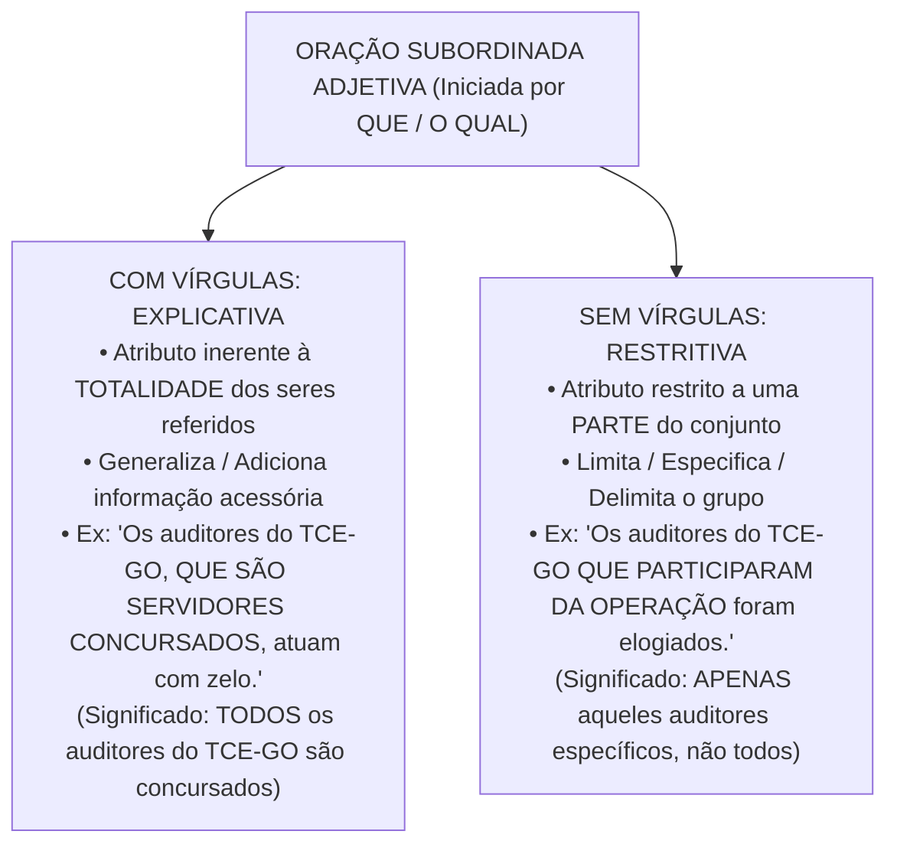
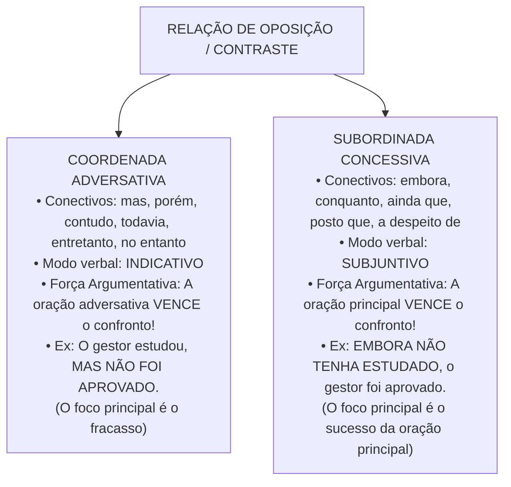

# 04 - Sintaxe do Período, Conectivos e Pontuação

> **Matéria:** Língua Portuguesa  
> **Cargos:** A01 – Técnico de Controle Externo (Adm) / B02 – Técnico de Controle Externo (TI)  
> **Arquivo:** `04_sintaxe_coordenacao_subordinacao_conectivos_pontuacao.md`  
> **Referência Temática:** Período Composto, Relações Lógicas Interoracionais, Valores de Conectivos e Pontuação na Banca FCC

---

## 📌 Ementa / Itens do Edital
- Coordenação e subordinação: processos sintáticos de articulação oracional no período composto;
- Conectivos coordenativos: conjunções aditivas, adversativas, alternativas, conclusivas e explicativas;
- Conectivos subordinativos: conjunções integrantes, causais, consecutivas, condicionais, concessivas, conformativas, comparativas, finais, proporcionais e temporais;
- Distinção semântica e modal entre orações adversativas (modo indicativo) e concessivas (modo subjuntivo);
- O trio clássico da FCC: *Porquanto* (causal), *Portanto* (conclusivo) e *Conquanto* (concessivo);
- Orações subordinadas substantivas (método de substituição pelo pronome *ISSO*);
- Orações subordinadas adjetivas explicativas (com vírgulas) vs. restritivas (sem vírgulas) e alteração de sentido pela pontuação;
- Emprego dos sinais de pontuação (vírgula, ponto e vírgula, dois-pontos, travessão e parênteses);
- Proibições sintáticas absolutas do emprego da vírgula (quebra da ordem direta Sujeito - Verbo - Complemento);
- Adjuntos adverbiais e orações adverbiais deslocadas ou intercaladas.

---

## 🧭 Sumário

1. [Fundamentos do Período Composto: Coordenação e Subordinação](#1-fundamentos-do-periodo-composto-coordenacao-e-subordinacao)
    1. [Conceito de Período Composto e Mecanismos de Junção Oracional](#11-conceito-de-periodo-composto-e-mecanismos-de-juncao-oracional)
    2. [Processo de Coordenação e Autonomia Sintática](#12-processo-de-coordenacao-e-autonomia-sintatica)
    3. [Processo de Subordinação e Encaixamento Hierárquico](#13-processo-de-subordinacao-e-encaixamento-hierarquico)
    4. [Teste 032](#Teste-032)
2. [Orações Coordenadas e Conectivos Coordenativos](#2-oracoes-coordenadas-e-conectivos-coordenativos)
    1. [Coordenadas Assindéticas e Sindéticas](#21-coordenadas-assindeticas-e-sindeticas)
    2. [Valores Semânticos das Conjunções Coordenativas](#22-valores-semanticos-das-conjuncoes-coordenativas)
    3. [Posição e Valores Polissêmicos da Conjunção Pois](#23-posicao-e-valores-polissemicos-da-conjuncao-pois)
    4. [Teste 033](#Teste-033)
3. [Orações Subordinadas Substantivas e Adjetivas](#3-oracoes-subordinadas-substantivas-e-adjetivas)
    1. [Orações Substantivas e o Método do Pronome ISSO](#31-oracoes-substantivas-e-o-metodo-do-pronome-isso)
    2. [Classificação Sintática das Orações Subordinadas Substantivas](#32-classificacao-sintatica-das-oracoes-subordinadas-substantivas)
    3. [Orações Subordinadas Adjetivas: Explicativas vs. Restritivas](#33-oracoes-subordinadas-adjetivas-explicativas-vs-restritivas)
    4. [Teste 034](#Teste-034)
    5. [Teste 035](#Teste-035)
4. [Orações Subordinadas Adverbiais e Conectivos Críticos](#4-oracoes-subordinadas-adverbiais-e-conectivos-criticos)
    1. [Quadro Completo das Conjunções Subordinativas Adverbiais](#41-quadro-completo-das-conjuncoes-subordinativas-adverbiais)
    2. [Adversativas vs. Concessivas: Conflito Sintático, Semântico e Modal](#42-adversativas-vs-concessivas-conflito-sintatico-semantico-e-modal)
    3. [O Trio Crítico da FCC: Porquanto, Portanto e Conquanto](#43-o-trio-critico-da-fcc-porquanto-portanto-e-conquanto)
    4. [A Polissemia do Conectivo Como](#44-a-polissemia-do-conectivo-como)
    5. [Teste 036](#Teste-036)
    6. [Teste 037](#Teste-037)
    7. [Teste 038](#Teste-038)
5. [Sintaxe da Pontuação e Efeitos Semânticos](#5-sintaxe-da-pontuacao-e-efeitos-semanticos)
    1. [A Proibição Inegociável da Quebra SVC](#51-a-proibicao-inegociavel-da-quebra-svc)
    2. [Regras do Uso da Vírgula no Período Simples](#52-regras-do-uso-da-virgula-no-periodo-simples)
    3. [Regras do Uso da Vírgula no Período Composto](#53-regras-do-uso-da-virgula-no-periodo-composto)
    4. [Emprego de Ponto e Vírgula, Dois-Pontos, Travessões e Parênteses](#54-emprego-de-ponto-e-virgula-dois-pontos-travessoes-e-parenteses)
    5. [Alterações de Sentido Provocadas pela Supressão ou Deslocamento de Pontuação](#55-alteracoes-de-sentido-provocadas-pela-supressao-ou-deslocamento-de-pontuacao)
    6. [Teste 039](#Teste-039)
    7. [Teste 040](#Teste-040)
    8. [Teste 041](#Teste-041)
6. [🌐 Fontes Oficiais e Referências Bibliográficas](#fontes-oficiais-e-referencias-bibliograficas)

---

## 1. Fundamentos do Período Composto: Coordenação e Subordinação

O período composto é aquele constituído por duas ou mais orações que se articulam para veicular um pensamento complexo. No texto formal, técnico e legislativo, o encadeamento das proposições obedece a dois processos estruturais básicos: a coordenação e a subordinação.

### 1.1 Conceito de Período Composto e Mecanismos de Junção Oracional

O reconhecimento do número de orações em um período faz-se pela identificação da quantidade de verbos ou locuções verbais presentes. A ligação entre essas orações processa-se ou por meio de conectivos expressos (conjunções coordenativas ou subordinativas, locuções conjuntivas e pronomes relativos) ou por simples justaposição assindética mediada por sinais de pontuação (vírgulas, ponto e vírgula ou dois-pontos).

### 1.2 Processo de Coordenação e Autonomia Sintática

Na coordenação, as orações encontram-se dispostas lado a lado no período sem que nenhuma delas exerça função sintática imediata em relação à outra. Cada oração coordenada possui estrutura interna própria (sujeito, predicado e complementos), mantendo equivalência hierárquica e autonomia gramatical:

* *"O auditor elaborou o relatório [1ª oração coordenada] e o conselheiro assinou o voto [2ª oração coordenada]."*

Embora sintaticamente autônomas, as orações coordenadas articulam-se logicamente no plano do discurso, expressando relações semânticas de soma, oposição, alternância, conclusão ou justificativa.

### 1.3 Processo de Subordinação e Encaixamento Hierárquico

Na subordinação, verifica-se uma relação de dependência hierárquica e encaixamento funcional: a oração subordinada desempenha uma função sintática essencial, integrante ou acessória em benefício da oração principal (atuando como se fosse um substantivo, um adjetivo ou um advérbio desta).

* *"O tribunal determinou [oração principal] <ins>que o contrato fosse suspenso</ins> [oração subordinada substantiva com função de objeto direto da principal]."*

Se a oração subordinada for retirada, a oração principal torna-se sintaticamente mutilada ou incompleta (no exemplo, o verbo *determinou* ficaria desprovido de seu complemento direto).

---

### Teste 032
**(FCC – DPE-RS – Analista Jurídico)**  
Considere o período:  
*"O plenário não acolheu as preliminares da defesa, nem os auditores encontraram atenuantes nos documentos acostados aos autos."*

Em relação à estrutura sintática do período acima, é correto afirmar que:

* **A)** É composto por subordinação, sendo a segunda oração classificada como subordinada substantiva completiva nominal.
* **B)** É composto por coordenação, sendo a segunda oração uma coordenada sindética aditiva introduzida pela conjunção *"nem"*.
* **C)** A oração introduzida por *"nem"* expressa circunstância de consequência em relação ao fato expresso na primeira oração.
* **D)** A conjunção *"nem"* equivale semanticamente ao conectivo conclusivo *"por conseguinte"*.
* **E)** As orações guardam relação de dependência sintática estrita, exercendo uma a função de sujeito da outra.

---

> **Comentário Detalhado:**
>
> - **A)** Incorreta. O período é composto por coordenação, pois as orações são sintaticamente independentes entre si (não exercem função de termo oracional de outra oração).
> - **B)** Correta. A conjunção coordenativa aditiva *"nem"* equivale a *"e não"*, ligando duas orações coordenadas que expressam soma de ideias negativas: *"O plenário não acolheu as preliminares (...) e os auditores não encontraram atenuantes..."*. Trata-se de oração coordenada sindética aditiva.
> - **C)** Incorreta. Não há nexo causal-consecutivo entre as orações, mas simples adição de fatos constatados.
> - **D)** Incorreta. *"Nem"* é aditivo, ao passo que *"por conseguinte"* é conclusivo.
> - **E)** Incorreta. A dependência sintática é própria da subordinação. Na coordenação, cada oração possui estrutura sintática completa e autônoma.
>
> **Gabarito: B**

---

## 2. Orações Coordenadas e Conectivos Coordenativos

As orações coordenadas dividem-se em dois grandes grupos: assindéticas (desprovidas de conectivo) e sindéticas (introduzidas por conjunção coordenativa).

### 2.1 Coordenadas Assindéticas e Sindéticas

* **Coordenadas Assindéticas:** São orações justapostas, separadas por vírgula ou ponto e vírgula, sem qualquer conjunção expressa: *"Chegou ao tribunal, conferiu a pauta, dirigiu-se ao plenário"*.
* **Coordenadas Sindéticas:** Vêm encabeçadas por uma conjunção coordenativa que explicita o vínculo lógico estabelecido com a oração precedente. Classificam-se conforme o valor semântico desse conectivo.

### 2.2 Valores Semânticos das Conjunções Coordenativas

A gramática normativa e os exames da Fundação Carlos Chagas reconhecem cinco modalidades de orações coordenadas sindéticas:

1. **Aditivas:** Expressam ideia de soma, acréscimo ou adição de pensamentos:
    * Conectivos: *e, nem* (= e não), *não só... mas também, não só... como também, bem como, tanto... quanto*.
    * Exemplo: *"A fiscalização não apenas apontou o sobrepreço, como também recomendou a aplicação de multa."*

2. **Adversativas:** Indicam oposição, contraste, compensação ou quebra de expectativa entre proposições:
    * Conectivos: *mas, porém, contudo, todavia, entretanto, no entanto, não obstante* (quando seguido de indicativo).
    * Exemplo: *"O gestor apresentou os balancetes, porém não comprovou a liquidação das despesas."*

3. **Alternativas:** Exprimem ideia de escolha, exclusão mútua ou alternância de situações:
    * Conectivos: *ou, ou... ou, ora... ora, quer... quer, seja... seja, já... já*.
    * Exemplo: *"Ou o município regulariza o portal da transparência, ou sofrerá sanções administrativas."*

4. **Conclusivas:** Expressam dedução lógica, resultado ou consequência direta da proposição anterior:
    * Conectivos: *logo, portanto, por conseguinte, por isso, assim, de modo que, pois* (posposto ao verbo e isolado entre vírgulas).
    * Exemplo: *"As despesas com pessoal ultrapassaram os limites da LRF; portanto, fica vedada a contratação de novos servidores."*

5. **Explicativas:** Apresentam a razão, justificativa ou motivo do enunciado ou comando anterior:
    * Conectivos: *que, porque, porquanto, pois* (anteposto ao verbo).
    * Exemplo: *"Revisem as planilhas de cálculo, porque a sessão de julgamento terá início em instantes."*

### 2.3 Posição e Valores Polissêmicos da Conjunção Pois

A conjunção *pois* assume comportamentos sintáticos diametralmente opostos em razão estrita da sua posição física na oração coordenada:

* **Pois Explicativo (Anteposto ao Verbo):** Posiciona-se no início da oração coordenada, antes do verbo conjugado, assumindo valor explicativo ou causal (= *porque, porquanto, já que*):
    * *"Não atrase a entrega dos autos, **pois** os prazos regimentais são preclusivos."*
* **Pois Conclusivo (Posposto ao Verbo e entre Vírgulas):** Surge deslocado para o interior da oração coordenada, posposto ao verbo conjugado e compulsoriamente isolado por vírgulas, assumindo valor estritamente conclusivo (= *portanto, por conseguinte, logo*):
    * *"As provas da materialidade da fraude eram robustas; o pleno julgou, **pois**, pela irregularidade das contas."*

> 📌 **NOTA EXPLICATIVA / IDENTIFICAÇÃO DO POIS CONCLUSIVO:** Se a questão da FCC sublinhar o vocábulo *pois* e ele estiver posicionado após o verbo e cercado de vírgulas (*"aprovou, pois, as contas"*), a sua equivalência semântica é **conclusiva** e o conectivo substituto cabível é **portanto** ou **por conseguinte**. Nunca o classifique como explicativo nessa posição.

---

### Teste 033
**(FCC – AL-SP – Analista Legislativo)**  
Considere o período:  
*"Os pareceres técnicos da controladoria demonstraram cabalmente a regularidade do processo licitatório; o plenário aprovou, <ins>pois</ins>, as contas do ordenador de despesas."*  
No contexto acima, o termo destacado expressa valor semântico de:

* **A)** Concessão
* **B)** Causa
* **C)** Explicação
* **D)** Conclusão
* **E)** Proporção

---

> **Comentário Detalhado:**
>
> - **A)** Incorreta. O conectivo *pois* não possui propriedade semântica de concessão sob nenhuma hipótese na língua portuguesa.
> - **B)** Incorreta. Para expressar valor causal, o conectivo *pois* deveria obrigatoriamente figurar no início da oração, anteposto ao verbo.
> - **C)** Incorreta. O valor explicativo do conectivo *pois* somente emerge quando a conjunção encabeça a oração antes do verbo conjugado, justificando uma asserção precedente.
> - **D)** Correta. A conjunção coordenativa **pois**, ao posicionar-se **deslocada no interior da oração, posposta ao verbo conjugado e cercada por vírgulas** (*"o plenário aprovou, pois, as contas"*), assume rigorosamente o valor semântico de **conclusão**, atuando como sinônimo cabal de *portanto*, *logo* e *por conseguinte*.
> - **E)** Incorreta. A ideia de proporção é veiculada por locuções proporcionais como *à medida que* e *à proporção que*, descabendo com *pois*.
> 
> **Gabarito: D**

---

## 3. Orações Subordinadas Substantivas e Adjetivas

As orações subordinadas dividem-se em substantivas, adjetivas e adverbiais, dependendo do valor gramatical que exercem em relação à oração principal.

### 3.1 Orações Substantivas e o Método do Pronome ISSO

As orações subordinadas substantivas exercem papéis privativos de substantivos em relação à oração principal. São introduzidas quase invariavelmente pelas **conjunções integrantes "QUE" ou "SE"** (que não exercem função sintática própria, sendo meros conectivos de ligação).

> 💡 **DICA DO "ISSO" PARA ORAÇÕES SUBSTANTIVAS:** Para comprovar que uma oração é subordinada substantiva e que a palavra *que* ou *se* atua como conjunção integrante, substitua mentalmente toda a oração a partir do conectivo pelo pronome demonstrativo neutro **"ISSO"** (ou *a isso, de isso/disso, com isso*):
>
> * *"O presidente declarou [que a sessão estava suspensa]"* $\rightarrow$ *"O presidente declarou [ISSO]"* (Oração Substantiva Objetiva Direta).
> * *"É necessário [que se apresentem os documentos]"* $\rightarrow$ *"É necessário [ISSO]"* $\rightarrow$ *"ISSO é necessário"* (Oração Substantiva Subjetiva).

### 3.2 Classificação Sintática das Orações Subordinadas Substantivas

Identificada a oração substantiva pelo teste do *ISSO*, classifica-se a sua função sintática analisando o papel do pronome *ISSO* em relação à oração principal:

1. **Subjetiva:** Exerce a função de sujeito da oração principal. Ocorre quando a oração principal possui verbo de ligação + predicativo (*"É evidente que o prazo expirou"* $\rightarrow$ *ISSO é evidente*), verbo na voz passiva analítica ou sintética (*"Sabe-se que haverá concurso"*) ou verbos unipessoais (*convém, cumpre, importa, parece, urge*): *"Convém que todos estudem"*.
2. **Objetiva Direta:** Atua como objeto direto de verbo transitivo direto da oração principal (*"O relator constatou que havia sobrepreço"* $\rightarrow$ *constatou ISSO*).
3. **Objetiva Indireta:** Atua como objeto indireto, sendo precedida de preposição exigida por verbo transitivo indireto (*"O conselheiro insistiu em que se realizasse a perícia"* $\rightarrow$ *insistiu NISSO*).
4. **Completiva Nominal:** Atua como complemento nominal, integrando o sentido de um substantivo abstrato, adjetivo ou advérbio da principal (*"Tínhamos a certeza de que a fiscalização seria rigorosa"* $\rightarrow$ *certeza DISSO*).
5. **Predicativa:** Exerce a função de predicativo do sujeito após verbo de ligação (*"Nosso objetivo é que a administração pública seja eficiente"* $\rightarrow$ *o objetivo é ISSO*).
6. **Apositiva:** Exerce o papel de aposto explicativo, esclarecendo um termo antecedente, comumente posposta a dois-pontos (*"Desejo apenas uma coisa: que a verdade prevaleça"*).

### 3.3 Orações Subordinadas Adjetivas: Explicativas vs. Restritivas

As orações subordinadas adjetivas desempenham papel equivalente ao de um adjetivo (adjunto adnominal) em relação a um substantivo antecedente, sendo invariavelmente introduzidas por um **pronome relativo** (*que, quem, cujo, o qual, onde*).

#### Distinção Semântica e Sintática Crucial:
* **Adjetiva Explicativa (com vírgulas):** Vem isolada por vírgulas (ou travessões/parênteses). Atribui uma qualidade própria que abrange a **totalidade** dos elementos do termo antecedente. Não delimita o grupo, operando de forma generalizadora.
    * *"Os cidadãos brasileiros, que têm direito ao voto, participam das eleições."* (Significado: todos os cidadãos brasileiros têm direito ao voto).
* **Adjetiva Restritiva (sem vírgulas):** É grafada sem vírgulas. Restringe, individualiza e delimita o sentido do substantivo antecedente a um **subconjunto restrito**, excluindo os demais membros da classe.
    * *"Os cidadãos brasileiros que têm mais de setenta anos possuem voto facultativo."* (Significado: apenas aquela parcela que tem mais de 70 anos, e não a totalidade dos brasileiros).

> 🚨 **ALERTA DE PROVA / SUPRESSÃO DE VÍRGULAS EM ORAÇÃO ADJETIVA:** A FCC explora intensamente assertivas que indagam: *"A retirada das vírgulas da oração adjetiva mantém a correção gramatical e o sentido original do período?"*. Resposta técnica obrigatória: a retirada das vírgulas **mantém a correção gramatical**, mas **SEMPRE ALTERA O SENTIDO DO TEXTO**, transformando uma explicação genérica sobre a totalidade em uma restrição delimitadora sobre uma fração.

---

### Teste 034
**(FCC – TCE-GO – Analista de Controle Externo)**  
Considere as duas orações destacadas a seguir:  

1. *"É fundamental **que os gestores apresentem as notas fiscais originais**."*  
2. *"A equipe técnica constatou **que os pagamentos foram efetuados sem prévio empenho**."*  

Quanto à função sintática exercida pelas orações destacadas, assinale a alternativa correta:

* **A)** Em 1, a oração é subordinada substantiva objetiva direta; em 2, é subordinada substantiva subjetiva.
* **B)** Em 1, a oração exerce a função de sujeito do verbo *ser* (subordinada substantiva subjetiva); em 2, funciona como objeto direto da forma verbal *constatou* (subordinada substantiva objetiva direta).
* **C)** Ambas as orações exercem a função de aposto explicativo do termo antecedente.
* **D)** Em 1 e 2, as orações classificam-se como subordinadas adjetivas explicativas introduzidas por pronome relativo considerando os requisitos operacionais de segurança, escalabilidade, auditoria e desempenho corporativo.
* **E)** Em 1, a oração é completiva nominal dependente do predicativo *fundamental*; em 2, é adverbial causal.

---

> **Comentário Detalhado:**
>
> - **Oração 1:** *"É fundamental [que os gestores apresentem as notas fiscais originais]"*. Aplicando o método da substituição pelo pronome substantivo **ISSO**: *"É fundamental ISSO"* $
ightarrow$ *"ISSO é fundamental"*. O termo *"ISSO"* funciona como sujeito da oração principal (que possui verbo de ligação *é* + predicativo do sujeito *fundamental*). Logo, a oração é **subordinada substantiva subjetiva**.
> - **Oração 2:** *"A equipe técnica constatou [que os pagamentos foram efetuados sem prévio empenho]"*. Substituindo: *"A equipe técnica constatou ISSO"*. O verbo *constatar* é transitivo direto (quem constata, constata algo). Logo, o termo *"ISSO"* desempenha a função de objeto direto da oração principal, classificando a oração como **subordinada substantiva objetiva direta**.
> - **Conclusão:** A alternativa **B** traduz com exatidão essas duas funções sintáticas primordiais da FCC.
>
> **Gabarito: B**

---

### Teste 035
**(FCC – TRT – Analista Judiciário)**  
Considere o segmento:  
*"Os auditores de controle externo, <ins>que fiscalizam a correta aplicação dos recursos públicos estaduais</ins>, atuam com estrita independência funcional."*  
A respeito da oração sublinhada e do emprego das vírgulas que a isolam, é correto afirmar:

* **A)** A oração é subordinada adjetiva restritiva, e a eliminação das duas vírgulas manteria inalterado o sentido original do enunciado.
* **B)** Trata-se de oração subordinada adjetiva explicativa, cuja supressão das vírgulas manteria a correção gramatical, mas alteraria o sentido original do período.
* **C)** As vírgulas são de emprego facultativo, pois isolam adjunto adverbial de curta extensão.
* **D)** A oração exerce função de oração coordenada sindética explicativa, sendo obrigatória a substituição do pronome *que* por *porquanto* em conformidade com as diretrizes e padrões de arquitetura corporativa.
* **E)** A retirada das vírgulas tornaria a frase agramatical e incorreta perante a norma-padrão.

---

> **Comentário Detalhado:**
>
> - **A)** Incorreta. A oração não é restritiva, mas explicativa, exatamente porque está grafada entre vírgulas. Ademais, a retirada das vírgulas alteraria profundamente a significação semântica do enunciado.
> - **B)** Correta. A oração subordinada é introduzida pelo pronome relativo *que* e está devidamente isolada por vírgulas, qualificando-se como **Oração Subordinada Adjetiva Explicativa**. Ela atribui uma qualidade inerente à universalidade dos sujeitos citados (todos os auditores de controle externo do órgão fiscalizam a aplicação dos recursos). Caso as vírgulas sejam suprimidas, a oração converte-se em **restritiva**: o período permanece gramaticalmente correto, porém seu sentido é transformado, passando a delimitar que apenas uma parcela restrita de auditores realiza tal mister, enquanto outros não o fariam.
> - **C)** Incorreta. O segmento não é adjunto adverbial, mas oração subordinada adjetiva explicativa, na qual as vírgulas são obrigatórias para consagrar o sentido explicativo.
> - **D)** Incorreta. Trata-se de oração subordinada adjetiva encabeçada pelo pronome relativo *que* (o qual retoma *os auditores de controle externo*), não havendo coordenação sindética.
> - **E)** Incorreta. A supressão das vírgulas não infringe a sintaxe nem torna o período agramatical; produz unicamente a conversão semântica de explicativa para restritiva.
> 
> **Gabarito: B**

---

## 4. Orações Subordinadas Adverbiais e Conectivos Críticos

As orações subordinadas adverbiais exercem a função de adjunto adverbial da oração principal, explicitando as circunstâncias temporais, lógicas e modais sob as quais se consuma o processo verbal.

### 4.1 Quadro Completo das Conjunções Subordinativas Adverbiais

A gramática normativa classifica as orações subordinadas adverbiais em nove categorias semânticas:

| Categoria | Ideia Central | Conjunções e Locuções Principais | Exemplo de Aplicação |
| :--- | :--- | :--- | :--- |
| **Causal** | Motivo, razão ou causa da oração principal | *porque, visto que, já que, uma vez que, como* (no início), *porquanto, dado que* | *"Como chovia torrencialmente, o fiscal adiou a vistoria."* |
| **Consecutiva** | Consequência, resultado ou efeito decorrente | *tal... que, tanto... que, tão... que, tamanho... que, de forma que, de modo que* | *"A fraude foi tamanha que chocou os auditores."* |
| **Condicional** | Condição indispensável ou hipótese | *se, caso, contanto que, desde que, a não ser que, a menos que* | *"Caso o plenário autorize, iniciaremos a inspeção."* |
| **Concessiva** | Fato que se opõe à principal sem impedi-la | *embora, conquanto, ainda que, mesmo que, a despeito de, posto que, se bem que* | *"Conquanto houvesse pressão, o relator manteve o voto."* |
| **Conformativa** | Conformidade, acordo ou modelo seguido | *conforme, consoante, segundo, como* (= conforme) | *"O edital foi publicado, como prescreve a lei."* |
| **Comparativa** | Confronto analógico entre dois elementos | *como, assim como, tal qual, mais... do que, menos... do que* | *"O técnico procedeu com rigor como um perito criminal."* |
| **Final** | Objetivo, desígnio ou finalidade | *a fim de que, para que, com o fito de, com o intuito de* | *"O tribunal aprovou novas resoluções para que haja transparência."* |
| **Proporcional** | Proporcionalidade ou simultaneidade progressiva | *à medida que, à proporção que, ao passo que, quanto mais... mais* | *"À medida que os autos avançavam, surgiam novas provas."* |
| **Temporal** | Momento cronológico em que ocorre a ação | *quando, enquanto, logo que, assim que, desde que, todas as vezes que* | *"Assim que a sessão terminou, a ata foi lavrada."* |

### 4.2 Adversativas vs. Concessivas: Conflito Sintático, Semântico e Modal

A oposição de ideias pode ser expressa por meio de coordenadas adversativas ou subordinadas concessivas. Embora ambas expressem contraste, seu funcionamento linguístico é radicalmente diverso:

#### Distinções Gramaticais Determinantes:
1. **Regência do Modo Verbal:**
    * A oração coordenada adversativa rege o verbo no **modo indicativo** (*"Ele agiu, contudo **errou**"*).
    * A oração subordinada concessiva rege compulsoriamente o verbo no **modo subjuntivo** (*"Embora ele **tenha agido**, não alcançou êxito"*).

2. **Hierarquia Argumentativa (Peso Discursivo):**
    * Na oração coordenada adversativa, o argumento mais forte, que orienta a conclusão final do autor, situa-se **dentro da própria oração adversativa** (*"O projeto é dispendioso, mas trará enormes benefícios à coletividade"* $\rightarrow$ prevalece a ideia de aprovação do projeto).
    * Na oração subordinada concessiva, a oração concessiva traz um argumento fraco que é superado pela oração principal; logo, o argumento determinante repousa **na oração principal** (*"Embora o projeto seja dispendioso, trará benefícios"* $\rightarrow$ a força do benefício prevalece sobre o custo).

> ⭐ **IMPORTANTE / SUBSTITUIÇÃO ADVERSATIVA POR CONCESSIVA:** Ao trocar uma conjunção adversativa (*mas, contudo, porém*) por uma concessiva (*embora, conquanto*), a gramática exige duas alterações simultâneas: 1) inversão da oração principal com a subordinada ou realocação do conectivo; 2) **mudança obrigatória do modo verbal do indicativo para o subjuntivo**.

### 4.3 O Trio Crítico da FCC: Porquanto, Portanto e Conquanto

Poucas pegadinhas são tão reiteradas pela Fundação Carlos Chagas quanto a semelhança gráfica entre os conectivos do trio:

* **PORQUANTO (Causal / Explicativo):** Equivale a *porque*, *já que*, *visto que*, *dado que*. Introduz a causa do fato ou a justificativa de uma ordem.
    * *"O TCE-GO rejeitou as contas, **porquanto** restou comprovado o superfaturamento."*
* **PORTANTO (Conclusivo):** Equivale a *logo*, *por conseguinte*, *assim*, *dessa forma*. Introduz a consequência lógica ou o arremate dedutivo.
    * *"Os autos comprovam a boa-fé do gestor; **portanto**, o processo deve ser arquivado."*
* **CONQUANTO (Concessivo):** Equivale a *embora*, *ainda que*, *a despeito de que*, *posto que*. Introduz uma ressalva concessiva que não anula a oração principal e **rege o modo subjuntivo**.
    * *"**Conquanto** houvesse fortes pressões políticas, o conselheiro proferiu voto técnico."*

### 4.4 A Polissemia do Conectivo Como

O conectivo *como* assume múltiplos papéis dependendo da sua posição na frase e da intenção discursiva:

1. **Como Causal:** Ocorre tipicamente anteposto ao período (no início da frase), equivalendo a *já que, visto que, dado que*: *"**Como** o prazo de apresentação de defesa havia expirado na véspera, o gestor foi declarado revel"*.
2. **Como Conformativo:** Equivale a *conforme, segundo, consoante*, indicando adequação a uma norma ou modelo: *"O concurso público realizou-se, **como** determina a Constituição Estadual"*.
3. **Como Comparativo:** Estabelece confronto de semelhança analógica (= *tal qual, assim como*): *"O fiscal examinou as planilhas **como** um analista forense minucioso"*.
4. **Como Aditivo (Correlativo):** Integra a estrutura aditiva correlata *não só... como também*: *"O parecer apontou **não só** desídia administrativa, **como também** dano patrimonial"*.

---

### Teste 036
**(FCC – TRT – Analista Judiciário)**  
Considere o período:  
*"À medida que as investigações avançavam, novos indícios de irregularidades vinham à tona, de modo que a comissão decidiu prorrogar os trabalhos por mais trinta dias."*

Os conectivos destacados expressam, correta e respectivamente, as noções circunstanciais de:

* **A)** tempo e causa.
* **B)** proporção e consequência.
* **C)** concessão e finalidade.
* **D)** condição e conformidade em conformidade com as diretrizes e padrões de arquitetura corporativa.
* **E)** proporção e explicação.

---

> **Comentário Detalhado:**
>
> - **1ª locução:** *"À medida que"* é a locução conjuntiva subordinativa por excelência de valor **proporcional** (indica um fenômeno que varia em relação direta e concomitante com outro). Atenção: não confundir com a locução causal "na medida em que".
> - **2ª locução:** *"de modo que"* introduz fato que decorre do que foi afirmado anteriormente (efeito produzido pelo acúmulo de novos indícios), configurando nexo subordinativo adverbial **consecutivo** (consequência).
> - **Análise das alternativas:** A alternativa **B** traz exatamente a dupla relação: proporção e consequência.
>
> **Gabarito: B**

---

### Teste 037
**(FCC – TCE-GO – Analista de Controle Externo)**  
Considere o seguinte período:  
*"<ins>Conquanto</ins> a equipe de auditoria tenha coligido indícios substanciais de superfaturamento na compra de medicamentos, a autoridade julgadora decidiu pela conversão dos autos em diligência saneadora."*  
O conectivo destacado introduz relação de sentido e pode ser substituído, mantendo-se a correção gramatical e o sentido original do período, por:

* **A)** Porquanto
* **B)** Visto que
* **C)** Embora
* **D)** À proporção que
* **E)** Contanto que

---

> **Comentário Detalhado:**
>
> - **A)** Incorreta. A conjunção *porquanto* expressa valor causal ou explicativo (= *porque, já que, dado que*), o que distorceria completamente a lógica de oposição/ressalva presente no período original.
> - **B)** Incorreta. A locução conjuntiva *visto que* introduz oração subordinada adverbial causal, inconciliável com a relação semântica de concessão.
> - **C)** Correta. A conjunção subordinativa **conquanto** possui valor semântico estritamente **concessivo** (introduz um fato real de contraste que não impede a concretização do fato da oração principal) e rege o modo subjuntivo (*tenha coligido*). O conectivo **embora** é seu sinônimo clássico perfeito, preservando integralmente o sentido concessivo original e a compatibilidade com o verbo no pretérito perfeito do subjuntivo.
> - **D)** Incorreta. A locução *à proporção que* expressa valor proporcional, relacionando fatos simultâneos em escala gradativa de variação.
> - **E)** Incorreta. A locução *contanto que* exprime valor condicional, apresentando uma exigência hipotética para que o fato principal ocorra.
> 
> **Gabarito: C**

---

### Teste 038
**(FCC – DPE-RS – Analista de Processos)**  
Assinale a frase em que o conectivo **COMO** expressa relação semântica de **causa**:

* **A)** *"O técnico de suporte agiu rapidamente, como orientava o protocolo de segurança da informação."* em conformidade com as diretrizes e padrões de arquitetura corporativa.
* **B)** *"O novo sistema operacional era rápido e silencioso como um raio."*
* **C)** *"Como o prazo de apresentação de defesa havia expirado na véspera, o gestor foi declarado revel."*
* **D)** *"A comissão convocou não apenas o presidente da fundação, como também o contador-geral."*
* **E)** *"O conselheiro explicou com detalhes como se operava a fraude nas medições de asfalto."*

---

> **Comentário Detalhado:**
>
> - **A)** Incorreta. A oração *como orientava o protocolo* veicula sentido de conformidade, equivalendo a *conforme* ou *segundo* (oração subordinada adverbial conformativa).
> - **B)** Incorreta. O segmento *como um raio* opera comparação analógica de semelhança, equivalendo a *tal qual* (oração subordinada adverbial comparativa).
> - **C)** Correta. Posicionado no início do período e encabeçando oração anteposta à principal, o conectivo **como** expressa inequívoco valor de **causa** (= *já que, visto que, dado que, porque*). A circunstância de o prazo haver expirado foi a causa motriz que determinou o efeito de o gestor ser declarado revel.
> - **D)** Incorreta. A estrutura *não apenas... como também* é uma locução correlativa coordenativa de adição.
> - **E)** Incorreta. O vocábulo *como* atua como advérbio interrogativo de modo em oração subordinada substantiva objetiva direta, indicando a maneira pela qual a fraude era praticada.
> 
> **Gabarito: C**

---

## 5. Sintaxe da Pontuação e Efeitos Semânticos

A pontuação não se destina a marcar pausas de respiração na leitura oral, mas a tornar visível a arquitetura sintática do período, demarcando unidades funcionais e impedindo ambiguidades.

### 5.1 A Proibição Inegociável da Quebra SVC

A regra número um da sintaxe de pontuação na língua culta proíbe o emprego de **uma vírgula simples** que separe os elementos constitutivos da ordem direta da oração:
$$\text{Sujeito} \not\longleftrightarrow [\text{Vírgula Proibida}] \not\longleftrightarrow \text{Verbo} \not\longleftrightarrow [\text{Vírgula Proibida}] \not\longleftrightarrow \text{Complementos (OD/OI)}$$

* É proibido separar por vírgula o Sujeito do seu Verbo (*"O conselheiro presidente da corte de contas [X], abriu a sessão extraordinária"* $\rightarrow$ **ERRO**).
* É proibido separar por vírgula o Verbo dos seus Complementos Diretos ou Indiretos (*"O auditor apurou [X], as irregularidades fiscais"* $\rightarrow$ **ERRO**; *"O presidente votou [X], pela procedência do pedido"* $\rightarrow$ **ERRO**).
* É proibido separar por vírgula o Nome do seu Complemento Nominal ou Adjunto Adnominal.

> 🚨 **ALERTA DE PROVA / TERMOS INTERCALADOS ENTRE SUJEITO E VERBO:** É lícito inserir termos entre o sujeito e o verbo, desde que esses termos estejam rigorosamente isolados por **DUAS VÍRGULAS** (ou dois travessões/parênteses):
>
> - Incorreto (apenas uma vírgula): *"O pleno do tribunal, após examinar os laudos votou pela anulação"* $\rightarrow$ Erro!
> - Incorreto (apenas uma vírgula): *"O pleno do tribunal após examinar os laudos, votou pela anulação"* $\rightarrow$ Erro!
> - **Correto (duas vírgulas):** *"O pleno do tribunal**, após examinar os laudos,** votou pela anulação."*

### 5.2 Regras do Uso da Vírgula no Período Simples

No interior da oração simples, a vírgula é de emprego compulsório nas seguintes situações:

1. **Separação de termos de mesma função sintática em enumeração:** *"O tribunal adquiriu computadores, servidores, licenças de software e impressoras."*
2. **Isolamento de Vocativo:** O vocativo deve vir sempre isolado por vírgula(s), em qualquer posição que ocupe: *"Senhor Conselheiro, apresento o recurso"*; *"Apresento, Senhor Conselheiro, o recurso"*.
3. **Isolamento de Aposto Explicativo:** *"Goiânia, capital do Estado de Goiás, sediou a conferência internacional de tribunais."*
4. **Isolamento de Adjunto Adverbial Deslocado:**
    * Se for de **longa extensão** (três ou mais palavras): o uso da vírgula é **obrigatório** (*"No primeiro semestre do exercício financeiro de 2026, concluíram-se as auditorias"*).
    * Se for de **curta extensão** (uma ou duas palavras: *hoje, ontem, aqui, em Goiânia*): o emprego da vírgula é **facultativo** (*"Ontem, o relator julgou"* ou *"Ontem o relator julgou"*).

5. **Expressões explicativas, retificativas ou continuativas:** *isto é, ou seja, por exemplo, a saber, aliás, digo*: *"O prazo era de dez dias, ou seja, improrrogável"*.

### 5.3 Regras do Uso da Vírgula no Período Composto

No período composto por coordenação e subordinação:

1. **Orações Coordenadas Assindéticas:** São separadas compulsoriamente por vírgula (*"Instruiu o processo, ouviu as testemunhas, redigiu a proposta de voto"*).
2. **Orações Coordenadas Sindéticas:** Usa-se vírgula antes de conjunções adversativas (*mas, porém, contudo*), conclusivas (*portanto, logo*) e explicativas (*porque, que*).
    * **Conjunção "E" com Sujeitos Iguais:** Em regra, não se usa vírgula antes do *e* quando as orações possuem o mesmo sujeito (*"O fiscal viajou e inspecionou as escolas"*).
    * **Conjunção "E" com Sujeitos Distintos:** Quando as orações coordenadas aditivas possuem **sujeitos gramaticais diferentes**, a vírgula antes da conjunção *e* é **plenamente admitida e recomendada** para evitar anfibologia: *"O tribunal acolheu o recurso, e o Ministério Público de Contas concordou com o relator"* (Sujeitos: *o tribunal* / *o MP de Contas*).

3. **Orações Adverbiais Deslocadas:**
    * Se a oração subordinada adverbial vier **anteposta à oração principal** ou **intercalada** nela: a vírgula é **obrigatória** (*"Embora chovesse torrencialmente, o fiscal compareceu à obra"*).
    * Se a oração adverbial vier **posposta à oração principal** (ordem direta): a vírgula é **facultativa** (*"O fiscal compareceu à obra[,] embora chovesse torrencialmente"*).

4. **Orações Subordinadas Adjetivas:** Explicativas vêm sempre isoladas por vírgulas; restritivas não admitem vírgulas.

### 5.4 Emprego de Ponto e Vírgula, Dois-Pontos, Travessões e Parênteses

* **Ponto e Vírgula (;):**
    * Separa orações coordenadas de certa extensão que já contenham vírgulas internas: *"O relatório inicial apontou desvios de combustível; o parecer conclusivo, elaborado pela auditoria de engenharia, recomendou a instauração de tomada de contas especial."*
    * Separa itens enumerados em disposições normativas, editais, relatórios e leis (como alíneas e incisos).
* **Dois-Pontos (:):**
    * Anunciam uma citação textual, uma enumeração explicativa ou uma oração subordinada substantiva apositiva: *"O conselheiro concluiu com a máxima de Rui Barbosa: 'A justiça atrasada não é justiça'."*
* **Travessão Simples ou Duplo (—):**
    * O travessão duplo atua como recurso expressivo para isolar termos intercalados, comentários enfáticos ou orações adjetivas explicativas, substituindo com elegância as vírgulas duplas ou os parênteses (*"O processo de auditoria — cuja complexidade assustava os neófitos — transcorreu dentro da mais estrita normalidade"*).
* **Parênteses ( ):**
    * Isolam notas explicativas acessórias, datas, referências bibliográficas ou reflexões secundárias do autor.

### 5.5 Alterações de Sentido Provocadas pela Supressão ou Deslocamento de Pontuação

A pontuação é ferramenta de arquitetura do sentido discursivo. O deslocamento ou a eliminação de um sinal de pontuação pode transformar completamente o sentido da mensagem:

* *Supressão de vírgulas em orações adjetivas:* Passa de explicativa (generalizadora, afeta todos os indivíduos) para restritiva (limitadora, afeta apenas um grupo).
* *Deslocamento da vírgula antes ou depois da conjunção:* Muda a regência das orações coordenadas.
* *Supressão da vírgula de vocativo:* Transforma o chamamento em sujeito da oração (*"Auditor, assine o documento"* [ordem a um interlocutor] vs. *"Auditor assine o documento"* [frase defeituosa ou ambígua]).

---

### Teste 039
**(FCC – TCE-PI – Auditor de Controle Externo)**  
A frase cuja pontuação atende plenamente às normas da norma culta da língua portuguesa é:

* **A)** *"O pleno do Tribunal de Contas, após detido exame dos relatórios de engenharia votou pela anulação da concorrência."*
* **B)** *"O pleno do Tribunal de Contas após detido exame dos relatórios de engenharia, votou pela anulação da concorrência."*
* **C)** *"O pleno do Tribunal de Contas, após detido exame dos relatórios de engenharia, votou pela anulação da concorrência."*
* **D)** *"O pleno do Tribunal de Contas votou, pela anulação da concorrência, após detido exame dos relatórios de engenharia."*
* **E)** *"O pleno do Tribunal de Contas votou pela anulação da concorrência, que, continha sobrepreço manifesto."*

---

> **Comentário Detalhado:**
>
> - **A)** Incorreta. O segmento adverbial intercalado *"após detido exame dos relatórios de engenharia"* foi aberto com uma vírgula após o sujeito, mas não foi fechado antes do verbo *votou*. Isso gerou a proibição inegociável de separar o sujeito do predicado por uma vírgula simples solitária.
> - **B)** Incorreta. Incorre no mesmo erro da assertiva A sob feição inversa: não abriu a vírgula antes do adjunto adverbial intercalado, deixando uma vírgula solitária antes do verbo *votou*, cindindo indevidamente a oração direta.
> - **C)** Correta. O adjunto adverbial de tempo de longa extensão encontra-se devidamente intercalado entre o sujeito (*O pleno do Tribunal de Contas*) e o predicado (*votou pela anulação...*), estando perfeitamente isolado por **duas vírgulas simétricas** (uma no início e outra no término do termo intercalado).
> - **D)** Incorreta. A vírgula empregada após o verbo *votou* separa indevidamente o verbo de seu objeto indireto regido pela preposição *por* (*votou pela anulação*), ferindo a regra estrutural da cadeia SVC.
> - **E)** Incorreta. A vírgula após o pronome relativo *que* cinde indevidamente o pronome relativo do verbo da oração adjetiva (*continha*).
> 
> **Gabarito: C**

---

### Teste 040
**(FCC – TCE-PI – Auditor de Controle Externo)**  
Considere a pontuação no período abaixo:  
*"A Lei de Responsabilidade Fiscal impõe limites severos para os gastos com pessoal; os municípios combalidos financeiramente, no entanto, frequentemente ultrapassam esses tetos prudenciais."*

Sobre o emprego dos sinais de pontuação no trecho, assinale a alternativa correta:

* **A)** O ponto e vírgula separa orações coordenadas de certa extensão que guardam contraste semântico, estando a segunda oração marcada por conectivo adversativo deslocado.
* **B)** O ponto e vírgula foi empregado incorretamente, devendo ser compulsoriamente substituído por dois-pontos para introduzir uma citação em conformidade com as diretrizes e padrões de arquitetura corporativa.
* **C)** As vírgulas que isolam *"no entanto"* são de emprego facultativo, podendo ser suprimidas sem nenhum prejuízo às normas gramaticais.
* **D)** O ponto e vírgula deveria ser substituído por ponto de exclamação para realçar a indignação do autor.
* **E)** É obrigatória a aposição de vírgula imediatamente após o termo *"combalidos financeiramente"*, sob pena de quebra da regência verbal.

---

> **Comentário Detalhado:**
>
> - **A)** Correta. O ponto e vírgula é o sinal de pontuação ideal na sintaxe culta da FCC para separar orações coordenadas extensas que se contrapõem em sentido, especialmente quando uma delas já possui vírgulas internas isolando adjuntos ou conjunções adversativas deslocadas (como *"no entanto"* entre vírgulas).
> - **B)** Incorreta. Não se trata de enumeração explicativa nem citação literal, razão pela qual o ponto e vírgula é plenamente legítimo e elegante.
> - **C)** Incorreta. Estando a conjunção adversativa (*no entanto*) deslocada para o meio da oração (após o sujeito *"os municípios..."*), o isolamento por vírgulas é **rigorosamente obrigatório**.
> - **D)** Incorreta. O texto é técnico-dissertativo e descarta pontuação enfática de teor emotivo.
> - **E)** Incorreta. *"combalidos financeiramente"* é adjunto adnominal restritivo de *municípios*; colocar vírgula após ele separaria o sujeito do seu verbo (*ultrapassam*), violando a regra de ouro SVC.
>
> **Gabarito: A**

---

### Teste 041
**(FCC – TRT-23 – Técnico Judiciário)**  
Considere as seguintes frases:  

I. *"Os auditores que concluíram a capacitação técnica elaboraram pareceres impecáveis."*  
II. *"Os auditores, que concluíram a capacitação técnica, elaboraram pareceres impecáveis."*  

Comparando-se as frases I e II quanto aos efeitos semânticos e sintáticos decorrentes da pontuação, conclui-se que:

* **A)** Em I e II, o sentido é estritamente idêntico, sendo o uso das vírgulas mero capricho de estilo do redator.
* **B)** Em I, a oração sem vírgulas restringe o sentido de *auditores*, indicando que apenas um grupo específico deles concluiu o curso; em II, a oração entre vírgulas é explicativa, atribuindo a conclusão da capacitação à totalidade dos auditores referidos.
* **C)** Em II, a oração entre vírgulas restringe o universo dos auditores, ao passo que em I generaliza para toda a categoria profissional considerando os requisitos operacionais de segurança, escalabilidade, auditoria e desempenho corporativo em conformidade com as diretrizes e padrões de arquitetura corporativa.
* **D)** A frase I contém erro gramatical grave por não pontuar oração adjetiva introduzida por pronome relativo.
* **E)** A frase II apresenta pontuação incorreta porque nunca se deve isolar orações adjetivas por vírgulas.

---

> **Comentário Detalhado:**
>
> - **A)** Incorreta. A presença ou ausência de vírgulas nas orações subordinadas adjetivas altera radicalmente o escopo semântico da frase (restrição vs. generalização explicativa).
> - **B)** Correta. Trata-se da clássica distinção entre orações subordinadas adjetivas cobrada à exaustão pela FCC:  
>   - **Sem vírgulas (Restritiva - Frase I):** Limita o antecedente. Apenas aqueles auditores que concluíram a capacitação elaboraram pareceres impecáveis (os que não concluíram não o fizeram).  
>   - **Com vírgulas (Explicativa - Frase II):** Generaliza e qualifica o antecedente como um todo. Todos os auditores em questão concluíram a capacitação técnica e elaboraram pareceres impecáveis.
> - **C)** Incorreta. Inverteu os conceitos (afirmou que a pontuada restringe, o que é falso).
> - **D) e E)** Incorretas. Ambas as frases são gramaticalmente impecáveis e plenamente válidas, cada qual veiculando um sentido próprio e distinto.
>
> **Gabarito: B**

---

## 🌐 Fontes Oficiais e Referências Bibliográficas

* [Manual de Comunicação do Senado Federal — Emprego da Vírgula](https://www12.senado.leg.br/manualdecomunicacao/estilos/virgula) - Regras de pontuação no período simples e composto, termos intercalados, orações adjetivas e vedações da ordem direta SVC.
* [Manual de Comunicação do Senado Federal — Ponto e Vírgula](https://www12.senado.leg.br/manualdecomunicacao/estilos/ponto-e-virgula) - Diretrizes sobre coordenação de períodos extensos, enumerações normativas e orações coordenadas conclusivas/adversativas.
* [Manual de Comunicação do Senado Federal — Redação e Estilo (Conectivos e Período)](https://www12.senado.leg.br/manualdecomunicacao/redacao-e-estilo) - Artigos técnicos sobre coordenação, subordinação, valores semânticos de conjunções e estruturação de períodos.
* [Manual de Redação da Presidência da República — 3ª Edição (PDF Oficial Planalto)](https://www4.planalto.gov.br/centrais-de-conteudos/publicacoes/manual-de-redacao-da-presidencia-da-republica-1.pdf) - Orientações sobre articulação sintática, conectivos lógicos e pontuação oficial no serviço público.
* [Lei Complementar Federal nº 95/1998 — Técnica Legislativa e Articulação Textual (Planalto)](https://www.planalto.gov.br/ccivil_03/leis/lcp/lcp95.htm) - Normas oficiais de pontuação, coordenação de dispositivos e clareza sintática em textos normativos.
* BECHARA, Evanildo. **Moderna Gramática Portuguesa**. 39. ed. Rio de Janeiro: Nova Fronteira, 2019. (Cap. 14 e Cap. 17 - Período Composto por Coordenação e Subordinação, Conectivos e Sinais de Pontuação).
* GARCIA, Othon M. **Comunicação em Prosa Moderna**. 27. ed. Rio de Janeiro: Editora FGV, 2010. (Primeira Parte - Estrutura da Frase, Coordenação, Subordinação e Valores Semânticos dos Conectivos).
* CUNHA, Celso; CINTRA, Lindley. **Nova Gramática do Português Contemporâneo**. 7. ed. Rio de Janeiro: Lexikon, 2017. (Cap. 16 e Cap. 21 - Conjunções Coordenativas e Subordinativas, Orações Adjetivas e Pontuação).
