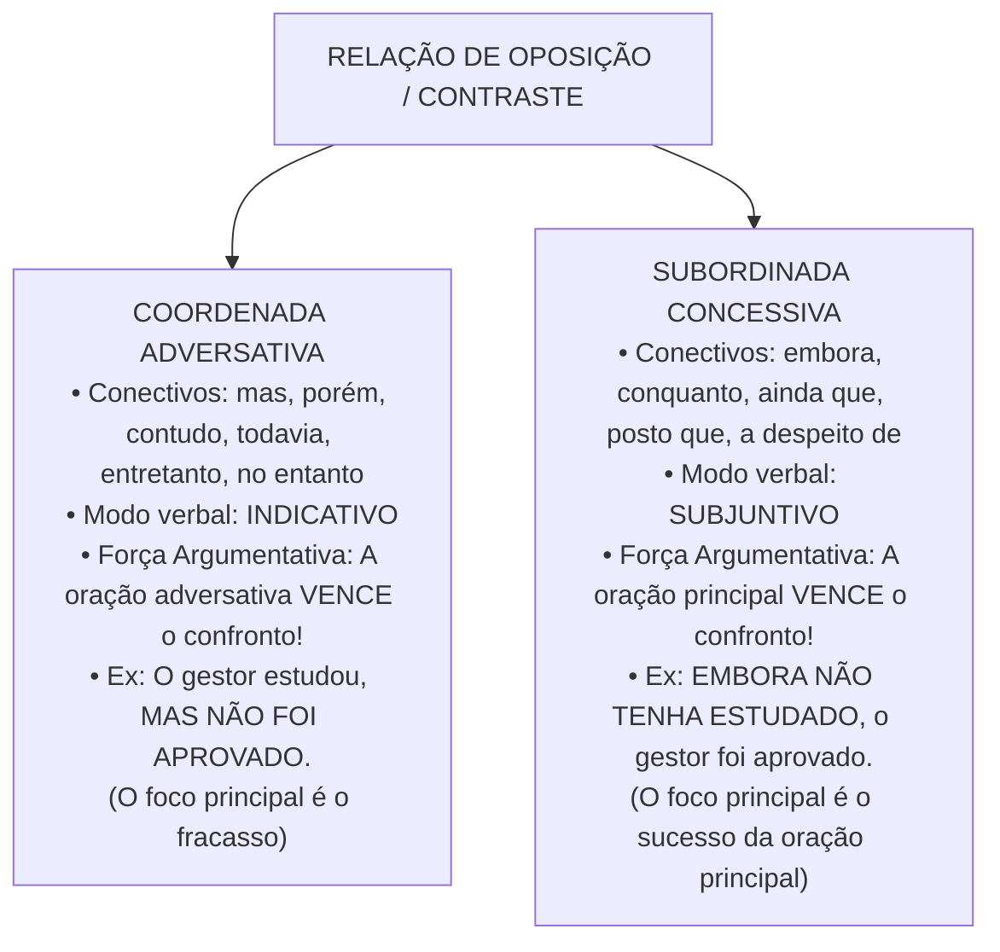
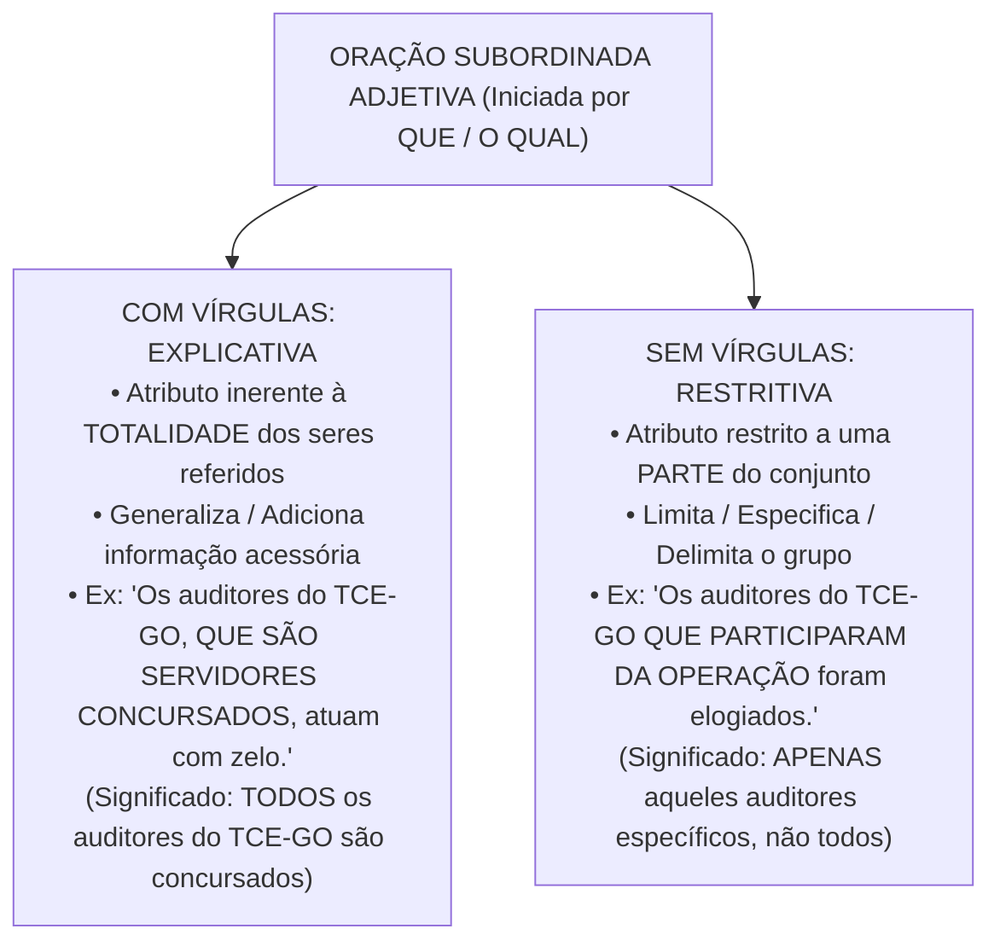

# 04 - Sintaxe do Período, Conectivos e Pontuação

> **Matéria:** Língua Portuguesa  
> **Cargos:** A01 – Técnico de Controle Externo (Adm) / B02 – Técnico de Controle Externo (TI)  
> **Arquivo:** `04_sintaxe_coordenacao_subordinacao_conectivos_pontuacao.md`  
> **Referência Temática:** Período Composto, Relações Lógicas Interoracionais, Valores de Conectivos e Pontuação na Banca FCC

---

## 📌 Ementa / Itens do Edital
- Coordenação e subordinação: processos sintáticos de articulação oracional no período composto;
- Conectivos coordenativos: conjunções aditivas, adversativas, alternativas, conclusivas e explicativas;
- Conectivos subordinativos: conjunções integrantes, causais, consecutivas, condicionais, concessivas, conformativas, comparativas, finais, proporcionais e temporais;
- Distinção semântica e modal entre orações adversativas (modo indicativo) e concessivas (modo subjuntivo);
- O trio clássico da FCC: *Porquanto* (causal), *Portanto* (conclusivo) e *Conquanto* (concessivo);
- Orações subordinadas substantivas (método de substituição pelo pronome *ISSO*);
- Orações subordinadas adjetivas explicativas (com vírgulas) vs. restritivas (sem vírgulas) e alteração de sentido pela pontuação;
- Emprego dos sinais de pontuação (vírgula, ponto e vírgula, dois-pontos, travessão e parênteses);
- Proibições sintáticas absolutas do emprego da vírgula (quebra da ordem direta Sujeito - Verbo - Complemento);
- Adjuntos adverbiais e orações adverbiais deslocadas ou intercaladas.

---

## 🌳 Classificação Hierárquica

```text
4. Sintaxe do Período Composto, Conectivos e Pontuação
├── 4.1 Estrutura e Articulação do Período Composto
│   ├── 4.1.1 Processo de Coordenação (Independência Sintática entre orações)
│   └── 4.1.2 Processo de Subordinação (Relação de dependência hierárquica e encaixamento)
├── 4.2 Orações Coordenadas e Conectivos
│   ├── 4.2.1 Coordenadas Assindéticas (justapostas sem conjunção, separadas por vírgula ou ponto e vírgula)
│   └── 4.2.2 Coordenadas Sindéticas (Valores Semânticos):
│       ├── Aditivas: e, nem, não só... mas também, bem como
│       ├── Adversativas: mas, porém, contudo, todavia, entretanto, no entanto
│       ├── Alternativas: ou... ou, ora... ora, quer... quer, seja... seja
│       ├── Conclusivas: logo, portanto, por conseguinte, pois (posposto ao verbo e entre vírgulas)
│       └── Explicativas: pois (anteposto ao verbo), que, porque, porquanto
├── 4.3 Orações Subordinadas e Conectivos Subordinativos
│   ├── 4.3.1 Orações Subordinadas Substantivas (Conjunções Integrantes 'Que' e 'Se' / Macete do 'ISSO'):
│   │   ├── Subjetiva (exerce função de sujeito da oração principal)
│   │   ├── Objetiva Direta e Objetiva Indireta (complementam verbos da principal)
│   │   ├── Completiva Nominal (complementa substantivo, adjetivo ou advérbio abstrato)
│   │   ├── Predicativa (função de predicativo do sujeito após verbo de ligação)
│   │   └── Apositiva (função de aposto, usualmente após dois-pontos)
│   ├── 4.3.2 Orações Subordinadas Adjetivas (Pronomes Relativos):
│   │   ├── Explicativa: Isolada por vírgulas / Sentido generalizador (abrange a totalidade)
│   │   └── Restritiva: Sem vírgulas / Sentido especificador (delimita um subconjunto restrito)
│   └── 4.3.3 Orações Subordinadas Adverbiais e Conectivos Críticos:
│       ├── Causais vs. Explicativas (motivo que gera o efeito vs. justificativa de um comando)
│       ├── Concessivas (embora, conquanto, ainda que, a despeito de, posto que) -> Modo Subjuntivo
│       ├── Conformativas (conforme, consoante, segundo, como)
│       ├── Consecutivas (tão/tanto/tamanho... que) -> Ideia de consequência/resultado
│       ├── Proporcionais (à medida que, à proporção que, ao passo que)
│       └── Valores Polissêmicos do conectivo 'COMO' (Causal, Conformativo, Comparativo e Aditivo)
└── 4.4 Sintaxe da Pontuação e Efeitos Semânticos
    ├── 4.4.1 A Regra de Ouro (Proibição SVC): Vedação de vírgula entre Sujeito - Verbo - Complementos
    ├── 4.4.2 Vírgula no Período Simples: Vocativo, Aposto explicativo, Adjuntos adverbiais deslocados
    ├── 4.4.3 Vírgula no Período Composto: Orações adjetivas explicativas, orações adverbiais antecipadas
    ├── 4.4.4 Ponto e Vírgula: Itens de leis e editais; separação de coordenadas com vírgulas internas
    ├── 4.4.5 Dois-pontos e Travessão: Enumerações explicativas, citações e intercalações enfáticas
    └── 4.4.6 Efeitos Semânticos: Alteração de sentido pela supressão ou deslocamento de vírgulas
```

---

## 📖 Resumo Teórico & Pontos-Chave

### 1. Adversativas vs. Concessivas (O Duelo Favorito da FCC)

Ambas expressam ideias de oposição ou contraste, mas com funcionamentos sintáticos e forças argumentativas completamente distintos:



#### O Trio Crítico de Conectivos em Provas:
* **PORQUANTO:** Tem valor **causal** ou **explicativo** (= *porque*, *já que*, *visto que*). Exemplo: *"O tribunal rejeitou as contas, porquanto constatou dano ao erário."*
* **PORTANTO:** Tem valor **conclusivo** (= *logo*, *por conseguinte*, *assim*). Exemplo: *"As despesas superaram o teto legal; portanto, as contas foram julgadas irregulares."*
* **CONQUANTO:** Tem valor **concessivo** (= *embora*, *ainda que*, *a despeito de*). Exemplo: *"Conquanto houvesse justificativas, o relator manteve a multa."*

---

### 2. A Polissemia do Conectivo "COMO"

O vocábulo *como* é um dos conectivos mais explorados em provas da FCC devido à sua multiplicidade de valores sintático-semânticos:

| Valor Sintático / Semântico | Posição Típica / Equivalência | Exemplo Ilustrativo |
| :--- | :--- | :--- |
| **Causal** | Início do período (= *já que*, *visto que*, *porque*) | *"**Como** não havia quórum suficiente, a sessão foi adiada."* |
| **Conformativo** | Meio ou início do período (= *conforme*, *segundo*, *consoante*) | *"O concurso seguiu as etapas, **como** previa o edital regulamentador."* |
| **Comparativo** | Introduz elemento de confronto analógico (= *tal qual*, *assim como*) | *"O auditor examinou os autos **como** um detetive experiente."* |
| **Aditivo** | Estrutura correlativa (= *não só... como também*) | *"O parecer apontou **não apenas** sobrepreço, **como também** direcionamento."* |

---

### 3. Orações Subordinadas Adjetivas: Explicativa vs. Restritiva

A presença ou ausência de vírgulas nas orações iniciadas por pronome relativo altera a semântica de forma substancial:



---

### 4. Guia Rápido de Pontuação: Regras de Ouro

1. **A Proibição Inegociável (Regra SVC):**
   * É terminantemente proibido colocar **uma vírgula simples** entre:
     * Sujeito e Predicado (*"O conselheiro relator do processo [X], votou pela condenação"* $\rightarrow$ **ERRADO**);
     * Verbo e seus Complementos (*"O plenário deliberou [X], que as contas seriam rejeitadas"* $\rightarrow$ **ERRADO**);
     * Nome e Complemento Nominal / Adjunto Adnominal.
2. **Adjunto Adverbial Deslocado:**
   * De **longa extensão** (3 ou mais palavras): vírgula **obrigatória** (*"No terceiro trimestre do exercício financeiro de 2025, o tribunal realizou dez auditorias"*);
   * De **curta extensão** (1 ou 2 palavras): vírgula **facultativa** (*"Ontem, o relatório foi aprovado"* ou *"Ontem o relatório foi aprovado"*).
3. **Orações Adverbiais Deslocadas (Antecipadas ou Intercaladas):**
   * Se a oração adverbial vier **antes da principal** ou **intercalada**: a vírgula é **obrigatória** (*"Embora chovesse torrencialmente, o fiscal compareceu à obra"*);
   * Se a oração adverbial vier **após a principal** (ordem direta): a vírgula é **facultativa** (*"O fiscal compareceu à obra[,] embora chovesse torrencialmente"*).
4. **O Conectivo "E" com Sujeitos Diferentes:**
   * Quando a conjunção *e* ligar orações coordenadas aditivas que possuam **sujeitos gramaticais distintos**, a vírgula **é permitida e recomendada**:
     * *"O tribunal acolheu o recurso, e o Ministério Público de Contas concordou com o voto."* (Sujeitos: *o tribunal* / *o MP de Contas*).

---

## ⚠️ Alertas de Prova & Pegadinhas da FCC

> 🚨 **ALERTA DE PROVA / PEGADINHA FCC:** Questões sobre "supressão de vírgulas mantendo-se o sentido original" frequentemente apresentam orações adjetivas explicativas. **Lembre-se:** A retirada das vírgulas de uma oração adjetiva explicativa **mantém a correção gramatical**, mas **SEMPRE ALTERA O SENTIDO DO TEXTO** (transformando uma declaração genérica em uma restrição categórica).

> ⭐ **IMPORTANTE / ADVERSATIVA X CONCESSIVA:** Conjunções adversativas (*mas*, *porém*, *contudo*) exigem verbo no modo **Indicativo**. Conjunções concessivas (*embora*, *conquanto*, *ainda que*, *posto que*) exigem verbo no modo **Subjuntivo**. Ao substituir um conectivo pelo outro, é mandatório flexionar o verbo correspondente!

> 📌 **NOTA EXPLICATIVA / POSIÇÃO DO "POIS":**
> * Se *pois* estiver no início da oração (antes do verbo), é **explicativo/causal**: *"Não saia agora, **pois** a chuva começou."*
> * Se *pois* estiver deslocado (depois do verbo e isolado entre vírgulas), é **conclusivo**: *"As contas estavam fraudulentas; o relator votou, **pois**, pela rejeição."*

> 💡 **DICA DO "ISSO" PARA ORAÇÕES SUBSTANTIVAS:** Sempre que você desconfiar de que uma oração subordinada é substantiva, substitua toda a oração a partir da conjunção integrante pela palavra **"ISSO"**. Se a frase fizer perfeito sentido, a oração é subordinada substantiva:
> * *"É necessário [que todos compareçam]"* $\rightarrow$ *"É necessário [ISSO]"* $\rightarrow$ Oração Subordinada Substantiva Subjetiva (sujeito de *é necessário*).
> * *"O auditor declarou [que o laudo estava pronto]"* $\rightarrow$ *"O auditor declarou [ISSO]"* $\rightarrow$ Oração Subordinada Substantiva Objetiva Direta.

---

## 🌐 Fontes Oficiais e Referências Bibliográficas

* [Guia Gramatical do Senado Federal - Pontuação e Período Composto](https://www12.senado.leg.br/manualdecomunicacao/redacao-e-estilo/guia-gramatical/pontuacao) - Regras práticas de pontuação em textos jurídicos e oficiais.
* [Só Português - Conjunções Coordenativas e Subordinativas Integradas](https://www.soportugues.com.br/secoes/morf/morf84.php) - Catálogo completo de valores semânticos dos conectivos oracionais.
* [Portal da Escola Virtual de Governo (EV.G / ENAP)](https://www.escolavirtual.gov.br/) - Relações de coesão, coerência e estruturação de orações complexas.
* BECHARA, Evanildo. *Moderna Gramática Portuguesa*. Rio de Janeiro: Nova Fronteira. (Capítulos de Sintaxe do Período Composto e Pontuação).
* GARCIA, Othon M. *Comunicação em Prosa Moderna*. Rio de Janeiro: Editora FGV. (Tratado clássico sobre a ordem das orações e coesão conectiva).

---

## 📝 Questões de Concurso FCC Comentadas

### Questão 01
**(FCC – TCE-GO – Analista de Controle Externo)**  
Considere o seguinte período:  
*"<ins>Conquanto</ins> a equipe de auditoria tenha coligido indícios substanciais de superfaturamento na compra de medicamentos, a autoridade julgadora decidiu pela conversão dos autos em diligência saneadora."*  
O conectivo destacado introduz relação de sentido e pode ser substituído, mantendo-se a correção gramatical e o sentido original do período, por:

* **A)** Porquanto
* **B)** Visto que
* **C)** Embora
* **D)** À proporção que
* **E)** Contanto que

> **Gabarito: C**  
> **Comentário Detalhado:**  
> - **A) Incorreta.** *Porquanto* expressa valor causal ou explicativo (= *porque*, *já que*), alterando completamente a lógica de oposição da frase.  
> - **B) Incorreta.** *Visto que* é conectivo causal.  
> - **C) CORRETA.** A conjunção subordinativa **conquanto** possui valor semântico estritamente **concessivo** (oposição que não impede a realização da oração principal) e rege o modo subjuntivo (*tenha coligido*). O conectivo **embora** é seu sinônimo perfeito, preservando rigorosamente o sentido concessivo e a regência modal da oração.  
> - **D) Incorreta.** *À proporção que* é locução conjuntiva proporcional.  
> - **E) Incorreta.** *Contanto que* é locução conjuntiva condicional.

---

### Questão 02
**(FCC – TRT – Analista Judiciário)**  
Considere o segmento:  
*"Os auditores de controle externo, <ins>que fiscalizam a correta aplicação dos recursos públicos estaduais</ins>, atuam com estrita independência funcional."*  
A respeito da oração sublinhada e do emprego das vírgulas que a isolam, é correto afirmar:

* **A)** A oração é subordinada adjetiva restritiva, e a eliminação das duas vírgulas manteria inalterado o sentido original do enunciado.
* **B)** Trata-se de oração subordinada adjetiva explicativa, cuja supressão das vírgulas manteria a correção gramatical, mas alteraria o sentido original do período.
* **C)** As vírgulas são de emprego facultativo, pois isolam adjunto adverbial de curta extensão.
* **D)** A oração exerce função de oração coordenada sindética explicativa, sendo obrigatória a substituição do pronome *que* por *porquanto*.
* **E)** A retirada das vírgulas tornaria a frase agramatical e incorreta perante a norma-padrão.

> **Gabarito: B**  
> **Comentário Detalhado:**  
> - **A) Incorreta.** Por estar entre vírgulas, a oração é adjetiva *explicativa*, e a retirada das vírgulas alteraria profundamente o sentido.  
> - **B) CORRETA.** A oração é iniciada pelo pronome relativo *que* e está isolada por vírgulas, qualificando-se como **Oração Subordinada Adjetiva Explicativa**. Ela atribui uma característica própria à totalidade dos auditores referidos. Caso as vírgulas sejam eliminadas, a oração passa a ser **restritiva**: a frase continuará gramaticalmente correta, mas o sentido mudará, dando a entender que apenas uma parcela dos auditores fiscaliza os recursos, enquanto outra parcela não o faria.  
> - **C) Incorreta.** Não se trata de adjunto adverbial, mas de oração adjetiva explicativa (vírgulas obrigatórias para essa função semântica).  
> - **D) Incorreta.** É oração subordinada adjetiva introduzida por pronome relativo (e não coordenada explicativa).  
> - **E) Incorreta.** A retirada das vírgulas não gera erro gramatical; apenas transforma a oração em adjetiva restritiva.

---

### Questão 03
**(FCC – TCE-PI – Auditor de Controle Externo)**  
A frase cuja pontuação atende plenamente às normas da norma culta da língua portuguesa é:

* **A)** *"O pleno do Tribunal de Contas, após detido exame dos relatórios de engenharia votou pela anulação da concorrência."*
* **B)** *"O pleno do Tribunal de Contas após detido exame dos relatórios de engenharia, votou pela anulação da concorrência."*
* **C)** *"O pleno do Tribunal de Contas, após detido exame dos relatórios de engenharia, votou pela anulação da concorrência."*
* **D)** *"O pleno do Tribunal de Contas votou, pela anulação da concorrência, após detido exame dos relatórios de engenharia."*
* **E)** *"O pleno do Tribunal de Contas votou pela anulação da concorrência, que, continha sobrepreço manifesto."*

> **Gabarito: C**  
> **Comentário Detalhado:**  
> - **A) e B) Incorretas.** O segmento *"após detido exame dos relatórios de engenharia"* é um adjunto adverbial de tempo intercalado entre o sujeito (*O pleno do Tribunal de Contas*) e o verbo (*votou*). Como foi intercalado, deve ser isolado por **duas vírgulas** (uma no início e outra no final). Em A, faltou a segunda vírgula; em B, faltou a primeira vírgula. Ambas incidiram no erro de separar o sujeito do verbo por uma vírgula solitária.  
> - **C) CORRETA.** O adjunto adverbial de longa extensão intercalado foi impecavelmente isolado por **duas vírgulas**: uma antes e outra depois. Não há quebra isolada da ordem direta Sujeito-Verbo.  
> - **D) Incorreta.** A vírgula após *votou* separa indevidamente o verbo de seu complemento regido pela preposição *por* (*votou pela anulação*).  
> - **E) Incorreta.** A vírgula após a palavra *que* separa indevidamente o pronome relativo do verbo da oração adjetiva (*continha*).

---

### Questão 04
**(FCC – AL-SP – Analista Legislativo)**  
Considere o período:  
*"Os pareceres técnicos da controladoria demonstraram cabalmente a regularidade do processo licitatório; o plenário aprovou, <ins>pois</ins>, as contas do ordenador de despesas."*  
No contexto acima, o termo destacado expressa valor semântico de:

* **A)** Concessão
* **B)** Causa
* **C)** Explicação
* **D)** Conclusão
* **E)** Proporção

> **Gabarito: D**  
> **Comentário Detalhado:**  
> - A conjunção **pois**, quando colocada **posposta ao verbo da oração e isolada entre vírgulas** (*aprovou, pois, as contas*), assume inequivocamente valor de **conjunção conclusiva** (= *portanto*, *por conseguinte*, *logo*).  
> - Se estivesse colocada no início da oração (antes do verbo), assumiria valor explicativo ou causal.  
> - Como está posposta ao verbo *aprovou*, expressa relação de **conclusão** necessária decorrente da premissa anterior. Portanto, alternativa D correta.

---

### Questão 05
**(FCC – DPE-RS – Analista de Processos)**  
Assinale a frase em que o conectivo **COMO** expressa relação semântica de **causa**:

* **A)** *"O técnico de suporte agiu rapidamente, como orientava o protocolo de segurança da informação."*
* **B)** *"O novo sistema operacional era rápido e silencioso como um raio."*
* **C)** *"Como o prazo de apresentação de defesa havia expirado na véspera, o gestor foi declarado revel."*
* **D)** *"A comissão convocou não apenas o presidente da fundação, como também o contador-geral."*
* **E)** *"O conselheiro explicou com detalhes como se operava a fraude nas medições de asfalto."*

> **Gabarito: C**  
> **Comentário Detalhado:**  
> - **A) Incorreta.** *como orientava...* é oração subordinada adverbial **conformativa** (= *conforme orientava*).  
> - **B) Incorreta.** *silencioso como um raio* é oração subordinada adverbial **comparativa** (= *tal qual um raio*).  
> - **C) CORRETA.** Quando introduz período antecedente equivalendo a *já que*, *visto que* ou *porque*, o conectivo *como* expressa valor **causal**: o fato de o prazo ter expirado foi a causa que gerou a consequência de o gestor ser declarado revel.  
> - **D) Incorreta.** *não apenas... como também* expressa correlação de **adição**.  
> - **E) Incorreta.** *como se operava...* atua como advérbio interrogativo indireto introduzindo oração subordinada substantiva objetiva direta com valor de modo.
