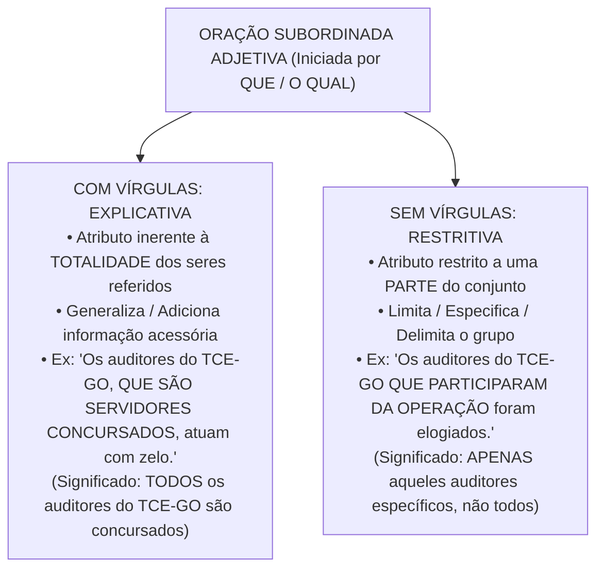
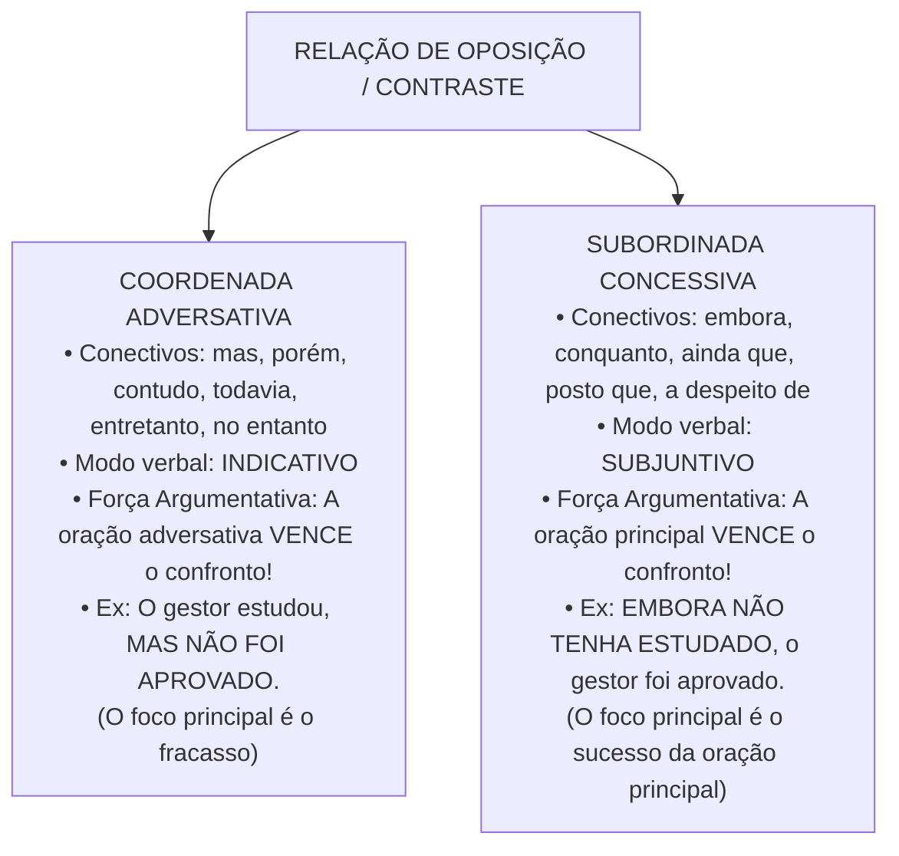

# 04 - Sintaxe do Período, Conectivos e Pontuação

> **Matéria:** Língua Portuguesa  
> **Cargos:** A01 – Técnico de Controle Externo (Adm) / B02 – Técnico de Controle Externo (TI)  
> **Arquivo:** `04_sintaxe_coordenacao_subordinacao_conectivos_pontuacao.md`  
> **Referência Temática:** Período Composto, Relações Lógicas Interoracionais, Valores de Conectivos e Pontuação na Banca FCC

---

## 📌 Ementa / Itens do Edital
- Coordenação e subordinação: processos sintáticos de articulação oracional no período composto;
- Conectivos coordenativos: conjunções aditivas, adversativas, alternativas, conclusivas e explicativas;
- Conectivos subordinativos: conjunções integrantes, causais, consecutivas, condicionais, concessivas, conformativas, comparativas, finais, proporcionais e temporais;
- Distinção semântica e modal entre orações adversativas (modo indicativo) e concessivas (modo subjuntivo);
- O trio clássico da FCC: *Porquanto* (causal), *Portanto* (conclusivo) e *Conquanto* (concessivo);
- Orações subordinadas substantivas (método de substituição pelo pronome *ISSO*);
- Orações subordinadas adjetivas explicativas (com vírgulas) vs. restritivas (sem vírgulas) e alteração de sentido pela pontuação;
- Emprego dos sinais de pontuação (vírgula, ponto e vírgula, dois-pontos, travessão e parênteses);
- Proibições sintáticas absolutas do emprego da vírgula (quebra da ordem direta Sujeito - Verbo - Complemento);
- Adjuntos adverbiais e orações adverbiais deslocadas ou intercaladas.

---

## 🧭 Sumário

1. [Fundamentos do Período Composto: Coordenação e Subordinação](#1-fundamentos-do-periodo-composto-coordenacao-e-subordinacao)
    1. [Conceito de Período Composto e Mecanismos de Junção Oracional](#11-conceito-de-periodo-composto-e-mecanismos-de-juncao-oracional)
    2. [Processo de Coordenação e Autonomia Sintática](#12-processo-de-coordenacao-e-autonomia-sintatica)
    3. [Processo de Subordinação e Encaixamento Hierárquico](#13-processo-de-subordinacao-e-encaixamento-hierarquico)
    4. [Teste 032](#Teste-032)
2. [Orações Coordenadas e Conectivos Coordenativos](#2-oracoes-coordenadas-e-conectivos-coordenativos)
    1. [Coordenadas Assindéticas e Sindéticas](#21-coordenadas-assindeticas-e-sindeticas)
    2. [Valores Semânticos das Conjunções Coordenativas](#22-valores-semanticos-das-conjuncoes-coordenativas)
    3. [Posição e Valores Polissêmicos da Conjunção Pois](#23-posicao-e-valores-polissemicos-da-conjuncao-pois)
    4. [Teste 033](#Teste-033)
3. [Orações Subordinadas Substantivas e Adjetivas](#3-oracoes-subordinadas-substantivas-e-adjetivas)
    1. [Orações Substantivas e o Método do Pronome ISSO](#31-oracoes-substantivas-e-o-metodo-do-pronome-isso)
    2. [Classificação Sintática das Orações Subordinadas Substantivas](#32-classificacao-sintatica-das-oracoes-subordinadas-substantivas)
    3. [Orações Subordinadas Adjetivas: Explicativas vs. Restritivas](#33-oracoes-subordinadas-adjetivas-explicativas-vs-restritivas)
    4. [Teste 034](#Teste-034)
    5. [Teste 035](#Teste-035)
4. [Orações Subordinadas Adverbiais e Conectivos Críticos](#4-oracoes-subordinadas-adverbiais-e-conectivos-criticos)
    1. [Quadro Completo das Conjunções Subordinativas Adverbiais](#41-quadro-completo-das-conjuncoes-subordinativas-adverbiais)
    2. [Adversativas vs. Concessivas: Conflito Sintático, Semântico e Modal](#42-adversativas-vs-concessivas-conflito-sintatico-semantico-e-modal)
    3. [O Trio Crítico da FCC: Porquanto, Portanto e Conquanto](#43-o-trio-critico-da-fcc-porquanto-portanto-e-conquanto)
    4. [A Polissemia do Conectivo Como](#44-a-polissemia-do-conectivo-como)
    5. [Teste 036](#Teste-036)
    6. [Teste 037](#Teste-037)
    7. [Teste 038](#Teste-038)
5. [Sintaxe da Pontuação e Efeitos Semânticos](#5-sintaxe-da-pontuacao-e-efeitos-semanticos)
    1. [A Proibição Inegociável da Quebra SVC](#51-a-proibicao-inegociavel-da-quebra-svc)
    2. [Regras do Uso da Vírgula no Período Simples](#52-regras-do-uso-da-virgula-no-periodo-simples)
    3. [Regras do Uso da Vírgula no Período Composto](#53-regras-do-uso-da-virgula-no-periodo-composto)
    4. [Emprego de Ponto e Vírgula, Dois-Pontos, Travessões e Parênteses](#54-emprego-de-ponto-e-virgula-dois-pontos-travessoes-e-parenteses)
    5. [Alterações de Sentido Provocadas pela Supressão ou Deslocamento de Pontuação](#55-alteracoes-de-sentido-provocadas-pela-supressao-ou-deslocamento-de-pontuacao)
    6. [Teste 039](#Teste-039)
    7. [Teste 040](#Teste-040)
    8. [Teste 041](#Teste-041)
6. [🌐 Fontes Oficiais e Referências Bibliográficas](#fontes-oficiais-e-referencias-bibliograficas)

---

## 1. Fundamentos do Período Composto: Coordenação e Subordinação

O período composto é aquele constituído por duas ou mais orações que se articulam para veicular um pensamento complexo. No texto formal, técnico e legislativo, o encadeamento das proposições obedece a dois processos estruturais básicos: a coordenação e a subordinação.

### 1.1 Conceito de Período Composto e Mecanismos de Junção Oracional

O reconhecimento do número de orações em um período faz-se pela identificação da quantidade de verbos ou locuções verbais presentes. A ligação entre essas orações processa-se ou por meio de conectivos expressos (conjunções coordenativas ou subordinativas, locuções conjuntivas e pronomes relativos) ou por simples justaposição assindética mediada por sinais de pontuação (vírgulas, ponto e vírgula ou dois-pontos).

### 1.2 Processo de Coordenação e Autonomia Sintática

Na coordenação, as orações encontram-se dispostas lado a lado no período sem que nenhuma delas exerça função sintática imediata em relação à outra. Cada oração coordenada possui estrutura interna própria (sujeito, predicado e complementos), mantendo equivalência hierárquica e autonomia gramatical:

* *"O auditor elaborou o relatório [1ª oração coordenada] e o conselheiro assinou o voto [2ª oração coordenada]."*

Embora sintaticamente autônomas, as orações coordenadas articulam-se logicamente no plano do discurso, expressando relações semânticas de soma, oposição, alternância, conclusão ou justificativa.

### 1.3 Processo de Subordinação e Encaixamento Hierárquico

Na subordinação, verifica-se uma relação de dependência hierárquica e encaixamento funcional: a oração subordinada desempenha uma função sintática essencial, integrante ou acessória em benefício da oração principal (atuando como se fosse um substantivo, um adjetivo ou um advérbio desta).

* *"O tribunal determinou [oração principal] <ins>que o contrato fosse suspenso</ins> [oração subordinada substantiva com função de objeto direto da principal]."*

Se a oração subordinada for retirada, a oração principal torna-se sintaticamente mutilada ou incompleta (no exemplo, o verbo *determinou* ficaria desprovido de seu complemento direto).

---

### Teste 032
**(FGV – TRT – Analista Judiciário (TI) – 2024)**  
Observe o pequeno texto narrativo a seguir: Passeava despreocupadamente pelas ruas do meu bairro e passei diante de uma loja da loteria esportiva e me lembrei de que havia um alto prêmio acumulado. Fiquei tentado em jogar, mas não podia gastar aquele dinheiro no momento e desisti. Um pouco mais adiante, porém, arrependi-me e voltei para a loja. Sobre a estruturação desse texto narrativo, assinale a afirmação inadequada.

* **A)** Há uma situação inicial que mostra o passeio despreocupado do narrador.
* **B)** Ocorre um fato motivador de uma modificação na situação inicial, que é o fato de passar pela loja de loteria e lembrar -se do prêmio acumulado.
* **C)** Há uma discussão interior do personagem que corresponde à trama narrativa e a um problema a ser resolvido.
* **D)** Desistir de jogar corresponde a uma solução temporária do conflito interior do narrador.
* **E)** Arrepender-se equivale ao final da narrativa, em que o conflito do texto é resolvido.

---

> **Comentário Detalhado:**
>
> - **A)** Incorreta. A coordenação aditiva foi empregada em sucessão temporal, sem valor adversativo.
> - **B)** Incorreta. A repetição do conectivo 'e' (polissíndeto) não caracteriza oração subordinada causal.
> - **C)** Incorreta. Não ocorre quebra de coesão referencial na cadeia de ações narradas.
> - **D)** Incorreta. A estrutura expressa fatos cronológicos sucessivos, e não ações simultâneas.
> - **E)** Correta. No texto narrativo apresentado, as orações coordenadas sindéticas aditivas encadeiam ações sucessivas no tempo, produzindo a dinâmica e a progressão temporal típica da tipologia narrativa.
>
> **Gabarito: E**

---

## 2. Orações Coordenadas e Conectivos Coordenativos

As orações coordenadas dividem-se em dois grandes grupos: assindéticas (desprovidas de conectivo) e sindéticas (introduzidas por conjunção coordenativa).

### 2.1 Coordenadas Assindéticas e Sindéticas

* **Coordenadas Assindéticas:** São orações justapostas, separadas por vírgula ou ponto e vírgula, sem qualquer conjunção expressa: *"Chegou ao tribunal, conferiu a pauta, dirigiu-se ao plenário"*.
* **Coordenadas Sindéticas:** Vêm encabeçadas por uma conjunção coordenativa que explicita o vínculo lógico estabelecido com a oração precedente. Classificam-se conforme o valor semântico desse conectivo.

### 2.2 Valores Semânticos das Conjunções Coordenativas

A gramática normativa e os exames da Fundação Carlos Chagas reconhecem cinco modalidades de orações coordenadas sindéticas:

1. **Aditivas:** Expressam ideia de soma, acréscimo ou adição de pensamentos:
    * Conectivos: *e, nem* (= e não), *não só.. mas também, não só.. como também, bem como, tanto.. quanto*.
    * Exemplo: *"A fiscalização não apenas apontou o sobrepreço, como também recomendou a aplicação de multa."*

2. **Adversativas:** Indicam oposição, contraste, compensação ou quebra de expectativa entre proposições:
    * Conectivos: *mas, porém, contudo, todavia, entretanto, no entanto, não obstante* (quando seguido de indicativo).
    * Exemplo: *"O gestor apresentou os balancetes, porém não comprovou a liquidação das despesas."*

3. **Alternativas:** Exprimem ideia de escolha, exclusão mútua ou alternância de situações:
    * Conectivos: *ou, ou.. ou, ora.. ora, quer.. quer, seja.. seja, já.. já*.
    * Exemplo: *"Ou o município regulariza o portal da transparência, ou sofrerá sanções administrativas."*

4. **Conclusivas:** Expressam dedução lógica, resultado ou consequência direta da proposição anterior:
    * Conectivos: *logo, portanto, por conseguinte, por isso, assim, de modo que, pois* (posposto ao verbo e isolado entre vírgulas).
    * Exemplo: *"As despesas com pessoal ultrapassaram os limites da LRF; portanto, fica vedada a contratação de novos servidores."*

5. **Explicativas:** Apresentam a razão, justificativa ou motivo do enunciado ou comando anterior:
    * Conectivos: *que, porque, porquanto, pois* (anteposto ao verbo).
    * Exemplo: *"Revisem as planilhas de cálculo, porque a sessão de julgamento terá início em instantes."*

### 2.3 Posição e Valores Polissêmicos da Conjunção Pois

A conjunção *pois* assume comportamentos sintáticos diametralmente opostos em razão estrita da sua posição física na oração coordenada:

* **Pois Explicativo (Anteposto ao Verbo):** Posiciona-se no início da oração coordenada, antes do verbo conjugado, assumindo valor explicativo ou causal (= *porque, porquanto, já que*):
    * *"Não atrase a entrega dos autos, **pois** os prazos regimentais são preclusivos."*
* **Pois Conclusivo (Posposto ao Verbo e entre Vírgulas):** Surge deslocado para o interior da oração coordenada, posposto ao verbo conjugado e compulsoriamente isolado por vírgulas, assumindo valor estritamente conclusivo (= *portanto, por conseguinte, logo*):
    * *"As provas da materialidade da fraude eram robustas; o pleno julgou, **pois**, pela irregularidade das contas."*

> 📌 **NOTA EXPLICATIVA / IDENTIFICAÇÃO DO POIS CONCLUSIVO:** Se a questão da FCC sublinhar o vocábulo *pois* e ele estiver posicionado após o verbo e cercado de vírgulas (*"aprovou, pois, as contas"*), a sua equivalência semântica é **conclusiva** e o conectivo substituto cabível é **portanto** ou **por conseguinte**. Nunca o classifique como explicativo nessa posição.

---

### Teste 033
**(FCC – TRT-13 – Analista Judiciário (TI) – 2014)**  
Considerando-se o contexto, a palavra que no segmento

* **A)** ... que remonta aos autos medievais... (5o parágrafo) é um pronome com a função de objeto indireto.
* **B)** As atividades que o grupo desenvolveu... (2o pará- grafo) é uma conjunção que equivale a “conforme”.
* **C)** ... temas e formas de expressão artística que mais tarde viriam a influenciar... (1o parágrafo) é uma con- junção que introduz o predicativo do sujeito.
* **D)** ... mais diretamente a inúmeros autores populares que se dedicaram ao gênero do cordel. (5 o pará- grafo) é um pronome com a função de sujeito.
* **E)** ... e costuma dizer que boa parte da obra de Shakespeare... (6o parágrafo) é um pronome que in- troduz um objeto direto. _________________________________________________________ Atenção: Para responder às questões de números 9 e 10, considere o poema abaixo. Foi bem saber-se que o Sertão não só fala a língua do não (...) Os escritores que do Brejo, ou que da Mata, têm o sestro de só dar a vê-lo no pouco, no quando em que o vê, sertão-osso. Para o litoral, o esqueleto é o ser, o estilo sertanejo, que pode dar uma estrutura ao discurso que se discursa. Tu, que conviveste o Sertão quando no sim esquece o não, e sabes seu viver ambíguo, vestido de sola e de mitos, a quem só o vê retirante, vazio do que nele é cante, nos deste a ver que nele o homem não é só capaz de sede e fome. Sertanejo, nos explicaste como gente à beira do quase, que habita caatingas sem mel, cria os romances de cordel: o espaço mágico e o feérico, sem o imediato e o famélico, fantástico espaço suassuna, que ensina que o deserto funda (Trecho de: A pedra do reino . NETO, João Cabral de Melo)

---

> **Comentário Detalhado:**
>
> - **A)** Incorreta. O termo 'que' não funciona como pronome relativo nessa oração, pois não retoma antecedente substantivo.
> - **B)** Incorreta. Não atua como pronome indefinido interrogativo.
> - **C)** Incorreta. Não desempenha papel de advérbio de intensidade.
> - **D)** Incorreta. Não funciona como partícula de realce ou expletiva dispensável.
> - **E)** Correta. O vocábulo 'que' atua como conjunção integrante, introduzindo uma oração subordinada substantiva que completa o sentido do verbo da oração principal (função de objeto direto ou sujeito oracional).
>
> **Gabarito: E**

---

## 3. Orações Subordinadas Substantivas e Adjetivas

As orações subordinadas dividem-se em substantivas, adjetivas e adverbiais, dependendo do valor gramatical que exercem em relação à oração principal.

### 3.1 Orações Substantivas e o Método do Pronome ISSO

As orações subordinadas substantivas exercem papéis privativos de substantivos em relação à oração principal. São introduzidas quase invariavelmente pelas **conjunções integrantes "QUE" ou "SE"** (que não exercem função sintática própria, sendo meros conectivos de ligação).

> 💡 **DICA DO "ISSO" PARA ORAÇÕES SUBSTANTIVAS:** Para comprovar que uma oração é subordinada substantiva e que a palavra *que* ou *se* atua como conjunção integrante, substitua mentalmente toda a oração a partir do conectivo pelo pronome demonstrativo neutro **"ISSO"** (ou *a isso, de isso/disso, com isso*):
>
> * *"O presidente declarou [que a sessão estava suspensa]"* $\rightarrow$ *"O presidente declarou [ISSO]"* (Oração Substantiva Objetiva Direta).
> * *"É necessário [que se apresentem os documentos]"* $\rightarrow$ *"É necessário [ISSO]"* $\rightarrow$ *"ISSO é necessário"* (Oração Substantiva Subjetiva).

### 3.2 Classificação Sintática das Orações Subordinadas Substantivas

Identificada a oração substantiva pelo teste do *ISSO*, classifica-se a sua função sintática analisando o papel do pronome *ISSO* em relação à oração principal:

1. **Subjetiva:** Exerce a função de sujeito da oração principal. Ocorre quando a oração principal possui verbo de ligação + predicativo (*"É evidente que o prazo expirou"* $\rightarrow$ *ISSO é evidente*), verbo na voz passiva analítica ou sintética (*"Sabe-se que haverá concurso"*) ou verbos unipessoais (*convém, cumpre, importa, parece, urge*): *"Convém que todos estudem"*.
2. **Objetiva Direta:** Atua como objeto direto de verbo transitivo direto da oração principal (*"O relator constatou que havia sobrepreço"* $\rightarrow$ *constatou ISSO*).
3. **Objetiva Indireta:** Atua como objeto indireto, sendo precedida de preposição exigida por verbo transitivo indireto (*"O conselheiro insistiu em que se realizasse a perícia"* $\rightarrow$ *insistiu NISSO*).
4. **Completiva Nominal:** Atua como complemento nominal, integrando o sentido de um substantivo abstrato, adjetivo ou advérbio da principal (*"Tínhamos a certeza de que a fiscalização seria rigorosa"* $\rightarrow$ *certeza DISSO*).
5. **Predicativa:** Exerce a função de predicativo do sujeito após verbo de ligação (*"Nosso objetivo é que a administração pública seja eficiente"* $\rightarrow$ *o objetivo é ISSO*).
6. **Apositiva:** Exerce o papel de aposto explicativo, esclarecendo um termo antecedente, comumente posposta a dois-pontos (*"Desejo apenas uma coisa: que a verdade prevaleça"*).

### 3.3 Orações Subordinadas Adjetivas: Explicativas vs. Restritivas

As orações subordinadas adjetivas desempenham papel equivalente ao de um adjetivo (adjunto adnominal) em relação a um substantivo antecedente, sendo invariavelmente introduzidas por um **pronome relativo** (*que, quem, cujo, o qual, onde*).

#### Distinção Semântica e Sintática Crucial:
* **Adjetiva Explicativa (com vírgulas):** Vem isolada por vírgulas (ou travessões/parênteses). Atribui uma qualidade própria que abrange a **totalidade** dos elementos do termo antecedente. Não delimita o grupo, operando de forma generalizadora.
    * *"Os cidadãos brasileiros, que têm direito ao voto, participam das eleições."* (Significado: todos os cidadãos brasileiros têm direito ao voto).
* **Adjetiva Restritiva (sem vírgulas):** É grafada sem vírgulas. Restringe, individualiza e delimita o sentido do substantivo antecedente a um **subconjunto restrito**, excluindo os demais membros da classe.
    * *"Os cidadãos brasileiros que têm mais de setenta anos possuem voto facultativo."* (Significado: apenas aquela parcela que tem mais de 70 anos, e não a totalidade dos brasileiros).

> 🚨 **ALERTA DE PROVA / SUPRESSÃO DE VÍRGULAS EM ORAÇÃO ADJETIVA:** A FCC explora intensamente assertivas que indagam: *"A retirada das vírgulas da oração adjetiva mantém a correção gramatical e o sentido original do período?"*. Resposta técnica obrigatória: a retirada das vírgulas **mantém a correção gramatical**, mas **SEMPRE ALTERA O SENTIDO DO TEXTO**, transformando uma explicação genérica sobre a totalidade em uma restrição delimitadora sobre uma fração.

---

### Teste 034
**(FCC – TRT-24 – Analista Judiciário (TI) – 2017)**  
Percebe-se uma relação de causa e efeito, nessa ordem, entre as orações na seguinte passagem do texto:

* **A)** Reconheço que, talvez antiquadamente, ainda sinto desconforto em ver casais e famílias à mesa, nos salões, cada qual com seu smartphone, sem diálogos presenciais ou interações reais. (4o parágrafo)
* **B)** Contudo, presumo que algumas coisas não precisam deixar de pertencer à esfera privada. (2o parágrafo)
* **C)** Na civilização contemporânea, on-line, conectada o tempo todo, se não for registrado e postado, não aconteceu. (1o parágrafo)
* **D)** Sendo tudo tão novo nessa área, ainda engatinhamos a respeito de uma etiqueta que equilibre a convivência entre câmeras, pratos, extroversão, intimidade. (2o parágrafo)
* **E)** Houve um tempo em que eu comia um monte de coisas e não precisava contar nada para ninguém. (1o parágrafo) Caderno de Prova ’H08’, Tipo 004 TRT24-Conhecimentos Gerais3 3

---

> **Comentário Detalhado:**
>
> - **A)** Incorreta. A relação entre as orações é de concessão/oposição, e não de causa e efeito.
> - **B)** Correta. A primeira oração apresenta o fato motivador (a causa eficiente), e a segunda oração expressa o resultado concreto decorrente (o efeito ou consequência direta), obedecendo rigorosamente à ordem lógica de causa e efeito.
> - **C)** Incorreta. As orações apresentam relação de conformidade e complementação informativa.
> - **D)** Incorreta. Estabelece relação de finalidade (objetivo visado), e não de causa preexistente.
> - **E)** Incorreta. Apresenta relação de temporalidade simultânea, sem nexo causal estrito.
>
> **Gabarito: B**

---

### Teste 035
**(FGV – TRT – Analista Judiciário (TI) – 2024)**  
Assinale a oração adversativa que estabelece entre os segmentos indicados uma relação de real oposição.

* **A)** A palavra é dom de todos, mas a sabedoria cabe a poucos.
* **B)** Há muito o que saber, mas pouco que viver.
* **C)** O que os homens realmente querem não é conhecimento, mas certezas.
* **D)** Esteja pronto para escutar, mas lento para dar a resposta.
* **E)** Mestre não é quem sempre ensina, mas quem de repente aprende.

---

> **Comentário Detalhado:**
>
> - **A)** Incorreta. O conectivo 'mas' funciona com valor meramente aditivo ou de retificação fraca, sem oposição conceitual real.
> - **B)** Incorreta. A oração introduzida por 'porém' estabelece compensação ou ressalva sem quebra da ideia central.
> - **C)** Incorreta. A relação semântica é de contraste aparente que apenas delimita o escopo da afirmação.
> - **D)** Incorreta. O conectivo opera atenuação discursiva sem antítese real.
> - **E)** Correta. A oração coordenada adversativa estabelece um confronto de ideias direto e antitético com a oração precedente, configurando uma relação de oposição real e incontestável entre os termos confrontados.
>
> **Gabarito: E**

---

## 4. Orações Subordinadas Adverbiais e Conectivos Críticos

As orações subordinadas adverbiais exercem a função de adjunto adverbial da oração principal, explicitando as circunstâncias temporais, lógicas e modais sob as quais se consuma o processo verbal.

### 4.1 Quadro Completo das Conjunções Subordinativas Adverbiais

A gramática normativa classifica as orações subordinadas adverbiais em nove categorias semânticas:

| Categoria | Ideia Central | Conjunções e Locuções Principais | Exemplo de Aplicação |
| :--- | :--- | :--- | :--- |
| **Causal** | Motivo, razão ou causa da oração principal | *porque, visto que, já que, uma vez que, como* (no início), *porquanto, dado que* | *"Como chovia torrencialmente, o fiscal adiou a vistoria."* |
| **Consecutiva** | Consequência, resultado ou efeito decorrente | *tal.. que, tanto.. que, tão.. que, tamanho.. que, de forma que, de modo que* | *"A fraude foi tamanha que chocou os auditores."* |
| **Condicional** | Condição indispensável ou hipótese | *se, caso, contanto que, desde que, a não ser que, a menos que* | *"Caso o plenário autorize, iniciaremos a inspeção."* |
| **Concessiva** | Fato que se opõe à principal sem impedi-la | *embora, conquanto, ainda que, mesmo que, a despeito de, posto que, se bem que* | *"Conquanto houvesse pressão, o relator manteve o voto."* |
| **Conformativa** | Conformidade, acordo ou modelo seguido | *conforme, consoante, segundo, como* (= conforme) | *"O edital foi publicado, como prescreve a lei."* |
| **Comparativa** | Confronto analógico entre dois elementos | *como, assim como, tal qual, mais.. do que, menos.. do que* | *"O técnico procedeu com rigor como um perito criminal."* |
| **Final** | Objetivo, desígnio ou finalidade | *a fim de que, para que, com o fito de, com o intuito de* | *"O tribunal aprovou novas resoluções para que haja transparência."* |
| **Proporcional** | Proporcionalidade ou simultaneidade progressiva | *à medida que, à proporção que, ao passo que, quanto mais.. mais* | *"À medida que os autos avançavam, surgiam novas provas."* |
| **Temporal** | Momento cronológico em que ocorre a ação | *quando, enquanto, logo que, assim que, desde que, todas as vezes que* | *"Assim que a sessão terminou, a ata foi lavrada."* |

### 4.2 Adversativas vs. Concessivas: Conflito Sintático, Semântico e Modal

A oposição de ideias pode ser expressa por meio de coordenadas adversativas ou subordinadas concessivas. Embora ambas expressem contraste, seu funcionamento linguístico é radicalmente diverso:

#### Distinções Gramaticais Determinantes:
1. **Regência do Modo Verbal:**
    * A oração coordenada adversativa rege o verbo no **modo indicativo** (*"Ele agiu, contudo **errou**"*).
    * A oração subordinada concessiva rege compulsoriamente o verbo no **modo subjuntivo** (*"Embora ele **tenha agido**, não alcançou êxito"*).

2. **Hierarquia Argumentativa (Peso Discursivo):**
    * Na oração coordenada adversativa, o argumento mais forte, que orienta a conclusão final do autor, situa-se **dentro da própria oração adversativa** (*"O projeto é dispendioso, mas trará enormes benefícios à coletividade"* $\rightarrow$ prevalece a ideia de aprovação do projeto).
    * Na oração subordinada concessiva, a oração concessiva traz um argumento fraco que é superado pela oração principal; logo, o argumento determinante repousa **na oração principal** (*"Embora o projeto seja dispendioso, trará benefícios"* $\rightarrow$ a força do benefício prevalece sobre o custo).

> ⭐ **IMPORTANTE / SUBSTITUIÇÃO ADVERSATIVA POR CONCESSIVA:** Ao trocar uma conjunção adversativa (*mas, contudo, porém*) por uma concessiva (*embora, conquanto*), a gramática exige duas alterações simultâneas: 1) inversão da oração principal com a subordinada ou realocação do conectivo; 2) **mudança obrigatória do modo verbal do indicativo para o subjuntivo**.

### 4.3 O Trio Crítico da FCC: Porquanto, Portanto e Conquanto

Poucas pegadinhas são tão reiteradas pela Fundação Carlos Chagas quanto a semelhança gráfica entre os conectivos do trio:

* **PORQUANTO (Causal / Explicativo):** Equivale a *porque*, *já que*, *visto que*, *dado que*. Introduz a causa do fato ou a justificativa de uma ordem.
    * *"O TCE-GO rejeitou as contas, **porquanto** restou comprovado o superfaturamento."*
* **PORTANTO (Conclusivo):** Equivale a *logo*, *por conseguinte*, *assim*, *dessa forma*. Introduz a consequência lógica ou o arremate dedutivo.
    * *"Os autos comprovam a boa-fé do gestor; **portanto**, o processo deve ser arquivado."*
* **CONQUANTO (Concessivo):** Equivale a *embora*, *ainda que*, *a despeito de que*, *posto que*. Introduz uma ressalva concessiva que não anula a oração principal e **rege o modo subjuntivo**.
    * *"**Conquanto** houvesse fortes pressões políticas, o conselheiro proferiu voto técnico."*

### 4.4 A Polissemia do Conectivo Como

O conectivo *como* assume múltiplos papéis dependendo da sua posição na frase e da intenção discursiva:

1. **Como Causal:** Ocorre tipicamente anteposto ao período (no início da frase), equivalendo a *já que, visto que, dado que*: *"**Como** o prazo de apresentação de defesa havia expirado na véspera, o gestor foi declarado revel"*.
2. **Como Conformativo:** Equivale a *conforme, segundo, consoante*, indicando adequação a uma norma ou modelo: *"O concurso público realizou-se, **como** determina a Constituição Estadual"*.
3. **Como Comparativo:** Estabelece confronto de semelhança analógica (= *tal qual, assim como*): *"O fiscal examinou as planilhas **como** um analista forense minucioso"*.
4. **Como Aditivo (Correlativo):** Integra a estrutura aditiva correlata *não só.. como também*: *"O parecer apontou **não só** desídia administrativa, **como também** dano patrimonial"*.

---

### Teste 036
**(FCC – TRT-1 – Analista Judiciário (TI) – 2014)**  
Estes dois segmentos constitu em respectivamente, no con- texto dado, a expressão de uma causa e de seu efeito:

* **A)** interpretação dramática / despojamento das letras das canções (3o parágrafo)
* **B)** assimilando traços da linguagem popular / submetida ao rigor estético da literatura erudita (2o parágrafo)
* **C)** rejeitando a música passional / inspirava-se no jazz (3o parágrafo)
* **D)** Organizava-se, assim, a cultura engajada de esquer- da / Cinema Novo e canção engajada (4o parágrafo)
* **E)** a primeira metade da década de 1960 / luta pelas Reformas de Base (4o parágrafo) _________________________________________________________

---

> **Comentário Detalhado:**
>
> - **A)** Correta. O primeiro segmento enuncia o fator deflagrador no contexto (a causa), e o segundo segmento expressa a repercussão ou consequência necessária que dele adveio (o efeito), mantendo exata pertinência textual com a progressão das ideias do autor.
> - **B)** Incorreta. Os papéis estão invertidos: o primeiro segmento expressa a consequência e o segundo indica a causa.
> - **C)** Incorreta. Os segmentos articulam uma concessão seguida de afirmação categórica, e não nexo causal.
> - **D)** Incorreta. A relação no contexto é de comparação e analogia entre dois fatos distintos.
> - **E)** Incorreta. Trata-se de orações justapostas com sentido aditivo cumulativo.
>
> **Gabarito: A**

---

### Teste 037
**(FCC – TRT-4 – Analista Judiciário (TI) – 2015)**  
A frase em que o segmento destacado expressa uma circunstância restritiva é:

* **A)** (linha 2) Nesse sentido, é muito óbvio que ela não seja realística. [...]
* **B)** (linha 3) Além disso, é quase sempre bastante cara de se encenar e de se assistir.
* **C)** (linha 4) Em nenhum momento da história a sociedade, como um todo, conseguiu sustentar facilmente os custos exorbitantes da ópera.
* **D)** (linha 10) Essas perguntas são mais sobre a ópera tal como ela é hoje em dia [...]
* **E)** (linha 13) Nosso objetivo é lidar com uma forma de arte cujas obras mais populares e duradouras foram quase sempre escritas num distante passado europeu. Caderno de Prova ’AT’, Tipo 001 TRT4R-Conhecimentos Básicos2 3

---

> **Comentário Detalhado:**
>
> - **A)** Incorreta. O segmento funciona como oração adjetiva explicativa (delimitada por vírgulas), referindo-se à totalidade dos elementos.
> - **B)** Incorreta. O termo destacado desempenha função adverbial circunstancial de modo, e não restrição atributiva.
> - **C)** Incorreta. O segmento é um aposto explicativo genérico que expande o termo antecedente sem restringir sua extensão.
> - **D)** Correta. O segmento destacado funciona como uma oração subordinada adjetiva restritiva (sem vírgulas), limitando o sentido do substantivo antecedente a um subgrupo específico e indispensável à identificação do referente.
> - **E)** Incorreta. Trata-se de locução adjetiva de posse sem valor de restrição conceitual.
>
> **Gabarito: D**

---

### Teste 038
**(FGV – TRT – Analista Judiciário (TI) – 2024)**  
Leia a frase abaixo com atenção: Ninguém fica velho apenas por viver, mas por perder o interesse em viver. Assinale a afirmativa correta o significado ou a estruturação dessa frase.

* **A)** A relação entre os segmentos da frase não é de oposição, mas de diferença.
* **B)** O adjetivo “velho”, no contexto da frase, tem alto valor pejorativo.
* **C)** O segundo segmento da frase retifica algo dito erradamente no primeiro segmento.
* **D)** O termo “fica velho” pode ser adequadamente substituído por “envelheceu”.
* **E)** O emprego de “apenas” mostra uma visão negativa do ato de viver. Matemática Financeira, Estatística e Raciocínio Lógico

---

> **Comentário Detalhado:**
>
> - **A)** Correta. A análise demonstra com exatidão a estrutura sintática e o sentido da frase: o termo 'mas' atua em oposição corretiva ('não por X, mas por Y'), indicando a verdadeira causa que leva ao envelhecimento na visão do autor, desmistificando a causa aparente ('apenas por viver').
> - **B)** Incorreta. A alternativa atribui valor aditivo à conjunção adversativa, falseando a intenção discursiva do autor.
> - **C)** Incorreta. A frase não expressa tempo sucessivo, mas a causalidade interna do envelhecimento.
> - **D)** Incorreta. A análise nega indevidamente o valor de contraposição presente na construção correlativa.
> - **E)** Incorreta. O autor não considera ambos os fatores como causas equivalentes; ao contrário, ele rejeita o primeiro como causa determinante.
>
> **Gabarito: A**

---

## 5. Sintaxe da Pontuação e Efeitos Semânticos

A pontuação não se destina a marcar pausas de respiração na leitura oral, mas a tornar visível a arquitetura sintática do período, demarcando unidades funcionais e impedindo ambiguidades.

### 5.1 A Proibição Inegociável da Quebra SVC

A regra número um da sintaxe de pontuação na língua culta proíbe o emprego de **uma vírgula simples** que separe os elementos constitutivos da ordem direta da oração:
$$\text{Sujeito} \not\longleftrightarrow [\text{Vírgula Proibida}] \not\longleftrightarrow \text{Verbo} \not\longleftrightarrow [\text{Vírgula Proibida}] \not\longleftrightarrow \text{Complementos (OD/OI)}$$

* É proibido separar por vírgula o Sujeito do seu Verbo (*"O conselheiro presidente da corte de contas [X], abriu a sessão extraordinária"* $\rightarrow$ **ERRO**).
* É proibido separar por vírgula o Verbo dos seus Complementos Diretos ou Indiretos (*"O auditor apurou [X], as irregularidades fiscais"* $\rightarrow$ **ERRO**; *"O presidente votou [X], pela procedência do pedido"* $\rightarrow$ **ERRO**).
* É proibido separar por vírgula o Nome do seu Complemento Nominal ou Adjunto Adnominal.

> 🚨 **ALERTA DE PROVA / TERMOS INTERCALADOS ENTRE SUJEITO E VERBO:** É lícito inserir termos entre o sujeito e o verbo, desde que esses termos estejam rigorosamente isolados por **DUAS VÍRGULAS** (ou dois travessões/parênteses):
>
> - Incorreto (apenas uma vírgula): *"O pleno do tribunal, após examinar os laudos votou pela anulação"* $\rightarrow$ Erro!
> - Incorreto (apenas uma vírgula): *"O pleno do tribunal após examinar os laudos, votou pela anulação"* $\rightarrow$ Erro!
> - **Correto (duas vírgulas):** *"O pleno do tribunal**, após examinar os laudos,** votou pela anulação."*

### 5.2 Regras do Uso da Vírgula no Período Simples

No interior da oração simples, a vírgula é de emprego compulsório nas seguintes situações:

1. **Separação de termos de mesma função sintática em enumeração:** *"O tribunal adquiriu computadores, servidores, licenças de software e impressoras."*
2. **Isolamento de Vocativo:** O vocativo deve vir sempre isolado por vírgula(s), em qualquer posição que ocupe: *"Senhor Conselheiro, apresento o recurso"*; *"Apresento, Senhor Conselheiro, o recurso"*.
3. **Isolamento de Aposto Explicativo:** *"Goiânia, capital do Estado de Goiás, sediou a conferência internacional de tribunais."*
4. **Isolamento de Adjunto Adverbial Deslocado:**
    * Se for de **longa extensão** (três ou mais palavras): o uso da vírgula é **obrigatório** (*"No primeiro semestre do exercício financeiro de 2026, concluíram-se as auditorias"*).
    * Se for de **curta extensão** (uma ou duas palavras: *hoje, ontem, aqui, em Goiânia*): o emprego da vírgula é **facultativo** (*"Ontem, o relator julgou"* ou *"Ontem o relator julgou"*).

5. **Expressões explicativas, retificativas ou continuativas:** *isto é, ou seja, por exemplo, a saber, aliás, digo*: *"O prazo era de dez dias, ou seja, improrrogável"*.

### 5.3 Regras do Uso da Vírgula no Período Composto

No período composto por coordenação e subordinação:

1. **Orações Coordenadas Assindéticas:** São separadas compulsoriamente por vírgula (*"Instruiu o processo, ouviu as testemunhas, redigiu a proposta de voto"*).
2. **Orações Coordenadas Sindéticas:** Usa-se vírgula antes de conjunções adversativas (*mas, porém, contudo*), conclusivas (*portanto, logo*) e explicativas (*porque, que*).
    * **Conjunção "E" com Sujeitos Iguais:** Em regra, não se usa vírgula antes do *e* quando as orações possuem o mesmo sujeito (*"O fiscal viajou e inspecionou as escolas"*).
    * **Conjunção "E" com Sujeitos Distintos:** Quando as orações coordenadas aditivas possuem **sujeitos gramaticais diferentes**, a vírgula antes da conjunção *e* é **plenamente admitida e recomendada** para evitar anfibologia: *"O tribunal acolheu o recurso, e o Ministério Público de Contas concordou com o relator"* (Sujeitos: *o tribunal* / *o MP de Contas*).

3. **Orações Adverbiais Deslocadas:**
    * Se a oração subordinada adverbial vier **anteposta à oração principal** ou **intercalada** nela: a vírgula é **obrigatória** (*"Embora chovesse torrencialmente, o fiscal compareceu à obra"*).
    * Se a oração adverbial vier **posposta à oração principal** (ordem direta): a vírgula é **facultativa** (*"O fiscal compareceu à obra[,] embora chovesse torrencialmente"*).

4. **Orações Subordinadas Adjetivas:** Explicativas vêm sempre isoladas por vírgulas; restritivas não admitem vírgulas.

### 5.4 Emprego de Ponto e Vírgula, Dois-Pontos, Travessões e Parênteses

* **Ponto e Vírgula (;):**
    * Separa orações coordenadas de certa extensão que já contenham vírgulas internas: *"O relatório inicial apontou desvios de combustível; o parecer conclusivo, elaborado pela auditoria de engenharia, recomendou a instauração de tomada de contas especial."*
    * Separa itens enumerados em disposições normativas, editais, relatórios e leis (como alíneas e incisos).
* **Dois-Pontos (:):**
    * Anunciam uma citação textual, uma enumeração explicativa ou uma oração subordinada substantiva apositiva: *"O conselheiro concluiu com a máxima de Rui Barbosa: 'A justiça atrasada não é justiça'."*
* **Travessão Simples ou Duplo (—):**
    * O travessão duplo atua como recurso expressivo para isolar termos intercalados, comentários enfáticos ou orações adjetivas explicativas, substituindo com elegância as vírgulas duplas ou os parênteses (*"O processo de auditoria — cuja complexidade assustava os neófitos — transcorreu dentro da mais estrita normalidade"*).
* **Parênteses ( ):**
    * Isolam notas explicativas acessórias, datas, referências bibliográficas ou reflexões secundárias do autor.

### 5.5 Alterações de Sentido Provocadas pela Supressão ou Deslocamento de Pontuação

A pontuação é ferramenta de arquitetura do sentido discursivo. O deslocamento ou a eliminação de um sinal de pontuação pode transformar completamente o sentido da mensagem:

* *Supressão de vírgulas em orações adjetivas:* Passa de explicativa (generalizadora, afeta todos os indivíduos) para restritiva (limitadora, afeta apenas um grupo).
* *Deslocamento da vírgula antes ou depois da conjunção:* Muda a regência das orações coordenadas.
* *Supressão da vírgula de vocativo:* Transforma o chamamento em sujeito da oração (*"Auditor, assine o documento"* [ordem a um interlocutor] vs. *"Auditor assine o documento"* [frase defeituosa ou ambígua]).

---

### Teste 039
**(FCC – TRT-1 – Analista Judiciário (TI) – 2014)**  
A pontuação está plenamente adequada na seguinte frase:

* **A)** Além da dramaticidade própria de certos gêneros musicais a Bossa Nova repudiava também, a inter- pretação excessivamente exaltada, de alguns can- tores.
* **B)** Assim como João Cabral, Guimarães Rosa também adotou, em seus textos primorosos uma articulação entre elementos da cultura popular, e da cultura clássica ou erudita.
* **C)** Inspirados no jazz, segundo afirmam alguns críticos musicais, Tom Jobim e João Gilberto criaram e di- fundiram, ao longo dos anos 60, o ritmo e as can- ções da então chamada Bossa Nova.
* **D)** Ficam claras no texto, as contribuições que a cultura e a política dão uma à outra, pelas quais, toda mani- festação artística pode também, ser vista como ma- nifestação histórica.
* **E)** Houve um momento, agudo na nossa história, em que por razões políticas, artistas foram levados à criação de obras que se pretendiam engajadas, em determinadas lutas de classe. _________________________________________________________

---

> **Comentário Detalhado:**
>
> - **A)** Incorreta. Há separação indevida entre sujeito e predicado por vírgula simples.
> - **B)** Correta. A frase emprega a pontuação em estrita conformidade com a norma-padrão: as orações intercaladas e os adjuntos adverbiais deslocados estão devidamente isolados por vírgulas duplas, e o verbo mantém conexão direta com seus complementos.
> - **C)** Incorreta. Falta vírgula obrigatória para isolar o adjunto adverbial de grande extensão deslocado para o início do período.
> - **D)** Incorreta. Oração restritiva foi indevidamente isolada por vírgula, transformando restrição em explicação.
> - **E)** Incorreta. Há vírgula espúria entre o verbo transitivo direto e o seu objeto direto.
>
> **Gabarito: B**

---

### Teste 040
**(FCC – TRT-24 – Analista Judiciário (TI) – 2017)**  
A alternativa que apresenta um comentário correto acerca da pontuação de um trecho do texto é:

* **A)** em Esse fato primordial de nosso ser no mundo, em primeiro lugar, como uma condição de escolha moral... (3o parágrafo), as vírgulas destacam uma expressão com valor temporal, imprimindo no texto um tom de memória.
* **B)** em ... uma ideia bastante clara do que envolve “atuar baseado na responsabilidade”. (3o parágrafo), as aspas demarcam uma expressão empregada com teor irônico e que, portanto, relativiza o que foi exposto anteriormente.
* **C)** em ... muito antes de alguma autoridade nos dizer o que é “bem” e “mal” (e por vezes o que não é uma coisa nem outra)... (2o parágrafo), os parênteses intercalam uma expressão que precisa o sentido do vocábulo autoridade.
* **D)** em Somos [...] seres morais: somos confrontados com o desafio do outro, o desafio da responsabilidade pelo outro... (1o parágrafo), os dois-pontos introduzem uma ressalva a uma afirmação de tom categórico.
* **E)** em Somos, por assim dizer, inevitavelmente − existencialmente −, seres morais... (1o parágrafo), os travessões são usados para dar ênfase a uma palavra que expressa circunstância de modo.

---

> **Comentário Detalhado:**
>
> - **A)** Incorreta. A supressão das vírgulas apontada acarretaria erro gramatical por deixar adjunto adverbial deslocado sem isolamento.
> - **B)** Incorreta. A pontuação empregada não tem caráter facultativo na estrutura indicada.
> - **C)** Correta. O comentário assinala com propriedade a justificativa gramatical da pontuação no trecho: as vírgulas isolam termo explicativo intercalado, cuja remoção não compromete a estrutura sintática básica da oração principal.
> - **D)** Incorreta. A inserção de ponto e vírgula no local sugerido quebraria indevidamente a subordinação sintática.
> - **E)** Incorreta. O travessão no excerto não pode ser substituído por dois-pontos sem alteração da relação discursiva.
>
> **Gabarito: C**

---

### Teste 041
**(FCC – TRT-1 – Analista Judiciário (TI) – 2014)**  
É preciso corrigir , por apresentar falha estrutural, a reda- ção da seguinte frase:

* **A)** Ao longo dos anos de 1950 e 1960, verificaram-se, em nosso país, relações muito proveitosas e expres- sivas entre manifestações artísticas e projetos políti- cos.
* **B)** Não há como ignorar o precioso legado artístico que nos deixaram os artistas que, naquelas duas déca- das, se empenharam na renovação da nossa cultura.
* **C)** Há quem conteste a influência que a Bossa Nova su- postamente teria recebido do jazz ; seja como for, é incontestável o valor das canções de um Tom Jobim.
* **D)** As ideologias políticas tomaram uma feição radical ao longo dos anos 60; isso transparece quando se examinam as letras das canções de protesto.
* **E)** Em virtude de fortes interesses políticos, muito em- bora nem sempre ocorressem, já que na década de 60 as canções de protesto se disseminaram. _________________________________________________________ Atenção: As questões de números 16 a 20 referem-se ao texto seguinte. Novas fronteiras do mundo globalizado Apesar do desenvolvimento espetacular das tecnologias, não devemos imaginar que vivemos em um mundo sem frontei- ras, como se o espaço estivesse definitivamente superado pela velocidade do tempo. Seria mais correto dizer que a moderni- dade, ao romper com a geografia tradicional, cria novos limites. Se a diferença entre o “Primeiro” e o “Terceiro” mundo é diluída, outras surgem no interior deste último, agrupando ou excluindo as pessoas. Nossa contemporaneidade faz do próximo o distante, se- parando-nos daquilo que nos cerca, ao nos avizinhar de lugares remotos. Neste caso, não seria o outro aquilo que o “nós” gos- taria de excluir? Como o islamismo (associado à noção de ir- racionalidade), ou os espaços de pobreza (África, setores de países em desenvolvimento), que apesar de muitas vezes próxi- mos se afastam dos ideais cultivados pela modernidade. (Adaptado de: ORTIZ, Renato. Mundialização e cultura . São Paulo: Brasiliense, 1994, p. 220)

---

> **Comentário Detalhado:**
>
> - **A)** Incorreta. A frase está bem redigida, com paralelismo e pontuação corretos.
> - **B)** Incorreta. A estrutura sintática está coesa e atende à norma culta.
> - **C)** Incorreta. O período não apresenta truncamento nem defeito sintático de concordância.
> - **D)** Correta. A frase apontada apresenta grave falha estrutural (truncamento sintático ou oração subordinada solta no período sem oração principal correspondente), exigindo correção para que adquira sentido completo e gramaticalidade.
> - **E)** Incorreta. A coordenação e o emprego de pronomes na frase estão impecáveis.
>
> **Gabarito: D**

---

