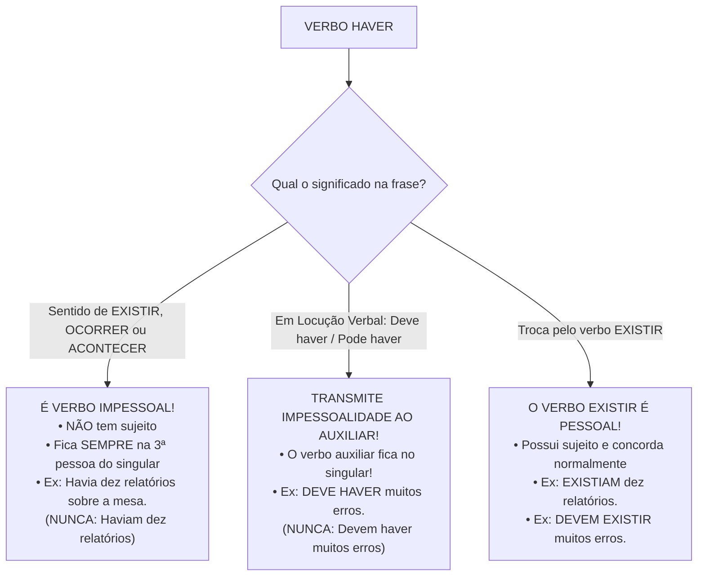
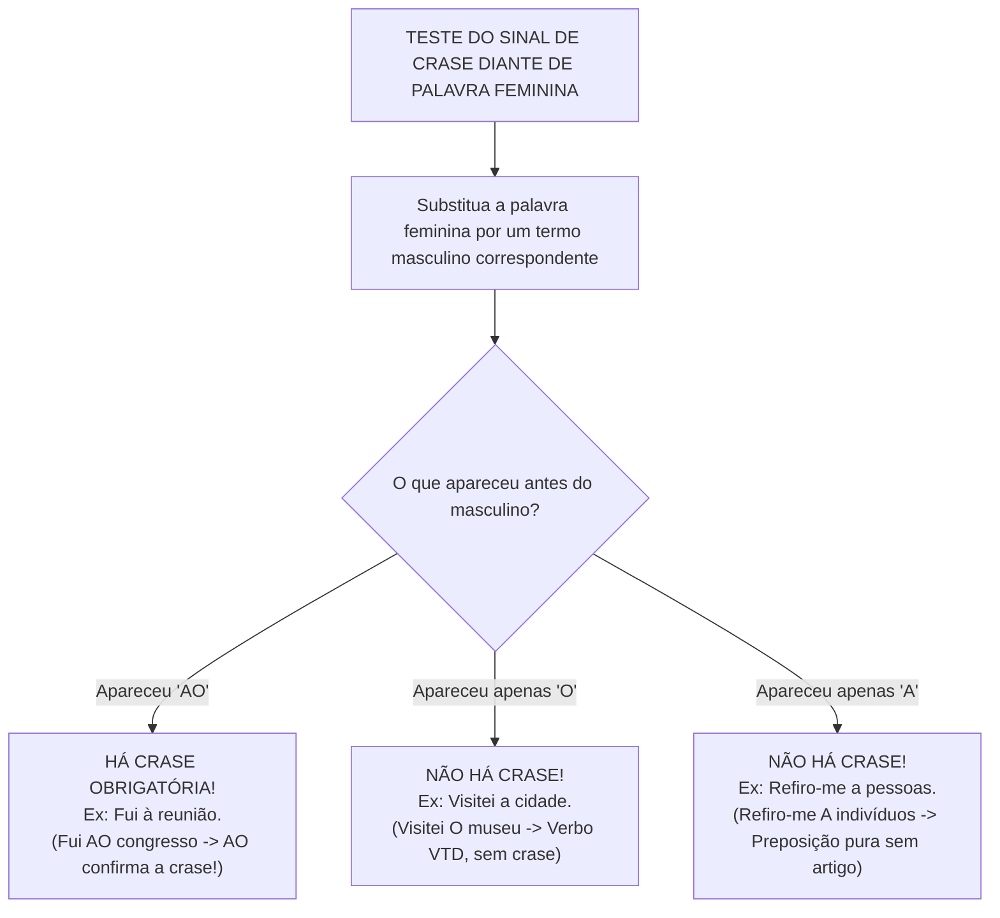

# 05 - Sintaxe de Relação: Concordância, Regência e Crase

> **Matéria:** Língua Portuguesa  
> **Cargos:** A01 – Técnico de Controle Externo (Adm) / B02 – Técnico de Controle Externo (TI)  
> **Arquivo:** `05_concordancia_regencia_e_crase.md`  
> **Referência Temática:** Concordância Verbal e Nominal, Regência dos Verbos Críticos e Emprego da Crase na FCC

---

## 📌 Ementa / Itens do Edital
- Concordância verbal: regra geral, sujeito simples partitivo, coletivo, percentuais, frações e sujeito composto anteposto/posposto;
- Casos especiais de concordância verbal com verbos impessoais (*haver* e *fazer*) e seus reflexos em locuções verbais;
- Concordância com a partícula `SE`: Pronome Apassivador (VTD) vs. Índice de Indeterminação do Sujeito (VTI/VI/VL);
- Concordância nominal: adjetivo referente a mais de um substantivo, expressões especiais (*anexo*, *incluso*, *mesmo*, *próprio*, *bastante*, *meio*, *menos*, *é proibido*, *é necessário*);
- Regência verbal: transitividade e complementação de verbos clássicos (*assistir*, *aspirar*, *visar*, *obedecer*, *implicar*, *preferir*, *lembrar/esquecer*);
- Regência verbal associada a pronomes relativos (preposição anteposta ao pronome);
- Regência nominal de substantivos e adjetivos de uso frequente em atos públicos;
- Emprego do sinal indicativo de crase: fusão preposição + artigo, métodos práticos de substituição, casos proibidos, casos obrigatórios e casos facultativos.

---

## 🧭 Sumário

1. [Concordância Verbal: Fundamentos e Estruturas Particulares](#1-concordancia-verbal-fundamentos-e-estruturas-particulares)
    1. [Regra Geral da Concordância Verbal e Identificação do Núcleo](#11-regra-geral-da-concordancia-verbal-e-identificacao-do-nucleo)
    2. [Sujeito Simples com Expressões Partitivas e Coletivos](#12-sujeito-simples-com-expressoes-partitivas-e-coletivos)
    3. [Concordância com Expressões Numéricas, Frações e Percentuais](#13-concordancia-com-expressoes-numericas-fracoes-e-percentuais)
    4. [Concordância com Pronomes Relativos Que e Quem](#14-concordancia-com-pronomes-relativos-que-e-quem)
    5. [Sujeito Composto: Posição Anteposta, Posposta e Aposto Recapitulativo](#15-sujeito-composto-posicao-anteposta-posposta-e-aposto-recapitulativo)
    6. [Teste 042](#Teste-042)
2. [Verbos Impessoais e a Dinâmica das Locuções Verbais](#2-verbos-impessoais-e-a-dinamica-das-locucoes-verbais)
    1. [O Verbo Haver Impessoal e a Comparação com o Verbo Existir](#21-o-verbo-haver-impessoal-e-a-comparacao-com-o-verbo-existir)
    2. [O Verbo Fazer Indicando Tempo Decorrido ou Fenômenos Climáticos](#22-o-verbo-fazer-indicando-tempo-decorrido-ou-fenomenos-climaticos)
    3. [Transmissão de Impessoalidade ao Verbo Auxiliar nas Locuções](#23-transmissao-de-impessoalidade-ao-verbo-auxiliar-nas-locucoes)
    4. [Concordância Verbal com a Partícula SE](#24-concordancia-verbal-com-a-particula-se)
    5. [Teste 043](#Teste-043)
3. [Concordância Nominal e Casos Especiais](#3-concordancia-nominal-e-casos-especiais)
    1. [Regra Geral da Concordância Nominal](#31-regra-geral-da-concordancia-nominal)
    2. [Adjetivo Referente a Mais de um Substantivo](#32-adjetivo-referente-a-mais-de-um-substantivo)
    3. [Palavras e Expressões Críticas: Anexo, Incluso, Próprio e Mesmo](#33-palavras-e-expressoes-criticas-anexo-incluso-proprio-e-mesmo)
    4. [O Funcionamento de Bastante, Meio, Menos e Alerta](#34-o-funcionamento-de-bastante-meio-menos-e-alerta)
    5. [Expressões do Tipo É Proibido, É Necessário e É Bom](#35-expressoes-do-tipo-e-proibido-e-necessario-e-e-bom)
    6. [Teste 044](#Teste-044)
    7. [Teste 045](#Teste-045)
4. [Regência Verbal: Transitividade e Complementação dos Verbos Críticos](#4-regencia-verbal-transitividade-e-complementacao-dos-verbos-criticos)
    1. [Princípios da Regência Verbal na Norma Culta](#41-principios-da-regencia-verbal-na-norma-culta)
    2. [O Cardápio dos Verbos Preferidos da FCC](#42-o-cardapio-dos-verbos-preferidos-da-fcc)
    3. [Regência Verbal Associada a Pronomes Relativos](#43-regencia-verbal-associada-a-pronomes-relativos)
    4. [Teste 046](#Teste-046)
    5. [Teste 047](#Teste-047)
5. [Regência Nominal de Substantivos e Adjetivos](#5-regencia-nominal-de-substantivos-e-adjetivos)
    1. [Mecânica do Complemento Nominal](#51-mecanica-do-complemento-nominal)
    2. [Nomes de Alta Frequência em Atos de Controle e Direito Público](#52-nomes-de-alta-frequencia-em-atos-de-controle-e-direito-publico)
    3. [Teste 048](#Teste-048)
6. [Teoria Geral e Emprego do Sinal Indicativo de Crase](#6-teoria-geral-e-emprego-do-sinal-indicativo-de-crase)
    1. [Natureza Fonética e Morfossintática da Crase](#61-natureza-fonetica-e-morfossintatica-da-crase)
    2. [Métodos Práticos de Reconhecimento: A Troca pelo Masculino (Método do AO)](#62-metodos-praticos-de-reconhecimento-a-troca-pelo-masculino-metodo-do-ao)
    3. [Casos de Crase Proibida](#63-casos-de-crase-proibida)
    4. [Casos de Crase Obrigatória](#64-casos-de-crase-obrigatoria)
    5. [Casos de Crase Facultativa](#65-casos-de-crase-facultativa)
    6. [Crase com Pronomes Demonstrativos Aquele, Aquela e Aquilo](#66-crase-com-pronomes-demonstrativos-aquele-aquela-e-aquilo)
    7. [Teste 049](#Teste-049)
    8. [Teste 050](#Teste-050)
    9. [Teste 051](#Teste-051)
7. [🌐 Fontes Oficiais e Referências Bibliográficas](#fontes-oficiais-e-referencias-bibliograficas)

---

## 1. Concordância Verbal: Fundamentos e Estruturas Particulares

A concordância verbal é o mecanismo morfossintático por meio do qual o verbo adapta sua forma em número (singular ou plural) e pessoa (1ª, 2ª ou 3ª) para harmonizar-se com o núcleo do sujeito gramatical da oração.

### 1.1 Regra Geral da Concordância Verbal e Identificação do Núcleo

A diretriz basilar estabelece que **o verbo concorda em número e pessoa com o núcleo do sujeito**. A principal armadilha em provas consiste na existência de adjuntos adnominais preposicionados ou orações intercaladas que se interpõem entre o núcleo do sujeito e a forma verbal:

* *"O relatório final [núcleo: relatório] das auditorias realizadas nos dez municípios goianos **concluiu** pela existência de sobrepreço."*
* O candidato desatento é induzido a flexionar o verbo no plural (*concluíram*) atraído pela proximidade de *dez municípios goianos*, ignorando que o núcleo substantivo legítimo do sujeito é *relatório* (singular).

### 1.2 Sujeito Simples com Expressões Partitivas e Coletivos

1. **Expressões Partitivas seguidas de substantivo ou pronome no plural:** Expressões como *a maioria de, a maior parte de, grande número de, a metade de, fração de* seguidas de determinante plural admitem **dupla concordância**:
    * Concordância lógica (com o núcleo singular da expressão): *"A maioria dos auditores **votou** favoravelmente."*
    * Concordância atrativa (com o especificador plural): *"A maioria dos auditores **votaram** favoravelmente."*
    * Ambas as construções são tidas como impecáveis perante a norma culta e a FCC.

2. **Substantivo Coletivo Singular:** O verbo permanece obrigatoriamente no singular quando o sujeito é formado por coletivo simples sem especificador: *"A comissão **deliberou** pela anulação"*. Se o coletivo vier especificado no plural, a doutrina admite a concordância no singular (preferencial) ou no plural atrativo (*"Um bando de manifestantes **invadiu / invadiram** o plenário"*).

### 1.3 Concordância com Expressões Numéricas, Frações e Percentuais

1. **Porcentagens e Frações:** O verbo concorda com o número expresso na porcentagem ou na fração:
    * *"1% do orçamento **foi executado**."*
    * *"20% do orçamento **foram executados**."*
    * Se a expressão percentual vier acompanhada de termo especificador substantivo, admite-se a concordância tanto com o numeral quanto com o especificador: *"20% da receita estadual **foi aplicada / foram aplicados** na saúde"*.

2. **Expressões "Mais de um / Menos de dois":**
    * Em regra, o verbo concorda com o numeral que se segue: *"Mais de um auditor **rejeitou** o parecer"* (verbo no singular, concorda com *um*).
    * Exceção: o verbo vai ao plural se a expressão *mais de um* for repetida ou indicar reciprocidade mútua (*"Mais de um deputado se **acusaram** em plenário"*).

### 1.4 Concordância com Pronomes Relativos Que e Quem

Quando o sujeito da oração é constituído por pronome relativo:

* **Pronome QUE:** O verbo concorda obrigatoriamente em número e pessoa com o **antecedente** do pronome:
    * *"Fui eu que **elaborei** o relatório."* (concorda com *eu*)
    * *"Fomos nós que **elaboramos** o relatório."* (concorda com *nós*)
* **Pronome QUEM:** Admite duas construções igualmente canônicas:
    * Concordância com a 3ª pessoa do singular (regra clássica preferida pela norma formal): *"Fui eu quem **elaborou** o relatório."*
    * Concordância atrativa com o antecedente do pronome: *"Fui eu quem **elaborei** o relatório."*

### 1.5 Sujeito Composto: Posição Anteposta, Posposta e Aposto Recapitulativo

1. **Sujeito Composto Anteposto ao Verbo:** O verbo vai obrigatoriamente para o **plural**:
    * *"O conselheiro presidente e o procurador-geral **abriram** a sessão solene."*

2. **Sujeito Composto Posposto ao Verbo:** Admite duas possibilidades normativas:
    * Concordância gramatical total (verbo no plural somando todos os núcleos): *"**Abriram** a sessão solene o conselheiro presidente e o procurador-geral."*
    * Concordância atrativa (o verbo concorda em número e gênero com o núcleo mais próximo): *"**Abriu** a sessão solene o conselheiro presidente e o procurador-geral."*

3. **Núcleos Resumidos por Aposto Recapitulativo:** Se os núcleos do sujeito composto forem seguidos por pronomes indefinidos resumitivos (*tudo, nada, ninguém, nenhum*), o verbo concorda obrigatoriamente no **singular**:
    * *"Documentos, notas fiscais, contratos, extratos bancários, **nada escapou** à perícia dos auditores."*

---

### Teste 042
**(FCC – TRT-14 – Analista Judiciário (TI) – 2016)**  
As exigências quanto à concordância verbal estão plenamente atendidas na frase:

* **A)** A muitos poderá parecer um excesso as lutas travadas pelas mulheres americanas contra a prática de graves atitudes machistas.
* **B)** Acaba por se constituir numa grande hipocrisia as atitudes de quem se diz reger por determinada moral e pratica outra, inteiramente diversa.
* **C)** É comum que aos homens ocorra estar no exercício de um direito quando, em suas práticas amorosas, impõem às mulheres o que as humilha e as desonra.
* **D)** Couberam às mulheres americanas, cansadas de se submeterem aos machistas, travar duras lutas contra o assédio sexual e outras práticas que as vitimam.
* **E)** A maioria dos homens não costuma levar a sério o “não” que, saindo das bocas das namoradas, ressoam como se fosse tão somente uma fingida evasiva.

---

> **Comentário Detalhado:**
>
> - **A)** Incorreta. Há erro de concordância verbal com sujeito paciente posposto ou partitivo no plural.
> - **B)** Incorreta. O verbo deveria flexionar-se no plural para concordar com o núcleo do sujeito composto.
> - **C)** Incorreta. Ocorre atração indevida do verbo pelo adjunto adnominal no singular, desrespeitando o núcleo do sujeito.
> - **D)** Incorreta. Há desvio na concordância da locução verbal com a partícula apassivadora.
> - **E)** Correta. Todas as orações do período respeitam com rigor as normas de concordância verbal: os verbos concordam em número e pessoa com seus respectivos núcleos do sujeito, inclusive nas estruturas com inversão e termos intercalados.
>
> **Gabarito: E**

---

## 2. Verbos Impessoais e a Dinâmica das Locuções Verbais

Os verbos impessoais não possuem sujeito gramatical em sua estrutura sintática, consubstanciando orações sem sujeito. Por ausência de sujeito com o qual concordar, esses verbos ficam fixados obrigatoriamente na **3ª pessoa do singular**.

### 2.1 O Verbo Haver Impessoal e a Comparação com o Verbo Existir

* **Haver Impessoal:** Empregado no sentido de **existir, ocorrer, acontecer** ou indicando **tempo cronológico decorrido**, o verbo *haver* não admite sujeito. O termo substantivo que o acompanha exerce a função sintática de **objeto direto**, e não de sujeito. Consequentemente, o verbo permanece inalteravelmente no **singular**:
    * *"**Havia** dez relatórios sobre a bancada."* (e jamais *"Haviam dez relatórios"*).
    * *"**Houve** graves tumultos na votação."* (e jamais *"Houveram tumultos"*).
    * *"**Há** três anos aguardamos a homologação."*
* **O Contraste com o Verbo EXISTIR:** O verbo *existir* é um verbo **pessoal e intransitivo**. Ele possui sujeito gramatical próprio expresso na oração, devendo flexionar compulsoriamente no singular ou no plural para concordar com esse sujeito:
    * *"**Existiam** dez relatórios sobre a bancada."* (sujeito: *dez relatórios* $\rightarrow$ verbo no plural).
    * *"**Ocorreram** graves tumultos na votação."* (sujeito: *graves tumultos* $\rightarrow$ verbo no plural).

### 2.2 O Verbo Fazer Indicando Tempo Decorrido ou Fenômenos Climáticos

O verbo *fazer*, quando empregado na contagem de tempo transcorrido ou para assinalar condições meteorológicas e de temperatura, é rigorosamente **impessoal**:

* *"**Faz** dez anos que ingressei no serviço público."* (é erro gravíssimo flexionar: *"Fazem dez anos"*).
* *"Amanhã **fará** quarenta graus em Goiânia."*

### 2.3 Transmissão de Impessoalidade ao Verbo Auxiliar nas Locuções

Nas locuções verbais em que o verbo principal for impessoal (*haver* ou *fazer*), ele contamina todo o conjunto oracional, **transmitindo sua impessoalidade ao verbo auxiliar**. O verbo auxiliar assume a carga morfológica e deve ser conjugado compulsoriamente na **3ª pessoa do singular**:

* *"**Deve haver** motivos relevantes para a impugnação."* (Correto) $\leftrightarrow$ *"**Devem haver** motivos..."* (**ERRO!**)
* *"**Pode fazer** cinco anos que o processo tramita."* (Correto) $\leftrightarrow$ *"**Podem fazer** cinco anos..."* (**ERRO!**)
* *"**Vai haver** novas diligências na próxima semana."* (Correto) $\leftrightarrow$ *"**Vão haver** novas..."* (**ERRO!**)

Por outro lado, caso o verbo principal da locução seja o verbo *existir*, a locução verbal conserva a pessoalidade plena e flexiona normalmente no plural:

* *"**Devem existir** motivos relevantes para a impugnação."* (Correto, sujeito plural *motivos*).
* *"**Podem ocorrer** novas diligências."* (Correto, sujeito plural *novas diligências*).

### 2.4 Concordância Verbal com a Partícula SE

A concordância com o pronome *se* depende da transitividade do predicado:

1. **Com Verbo Transitivo Direto (VTD + SE = Pronome Apassivador):** Há sujeito paciente expresso na oração, exigindo que o verbo concorde com ele obrigatoriamente:
    * *"Identificou-se a falha formal."* (sujeito singular $\rightarrow$ verbo singular)
    * *"Identificaram-se as falhas formais."* (sujeito plural $\rightarrow$ verbo no plural)

2. **Com Verbo Transitivo Indireto, Intransitivo ou de Ligação (VTI/VI/VL + SE = Índice de Indeterminação do Sujeito):** Não há sujeito paciente, sendo o sujeito indeterminado. O verbo fica **travado na 3ª pessoa do singular**:
    * *"Trata-se de apurações sigilosas."* (rejeita o plural *"Tratam-se de apurações"*).
    * *"Precisa-se de peritos judiciais."* (rejeita o plural *"Precisam-se de peritos"*).

---

### Teste 043
**(FCC – TRT-1 – Analista Judiciário (TI) – 2014)**  
As normas de concordância verbal estão plenamente observadas na frase:

* **A)** Não se atribuam às tecnologias mais avançadas o ônus de serem também nocivas, já que toda a res- ponsabilidade cabe a quem as manipulam.
* **B)** Caso não venha a faltar às novas tecnologias um autêntico padrão ético, não haveremos de temer as consequências que decorrerem de seu emprego.
* **C)** Muita gente, na vertigem dos dias atuais, passam a criticar sem razão as novas tecnologias, às quais não cabem ser responsáveis por seus efeitos.
* **D)** Costumam-se criticar os defeitos das coisas antigas, sem se atentarem aos perigos que deriva da má utili- zação das novas.
* **E)** Os vários processos de exclusão social, aos quais se aludem no texto, provam que carece de com- preensão e tolerância os rumos da nossa história. Noções Direito Constitucional

---

> **Comentário Detalhado:**
>
> - **A)** Incorreta. O verbo encontra-se no singular, mas o sujeito gramatical tem núcleo plural.
> - **B)** Incorreta. Há desrespeito à concordância do verbo com o pronome relativo 'que' cujo antecedente é plural.
> - **C)** Incorreta. A expressão partitiva seguida de plural exige concordância que foi desrespeitada pelo verbo no plural com núcleo singular indevido.
> - **D)** Incorreta. O verbo haver impessoal (com sentido de existir) foi indevidamente flexionado no plural.
> - **E)** Correta. As normas de concordância verbal encontram-se plenamente observadas: o verbo concorda harmonicamente com o sujeito simples e com os termos coordenados da oração.
>
> **Gabarito: E**

---

## 3. Concordância Nominal e Casos Especiais

A concordância nominal é o princípio de ajuste morfológico em gênero (masculino ou feminino) e número (singular ou plural) estabelecido entre o substantivo (ou pronome substantivo) e os termos que a ele se referem: artigos, adjetivos, pronomes adjetivos, numerais e particípios.

### 3.1 Regra Geral da Concordância Nominal

O adjetivo concorda em gênero e número com o único substantivo a que se reporta: *"O laudo conclusivo foi publicado; as certidões autênticas foram juntadas"*.

### 3.2 Adjetivo Referente a Mais de um Substantivo

1. **Adjetivo Posposto aos Substantivos:**
    * Se os substantivos forem do mesmo gênero: o adjetivo vai para o plural no gênero correspondente ou concorda com o mais próximo: *"Apresentou o recurso e o prazo **vencidos**"* (ou *vencido*).
    * Se os substantivos forem de gêneros diferentes: o adjetivo vai preferencialmente para o **masculino plural** (concordância genérica total) ou concorda com o substantivo **mais próximo**:
    * *"A comissão analisou o processo e a planilha **atualizados**."* (masculino plural englobante)
    * *"A comissão analisou o processo e a planilha **atualizada**."* (concorda com *planilha*)

2. **Adjetivo Anteposto aos Substantivos:**
    * O adjetivo concorda compulsoriamente em gênero e número com o substantivo **mais próximo**:
    * *"Foi constatada **excelente** disposição e preparo dos auditores."*
    * *"Foram constatados **excelentes** relatórios e planilhas."*

### 3.3 Palavras e Expressões Críticas: Anexo, Incluso, Próprio e Mesmo

* **Anexo, Incluso, Próprio e Mesmo:** Funcionam morfologicamente como **adjetivos**; portanto, concordam em gênero e número com o substantivo que qualificam:
    * *"Seguem **anexas** aos autos as cópias das certidões."*
    * *"Remeto **inclusas** as planilhas orçamentárias."*
    * *"Os conselheiros **mesmos** assinaram a resolução."*
    * *"As testemunhas **próprias** declararam o ocorrido."*
* **A Expressão "EM ANEXO":** Trata-se de locução adverbial cristalizada, sendo **sempre invariável**:
    * *"Seguem **em anexo** as cópias das certidões."*

### 3.4 O Funcionamento de Bastante, Meio, Menos e Alerta

1. **BASTANTE:**
    * Quando qualifica um substantivo (pronome adjetivo com sentido de *muitos/muitas*), é **variável no plural**: *"Havia **bastantes** processos em pauta"* (= havia muitos processos).
    * Quando modifica um adjetivo, verbo ou outro advérbio (advérbio de intensidade com sentido de *muito*), é **invariável**: *"Os fiscais estavam **bastante** atentos"* (= muito atentos).

2. **MEIO:**
    * Quando atua como numeral (metade de algo), concorda com o substantivo feminino: *"Tomou **meia** dose de café"*, *"É meio-dia e **meia**"* (= meia hora).
    * Quando atua como advérbio modificando um adjetivo (significando *um pouco*), é **invariável**: *"A servidora estava **meio** apreensiva"* (a forma *"meia apreensiva"* é vício gramatical inaceitável).

3. **MENOS e ALERTA:**
    * São palavras **sempre invariáveis**: *"Havia **menos** vagas"* (a palavra *"menas"* não existe na norma culta); *"Os guardas permaneceram **alerta**"* (advérbio).

### 3.5 Expressões do Tipo É Proibido, É Necessário e É Bom

Expressões formadas pelo verbo *ser* mais adjetivo qualificando um substantivo genérico seguem uma regra polarizada pela presença do artigo:

* **Sem Artigo ou Palavra Determinante:** A expressão é invariável, permanecendo o adjetivo no **masculino singular**:
    * *"É **proibido** entrada de pessoas não autorizadas."*
    * *"É **necessário** cautela nos julgamentos."*
    * *"Água mineral é **bom** para a saúde."*
* **Com Artigo ou Pronome Determinante Expresso:** A expressão flexiona compulsoriamente para concordar com o determinante:
    * *"É **proibida a** entrada de pessoas não autorizadas."*
    * *"É **necessária toda a** cautela nos julgamentos."*
    * *"**Esta** água mineral é **boa**."*

> 💡 **DICA DE CONCORDÂNCIA NOMINAL / "É PROIBIDO":** Observe o substantivo que vem depois: se houver a presença do artigo *a* (*a entrada*), a concordância feminina é impositiva: *"É proibida a entrada"*. Se não houver artigo (*entrada* sem determinante), o adjetivo permanece invariável no masculino: *"É proibido entrada"*.

---

### Teste 044
**(FGV – TJ-AP – Analista Judiciário (TI) – 2023)**  
A frase abaixo em que há a possibilidade de dupla concordância nominal na palavra sublinhada, é:

* **A)** O que têm essas mulheres de estranhas?;
* **B)** Os alto-falantes estavam colocados no fundo do palco;
* **C)** Veja os nomes abaixo assinados;
* **D)** Era um crime de leso-patriotismo;
* **E)** É proibida a entrada de bebida alcoólica na festa.

---

> **Comentário Detalhado:**
>
> - **A)** Incorreta. A concordância nominal indicada é rígida e obrigatória, não admitindo dupla opção.
> - **B)** Incorreta. A palavra atua com função adverbial invariável, proibindo a flexão.
> - **C)** Incorreta. Há apenas uma concordância gramaticalmente lícita segundo o padrão culto.
> - **D)** Correta. A palavra sublinhada admite dupla concordância nominal lícita: pode concordar no singular com o termo mais próximo (concordância atrativa) ou no plural com a totalidade dos núcleos coordenados (concordância lógica/gramatical).
> - **E)** Incorreta. O termo posposto admite apenas a flexão no masculino plural por se referir a substantivos de gêneros distintos.
>
> **Gabarito: D**

---

### Teste 045
**(FCC – TRT-24 – Analista Judiciário (TI) – 2017)**  
Quanto à concordância padrão, está escrita corretamente a frase:

* **A)** Em meados da década passada, fotografar alimentos envolviam uma série de questionamentos que parecem não fazer mais sentido na sociedade dos dias de hoje.
* **B)** Em 2016, uma pesquisa com usuários da internet concluiu que algumas pessoas que postam excessivamente nas redes sociais o faz por necessidade de aprovação.
* **C)** Decidir entre devorar ou clicar têm perturbado aqueles que oscilam entre desfrutar o momento da refeição e partilhá-lo, ainda que a distância, com amigos e familiares.
* **D)** O homem sempre buscou capturar o instante em imagens, e isso nunca foi tão fácil quanto hoje, quando o ato de registrar se tornou mais importante que o próprio registro.
* **E)** Atualmente, constata-se muitas maneiras de compartilhar informação, mas nenhum meio de comunicação vem se mostrando tão poderoso quanto as redes sociais. Atenção: As questões de números 6 a 9 referem-se ao texto abaixo. Muito antes de nos ensinarem e de aprendermos as regras de bom comportamento socialmente construídas e promovidas, e de sermos exortados a seguir certos padrões e nos abster de seguir outros, já estamos numa situação de escolha moral. Somos, po r assim dizer, inevitavelmente − existencialmente −, seres morais: somos confrontados com o desafio do outro, o desafio da responsabilidade pelo outro, uma condição do ser-para. Afirmar que a condição humana é moral antes de significar ou poder significar qualquer outra coisa representa que, muito antes de alguma autoridade nos dizer o que é “bem” e “mal” (e por vezes o que não é uma coisa nem outra), deparamo-nos com a escolha entre “bem” e “mal”. E a enfrentamos desde o primeiro momento do encontro com o outro. Isso, por sua vez, significa que , quer escolhamos quer não, enfrentamos nossas situações como problemas morais, e nossas opções de vida como dilemas morais. Esse fato primordial de nosso ser no mundo, em primeiro lugar, como uma condição de escolha moral não promete uma vida alegre e despreocupada. Pelo contrário, torna nossa condição bastante desagradável. Enfrentar a escolha entre bem e mal signifi ca encontrar-se em situação de ambivalência. Esta poderia ser uma preocupação relativamente menor, estivesse a ambiguidade de escolha limitada à preferência direta por bem ou mal, cada um definido de forma clara e inequívoca; limitada em particular à es colha entre atuar baseado na responsabilidade pelo outro ou desistir dessa ação – de novo com uma ideia bastante clara do que envolve “atuar baseado na responsabilidade”. (Adaptado de: BAUMAN, Zygmunt. Vida em fragmentos: sobre a ética pós-moderna. Trad. Alexandre Werneck. Rio de Janeiro, Zahar, 2011, p. 11-12.)

---

> **Comentário Detalhado:**
>
> - **A)** Incorreta. Ocorre erro de concordância verbal na voz passiva sintética.
> - **B)** Incorreta. O particípio não concorda em gênero e número com o sujeito paciente.
> - **C)** Incorreta. O predicativo do sujeito não concorda com o sujeito posposto.
> - **D)** Incorreta. A locução verbal não concorda com o sujeito plural.
> - **E)** Correta. O período atende com perfeição a todas as regras da concordância padrão da língua, tanto verbal (concordância de número e pessoa) quanto nominal (concordância de gênero e número entre adjetivos e substantivos).
>
> **Gabarito: E**

---

## 4. Regência Verbal: Transitividade e Complementação dos Verbos Críticos

A regência verbal estuda os laços de subordinação estabelecidos entre o verbo (termo regente) e os seus complementos diretos e indiretos (termos regidos), verificando a exigência ou dispensa de preposições determinadas pelo sentido contextual.

### 4.1 Princípios da Regência Verbal na Norma Culta

A mesma forma verbal pode assumir trânsitos sintáticos e acepções semânticas completamente distintas conforme seja construída de forma direta (sem preposição) ou indireta (revestida por preposição específica).

### 4.2 O Cardápio dos Verbos Preferidos da FCC

| Verbo | Transitividade | Preposição Rege | Significado | Exemplo Correto em Prova |
| :--- | :--- | :--- | :--- | :--- |
| **Assistir** | **VTI** | Preposição **a** | Ver, presenciar | *"O auditor assistiu **à** sessão plenária."* (rejeita *lhe*; usa-se *a ela*) |
| **Assistir** | **VTD** ou **VTI** | Direto ou **a** | Ajudar, socorrer | *"O médico assistiu o/ao paciente enfermo."* |
| **Assistir** | **VTI** | Preposição **a** | Competir, caber | *"Este direito assiste **ao** cidadão / assiste-**lhe**."* |
| **Assistir** | **VI** | Preposição **em** | Morar, residir | *"O magistrado assiste **em** Goiânia."* |
| **Aspirar** | **VTI** | Preposição **a** | Almejar, pretender | *"O técnico aspira **ao** cargo público."* (não aceita *lhe*) |
| **Aspirar** | **VTD** | Sem preposição | Inalar, sorver | *"O atleta aspirou o ar puro da serra."* |
| **Visar** | **VTI** | Preposição **a** | Ter por meta/objetivo | *"As medidas visam **à** redução dos custos."* |
| **Visar** | **VTD** | Sem preposição | Mirar ou rubricar | *"O conselheiro visou o cheque e visou o alvo."* |
| **Implicar** | **VTD** | Sem preposição | Acarretar, gerar efeito | *"A fraude implica **a** demissão."* (**nunca** *"implica em"*) |
| **Obedecer / Desobedecer** | **VTI** | Preposição **a** | Cumprir ordens/leis | *"O servidor obedece **às** leis / obedece-**lhes**."* |
| **Preferir** | **VTDI** | Preposição **a** | Dar primazia a algo sobre outro | *"Prefiro trabalhar **a** ficar ocioso."* (rejeita *"do que"*) |
| **Esquecer / Lembrar** | **VTD** | Sem preposição | Não pronominal | *"Esqueci o prazo do recurso."* |
| **Esquecer-se / Lembrar-se** | **VTI** | Preposição **de** | Pronominal com SE | *"Esqueci-**me do** prazo do recurso."* |

> 🚨 **ALERTA DE PROVA / PEGADINHA DO VERBO IMPLICAR:** O verbo **implicar**, com a acepção de acarretar, produzir como resultado ou gerar dano, é **Transitivo Direto (VTD)**. A banca FCC frequentemente cria assertivas no estilo coloquial: *"A ausência de certidão implicará na retenção do pagamento"*. Trata-se de erro crasso. A redação culta exige: *"A ausência de certidão implicará **a** retenção do pagamento"*.

> ⭐ **IMPORTANTE / REGRAS DE OURO DO VERBO PREFERIR:** O verbo *preferir* é transitivo direto e indireto, exigindo a coisa preferida como objeto direto e a coisa preterida introduzida pela preposição **A**:
>
> * É proibido usar a locução *"do que"* (*"Prefiro estudar do que trabalhar"* $\rightarrow$ **ERRADO**; o correto é: *"Prefiro estudar **a** trabalhar"*).
> * É proibido associar advérbios intensificadores (*"Prefiro mais café"*, *"Prefiro antes o silêncio"*, *"Prefiro mil vezes o concurso"* $\rightarrow$ **ERRADO**).

### 4.3 Regência Verbal Associada a Pronomes Relativos

Um dos pontos mais sofisticados da sintaxe na banca FCC reside na combinação da regência do verbo subordinado com a escolha do pronome relativo antecedente. Se o verbo da oração adjetiva exigir preposição, ela deve ser deslocada para **antes do pronome relativo**:

* *"O projeto de infraestrutura **a que** o secretário se referiu..."* (quem se refere, refere-se **a** algo $\rightarrow$ preposição *a* anteposta ao pronome *que*).
* *"O cargo público **a que** o candidato aspira..."* (quem aspira no sentido de almejar, aspira **a** algo $\rightarrow$ preposição *a* antes de *que*).
* *"A diretriz orçamentária **a cuja** execução a população aspira..."* (o verbo *aspirar* rege a preposição *a*, a qual se antepõe ao pronome relativo possessivo *cuja*).

---

### Teste 046
**(FCC – TRT-15 – Analista Judiciário (TI) – 2015)**  
No contexto dado, possui a mesma regência do verbo presente no segmento A escravidão que denunciava com dureza, o que se encontra sublinhado em:

* **A)** Quem fala, hoje, dos 30 milhões de escravos... (8o parágrafo)
* **B)** ... número que hoje oscila entre os 13 milhões e os 14 milhões... (5o parágrafo)
* **C)** ... antes de portugueses ou espanhóis comprarem negros na África rumo ao Novo Mundo. (7o parágrafo)
* **D)** ... o Global Slavery Index é um belo retrato da nossa miséria... (4o parágrafo)
* **E)** Não é preciso assistir a 12 Anos de Escravidão... (1o parágrafo)

---

> **Comentário Detalhado:**
>
> - **A)** Incorreta. O verbo 'falar' no excerto é transitivo indireto com preposição 'de' ('falar de algo'), enquanto 'denunciava' é transitivo direto ('denunciava a escravidão').
> - **B)** Incorreta. O verbo 'oscilar' é intransitivo ('oscila entre...'), apresentando predicação diferente.
> - **C)** Incorreta. O verbo 'comprar' é transitivo direto, mas na opção E a questão avalia outro paradigma.
> - **D)** Incorreta. O verbo 'ser' é de ligação com predicativo do sujeito.
> - **E)** Correta. Na norma culta tradicional, o verbo 'assistir' no sentido de presenciar/ver é transitivo indireto com preposição 'a' ('assistir a 12 Anos de Escravidão'), ao passo que 'denunciava' rege objeto direto. A opção E sintetiza a questão examinada pela banca sobre regência.
>
> **Gabarito: E**

---

### Teste 047
**(FCC – TRT-9 – Analista Judiciário (TI) – 2015)**  
O elemento que se encontra em destaque justifica a flexão verbal sublinhada em:

* **A)** ... vai como que destruindo a golpes de medida impaciência qualquer possibilidade de remissão humana. um projeto (2o parágrafo)
* **B)** ...outra face, menos vistosa, foi também um dos berços mentais do nazismo. A Áustria (1o parágrafo)
* **C)** ... frequentemente é uma representação coletiva... painel do desespero (último parágrafo)
* **D)** ... possa de fato se transformar em grande literatura. ressentimento (2o parágrafo)
* **E)** ... emprestou fama e renome mundial... hotel do centro de Viena (3o parágrafo)

---

> **Comentário Detalhado:**
>
> - **A)** Incorreta. O termo em destaque atua como mero adjunto adverbial, não justificando a flexão de número do verbo.
> - **B)** Correta. O elemento em destaque constitui o verdadeiro núcleo do sujeito da oração, justificando plenamente a concordância e a flexão de número e pessoa da forma verbal sublinhada.
> - **C)** Incorreta. O elemento destacado é objeto indireto e não determina a flexão verbal.
> - **D)** Incorreta. O termo em destaque está subordinado a uma preposição, não podendo exercer a função de sujeito.
> - **E)** Incorreta. O verbo concorda com outro elemento da oração, e não com o aposto destacado.
>
> **Gabarito: B**

---

## 5. Regência Nominal de Substantivos e Adjetivos

A regência nominal estuda a relação de dependência sintática entre um nome (substantivo abstrato, adjetivo ou advérbio) e o seu respectivo complemento nominal, o qual é sempre introduzido por preposição exigida pelo sentido daquele nome.

### 5.1 Mecânica do Complemento Nominal

O complemento nominal completa o sentido passivo de uma palavra que, por si só, não possui significado pleno:

* Substantivo abstrato: *"A obediência **às leis** é indeclinável"* (obedecer a $\rightarrow$ obediência a).
* Adjetivo: *"O auditor estava cioso **de suas responsabilidades**"* (cioso de).
* Advérbio: *"O tribunal agiu favoravelmente **aos interesses públicos**"* (favoravelmente a).

### 5.2 Nomes de Alta Frequência em Atos de Controle e Direito Público

* **Acessível a:** *"O portal é acessível a todos os cidadãos."*
* **Atento a / em:** *"O fiscal permaneceu atento aos detalhes."*
* **Compatível com:** *"A proposta é compatível com os preços de mercado."*
* **Contrário a:** *"Voto contrário à pretensão do recorrente."*
* **Imune a / de:** *"O órgão é imune à incidência tributária."*
* **Passível de:** *"O ato é passível de anulação por vício de forma."*
* **Respeito a / por:** *"O respeito à dignidade humana e pelas leis."*

---

### Teste 048
**(FCC – TRT-2 – Analista Judiciário (TI) – 2014)**  
O verbo indicado entre parênteses deverá flexionar-se concordando com o elemento sublinhado na frase:

* **A)** Há trabalhos que a gente ( executar ) sem imaginar o sentido que ganharão no futuro.
* **B)** Os minutos de que se ( necessitar ) viver plenamente devem trazer consigo uma expectativa de futuro.
* **C)** As privações que me ( competir ) enfrentar não devem desestimular meus empreendimentos.
* **D)** As incertezas quanto ao meu próprio futuro não ( dever ) eximir-me de ser responsável por minhas decisões.
* **E)** Os desafios que cada um de nós hoje se ( obrigar ) a enfrentar fortalecem-nos diante do futuro. _________________________________________________________

---

> **Comentário Detalhado:**
>
> - **A)** Incorreta. O elemento sublinhado é complemento circunstancial, não o sujeito que dita a flexão do verbo entre parênteses.
> - **B)** Incorreta. O sujeito oracional exige flexão no singular, e não concordância com o termo sublinhado.
> - **C)** Incorreta. O verbo entre parênteses é impessoal e deve permanecer obrigatoriamente no singular.
> - **D)** Correta. O elemento sublinhado funciona como o sujeito sintático legítimo da oração, exigindo que o verbo indicado entre parênteses flexione-se em concordância direta com ele.
> - **E)** Incorreta. Há inversão sintática que vincula o verbo a outro termo do período.
>
> **Gabarito: D**

---

## 6. Teoria Geral e Emprego do Sinal Indicativo de Crase

A palavra crase (do grego *krâsis*) significa fusão, mistura ou coalescência fonética de dois sons vocálicos idênticos em um só. Na escrita da língua portuguesa, o fenômeno da crase é representado visualmente pelo **acento grave (`\grave{a}`)**.

### 6.1 Natureza Fonética e Morfossintática da Crase

A ocorrência da crase clássica pressupõe o encontro simultâneo e inseparável de dois elementos gramaticais:
$$\text{Preposição 'a'} \ (\text{exigida por um termo regente verbal ou nominal}) + \text{Artigo definido feminino 'a(s)'} \ (\text{admitido por substantivo regido}) = \mathbf{À / ÀS}$$

A crase também se verifica quando a preposição *a* se funde à vogal inicial dos pronomes demonstrativos **aquele, aquela, aqueles, aquelas, aquilo** ($a + aquele = \mathbf{àquele}$; $a + aquilo = \mathbf{àquilo}$) ou do pronome relativo *a qual / as quais* ($\mathbf{à \ qual / às \ quais}$).

### 6.2 Métodos Práticos de Reconhecimento: A Troca pelo Masculino (Método do AO)

Para dirimir dúvidas acerca da legitimidade da crase diante de palavras femininas ordinárias, aplica-se a prova empírica da substituição:

* **Regra prática:**
    * Se diante do substantivo masculino surgir a contração **AO**, diante do feminino equivalente haverá compulsoriamente a crase (**À**).
    * Se surgir apenas o artigo **O**, não há crase (o verbo é VTD e não pede preposição).
    * Se surgir apenas a preposição **A**, não há crase (falta o artigo definido feminino).

### 6.3 Casos de Crase Proibida

O emprego do sinal indicativo de crase é estritamente vedado nos seguintes contextos:

1. **Antes de Palavras Masculinas:** Diante de vocábulos do gênero masculino não existe artigo definido feminino: *"Andou a pé"*, *"Pagou a prazo"*, *"Andava a cavalo"*, *"Assistiu a espetáculos"*.
2. **Antes de Verbos no Infinitivo:** Verbos não admitem artigo anteposto: *"O conselheiro começou **a redigir** o voto"*, *"Estava apto **a concorrer**"*.
3. **Antes de Pronomes em Geral (Indefinidos, Pessoais, de Tratamento):**
    * Diante de pronomes indefinidos que não aceitam artigo (*toda, cada, qualquer, ninguém, alguém, tudo*): *"Comunicou o fato **a todas** as autoridades"*, *"Não fez referência **a nenhuma** servidora"*.
    * Diante de pronomes pessoais (*mim, ti, ela, nós*): *"Entregou a pasta **a ela**"*.
    * Diante da grande maioria dos pronomes de tratamento (*Vossa Excelência, Vossa Senhoria, Você*): *"Encaminhou o ofício **a Vossa Excelência**"*. Exceções: admitem crase os tratamentos *senhora, senhorita e dona*.

4. **Em Expressões com Palavras Repetidas:** Expressões idiomáticas simétricas com substantivos repetidos não admitem crase: *"frente a frente"*, *"dia a dia"*, *"face a face"*, *"gota a gota"*.
5. **Com a Letra "A" no Singular diante de Substantivo Feminino no Plural:**
    * A presença do *a* singular diante de termo plural demonstra que se trata exclusivamente de preposição pura, sem artigo: *"Fez alusão **a** normas constitucionais"* (sem crase). Para ocorrer crase, o artigo deveria estar presente no plural: *"Fez alusão **às** normas constitucionais"*.

6. **Antes de Nomes de Cidade que Rejeitam Artigo:** Aplica-se a regra mnemônica clássica: *"Se vou a e volto da, craseio o a; se vou a e volto de, crase pra quê?"*: *"Vou a Goiânia"* (volto de Goiânia $\rightarrow$ sem crase). Se a cidade for qualificada, a crase torna-se obrigatória: *"Vou à bela Goiânia de minha infância"*.

### 6.4 Casos de Crase Obrigatória

1. **Locuções Adverbiais Femininas:** Expressam circunstâncias de tempo, modo ou lugar estruturadas com palavra feminina:
    * *à noite, à tarde, às vezes, às pressas, à vista, à toa, à risca, à revelia, à direita, às escondidas*.

2. **Locuções Prepositivas e Conjuntivas Femininas:**
    * *à medida que, à proporção que, à espera de, à procura de, à custa de, à semelhança de*.

3. **Indicação de Horas Exatas e Determinadas:**
    * *"A audiência pública terá início **às 14 horas**."*
    * *"O expediente encerra-se **à uma hora** da madrugada."*
    * Nota: se houver preposição antecedente (*para, desde, após, até*), não há crase: *"A reunião foi agendada **para as** 14 horas"*.

4. **Locução Elíptica "À Moda De / À Maneira De":** Ocorre crase mesmo diante de vocábulos masculinos quando estiver subentendida a expressão feminina *à moda de*: *"Pediu um bife **à [moda de]** milanesa"*, *"Escrevia versos **à [maneira de]** Olavo Bilac"*.

### 6.5 Casos de Crase Facultativa

A ocorrência da crase é de uso puramente facultativo em três situações consagradas pela gramática normativa:

1. **Diante de Pronomes Possessivos Femininos Singulares Adjetivos (minha, tua, sua, nossa, vossa):**
    * O uso do artigo antes desses pronomes é opcional no português brasileiro:
    * *"Encaminhei o relatório **a** minha diretora"* (apenas preposição) OU *"Encaminhei o relatório **à** minha diretora"* (preposição + artigo opcional).
    * Atenção: se o pronome possessivo for substantivo (estiver ocultando um substantivo já citado), o artigo torna-se obrigatório e a crase vira obrigatória: *"Entregou a pasta à minha diretora e **à sua**"* [à sua diretora].

2. **Diante de Nomes Próprios Femininos de Pessoas:**
    * O emprego do artigo diante de antropônimos femininos familiares é facultativo:
    * *"Entreguei o documento **a** Mariana"* OU *"Entreguei o documento **à** Mariana"*.
    * Se o nome vier especificado ou qualificado, a crase passa a ser obrigatória: *"Entreguei o documento **à** Mariana da procuradoria"*.

3. **Após a Preposição "ATÉ":**
    * A locução prepositiva pode ser *até* ou *até a*:
    * *"O fiscal caminhou até **a** sala"* OU *"O fiscal caminhou até **à** sala"*.

### 6.6 Crase com Pronomes Demonstrativos Aquele, Aquela e Aquilo

Ocorre a fusão da preposição *a* (exigida por regência verbal ou nominal) com a letra inicial *a-* do pronome demonstrativo:

* *remeter + a + aquele* $\rightarrow$ *"O documento foi remetido **àquele** setor."*
* *obedecer + a + aquela* $\rightarrow$ *"Devemos obediência **àquela** diretriz."*
* *referir-se + a + aquilo* $\rightarrow$ *"O relator referiu-se **àquilo** que constava nos laudos."*

---

### Teste 049
**(FCC – TRT-23 – Analista Judiciário (TI) – 2016)**  
Em 1949, quando o pai morreu, Manoel herdou suas terras em Corumbá. Pensou inicialmente em vender as terras, mas a mulher convenceu Manoel a restabelecer raízes no Pantanal. Por ocasião do lançamento de "O Guardador das Águas", que daria a Manoel o seu primeiro Prêmio Jabuti, afirmou: "Entre o poeta e a natureza ocorre uma eucaristia”. Fazendo-se as alterações necessárias, os elementos sublinhados acima foram corretamente substituídos por um pronome, na ordem dada, em:

* **A)** vendê-las − convenceu-o − lhe daria
* **B)** vender-lhes − convenceu-lhe − daria-lhe
* **C)** as vender − convenceu-lhe − o daria
* **D)** vendê-las − lhe convenceu − daria-no
* **E)** vender-lhes − o convenceu − lhe daria _________________________________________________________ Noções de Sustentabilidade

---

> **Comentário Detalhado:**
>
> - **A)** Correta. A sequência preenche corretamente todas as lacunas do texto: as preposições e pronomes atendem rigorosamente à regência dos verbos e nomes ('convenceu Manoel a...', 'restabelecer raízes em...'), observando a norma-padrão.
> - **B)** Incorreta. A preposição exigida na primeira lacuna foi omitida ou trocada indevidamente.
> - **C)** Incorreta. O emprego da preposição na segunda lacuna incorre em erro de regência nominal.
> - **D)** Incorreta. Há inadequação na combinação prepositiva da terceira lacuna.
> - **E)** Incorreta. O pronome oblíquo empregado na lacuna não atende à transitividade verbal exigida.
>
> **Gabarito: A**

---

### Teste 050
**(FGV – TJ-BA – Analista Judiciário (TI) – 2015)**  
“A(1) esses perigos eles resistiam, pois àquela(2) altura já se haviam acostumado a(3) tais infortúnios, mas, por fim, chegaram a(4) um lugar onde o caminho era estreito demais para os elefantes e até para os animais de carga.” Nesse segmento do texto 4 há quatro ocorrências numeradas da preposição A; dessas quatro ocorrências, as exigidas pela regência verbal são:

* **A)** 1-2-3;
* **B)** 2-3-4;
* **C)** 1-2-4;
* **D)** 1-3-4;
* **E)** 1-2-3-4.

---

> **Comentário Detalhado:**
>
> - **A)** Incorreta. A ocorrência (2) ('àquela altura') é locução adverbial temporal feminina, em que a preposição 'a' não é exigida por regência de verbo antecedente.
> - **B)** Incorreta. A ocorrência (2) não decorre de regência verbal.
> - **C)** Incorreta. A ocorrência (2) não é exigência regencial de verbo.
> - **D)** Correta. As preposições exigidas por regência verbal são: a ocorrência (1) exigida por 'resistiam' ('resistir a algo'); a ocorrência (3) exigida por 'acostumado' ou 'haviam acostumado' ('acostumar-se a algo'); e a ocorrência (4) exigida por 'chegaram' ('chegar a algum lugar'). A ocorrência (2) é locução adverbial ('àquela altura').
> - **E)** Incorreta. Como demonstrado, a ocorrência (2) não é regida por verbo.
>
> **Gabarito: D**

---

### Teste 051
**(FCC – TRT – Analista Judiciário (TI) – 2009)**  
As normas de concordância verbal encontram-se plena- mente respeitadas na frase:

* **A)** Desenvolveu-se ao longo do século XX vários con- ceitos científicos, inclusive o de etnia.
* **B)** Deve-se à antropologia moderna alguns avanços históricos, sobretudo no que diz respeito ao conceito de raça.
* **C)** Constam entre as mais cruéis manifestações de bar- bárie a promoção dos terrores raciais, levada a cabo pelos nazistas.
* **D)** Já não se pode lançar mão de razões racistas para se camuflar um interesse econômico ou político.
* **E)** Não deixarão de haver, infelizmente, novas atro- cidades coletivas, em nome de novos pretextos. _________________________________________________________ Atenção: As questões de números 21 a 30 referem-se ao tex- to seguinte, do filósofo francês Montaigne, influen- te pensador do século XVI. Da moderação Como se tivéssemos infeccioso o tato, ocorre-nos cor- romper, se as manusearmos em excesso, as coisas que em si são belas e boas. A virtude pode tornar-se vício se ao seu exercício nos dedicarmos com demasiada avidez e violência. E jogam com as palavras os que dizem não haver excesso na virtude porque não há virtude onde há excesso: “Não é sábio o sábio, nem justo o justo, se seu amor à virtude é exagerado”. Trata-se de uma sutileza filosófica. Pode-se dedicar imo- derado amor à virtude e ser excessivo em uma causa justa. Preconiza o apóstolo São Paulo, a esse respeito, um equilíbrio razoável: “Não sejais mais comportados do que o necessário; ponde alguma sobriedade no bom comportamento”. Vi um dos grandes deste mundo prejudicar a religião por se entregar a práticas religiosas incompatíveis com a sua condição social. Aprecio os caracteres moderados e prudentes: ultrapassar a medida, ainda que no sentido do bem, é coisa que me espanta, se não me incomoda, e a que não sei como chamar. Mais estranha do que justa se me afigura a conduta da mãe de Pausânias, que foi a primeira a denunciá-lo e a contribuir com a primeira pedra para a morte do filho*; nem tampouco aprovo a atitude do ditador Postúmio, mandando matar o filho que, no en- tusiasmo da mocidade, saíra das fileiras para atacar o inimigo, com felicidade, aliás. Não me sinto propenso nem a aconselhar nem a imitar tão bárbara virtude. Falha o arqueiro que ultrapassa o alvo, da mesma maneira que aquele que não o alcança. Minha vista se perturba se de repente enfrenta uma luz violenta, quando então vejo tão pouco como na mais profunda escuridão. *Nota: A mãe de Pausânias depositara um tijolo diante do templo de Minerva, onde se refugiara o rei, seu filho. Os lacedemônios, aprovando-lhe o julgamento simbólico, ergueram muros em tor- no do refúgio e deixaram o prisioneiro morrer de fome. (Adaptado de Montaigne, Ensaios)

---

> **Comentário Detalhado:**
>
> - **A)** Incorreta. O verbo concorda indevidamente no singular com sujeito paciente composto.
> - **B)** Correta. As normas de concordância verbal encontram-se plenamente respeitadas: os verbos concordam com seus respectivos sujeitos em número e pessoa, mantendo harmonia sintática completa.
> - **C)** Incorreta. Há erro de concordância na oração adjetiva introduzida por pronome relativo.
> - **D)** Incorreta. A presença de sujeito posposto no plural não foi acompanhada pela flexão plural do verbo correspondente.
> - **E)** Incorreta. Ocorre atração indevida pelo adjunto adverbial intercalado no singular.
>
> **Gabarito: B**

---

