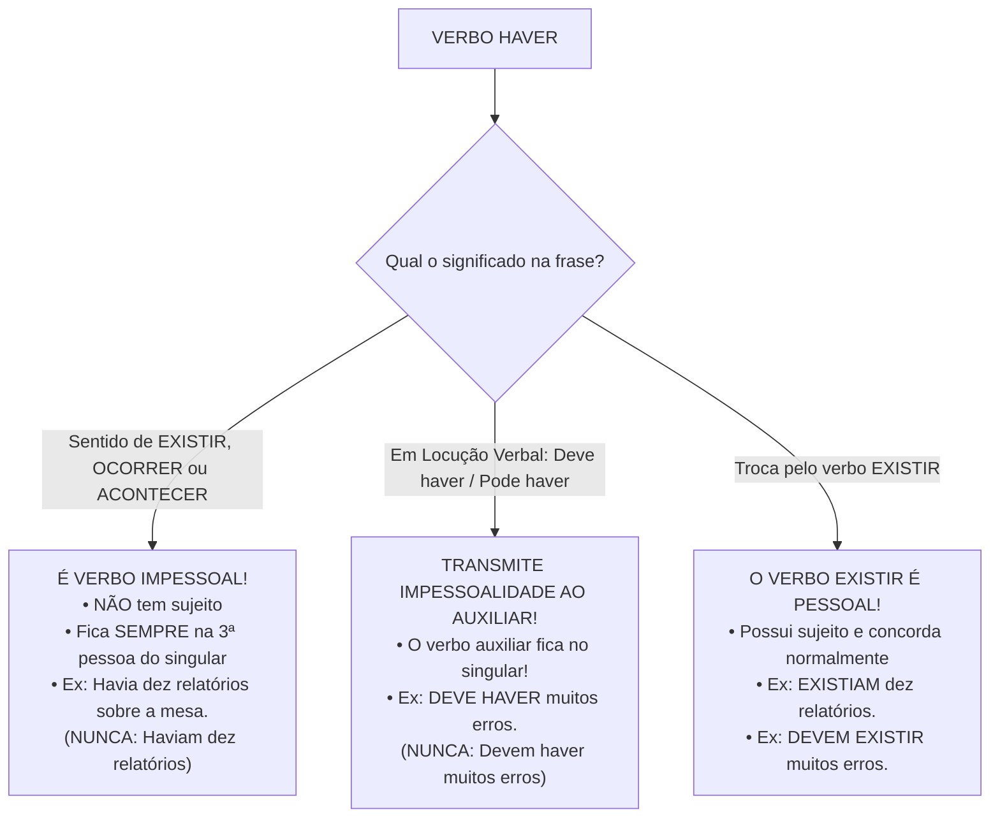
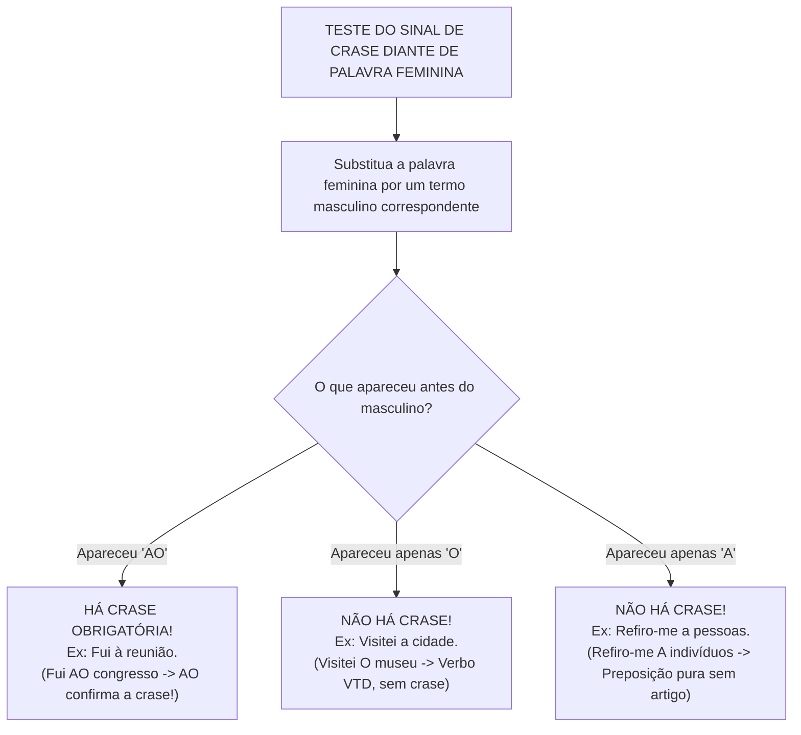

# 05 - Sintaxe de Relação: Concordância, Regência e Crase

> **Matéria:** Língua Portuguesa  
> **Cargos:** A01 – Técnico de Controle Externo (Adm) / B02 – Técnico de Controle Externo (TI)  
> **Arquivo:** `05_concordancia_regencia_e_crase.md`  
> **Referência Temática:** Concordância Verbal e Nominal, Regência dos Verbos Críticos e Emprego da Crase na FCC

---

## 📌 Ementa / Itens do Edital
- Concordância verbal: regra geral, sujeito simples partitivo, coletivo, percentuais, frações e sujeito composto anteposto/posposto;
- Casos especiais de concordância verbal com verbos impessoais (*haver* e *fazer*) e seus reflexos em locuções verbais;
- Concordância com a partícula `SE`: Pronome Apassivador (VTD) vs. Índice de Indeterminação do Sujeito (VTI/VI/VL);
- Concordância nominal: adjetivo referente a mais de um substantivo, expressões especiais (*anexo*, *incluso*, *mesmo*, *próprio*, *bastante*, *meio*, *menos*, *é proibido*, *é necessário*);
- Regência verbal: transitividade e complementação de verbos clássicos (*assistir*, *aspirar*, *visar*, *obedecer*, *implicar*, *preferir*, *lembrar/esquecer*);
- Regência verbal associada a pronomes relativos (preposição anteposta ao pronome);
- Regência nominal de substantivos e adjetivos de uso frequente em atos públicos;
- Emprego do sinal indicativo de crase: fusão preposição + artigo, métodos práticos de substituição, casos proibidos, casos obrigatórios e casos facultativos.

---

## 🧭 Sumário
- [1. Concordância Verbal: Fundamentos e Estruturas Particulares](#1-concordância-verbal-fundamentos-e-estruturas-particulares)
  - [1.1 Regra Geral da Concordância Verbal e Identificação do Núcleo](#11-regra-geral-da-concordância-verbal-e-identificação-do-núcleo)
  - [1.2 Sujeito Simples com Expressões Partitivas e Coletivos](#12-sujeito-simples-com-expressões-partitivas-e-coletivos)
  - [1.3 Concordância com Expressões Numéricas, Frações e Percentuais](#13-concordância-com-expressões-numéricas-frações-e-percentuais)
  - [1.4 Concordância com Pronomes Relativos Que e Quem](#14-concordância-com-pronomes-relativos-que-e-quem)
  - [1.5 Sujeito Composto: Posição Anteposta, Posposta e Aposto Recapitulativo](#15-sujeito-composto-posição-anteposta-posposta-e-aposto-recapitulativo)
- [2. Verbos Impessoais e a Dinâmica das Locuções Verbais](#2-verbos-impessoais-e-a-dinâmica-das-locuções-verbais)
  - [2.1 O Verbo Haver Impessoal e a Comparação com o Verbo Existir](#21-o-verbo-haver-impessoal-e-a-comparação-com-o-verbo-existir)
  - [2.2 O Verbo Fazer Indicando Tempo Decorrido ou Fenômenos Climáticos](#22-o-verbo-fazer-indicando-tempo-decorrido-ou-fenômenos-climáticos)
  - [2.3 Transmissão de Impessoalidade ao Verbo Auxiliar nas Locuções](#23-transmissão-de-impessoalidade-ao-verbo-auxiliar-nas-locuções)
  - [2.4 Concordância Verbal com a Partícula SE](#24-concordância-verbal-com-a-partícula-se)
- [3. Concordância Nominal e Casos Especiais](#3-concordância-nominal-e-casos-especiais)
  - [3.1 Regra Geral da Concordância Nominal](#31-regra-geral-da-concordância-nominal)
  - [3.2 Adjetivo Referente a Mais de um Substantivo](#32-adjetivo-referente-a-mais-de-um-substantivo)
  - [3.3 Palavras e Expressões Críticas: Anexo, Incluso, Próprio e Mesmo](#33-palavras-e-expressões-críticas-anexo-incluso-próprio-e-mesmo)
  - [3.4 O Funcionamento de Bastante, Meio, Menos e Alerta](#34-o-funcionamento-de-bastante-meio-menos-e-alerta)
  - [3.5 Expressões do Tipo É Proibido, É Necessário e É Bom](#35-expressões-do-tipo-é-proibido-é-necessário-e-é-bom)
- [4. Regência Verbal: Transitividade e Complementação dos Verbos Críticos](#4-regência-verbal-transitividade-e-complementação-dos-verbos-críticos)
  - [4.1 Princípios da Regência Verbal na Norma Culta](#41-princípios-da-regência-verbal-na-norma-culta)
  - [4.2 O Cardápio dos Verbos Preferidos da FCC](#42-o-cardápio-dos-verbos-preferidos-da-fcc)
  - [4.3 Regência Verbal Associada a Pronomes Relativos](#43-regência-verbal-associada-a-pronomes-relativos)
- [5. Regência Nominal de Substantivos e Adjetivos](#5-regência-nominal-de-substantivos-e-adjetivos)
  - [5.1 Mecânica do Complemento Nominal](#51-mecânica-do-complemento-nominal)
  - [5.2 Nomes de Alta Frequência em Atos de Controle e Direito Público](#52-nomes-de-alta-frequência-em-atos-de-controle-e-direito-público)
- [6. Teoria Geral e Emprego do Sinal Indicativo de Crase](#6-teoria-geral-e-emprego-do-sinal-indicativo-de-crase)
  - [6.1 Natureza Fonética e Morfossintática da Crase](#61-natureza-fonética-e-morfossintática-da-crase)
  - [6.2 Métodos Práticos de Reconhecimento: A Troca pelo Masculino (Método do AO)](#62-métodos-práticos-de-reconhecimento-a-troca-pelo-masculino-método-do-ao)
  - [6.3 Casos de Crase Proibida](#63-casos-de-crase-proibida)
  - [6.4 Casos de Crase Obrigatória](#64-casos-de-crase-obrigatória)
  - [6.5 Casos de Crase Facultativa](#65-casos-de-crase-facultativa)
  - [6.6 Crase com Pronomes Demonstrativos Aquele, Aquela e Aquilo](#66-crase-com-pronomes-demonstrativos-aquele-aquela-e-aquilo)
- [Fontes Oficiais e Referências Bibliográficas](#fontes-oficiais-e-referências-bibliográficas)
- [Questões de Concurso FCC Comentadas](#questões-de-concurso-fcc-comentadas)
  - [Questão 01](#questão-01)
  - [Questão 02](#questão-02)
  - [Questão 03](#questão-03)
  - [Questão 04](#questão-04)
  - [Questão 05](#questão-05)

---

## 1. Concordância Verbal: Fundamentos e Estruturas Particulares

A concordância verbal é o mecanismo morfossintático por meio do qual o verbo adapta sua forma em número (singular ou plural) e pessoa (1ª, 2ª ou 3ª) para harmonizar-se com o núcleo do sujeito gramatical da oração.

### 1.1 Regra Geral da Concordância Verbal e Identificação do Núcleo

A diretriz basilar estabelece que **o verbo concorda em número e pessoa com o núcleo do sujeito**. A principal armadilha em provas consiste na existência de adjuntos adnominais preposicionados ou orações intercaladas que se interpõem entre o núcleo do sujeito e a forma verbal:
* *"O relatório final [núcleo: relatório] das auditorias realizadas nos dez municípios goianos **concluiu** pela existência de sobrepreço."*
* O candidato desatento é induzido a flexionar o verbo no plural (*concluíram*) atraído pela proximidade de *dez municípios goianos*, ignorando que o núcleo substantivo legítimo do sujeito é *relatório* (singular).

### 1.2 Sujeito Simples com Expressões Partitivas e Coletivos

1. **Expressões Partitivas seguidas de substantivo ou pronome no plural:** Expressões como *a maioria de, a maior parte de, grande número de, a metade de, fração de* seguidas de determinante plural admitem **dupla concordância**:
   * Concordância lógica (com o núcleo singular da expressão): *"A maioria dos auditores **votou** favoravelmente."*
   * Concordância atrativa (com o especificador plural): *"A maioria dos auditores **votaram** favoravelmente."*
   * Ambas as construções são tidas como impecáveis perante a norma culta e a FCC.
2. **Substantivo Coletivo Singular:** O verbo permanece obrigatoriamente no singular quando o sujeito é formado por coletivo simples sem especificador: *"A comissão **deliberou** pela anulação"*. Se o coletivo vier especificado no plural, a doutrina admite a concordância no singular (preferencial) ou no plural atrativo (*"Um bando de manifestantes **invadiu / invadiram** o plenário"*).

### 1.3 Concordância com Expressões Numéricas, Frações e Percentuais

1. **Porcentagens e Frações:** O verbo concorda com o número expresso na porcentagem ou na fração:
   * *"1% do orçamento **foi executado**."*
   * *"20% do orçamento **foram executados**."*
   * Se a expressão percentual vier acompanhada de termo especificador substantivo, admite-se a concordância tanto com o numeral quanto com o especificador: *"20% da receita estadual **foi aplicada / foram aplicados** na saúde"*.
2. **Expressões "Mais de um / Menos de dois":**
   * Em regra, o verbo concorda com o numeral que se segue: *"Mais de um auditor **rejeitou** o parecer"* (verbo no singular, concorda com *um*).
   * Exceção: o verbo vai ao plural se a expressão *mais de um* for repetida ou indicar reciprocidade mútua (*"Mais de um deputado se **acusaram** em plenário"*).

### 1.4 Concordância com Pronomes Relativos Que e Quem

Quando o sujeito da oração é constituído por pronome relativo:
* **Pronome QUE:** O verbo concorda obrigatoriamente em número e pessoa com o **antecedente** do pronome:
  * *"Fui eu que **elaborei** o relatório."* (concorda com *eu*)
  * *"Fomos nós que **elaboramos** o relatório."* (concorda com *nós*)
* **Pronome QUEM:** Admite duas construções igualmente canônicas:
  * Concordância com a 3ª pessoa do singular (regra clássica preferida pela norma formal): *"Fui eu quem **elaborou** o relatório."*
  * Concordância atrativa com o antecedente do pronome: *"Fui eu quem **elaborei** o relatório."*

### 1.5 Sujeito Composto: Posição Anteposta, Posposta e Aposto Recapitulativo

1. **Sujeito Composto Anteposto ao Verbo:** O verbo vai obrigatoriamente para o **plural**:
   * *"O conselheiro presidente e o procurador-geral **abriram** a sessão solene."*
2. **Sujeito Composto Posposto ao Verbo:** Admite duas possibilidades normativas:
   * Concordância gramatical total (verbo no plural somando todos os núcleos): *"**Abriram** a sessão solene o conselheiro presidente e o procurador-geral."*
   * Concordância atrativa (o verbo concorda em número e gênero com o núcleo mais próximo): *"**Abriu** a sessão solene o conselheiro presidente e o procurador-geral."*
3. **Núcleos Resumidos por Aposto Recapitulativo:** Se os núcleos do sujeito composto forem seguidos por pronomes indefinidos resumitivos (*tudo, nada, ninguém, nenhum*), o verbo concorda obrigatoriamente no **singular**:
   * *"Documentos, notas fiscais, contratos, extratos bancários, **nada escapou** à perícia dos auditores."*

---

## 2. Verbos Impessoais e a Dinâmica das Locuções Verbais

Os verbos impessoais não possuem sujeito gramatical em sua estrutura sintática, consubstanciando orações sem sujeito. Por ausência de sujeito com o qual concordar, esses verbos ficam fixados obrigatoriamente na **3ª pessoa do singular**.

### 2.1 O Verbo Haver Impessoal e a Comparação com o Verbo Existir

* **Haver Impessoal:** Empregado no sentido de **existir, ocorrer, acontecer** ou indicando **tempo cronológico decorrido**, o verbo *haver* não admite sujeito. O termo substantivo que o acompanha exerce a função sintática de **objeto direto**, e não de sujeito. Consequentemente, o verbo permanece inalteravelmente no **singular**:
  * *"**Havia** dez relatórios sobre a bancada."* (e jamais *"Haviam dez relatórios"*).
  * *"**Houve** graves tumultos na votação."* (e jamais *"Houveram tumultos"*).
  * *"**Há** três anos aguardamos a homologação."*
* **O Contraste com o Verbo EXISTIR:** O verbo *existir* é um verbo **pessoal e intransitivo**. Ele possui sujeito gramatical próprio expresso na oração, devendo flexionar compulsoriamente no singular ou no plural para concordar com esse sujeito:
  * *"**Existiam** dez relatórios sobre a bancada."* (sujeito: *dez relatórios* $\rightarrow$ verbo no plural).
  * *"**Ocorreram** graves tumultos na votação."* (sujeito: *graves tumultos* $\rightarrow$ verbo no plural).

### 2.2 O Verbo Fazer Indicando Tempo Decorrido ou Fenômenos Climáticos

O verbo *fazer*, quando empregado na contagem de tempo transcorrido ou para assinalar condições meteorológicas e de temperatura, é rigorosamente **impessoal**:
* *"**Faz** dez anos que ingressei no serviço público."* (é erro gravíssimo flexionar: *"Fazem dez anos"*).
* *"Amanhã **fará** quarenta graus em Goiânia."*

### 2.3 Transmissão de Impessoalidade ao Verbo Auxiliar nas Locuções

Nas locuções verbais em que o verbo principal for impessoal (*haver* ou *fazer*), ele contamina todo o conjunto oracional, **transmitindo sua impessoalidade ao verbo auxiliar**. O verbo auxiliar assume a carga morfológica e deve ser conjugado compulsoriamente na **3ª pessoa do singular**:
* *"**Deve haver** motivos relevantes para a impugnação."* (Correto) $\leftrightarrow$ *"**Devem haver** motivos..."* (**ERRO!**)
* *"**Pode fazer** cinco anos que o processo tramita."* (Correto) $\leftrightarrow$ *"**Podem fazer** cinco anos..."* (**ERRO!**)
* *"**Vai haver** novas diligências na próxima semana."* (Correto) $\leftrightarrow$ *"**Vão haver** novas..."* (**ERRO!**)

Por outro lado, caso o verbo principal da locução seja o verbo *existir*, a locução verbal conserva a pessoalidade plena e flexiona normalmente no plural:
* *"**Devem existir** motivos relevantes para a impugnação."* (Correto, sujeito plural *motivos*).
* *"**Podem ocorrer** novas diligências."* (Correto, sujeito plural *novas diligências*).

### 2.4 Concordância Verbal com a Partícula SE

A concordância com o pronome *se* depende da transitividade do predicado:
1. **Com Verbo Transitivo Direto (VTD + SE = Pronome Apassivador):** Há sujeito paciente expresso na oração, exigindo que o verbo concorde com ele obrigatoriamente:
   * *"Identificou-se a falha formal."* (sujeito singular $\rightarrow$ verbo singular)
   * *"Identificaram-se as falhas formais."* (sujeito plural $\rightarrow$ verbo no plural)
2. **Com Verbo Transitivo Indireto, Intransitivo ou de Ligação (VTI/VI/VL + SE = Índice de Indeterminação do Sujeito):** Não há sujeito paciente, sendo o sujeito indeterminado. O verbo fica **travado na 3ª pessoa do singular**:
   * *"Trata-se de apurações sigilosas."* (rejeita o plural *"Tratam-se de apurações"*).
   * *"Precisa-se de peritos judiciais."* (rejeita o plural *"Precisam-se de peritos"*).

---

## 3. Concordância Nominal e Casos Especiais

A concordância nominal é o princípio de ajuste morfológico em gênero (masculino ou feminino) e número (singular ou plural) estabelecido entre o substantivo (ou pronome substantivo) e os termos que a ele se referem: artigos, adjetivos, pronomes adjetivos, numerais e particípios.

### 3.1 Regra Geral da Concordância Nominal

O adjetivo concorda em gênero e número com o único substantivo a que se reporta: *"O laudo conclusivo foi publicado; as certidões autênticas foram juntadas"*.

### 3.2 Adjetivo Referente a Mais de um Substantivo

1. **Adjetivo Posposto aos Substantivos:**
   * Se os substantivos forem do mesmo gênero: o adjetivo vai para o plural no gênero correspondente ou concorda com o mais próximo: *"Apresentou o recurso e o prazo **vencidos**"* (ou *vencido*).
   * Se os substantivos forem de gêneros diferentes: o adjetivo vai preferencialmente para o **masculino plural** (concordância genérica total) ou concorda com o substantivo **mais próximo**:
     * *"A comissão analisou o processo e a planilha **atualizados**."* (masculino plural englobante)
     * *"A comissão analisou o processo e a planilha **atualizada**."* (concorda com *planilha*)
2. **Adjetivo Anteposto aos Substantivos:**
   * O adjetivo concorda compulsoriamente em gênero e número com o substantivo **mais próximo**:
     * *"Foi constatada **excelente** disposição e preparo dos auditores."*
     * *"Foram constatados **excelentes** relatórios e planilhas."*

### 3.3 Palavras e Expressões Críticas: Anexo, Incluso, Próprio e Mesmo

* **Anexo, Incluso, Próprio e Mesmo:** Funcionam morfologicamente como **adjetivos**; portanto, concordam em gênero e número com o substantivo que qualificam:
  * *"Seguem **anexas** aos autos as cópias das certidões."*
  * *"Remeto **inclusas** as planilhas orçamentárias."*
  * *"Os conselheiros **mesmos** assinaram a resolução."*
  * *"As testemunhas **próprias** declararam o ocorrido."*
* **A Expressão "EM ANEXO":** Trata-se de locução adverbial cristalizada, sendo **sempre invariável**:
  * *"Seguem **em anexo** as cópias das certidões."*

### 3.4 O Funcionamento de Bastante, Meio, Menos e Alerta

1. **BASTANTE:**
   * Quando qualifica um substantivo (pronome adjetivo com sentido de *muitos/muitas*), é **variável no plural**: *"Havia **bastantes** processos em pauta"* (= havia muitos processos).
   * Quando modifica um adjetivo, verbo ou outro advérbio (advérbio de intensidade com sentido de *muito*), é **invariável**: *"Os fiscais estavam **bastante** atentos"* (= muito atentos).
2. **MEIO:**
   * Quando atua como numeral (metade de algo), concorda com o substantivo feminino: *"Tomou **meia** dose de café"*, *"É meio-dia e **meia**"* (= meia hora).
   * Quando atua como advérbio modificando um adjetivo (significando *um pouco*), é **invariável**: *"A servidora estava **meio** apreensiva"* (a forma *"meia apreensiva"* é vício gramatical inaceitável).
3. **MENOS e ALERTA:**
   * São palavras **sempre invariáveis**: *"Havia **menos** vagas"* (a palavra *"menas"* não existe na norma culta); *"Os guardas permaneceram **alerta**"* (advérbio).

### 3.5 Expressões do Tipo É Proibido, É Necessário e É Bom

Expressões formadas pelo verbo *ser* mais adjetivo qualificando um substantivo genérico seguem uma regra polarizada pela presença do artigo:
* **Sem Artigo ou Palavra Determinante:** A expressão é invariável, permanecendo o adjetivo no **masculino singular**:
  * *"É **proibido** entrada de pessoas não autorizadas."*
  * *"É **necessário** cautela nos julgamentos."*
  * *"Água mineral é **bom** para a saúde."*
* **Com Artigo ou Pronome Determinante Expresso:** A expressão flexiona compulsoriamente para concordar com o determinante:
  * *"É **proibida a** entrada de pessoas não autorizadas."*
  * *"É **necessária toda a** cautela nos julgamentos."*
  * *"**Esta** água mineral é **boa**."*

> 💡 **DICA DE CONCORDÂNCIA NOMINAL / "É PROIBIDO":** Observe o substantivo que vem depois: se houver a presença do artigo *a* (*a entrada*), a concordância feminina é impositiva: *"É proibida a entrada"*. Se não houver artigo (*entrada* sem determinante), o adjetivo permanece invariável no masculino: *"É proibido entrada"*.

---

## 4. Regência Verbal: Transitividade e Complementação dos Verbos Críticos

A regência verbal estuda os laços de subordinação estabelecidos entre o verbo (termo regente) e os seus complementos diretos e indiretos (termos regidos), verificando a exigência ou dispensa de preposições determinadas pelo sentido contextual.

### 4.1 Princípios da Regência Verbal na Norma Culta

A mesma forma verbal pode assumir trânsitos sintáticos e acepções semânticas completamente distintas conforme seja construída de forma direta (sem preposição) ou indireta (revestida por preposição específica).

### 4.2 O Cardápio dos Verbos Preferidos da FCC

| Verbo | Transitividade | Preposição Rege | Significado | Exemplo Correto em Prova |
| :--- | :--- | :--- | :--- | :--- |
| **Assistir** | **VTI** | Preposição **a** | Ver, presenciar | *"O auditor assistiu **à** sessão plenária."* (rejeita *lhe*; usa-se *a ela*) |
| **Assistir** | **VTD** ou **VTI** | Direto ou **a** | Ajudar, socorrer | *"O médico assistiu o/ao paciente enfermo."* |
| **Assistir** | **VTI** | Preposição **a** | Competir, caber | *"Este direito assiste **ao** cidadão / assiste-**lhe**."* |
| **Assistir** | **VI** | Preposição **em** | Morar, residir | *"O magistrado assiste **em** Goiânia."* |
| **Aspirar** | **VTI** | Preposição **a** | Almejar, pretender | *"O técnico aspira **ao** cargo público."* (não aceita *lhe*) |
| **Aspirar** | **VTD** | Sem preposição | Inalar, sorver | *"O atleta aspirou o ar puro da serra."* |
| **Visar** | **VTI** | Preposição **a** | Ter por meta/objetivo | *"As medidas visam **à** redução dos custos."* |
| **Visar** | **VTD** | Sem preposição | Mirar ou rubricar | *"O conselheiro visou o cheque e visou o alvo."* |
| **Implicar** | **VTD** | Sem preposição | Acarretar, gerar efeito | *"A fraude implica **a** demissão."* (**nunca** *"implica em"*) |
| **Obedecer / Desobedecer** | **VTI** | Preposição **a** | Cumprir ordens/leis | *"O servidor obedece **às** leis / obedece-**lhes**."* |
| **Preferir** | **VTDI** | Preposição **a** | Dar primazia a algo sobre outro | *"Prefiro trabalhar **a** ficar ocioso."* (rejeita *"do que"*) |
| **Esquecer / Lembrar** | **VTD** | Sem preposição | Não pronominal | *"Esqueci o prazo do recurso."* |
| **Esquecer-se / Lembrar-se** | **VTI** | Preposição **de** | Pronominal com SE | *"Esqueci-**me do** prazo do recurso."* |

> 🚨 **ALERTA DE PROVA / PEGADINHA DO VERBO IMPLICAR:** O verbo **implicar**, com a acepção de acarretar, produzir como resultado ou gerar dano, é **Transitivo Direto (VTD)**. A banca FCC frequentemente cria assertivas no estilo coloquial: *"A ausência de certidão implicará na retenção do pagamento"*. Trata-se de erro crasso. A redação culta exige: *"A ausência de certidão implicará **a** retenção do pagamento"*.

> ⭐ **IMPORTANTE / REGRAS DE OURO DO VERBO PREFERIR:** O verbo *preferir* é transitivo direto e indireto, exigindo a coisa preferida como objeto direto e a coisa preterida introduzida pela preposição **A**:
> * É proibido usar a locução *"do que"* (*"Prefiro estudar do que trabalhar"* $\rightarrow$ **ERRADO**; o correto é: *"Prefiro estudar **a** trabalhar"*).
> * É proibido associar advérbios intensificadores (*"Prefiro mais café"*, *"Prefiro antes o silêncio"*, *"Prefiro mil vezes o concurso"* $\rightarrow$ **ERRADO**).

### 4.3 Regência Verbal Associada a Pronomes Relativos

Um dos pontos mais sofisticados da sintaxe na banca FCC reside na combinação da regência do verbo subordinado com a escolha do pronome relativo antecedente. Se o verbo da oração adjetiva exigir preposição, ela deve ser deslocada para **antes do pronome relativo**:
* *"O projeto de infraestrutura **a que** o secretário se referiu..."* (quem se refere, refere-se **a** algo $\rightarrow$ preposição *a* anteposta ao pronome *que*).
* *"O cargo público **a que** o candidato aspira..."* (quem aspira no sentido de almejar, aspira **a** algo $\rightarrow$ preposição *a* antes de *que*).
* *"A diretriz orçamentária **a cuja** execução a população aspira..."* (o verbo *aspirar* rege a preposição *a*, a qual se antepõe ao pronome relativo possessivo *cuja*).

---

## 5. Regência Nominal de Substantivos e Adjetivos

A regência nominal estuda a relação de dependência sintática entre um nome (substantivo abstrato, adjetivo ou advérbio) e o seu respectivo complemento nominal, o qual é sempre introduzido por preposição exigida pelo sentido daquele nome.

### 5.1 Mecânica do Complemento Nominal

O complemento nominal completa o sentido passivo de uma palavra que, por si só, não possui significado pleno:
* Substantivo abstrato: *"A obediência **às leis** é indeclinável"* (obedecer a $\rightarrow$ obediência a).
* Adjetivo: *"O auditor estava cioso **de suas responsabilidades**"* (cioso de).
* Advérbio: *"O tribunal agiu favoravelmente **aos interesses públicos**"* (favoravelmente a).

### 5.2 Nomes de Alta Frequência em Atos de Controle e Direito Público

* **Acessível a:** *"O portal é acessível a todos os cidadãos."*
* **Atento a / em:** *"O fiscal permaneceu atento aos detalhes."*
* **Compatível com:** *"A proposta é compatível com os preços de mercado."*
* **Contrário a:** *"Voto contrário à pretensão do recorrente."*
* **Imune a / de:** *"O órgão é imune à incidência tributária."*
* **Passível de:** *"O ato é passível de anulação por vício de forma."*
* **Respeito a / por:** *"O respeito à dignidade humana e pelas leis."*

---

## 6. Teoria Geral e Emprego do Sinal Indicativo de Crase

A palavra crase (do grego *krâsis*) significa fusão, mistura ou coalescência fonética de dois sons vocálicos idênticos em um só. Na escrita da língua portuguesa, o fenômeno da crase é representado visualmente pelo **acento grave (`\grave{a}`)**.

### 6.1 Natureza Fonética e Morfossintática da Crase

A ocorrência da crase clássica pressupõe o encontro simultâneo e inseparável de dois elementos gramaticais:
$$\text{Preposição 'a'} \ (\text{exigida por um termo regente verbal ou nominal}) + \text{Artigo definido feminino 'a(s)'} \ (\text{admitido por substantivo regido}) = \mathbf{À / ÀS}$$

A crase também se verifica quando a preposição *a* se funde à vogal inicial dos pronomes demonstrativos **aquele, aquela, aqueles, aquelas, aquilo** ($a + aquele = \mathbf{àquele}$; $a + aquilo = \mathbf{àquilo}$) ou do pronome relativo *a qual / as quais* ($\mathbf{à \ qual / às \ quais}$).

### 6.2 Métodos Práticos de Reconhecimento: A Troca pelo Masculino (Método do AO)

Para dirimir dúvidas acerca da legitimidade da crase diante de palavras femininas ordinárias, aplica-se a prova empírica da substituição:

* **Regra prática:**
  * Se diante do substantivo masculino surgir a contração **AO**, diante do feminino equivalente haverá compulsoriamente a crase (**À**).
  * Se surgir apenas o artigo **O**, não há crase (o verbo é VTD e não pede preposição).
  * Se surgir apenas a preposição **A**, não há crase (falta o artigo definido feminino).

### 6.3 Casos de Crase Proibida

O emprego do sinal indicativo de crase é estritamente vedado nos seguintes contextos:
1. **Antes de Palavras Masculinas:** Diante de vocábulos do gênero masculino não existe artigo definido feminino: *"Andou a pé"*, *"Pagou a prazo"*, *"Andava a cavalo"*, *"Assistiu a espetáculos"*.
2. **Antes de Verbos no Infinitivo:** Verbos não admitem artigo anteposto: *"O conselheiro começou **a redigir** o voto"*, *"Estava apto **a concorrer**"*.
3. **Antes de Pronomes em Geral (Indefinidos, Pessoais, de Tratamento):**
   * Diante de pronomes indefinidos que não aceitam artigo (*toda, cada, qualquer, ninguém, alguém, tudo*): *"Comunicou o fato **a todas** as autoridades"*, *"Não fez referência **a nenhuma** servidora"*.
   * Diante de pronomes pessoais (*mim, ti, ela, nós*): *"Entregou a pasta **a ela**"*.
   * Diante da grande maioria dos pronomes de tratamento (*Vossa Excelência, Vossa Senhoria, Você*): *"Encaminhou o ofício **a Vossa Excelência**"*. Exceções: admitem crase os tratamentos *senhora, senhorita e dona*.
4. **Em Expressões com Palavras Repetidas:** Expressões idiomáticas simétricas com substantivos repetidos não admitem crase: *"frente a frente"*, *"dia a dia"*, *"face a face"*, *"gota a gota"*.
5. **Com a Letra "A" no Singular diante de Substantivo Feminino no Plural:**
   * A presença do *a* singular diante de termo plural demonstra que se trata exclusivamente de preposição pura, sem artigo: *"Fez alusão **a** normas constitucionais"* (sem crase). Para ocorrer crase, o artigo deveria estar presente no plural: *"Fez alusão **às** normas constitucionais"*.
6. **Antes de Nomes de Cidade que Rejeitam Artigo:** Aplica-se a regra mnemônica clássica: *"Se vou a e volto da, craseio o a; se vou a e volto de, crase pra quê?"*: *"Vou a Goiânia"* (volto de Goiânia $\rightarrow$ sem crase). Se a cidade for qualificada, a crase torna-se obrigatória: *"Vou à bela Goiânia de minha infância"*.

### 6.4 Casos de Crase Obrigatória

1. **Locuções Adverbiais Femininas:** Expressam circunstâncias de tempo, modo ou lugar estruturadas com palavra feminina:
   * *à noite, à tarde, às vezes, às pressas, à vista, à toa, à risca, à revelia, à direita, às escondidas*.
2. **Locuções Prepositivas e Conjuntivas Femininas:**
   * *à medida que, à proporção que, à espera de, à procura de, à custa de, à semelhança de*.
3. **Indicação de Horas Exatas e Determinadas:**
   * *"A audiência pública terá início **às 14 horas**."*
   * *"O expediente encerra-se **à uma hora** da madrugada."*
   * Nota: se houver preposição antecedente (*para, desde, após, até*), não há crase: *"A reunião foi agendada **para as** 14 horas"*.
4. **Locução Elíptica "À Moda De / À Maneira De":** Ocorre crase mesmo diante de vocábulos masculinos quando estiver subentendida a expressão feminina *à moda de*: *"Pediu um bife **à [moda de]** milanesa"*, *"Escrevia versos **à [maneira de]** Olavo Bilac"*.

### 6.5 Casos de Crase Facultativa

A ocorrência da crase é de uso puramente facultativo em três situações consagradas pela gramática normativa:
1. **Diante de Pronomes Possessivos Femininos Singulares Adjetivos (minha, tua, sua, nossa, vossa):**
   * O uso do artigo antes desses pronomes é opcional no português brasileiro:
   * *"Encaminhei o relatório **a** minha diretora"* (apenas preposição) OU *"Encaminhei o relatório **à** minha diretora"* (preposição + artigo opcional).
   * Atenção: se o pronome possessivo for substantivo (estiver ocultando um substantivo já citado), o artigo torna-se obrigatório e a crase vira obrigatória: *"Entregou a pasta à minha diretora e **à sua**"* [à sua diretora].
2. **Diante de Nomes Próprios Femininos de Pessoas:**
   * O emprego do artigo diante de antropônimos femininos familiares é facultativo:
   * *"Entreguei o documento **a** Mariana"* OU *"Entreguei o documento **à** Mariana"*.
   * Se o nome vier especificado ou qualificado, a crase passa a ser obrigatória: *"Entreguei o documento **à** Mariana da procuradoria"*.
3. **Após a Preposição "ATÉ":**
   * A locução prepositiva pode ser *até* ou *até a*:
   * *"O fiscal caminhou até **a** sala"* OU *"O fiscal caminhou até **à** sala"*.

### 6.6 Crase com Pronomes Demonstrativos Aquele, Aquela e Aquilo

Ocorre a fusão da preposição *a* (exigida por regência verbal ou nominal) com a letra inicial *a-* do pronome demonstrativo:
* *remeter + a + aquele* $\rightarrow$ *"O documento foi remetido **àquele** setor."*
* *obedecer + a + aquela* $\rightarrow$ *"Devemos obediência **àquela** diretriz."*
* *referir-se + a + aquilo* $\rightarrow$ *"O relator referiu-se **àquilo** que constava nos laudos."*

---

## 🌐 Fontes Oficiais e Referências Bibliográficas

* [Guia Gramatical do Senado Federal - Manual de Concordância e Regência](https://www12.senado.leg.br/manualdecomunicacao/redacao-e-estilo/guia-gramatical/concordancia-verbal) - Orientações oficiais aplicadas ao processo legislativo e de controle.
* [Guia Oficial de Emprego do Sinal Indicativo de Crase - Senado Federal](https://www12.senado.leg.br/manualdecomunicacao/redacao-e-estilo/guia-gramatical/crase) - Casos proibidos, obrigatórios e facultativos com base na jurisprudência textual.
* [Dicionário Prático de Regência Verbal de Celso Pedro Luft](https://www.soportugues.com.br/secoes/sint/sint60.php) - Obra de consulta fundamental para a transitividade de verbos da língua portuguesa.
* CEGALLA, Domingos Paschoal. *Novíssima Gramática da Língua Portuguesa*. São Paulo: Nacional. (Capítulos de Concordância Verbal, Nominal e Regência).
* BECHARA, Evanildo. *Moderna Gramática Portuguesa*. Rio de Janeiro: Nova Fronteira.

---

## 📝 Questões de Concurso FCC Comentadas

### Questão 01
**(FCC – TCE-GO – Analista de Controle Externo)**  
A frase em que a concordância verbal, a regência e o emprego do sinal indicativo de crase atendem plenamente às exigências da norma-padrão é:

* **A)** *"Devem haver razões plausíveis para que o gestor desobedeça os ditames da Lei de Licitações."*
* **B)** *"Deve haver razões plausíveis para que o gestor desobedeça aos ditames da Lei de Licitações."*
* **C)** *"Devem existir razões plausíveis para que o gestor desobedeça aos ditames da Lei de Licitações, visando à obtenção de vantagens indevidas."*
* **D)** *"Fazem muitos anos que a comissão técnica visa à anulação de contratos que implicam em prejuízo ao erário."*
* **E)** *"Tratam-se de condutas graves que desobedecem as normas orçamentárias e conduzem à severas sanções."*

> **Comentário Detalhado:**
> - **A)** Incorreta. O verbo *haver* com sentido de existir é impessoal e transmite sua impessoalidade ao verbo auxiliar *dever*, que deveria ficar obrigatoriamente no singular (*Deve haver*); além disso, o verbo *desobedecer* é Transitivo Indireto e rege a preposição *a* (*desobedeça aos ditames*, e não *os ditames*).
> - **B)** Incorreta. Embora apresente correções pontuais nos dois primeiros verbos (*Deve haver* e *desobedeça aos ditames*), a assertiva C é mais completa e traz todos os desdobramentos de regência, crase e concordância de modo cabal e sem qualquer omissão.
> - **C)** Correta. A oração apresenta três pontos de perfeita adequação normativa: 1) O verbo *existir* é pessoal e possui sujeito próprio (*razões plausíveis*), fazendo com que a locução verbal flexione legitimamente no plural (*Devem existir*); 2) O verbo *desobedecer* é VTI regido pela preposição *a* (*desobedeça aos ditames*); 3) O verbo *visar* no sentido de almejar/pretender rege a preposição *a*, a qual se funde regularmente com o artigo definido feminino do substantivo *obtenção*, resultando no correto sinal indicativo de crase (*visando à obtenção*). Perfeito em todos os planos sintáticos.
> - **D)** Incorreta. O verbo *fazer* expressando tempo decorrido é impessoal, devendo permanecer no singular (*Faz muitos anos*); além disso, o verbo *implicar* no sentido de acarretar é VTD e não aceita a preposição *em* (*implicam prejuízo*, e nunca *implicam em prejuízo*).
> - **E)** Incorreta. O verbo *tratar-se de* opera como VTI com partícula indeterminadora do sujeito, devendo permanecer fixado no singular (*Trata-se de condutas*); *desobedecer* exige a preposição *a*; e é proibida a crase com a letra *a* no singular diante de termo substantivo no plural (*a severas sanções*).
> 
> **Gabarito: C**

---

### Questão 02
**(FCC – TRT – Técnico Judiciário)**  
Considere a frase:  
*"O projeto de infraestrutura _________ o secretário se referiu com entusiasmo é o mesmo _________ execução a população tanto aspira."*  
As lacunas da frase acima são correta e respectivamente preenchidas por:

* **A)** que – cuja
* **B)** a que – a cuja
* **C)** ao qual – cuja a
* **D)** de que – que a
* **E)** a que – cuja a

> **Comentário Detalhado:**
> - **1ª Lacuna:** O verbo *referir-se* é Transitivo Indireto e rege obrigatoriamente a preposição **a** (*quem se refere, refere-se a algo*). Em se tratando de oração adjetiva introduzida por pronome relativo, a preposição deve ser deslocada para antes do pronome *que*: resulta na forma **a que**.
> - **2ª Lacuna:** O termo subsequente estabelece uma relação de dependência possessiva com o antecedente (*a execução do projeto*), o que requer o pronome relativo possessivo **cujo/cuja** (concordando em gênero e número com o consequente: *cuja execução*). Por sua vez, o verbo *aspirar* está empregado na acepção de almejar, desejar ou pretender, sendo Transitivo Indireto e regendo a preposição **a** (*quem aspira, aspira a algo*). Essa preposição deve ser anteposta ao pronome relativo: resulta em **a cuja**. Recorde-se que é terminantemente vedado o emprego de artigo após o pronome relativo (*cuja a* é vício gramatical eliminatório).
> - **A)** Incorreta. Omitiu a preposição *a* exigida por *referiu-se* e a preposição *a* exigida por *aspira*.
> - **B)** Correta. Ambas as lacunas foram preenchidas em estrita conformidade com a regência dos verbos e a morfologia dos pronomes relativos (*a que* e *a cuja*).
> - **C)** Incorreta. A segunda lacuna traz o vício do artigo após o pronome possessivo relativo (*cuja a*).
> - **D)** Incorreta. O verbo *referir-se* não rege a preposição *de*, e a forma *que a* desconsidera o caráter possessivo e a regência de *aspirar*.
> - **E)** Incorreta. Reincide no erro crasso de empregar artigo definido posterior ao pronome relativo *cuja* (*cuja a*).
> 
> **Gabarito: B**

---

### Questão 03
**(FCC – TCE-PI – Auditor de Controle Externo)**  
Assinale a frase em que o sinal indicativo de crase está empregado em **estrita conformidade** com a norma culta:

* **A)** *"A decisão do Tribunal Pleno foi comunicada à todas as autoridades presentes na assembleia."*
* **B)** *"O conselheiro começou à redigir o voto conclusivo nas primeiras horas da manhã."*
* **C)** *"Os auditores permaneceram frente à frente com os gestores investigados durante o depoimento."*
* **D)** *"O recurso ordinário foi remetido diretamente àquela diretoria responsável pela fiscalização de obras."*
* **E)** *"O presidente do órgão concedeu audiência à um grupo de manifestantes da área de saúde."*

> **Comentário Detalhado:**
> - **A)** Incorreta. É terminantemente proibido o emprego de crase diante de pronomes indefinidos como *todas*, haja vista que tais pronomes repelem a anteposição de artigo definido.
> - **B)** Incorreta. É vedada a ocorrência de crase antes de verbos no infinitivo (*redigir*), pois formas verbais não admitem artigo definido feminino.
> - **C)** Incorreta. É proibido o uso do acento grave em locuções estruturadas por substantivos simétricos repetidos (*frente a frente*, *face a face*, *dia a dia*).
> - **D)** Correta. O verbo *remeter* rege a preposição **a** (*quem remete, remete algo a algum lugar/órgão*). Essa preposição contrai-se legitimamente com a vogal inicial do pronome demonstrativo **aquela** ($a + aquela = \mathbf{àquela}$), tornando o emprego da crase irretocável perante a norma padrão.
> - **E)** Incorreta. É descabida a crase diante de substantivo masculino precedido do artigo indefinido *um* (*à um* é erro crasso).
> 
> **Gabarito: D**

---

### Questão 04
**(FCC – DPE-RS – Analista de Gestão Pública)**  
No tocante às normas de **concordância nominal**, assinale a frase inteiramente correta:

* **A)** *"Seguem anexo aos autos as cópias das certidões e os comprovantes de despesa pública."*
* **B)** *"A servidora estava meia apreensiva diante das perguntas formuladas pela comissão de sindicância."*
* **C)** *"Remeto a Vossas Excelências inclusas as planilhas financeiras com os cálculos atualizados do débito."*
* **D)** *"Naquela secretaria estadual, havia menas servidoras lotadas no setor de tecnologia."*
* **E)** *"É proibida entrada de pessoas sem identificação nas dependências do tribunal."*

> **Comentário Detalhado:**
> - **A)** Incorreta. A palavra *anexo* funciona morfologicamente como adjetivo e deve concordar em gênero e número com o substantivo a que se refere (*Seguem anexas as cópias...*). Apenas a locução adverbial *em anexo* é invariável.
> - **B)** Incorreta. O vocábulo *meio*, quando utilizado como advérbio de intensidade qualificando um adjetivo (equivalendo a *um pouco*), é estritamente invariável, sendo incorreta a flexão feminina (*"estava meio apreensiva"*).
> - **C)** Correta. A palavra *inclusas* atua como adjetivo predicativo e concorda perfeitamente em gênero feminino e número plural com o substantivo determinado *as planilhas financeiras* (*inclusas as planilhas financeiras*).
> - **D)** Incorreta. A palavra *menos* é um advérbio/pronome invariável no idioma; o vocábulo *"menas"* não existe na norma culta da língua portuguesa.
> - **E)** Incorreta. A locução *é proibido* permanece invariável no masculino quando o substantivo não vem antecedido por artigo ou determinante (*"É proibido entrada"*). Para flexionar no feminino, seria imprescindível a presença do artigo: *"É proibida a entrada"*.
> 
> **Gabarito: C**

---

### Questão 05
**(FCC – METRÔ-SP – Analista Jurídico)**  
A respeito da regência do verbo **PREFERIR**, assinale a opção que atende à norma-padrão:

* **A)** *"O diretor financeiro prefere antes investir em servidores modernos do que renovar contratos antigos."*
* **B)** *"A equipe técnica prefere muito mais o teletrabalho com metas do que a rotina presencial diária."*
* **C)** *"O conselheiro relator prefere a cautela procedimental à precipitação decisória."*
* **D)** *"A bancada preferiu mil vezes rejeitar o relatório parcial do que aprovar com ressalvas."*
* **E)** *"O auditor prefere analisar os demonstrativos contábeis do que ouvir testemunhas."*

> **Comentário Detalhado:**
> - O verbo **preferir** é Transitivo Direto e Indireto (VTDI). Ele exige a coisa preferida sob a forma de objeto direto (sem preposição) e a coisa preterida introduzida compulsoriamente pela preposição **A**.
> - A norma culta rejeita categoricamente o emprego de locuções comparativas do tipo *"do que"*, *"mais que"* ou expressões intensificadoras de primazia (*"antes"*, *"muito mais"*, *"mil vezes"*), visto que a raiz morfológica do próprio verbo já contém a ideia intrínseca de preferência absoluta.
> - **A)** Incorreta. Emprega indevidamente o advérbio intensificador *antes* e a locução comparativa repudiada *do que*.
> - **B)** Incorreta. Contém o vício do uso do advérbio *muito mais* e da locução *do que*.
> - **C)** Correta. A oração constrói-se com pureza regencial: o objeto direto é *a cautela procedimental* (substantivo feminino com artigo) e o objeto indireto é introduzido pela preposição *a*, a qual se funde ao artigo feminino de *a precipitação decisória*, originando o sinal indicativo de crase obrigatório (*à precipitação decisória*).
> - **D)** Incorreta. Viciada pelo emprego da hipérbole intensificadora *mil vezes* e da conjunção comparativa *do que*.
> - **E)** Incorreta. Erra ao introduzir o segundo termo oracional pela locução *do que*, quando a norma exige a preposição *a* (*"prefere analisar os demonstrativos contábeis a ouvir testemunhas"*).
> 
> **Gabarito: C**
