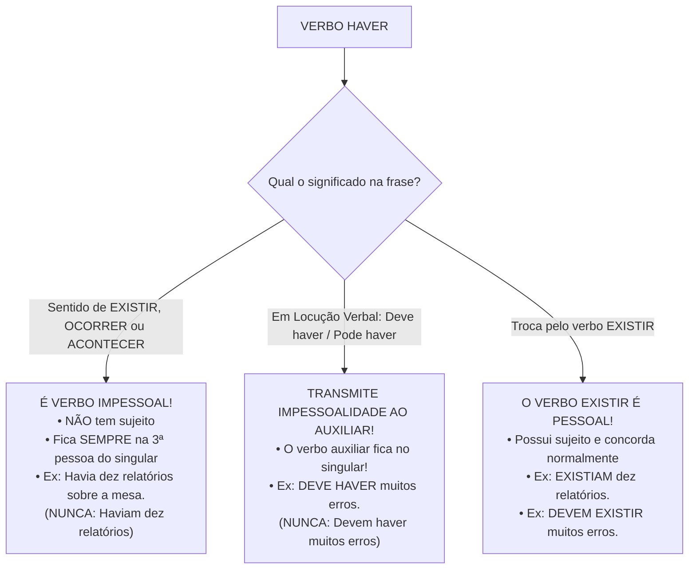
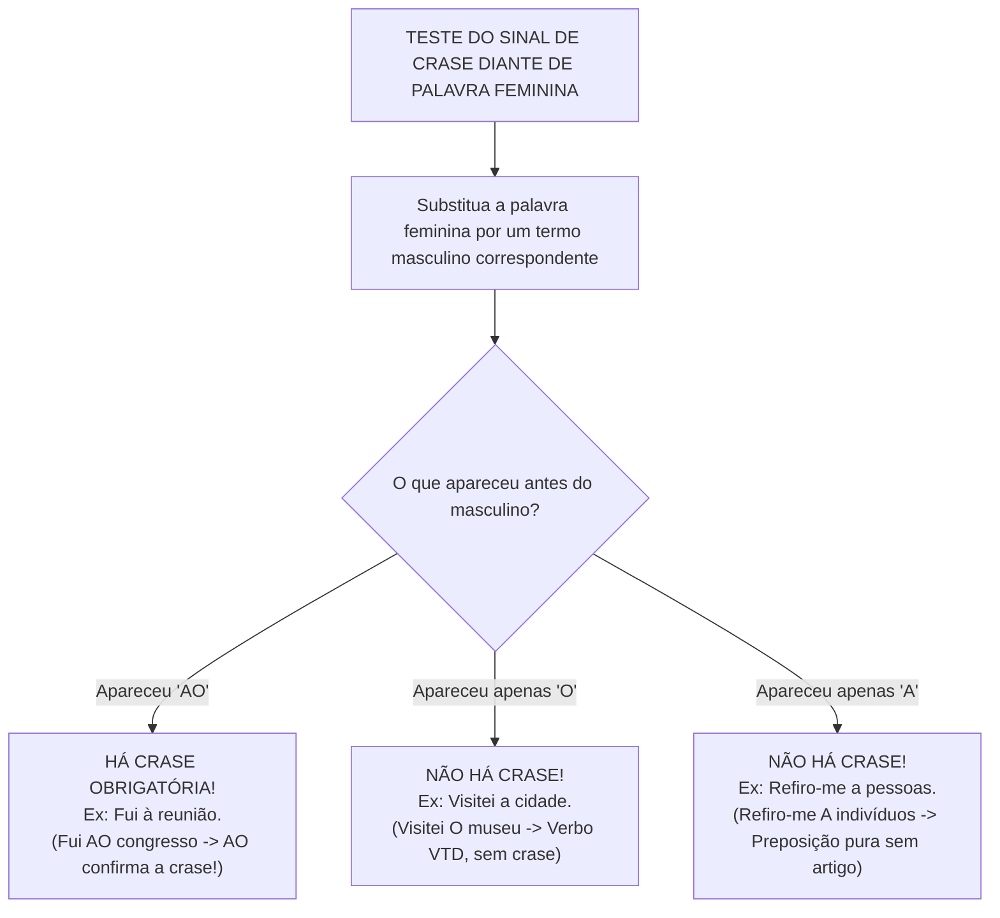

# 05 - Sintaxe de Relação: Concordância, Regência e Crase

> **Matéria:** Língua Portuguesa  
> **Cargos:** A01 – Técnico de Controle Externo (Adm) / B02 – Técnico de Controle Externo (TI)  
> **Arquivo:** `05_concordancia_regencia_e_crase.md`  
> **Referência Temática:** Concordância Verbal e Nominal, Regência dos Verbos Críticos e Emprego da Crase na FCC

---

## 📌 Ementa / Itens do Edital
- Concordância verbal: regra geral, sujeito simples partitivo, coletivo, percentuais, frações e sujeito composto anteposto/posposto;
- Casos especiais de concordância verbal com verbos impessoais (*haver* e *fazer*) e seus reflexos em locuções verbais;
- Concordância com a partícula `SE`: Pronome Apassivador (VTD) vs. Índice de Indeterminação do Sujeito (VTI/VI/VL);
- Concordância nominal: adjetivo referente a mais de um substantivo, expressões especiais (*anexo*, *incluso*, *mesmo*, *próprio*, *bastante*, *meio*, *menos*, *é proibido*, *é necessário*);
- Regência verbal: transitividade e complementação de verbos clássicos (*assistir*, *aspirar*, *visar*, *obedecer*, *implicar*, *preferir*, *lembrar/esquecer*);
- Regência verbal associada a pronomes relativos (preposição anteposta ao pronome);
- Regência nominal de substantivos e adjetivos de uso frequente em atos públicos;
- Emprego do sinal indicativo de crase: fusão preposição + artigo, métodos práticos de substituição, casos proibidos, casos obrigatórios e casos facultativos.

---

## 🌳 Classificação Hierárquica

```text
5. Sintaxe de Relação e Normas Gramaticais Fundamentais
├── 5.1 Concordância Verbal
│   ├── 5.1.1 Regra Geral: Harmonia de número e pessoa entre verbo e o núcleo do sujeito
│   ├── 5.1.2 Sujeito Simples com Estruturas Particulares:
│   │   ├── Expressões Partitivas (a maioria de, a maior parte de + substantivo plural) -> singular ou plural
│   │   ├── Expressões Numéricas e Percentuais (concordância com o número ou com o especificador)
│   │   ├── Pronomes Relativos "Que" (concorda com o antecedente) e "Quem" (3ª singular ou antecedente)
│   │   └── Nomes Próprios Plurais (com artigo -> verbo no plural; sem artigo -> verbo no singular)
│   ├── 5.1.3 Sujeito Composto:
│   │   ├── Anteposto ao verbo: Plural obrigatório
│   │   ├── Posposto ao verbo: Plural total ou atrativo com o núcleo mais próximo
│   │   └── Resumido por aposto recapitulativo (tudo, nada, ninguém) -> Verbo no singular
│   └── 5.1.4 Verbos Impessoais e a Partícula 'SE':
│       ├── Haver (no sentido de existir, ocorrer ou tempo decorrido) -> Invariável na 3ª pessoa do singular
│       ├── Haver em Locuções Verbais (transmite a impessoalidade ao verbo auxiliar -> Deve haver, Pode haver)
│       ├── Fazer (indicando tempo decorrido ou fenômeno climático) -> Invariável na 3ª pessoa do singular
│       ├── Voz Passiva Sintética (VTD + SE) -> Verbo concorda obrigatoriamente com o sujeito paciente
│       └── Indeterminação do Sujeito (VTI/VI/VL + SE) -> Verbo fixado na 3ª pessoa do singular
├── 5.2 Concordância Nominal
│   ├── 5.2.1 Regra Geral: Adjetivos, artigos, pronomes e numerais concordam em gênero e número com o substantivo
│   ├── 5.2.2 Adjetivo posposto a substantivos de gêneros diferentes: Masculino plural ou atrativo com o mais próximo
│   ├── 5.2.3 Adjetivo anteposto a múltiplos substantivos: Concorda obrigatoriamente com o substantivo mais próximo
│   └── 5.2.4 Palavras e Expressões Críticas:
│       ├── Anexo, incluso, próprio, mesmo -> Adjetivos variáveis (concordam com o substantivo)
│       ├── "Em anexo" -> Expressão adverbial invariável
│       ├── Bastante / Meio -> Variáveis como adjetivo/numeral; invariáveis como advérbio
│       ├── Menos e Alerta -> Palavras sempre invariáveis
│       └── "É proibido / É necessário / É bom" -> Sem artigo: masculino singular; Com artigo: concorda com o artigo
├── 5.3 Regência Verbal e Nominal
│   ├── 5.3.1 Verbos de Alta Incidência em Provas:
│   │   ├── Assistir: Ver/presenciar (VTI com 'a'); Prestar auxílio (VTD ou VTI); Competir (VTI com 'a'); Morar (VI com 'em')
│   │   ├── Aspirar: Inalar/cheirar (VTD); Almejar/pretender (VTI com 'a', não aceita 'lhe')
│   │   ├── Visar: Mirar/apontar (VTD); Pôr visto (VTD); Ter por objetivo (VTI com 'a')
│   │   ├── Implicar: Acarretar/produzir resultado (VTD direto, sem preposição 'em')
│   │   ├── Preferir: VTDI (prefere algo 'A' outro, vedado "do que" ou advérbios intensificadores)
│   │   ├── Obedecer e Desobedecer: Sempre VTI com preposição 'a' (admitem pronome 'lhe')
│   │   └── Esquecer e Lembrar: Não pronominais (VTD); Pronominais esquecer-se/lembrar-se (VTI com 'de')
│   └── 5.3.2 Regência Verbal associada a Pronomes Relativos (Anteposição obrigatória da preposição exigida pelo verbo)
└── 5.4 Emprego do Sinal Indicativo de Crase
    ├── 5.4.1 Natureza da Crase: Contração da preposição 'a' com artigo definido 'a(s)' ou pronomes aquele(s)/aquela(s)/aquilo
    ├── 5.4.2 Método Prático de Substituição: Troca pelo termo masculino equivalente (se gerar "AO" -> Crase confirmada)
    ├── 5.4.3 Casos Proibidos:
    │   ├── Antes de palavras masculinas e verbos no infinitivo
    │   ├── Antes de pronomes pessoais e pronomes de tratamento (exceto senhora, senhorita e dona)
    │   ├── Antes de pronomes indefinidos (toda, cada, qualquer, ninguém)
    │   ├── Em expressões com palavras repetidas (dia a dia, face a face)
    │   └── 'A' no singular diante de palavra no plural (indica preposição pura, sem artigo)
    ├── 5.4.4 Casos Obrigatórios:
    │   ├── Locuções adverbiais femininas de tempo, modo e lugar (à noite, às pressas, à vista)
    │   ├── Locuções prepositivas e conjuntivas femininas (à medida que, à proporção que, à espera de)
    │   ├── Indicação de horas exatas determinadas (às 14 horas, às duas horas)
    │   └── Expressão elíptica "à moda de / à maneira de" (mesmo diante de palavra masculina)
    └── 5.4.5 Casos Facultativos:
        ├── Diante de pronomes possessivos femininos singulares adjetivos (minha, tua, sua)
        ├── Diante de nomes próprios femininos de pessoas
        └── Após a preposição 'até'
```

---

## 📖 Resumo Teórico & Pontos-Chave

### 1. Concordância do Verbo Impessoal HAVER e do Verbo FAZER



#### Regras Práticas de Impessoalidade:
1. **Haver (existir/ocorrer):** Invariável no singular (*Houve discussões acaloradas*; *Haverá novas eleições*).
2. **Haver e Fazer indicando tempo decorrido:** Invariáveis no singular (*Há três anos não o vejo*; *Faz dez meses que a auditoria começou*; *Vai fazer dois anos*).
3. **Se houver verbo auxiliar:** O auxiliar assume a impessoalidade e **trava no singular**:
   * *Deve haver motivos para a decisão.* (Correto)
   * *Devem haver motivos para a decisão.* (ERRADO!)
   * *Pode fazer cinco anos.* (Correto)
   * *Podem fazer cinco anos.* (ERRADO!)

---

### 2. Regência Verbal: O Cardápio dos Verbos Preferidos da FCC

| Verbo | Transitividade | Preposição Rege | Significado | Exemplo Correto em Prova |
| :--- | :--- | :--- | :--- | :--- |
| **Assistir** | **VTI** | Preposição **a** | Ver, presenciar | *"O auditor assistiu **à** sessão plenária."* (rejeita *lhe*; usa-se *a ela*) |
| **Assistir** | **VTD** ou **VTI** | Direto ou **a** | Ajudar, socorrer | *"O médico assistiu o/ao paciente enfermo."* |
| **Assistir** | **VTI** | Preposição **a** | Competir, caber | *"Este direito assiste **ao** cidadão / assiste-**lhe**."* |
| **Aspirar** | **VTI** | Preposição **a** | Almejar, pretender | *"O técnico aspira **ao** cargo público."* (não aceita *lhe*) |
| **Aspirar** | **VTD** | Sem preposição | Inalar, sorver | *"O atleta aspirou o ar puro da montanha."* |
| **Visar** | **VTI** | Preposição **a** | Ter por meta | *"As medidas visam **à** redução dos custos."* |
| **Visar** | **VTD** | Sem preposição | Mirar ou rubricar | *"O conselheiro visou o cheque e visou o alvo."* |
| **Implicar** | **VTD** | Sem preposição | Acarretar, gerar | *"A fraude implica **a** demissão."* (**nunca** *"implica em"*) |
| **Obedecer** | **VTI** | Preposição **a** | Cumprir ordens | *"O servidor obedece **às** leis / obedece-**lhes**."* |
| **Preferir** | **VTDI** | Preposição **a** | Querer antes | *"Prefiro trabalhar **a** ficar ocioso."* (sem *"do que"*) |

---

### 3. A Mecânica da Crase: O Teste Definitivo do "AO"



#### Os Três Casos Facultativos da Crase (Memorização Rápida):
1. **Pronome Possessivo Feminino Singular Adjetivo:**
   * Diante de *minha, tua, sua, nossa, vossa* acompanhando substantivo:
   * *"Enviei o relatório **a** minha diretora"* OU *"Enviei o relatório **à** minha diretora"*.
2. **Nome Próprio Feminino de Pessoa:**
   * Diante de nomes de mulheres sem especificador:
   * *"Entreguei a pasta **a** Mariana"* OU *"Entreguei a pasta **à** Mariana"*.
3. **Após a Preposição "ATÉ":**
   * *"O auditor caminhou até **a** sala"* OU *"O auditor caminhou até **à** sala"*.

---

## ⚠️ Alertas de Prova & Pegadinhas da FCC

> 🚨 **ALERTA DE PROVA / PEGADINHA FCC:** O verbo **IMPLICAR**, no sentido de acarretar ou trazer como consequência, é **Transitivo Direto (VTD)**. A FCC sempre tenta seduzir o candidato com a redação popular com *"em"*: *"A irregularidade implicará na nulidade do contrato"*. **ERRADO!** O correto segundo a norma culta é: *"A irregularidade implicará **a** nulidade do contrato"*.

> ⭐ **IMPORTANTE / VERBO PREFERIR:** O verbo *preferir* exige a preposição **A** e rejeita enfaticamente qualquer termo intensificador ou comparativo:
> * *"Prefiro mais café do que chá"* $\rightarrow$ **ERRADO!**
> * *"Prefiro mil vezes matemática do que história"* $\rightarrow$ **ERRADO!**
> * *"Prefiro café **a** chá"* $\rightarrow$ **CORRETO!**

> 📌 **NOTA EXPLICATIVA / CRASE COM "A" NO SINGULAR E SUBSTANTIVO NO PLURAL:**
> Se a letra **a** estiver no singular e o substantivo feminino subsequente estiver no plural, **NUNCA OCORRE CRASE**:
> * *"Fez alusão **a** normas constitucionais"* $\rightarrow$ Correto (apenas preposição pura).
> * *"Fez alusão **à** normas..."* $\rightarrow$ **ERRO CRASSO!**
> * Para haver crase, ambos devem estar no plural: *"Fez alusão **às** normas constitucionais"*.

> 💡 **DICA DE CONCORDÂNCIA NOMINAL / "É PROIBIDO":**
> * Sem artigo / palavra determinante $\rightarrow$ Expressão invariável: *"É **proibido** entrada de pessoas estranhas"*.
> * Com artigo / palavra determinante $\rightarrow$ Expressão concorda: *"É **proibida a** entrada de pessoas estranhas"*.

---

## 🌐 Fontes Oficiais e Referências Bibliográficas

* [Guia Gramatical do Senado Federal - Manual de Concordância e Regência](https://www12.senado.leg.br/manualdecomunicacao/redacao-e-estilo/guia-gramatical/concordancia-verbal) - Orientações oficiais aplicadas ao processo legislativo e de controle.
* [Guia Oficial de Emprego do Sinal Indicativo de Crase - Senado Federal](https://www12.senado.leg.br/manualdecomunicacao/redacao-e-estilo/guia-gramatical/crase) - Casos proibidos, obrigatórios e facultativos com base na jurisprudência textual.
* [Dicionário Prático de Regência Verbal de Celso Pedro Luft](https://www.soportugues.com.br/secoes/sint/sint60.php) - Obra de consulta fundamental para a transitividade de verbos da língua portuguesa.
* CEGALLA, Domingos Paschoal. *Novíssima Gramática da Língua Portuguesa*. São Paulo: Nacional. (Capítulos de Concordância Verbal, Nominal e Regência).
* BECHARA, Evanildo. *Moderna Gramática Portuguesa*. Rio de Janeiro: Nova Fronteira.

---

## 📝 Questões de Concurso FCC Comentadas

### Questão 01
**(FCC – TCE-GO – Analista de Controle Externo)**  
A frase em que a concordância verbal, a regência e o emprego do sinal indicativo de crase atendem plenamente às exigências da norma-padrão é:

* **A)** *"Devem haver razões plausíveis para que o gestor desobedeça os ditames da Lei de Licitações."*
* **B)** *"Deve haver razões plausíveis para que o gestor desobedeça aos ditames da Lei de Licitações."*
* **C)** *"Devem existir razões plausíveis para que o gestor desobedeça aos ditames da Lei de Licitações, visando à obtenção de vantagens indevidas."*
* **D)** *"Fazem muitos anos que a comissão técnica visa à anulação de contratos que implicam em prejuízo ao erário."*
* **E)** *"Tratam-se de condutas graves que desobedecem as normas orçamentárias e conduzem à severas sanções."*

> **Gabarito: C**  
> **Comentário Detalhado:**  
> - **A) Incorreta.** O verbo *haver* no sentido de existir é impessoal e transmite a impessoalidade ao auxiliar (*Deve haver* no singular); ademais, o verbo *desobedecer* é VTI e rege a preposição *a* (*desobedeça aos ditames*).  
> - **B) Incorreta.** Embora a primeira oração esteja correta (*Deve haver* e *desobedeça aos ditames*), compare com a integridade da letra C.  
> - **C) CORRETA.** 1) O verbo *existir* é pessoal, logo a locução verbal flexiona perfeitamente no plural (*Devem existir razões plausíveis*); 2) O verbo *desobedecer* é VTI e rege preposição *a* (*desobedeça aos ditames*); 3) O verbo *visar* no sentido de almejar rege preposição *a*, que se funde ao artigo feminino de *a obtenção*, gerando crase correta (*visando à obtenção*). Impecável em todos os aspectos!  
> - **D) Incorreta.** O verbo *fazer* indicando tempo decorrido é impessoal (*Faz muitos anos*); além disso, o verbo *implicar* no sentido de acarretar é VTD e não aceita a preposição *em* (*implicam prejuízo*, e não *implicam em prejuízo*).  
> - **E) Incorreta.** *Tratar-se de* exige singular (*Trata-se de*); *desobedecer* rege preposição *a*; e não cabe crase com *a* no singular diante do plural *severas sanções*.

---

### Questão 02
**(FCC – TRT – Técnico Judiciário)**  
Considere a frase:  
*"O projeto de infraestrutura _________ o secretário se referiu com entusiasmo é o mesmo _________ execução a população tanto aspira."*  
As lacunas da frase acima são correta e respectivamente preenchidas por:

* **A)** que – cuja
* **B)** a que – a cuja
* **C)** ao qual – cuja a
* **D)** de que – que a
* **E)** a que – cuja a

> **Gabarito: B**  
> **Comentário Detalhado:**  
> - **1ª Lacuna:** Quem se refere, refere-se **A** algo (o verbo *referir-se* é VTI e rege preposição *a*). Essa preposição deve ser anteposta ao pronome relativo *que*: **a que** o secretário se referiu.  
> - **2ª Lacuna:** O termo subsequente exprime relação de posse (*a execução do projeto*), exigindo o pronome relativo **cujo/cuja** (concordando com *execução*). Como o verbo *aspirar* está empregado no sentido de desejar/almejar (VTI que rege a preposição **a**), essa preposição deve ser obrigatoriamente colocada antes de *cuja*: **a cuja** execução a população tanto aspira. Lembrar que é terminantemente proibido o artigo após cujo (*cuja a* é erro).  
> - A combinação correta é **a que – a cuja** (letra B).

---

### Questão 03
**(FCC – TCE-PI – Auditor de Controle Externo)**  
Assinale a frase em que o sinal indicativo de crase está empregado em **estrita conformidade** com a norma culta:

* **A)** *"A decisão do Tribunal Pleno foi comunicada à todas as autoridades presentes na assembleia."*
* **B)** *"O conselheiro começou à redigir o voto conclusivo nas primeiras horas da manhã."*
* **C)** *"Os auditores permaneceram frente à frente com os gestores investigados durante o depoimento."*
* **D)** *"O recurso ordinário foi remetido diretamente àquela diretoria responsável pela fiscalização de obras."*
* **E)** *"O presidente do órgão concedeu audiência à um grupo de manifestantes da área de saúde."*

> **Gabarito: D**  
> **Comentário Detalhado:**  
> - **A) Incorreta.** É vedada a crase diante do pronome indefinido *todas* (que repele artigo definido).  
> - **B) Incorreta.** É terminantemente vedada a crase antes de verbos no infinitivo (*à redigir* é erro).  
> - **C) Incorreta.** Não ocorre crase em locuções formadas por palavras repetidas (*frente a frente*, *dia a dia*).  
> - **D) CORRETA.** O verbo *remeter* no sentido de enviar rege a preposição **a** (*remetido a algo/alguém*). O pronome demonstrativo **aquela** inicia-se com a letra *a*. Ocorre, portanto, a contração da preposição com a vogal inicial do pronome demonstrativo: **a + aquela = àquela**. Uso perfeito!  
> - **E) Incorreta.** É vedada a crase antes de palavra masculina precedida por artigo indefinido (*à um* é erro).

---

### Questão 04
**(FCC – DPE-RS – Analista de Gestão Pública)**  
No tocante às normas de **concordância nominal**, assinale a frase inteiramente correta:

* **A)** *"Seguem anexo aos autos as cópias das certidões e os comprovantes de despesa pública."*
* **B)** *"A servidora estava meia apreensiva diante das perguntas formuladas pela comissão de sindicância."*
* **C)** *"Remeto a Vossas Excelências inclusas as planilhas financeiras com os cálculos atualizados do débito."*
* **D)** *"Naquela secretaria estadual, havia menas servidoras lotadas no setor de tecnologia."*
* **E)** *"É proibida entrada de pessoas sem identificação nas dependências do tribunal."*

> **Gabarito: C**  
> **Comentário Detalhado:**  
> - **A) Incorreta.** A palavra *anexo* é um adjetivo e deve concordar em gênero e número com o substantivo a que se refere (*Seguem anexas as cópias...*). Apenas a locução *em anexo* é invariável.  
> - **B) Incorreta.** *Meio*, quando modifica um adjetivo com valor de "um pouco" (advérbio de intensidade), é rigorosamente invariável (*meio apreensiva*, e nunca *meia apreensiva*).  
> - **C) CORRETA.** A palavra *inclusas* é adjetivo e concorda regularmente em gênero feminino e número plural com o substantivo subsequente *as planilhas financeiras* (*inclusas as planilhas*).  
> - **D) Incorreta.** A palavra *menos* é invariável na língua portuguesa; a forma *"menas"* não existe na norma culta.  
> - **E) Incorreta.** A expressão *é proibido* fica no masculino quando o substantivo não vem precedido de artigo (*É proibido entrada*). Se houvesse o artigo *a*, seria *É proibida a entrada*.

---

### Questão 05
**(FCC – METRÔ-SP – Analista Jurídico)**  
A respeito da regência do verbo **PREFERIR**, assinale a opção que atende à norma-padrão:

* **A)** *"O diretor financeiro prefere antes investir em servidores modernos do que renovar contratos antigos."*
* **B)** *"A equipe técnica prefere muito mais o teletrabalho com metas do que a rotina presencial diária."*
* **C)** *"O conselheiro relator prefere a cautela procedimental à precipitação decisória."*
* **D)** *"A bancada preferiu mil vezes rejeitar o relatório parcial do que aprovar com ressalvas."*
* **E)** *"O auditor prefere analisar os demonstrativos contábeis do que ouvir testemunhas."*

> **Gabarito: C**  
> **Comentário Detalhado:**  
> - O verbo **preferir** é Transitivo Direto e Indireto (VTDI). Rege a coisa preferida como objeto direto (sem preposição) e a coisa preterida introduzida pela preposição **A**.  
> - É repudiado pela norma culta o emprego de locuções comparativas como *"do que"*, *"mais do que"* ou intensificadores como *"antes"*, *"muito mais"*, *"mil vezes"*, pois o prefixo *pre-* do verbo já embute o sentido de primazia.  
> - Na alternativa C: *"prefere a cautela procedimental* [objeto direto feminino com artigo] *à precipitação decisória* [objeto indireto feminino com crase: preposição a + artigo a]". Construção impecável!  
> - As alternativas A, B, D e E contêm o vício de usar *"do que"* ou advérbios proibidos com o verbo preferir.
