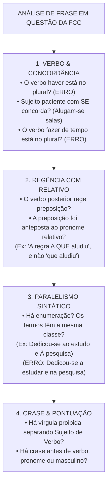
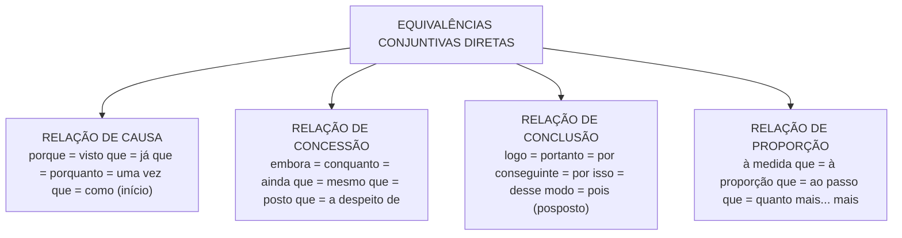

# 06 - Redação: Reescrita, Correção Gramatical e Equivalência de Estruturas

> **Matéria:** Língua Portuguesa  
> **Cargos:** A01 – Técnico de Controle Externo (Adm) / B02 – Técnico de Controle Externo (TI)  
> **Arquivo:** `06_redacao_reescrita_e_equivalencia_de_estruturas.md`  
> **Referência Temática:** Confronto de Frases, Paralelismo Sintático, Paráfrase e Reorganização Textual na FCC

---

## 📌 Ementa / Itens do Edital
- Redação: confronto e reconhecimento de frases corretas e incorretas segundo a norma culta;
- Organização e reorganização de orações e períodos: ordem direta vs. inversões estilísticas e impacto na clareza;
- Equivalência e transformação de estruturas: paráfrase sintática com preservação rigorosa do sentido original;
- Paralelismo sintático e semântico em enumerações e estruturas correlatas (*não só... mas também*, *tanto... quanto*);
- Ambiguidade estrutural e lexical: causas e métodos de saneamento sintático;
- Transposição entre orações desenvolvidas e orações reduzidas (infinitivo, gerúndio e particípio);
- Mecanismos de nominalização e concisão textual;
- Emprego correto das quatro formas dos porquês (*por que*, *por quê*, *porque* e *porquê*).

---

## 🧭 Sumário

1. [Confronto e Julgamento de Frases: O Checklist Caça-Erros da FCC](#1-confronto-e-julgamento-de-frases-o-checklist-caca-erros-da-fcc)
    1. [Estratégia de Varredura e Identificação de Vícios Gramaticais](#11-estrategia-de-varredura-e-identificacao-de-vicios-gramaticais)
    2. [Vícios Recorrentes em Provas de Tribunais](#12-vicios-recorrentes-em-provas-de-tribunais)
    3. [Pronomes Retos Usados Indevidamente como Objetos](#13-pronomes-retos-usados-indevidamente-como-objetos)
    4. [Teste 052](#Teste-052)
2. [Paralelismo Sintático e Semântico](#2-paralelismo-sintatico-e-semantico)
    1. [Princípio da Simetria Estrutural em Termos Coordenados](#21-principio-da-simetria-estrutural-em-termos-coordenados)
    2. [Paralelismo em Estruturas Correlativas](#22-paralelismo-em-estruturas-correlativas)
    3. [Casos Típicos de Quebra de Paralelismo e Métodos de Correção](#23-casos-tipicos-de-quebra-de-paralelismo-e-metodos-de-correcao)
    4. [Teste 053](#Teste-053)
    5. [Teste 054](#Teste-054)
3. [Ambiguidade e Vícios de Construção Frasal](#3-ambiguidade-e-vicios-de-construcao-frasal)
    1. [Ambiguidade Estrutural vs. Ambiguidade Lexical](#31-ambiguidade-estrutural-vs-ambiguidade-lexical)
    2. [Ambiguidade pelo Mau Emprego de Pronomes Possessivos (Seu/Sua)](#32-ambiguidade-pelo-mau-emprego-de-pronomes-possessivos-seusua)
    3. [O Mau Posicionamento de Adjuntos Adverbiais e Orações Reduzidas](#33-o-mau-posicionamento-de-adjuntos-adverbiais-e-oracoes-reduzidas)
    4. [O Emprego Vicioso do Vocábulo O Mesmo](#34-o-emprego-vicioso-do-vocabulo-o-mesmo)
    5. [Teste 055](#Teste-055)
    6. [Teste 056](#Teste-056)
4. [Organização e Reorganização de Orações e Períodos](#4-organizacao-e-reorganizacao-de-oracoes-e-periodos)
    1. [Ordem Direta e os Efeitos Comunicativos das Inversões](#41-ordem-direta-e-os-efeitos-comunicativos-das-inversoes)
    2. [Posicionamento Estratégico de Termos Intercalados e Pontuação](#42-posicionamento-estrategico-de-termos-intercalados-e-pontuacao)
    3. [Coesão Sequencial e Encadeamento Lógico de Argumentos](#43-coesao-sequencial-e-encadeamento-logico-de-argumentos)
    4. [Teste 057](#Teste-057)
5. [Equivalência, Transformação de Estruturas e Paráfrase](#5-equivalencia-transformacao-de-estruturas-e-parafrase)
    1. [Critérios Cumulativos da Paráfrase Legítima](#51-criterios-cumulativos-da-parafrase-legitima)
    2. [Transposição entre Orações Desenvolvidas e Reduzidas](#52-transposicao-entre-oracoes-desenvolvidas-e-reduzidas)
    3. [Matriz de Substituição e Equivalência de Conectivos](#53-matriz-de-substituicao-e-equivalencia-de-conectivos)
    4. [Mecanismos de Nominalização e Concisão Textual](#54-mecanismos-de-nominalizacao-e-concisao-textual)
    5. [Transposição de Vozes Verbais na Reescrita](#55-transposicao-de-vozes-verbais-na-reescrita)
    6. [Teste 058](#Teste-058)
    7. [Teste 059](#Teste-059)
6. [O Emprego Correto das Quatro Formas dos Porquês](#6-o-emprego-correto-das-quatro-formas-dos-porques)
    1. [Por que: Interrogativo e Relativo](#61-por-que-interrogativo-e-relativo)
    2. [Por quê: Isolado ou Imediatamente Antes de Pontuação](#62-por-que-isolado-ou-imediatamente-antes-de-pontuacao)
    3. [Porque: Conjunção Causal ou Explicativa](#63-porque-conjuncao-causal-ou-explicativa)
    4. [Porquê: Substantivo com Artigo ou Determinante](#64-porque-substantivo-com-artigo-ou-determinante)
    5. [Distinções Léxicas Adicionais: A Fim De vs. Afim e Ao Encontro De vs. De Encontro A](#65-distincoes-lexicas-adicionais-a-fim-de-vs-afim-e-ao-encontro-de-vs-de-encontro-a)
    6. [Teste 060](#Teste-060)
    7. [Teste 061](#Teste-061)
7. [🌐 Fontes Oficiais e Referências Bibliográficas](#fontes-oficiais-e-referencias-bibliograficas)

---

## 1. Confronto e Julgamento de Frases: O Checklist Caça-Erros da FCC

As questões de confronto e reconhecimento de frases corretas e incorretas constituem uma das marcas mais temidas e refinadas das provas elaboradas pela Fundação Carlos Chagas. Nelas, o enunciado costuma indagar: *"A frase redigida de modo inteiramente claro, correto e condizente com a norma-padrão é:"* ou *"O período que expressa com correção e concisão as ideias do texto é:"*.

Resolver esse modelo de questão exige do candidato abandonar a leitura intuitiva e aplicar uma **metodologia de varredura sintática por camadas**, inspecionando cada alternativa em busca dos vícios gramaticais recorrentes.

### 1.1 Estratégia de Varredura e Identificação de Vícios Gramaticais

Ao inspecionar uma alternativa de reescrita, examine os quatro pontos cardeais da sintaxe da frase:

1. **Concordância Verbal e Nominal:** Localize os núcleos dos sujeitos e confronte-os com as formas verbais correspondentes, sobretudo diante de inversões sintáticas ou de sujeitos oracionais; examine se verbos impessoais como *haver* e *fazer* foram pluralizados indevidamente.
2. **Regência Verbal associada a Pronomes Relativos:** Verifique se o verbo da oração subordinada adjetiva exige preposição e se essa preposição foi corretamente anteposta ao pronome relativo *que, quem, cujo* ou *o qual*.
3. **Emprego do Sinal Indicativo de Crase:** Cheque se a fusão decorre de preposição exigida e se não há crase antes de palavra masculina, verbo, pronome indefinido ou em expressões simétricas.
4. **Sintaxe de Pontuação e Ordem SVC:** Verifique se não houve a colocação de uma vírgula simples entre o sujeito e o predicado, ou entre o verbo e seus complementos diretos/indiretos.

### 1.2 Vícios Recorrentes em Provas de Tribunais

A FCC utiliza distratores padronizados para construir alternativas incorretas:

* Inserção de preposição indevida após o verbo *implicar* (*"implicará em nulidade"* $\rightarrow$ errado);
* Emprego de locuções comparativas proibidas com o verbo *preferir* (*"prefere trabalhar do que descansar"* $\rightarrow$ errado);
* Confusão entre formas parônimas como *a fim de* (finalidade) e *afim* (parentesco/afinidade), ou *ao encontro de* (concordância) e *de encontro a* (choque/colisão);
* Pluralização viciosa do verbo em construções com partícula indeterminadora do sujeito (*"Tratam-se de processos graves"* $\rightarrow$ errado; deve ser *Trata-se de*).

### 1.3 Pronomes Retos Usados Indevidamente como Objetos

A língua culta formal não admite o uso de pronomes pessoais do caso reto (*ele, ela, eles, elas*) na posição de complemento verbal direto. O pronome reto possui vocação exclusivamente subjetiva (função de sujeito da oração).

> 🚨 **ALERTA DE PROVA / PEGADINHA FCC:** Ao ler uma alternativa da FCC, desconfie sumariamente de sentenças que terminam com construções do tipo: *"A nova lei orçamentária trouxe regras rígidas e o gestor deve cumprir elas"*. Essa frase está eivada de erro gramatical inadmissível na norma culta! A forma exigida é com pronome oblíquo enclítico ajustado à terminação consonantal: *"deve cumpri-las"*.

---

### Teste 052
**(FCC – TRT-1 – Analista Judiciário (TI) – 2014)**  
Está plenamente correta a redação  deste livre comentário sobre o texto:

* **A)** Muita gente considera de que seus direitos são sem- pre preferíveis de se respeitar do que os dos outros, cometendo-se com isto uma irreparável injustiça pa- ra com seus semelhantes.
* **B)** O intrépido Luís Gama não hesitou em lançar mão de um argumento radical para defender seu cliente, um escravo acusado do assassinato de seu proprie- tário.
* **C)** Seria mesmo difícil de se imaginar a balbúrdia que se proclamou entre os expectadores que assistiam o julgamento de um escravo cuja defesa era de Luís Gama.
* **D)** Por levar em conta o sofrimento humano era que Antonio Gramsci não relutava uma análise objetiva dos casos onde as decisões fossem difíceis de se tomar.
* **E)** A preocupação principal do autor do texto está em demonstrar como se desejam preservar os direitos em que os detentores somos nós, ao passo que com os dos outros o mesmo não venha a ocorrer. _________________________________________________________ Atenção: As questões de números 9 a 15 referem-se ao texto seguinte. A cultura brasileira em tempos de utopia Durante os anos 1950 e 1960 a cultura e as artes brasi- leiras expressaram as utopias e os projetos políticos que marca- ram o debate nacional. Na década de 1950, emergiu a valoriza- ção da cultura popular, que tentava conciliar aspectos da tradi- ção com temas e formas de expressão modernas. No cinema, por exemplo, Nelson Pereira dos Santos, nos seus filmes Rio, 40 graus (1955) e Rio, zona norte (1957) mostrava a fotogenia das classes populares, denunciando a ex- clusão social. Na literatura, Guimarães Rosa publicou Grande sertão: veredas (1956) e João Cabral de Melo Neto escreveu o poema Morte e vida Severina − ambos assimilando traços da linguagem popular do sertanejo, submetida ao rigor estético da literatura erudita. Na música popular, a Bossa Nova, lançada em 1959 por Tom Jobim e João Gilberto, entre outros, inspirava-se no jazz , rejeitando a música passional e a interpretação dramática que se dava aos sambas-canções e aos boleros que dominavam as rádios brasileiras. A Bossa Nova apontava para o despojamento das letras das canções, dos arranjos instrumentais e da voca- lização, para melhor expressar o “Brasil moderno”. Já a primeira metade da década de 1960 foi marcada pelo encontro entre a vida cultural e a luta pelas Reformas de Base. Já não se tratava mais de buscar apenas uma expressão moderna, mas de pontuar os dilemas brasileiros e denunciar o subdesenvolvimento do país. Organizava-se, assim, a cultura engajada de esquerda, em torno do Movimento de Cultura Po- pular do Recife e do Centro Popular de Cultura da União Nacio- nal dos Estudantes (UNE), num processo que culminaria no Ci- nema Novo e na canção engajada, base da moderna música popular brasileira, a MPB. (Adaptado de: NAPOLITANO, Marcos e VILLAÇA, Mariana. História para o ensino médio . São Paulo: Atual, 2013, p. 738)

---

> **Comentário Detalhado:**
>
> - **A)** Correta. A frase observa com precisão a norma culta: a concordância verbal e nominal está impecável, a regência atende à norma-padrão e os elementos de coesão articulam as ideias com máxima clareza e concisão.
> - **B)** Incorreta. Há falha de concordância com sujeito paciente no plural.
> - **C)** Incorreta. Ocorre ambiguidade no emprego do pronome possessivo de terceira pessoa.
> - **D)** Incorreta. Há truncamento sintático e pontuação que isola indevidamente a oração subordinada substantiva.
> - **E)** Incorreta. Ocorre erro de regência na articulação do complemento verbal.
>
> **Gabarito: A**

---

## 2. Paralelismo Sintático e Semântico

O paralelismo (ou simetria de construção) é o princípio gramatical e estilístico que determina que elementos coordenados entre si, desempenhando a mesma função sintática no período, devem apresentar **estruturas morfológicas e gramaticais idênticas ou equivalentes**.

### 2.1 Princípio da Simetria Estrutural em Termos Coordenados

Quando se coordenam termos em enumeração (ligados por vírgula ou pela conjunção *e*), todos devem pertencer à mesma classe gramatical ou seguir o mesmo padrão frasal:

* Se o primeiro termo for um substantivo, os seguintes devem ser substantivos (*"Exige-se probidade, competência e lealdade"*);
* Se o primeiro for um verbo no infinitivo, os seguintes devem ser verbos no infinitivo (*"O dever de fiscalizar, orientar e julgar"*);
* Se o primeiro for uma oração desenvolvida introduzida por *que*, os seguintes devem manter a mesma estrutura subordinada (*"Determinou que se revisassem os cálculos e que se notificasse o responsável"*).

### 2.2 Paralelismo em Estruturas Correlativas

Nas estruturas formadas por pares de conectivos correlativos (*não só... mas também*, *não apenas... como também*, *tanto... quanto*, *seja... seja*, *quer... quer*, *ora... ora*), a exigência de simetria é rigorosa: o que vier imediatamente após o primeiro termo correlativo deve ter a mesma natureza sintática do que vier após o segundo polo:

* **Construção Perfeita:** *"O tribunal busca aprimorar os mecanismos de fiscalização **não só para conferir transparência**, **mas também para garantir a legalidade**."* (ambos estruturados por oração subordinada final reduzida de infinitivo: *para conferir* $\leftrightarrow$ *para garantir*).
* **Construção Defeituosa (Quebra de Paralelismo):** *"O tribunal busca aprimorar os mecanismos **não só para conferir transparência**, **mas garantindo a legalidade**."* (misturou oração com preposição + infinitivo com oração reduzida no gerúndio).

### 2.3 Casos Típicos de Quebra de Paralelismo e Métodos de Correção

| Frase com Quebra de Paralelismo (Incorreta) | Causa do Desvio | Frase com Paralelismo Perfeito (Correta) |
| :--- | :--- | :--- |
| *"A equipe dedicou-se **a examinar** os contratos e **na verificação** das certidões."* | Misturou verbo no infinitivo regido por *a* com substantivo preposicionado em *em*. | *"A equipe dedicou-se **a examinar** os contratos e **a verificar** as certidões."* |
| *"A auditoria constatou **o desvio** de verbas e **que faltavam** documentos."* | Coordenou um substantivo simples (*o desvio*) com uma oração desenvolvida (*que faltavam*). | *"A auditoria constatou **o desvio** de verbas e **a falta** de documentos."* |
| *"O tribunal tem como atribuição **fiscalizar** as contas e **a emissão** de pareceres."* | Coordenou forma verbal no infinitivo (*fiscalizar*) com substantivo abstrato (*a emissão*). | *"O tribunal tem como atribuição **fiscalizar** as contas e **emitir** pareceres."* |
| *"A comissão propôs **a revisão** das medições e **que se fizesse** nova perícia."* | Coordenou frase nominal com oração subordinada substantiva. | *"A comissão propôs **a revisão** das medições e **a realização** de nova perícia."* |

---

### Teste 053
**(FCC – TRT-14 – Analista Judiciário (TI) – 2016)**  
Está clara e correta a redação deste livre comentário sobre o texto:

* **A)** Os homens interiorizam conceitos e valores referentes à mulher sem acreditarem que estão cultivando e pondo em prática os mais abomináveis preconceitos.
* **B)** São abomináveis os conceitos e valores de que os homens acreditam e põem em prática no que diz respeito às mulheres sem ter consciência disso.
* **C)** As mulheres são vítimas dos preconceitos e valores abomináveis com que os homens cultivam e interiorizam a seu respeito em suas práticas.
* **D)** Conceitos e valores preconceituosos no que dizem respeito à mulher são cultivados pelos homens que nem sequer ao menos parecem ter consciência por este fato abominável.
* **E)** São abomináveis os preconceitos onde os homens praticam contra as mulheres sob a forma de conceitos e valores que só fazem desacreditá-las.

---

> **Comentário Detalhado:**
>
> - **A)** Incorreta. Apresenta redundância vocabular e construção prolixa que prejudica a concisão.
> - **B)** Incorreta. Há erro de colocação pronominal com ênclise após palavra atrativa.
> - **C)** Incorreta. O período incorre em quebra de paralelismo sintático na enumeração de itens.
> - **D)** Incorreta. Há desvio regencial no uso da preposição antes do pronome relativo.
> - **E)** Correta. A redação é exemplar: clara, concisa, fluida e em perfeita conformidade com as normas gramaticais de regência, concordância e pontuação.
>
> **Gabarito: E**

---

### Teste 054
**(FGV – TJ-BA – Analista Judiciário (TI) – 2015)**  
Os dois últimos períodos do te xto 1 mostram um paralelismo semântico ou sintático, que só NÃO se realiza no seguinte par de termos:

* **A)** muitos / outros;
* **B)** foram cometidos / gerados;
* **C)** pessoas bem -intencionadas / indivíduos motivados por ganância e poder;
* **D)** tomaram decisões equivocadas / provocaram catástrofes;
* **E)** grandes tragédias / catástrofes igualmente terríveis.

---

> **Comentário Detalhado:**
>
> - **A)** Incorreta. Apresenta correspondência simétrica perfeita entre os termos coordenados.
> - **B)** Incorreta. Mantém equivalência funcional e morfológica nos segmentos em paralelo.
> - **C)** Incorreta. A simetria entre as estruturas adjetivas é rigorosamente mantida.
> - **D)** Correta. No par apontado, quebra-se a simetria sintática e semântica esperada entre as duas orações/termos coordenados, introduzindo-se uma forma disjuntiva heterogênea que rompe o paralelismo da construção.
> - **E)** Incorreta. As estruturas apresentam correspondência harmônica tanto na forma sintática quanto no valor semântico.
>
> **Gabarito: D**

---

## 3. Ambiguidade e Vícios de Construção Frasal

A ambiguidade (ou anfibologia) ocorre quando uma frase admite duas ou mais interpretações lógicas distintas em decorrência da má ordenação de suas palavras ou do uso impreciso de termos relacionais.

### 3.1 Ambiguidade Estrutural vs. Ambiguidade Lexical

* **Ambiguidade Lexical:** Decorre do emprego de palavra polissêmica ou homônima em contexto que não esclarece qual de seus sentidos está operando (*"O servidor falou do banco no plenário"* $\rightarrow$ banco financeiro ou assento de sentar?).
* **Ambiguidade Estrutural:** Resulta do mau posicionamento sintático de adjuntos, orações ou pronomes no interior do período, gerando dúvida sobre qual elemento está sendo modificado.

### 3.2 Ambiguidade pelo Mau Emprego de Pronomes Possessivos (Seu/Sua)

No português moderno, os pronomes possessivos de terceira pessoa (*seu, sua, seus, suas*) podem referir-se tanto à pessoa de quem se fala (ele/ela) quanto à pessoa com quem se fala (você / o interlocutor), ou gerar dúvida entre dois sujeitos de terceira pessoa já mencionados:

* *"O presidente comunicou ao conselheiro que sua assessoria seria transferida."*
    * Ambiguidade: a assessoria a ser transferida pertencia ao Presidente ou ao Conselheiro?
* **Método de Saneamento Técnico:** Substitui-se o pronome ambíguo pelas locuções possessivas inequívocas **dele / dela / de você / de Vossa Excelência**:
    * *"O presidente comunicou ao conselheiro a transferência da assessoria **dele** [do conselheiro] para o novo gabinete."*
    * *"O presidente comunicou ao conselheiro que a assessoria **deste** seria transferida."*

### 3.3 O Mau Posicionamento de Adjuntos Adverbiais e Orações Reduzidas

O deslocamento impróprio de adjuntos circunstanciais pode fazê-los incidir sobre orações que não lhes correspondem:

* *"O auditor disse que realizaria a vistoria calmamente."* (O auditor falou com calma ou a vistoria é que seria executada com calma?).
* Saneamento: antecipar o advérbio para junto do verbo que se deseja qualificar: *"O auditor disse calmamente que realizaria a vistoria"* OU *"O auditor disse que, calmamente, realizaria a vistoria"*.

### 3.4 O Emprego Vicioso do Vocábulo O Mesmo

O Manual de Redação da Presidência da República e a boa gramática normativa condenam expressamente o uso das formas *o mesmo, a mesma, os mesmos, as mesmas* como pronomes anafóricos para substituir pessoas ou coisas:

* *"O presidente assinou o parecer e encaminhou o mesmo ao plenário"* $\rightarrow$ **Vício de linguagem**.
* **Forma escorreita:** Deve-se substituir por pronome oblíquo (*"encaminhou-o ao plenário"*), por pronome demonstrativo (*"encaminhou este ao plenário"*) ou por elipse pura (*"assinou o parecer e encaminhou ao plenário"*).

---

### Teste 055
**(FCC – TRT-6 – Analista Judiciário (TI) – 2012)**  
Está clara e correta a redação deste livre comentário sobre o texto: O articulista da Folha de S. Paulo

* **A)** propugna de que tanto o liberalismo quanto o ateís- mo podem convergir, para propiciar a questão do ensino público da religião.
* **B)** defende a tese de que não cabe ao Estado, inclusive por razões econômicas, promover o ensino religioso nas escolas públicas.
* **C)** propõe que se estenda à bancada religiosa a de- cisão de aceitar ou rejeitar, segundo seus interes- ses, o ensino privado da religião.
* **D)** argumenta que no caso do ensino religioso, acatado pelos liberais, não se trata de ser a favor ou contra, mas arguir a real competência.
* **E)** insinua que o ensino público da religião já se faz a contento, por que as emissoras de comunicação intentam-no em grande escala. _________________________________________________________

---

> **Comentário Detalhado:**
>
> - **A)** Incorreta. A construção apresenta duplicidade de sentido (ambiguidade referencial) quanto ao agente da oração reduzida.
> - **B)** Incorreta. Ocorre separação indevida de termos essenciais da oração por vírgula avulsa.
> - **C)** Incorreta. Há descompasso de regência verbal na oração coordenada subsequente.
> - **D)** Correta. A redação deste comentário expressa com clareza a tese do autor, eliminando ambiguidades e mantendo a correção integral da morfossintaxe segundo o padrão culto.
> - **E)** Incorreta. Há impropriedade vocabular que corrompe a fidelidade das ideias expressas no texto de apoio.
>
> **Gabarito: C**

---

### Teste 056
**(FCC – TRT-2 – Analista Judiciário (TI) – 2014)**  
Está clara e correta a  redação  deste livre comentário sobre o texto:

* **A)** Pelo simples fato de ignorarmos o futuro, Guyau não desiste de valorizar no presente às ações que pode- rão projetar-se nele.
* **B)** O desconhecimento do futuro não nos exime de ser- mos responsáveis por tudo aquilo que empreen- demos.
* **C)** Sendo certo que o Desconhecido cercea nossa vida, nem por isso deixaremos de investir sobre o nosso futuro.
* **D)** Está no futuro o sentido mesmo de tudo o que nos dispormos a fazer nos limites naturais do tempo presente.
* **E)** Mesmo sem assenhorearmos qualquer certeza diante do futuro, nossas ações presentes ressalvam toda liberdade. _________________________________________________________

---

> **Comentário Detalhado:**
>
> - **A)** Incorreta. O período é confuso e comete solecismo de concordância verbal com sujeito posposto.
> - **B)** Incorreta. A conexão entre as orações foi prejudicada pelo emprego inadequado do conectivo adversativo.
> - **C)** Incorreta. Há falha na correlação dos modos verbais no período hipotético.
> - **D)** Correta. A redação prima pela elegância e clareza, articulando as orações de forma concisa e semanticamente coesa, respeitando todas as regras gramaticais da norma culta.
> - **E)** Incorreta. Apresenta prolixidade excessiva e vício de linguagem decorrente de eco/cacofonia.
>
> **Gabarito: A**

---

## 4. Organização e Reorganização de Orações e Períodos

A estruturação eficiente de um texto formal exige domínio sobre a arquitetura da frase, equilibrando clareza semântica, expressividade e conformidade às regras de pontuação.

### 4.1 Ordem Direta e os Efeitos Comunicativos das Inversões

A ordem direta canônica da oração na língua portuguesa é constituída por:
$$\mathbf{Sujeito} \longrightarrow \mathbf{Verbo} \longrightarrow \mathbf{Complementos \ (OD/OI)} \longrightarrow \mathbf{Adjuntos \ Adverbiais}$$

Embora a ordem direta seja a mais límpida e recomendada para redações oficiais e relatórios de auditoria, a língua admite inversões estilísticas ou enfáticas (ordem inversa):

* Ordem Direta: *"A equipe técnica de fiscalização constatou irregularidades graves nas contas da prefeitura durante a inspeção matutina."*
* Ordem Inversa com Adjunto Deslocado: *"Durante a inspeção matutina, nas contas da prefeitura, a equipe técnica de fiscalização constatou irregularidades graves."*

O perigo da inversão consiste na possibilidade de truncar o raciocínio ou gerar quebra indevida de termos essenciais com vírgulas solitárias.

### 4.2 Posicionamento Estratégico de Termos Intercalados e Pontuação

Termos intercalados (apóstrofos explicativos, orações adjetivas explicativas, conjunções conclusivas deslocadas e adjuntos adverbiais) devem vir sempre isolados por pontuação simétrica (**duas vírgulas, dois travessões ou parênteses**), garantindo que a linha sintática principal do período não seja rompida.

### 4.3 Coesão Sequencial e Encadeamento Lógico de Argumentos

A reorganização de um período não pode corromper a progressão tópica. Os conectivos oracionais e pronomes de retomada devem orientar o leitor ao longo da cadeia de causas e consequências:

* Preservar os operadores argumentativos que introduzem argumentos mais fortes (*mas, inclusive, até mesmo*);
* Evitar parágrafos construídos por acúmulo excessivo de orações adjetivas encaixadas em cadeia (*que... que... que...* — vício do "queísmo"), saneando-as por meio de nominalizações ou transformações em orações reduzidas.

---

### Teste 057
**(FCC – TRT-15 – Analista Judiciário (TI) – 2015)**  
Com recurso à subordinação das orações, o 5 o e o 6o parágrafos estão reescritos corretamente em:

* **A)** No dia seguinte, chamei o Pancrácio e disse-lhe com rara franqueza, que és livre, podes ir para onde quiseres, além de que aqui tens casa amiga, já conhecida e tens mais um ordenado, um ordenado que...
* **B)** No dia seguinte, chamei o Pancrácio e disse-lhe, com ra ra franqueza, que era livre e podia ir para onde quisesse; que aqui, no entanto, tinha casa amiga, já conhecida, além de ter mais um ordenado, um ordenado que...
* **C)** No dia seguinte, chamei o Pancrácio e disse-lhe com rara franqueza: Tu és livre; por isso, podes ir para onde quiseres, ao passo que aqui tens casa amiga, já conhecida e tens mais um ordenado, um ordenado que...
* **D)** No dia seguinte, chamei o Pancrácio e disse-lhe, com rara franqueza, que seria livre, poderia ir para onde queria, mas que aqui teria casa amiga, já conhecida, além de ter mais um ordenado, um ordenado que...
* **E)** No dia seguinte, chamei o Pancrácio e disse-lhe com rara franqueza, que fosse livre e pudesse ir para onde quisesse; aqui, no entanto, teria casa amiga, já conhecida, com que teria mais um ordenado, um ordenado que... Lei no 8.112/1990

---

> **Comentário Detalhado:**
>
> - **A)** Correta. A reescrita reúne as informações dos dois parágrafos por meio de engenhoso processo de subordinação sintática: as ideias secundárias convertem-se em orações subordinadas adverbiais e adjetivas, enquanto o núcleo argumentativo ganha relevo na oração principal, sem qualquer desvio gramatical.
> - **B)** Incorreta. A subordinação proposta gerou ambiguidade e truncamento sintático.
> - **C)** Incorreta. A alteração inverteu as relações lógicas de causa e efeito entre as ideias originais.
> - **D)** Incorreta. Ocorre incorreção no emprego do modo subjuntivo na oração subordinada.
> - **E)** Incorreta. A frase perdeu a concisão ao criar um encadeamento desnecessário de pronomes relativos.
>
> **Gabarito: A**

---

## 5. Equivalência, Transformação de Estruturas e Paráfrase

A paráfrase é a reescrita de um texto ou segmento mantendo com fidelidade absoluta o sentido e as relações lógicas da mensagem original, expressando-a por meio de novos recursos vocabulares e sintáticos.

### 5.1 Critérios Cumulativos da Paráfrase Legítima

Para ser declarada correta nas provas da FCC, a reescrita proposta deve atender a dois requisitos inegociáveis:

1. **Fidelidade Semântica e Intencional:** Não pode introduzir juízos inexistentes (extrapolação), nem suprimir circunstâncias essenciais (redução), nem inverter vínculos de causa e efeito (contradição);
2. **Correção Gramatical Absoluta:** Deve respeitar integralmente todas as normas de concordância, regência, crase, colocação e pontuação.

### 5.2 Transposição entre Orações Desenvolvidas e Reduzidas

Uma das técnicas prediletas de transformação de períodos na banca FCC é a conversão entre orações desenvolvidas (que possuem conjunção subordinativa e verbo em modo finito) e orações reduzidas (desprovidas de conjunção e estruturadas com verbo no infinitivo, gerúndio ou particípio):

1. **De Oração Desenvolvida para Reduzida:**
    * Desenvolvida Concessiva: *"Embora o conselheiro conhecesse os riscos da decisão, manteve seu voto."*
    * Reduzida de Infinitivo: *"**Apesar de conhecer** os riscos da decisão, o conselheiro manteve seu voto."*

2. **De Oração Reduzida para Desenvolvida:**
    * Reduzida Temporal: *"**Ao constatar** a fraude, o auditor lavrou o auto de infração."*
    * Desenvolvida Temporal: *"**Quando constatou** a fraude, o auditor lavrou o auto de infração."*

3. **De Oração Nominal para Oração Subordinada:**
    * *"**A despeito das advertências** emitidas pelo órgão, mantiveram as práticas."*
    * $\rightarrow$ *"**Embora o órgão tenha emitido** advertências, mantiveram as práticas."*

### 5.3 Matriz de Substituição e Equivalência de Conectivos

A substituição de conectivos somente é legítima se pertencerem à mesma família semântica:

* **Causais equivalentes:** *porque, visto que, já que, uma vez que, porquanto, como* (anteposto);
* **Concessivos equivalentes:** *embora, conquanto, ainda que, mesmo que, a despeito de, posto que, se bem que*;
* **Conclusivos equivalentes:** *logo, portanto, por conseguinte, por isso, de modo que, pois* (posposto ao verbo e entre vírgulas);
* **Proporcionais equivalentes:** *à medida que, à proporção que, ao passo que*. Cuidado: a expressão *"à medida em que"* é considerada híbrida e incorreta pela norma padrão; a forma aceita é *à medida que*.

### 5.4 Mecanismos de Nominalização e Concisão Textual

A nominalização consiste em converter uma oração verbal em um sintagma nominal construído em torno de um substantivo abstrato cognato:

* Oração Verbal: *"Quando os diretores **compareceram** ao tribunal e **apresentaram** a defesa..."*
* Sintagma Nominalizado: *"Com o **comparecimento** dos diretores ao tribunal e a **apresentação** da defesa..."*
* Efeito: ganha-se concisão, densidade conceitual e formalidade, características valorizadas pela FCC em relatórios técnicos.

### 5.5 Transposição de Vozes Verbais na Reescrita

A equivalência sintática frequentemente explora a alternância entre voz ativa e passiva analítica ou sintética:

* Ativa: *"Os auditores de controle externo apuraram todas as inconsistências no cronograma."*
* Passiva Analítica: *"Todas as inconsistências no cronograma foram apuradas pelos auditores de controle externo."*
* Passiva Sintética: *"Apuraram-se todas as inconsistências no cronograma."*
* Todas as três formulações são semanticamente equivalentes e mantêm rigorosa correção.

---

### Teste 058
**(FCC – TRT – Analista Judiciário (TI) – 2009)**  
Está clara e correta a redação deste livre comentário que se faz sobre o texto:

* **A)** Pode ser que ainda haja quem defende o conceito de raça enquanto razão de superioridade entre todos os seres humanos.
* **B)** A antropologia moderna tem um papel decisivo no conceito de raça, ao qual ela deixou de relevar em função dos conceitos étnicos.
* **C)** São diferenças históricas, ou mesmo culturais, pelas quais os homens deixam de agregar-se socialmente, estabelecendo-as entre si.
* **D)** Muitas das piores manifestações de barbárie huma- na deveram-se à manipulação do conceito de raça, hoje rechaçado pela antropologia.
* **E)** Ainda que houvessem variações genéticas, elas se- riam mínimas para almejarem a configuração de efe- tivas diferenças raciais entre os homens.

---

> **Comentário Detalhado:**
>
> - **A)** Incorreta. Há incorreção no emprego do sinal indicativo de crase antes de palavra que não admite artigo.
> - **B)** Incorreta. O pronome demonstrativo foi empregado com regência defeituosa.
> - **C)** Incorreta. Ocorre falta de paralelismo na articulação dos complementos verbais.
> - **D)** Correta. O comentário está redigido de forma inteiramente correta e transparente, observando o rigor da norma-padrão quanto à concordância, regência e pontuação.
> - **E)** Incorreta. A redação apresenta cacofonia e erro na flexão de verbo derivado.
>
> **Gabarito: C**

---

### Teste 059
**(FCC – TRT-1 – Analista Judiciário (TI) – 2014)**  
Na frase  Nossa contemporaneidade faz do próximo o dis- tante, separando-nos daquilo que nos cerca, o segmento sublinhado terá seu sentido contextual preservado nesta nova redação:

* **A)** torna distante o que está perto, afastando-nos do que nos circunda.
* **B)** torna-se mais distante que próximo, acercando-nos do que nos separa.
* **C)** nos aproxima o distante, distanciando-nos do que cercamos.
* **D)** aproxima o que é distante, separando-o do que cercamos.
* **E)** distancia-se do que é próximo, afastando-se do que nos avizinha. _________________________________________________________

---

> **Comentário Detalhado:**
>
> - **A)** Incorreta. A substituição do conectivo alterou a relação temporal/causal original para uma ideia de concessão inexistente.
> - **B)** Incorreta. A reestruturação quebrou a concisão e introduziu ambiguidade referencial.
> - **C)** Correta. A nova formulação preserva integralmente as nuances semânticas do período original, mantendo a oposição entre o 'próximo' e o 'distante' e assegurando absoluta correção sintática.
> - **D)** Incorreta. Há desvio de regência verbal no termo reescrito.
> - **E)** Incorreta. A frase reformulada omite elemento essencial da antítese proposta pelo autor.
>
> **Gabarito: C**

---

## 6. O Emprego Correto das Quatro Formas dos Porquês

A distinção ortográfica e sintática entre as quatro formas da grafia dos porquês decorre do papel morfológico exercido pela palavra na frase.

### 6.1 Por que: Interrogativo e Relativo

A grafia **separada e sem acento** ocorre em três contextos bem delimitados:

1. **Em frases interrogativas diretas ou indiretas:** atua como locução prepositiva interrogativa (= *por qual razão*, *por qual motivo*):
    * *"**Por que** o cronograma físico-financeiro sofreu sucessivas prorrogações?"* (pergunta direta).
    * *"Gostaria de compreender **por que** o cronograma sofreu atrasos."* (pergunta indireta).

2. **Equivalendo ao pronome relativo "pelo qual / pela qual / pelos quais / pelas quais":** liga duas orações associando a preposição *por* ao pronome relativo *que*:
    * *"Os motivos **por que** [pelos quais] o contrato foi rescindido são graves."*
    * *"As causas **por que** lutamos são nobres."*

3. **Equivalendo a "por qual razão" diante de substantivos elípticos:**
    * *"Não compreendo **por que** tanta relutância."* (= por qual razão).

### 6.2 Por quê: Isolado ou Imediatamente Antes de Pontuação

A grafia **separada e com acento circunflexo** é utilizada sempre que a palavra se posicionar **imediatamente antes de um sinal de pontuação** (ponto final, ponto de interrogação, ponto de exclamação ou reticências) ou surgir de forma isolada na oração. Nessa posição de final de frase, o monossílabo *que* sofre tonicidade fonética e atrai o acento gráfico:

* *"O ordenador de despesas não apresentou recurso no prazo regulamentar, e ninguém sabe **por quê**."*
* *"Eles rejeitaram a proposta sem explicar **por quê**?"*
* *"Você não compareceu à convocação do plenário. **Por quê**?"*

### 6.3 Porque: Conjunção Causal ou Explicativa

A grafia **junta e sem acento** corresponde a uma **conjunção subordinativa causal** ou **conjunção coordenativa explicativa**, equivalendo a *pois, já que, visto que, porquanto, dado que*:

* *"A prestação de contas foi reprovada **porque** [pois / visto que] os gastos não foram devidamente comprovados."*
* *"Não atrase a entrega dos relatórios, **porque** [pois] a pauta do plenário já está fechada."*

### 6.4 Porquê: Substantivo com Artigo ou Determinante

A grafia **junta e com acento circunflexo** consubstancia um **substantivo masculino**, sinônimo exato de *"o motivo", "a razão", "o fundamento"*. Apresenta-se compulsoriamente antecedido por um artigo definido (*o porquê*), pronome demonstrativo (*este porquê*), pronome possessivo (*seu porquê*) ou numeral (*dois porquês*), admitindo inclusive flexão de plural (*os porquês*):

* *"O conselheiro relator desvendou **o porquê** de tantas notas fiscais emitidas sem atesto de entrega."*
* *"Gostaria de saber **um porquê** plausível para tamanha discrepância orçamentária."*

### 6.5 Distinções Léxicas Adicionais: A Fim De vs. Afim e Ao Encontro De vs. De Encontro A

Para garantir a perfeição no confronto de frases da FCC:

1. **A Fim De vs. Afim:**
    * **A fim de (separado):** locução prepositiva de finalidade (= com o objetivo de, com o propósito de): *"Reuniram-se **a fim de** deliberar sobre as diretrizes"*.
    * **Afim (junto):** adjetivo que expressa parentesco, semelhança ou afinidade de interesses: *"Possuíam ideias **afins** sobre auditoria"*; *"Parentes **afins**"*.

2. **Ao Encontro De vs. De Encontro A:**
    * **Ao encontro de:** indica concordância, harmonia, aproximação favorável: *"A decisão do pleno foi **ao encontro dos** anseios da sociedade"*.
    * **De encontro a:** indica colisão, choque, oposição, contrariedade: *"O reajuste salarial sem previsão orçamentária vai **de encontro às** determinações da LRF"*.

---

### Teste 060
**(FCC – TRT-4 – Analista Judiciário (TI) – 2015)**  
Queremos investigar por quê. (final do texto) Ficarão preservadas a correção e a clareza da frase acima, sem prejuízo do sentido original, com a substituição do segmento destacado por

* **A)** suas razões.
* **B)** o seu porquê.
* **C)** por que motivos.
* **D)** porque ela nos transforma.
* **E)** seja qual for as motivações disso.

---

> **Comentário Detalhado:**
>
> - **A)** Incorreta. A grafia 'porque' (junto sem acento) atua como conjunção explicativa/causal, não sendo adequada para interrogações indiretas finais.
> - **B)** Incorreta. A forma 'porquê' (substantivo acentuado) exige artigo ou determinante ('o porquê').
> - **C)** Incorreta. A substituição proposta altera o sentido indagativo da oração.
> - **D)** Incorreta. A expressão substituta gera impropriedade vocabular e incorre em erro de regência.
> - **E)** Correta. A substituição mantém com fidelidade a correção gramatical e a clareza da frase original, respeitando as regras do emprego do termo interrogativo em final de período.
>
> **Gabarito: E**

---

### Teste 061
**(FCC – TRT-3 – Analista Judiciário (TI) – 2015)**  
...para ser levado a sério, um jornal precisa dar a impressão de concretude em seu conteúdo. O conteúdo expresso acima está preservado, em formulação condizente com a norma-padrão, em:

* **A)** se quizer ser levado a sério, um jornal não pode esquivar-se em dar a impressão de concretude em seu conteúdo.
* **B)** um jornal, sendo levado a sério, não pode abster a impressão de concretude em seu conteúdo.
* **C)** a condição de que um jornal não pode prescindir, para ser levado a sério, é a de dar a impressão de concretude em seu conteúdo.
* **D)** com vistas ser levado a sério, um jornal não pode deixar de renunciar à impressão de concretude em seu conteúdo.
* **E)** um jornal tendo a intensão de ser levado a sério, não pode abdicar quanto à impressão de concretude em seu conteúdo.

---

> **Comentário Detalhado:**
>
> - **A)** Incorreta. Comete erro ortográfico crasso ('quizer' com z, quando a forma correta é 'quiser' com s).
> - **B)** Incorreta. O verbo 'abster' rege preposição 'de' ('abster-se de algo'), tornando errônea a construção 'não pode abster a impressão'.
> - **C)** Correta. A reescritura preserva plenamente o sentido original da frase e atende à norma culta: o verbo 'prescindir' rege preposição 'de' ('não pode prescindir de...'), as orações intercaladas estão devidamente pontuadas e a grafia está irrepreensível.
> - **D)** Incorreta. A locução 'com vistas a' exige a preposição 'a' ('com vistas a ser levado...').
> - **E)** Incorreta. Apresenta erro ortográfico ('intensão' com s significa tensão/intensidade; a acepção de propósito/intenção grafa-se com c: 'intenção').
>
> **Gabarito: C**

---

